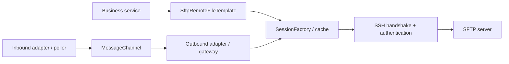
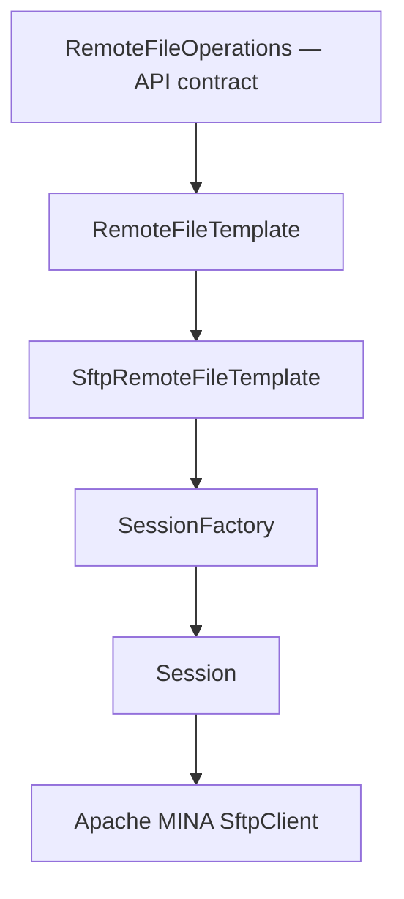
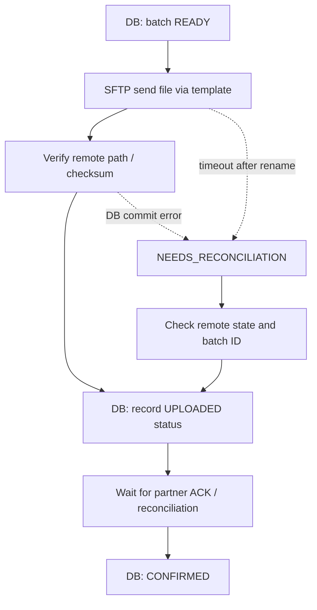

# Using `RemoteFileTemplate` for SFTP Operations

## 1. When Does an Application Need Direct SFTP Operations?

An accounting system needs to send `settlement-20261123-0042.csv` to a partner's SFTP server. After sending, the application must verify that the file exists, occasionally list the `ready` directory, download a response file, and move reconciled files to `archive`. The decision to run each operation comes from a business service, for example when a batch in the database transitions to `READY_TO_SEND`.

In **Spring Integration**, `SftpRemoteFileTemplate` provides a Java API to perform remote file operations directly: **`send`, `get`, `list`, `exists`, `rename`, `remove`**. It extends `RemoteFileTemplate<SftpClient.DirEntry>` and uses a `SessionFactory` to manage SSH/SFTP sessions. This class fits well when developers want to invoke an operation from a **Java service**, or combine several operations within an application-managed stateful workflow.

This lesson belongs to the **SFTP Adapter** chapter of the `SPRING_INTEGRATION_ADAPTERS` module. Across the module, inbound/outbound adapters, gateways, pollers, and `MessageChannel` build integration flows between systems; `RemoteFileTemplate` is a lower-level API for **controlling file operations on demand**. It does not create a polling endpoint or a message flow by itself.

After this lesson, you will be able to:

- Explain the relationship between `SftpRemoteFileTemplate`, `RemoteFileOperations`, `SessionFactory`, and `Session`.
- Configure a template using a private key, passphrase, and verified `known_hosts` file.
- Use `send`, `get`, `list`, `exists`, `rename`, and `remove` with explicit path contracts.
- Distinguish `execute(SessionCallback)` from `invoke(OperationsCallback)`, and understand session lifecycles.
- Design retries, idempotency, and reconciliation when remote operation outcomes are uncertain.

> **Version:** Java snippets use the Spring Integration **6.x** API, with the SFTP client based on **Apache MINA SSHD** and remote file entries typed as `org.apache.sshd.sftp.client.SftpClient.DirEntry`. In Spring Integration 5.x, several generic types/SFTP clients use JSch; consult documentation matching your project's version. Examples assume a Spring Boot application with Spring Integration enabled.

## 2. Where Does `RemoteFileTemplate` Fit in the Architecture?



`RemoteFileTemplate` and adapters/gateways can **share the same `SessionFactory`**. The difference lies in how they are invoked and how they return results:

| Integration Style | How It Triggers | Application Interface | Best Fit |
| --- | --- | --- | --- |
| SFTP **inbound adapter** | Poller runs periodically | Emits `Message<File>` from downloaded files | Automatically ingesting batches of new files |
| SFTP **outbound adapter** | Receives messages from `MessageChannel` | One-way handler uploading files to server | Publishing files within an integration flow |
| SFTP **outbound gateway** | Receives request messages | Request/reply returning results of `ls/get/put/mv/rm` | Business services interacting via a messaging gateway |
| **`SftpRemoteFileTemplate`** | Direct Java method calls | Return values/callbacks/exceptions per API | Services actively executing one or more SFTP operations |

For instance, a job with a list of DB batches can call `template.send(...)` and save the returned path. If instead your architecture already centers on `MessageChannel`, placing an SFTP outbound gateway in a flow typically gives clearer request/reply semantics, retry advice, and error channels.

**No poller is required to use the template.** A poller can periodically invoke a service that uses the template, but `SftpRemoteFileTemplate` itself does not scan an SFTP server or schedule its own execution. Likewise, calling `template.get()` does not emit a `Message<File>` onto another channel by itself.

## 3. Classes and Methods to Know

Simplified dependency diagram:



`SftpRemoteFileTemplate` is a **concrete class** extending the generic template. Common methods inherited from `RemoteFileTemplate` and `RemoteFileOperations`:

| Method | Return Type | Meaning |
| --- | --- | --- |
| `send(Message<?>, FileExistsMode...)` | `String` | Sends a file/data payload; returns the remote path or `null` if the source file was not found per the API contract |
| `get(String, InputStreamCallback)` | `boolean` | Reads remote data via an `InputStream` inside a callback; the template manages stream/session lifecycle |
| `list(String)` | `SftpClient.DirEntry[]` | Lists entries in a remote directory |
| `exists(String)` | `boolean` | Checks whether a remote path exists |
| `rename(String, String)` | `void` | Renames/moves a remote path; errors are signaled via exceptions |
| `remove(String)` | `boolean` | Deletes a remote file and reports the outcome per SFTP contract |
| `execute(SessionCallback<F,T>)` | `T` | Allows calling one or more methods directly on the **same `Session`** inside a callback |
| `invoke(OperationsCallback<F,T>)` | `T` | Calls multiple template-level APIs within the scope of **a thread-bound session** |
| `executeWithClient(ClientCallback<C,T>)` | `T` | Accesses the low-level protocol client when template APIs are not sufficient |
| `getSession()` | `Session<F>` | Obtains a raw session; **the caller must close the session** when done |

Distinguish the two "get" methods: `get(remotePath, callback)` streams file contents, whereas `getSession()` acquires a connection/session to operate on. With `get(remotePath, callback)`, the callback must consume the stream **while the callback is executing**; do not store the `InputStream` to read on another thread after the method returns.

`send(...)` takes a Spring `Message<?>`, such as `MessageBuilder.withPayload(file).build()`, because the template reads the payload and can use headers when resolving remote names/directories. Other methods accept string paths. A path like `/exchange/settlement/ready/a.csv` is an **SFTP server path**, distinct from a `Path` on the application's local disk.

## 4. SSH Authentication and Spring Boot Configuration

`SessionFactory` handles connecting and authenticating; the template simply requests a session to execute against. When logging in with keys, distinguish:

- **Application private key**: kept in a secret mount to prove client identity.
- **Application public key**: added by the partner to `authorized_keys` on the provisioned account.
- **Private key passphrase**: decrypts the private key on the client side if encrypted; not a login password.
- **Server host key**: verified public host key stored in `known_hosts` to ensure the application connects to the right server.

**Never disable host key verification** to bypass connection errors. If using `ssh-keyscan` to gather the host key initially, compare the fingerprint against the value provided by the partner administrator over an independent authenticated channel. Only after verifying should you use the `known_hosts` file.

With the Spring Boot BOM, declare the dependencies:

```groovy
dependencies {
    implementation 'org.springframework.boot:spring-boot-starter-integration'
    implementation 'org.springframework.integration:spring-integration-sftp'
}
```

A placeholder-only `application.yml`:

```yaml
app:
  sftp:
    host: ${SFTP_HOST:sftp.partner.example}
    port: ${SFTP_PORT:22}
    username: ${SFTP_USERNAME:settlement_app}
    private-key: file:${SFTP_PRIVATE_KEY_FILE}
    private-key-passphrase: ${SFTP_PRIVATE_KEY_PASSPHRASE:}
    known-hosts: file:${SFTP_KNOWN_HOSTS_FILE}
    outgoing-dir: ${SFTP_OUTGOING_DIR:/exchange/settlement/outgoing}
    ready-dir: ${SFTP_READY_DIR:/exchange/settlement/ready}
    archive-dir: ${SFTP_ARCHIVE_DIR:/exchange/settlement/archive}
```

`SFTP_PRIVATE_KEY_FILE` and `SFTP_KNOWN_HOSTS_FILE` must be file paths mounted **at runtime**; private keys never belong in Git or container images. `SFTP_PRIVATE_KEY_PASSPHRASE` is a secret—never put real values in YAML or logs. If the private key has no passphrase, it can be empty; in production, prefer a secret store/config tree rather than relying solely on environment variables.

Create a `SessionFactory` shared with the template:

```java
import org.apache.sshd.sftp.client.SftpClient;
import org.springframework.beans.factory.annotation.Value;
import org.springframework.context.annotation.Bean;
import org.springframework.context.annotation.Configuration;
import org.springframework.core.io.Resource;
import org.springframework.integration.file.remote.session.CachingSessionFactory;
import org.springframework.integration.file.remote.session.SessionFactory;
import org.springframework.integration.sftp.session.DefaultSftpSessionFactory;

@Configuration
public class SftpSessionConfiguration {

    @Bean
    public SessionFactory<SftpClient.DirEntry> sftpSessionFactory(
            @Value("${app.sftp.host}") String host,
            @Value("${app.sftp.port}") int port,
            @Value("${app.sftp.username}") String username,
            @Value("${app.sftp.private-key}") Resource privateKey,
            @Value("${app.sftp.private-key-passphrase:}") String passphrase,
            @Value("${app.sftp.known-hosts}") Resource knownHosts) {

        DefaultSftpSessionFactory factory = new DefaultSftpSessionFactory(false);
        factory.setHost(host);
        factory.setPort(port);
        factory.setUser(username);
        factory.setPrivateKey(privateKey);
        if (!passphrase.isBlank()) {
            factory.setPrivateKeyPassphrase(passphrase);
        }
        factory.setKnownHostsResource(knownHosts);
        factory.setAllowUnknownKeys(false);
        factory.setTimeout(30_000);

        // Cache at most four sessions; tune according to the SFTP server's quota.
        return new CachingSessionFactory<>(factory, 4);
    }
}
```

`CachingSessionFactory` reduces the cost of opening new connections. When the template finishes a callback and "closes" a session through the cache wrapper, the session can be **returned to the pool** for reuse. Do not equate this with the underlying TCP/SSH connection physically closing after every command. When rotating keys or `known_hosts`, manage session reset/recreation and verify that **new connections** pick up the updated configuration.

## 5. Initializing `SftpRemoteFileTemplate`

`SftpRemoteFileTemplate` provides a constructor accepting `SessionFactory<SftpClient.DirEntry>`. Define a bean to inject into services, fixing the target upload directory and filename rule:

```java
import java.io.File;

import org.apache.sshd.sftp.client.SftpClient;
import org.springframework.beans.factory.annotation.Value;
import org.springframework.context.annotation.Bean;
import org.springframework.context.annotation.Configuration;
import org.springframework.expression.common.LiteralExpression;
import org.springframework.integration.file.remote.session.SessionFactory;
import org.springframework.integration.sftp.session.SftpRemoteFileTemplate;

@Configuration
public class SftpTemplateConfiguration {

    @Bean
    public SftpRemoteFileTemplate sftpRemoteFileTemplate(
            SessionFactory<SftpClient.DirEntry> sftpSessionFactory,
            @Value("${app.sftp.outgoing-dir}") String outgoingDir) {

        SftpRemoteFileTemplate template =
                new SftpRemoteFileTemplate(sftpSessionFactory);

        // Use only with Message<File> validated by a business service.
        template.setRemoteDirectoryExpression(new LiteralExpression(outgoingDir));
        template.setFileNameGenerator(message ->
                ((File) message.getPayload()).getName());

        // Partner only processes the final name after upload + rename finishes.
        template.setUseTemporaryFileName(true);
        template.setTemporaryFileSuffix(".writing");
        template.setAutoCreateDirectory(false);  // Directory is pre-provisioned.
        return template;
    }
}
```

As a Spring bean, the container invokes the `afterPropertiesSet()` lifecycle callback on the template per the `InitializingBean` contract. If instantiating the template manually outside Spring, check your version's lifecycle contract and ensure full configuration before the first `send`.

`setRemoteDirectoryExpression(...)` controls the remote directory **when sending files**; it does not automatically constrain arbitrary paths passed into methods such as `get("/...")`, `rename`, or `remove`. Services passing paths to those methods must enforce root and filename validation independently.

### Options Prone to Unintended Side Effects

| Setting | Meaning | Notes |
| --- | --- | --- |
| `setRemoteDirectoryExpression(...)` | Selects remote directory for upload operations | Use a fixed directory or an expression drawing only from trusted inputs |
| `setFileNameGenerator(...)` | Chooses the target filename on `send` | Validate the basename; never let external clients dictate paths freely |
| `setUseTemporaryFileName(true)` | Uploads under a temporary name before renaming to the official name | Partner must ignore temporary suffixes; rename depends on server support |
| `setTemporaryFileSuffix(".writing")` | Defines the suffix used during transfer | Temporary files can remain if connectivity drops |
| `setAutoCreateDirectory(false)` | Does not auto-create remote upload directories | Directories must exist and the account needs write/rename permissions |
| `FileExistsMode.FAIL` on `send` | Reports a conflict when the destination file exists | Useful when every batch must have a unique name |

`FileExistsMode` also includes `REPLACE`, `IGNORE`, and `APPEND`; the choice depends on the business contract. The default for `send` when no mode is specified is **`REPLACE`** in Spring Integration 6.x. Because that could overwrite a file a partner is actively reading, the example below **explicitly sets `FAIL`**.

## 6. Uploading Files with `send(Message, FileExistsMode)`

The application must finish exporting and **close local streams** before sending. Example service receiving a complete CSV file, validating name and source state, then calling `send`:

```java
import java.io.File;
import java.nio.file.Files;

import org.springframework.integration.file.support.FileExistsMode;
import org.springframework.integration.sftp.session.SftpRemoteFileTemplate;
import org.springframework.messaging.support.MessageBuilder;
import org.springframework.stereotype.Service;

@Service
public class SettlementUploadService {

    private final SftpRemoteFileTemplate sftp;

    public SettlementUploadService(SftpRemoteFileTemplate sftp) {
        this.sftp = sftp;
    }

    public String uploadCompletedCsv(File csv) {
        if (!Files.isRegularFile(csv.toPath()) || !Files.isReadable(csv.toPath())) {
            throw new IllegalArgumentException("Source file is not ready: " + csv);
        }

        String name = csv.getName();
        if (!name.matches("[A-Za-z0-9][A-Za-z0-9._-]{0,127}\\.csv")
                || name.contains("..")) {
            throw new IllegalArgumentException("Invalid CSV filename");
        }

        String remotePath = sftp.send(
                MessageBuilder.withPayload(csv).build(), FileExistsMode.FAIL);

        if (remotePath == null) {
            throw new IllegalStateException("Source file not found to send");
        }
        // Persist remotePath + batchId + checksum in business state.
        return remotePath;
    }
}
```

Assuming the configured directory is `/exchange/settlement/outgoing` and the local file is `settlement-20261123-0042.csv`, the template uploads to the corresponding remote path. With temporary naming enabled, the transfer proceeds as:

```text
/exchange/settlement/outgoing/settlement-20261123-0042.csv.writing
    -- write completes, then rename -->
/exchange/settlement/outgoing/settlement-20261123-0042.csv
```

`send(...)` returns a **remote path**, not an `ACK` confirming the partner imported the data. Nor does it span a transaction between the SFTP server and your application database. Persisting `remotePath`, `batchId`, and checksum supports reconciliation on timeouts or job reruns.

### What If Upload Fails After the Server Already Received the File?

A connection can drop **immediately after the server finishes renaming** but before the client receives confirmation. In that case `send` may throw an exception even though the final filename already exists on the server. Immediately retrying with `REPLACE` could alter a file the partner has already started reading; retrying with `FAIL` can report a duplicate name. Inspect destination state and reconcile batch/checksum through a reconciliation workflow instead of treating every exception as proof the file never arrived.

## 7. Reading Files via `get(String, InputStreamCallback)`

Unlike the SFTP inbound adapter which produces `Message<File>`, `SftpRemoteFileTemplate#get` passes your callback an **`InputStream` containing the remote file's contents**. The template takes care of closing the stream after the callback returns. You decide where to save the file, how to validate it, and when to expose the final filename downstream.

Example downloading a file into staging under a temporary name and promoting it to the final file only upon completion:

```java
import java.io.IOException;
import java.nio.file.FileAlreadyExistsException;
import java.nio.file.Files;
import java.nio.file.Path;

import org.springframework.beans.factory.annotation.Value;
import org.springframework.integration.sftp.session.SftpRemoteFileTemplate;
import org.springframework.stereotype.Service;

@Service
public class SettlementDownloadService {

    private final SftpRemoteFileTemplate sftp;
    private final String readyDir;

    public SettlementDownloadService(SftpRemoteFileTemplate sftp,
            @Value("${app.sftp.ready-dir}") String readyDir) {
        this.sftp = sftp;
        this.readyDir = readyDir.replaceAll("/+$", "");
    }

    public Path download(String fileName, Path stagingDir) throws IOException {
        if (!fileName.matches("[A-Za-z0-9][A-Za-z0-9._-]{0,127}\\.csv")
                || fileName.contains("..")) {
            throw new IllegalArgumentException("Invalid file name");
        }

        Files.createDirectories(stagingDir);
        Path localTarget = stagingDir.resolve(fileName);
        Path partial = Files.createTempFile(stagingDir, "sftp-download-", ".part");
        try {
            String remotePath = readyDir + "/" + fileName;
            boolean downloaded = sftp.get(remotePath, input -> {
                // Callback must consume the stream completely before returning.
                Files.copy(input, partial, java.nio.file.StandardCopyOption.REPLACE_EXISTING);
            });
            if (!downloaded) {
                throw new IOException("SFTP failed to download: " + remotePath);
            }
            if (Files.exists(localTarget)) {
                throw new FileAlreadyExistsException(localTarget.toString());
            }
            Files.move(partial, localTarget);
            return localTarget;
        }
        finally {
            Files.deleteIfExists(partial);
        }
    }
}
```

The `.part` file and target file reside in the same staging directory; on download error, the `finally` block cleans up the temporary file if it remains. `Files.move` in this example **omits `REPLACE_EXISTING`**, preventing accidental overwrite of an existing file. If atomic rename guarantees are required, check filesystem support for `ATOMIC_MOVE` and handle `AtomicMoveNotSupportedException` per system policy; do not assume all storage drivers support it.

This code illustrates the basic flow; production requires disk quotas, timeouts, checksums, per-batch staging isolation, race handling when multiple workers fetch the same basename, and cleanup for leftover temporary files after crashes. When downstream consumers read the file asynchronously, retain the local file until processing/commit finishes.

**Do not retain the `InputStream` past the callback.** In `get(remotePath, input -> ...)`, `input` is only valid while the callback runs; if you put `input` onto a queue and return from the callback, the template can close the stream and cause read errors in the consumer.

## 8. `list`, `exists`, `rename`, `remove`: File Management Operations

`list` returns entries of a remote directory. In Spring Integration 6.x, each entry is an `SftpClient.DirEntry`, containing the filename and attributes from Apache MINA SSHD:

```java
import java.util.Arrays;
import java.util.List;
import org.apache.sshd.sftp.client.SftpClient;
import org.springframework.integration.sftp.session.SftpRemoteFileTemplate;

public List<String> listNames(SftpRemoteFileTemplate sftp, String readyDir) {
    SftpClient.DirEntry[] entries = sftp.list(readyDir);
    return Arrays.stream(entries)
            .map(SftpClient.DirEntry::getFilename)
            .filter(name -> !name.equals(".") && !name.equals(".."))
            .toList();
}
```

Never treat a `list` result as an **immutable snapshot** of the server: the partner may upload, rename, or delete files right after listing. Before critical operations, inspect needed metadata and handle cases where the file disappeared or changed by the time of the operation.

For `exists`, `rename`, and `remove`, the service should validate batch state and permissions:

```java
import org.springframework.integration.sftp.session.SftpRemoteFileTemplate;

public boolean archiveIfPresent(SftpRemoteFileTemplate sftp,
        String source, String archiveTarget) {

    // source and archiveTarget must be built by the app from root + validated basename.
    if (!sftp.exists(source)) {
        return false;
    }
    if (sftp.exists(archiveTarget)) {
        throw new IllegalStateException("File already exists in archive");
    }

    sftp.rename(source, archiveTarget);
    return sftp.exists(archiveTarget);
}

public boolean removeArchivedFile(SftpRemoteFileTemplate sftp,
        String authorizedArchivedPath) {

    // Call only after a deletion decision per retention policy.
    return sftp.remove(authorizedArchivedPath);
}
```

This code illustrates **business intent**. Calling `exists` followed by `rename` does not form an atomic check-and-rename operation: another process can modify the file between the two calls. `rename` can also fail due to missing permissions or lack of server support for the desired rename semantics. For `remove`, do not treat successful deletion as confirmation that the DB import succeeded, since SFTP and the DB do not share a transaction.

## 9. `execute` and `invoke`: How Is Session Reuse Handled?

This is the most important aspect when using `RemoteFileTemplate` for a workflow with multiple consecutive operations.

### 9.1 `execute(SessionCallback)`: Operating on the `Session` API

`execute` acquires a session from `SessionFactory`, runs the callback **on that session**, and handles closing/returning the session when the callback finishes, even if an exception occurs. The callback can use operations such as `session.exists`, `session.rename`, and `session.listNames`:

```java
import org.springframework.integration.sftp.session.SftpRemoteFileTemplate;

public boolean moveWithinOneSession(SftpRemoteFileTemplate sftp,
        String source, String target) {

    return sftp.execute(session -> {
        if (!session.exists(source)) {
            return false;
        }

        session.rename(source, target);
        return session.exists(target);
    });
}
```

`execute` is useful when you need `Session<DirEntry>` directly and want to group multiple calls inside **a single session checkout**. If `session.rename` throws, the template manages the session lifecycle around the callback. On severe protocol errors, the implementation may mark the session as unfit for reuse.

### 9.2 `invoke(OperationsCallback)`: Calling Multiple Template-Level Methods

`invoke` is used when you want to call multiple `RemoteFileOperations` APIs such as `send` and `exists` within the scope of a **session bound to the current thread**. This differs from calling `sftp.send(...)` and then `sftp.exists(...)` outside `invoke`, which could check out two different sessions.

```java
import java.io.File;
import org.springframework.integration.file.support.FileExistsMode;
import org.springframework.integration.sftp.session.SftpRemoteFileTemplate;
import org.springframework.messaging.Message;
import org.springframework.messaging.support.MessageBuilder;

public boolean uploadAndCheck(SftpRemoteFileTemplate sftp, File csv) {
    Message<File> request = MessageBuilder.withPayload(csv).build();

    return sftp.invoke(ops -> {
        String remotePath = ops.send(request, FileExistsMode.FAIL);
        if (remotePath == null) {
            return false;
        }
        return ops.exists(remotePath);
    });
}
```

`invoke` provides **session scope**, not an **SFTP transaction**. If `send` succeeds but `exists` times out, the file may already exist on the server even though the method throws an exception. Reconcile state and avoid blind retries, especially when files could be overwritten or appended.

### 9.3 Which API Should You Choose?

| Need | API to Start With | Session Lifecycle |
| --- | --- | --- |
| Send or check a single standalone file | `send`, `exists`, `get` | Template acquires and returns the session automatically |
| Combine `session.exists`/`session.rename`/`session.list` directly | `execute` | One callback on one session |
| Combine template `send`, `get`, `exists` in one unit of work | `invoke` | APIs inside the callback share the same thread-bound session |
| Need Apache MINA SSHD-specific APIs | `executeWithClient` | Callback receives the low-level client; requires understanding that library's API |
| Acquire a raw session to use outside a callback | `getSession` | **Caller must close** or return the session properly |

For typical needs, prefer template-level methods or `execute`/`invoke` because they wrap session management. If you call `getSession()` and forget to close it in a `finally`/try-with-resources block, the pool can exhaust and subsequent calls will block or time out.

## 10. Owning a Session Does Not Mean Owning a Transaction

A file integration typically spans multiple systems: SFTP server, Spring Boot app, local directories, database, and possibly a queue. There is no automatic distributed transaction spanning `RemoteFileTemplate` calls and DB `commit`s.



Suppose the application calls `send`, the server writes the complete file, and the process crashes before the DB records `UPLOADED`. After restart, the batch is still `READY`. Unconditionally resending can duplicate or overwrite the file. A durable design should persist `(partner_id, batch_id, remote_path, checksum, status, attempts, last_error)` with a unique key per batch and explicit handling for uncertain states.

**Immutable file-sending contract recommendation:** give each batch a unique filename such as `settlement-20261123-0042.csv`; use `FileExistsMode.FAIL`; on error or file-already-exists, check filename, size, and checksum as supported by the partner before deciding whether delivery succeeded or requires intervention. If two workers could send the same batch, use an application- or DB-level claim/lock; calling `exists` before `send` does not eliminate race conditions.

**File-receiving contract recommendation:** download to staging under a temporary name, verify checksum/schema, commit data with a unique batch key, and only then call `rename` to move the source file to archive if the contract permits. If the DB committed while rename failed, a rerun should complete **archiving/reconciliation** without re-importing the same batch.

### The `.writing` Temporary Name and Consistency

`setUseTemporaryFileName(true)` prevents exposing the **final filename** while upload is in progress: the server sees `report.csv.writing` during transfer, then `report.csv` after rename. This only supports the file-publishing contract; it does not guarantee atomic rename on every server backend, does not prove the partner parsed the file, and does not automatically clean up `.writing` after a client crash. Partners must agree to process only the final filename or use completion markers.

## 11. Protecting Paths, Data, and Connections

`template.get("/some/path", callback)`, `rename`, and `remove` take remote paths directly. If a path comes from an HTTP request, message header, or external data without validation, the application could inadvertently allow reading or deleting files outside business scope. Apply these safeguards:

1. Fix the **remote root** per partner and environment; paths in examples are constructed only from `root + validated basename`.
2. Allow basenames only by strict rules: reject empty names, `/` and `\\` separators, leading dots, `..`, and control characters; bound length and file extensions.
3. Grant least-privilege SFTP permissions: read/list services do not need delete rights; uploading accounts need write/rename only in the target folder.
4. If the server supports symlinks, chroot, or custom filesystem policies, verify the **effective scope** of the account; a basename regex is not the sole security boundary.
5. Mount private keys read-only, keep passphrases in a secret manager, verify server fingerprints out-of-band, and keep `allowUnknownKeys(false)`.
6. Monitor file sizes, disk quotas, active session counts, and backlog; a single `get` of a huge file can fill staging, and a `list` on a massive directory can consume heavy resources.

SFTP encrypts data **in transit**. When sensitive data rests in local staging or on the SFTP server, manage storage encryption, permissions, retention, and cleanup per your data contract. `RemoteFileTemplate` does not validate CSV content or verify whether the recipient imported the batch.

## 12. Retries, Timeouts, and Monitoring

| Failure Case | Common Causes | Handling Approach |
| --- | --- | --- |
| Host key mismatch | Wrong `known_hosts`, server rotated key, or spoofing | Stop, verify fingerprint independently; never enable `allowUnknownKeys(true)` |
| Authentication failed | Public key not authorized on server, wrong private key/passphrase/username | Check `authorized_keys`, client key fingerprint, secrets, and server policy |
| `send` permission error | Account lacks write/rename permission in remote directory | Check directory, quota, permissions, and account policy |
| `get` fails partway through | Network reset, file changed, local disk full | Delete/quarantine partial file, retry with control |
| `rename` times out | Server may have renamed despite lost reply | Check both source and target before retrying |
| `remove` times out | File may already be deleted | Verify final state per retention policy |
| Pool out of sessions | Unclosed sessions or excessive concurrency | Prefer callback-managed sessions, bound concurrency, and inspect cache |
| `send` succeeded but DB not updated | Crash between SFTP and DB commit | Reconcile by batch ID, remote path, and checksum |

Do not retry all exceptions identically. Permission errors, wrong host keys, and wrong passphrases require configuration fixes; retrying repeatedly accomplishes nothing. Transient network errors can be retried with backoff and jitter, yet for `send`, `rename`, and `remove` you must account for the possibility that **the server-side effect already happened** before the client saw the exception.

Logs/metrics should capture `partner_id`, `batch_id`, `operation`, `remote_path` (redacted of sensitive info), duration, byte count, retry count, error type, and reconciliation status. Never log private keys, passphrases, or sensitive file contents. Do not confuse **`send` succeeded** with **partner business confirmation**, as those two events are normally separated by a distinct ACK protocol.

## 13. End-to-End Verification Lab

Prepare a **test** SFTP server with the application's public key in `authorized_keys`, a verified `known_hosts` file, `outgoing`, `ready`, and `archive` directories with matching permissions, and a sample CSV with synthetic data.

1. **Connectivity check:** run OpenSSH `sftp -i ...` with host key verification enabled; confirm the account has the required permissions.
2. **`list`/`exists`:** create two sample files in `ready`, call `template.list(readyDir)` and `template.exists(path)`. Inspect the `DirEntry[]` type and returned filenames.
3. **`send`:** send a CSV whose local stream is closed using `FileExistsMode.FAIL`. Confirm the final file has the expected name/size/checksum after rename, and the partner ignores `.writing`.
4. **Duplicate name:** call `send` a second time with the same filename. Confirm a conflict/error is reported and the destination file is not silently replaced.
5. **`get`:** download a file from `ready` via `InputStreamCallback` into a `.part` file; promote to the final name only after completion and verify checksum.
6. **`execute`:** run a callback performing `exists` and `rename` on a test file; verify the session returns to the cache when the method finishes.
7. **`invoke`:** run `send` then `exists` in one callback. Observe the result and explain why this is still not a transaction.
8. **Connection loss:** simulate a failure right after upload/rename; run reconciliation before retrying to avoid duplicate sends.
9. **Permission error:** revoke write/rename on a test folder; verify the error is distinguished from authentication errors.
10. **Multiple workers:** have two workers try sending the same batch ID concurrently. Test claim/unique constraints and how the application handles SFTP conflicts.

### Quick Assessment Table

| Observation | Expected Outcome | Key Takeaway |
| --- | --- | --- |
| `send` returns remote path | File was transferred per contract and can be inspected remotely | Not a partner business ACK |
| `get` invokes callback | Callback reads stream within method scope | Template manages stream closing; do not leak ownership outside |
| `execute` runs three commands | One session used across the callback | Does not automatically roll back earlier commands if the third fails |
| `invoke` uses `send` + `exists` | Same thread-bound session across callback | Does not create a distributed transaction |
| Manual `getSession()` call | Caller manages `close` | Forgetting to close leaks pool/sessions |
| `exists(path)` returns `true` | Path existed at check time | Does not lock the file before `rename`/`remove` |

## 14. Common Pitfalls

- **Using `RemoteFileTemplate` like an automatic poller:** it is an imperative API; it does not schedule itself or emit `Message<File>`.
- **Confusing `get` with `getSession`:** `get` supplies a file stream to a callback; `getSession` hands out a raw session for the caller to close.
- **Assuming `execute`/`invoke` are transactions:** sharing a session does not roll back earlier SFTP commands if a later command fails.
- **Omitting `FileExistsMode` on `send`:** in the illustrated API version, the default is `REPLACE`, which can overwrite files in use by the partner.
- **Reading `InputStream` after the callback ends:** the stream may already be closed; copy/process the data inside the callback.
- **Skipping filename and path validation:** `get`, `remove`, and `rename` can touch out-of-scope paths if fed raw client input.
- **Calling `exists` and assuming `rename` is guaranteed to succeed:** a race exists if another process alters the file between the two calls.
- **Retrying `send` or `remove` blindly after a timeout:** the side effect may already have occurred even though the reply was lost.
- **Calling `getSession` and forgetting to close:** the cache can drain, leaving other calls blocked or timing out.
- **Allowing unknown host keys to fix connection errors:** removes server verification; update `known_hosts` after confirming the fingerprint instead.

## 15. Self-Check Questions

1. Why can `SftpRemoteFileTemplate` be used inside a Java service without an `IntegrationFlow` or poller?
2. What does `send(Message<File>, FileExistsMode.FAIL)` return? Why does that result not prove the partner imported the data?
3. What is the difference between `get(remotePath, InputStreamCallback)` and an inbound adapter emitting `Message<File>`?
4. When you want to call `session.exists` and `session.rename` on one session, do you choose `execute` or `invoke`? When would you choose the other?
5. Why does running three commands inside `execute` not guarantee atomicity or rollback?
6. If `rename(source, target)` succeeds on the server but the client times out, how does a safe retry differ from an unconditional retry?
7. If an application runs multiple instances, is `exists(path)` sufficient to prevent two processes from sending the same batch? What must be added?
8. When calling `getSession()` manually, what responsibility falls on the caller? How does `CachingSessionFactory` change what `close` means?

## References

- [Spring Integration Reference — Using RemoteFileTemplate (SFTP)](https://docs.spring.io/spring-integration/reference/sftp/rft.html)
- [Spring Integration 6.5 API — SftpRemoteFileTemplate](https://docs.spring.io/spring-integration/docs/6.5.x/api/org/springframework/integration/sftp/session/SftpRemoteFileTemplate.html)
- [Spring Integration 6.5 API — RemoteFileTemplate](https://docs.spring.io/spring-integration/docs/6.5.x/api/org/springframework/integration/file/remote/RemoteFileTemplate.html)
- [Spring Integration 6.5 API — RemoteFileOperations](https://docs.spring.io/spring-integration/docs/6.5.x/api/org/springframework/integration/file/remote/RemoteFileOperations.html)
- [Spring Integration 6.5 API — InputStreamCallback](https://docs.spring.io/spring-integration/docs/6.5.x/api/org/springframework/integration/file/remote/InputStreamCallback.html)
- [Spring Integration Reference — SFTP Session Factory](https://docs.spring.io/spring-integration/reference/sftp/session-factory.html)
- [Spring Integration Reference — SFTP Session Caching](https://docs.spring.io/spring-integration/reference/sftp/session-caching.html)
