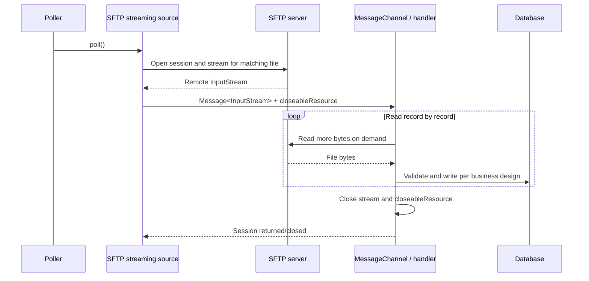
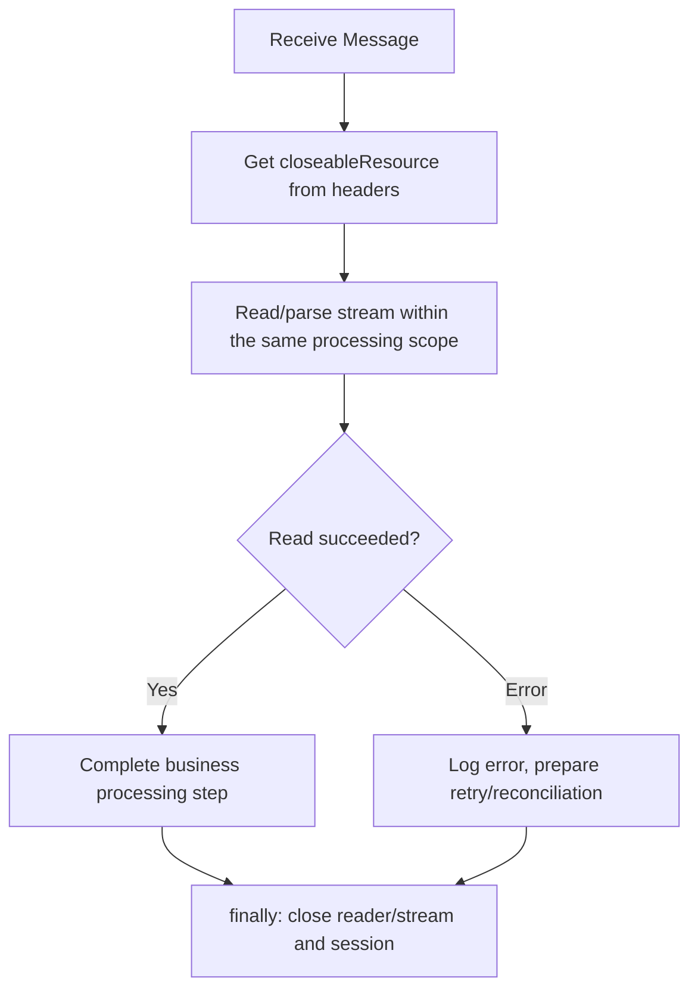
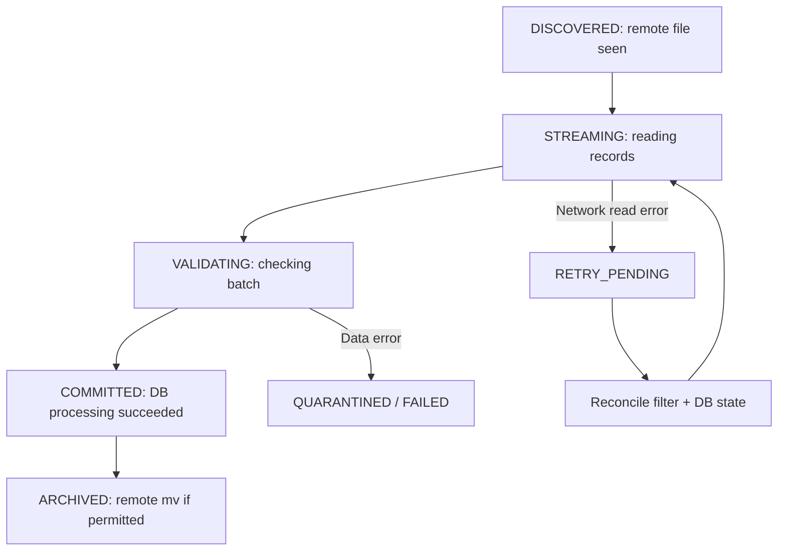

# SFTP Streaming for Diskless File Processing

## 1. Problem Statement: Reading Large Files Without Creating Disk Copies

A partner places daily transaction reports in `/exchange/settlements/ready` on an SFTP server. Each CSV file can contain millions of rows. The Spring Boot system must read each record, validate the data, and persist results to a database. Using the regular SFTP inbound adapter would cause the application to **download the entire file to a local directory** before emitting `Message<File>`. That creates extra demand for staging disk space, file cleanup workflows, and wait time before parsing can begin.

The **SFTP streaming inbound channel adapter** solves the case where an application wants to read directly from a stream: it emits `Message<InputStream>` pointing to the file content on SFTP. The consumer can read line by line or record by record **while data streams over the network**, without needing a complete file copy on the local disk.

In the **SFTP Adapter** chapter of the `SPRING_INTEGRATION_ADAPTERS` module, streaming is a variant of the **inbound adapter**. It is still triggered by a **poller**, sends data onto a **MessageChannel**, and can flow onward through transformers, splitters, or service activators. HTTP, JMS, Kafka, and database adapters/gateways in this module follow similar messaging models, but **the resource-ownership contract for `InputStream` and the SSH session requires special attention** in SFTP streaming.

After this lesson, you will be able to:

- Distinguish `File`-based SFTP inbound, `InputStream`-based streaming inbound, and on-demand stream retrieval via outbound gateway.
- Create an `SftpStreamingMessageSource`, attach a poller, and process CSVs line by line in Java DSL.
- Properly close both `InputStream` and `closeableResource` to return the SSH/SFTP session to the pool, even on errors.
- Understand remote-file headers, accept-once filters, `maxFetchSize`, and `maxMessagesPerPoll`.
- Handle retries, idempotency, partially uploaded files, and mid-stream failures without local staging files.
- Evaluate when streaming fits well and when downloading to local staging first is better.

> **API scope:** examples target Spring Integration **6.x and later** with the Apache MINA SSHD SFTP client. In Spring Integration 5.x, client-layer SFTP types can differ. Check your running Spring Boot BOM/Spring Integration version when adapting examples to a real project.

## 2. Differences Between File Inbound and Streaming Inbound

| Characteristic | Regular SFTP Inbound Adapter | SFTP Streaming Inbound Adapter |
| --- | --- | --- |
| Message payload | `java.io.File` on the application host | `java.io.InputStream` reading from the remote file |
| Local staging | Adapter synchronizes files to a local directory | Does not require writing a file copy to local disk |
| Processing start time | After the entire file finishes downloading | Can read while data continues transferring |
| Connection lifecycle | Synchronizer manages the download session | **Session must stay open** until the consumer finishes reading the stream |
| Can re-read payload? | Local file can be reopened if not yet deleted | `InputStream` is forward-only; re-reading requires opening a new session/stream |
| Retry after processing error | Can re-read the local copy if designed to do so | Must trigger a fresh read from the server and adjust metadata/filter state |
| Disk capacity | Must size for file size and concurrent staging files | No staging files needed, though RAM/DB buffers or other storage are still needed |
| Primary risks | Duplicate local files, full disk, staging cleanup | Session leaks, holding streams too long, partial data on network drop |

Lifecycle diagram of a streaming message:



**Streaming does not mean zero memory usage.** `BufferedReader`, CSV parsers, and the SSH library still use buffers. The right practice is to keep in-flight data **bounded**, such as one record or a small batch at a time, instead of calling `readAllBytes()`, loading the whole file into a `String`, or collecting all lines into a giant `List`.

## 3. The `Message<InputStream>` Contract and Key Headers

The SFTP streaming source creates messages with an `InputStream` payload. Headers tell the consumer which file was selected and how to release the connection:

| Header / Constant | Content | Purpose |
| --- | --- | --- |
| `FileHeaders.REMOTE_DIRECTORY` | Directory where the file lives on the SFTP server | Logging, remote path reconciliation |
| `FileHeaders.REMOTE_FILE` | Selected filename | Building batch IDs, applying parse rules |
| `FileHeaders.REMOTE_FILE_INFO` | Additional remote file info, JSON by default | Tracking size/metadata per version |
| `IntegrationMessageHeaderAccessor.CLOSEABLE_RESOURCE` | `Closeable` tied to the SFTP session/stream | **Consumer must close after reading finishes** |

The easiest mistake is assuming that reading to EOF and returning from the handler is enough. Per the Spring Integration Reference, **the SFTP session still needs to be closed once the file is consumed**. The `closeableResource` header provides the handle for the consumer to fulfill that responsibility. Access it via:

```java
import java.io.Closeable;
import org.springframework.integration.IntegrationMessageHeaderAccessor;
import org.springframework.messaging.Message;

Closeable resource =
        new IntegrationMessageHeaderAccessor(message).getCloseableResource();

// In real handler code, close the resource in finally/try-with-resources.
// Never close it before finishing reading the InputStream.
```

When using standard components such as `FileSplitter` or `StreamTransformer` in their streaming-aware modes, the framework has mechanisms to **automatically close the session** after consuming the stream. With a **custom handler**, closing remains the application's responsibility. Never close `closeableResource` while another thread is still reading the stream, and never push a raw `InputStream` onto a queue for an async worker to read after the current session has been returned to the pool.

Think of the close timing as follows:



## 4. SSH Configuration, Dependencies, and `SessionFactory`

Streaming does not bypass SSH security requirements. The server authenticates the client via the public key registered in `authorized_keys`; the application uses the matching private key to log in. The application must also verify the **server host key** using a `known_hosts` file whose fingerprint was checked out-of-band. Any passphrase only decrypts the **client private key** on the application side.

With Spring Boot managing versions via the BOM:

```groovy
dependencies {
    implementation 'org.springframework.boot:spring-boot-starter-integration'
    implementation 'org.springframework.integration:spring-integration-sftp'
}
```

Example configuration keeping real secrets out of the repository:

```yaml
app:
  sftp:
    host: ${SFTP_HOST:sftp.partner.example}
    port: ${SFTP_PORT:22}
    username: ${SFTP_USERNAME:streaming_reader}
    private-key: file:${SFTP_PRIVATE_KEY_FILE}
    private-key-passphrase: ${SFTP_PRIVATE_KEY_PASSPHRASE:}
    known-hosts: file:${SFTP_KNOWN_HOSTS_FILE}
    remote-directory: ${SFTP_REMOTE_DIR:/exchange/settlements/ready}
```

`SFTP_PRIVATE_KEY_FILE` and `SFTP_KNOWN_HOSTS_FILE` are paths that **actually exist at runtime**, typically mounted via secret/config volumes. Never commit private keys or passphrases to Git or container images. Data in `known_hosts` consists of public host keys, yet its **integrity** must be protected, because tampering with it can change which server the client trusts.

```java
import org.apache.sshd.sftp.client.SftpClient;
import org.springframework.beans.factory.annotation.Value;
import org.springframework.context.annotation.Bean;
import org.springframework.context.annotation.Configuration;
import org.springframework.core.io.Resource;
import org.springframework.integration.file.remote.session.CachingSessionFactory;
import org.springframework.integration.file.remote.session.SessionFactory;
import org.springframework.integration.sftp.session.DefaultSftpSessionFactory;

@Configuration
public class SftpConnectionConfiguration {

    @Bean
    public SessionFactory<SftpClient.DirEntry> sftpSessionFactory(
            @Value("${app.sftp.host}") String host,
            @Value("${app.sftp.port}") int port,
            @Value("${app.sftp.username}") String user,
            @Value("${app.sftp.private-key}") Resource privateKey,
            @Value("${app.sftp.private-key-passphrase:}") String passphrase,
            @Value("${app.sftp.known-hosts}") Resource knownHosts) {

        DefaultSftpSessionFactory delegate = new DefaultSftpSessionFactory(false);
        delegate.setHost(host);
        delegate.setPort(port);
        delegate.setUser(user);
        delegate.setPrivateKey(privateKey);
        if (!passphrase.isBlank()) {
            delegate.setPrivateKeyPassphrase(passphrase);
        }
        delegate.setKnownHostsResource(knownHosts);
        delegate.setAllowUnknownKeys(false);
        delegate.setTimeout(30_000);

        // Cap the number of sessions held in cache.
        return new CachingSessionFactory<>(delegate, 4);
    }
}
```

For streaming, size the cache based on **how long consumers hold streams open** and the number of files processed concurrently. A stream read over 10 minutes can hold a session for the full 10 minutes. If four streams are open and the cache/pool limit is four sessions, other requests must wait for a session to be returned. Caching reuses connections—it **does not prevent session leaks** if a consumer forgets to close.

## 5. Creating `SftpStreamingMessageSource` and Poller

Java DSL can use `SftpStreamingMessageSource` as the source of an `IntegrationFlow`. This source fetches remote files via `SftpRemoteFileTemplate`; there is no `localDirectory` to configure because the payload is an `InputStream`.

```java
import org.apache.sshd.sftp.client.SftpClient;
import org.springframework.beans.factory.annotation.Value;
import org.springframework.context.annotation.Bean;
import org.springframework.context.annotation.Configuration;
import org.springframework.integration.dsl.IntegrationFlow;
import org.springframework.integration.dsl.Pollers;
import org.springframework.integration.file.remote.session.SessionFactory;
import org.springframework.integration.sftp.inbound.SftpStreamingMessageSource;
import org.springframework.integration.sftp.session.SftpRemoteFileTemplate;

@Configuration
public class SftpStreamingFlowConfiguration {

    @Bean
    public SftpRemoteFileTemplate streamingTemplate(
            SessionFactory<SftpClient.DirEntry> sftpSessionFactory) {
        return new SftpRemoteFileTemplate(sftpSessionFactory);
    }

    @Bean
    public IntegrationFlow sftpStreamingFlow(
            SftpRemoteFileTemplate streamingTemplate,
            StreamingCsvHandler streamingCsvHandler,
            @Value("${app.sftp.remote-directory}") String remoteDirectory) {

        SftpStreamingMessageSource source =
                new SftpStreamingMessageSource(streamingTemplate);
        source.setRemoteDirectory(remoteDirectory);
        source.setMaxFetchSize(1);

        return IntegrationFlow.from(source,
                        endpoint -> endpoint.id("sftpStreamInbound")
                                .poller(Pollers.fixedDelay(10_000)
                                        .maxMessagesPerPoll(1)))
                .handle(streamingCsvHandler)
                .get();
    }
}
```

`StreamingCsvHandler` is a custom consumer defined in the next section. The `SftpRemoteFileTemplate` bean is Spring-managed so its initialization lifecycle runs properly. `IntegrationFlow.from(source, endpoint -> ...)` turns a `MessageSource<InputStream>` into a **polling endpoint**; `.handle(...)` receives messages carrying the stream payload and remote-file headers. The default synchronous `DirectChannel` ensures the consumer finishes reading the stream before the poller completes its poll cycle.

Key parameters:

| Property | Role | Notes |
| --- | --- | --- |
| `setRemoteDirectory(...)` | Selects the file directory on the SFTP server | Account needs list/read permissions |
| `setMaxFetchSize(1)` | Caps how many new entries the source pulls into its internal list when fetching | Useful with multiple instances to distribute work |
| `Pollers.fixedDelay(10_000)` | Wait time between polls using fixed delay | Tune frequency to SLA and server load |
| `maxMessagesPerPoll(1)` | Caps how many messages are emitted per poll | Distinct from `maxFetchSize` |
| `.handle(streamingCsvHandler)` | Consumes `InputStream` and releases resources | Custom handlers must close the session on all branches |

**`maxFetchSize` differs from `maxMessagesPerPoll`:** the former caps how many files are **fetched into the source's internal queue**, while the latter caps how many messages are **emitted per poll**. Setting both to 1 keeps behavior easy to observe and avoids opening multiple streams at once when starting out. When scaling throughput, evaluate open stream count, parse duration, and SFTP server quotas together.

### Default File Filter

Since Spring Integration 5.0, `SftpStreamingMessageSource` uses a **persistent accept-once filter** backed by an **in-memory** `SimpleMetadataStore` by default to prevent re-emitting the same remote file within one runtime. Here "persistent" refers to the `MetadataStore`-backed algorithm; **it is not durable across restarts if the store remains in memory**.

In the Java DSL example above, we did not override the filter so the default behavior stays intact. When business logic should only pick up CSVs or share state across multiple instances, configure a **composite/chained filter** rather than replacing the whole filter with a bare pattern filter and accidentally losing accept-once tracking.

Example building a `ChainFileListFilter` with a separately configured `ConcurrentMetadataStore`:

```java
import org.apache.sshd.sftp.client.SftpClient;
import org.springframework.integration.file.filters.ChainFileListFilter;
import org.springframework.integration.metadata.ConcurrentMetadataStore;
import org.springframework.integration.sftp.filters.SftpPersistentAcceptOnceFileListFilter;
import org.springframework.integration.sftp.filters.SftpSimplePatternFileListFilter;

// metadataStore is a ConcurrentMetadataStore bean, e.g. RedisMetadataStore.
ChainFileListFilter<SftpClient.DirEntry> filters = new ChainFileListFilter<>();
filters.addFilter(new SftpSimplePatternFileListFilter("*.csv"));
filters.addFilter(new SftpPersistentAcceptOnceFileListFilter(
        metadataStore, "settlement-stream-"));

// Set before IntegrationFlow starts running:
source.setFilter(filters);
```

This standalone snippet augments source creation. `ChainFileListFilter` applies filters in order so only files matching the name rule get marked as seen. Choose a shared metadata store across multiple replicas, standardize prefixes per partner and directory, and design how filter state is reset/rolled back when reading a file fails.

## 6. Writing a Line-by-Line Consumer and Closing the Session

The consumer below demonstrates reading a CSV line by line **without writing a file to local disk**. To stay focused on stream lifecycle, the example simply counts lines and enforces a row limit; a production application should use a streaming CSV parser that handles quotes, embedded commas, encodings, and schema validation.

```java
import java.io.BufferedReader;
import java.io.Closeable;
import java.io.IOException;
import java.io.InputStream;
import java.io.InputStreamReader;
import java.nio.charset.StandardCharsets;

import org.springframework.integration.IntegrationMessageHeaderAccessor;
import org.springframework.integration.file.FileHeaders;
import org.springframework.messaging.Message;
import org.springframework.messaging.MessageHandler;
import org.springframework.messaging.MessagingException;
import org.springframework.stereotype.Component;

@Component
public class StreamingCsvHandler implements MessageHandler {

    @Override
    public void handleMessage(Message<?> message) throws MessagingException {
        InputStream input = (InputStream) message.getPayload();
        Closeable resource = new IntegrationMessageHeaderAccessor(message)
                .getCloseableResource();

        // Close reader -> InputStream first, then close the session resource.
        try (Closeable session = resource;
             BufferedReader reader = new BufferedReader(
                     new InputStreamReader(input, StandardCharsets.UTF_8))) {

            long lineCount = 0;
            String line;
            while ((line = reader.readLine()) != null) {
                // Demo: replace with per-record/small-batch validation and processing.
                lineCount++;
                if (lineCount > 2_000_000) {
                    throw new IllegalStateException("Batch line limit exceeded");
                }
            }

            String remoteName = (String) message.getHeaders()
                    .get(FileHeaders.REMOTE_FILE);
            System.out.println("Read " + remoteName + ": " + lineCount + " lines");

        } catch (IOException e) {
            throw new MessagingException(message, "Failed to read SFTP stream", e);
        }
    }
}
```

In `try-with-resources`, `BufferedReader` closes first and `Closeable session` closes next, releasing both stream and session even on `IOException`, validation errors, or business exceptions. If the parser throws a runtime exception, `try-with-resources` still invokes `close`. `MessagingException` retains message context so logs/error flows can classify failures.

**Resource note:** closing the stream alone should not be relied upon as a substitute for closing `closeableResource`. That header is the framework's designated hook to finalize the SFTP session lifecycle. In custom handlers, inspect it and close it once at the end of processing; components like `StreamTransformer`/`FileSplitter` can manage closing automatically, so do not add a duplicate closing handler when the framework already owns the resource.

**Example limitation:** `BufferedReader.readLine()` can still allocate huge amounts of memory if a remote file has **one extraordinarily long line**. Production code should use a parser enforcing limits on record length, field size, column count, and total records to guard against unbounded input from non-compliant senders.

## 7. `FileSplitter` and `StreamTransformer`: Choosing the Right Stream Consumer

Spring Integration ships components that know how to consume `InputStream` and close the session:

| Component | How It Processes | Good Fit | Risks to Watch |
| --- | --- | --- | --- |
| `FileSplitter` | Reads text line by line, can emit one message per line | Line-delimited text files | A line may not equal a CSV record if CSV allows newlines inside quoted fields |
| `StreamTransformer` | Reads stream and converts to `String`/`byte[]` per config | Files small enough to hold full content | **Can load the entire file into memory**, despite skipping disk |
| Custom handler with streaming parser | Reads record by record or in small batches | Large CSVs, validating and writing DB per contract | Must manage `closeableResource` and parse errors yourself |

**Do not equate the name `StreamTransformer` with bounded-memory streaming.** This transformer turns the whole stream into a single large payload; it is helpful for skipping local disk on small files, not optimal for multi-GB files. For huge files, prefer a sequential streaming parser and keep backpressure at the application layer.

`FileSplitter` is a natural fit for log files or one-record-per-line formats. If the first line is a CSV header and subsequent lines are rows, you can split line messages and parse downstream. However, for CSV standards allowing newlines inside quotes, `readLine`/`FileSplitter` will split records incorrectly; use a streaming CSV library such as Apache Commons CSV or equivalent instead.

When a splitter emits many messages from a single stream, track **when the stream is fully consumed**. Offloading parts of the data to an async queue or subscriber does not automatically keep the session alive long enough; design around the splitter's lifecycle semantics and avoid unbounded buffering.

## 8. Alternative: `SftpRemoteFileTemplate#get` Without Creating `Message<InputStream>`

Not every streaming use case needs to start from a poller. If a service **already knows the exact remote path** to read, `SftpRemoteFileTemplate#get(remotePath, InputStreamCallback)` can consume the stream directly inside a callback, also without creating a local file:

```java
import java.io.BufferedReader;
import java.io.IOException;
import java.io.InputStreamReader;
import java.nio.charset.StandardCharsets;

import org.springframework.integration.sftp.session.SftpRemoteFileTemplate;
import org.springframework.stereotype.Service;

@Service
public class RequestedSftpReader {

    private final SftpRemoteFileTemplate template;

    public RequestedSftpReader(SftpRemoteFileTemplate template) {
        this.template = template;
    }

    public void readKnownFile(String safeRemotePath) {
        boolean downloaded = template.get(safeRemotePath, input -> {
            // Do not retain InputStream to read after the callback returns.
            BufferedReader reader = new BufferedReader(
                    new InputStreamReader(input, StandardCharsets.UTF_8));
            String line;
            while ((line = reader.readLine()) != null) {
                // Parse/validate line by line; do not load whole file into RAM.
            }
        });

        if (!downloaded) {
            throw new IllegalStateException("Failed to read remote file: " + safeRemotePath);
        }
    }
}
```

In this case, `RemoteFileTemplate` manages the session and stream lifecycle around the callback. The callback author must **consume the stream before returning** and never hand off a reference for another thread to read later. Validate/normalize the remote path against an allowed root, especially if the path originates from an HTTP request or message header.

### Comparing Stream Retrieval Approaches

| Need | Appropriate API | Who Triggers? | Who Closes the Session? |
| --- | --- | --- | --- |
| Automatically ingest new files on a schedule | `SftpStreamingMessageSource` | Poller | Consumer or streaming-aware component |
| Service already knows remote path to read | `SftpRemoteFileTemplate#get` | Java service | Template after callback |
| Request/reply over messaging, wanting a stream | SFTP outbound gateway `get` with stream option | Request message | Consumer via `closeableResource` or supporting component |
| Want a local copy for reprocessing | Regular inbound adapter | Poller | Synchronizer manages it after download |

Streaming is a decision about **how data is consumed and resources are managed**; `MessageChannel` vs. callback are simply two ways to structure logic around the same SFTP transport.

## 9. Duplicate Filtering, Retries, and Business Idempotency

A major risk in inbound streaming is that **the file-selected state** can be recorded before **business processing succeeds**. Persistent accept-once filters reduce duplicate emissions of a remote file, yet they do not share transactions with the DB or parser. For example:

1. The poller sees `settlement-0042.csv` and the source picks it up; the metadata filter marks the file as received.
2. The handler reads 70% of the stream before the network drops; code closes the session and raises an error.
3. The next poll may not re-emit the file because metadata still considers it accepted.
4. On restart with in-memory metadata, filter state can be lost and the file re-emitted, regardless of whether the earlier 70% of rows already committed to the DB.

Therefore, design **recovery at the business layer**:

- Enforce a unique key `(partner_id, batch_id)` or an immutable file identifier/checksum in the DB; track states `DISCOVERED`, `PROCESSING`, `COMPLETED`, `RETRY_PENDING`, `FAILED`.
- If importing in DB batches, use appropriate transactions and checkpoints; avoid committing record-by-record without idempotency because a stream may be re-read from the start.
- On failure, define clearly how metadata/filter state is reset or use a separate orchestration mechanism to retry the file; clear metadata markers only when rerunning is known to be safe.
- Never delete or rename the remote file until there is proof all data was processed per contract, unless partner workflows explicitly dictate otherwise.
- With multiple instances, use a durable, shared `ConcurrentMetadataStore`; combine `maxFetchSize=1`, claim/lock mechanisms, and DB idempotency.

Sample processing state machine:



**SFTP is not the database's transaction coordinator.** If the DB commits but renaming the file from `ready` to `archive` fails, the file may remain at the source and be seen again. In that case, **resume the archive step** based on the completed batch status rather than re-importing data. If the file is deleted before the DB commits, recovery becomes much harder; therefore never enable a "delete remote file as soon as stream opens" policy without a recovery mechanism.

## 10. Avoiding Reading Files Before the Partner Finishes Uploading

Streaming introduces a twist compared to local file downloads: **the client opens the stream while the remote file is still being written by the sender**. An SFTP server may allow reading a file the instant its final name appears, leading to missing trailing rows, incomplete footers, or checksum mismatches. Skipping local disk **does not provide a signal that the remote file is complete**.

Common coordination protocols:

| How the Sender Publishes | How the Consumer Detects | Reliability |
| --- | --- | --- |
| Upload `file.csv.part`, then rename to `file.csv` | Filter accepts only `*.csv` | Strong when server rename has suitable semantics |
| Upload `file.csv`, then create marker `file.csv.done` | Process only when marker is present | Strong if both sides agree marker is created after closing upload |
| Wait until file modification time is old enough | Last-modified/age filter | Heuristic; large uploads can pause long enough mid-write |
| Sender provides a manifest/checksum | Read once manifest exists and verify data | Verifies integrity, though missing/mismatched cases must be handled |

`SftpSystemMarkerFilePresentFileListFilter` supports the marker-file pattern in Spring Integration. When using markers or age filters, combine them with appropriate name/accept-once filters and verify behavior in your running version. Uploading to a temp name and renaming to the final name is usually easiest to reason about and test when the partner can adjust the sender.

Once a stream is open, if the partner **modifies the file mid-read**, data can become inconsistent. Agree that published files are **immutable**: never mutate contents under the same name; publish corrections under a new name/version. You can verify size/checksum before and after if the protocol provides them, but reaching EOF only proves **the current stream ended**, not necessarily that the full data contract was satisfied.

## 11. Backpressure, RAM, Session Pool, and Throughput

Skipping local files relieves disk pressure, but shifts pressure onto **network connection duration, sessions, and consumer speed**.

| Resource | Under Streaming | Operational Measures |
| --- | --- | --- |
| SSH/SFTP sessions | Held open until `InputStream` is consumed/closed | Monitor active sessions, tune cache pool and timeouts |
| TCP/network | Slow consumers keep connections alive longer | Track bytes/sec, monitor stalls and reconnects |
| RAM | Parsers/readers/buffers can grow per record or batch | Bound record, field, and batch sizes; avoid `readAllBytes` |
| DB connections | Direct record writes can create overly long transactions | Split batches/transactions aligned with idempotency strategy |
| Poller threads | Synchronous handlers occupy threads until completion | Tune scheduler and `maxMessagesPerPoll` |
| Metadata store | Must remember selected files across restarts if durable | Use an appropriate store and clear recovery procedures |

**Backpressure** here can be straightforward: poll one file, read record by record, and persist in reasonably sized batches before taking the next file. If inserting an `ExecutorChannel` or queue between source and handler, evaluate open `InputStream`s sitting in the queue, when messages get consumed, and who closes the session if a message is dropped. For inbound streaming, synchronous configuration is usually much easier to keep resource lifecycles clean at first.

Do not hold a single DB transaction open for the entire duration of reading a multi-GB file. One strategy is writing records into a **staging table** in small batches tagged by batch ID, then publishing/committing completion status once the whole file is verified read; on retry, staging rows for that batch can be deleted or merged per your idempotency contract. That is an application-level design choice, not an automatic feature of the streaming adapter.

### When Should You Revert to Local Staging?

Streaming is not always optimal. If the same file must be replayed repeatedly, multiple independent processing stages must read the same data, or audit rules require preserving the raw original, **downloading to staging with a checksum** can make recovery much simpler. Likewise, if the SFTP network is flaky while DB import takes many minutes, storing a copy locally or in object storage decouples network reliability from processing time.

## 12. Common Troubleshooting Scenarios

| Symptom | Possible Causes | What to Check |
| --- | --- | --- |
| Source emits no messages | Wrong directory, filter already marked file, no published file, poller stopped | `remoteDirectory`, metadata store, poller, and naming contract |
| `ClassCastException` in handler | Code expects `File` while streaming payload is `InputStream` | Message type and handler signature |
| `Stream closed` mid-parse | Session/stream closed before consumer finished reading; async lifecycle bug | `closeableResource`, channel, threads, splitter |
| Session cache exhausted, poller times out | Handler holds stream too long or forgot to close | Active session metrics, read duration, and `finally` blocks |
| CSV missing trailing rows | Partner still uploading or network dropped causing partial read | Publish via rename/marker; checksum/manifest |
| File re-read after restart | Default in-memory metadata store | Shared persistent metadata store, batch idempotency |
| File not retried after failure | Accept-once filter already marked it | Metadata rollback/reset policy and business retries |
| `UnknownHostKey` or host key mismatch | Wrong `known_hosts`, changed host/port, server rotated host key | Verify fingerprint out-of-band |
| `Auth fail` | Wrong user/private key/passphrase, public key unauthorized | SSH client identity and `authorized_keys` |
| Permission denied | SSH login succeeded, lacks read/list permission | Server path/permissions |

### Mid-Stream Failure and Closing in `finally`

When the network drops 70% through a file, closing the stream/session is **mandatory even though the importer cannot proceed**. Otherwise, the system suffers both a business failure and a session leak, causing subsequent polls to fail for lack of sessions. Such failures must be recorded as explicit retry/reconciliation states—never swallow the exception and mark the batch `COMPLETED`.

## 13. End-to-End Testing Lab

Prepare a **test** SFTP server with an authorized client public key, a verified host key in `known_hosts`, list/read permissions on `ready`, and a synthetic CSV of a few thousand rows. Set log levels high enough to see filenames, sizes, poll counts, and errors; never print private keys, passphrases, or full sensitive payloads.

1. **Happy path:** partner uploads `settlement-001.csv.part` and renames to `.csv` upon completion. Poller receives `Message<InputStream>`; handler counts exact rows and closes the session.
2. **No local file:** verify the application creates no staging file from the adapter; only logs/DB state written explicitly by the handler appear. Watch heap memory to confirm the entire file is not loaded into one `String`.
3. **Payload type:** log the payload's class name in test, confirming `InputStream` rather than `File`; inspect remote-file headers.
4. **Duplicate filter:** leave the file and timestamp unchanged and keep polling; confirm no duplicate emissions under the configured filter. Restart and compare behavior between in-memory metadata and a durable store.
5. **Read error:** simulate a network reset mid-file; confirm the handler reports an error, the session closes, and the batch records a retry-needed state.
6. **Parser error:** supply an invalid data file, confirm validation failure still releases the stream/session and does not mark import successful.
7. **Multiple instances:** let two nodes read the directory using a shared metadata store; verify claim/idempotency behavior when both see the same file.
8. **File mid-upload:** keep a `.part` file unrenamed; verify it is not picked up prematurely. Test markers or manifests if your partner contract uses them.
9. **Large file:** read a file many times larger than the memory budget allocated to batch parsing; monitor heap, session occupancy, throughput, and poll durations.
10. **Long-running connections:** throttle consumer speed in test to verify timeouts and pool occupancy are observable without hanging sessions indefinitely.

## 14. Mistakes to Avoid

- **Pushing `InputStream` onto a queue and letting the current handler return:** the session may close or stay pinned open too long; establish a clear resource-ownership model.
- **Closing only `InputStream` and forgetting `closeableResource`:** risks leaking SSH sessions until the pool drains.
- **Using `StreamTransformer` to turn multi-GB files into a `String`:** skips local disk yet can still trigger `OutOfMemoryError`.
- **Thinking `maxFetchSize=1` means exactly-once:** it is a fetch cap; exactly-once still relies on metadata, retries, and DB idempotency.
- **Using `AcceptAllFileListFilter` in production without justification:** can re-read old files on every poll.
- **Overwriting the default filter with a lone pattern filter:** silently drops accept-once tracking.
- **Reading a remote file while the sender is still uploading:** stream may hit EOF before the file is complete; require rename/marker/manifest.
- **Deleting the remote file as soon as the stream opens:** finishing a read is not equivalent to a committed DB transaction.
- **Treating `Message<InputStream>` as infinitely replayable:** a consumed stream does not rewind by default.
- **Swallowing `close()` errors unconditionally:** preserve visibility into resource failures and their impact on cache/sessions.

## 15. Self-Check Questions

1. Why does the SFTP streaming inbound adapter return `InputStream` instead of `File`, and what is the benefit for large files?
2. What problem does the `IntegrationMessageHeaderAccessor.CLOSEABLE_RESOURCE` header solve? What can happen if you forget to close it?
3. When is `FileSplitter` a better fit than `StreamTransformer`? Why must CSVs with newlines inside quoted fields be handled differently?
4. How do `maxFetchSize` and `maxMessagesPerPoll` differ?
5. Why does the "persistent accept once" filter with `SimpleMetadataStore` not guarantee deduplication across restarts?
6. If the handler fails after reading 70% of a file, how do you safely replay it without duplicating already-committed rows?
7. What must you agree on with the partner to ensure streams are opened only on completely uploaded files?
8. When should you use `SftpRemoteFileTemplate#get(...)` instead of `SftpStreamingMessageSource`?
9. Why can streaming still hit OOM or exhaust the session pool?
10. With two Spring Boot replicas, how would you design filtering/claiming and DB idempotency?

## References

- [Spring Integration Reference — SFTP Streaming Inbound Channel Adapter](https://docs.spring.io/spring-integration/reference/sftp/streaming.html)
- [Spring Integration Reference — SFTP Inbound Channel Adapter](https://docs.spring.io/spring-integration/reference/sftp/inbound.html)
- [Spring Integration Reference — SFTP Outbound Gateway](https://docs.spring.io/spring-integration/reference/sftp/using-the-gateway.html)
- [Spring Integration Reference — File Splitter](https://docs.spring.io/spring-integration/reference/file/splitter.html)
- [Spring Integration Reference — Remote Persistent File List Filters](https://docs.spring.io/spring-integration/reference/file/remote-persistent-flf.html)
- [Spring Integration Reference — SFTP Session Factory](https://docs.spring.io/spring-integration/reference/sftp/session-factory.html)
- [Spring Integration Reference — SFTP Session Caching](https://docs.spring.io/spring-integration/reference/sftp/session-caching.html)
