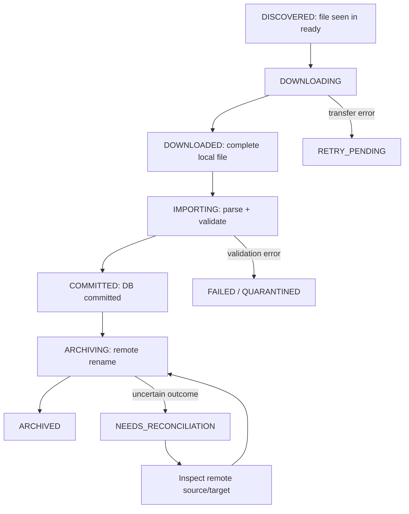

# Renaming Remote Files After Successful Download

## 1. Problem Statement: Moving a File Out of the Inbox After Receiving Data

A partner places `settlement-20261123-0042.csv` into the SFTP directory `/exchange/settlement/ready`. Your Spring Boot application polls this directory, downloads the file to `/var/app/sftp/staging`, validates it, and imports the data into a database. Upon completion, the application wants to **rename or move the remote file** to `/exchange/settlement/archive` so the `ready` directory does not keep accumulating already-processed batches.

The hard part is not the rename command itself—it is the word **"successful"**. A file that downloaded all its bytes might still contain a malformed CSV; data imported into the DB might not yet have committed; the SFTP rename might succeed on the server while the client loses connectivity before receiving the response. Therefore, you must define the **business milestone** before deciding when to rename.

This lesson belongs to the **SFTP Adapter** chapter of the `SPRING_INTEGRATION_ADAPTERS` module. We combine the **inbound adapter**, **poller**, **MessageChannel**, and either **`SftpRemoteFileTemplate`** or an **outbound gateway** to coordinate the file flow, while applying the same message contracts, retries, error handling, and connection lifecycle principles used across HTTP, JMS, AMQP, Kafka, and database integrations in this module.

After this lesson, you will be able to:

- Distinguish **download succeeded**, **business processing succeeded**, and **remote rename succeeded**.
- Use `SftpRemoteFileTemplate#get(...)` followed by `rename(...)` when an imperative Java workflow is needed.
- Use the SFTP inbound adapter to download as `Message<File>` and perform the rename in the handler **after** the import commits.
- Understand why `deleteRemoteFiles(true)` is **not** equivalent to renaming into an archive.
- Handle duplicate files, timeouts after rename, SSH connections, race conditions, and idempotency across restarts.
- Test both success and failure scenarios without deleting source files prematurely.

> **Scope:** Java examples target **Spring Integration 6.x and later**, where SFTP uses Apache MINA SSHD and remote entries have type `SftpClient.DirEntry`. Older versions may differ in generic types and configuration. Paths, hostnames, and sample data below are illustrative only, not real accounts or endpoints.

## 2. Identifying the Right Moment to Rename

There are three distinct events:

| Event | What Is Confirmed | What Is **Not** Yet Guaranteed |
| --- | --- | --- |
| **Downloaded** | All file bytes were copied locally and the download stream finished cleanly | File matches schema, DB committed, or partner received an ACK |
| **Processed/Committed** | Application validated the file and committed the import transaction per contract | Remote file has been archived successfully |
| **Archived** | Server processed the `rename`/`mv` request and destination state was verified | Does not automatically mean the entire partner communication flow received a final ACK |

If the requirement is simply *"once a complete copy is received, move it out of `ready`"*, you can rename after **Downloaded**. If `ready` represents **a queue of unimported batches**, it is much safer to rename after **Processed/Committed**. The second case serves as the primary flow in this lesson.

```mermaid
sequenceDiagram
    participant P as Poller
    participant I as SFTP inbound adapter
    participant S as SFTP server
    participant H as Downloaded-file handler
    participant DB as Database
    participant R as SftpRemoteFileTemplate
    P->>I: Poll ready directory
    I->>S: Download file to local .writing
    S-->>I: All bytes received; stream closed
    I->>I: Rename local .writing to .csv
    I-->>H: Message<File> + remote headers
    H->>DB: Validate and import idempotently
    DB-->>H: DB transaction committed
    H->>R: rename(remoteReady, remoteArchive)
    R->>S: SFTP RENAME
    S-->>R: Rename result
    H->>DB: Record archived or needs reconciliation
```

**Watch out for two different renames:** the inbound adapter can download into a temporary **local** file like `report.csv.writing` and rename it to `report.csv` locally once transfer finishes. That is **not** a **remote** rename on the server. To archive the file on the server, we must explicitly execute `rename`/`mv` after verifying the success condition.

## 3. Choosing the Tool: Adapter, Template, or Gateway?

| Component | Role | When to Use in This Lesson |
| --- | --- | --- |
| `Sftp.inboundAdapter(...)` | Polls remote, downloads files locally, emits `Message<File>` | Automated source fetching new files |
| `SftpRemoteFileTemplate#get(...)` | Downloads a known remote path using a stream callback | Imperative Java workflow needing to decide rename right after copy |
| `SftpRemoteFileTemplate#rename(src, dest)` | Renames/moves a remote path directly | Handler archiving after DB commit |
| `Sftp.outboundGateway(..., "mv", ...)` | Sends an `mv` request and receives a reply via message flow | Architectures requiring request/reply, correlation, and error channels |
| `deleteRemoteFiles(true)` on inbound adapter | Deletes the remote file by policy after transfer | **Unsuitable** when files must be kept in archive or await import/commit |

**Do not use `deleteRemoteFiles(true)` to simulate archiving.** Deleting removes the source file from the server. If parsing/importing fails later, the application must rely on local staging or backups to recover, and may even lose the ability to reconcile with the partner. Renaming to `archive` is an **explicit, conditional action**, not a default setting on the inbound adapter.

## 4. Preparing Dependencies, Paths, and SSH Authentication

SFTP runs over SSH. The server must authorize the **application's public key** in `authorized_keys`; the application holds the private key and passphrase if the private key is encrypted. In addition, the application must verify the **server host key** against a `known_hosts` file whose fingerprint was checked via an independent channel. Never enable `allowUnknownKeys(true)` to bypass host key verification failures in production.

With Spring Boot managing versions via the BOM, Gradle dependencies can be:

```groovy
dependencies {
    implementation 'org.springframework.boot:spring-boot-starter-integration'
    implementation 'org.springframework.integration:spring-integration-sftp'
}
```

Example `application.yml` (no real secrets):

```yaml
app:
  sftp:
    host: ${SFTP_HOST:sftp.partner.example}
    port: ${SFTP_PORT:22}
    username: ${SFTP_USERNAME:settlement_reader}
    private-key: file:${SFTP_PRIVATE_KEY_FILE}
    private-key-passphrase: ${SFTP_PRIVATE_KEY_PASSPHRASE:}
    known-hosts: file:${SFTP_KNOWN_HOSTS_FILE}
    incoming-directory: ${SFTP_INCOMING_DIR:/exchange/settlement/ready}
    archive-directory: ${SFTP_ARCHIVE_DIR:/exchange/settlement/archive}
    local-staging-directory: ${SFTP_STAGING_DIR:./data/sftp-staging}
```

`SFTP_PRIVATE_KEY_FILE` and `SFTP_KNOWN_HOSTS_FILE` must point to files mounted **at runtime**, not paths that exist only on a developer laptop. Grant least-privilege read permissions on the private key and protect the integrity of `known_hosts`. Both remote directories must exist and the account must have **list/read** on `ready`, **rename/move** from `ready`, and appropriate permissions on `archive`. Depending on the server and filesystem, cross-directory renames may be restricted; test against the real server.

Session factory shared by download and rename operations:

```java
import org.apache.sshd.sftp.client.SftpClient;
import org.springframework.beans.factory.annotation.Value;
import org.springframework.context.annotation.Bean;
import org.springframework.context.annotation.Configuration;
import org.springframework.core.io.Resource;
import org.springframework.integration.file.remote.session.CachingSessionFactory;
import org.springframework.integration.file.remote.session.SessionFactory;
import org.springframework.integration.sftp.session.DefaultSftpSessionFactory;

@Configuration
public class PartnerSftpConnectionConfiguration {

    @Bean
    public SessionFactory<SftpClient.DirEntry> partnerSftpSessionFactory(
            @Value("${app.sftp.host}") String host,
            @Value("${app.sftp.port}") int port,
            @Value("${app.sftp.username}") String username,
            @Value("${app.sftp.private-key}") Resource privateKey,
            @Value("${app.sftp.private-key-passphrase:}") String passphrase,
            @Value("${app.sftp.known-hosts}") Resource knownHosts) {

        DefaultSftpSessionFactory delegate = new DefaultSftpSessionFactory(false);
        delegate.setHost(host);
        delegate.setPort(port);
        delegate.setUser(username);
        delegate.setPrivateKey(privateKey);
        if (!passphrase.isBlank()) {
            delegate.setPrivateKeyPassphrase(passphrase);
        }
        delegate.setKnownHostsResource(knownHosts);
        delegate.setAllowUnknownKeys(false);
        delegate.setTimeout(30_000);

        return new CachingSessionFactory<>(delegate, 4);
    }
}
```

Caching reuses SSH sessions, yet `CachingSessionFactory` **does not turn `get` and `rename` into a single transaction**. They remain separate commands with remote side effects. If connectivity drops between the two commands, rely on durable state to decide the next action.

## 5. Approach A: Download via `RemoteFileTemplate#get`, Then Rename Remotely

This is the most straightforward choice when a service already knows the **exact remote path** and the requirement is simply *"download successfully, then move the source to archive"*. We use `InputStreamCallback` to copy from SFTP into a **temporary local file**, promote it to the final local filename once copying finishes, and only then call `template.rename(...)` remotely.

First declare the template:

```java
import org.apache.sshd.sftp.client.SftpClient;
import org.springframework.context.annotation.Bean;
import org.springframework.context.annotation.Configuration;
import org.springframework.integration.file.remote.session.SessionFactory;
import org.springframework.integration.sftp.session.SftpRemoteFileTemplate;

@Configuration
public class SftpFileOperationsConfiguration {

    @Bean
    public SftpRemoteFileTemplate partnerRemoteFileTemplate(
            SessionFactory<SftpClient.DirEntry> partnerSftpSessionFactory) {
        return new SftpRemoteFileTemplate(partnerSftpSessionFactory);
    }
}
```

The following service illustrates downloading, finalizing the local file, and renaming remotely. Only a **basename** is accepted; remote paths are built from two fixed roots. Keeping the temporary file in the same staging directory prevents downstream consumers from reading a file mid-copy.

```java
import java.io.IOException;
import java.nio.file.Files;
import java.nio.file.Path;
import java.nio.file.StandardCopyOption;

import org.springframework.beans.factory.annotation.Value;
import org.springframework.integration.sftp.session.SftpRemoteFileTemplate;
import org.springframework.stereotype.Service;

@Service
public class SftpDownloadAndArchiveService {

    private final SftpRemoteFileTemplate sftp;
    private final String incoming;
    private final String archive;

    public SftpDownloadAndArchiveService(
            SftpRemoteFileTemplate sftp,
            @Value("${app.sftp.incoming-directory}") String incoming,
            @Value("${app.sftp.archive-directory}") String archive) {
        this.sftp = sftp;
        this.incoming = incoming.replaceAll("/+$", "");
        this.archive = archive.replaceAll("/+$", "");
    }

    public Path downloadThenArchive(String fileName, Path stagingDir)
            throws IOException {

        validateCsvName(fileName);
        Files.createDirectories(stagingDir);

        String remoteSource = incoming + "/" + fileName;
        String remoteArchive = archive + "/" + fileName;
        Path localTarget = stagingDir.resolve(fileName);
        Path partial = Files.createTempFile(stagingDir, "sftp-in-", ".part");

        try {
            boolean downloaded = sftp.get(remoteSource, input ->
                    Files.copy(input, partial,
                            StandardCopyOption.REPLACE_EXISTING));

            if (!downloaded) {
                throw new IOException("Failed to download file: " + remoteSource);
            }

            // Publish the final local name only after the download stream ends.
            Files.move(partial, localTarget); // Avoid intentionally overwriting existing files.

            // At this point only TRANSPORT is guaranteed. If DB import must happen first,
            // run validate/import and commit right before the rename call below.
            if (sftp.exists(remoteArchive)) {
                throw new IllegalStateException(
                        "File with same name already in archive, reconciliation needed: " + remoteArchive);
            }

            sftp.rename(remoteSource, remoteArchive);
            return localTarget;
        }
        finally {
            Files.deleteIfExists(partial);
        }
    }

    private static void validateCsvName(String name) {
        if (name == null
                || !name.matches("[A-Za-z0-9][A-Za-z0-9._-]{0,127}\\.csv")
                || name.contains("..")) {
            throw new IllegalArgumentException("Invalid CSV filename");
        }
    }
}
```

Note that this example demonstrates **rename after copy**, not data import. `Files.move` omits `REPLACE_EXISTING` to avoid silently overwriting an existing file; however, in multi-worker systems you still need **per-batch staging isolation** and a claim/lock mechanism against races. If atomic local file publishing is required, evaluate `StandardCopyOption.ATOMIC_MOVE` and handle unsupported filesystems rather than assuming moves are always atomic.

### What If `get()` Returns `false` or Fails Mid-Copy?

The remote file is **not renamed**. The `.part` file is deleted in `finally`; the source file stays in `ready` so it can be retried. Because `InputStreamCallback` runs within `get`, the template closes the stream/session after the callback returns; never leak `InputStream` outside the method.

### What If `get()` Succeeds but `rename()` Fails?

The final local file already exists. The remote source might still be in `ready`, **or it may already have been renamed with the response lost**. Never treat a `rename` exception as proof that the operation did not occur. Record a **Downloaded / Needs reconciliation** state and inspect both source and target before retrying. The example above deliberately throws an exception so the caller decides the policy instead of silently deleting the local file.

### When Should You Avoid Approach A?

If the file must be validated or imported into the DB before archiving, move `rename` **after the business transaction**. If a downloaded file fails parsing after already being archived, a scanner watching `ready` will no longer find the file to retry. Approach B below makes that boundary explicit.

## 6. Approach B: SFTP Inbound Adapter → Business Success → Remote Rename

When polling the server periodically, combining the inbound adapter with a downstream handler is the natural design. The adapter uses `SessionFactory` to download files locally; receiving `Message<File>` means transfer of **the corresponding local file** completed. Keep `deleteRemoteFiles(false)` so the source remains until downstream confirms success.

```java
import java.io.File;

import org.apache.sshd.sftp.client.SftpClient;
import org.springframework.beans.factory.annotation.Value;
import org.springframework.context.annotation.Bean;
import org.springframework.context.annotation.Configuration;
import org.springframework.integration.dsl.IntegrationFlow;
import org.springframework.integration.dsl.Pollers;
import org.springframework.integration.file.remote.session.SessionFactory;
import org.springframework.integration.sftp.dsl.Sftp;

@Configuration
public class SettlementInboundFlowConfiguration {

    @Bean
    public IntegrationFlow settlementInboundFlow(
            SessionFactory<SftpClient.DirEntry> partnerSftpSessionFactory,
            DownloadedAndArchiveHandler downloadedAndArchiveHandler,
            @Value("${app.sftp.incoming-directory}") String incoming,
            @Value("${app.sftp.local-staging-directory}") String staging) {

        return IntegrationFlow.from(
                        Sftp.inboundAdapter(partnerSftpSessionFactory)
                                .remoteDirectory(incoming)
                                .localDirectory(new File(staging))
                                .autoCreateLocalDirectory(true)
                                .temporaryFileSuffix(".writing")
                                .deleteRemoteFiles(false)
                                .patternFilter("*.csv")
                                .maxFetchSize(1),
                        endpoint -> endpoint.poller(
                                Pollers.fixedDelay(10_000)
                                        .maxMessagesPerPoll(1)))
                .handle(downloadedAndArchiveHandler)
                .get();
    }
}
```

`patternFilter("*.csv")` excludes names such as `.part` or `.writing`, **provided the partner publishes completed files by renaming them to `.csv`**. Depending on the contract, you may need a `.done` marker, age filter, or manifest/checksum; matching the file extension alone is insufficient if the sender writes directly to `.csv`.

Spring Integration applies **two filtering stages**: the remote filter decides which files to fetch, and the local filter decides which downloaded files to emit as messages. Since 5.x, an in-memory remote persistent accept-once filter is typically enabled by default and combined with pattern filters; its store is **not durable across restarts** if using only `SimpleMetadataStore`. For multiple replicas or accurate recovery, configure a shared `ConcurrentMetadataStore` and dedicated idempotency policies.

### Handler Performing Import Then Archive

`FileHeaders.REMOTE_DIRECTORY` and `FileHeaders.REMOTE_FILE` are attached to the message by the adapter to identify the remote file. The example below uses both headers and **never guesses the remote path from the local path** (because local filenames can be transformed via adapter configuration).

```java
import java.io.File;
import java.nio.file.Files;

import org.springframework.beans.factory.annotation.Value;
import org.springframework.integration.file.FileHeaders;
import org.springframework.integration.sftp.session.SftpRemoteFileTemplate;
import org.springframework.messaging.Message;
import org.springframework.messaging.MessageHandler;
import org.springframework.stereotype.Component;

@Component
public class DownloadedAndArchiveHandler implements MessageHandler {

    private final SftpRemoteFileTemplate sftp;
    private final BatchImportService importer;
    private final String incoming;
    private final String archive;

    public DownloadedAndArchiveHandler(
            SftpRemoteFileTemplate sftp,
            BatchImportService importer,
            @Value("${app.sftp.incoming-directory}") String incoming,
            @Value("${app.sftp.archive-directory}") String archive) {
        this.sftp = sftp;
        this.importer = importer;
        this.incoming = incoming.replaceAll("/+$", "");
        this.archive = archive.replaceAll("/+$", "");
    }

    @Override
    public void handleMessage(Message<?> message) {
        File local = (File) message.getPayload();
        String directory = (String) message.getHeaders()
                .get(FileHeaders.REMOTE_DIRECTORY);
        String fileName = (String) message.getHeaders()
                .get(FileHeaders.REMOTE_FILE);

        if (!Files.isRegularFile(local.toPath())) {
            throw new IllegalStateException("Complete local file not found");
        }
        String normalizedDirectory = directory == null
                ? null : directory.replaceAll("/+$", "");
        if (!incoming.equals(normalizedDirectory) || !isValidCsvName(fileName)) {
            throw new SecurityException("Invalid remote source");
        }

        String source = incoming + "/" + fileName;
        String target = archive + "/" + fileName;
        String batchId = fileName; // Illustrative; production needs a contract-defined batch ID.

        // Contract: method returns only after the import/DB transaction COMMITS.
        // Implementation must enforce a unique key on (partner, batchId).
        importer.importCommitted(local, batchId);

        // If target already exists, do not overwrite or assume success.
        if (sftp.exists(target)) {
            throw new IllegalStateException(
                    "Archive name collision, reconciliation needed: " + target);
        }

        sftp.rename(source, target);
        // Only remote rename is confirmed here; persist ARCHIVED status
        // via a durable state step with retry/reconciliation.
    }

    private static boolean isValidCsvName(String name) {
        return name != null
                && name.matches("[A-Za-z0-9][A-Za-z0-9._-]{0,127}\\.csv")
                && !name.contains("..");
    }
}
```

The import contract is separated because each project has its own schema/database:

```java
import java.io.File;

public interface BatchImportService {
    /**
     * Validate and import the file idempotently.
     * Return only after the business transaction has committed successfully;
     * throw an exception if import or commit fails.
     */
    void importCommitted(File localFile, String batchId);
}
```

In a real implementation, use a **separate Spring bean** with a public `@Transactional` method (or `TransactionTemplate`) so the transaction finishes **before `importCommitted` returns**. Do not put `sftp.rename` inside the same `@Transactional` method thinking the SFTP command will roll back alongside the DB: SSH/SFTP does not participate in database transactions. After commit, if rename fails, the DB already has the data; state must be completed via reconciliation.

### Why Must Headers and Filenames Be Validated?

`FileHeaders.REMOTE_DIRECTORY`/`REMOTE_FILE` link the local file to its remote origin, yet **headers are still data**: never trust headers coming from an external channel or HTTP request that could forge messages. In this example, the flow only accepts files from the internal inbound source and the handler enforces the exact root. With multitenancy, also validate partner IDs, access rights, and path structures. If using `localFilenameExpression` or dynamic remote directories, never infer the remote path via `local.getName()`.

## 7. Another Option: SFTP Outbound Gateway with `mv`

If your architecture uses `MessageChannel` for all remote operations and requires **request/reply**, the outbound gateway supports the `mv` command. `expression` selects the source path; `renameExpression` selects the target path. Example flow receiving a message whose payload is the **source path** and whose `remoteTarget` header holds the destination:

```java
import org.apache.sshd.sftp.client.SftpClient;
import org.springframework.context.annotation.Bean;
import org.springframework.context.annotation.Configuration;
import org.springframework.integration.dsl.IntegrationFlow;
import org.springframework.integration.file.remote.session.SessionFactory;
import org.springframework.integration.sftp.dsl.Sftp;

@Configuration
public class SftpArchiveGatewayFlow {

    @Bean
    public IntegrationFlow renameRemoteFileFlow(
            SessionFactory<SftpClient.DirEntry> partnerSftpSessionFactory) {
        return IntegrationFlow.from("sftpArchiveRequests")
                .handle(Sftp.outboundGateway(
                                partnerSftpSessionFactory, "mv", "payload")
                        .renameExpression("headers['remoteTarget']"))
                .get();
    }
}
```

With `mv`, the reply represents the rename outcome (typically `Boolean.TRUE` on success). The gateway **does not automatically know** whether the DB import succeeded; send the `mv` request **only after** the business service confirms the appropriate milestone. Construct the rename target from a trusted root and basename; never concatenate raw HTTP input into the `remoteTarget` header.

Compared to `SftpRemoteFileTemplate#rename`, an outbound gateway lets you attach correlation IDs, error channels, retry advice, and timeouts in a messaging style. Pick one primary mechanism—avoid calling both `template.rename` and the `mv` gateway for **the same batch**, which causes duplicate operations.

## 8. Do Not Confuse Remote Rename with Temporary-File Publishing

There are three independent naming/move conventions:

| Actor | Temporary / Source Name | Final / Target Name | Purpose |
| --- | --- | --- | --- |
| **Partner uploading to SFTP** | `report.csv.part` on **remote** | `report.csv` on **remote** | Signals to the application that the partner finished uploading |
| **Inbound adapter downloading** | `report.csv.writing` on **local** | `report.csv` on **local** | Prevents emitting an incomplete local file |
| **Application archiving after processing** | `ready/report.csv` on **remote** | `archive/report.csv` on **remote** | Distinguishes unprocessed files from completed files |

These three renames occur at different times. Never infer that because local `report.csv` exists, remote data validation can be skipped. And if the partner writes directly into remote `report.csv` under its final name, a `*.csv` filter alone will not prevent downloading a **half-written file**.

To avoid reading incomplete files, agree with the partner on uploading `.part` then renaming, `.done` markers, manifests/checksums, or a sufficiently safe age filter. A published remote file should be treated as **immutable**; if the partner must send corrected data, publish under a new name/version/batch.

## 9. `rename` Is Not a Transaction: Uncertain States and Errors

An SFTP `rename(source, target)` command can fail due to permissions, an existing target, cross-filesystem moves, server errors, or network timeouts. In particular, a timeout **after the server executes the rename** leaves the client uncertain whether it succeeded. Never retry unconditionally.

| Remote State | DB State | Recommended Action |
| --- | --- | --- |
| Source exists, target absent | `COMMITTED` | Can retry `rename` with backoff and monitoring |
| Source gone, target exists | `COMMITTED` | Verify identity/size/checksum; if matching batch, mark `ARCHIVED` |
| Both source and target exist | Any | Possible name collision or another producer; **do not overwrite**, route to reconciliation |
| Neither source nor target exists | `COMMITTED` | File may have been moved/deleted by another actor; investigate, do not auto-mark success |
| Source exists | `FAILED_IMPORT` | Keep file in `ready` or move to **quarantine** per policy; do not mark archive succeeded |
| Target exists | `NOT_IMPORTED` | Risk of premature archiving; requires data recovery and auditing |

Sample state machine:



To make state meaningful, persist a durable record such as:

```text
partner_id, batch_id, remote_source, remote_archive,
local_path, checksum, processing_status, archive_status,
attempt_count, last_error, updated_at
```

Add a **unique constraint** on `(partner_id, batch_id)` or a reliable business key. Once the DB import succeeds, save `COMMITTED`; if rename fails, a reconciliation job completes the `ARCHIVING` step **without importing the data a second time**. For retries, retry only transient network errors; authentication, permission, or host key failures require configuration fixes rather than endless retries.

### Rename and Atomicity

Some SFTP servers/filesystems perform renames within the same filesystem atomically for directory entries; however, **never assume every server provides the same semantics**, especially across different mounts/chroots or when the target already exists. `exists(target)` before `rename` **does not create a lock** and still has a race condition if another worker creates the target right after the check.

If overwriting is forbidden, enforce a **unique destination naming contract** (such as date-partitioned directories and batch IDs), clear batch ownership, and a collision-handling policy. Test on the actual production server version rather than relying solely on local filesystem tests.

## 10. Downstream Errors and the Inbound Adapter's Two Filters

The inbound adapter has a remote file filter and a local file filter. The remote filter prevents duplicate fetches; the local filter prevents re-emitting a local file already received. When errors happen **during the SFTP → local copy**, some filters can reset so the file is fetched again (especially `ReversibleFileListFilter`). When errors happen **after the local file finishes and the message reaches downstream**, metadata filters do not automatically roll back with the DB transaction.

Example scenario:

1. The file downloads to `staging/settlement-0042.csv`, and the remote filter marks it fetched.
2. The handler starts importing and fails on the last record, **without** renaming remotely.
3. Subsequent polls may not re-emit the file because local/remote accept-once filters recorded it.
4. Simply deleting the local file without a reset/retry policy can leave the batch **stuck** even though the source remains in `ready`.

You need a **business retry mechanism**, such as persisting local files to a durable processing queue, using DB state with a retry job that re-reads the local file, or resetting filters in a controlled scope per documentation when re-fetching from SFTP. Never blindly switch `localFilter` to `AcceptAllFileListFilter` to "fix" errors, as that can re-emit files endlessly.

Especially with multiple instances, `maxFetchSize(1)` bounds fetch batch size—it **does not guarantee exactly-once**. Use a shared `ConcurrentMetadataStore` across instances, per-batch claims/locks, and DB unique keys. If the inbound adapter allows remote renames from multiple independent workers, ensure a single worker **owns** the batch so two `mv` calls do not race on the same source.

## 11. Safe Operational Principles

- **Protect SFTP identity:** load the client private key from a secret manager, verify host keys with a checked `known_hosts`, and never put passphrases into logs or source code.
- **Restrict permissions:** grant read/list on `ready`, rename/move per contract, and required rights on `archive`; avoid out-of-scope delete permissions.
- **Lock down filename contracts:** immutable names per partner/batch, paths built from fixed roots; reject `/`, `\\`, `..`, control characters, or non-allowlisted names.
- **Separate the two milestones:** local copy finished differs from DB import committed. If compliance requires it, rename only after commit.
- **Observability:** log `partner_id`, `batch_id`, `remoteSource`, `remoteTarget`, `localPath`, size, checksum, retry count, rename outcome, and reconciliation status.
- **Local file management:** enforce disk quotas, secure staging folder permissions, clean up after completion; retain files still needed for retry and do not delete local files before durable state is recorded.
- **Session management:** do not hold SSH sessions longer than needed; monitor cache/session errors, timeouts, and server quotas.

Never assume a successful `rename` equals a partner business ACK. If your application must **send back results** or the partner must confirm import, define a dedicated ACK/manifest/callback mechanism in the integration contract.

## 12. End-to-End Test Scenarios

Prepare a **test** SFTP server with `/exchange/settlement/ready` and `/exchange/settlement/archive`, an authorized client public key, a verified `known_hosts` file, a local staging directory, and a test database. Never run `rename`/`rm` tests against production files.

1. **Happy path:** partner uploads `settlement-0042.csv.part`, completes it, and renames to `.csv`. Adapter downloads locally, handler imports/commits and executes remote rename. Verify `ready` no longer has the file, `archive` has the exact filename, and DB shows `ARCHIVED`.
2. **Mid-transfer failure:** drop the network while local `.writing` is downloading. Confirm no successful `Message<File>` is emitted, the remote file remains in `ready`, and the local partial file is handled per policy.
3. **Validation failure:** feed a schema-invalid CSV. Handler skips rename; status records `FAILED_IMPORT`, and the remote file stays or moves to quarantine per contract.
4. **DB commit failure:** simulate a DB error after parsing. Confirm the remote file is not archived and retries do not duplicate partially written data.
5. **Rename denied:** revoke rename permission on the test SFTP server. Confirm DB may be `COMMITTED`, remote remains in `ready`, and status is `NEEDS_RECONCILIATION`.
6. **Lost reply after rename:** simulate a timeout right when the server renames. Check both `source` and `target`, reconciling the batch before marking `ARCHIVED` or retrying.
7. **Target name collision:** pre-create another file in `archive` with the same name. The application must report a collision and never silently overwrite.
8. **Restart:** stop the app after DB commit while the remote file is still in `ready`, then restart. Reconciliation job must finish archiving without re-importing.
9. **Two replicas:** let two workers see the same batch. Check `ConcurrentMetadataStore`, DB claim/unique key, and remote rename call count.
10. **Security/path traversal:** send a forged message with a remote directory outside `incoming` or filename `../secret.csv`. Handler must reject before executing any harmful SFTP operation.

### Quick Diagnostic Table

| Symptom | Likely Cause | First Check |
| --- | --- | --- |
| Local file present, remote still in `ready` | Import uncommitted or rename failed | Check batch status and handler errors |
| No `Message<File>` | Filtered out, not yet published, or transfer failed | Check poller, remote/local filters, `.writing` files |
| `Permission denied` on rename | Missing permission on source/target | Check account, ACLs, remote paths |
| `No such file` on rename | Moved by another worker or wrong path | Check both source and target; do not retry blindly |
| `Target already exists` | Duplicate batch or leftover file with same name | Reconcile batch ID/checksum; never overwrite |
| Server renamed yet app timed out | Reply lost after side effect | Inspect remote state before retrying |
| File imported twice | Missing DB idempotency or faulty filter reset | Unique key per batch, state, and claim/lock |
| Host key mismatch | Host/port/key changed or spoofing risk | Stop and verify fingerprint out-of-band |

## 13. Common Pitfalls

1. **Assuming the inbound adapter archives remotely after copying:** by default it only syncs locally; design explicit `rename`/`mv` steps.
2. **Enabling `deleteRemoteFiles(true)` to "move" files:** that deletes rather than renames and can lose source data before import commits.
3. **Confusing local `.writing` rename with remote archiving:** those happen on different systems at different times.
4. **Renaming right after parsing but before DB commit:** a DB failure leaves the file out of `ready`, complicating recovery.
5. **Retrying `mv` unconditionally after a timeout:** the server may already have renamed successfully before the reply was lost.
6. **Trusting `exists(target)` as a lock:** does not prevent races between two workers or processes.
7. **Deriving the remote path from `local.getAbsolutePath()` or a transformed local name:** local paths are not SFTP paths; use remote headers and validated roots.
8. **Using an in-memory metadata store and expecting deduplication across restarts:** use a durable store or external state/claim mechanisms.
9. **Disabling host key verification when rename fails:** permission/path errors have nothing to do with trusting the right SFTP server.
10. **Lacking a reconciliation workflow:** the gap between DB commit and SFTP rename cannot be eliminated with a single `try/catch`.

## 14. Self-Check Questions

1. Why are "downloaded," "committed," and "archived" three separate milestones?
2. How does `deleteRemoteFiles(true)` differ from `SftpRemoteFileTemplate#rename(...)` in its consequences for source data?
3. When should you choose `RemoteFileTemplate#get` to download and rename imperatively, versus SFTP inbound adapter + poller?
4. What is the inbound adapter's local `.writing` suffix used for? Does it affect the remote filename on the server?
5. Why should the handler read `FileHeaders.REMOTE_DIRECTORY` and `REMOTE_FILE` instead of inferring the remote path from the local path?
6. If the DB committed but SFTP rename timed out, which remote states must be checked before deciding to retry?
7. Why are `maxFetchSize=1` and a persistent accept-once filter still insufficient to guarantee business-level exactly-once?
8. If a CSV has a schema error after copying completely, should it be archived? Which contract factors decide?
9. With two parallel workers, what mechanisms prevent duplicate processing and rename collisions?
10. Which fields would you store in a reconciliation table to resume archiving after a process crash?

## References

- [Spring Integration Reference — SFTP Inbound Channel Adapter](https://docs.spring.io/spring-integration/reference/6.5/sftp/inbound.html)
- [Spring Integration Reference — SFTP Outbound Gateway (`mv`)](https://docs.spring.io/spring-integration/reference/6.5/sftp/outbound-gateway.html)
- [Spring Integration Reference — Using `RemoteFileTemplate`](https://docs.spring.io/spring-integration/reference/6.5/sftp/rft.html)
- [Spring Integration Reference — Controlling Remote File Fetching](https://docs.spring.io/spring-integration/reference/6.5/sftp/max-fetch.html)
- [Spring Integration Reference — Remote Persistent File List Filters](https://docs.spring.io/spring-integration/reference/file/remote-persistent-flf.html)
- [Spring Integration Reference — SFTP Session Factory](https://docs.spring.io/spring-integration/reference/sftp/session-factory.html)
