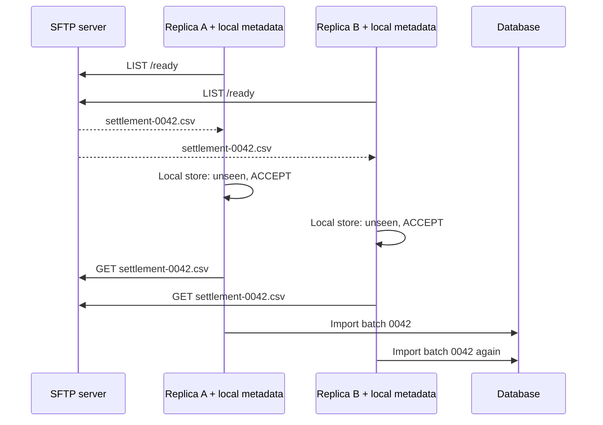
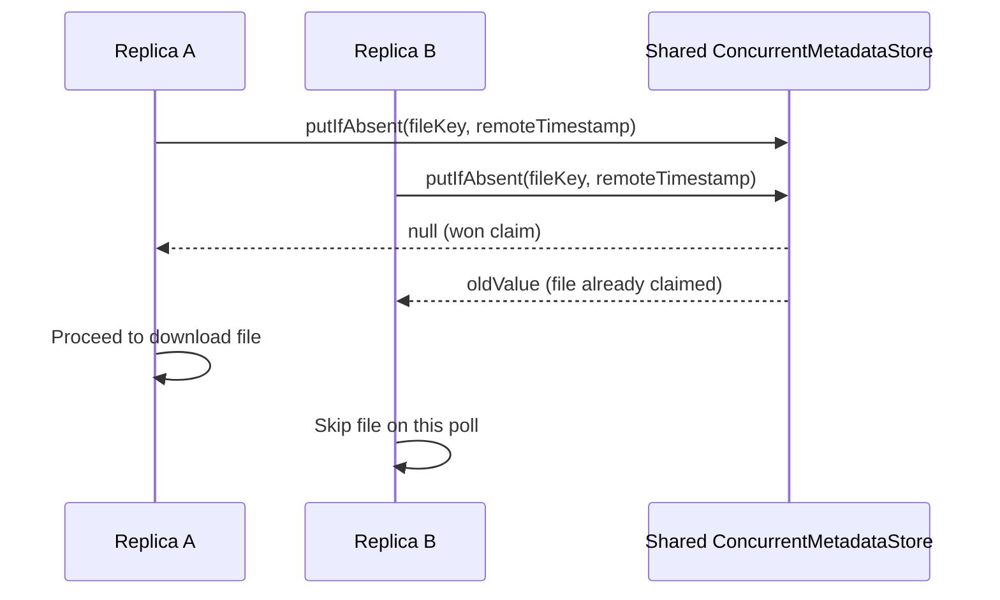
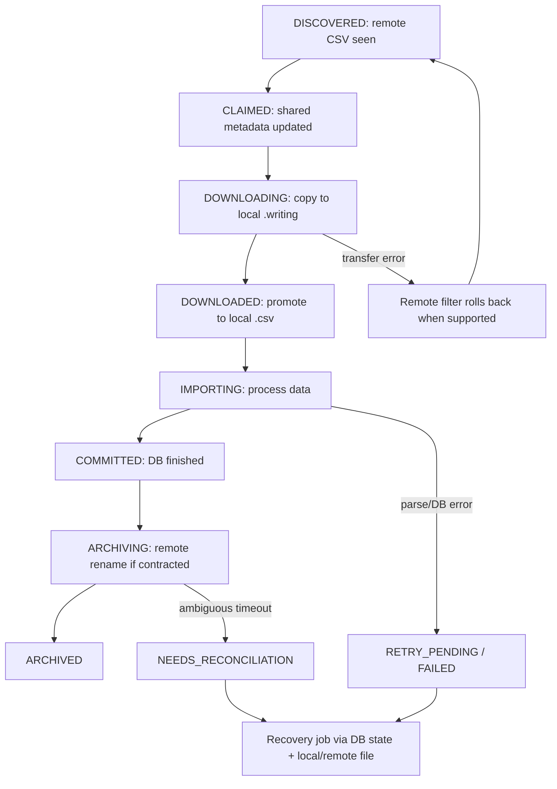

# ConcurrentMetadataStore for Multiple Consumers

## 1. Problem Statement: Two Instances See the Same SFTP File

A Spring Boot application runs two replicas, `settlement-worker-a` and `settlement-worker-b`. Both run an SFTP inbound adapter with a 10-second poller pointing to the same `/exchange/settlement/ready` directory. When the partner publishes `settlement-0042.csv`, **both replicas can see the filename** in their directory listings. If each replica tracks received files in its own local memory, both can download the file, emit `Message<File>`, and import the same batch into the database.

To coordinate across multiple consumers, Spring Integration provides **`ConcurrentMetadataStore`** combined with **`SftpPersistentAcceptOnceFileListFilter`**. The filter uses a shared metadata store to decide which remote files have already been claimed; conditional update operations let multiple instances compete without both accepting the same new file. This is a critical building block when scaling worker counts or deploying for high availability.

This lesson belongs to the **SFTP Adapter** chapter of the `SPRING_INTEGRATION_ADAPTERS` module. Like other sections in this module connecting external systems via inbound/outbound adapters, gateways, pollers, and `MessageChannel`, we must define the **message contract, error handling, connection lifecycle, and processing state**. The focus here is **sharing file-acceptance state** across replicas; that is still distinct from guaranteeing a business transaction executes exactly once.

After this lesson, you will be able to:

- Distinguish `MetadataStore`, `ConcurrentMetadataStore`, `SimpleMetadataStore`, and `RedisMetadataStore`.
- Understand how `SftpPersistentAcceptOnceFileListFilter` coordinates multiple consumers when new files arrive or existing files change.
- Write Java DSL for an SFTP inbound adapter with a **shared remote filter**, `maxFetchSize`, and a poller.
- Design key namespaces, staging directories, metadata retention, recovery, and observability.
- Explain why a shared filter **does not** replace DB idempotency, business retries, or long-lived distributed locks.
- Test two replicas, post-claim crashes, metadata store outages, and incomplete uploads.

> **Version:** code examples focus on **Spring Integration 6.5.x** on Spring Boot, where SFTP uses Apache MINA SSHD with `SftpClient.DirEntry`. Starting in Spring Integration 7.0, key construction for some persistent file filters changed to include the remote directory in the key name; when upgrading, check compatibility with stored metadata. Examples are learning configurations, not production-hardened deployments tested against a live server.

## 2. What Happens If You Only Use Local Memory?

By default, the SFTP inbound adapter in modern versions uses `SftpPersistentAcceptOnceFileListFilter` backed by an **in-process** `SimpleMetadataStore`. The filter tracks filename and modification timestamp, yet replica A's store **does not communicate** with replica B's store.



Using the same bean name `metadataStore` in two JVMs **does not make them a shared store**. Both still hold two separate in-memory objects. Even a store with thread-safe operations **within one JVM** is not automatically safe across **two machines**.

| Design | Prevents Duplicates Across Threads in One JVM | Prevents Duplicates Across Replicas | Retains State Across Restarts |
| --- | --- | --- | --- |
| `AcceptOnceFileListFilter` storing state in RAM | Yes within the filter's scope | No if each replica has its own filter | No |
| `SftpPersistentAcceptOnceFileListFilter` + `SimpleMetadataStore` | Yes within one store | **No**, if the store is not shared | No |
| Persistent filter + `RedisMetadataStore` sharing Redis | Yes | Coordinates via atomic metadata operations | Yes, depending on Redis durability and retention policy |
| Persistent filter + `JdbcMetadataStore` sharing a DB | Yes | Coordinates through a shared database | Yes, depending on DB durability and configuration |

The word **"persistent"** in the filter's name refers to its mechanism using `MetadataStore`—it does not mean every implementation persists data to disk. `SimpleMetadataStore` is the clearest example: it implements the store interface, yet its data disappears when the JVM stops.

## 3. What Contract Is `ConcurrentMetadataStore`?

`ConcurrentMetadataStore` extends `MetadataStore` with key atomic operations:

| Method | Semantics | Meaning with Multiple Consumers |
| --- | --- | --- |
| `get(key)` | Reads the current value | Inspects metadata state |
| `putIfAbsent(key, value)` | Writes **only if the key does not exist**, returning the old value if present | Ensures only one instance claims a new key |
| `replace(key, oldValue, newValue)` | Compares old value and replaces **conditionally** | Coordinates when a file is treated as a new version due to a changed timestamp |
| `remove(key)` | Deletes the key | Can be used during controlled recovery; requires race protection |

**The core insight:** running `get` then `put` as two separate calls is a check-then-act race. Both workers can read "absent" before either writes. `putIfAbsent` is a conditional operation **atomic inside the store implementation**. `replace` must also have atomic compare-and-set semantics so multiple instances cannot simultaneously claim a new version of a file.



The diagram illustrates the **contention principle on a new key**, not code you should write manually around the SFTP adapter. In your application, let `SftpPersistentAcceptOnceFileListFilter` manage keys and values. **Do not invent keys and call `putIfAbsent` manually in a service**, because the filter also handles timestamps, rollbacks, and namespaces.

### Is the Store Value a `PROCESSED` Status?

**No.** In Spring Integration 6.x, the persistent remote file filter identifies files by remote filename and modification timestamp. Metadata marks that a file was **accepted for fetching**, not that a DB transaction committed. By default, changing the remote file's modification time can cause the filter to treat it as a new version and accept it again. If a partner overwrites contents under the same filename, a filter cannot substitute for immutable file contracts, batch IDs, and checksums.

Per the Spring Integration documentation, since version 5.2, a remote file is marked right before fetching and the mark can be **rolled back when fetching fails**. However, if fetching succeeds and **a downstream handler fails**, filter rollback and business transactions do not couple automatically. Keep this boundary in mind when running a cluster.

## 4. Three State Layers to Distinguish

When ingesting SFTP files into an application, there are at least three types of state:

| Layer | Component | Question It Answers | What It Cannot Answer |
| --- | --- | --- | --- |
| **Remote filter** | `SftpPersistentAcceptOnceFileListFilter` + shared store | Has the remote file already been claimed for fetching? | Did the DB import finish? |
| **Local filter** | Inbound adapter's local directory filter | Which completed local files have already been emitted as messages? | Did another replica commit the data? |
| **Business state** | Application DB/outbox/ledger | Is the batch importing, committed, pending retry, or archived? | Is the SFTP network always healthy? |

Why separate them? Because the remote filter runs **before downloading the file**; the local filter runs **after downloading to disk**; and the consumer may take minutes to validate/import into the DB. Only business state has enough information to decide whether to re-import, requeue, archive, or raise an alert.

A safe way to summarize:

> A shared `ConcurrentMetadataStore` coordinates **file ingestion across multiple instances**. Achieving near-exactly-once behavior in the DB still requires business keys, unique constraints, transactions, and an error-recovery workflow.

## 5. Dependencies and Environment Configuration

The example uses Redis as the shared metadata store. Redis is **not a store for CSV contents**: the store holds only small entries for filtering. Using the Spring Boot BOM, declare:

```groovy
dependencies {
    implementation 'org.springframework.boot:spring-boot-starter-integration'
    implementation 'org.springframework.integration:spring-integration-sftp'

    // RedisMetadataStore and RedisConnectionFactory.
    implementation 'org.springframework.integration:spring-integration-redis'
    implementation 'org.springframework.boot:spring-boot-starter-data-redis'
}
```

Example configuration **without real secrets**:

```yaml
spring:
  data:
    redis:
      host: ${REDIS_HOST:redis.internal.example}
      port: ${REDIS_PORT:6379}

app:
  sftp:
    host: ${SFTP_HOST:sftp.partner.example}
    port: ${SFTP_PORT:22}
    username: ${SFTP_USERNAME:settlement_reader}
    private-key: file:${SFTP_PRIVATE_KEY_FILE}
    private-key-passphrase: ${SFTP_PRIVATE_KEY_PASSPHRASE:}
    known-hosts: file:${SFTP_KNOWN_HOSTS_FILE}
    remote-directory: ${SFTP_REMOTE_DIR:/exchange/settlement/ready}
    local-directory: ${SFTP_LOCAL_DIR:./data/sftp-inbox}
```

**All replicas must point to the same metadata store** for a given ingestion flow: the same Redis database/endpoint, Redis hash region, and filter prefix. Conversely, `app.sftp.local-directory` should be **a separate local area per replica**, such as each pod having its own volume; if multiple pods share a filesystem, you must additionally evaluate write permissions, temporary filenames, and access synchronization.

In production, configure Redis authentication, TLS/network ACLs, appropriate persistence, and availability monitoring. Never assume unauthenticated Redis is acceptable just because the sample `application.yml` omits secrets. SFTP still requires the client private key, passphrase if any, and `known_hosts` with out-of-band fingerprint verification; never disable host verification to simplify deployment.

### Creating the SFTP `SessionFactory` with an SSH Key

```java
import org.apache.sshd.sftp.client.SftpClient;
import org.springframework.beans.factory.annotation.Value;
import org.springframework.context.annotation.Bean;
import org.springframework.context.annotation.Configuration;
import org.springframework.core.io.Resource;
import org.springframework.integration.file.remote.session.CachingSessionFactory;
import org.springframework.integration.file.remote.session.SessionFactory;
import org.springframework.integration.sftp.session.DefaultSftpSessionFactory;

@Configuration
public class PartnerSftpSessionConfig {

    @Bean
    SessionFactory<SftpClient.DirEntry> partnerSftpSessionFactory(
            @Value("${app.sftp.host}") String host,
            @Value("${app.sftp.port}") int port,
            @Value("${app.sftp.username}") String username,
            @Value("${app.sftp.private-key}") Resource clientKey,
            @Value("${app.sftp.private-key-passphrase:}") String passphrase,
            @Value("${app.sftp.known-hosts}") Resource knownHosts) {

        DefaultSftpSessionFactory delegate = new DefaultSftpSessionFactory(false);
        delegate.setHost(host);
        delegate.setPort(port);
        delegate.setUser(username);
        delegate.setPrivateKey(clientKey);
        if (!passphrase.isBlank()) {
            delegate.setPrivateKeyPassphrase(passphrase);
        }
        delegate.setKnownHostsResource(knownHosts);
        delegate.setAllowUnknownKeys(false);
        delegate.setTimeout(30_000);

        return new CachingSessionFactory<>(delegate, 4);
    }
}
```

The SFTP connection/session cache is **different** from the Redis metadata store. The former reuses SSH sessions **within each instance**; the latter coordinates **file claiming** across multiple instances. You do not share a `SessionFactory` object across JVMs; each JVM has its own session factory, while remote filters reference the shared metadata store.

## 6. Configuring `RedisMetadataStore` and Namespaces

`RedisMetadataStore` implements `ConcurrentMetadataStore`. Its constructor accepts a `RedisConnectionFactory` and a **Redis hash key** serving as the storage region. Each filter also accepts a `prefix` to construct metadata keys inside that region:

```java
import org.springframework.context.annotation.Bean;
import org.springframework.context.annotation.Configuration;
import org.springframework.data.redis.connection.RedisConnectionFactory;
import org.springframework.integration.metadata.ConcurrentMetadataStore;
import org.springframework.integration.redis.metadata.RedisMetadataStore;

@Configuration
public class DistributedFileMetadataConfig {

    @Bean("sftpRemoteMetadataStore")
    public ConcurrentMetadataStore sftpRemoteMetadataStore(
            RedisConnectionFactory redisConnectionFactory) {

        // Same region value for EVERY replica polling /ready.
        return new RedisMetadataStore(
                redisConnectionFactory, "si:sftp:settlement:metadata");
    }
}
```

Two distinct scopes must remain consistent:

| Scope | Example Value | Consequence of Changing |
| --- | --- | --- |
| Redis connection/DB | Shared Redis for settlement workers | If different, workers **do not** coordinate |
| Redis **hash region** | `si:sftp:settlement:metadata` | A different region looks like an empty new key list |
| SFTP filter prefix | `partner-a:ready:` | A different prefix forms a separate file namespace |
| Remote directory | `/exchange/settlement/ready` | Review filename collisions and version-specific key strategies |
| Local directory | Per-pod local volume | Not a place to share claims across replicas |

**Never include pod ID, hostname, or a random UUID in the remote filter prefix.** Doing so causes each instance to write distinct keys and breaks coordination. Conversely, if two partners both publish `report.csv`, never let them accidentally share a namespace if they are **two independent sources**. Distinguish prefixes by partner/remote directory/business flow.

> **Compatibility note:** in Spring Integration **6.x**, verify how the filter builds metadata keys if a single filter spans multiple directories containing the **same basename**. As of **7.0**, documentation notes using long filenames including the fetching directory; when upgrading, plan metadata migration or reinitialization instead of silently changing namespaces in production.

### An Important Redis Cluster Limitation

Per Spring Integration 6.5 documentation, `RedisMetadataStore.replace(...)` uses a `WATCH`-based mechanism for atomicity and **is not fully supported on Redis Cluster** in the documented implementation. A filter may call `replace` when a file's timestamp changes. Therefore, **do not assume that because Redis provides HA, every Redis Cluster topology is safe**; verify topology, library version, and atomic CAS semantics before deploying. Consider `JdbcMetadataStore` or another backend that supports `ConcurrentMetadataStore` and your HA requirements.

## 7. Remote Filter Coordinating Multiple Consumers

Use `ChainFileListFilter` to chain **pattern first**, **persistent accept-once second**. This ensures only validly named `*.csv` files are recorded in the shared store; half-uploaded files such as `.part` never occupy metadata entries.

```java
import org.apache.sshd.sftp.client.SftpClient;
import org.springframework.beans.factory.annotation.Qualifier;
import org.springframework.context.annotation.Bean;
import org.springframework.context.annotation.Configuration;
import org.springframework.integration.file.filters.ChainFileListFilter;
import org.springframework.integration.file.filters.FileListFilter;
import org.springframework.integration.metadata.ConcurrentMetadataStore;
import org.springframework.integration.sftp.filters.SftpPersistentAcceptOnceFileListFilter;
import org.springframework.integration.sftp.filters.SftpSimplePatternFileListFilter;

@Configuration
public class SftpClusteredFilterConfiguration {

    @Bean("settlementRemoteFileFilter")
    public FileListFilter<SftpClient.DirEntry> settlementRemoteFileFilter(
            @Qualifier("sftpRemoteMetadataStore")
            ConcurrentMetadataStore store) {

        ChainFileListFilter<SftpClient.DirEntry> filters =
                new ChainFileListFilter<>();

        // Only CSV files published per contract reach accept-once.
        filters.addFilter(new SftpSimplePatternFileListFilter("*.csv"));
        filters.addFilter(new SftpPersistentAcceptOnceFileListFilter(
                store, "partner-a:ready:"));
        return filters;
    }
}
```

`SftpPersistentAcceptOnceFileListFilter` compares the filename and **remote modified time**; it does not compute a SHA-256 hash of remote contents. When a partner uploads under a temp name and renames to `.csv`, the pattern filter ignores the temp file; once the final name is published, the file becomes eligible for claiming. If the partner **writes directly under the `.csv` name before finishing**, neither the pattern nor the metadata store knows the file is complete; you need markers, an age filter, or a safer publish contract.

**Why use `ChainFileListFilter` instead of only `SftpSimplePatternFileListFilter`?** Because setting a standalone pattern filter on the adapter can replace the framework's default persistent accept-once filter. When declaring a **custom filter**, include both the filename condition and the shared claim inside one filter chain. In some architectures `CompositeFileListFilter` also fits, yet `ChainFileListFilter` makes evaluation order explicit and avoids recording files rejected by the first filter.

## 8. Attaching the Filter to the SFTP Inbound Adapter with Java DSL

Each replica uses the same code configuration and Redis store, but its own **local staging**. The snippet below completes the wiring from poller to `MessageHandler`:

```java
import java.io.File;

import org.apache.sshd.sftp.client.SftpClient;
import org.springframework.beans.factory.annotation.Qualifier;
import org.springframework.beans.factory.annotation.Value;
import org.springframework.context.annotation.Bean;
import org.springframework.context.annotation.Configuration;
import org.springframework.integration.dsl.IntegrationFlow;
import org.springframework.integration.dsl.Pollers;
import org.springframework.integration.file.filters.FileListFilter;
import org.springframework.integration.file.remote.session.SessionFactory;
import org.springframework.integration.sftp.dsl.Sftp;

@Configuration
public class ClusteredSftpInboundFlow {

    @Bean
    public IntegrationFlow settlementInbound(
            SessionFactory<SftpClient.DirEntry> partnerSftpSessionFactory,
            @Qualifier("settlementRemoteFileFilter")
            FileListFilter<SftpClient.DirEntry> remoteFilter,
            SettlementBatchHandler handler,
            @Value("${app.sftp.remote-directory}") String remoteDirectory,
            @Value("${app.sftp.local-directory}") String localDirectory) {

        return IntegrationFlow.from(
                        Sftp.inboundAdapter(partnerSftpSessionFactory)
                                .remoteDirectory(remoteDirectory)
                                .localDirectory(new File(localDirectory))
                                .autoCreateLocalDirectory(true)
                                .temporaryFileSuffix(".writing")
                                .deleteRemoteFiles(false)
                                .filter(remoteFilter)
                                .maxFetchSize(1),
                        endpoint -> endpoint.poller(
                                Pollers.fixedDelay(10_000)
                                        .maxMessagesPerPoll(1)))
                .handle(handler)
                .get();
    }
}
```

`maxFetchSize(1)` limits how many **new files are fetched from SFTP to local disk** in one fetch pass; `maxMessagesPerPoll(1)` limits how many **local messages are emitted** in one poll. These two settings are **not synonymous**, nor are they a distributed lock. Following Spring Integration guidance, use a small `maxFetchSize` across multiple instances so one replica does not grab the entire backlog and starve others.

With the default `DirectChannel`, `.handle(handler)` runs on the flow's message-handling thread; if the handler takes a long time, the poller waits for that duration. You can add queues or async processing, provided you explicitly define **a durable work store**, batch ownership, and retry handling instead of just dropping in an `ExecutorChannel` and assuming the accept-once filter handles everything.

### Remote and Local Filters Are Not Interchangeable

In a regular inbound adapter, the **remote filter** above decides which files are downloaded from SFTP. After downloading to local `*.writing` and renaming to the final name, the **local filter** decides which local files are emitted as `Message<File>`. The default local filter may also track state in an in-memory store.

Consequently, after a restart, an existing file in the local inbox may be re-emitted; or if remote contents update their timestamp and re-download, the local filter may suppress emission if local metadata is not designed to match. **A shared remote filter does not replace the local filter and certainly does not replace business state.** If replacing the local filter, design and test it separately alongside local cleanup, timestamps, retries, and real filesystem behavior.

## 9. Handlers Still Need Database Idempotency

A consumer receiving `Message<File>` should treat it solely as proof that **the file finished transferring to local disk**, not that the batch was imported. Example handler reading remote headers and calling a service with an idempotent contract:

```java
import java.io.File;
import java.nio.file.Files;

import org.springframework.integration.file.FileHeaders;
import org.springframework.messaging.Message;
import org.springframework.messaging.MessageHandler;
import org.springframework.stereotype.Component;

@Component
public class SettlementBatchHandler implements MessageHandler {

    private final SettlementImportService importer;

    public SettlementBatchHandler(SettlementImportService importer) {
        this.importer = importer;
    }

    @Override
    public void handleMessage(Message<?> message) {
        File local = (File) message.getPayload();
        String remoteName = (String) message.getHeaders()
                .get(FileHeaders.REMOTE_FILE);
        String remoteDirectory = (String) message.getHeaders()
                .get(FileHeaders.REMOTE_DIRECTORY);

        if (!Files.isRegularFile(local.toPath())) {
            throw new IllegalStateException("Local file no longer exists");
        }
        if (remoteName == null || !remoteName.matches("settlement-[0-9]+\\.csv")) {
            throw new IllegalArgumentException("Invalid batch name");
        }

        // Only pass data fetched by the internal adapter source;
        // never accept remote headers from untrusted HTTP requests.
        importer.importOnce(remoteDirectory, remoteName, local);
    }
}
```

The import service must manage transactions and unique keys. That belongs in the **business layer**, not inside `SftpPersistentAcceptOnceFileListFilter`:

```java
import java.io.File;

public interface SettlementImportService {
    /**
     * Business key can be (partnerId, batchId) or an immutable ID.
     * If the batch is already COMMITTED, do not write data a second time.
     * On failure, throw an exception and leave a recoverable state.
     */
    void importOnce(String remoteDirectory, String remoteFile, File localFile);
}
```

One implementation pattern is a unique constraint on `(partner_id, batch_id)`, persisted batch status, and controlled validation/import inside DB transactions. If importing in chunks, design per-record checkpoints/idempotency and a way to **publish batch completion only when all data is valid**. Never hold a single massive DB transaction open for multi-GB files.

## 10. Crashes at Each Stage: How Much Does a Shared Store Help?

Suppose replica A won the accept-once claim for `settlement-0042.csv`. The sequence may look like:



| Failure Point | Remote Metadata Store | Additional Behavior Required |
| --- | --- | --- |
| Before filter claim | No entry for the file yet | Another replica can pick it up on the next poll |
| During file download | Can be **rolled back on fetch failure** per filter/synchronizer mechanism | Clean up local `.writing`, inspect logs, and retry safely |
| After download, **before consumer imports** | File may already be marked accepted remotely | Recovery job must pick up the local file or properly reset the claim |
| Consumer parse/DB error | Remote metadata may remain accepted | Persist `RETRY_PENDING` or `FAILED`; do not expect the poller to re-emit automatically |
| DB committed, app died before archiving | Batch is committed yet remote file stays in `ready` | Finish archiving only; **do not re-import** |
| Redis state lost after restart | Accepted mark may vanish | File may be re-downloaded; DB unique key must prevent double import |

In particular, never bulk-delete Redis keys when seeing a downstream failure. If a key is deleted while replica A is still downloading, replica B can claim the same file and create **two concurrent executions**. Metadata resets must target a specific batch after confirming no worker holds an active processing lease (e.g., via an application claim/lease ledger).

**Metadata operations are not two-phase transactions.** The filter does not know whether a SQL statement committed. A record in Redis coordinates polling—it **is not proof of successful processing** and does not replace transactional guarantees between SFTP and the DB.

## 11. Choosing Namespaces and Managing Metadata Lifecycle

Persistent metadata needs **governance rules** just like business data, even though values are merely filenames and timestamps.

1. **Stable file identifiers:** partners should publish files with unique batch names; avoid overwriting the same filename without changing version. If corrections are needed, define how a new batch is distinguished.
2. **Consistent prefixes:** the same partner, remote directory, and business flow must use the exact same prefix across all replicas. Changing the prefix risks reprocessing all old files.
3. **Never mix environments:** dev, staging, and production need separate Redis namespaces/databases; never share accept-once state between test and production.
4. **Protect metadata mutation rights:** an account able to delete/modify keys can cause files to be reprocessed or skipped. Restrict Redis ACLs, audit admin operations, and back up state.
5. **Controlled retention:** never set short arbitrary TTLs across the whole region; once keys expire, lingering remote files can be reprocessed. Define key cleanup only after batches finish and source files are archived/deleted per contract.
6. **Framework upgrades:** when key algorithms change, plan controlled migrations or reprocessing; never deploy new code assuming old metadata keys stay compatible.

`RedisMetadataStore` uses a Redis hash region; expiring the entire hash **is not a safe per-batch TTL**. To purge old entries, drive cleanup via reconciliation against the business ledger. Never schedule a blind cron job deleting keys by age without knowing whether files remain on the remote server.

### Note on Identical Filenames Across Two Directories

In Spring Integration **6.x**, how the remote persistent filter constructs keys depends on the version and carries risk when **the same basename** appears across multiple remote directories sharing a filter/namespace. Differentiate prefixes per directory or dedicate appropriately scoped filters per flow so one file cannot accidentally block another. Spring Integration **7.0** announced using long filenames including the fetching directory; review the impact when upgrading.

## 12. `maxFetchSize`, Load Balancing, and SFTP Session Counts

In a cluster, `maxFetchSize(1)` is a **fairness control**, not a guarantee that a file is processed exactly once. If replica A can pull 100 files per turn while replica B pulls one, A can repeatedly grab most of the backlog. Small fetch limits spread claim opportunities across workers; final throughput still depends on pollers, bandwidth, local staging, import duration, and Redis latency.

Example with a poller set to `maxMessagesPerPoll(2)`:

| `maxFetchSize` | Single Remote Fetch Pass | Messages Emitted Per Poll | Meaning |
| --- | --- | --- | --- |
| `1` | New fetches capped at 1 file | Can fetch again while message emission budget remains | Gradual distribution, cluster-friendly |
| `2` | Fetches up to 2 files in one pass | Emits up to 2 messages | Simple to observe |
| `4` | May download 4 files even though only 2 emit | Remaining local files emit on later polls | Increases prefetch but grows local backlog |
| Default unlimited | Can download many files | Still bounded by poller emission limit | One instance can hog files and local resources |

Do not raise `maxMessagesPerPoll` without checking SSH session quotas, Redis request rates, and local disk capacity. For large files, local transfers consume time and connections; with slow DB consumers, local backlogs can pile up. Track `pollDuration`, `fetchCount`, `processDuration`, `sessionActive`, `diskBytes`, `acceptedCount`, `duplicateSkippedCount`, and `retryPendingCount` per replica.

## 13. Redis Outages, Redis Cluster, and Backend Choices

When the metadata store is unreachable, **do not automatically fall back to `SimpleMetadataStore`** to "keep the service running" if cluster coordination is the goal. Every replica would then operate independently and likely ingest the same files. Instead, transition the ingestion source to **degraded/paused**, alert operators, and retry metadata connectivity with backoff.

| Incident | Risk | Handling |
| --- | --- | --- |
| Redis timeout while filter records claim | Unclear whether claim was persisted | Do not proceed blindly; inspect keys, retry via idempotency and business state |
| Redis restart loses unpersisted data | Old files may be re-claimed | Ensure appropriate Redis durability and DB unique batch keys |
| Redis Cluster lacks required CAS | `replace` lacks expected semantics | Check implementation/version; consider another backend |
| Two instances point to two Redis DBs | No real claim sharing | Verify runtime configuration of every replica |
| Operator accidentally deletes the region | Can replay every file still on the server | Controlled recovery, inspect ledger and backups |
| Slow metadata store | Pollers lag, backlog may build | Monitor latency, timeouts, and backend capacity |

Beyond Redis, Spring Integration offers `JdbcMetadataStore` and other `ConcurrentMetadataStore` implementations. Choose a backend based on transaction/CAS needs, cluster topology, SLA, operational ownership, and durability. Do not pick Redis merely because "we already have Redis" without verifying `putIfAbsent`/`replace` semantics in your actual topology.

## 14. Does the Streaming Inbound Adapter Use the Same Mechanism?

Yes. `SftpStreamingMessageSource` can also use `SftpPersistentAcceptOnceFileListFilter` with a **shared `ConcurrentMetadataStore`**, except the message payload is **`InputStream`** rather than `File`. There is no local download filter in the same sense as the file-based inbound adapter; the consumer must close `closeableResource` in the header to release the SFTP session after reading.

```java
import org.apache.sshd.sftp.client.SftpClient;
import org.springframework.integration.file.filters.FileListFilter;
import org.springframework.integration.sftp.inbound.SftpStreamingMessageSource;
import org.springframework.integration.sftp.session.SftpRemoteFileTemplate;

// Uses the shared filter defined in section 7 and the same session factory.
SftpRemoteFileTemplate remoteTemplate = new SftpRemoteFileTemplate(sessionFactory);
SftpStreamingMessageSource source =
        new SftpStreamingMessageSource(remoteTemplate);
source.setRemoteDirectory("/exchange/settlement/ready");
source.setFilter(remoteFileFilter);
source.setMaxFetchSize(1);
```

This snippet configures the source only; it is **not** a complete flow. In Java DSL, attach the source to a poller and a handler that reads the `InputStream` and closes stream/session cleanly. If an application runs both **file-based inbound** and **streaming inbound** on the same directory simultaneously, decide explicitly whether they compete or stay independent: sharing a namespace lets one side grab files from the other; separating namespaces lets both ingest the same file. Never let two pipelines process the same batch merely because they use two adapter types.

## 15. Cluster and Recovery Test Scenarios

Prepare **two real Spring Boot instances** (A, B), one shared Redis, a test SFTP server with verified `known_hosts`, separate local volumes per instance, and a test database with a unique batch key. Use synthetic files and never corrupt production metadata during tests.

1. **Concurrent poll of one file:** place one published CSV into `ready`, start A and B together. Observe that only one instance wins the filter claim and fetches the file first. Verify the DB commits only one batch.
2. **Multiple files:** place 20 files with distinct batch IDs, keep `maxFetchSize(1)`, and verify claim distribution across both replicas without missing any file.
3. **Restart:** finish processing a file, restart both A and B while keeping Redis metadata. Verify unchanged timestamps are not re-claimed by the remote filter, and inspect local filter/retention behavior.
4. **Crash mid-transfer:** drop SFTP connectivity while A downloads `.writing`. Confirm no half-baked local file is emitted; observe claim rollback behavior and retry on the surviving instance.
5. **Crash after transfer before DB:** let A finish downloading, then kill it before importing. B may not be allowed to fetch because remote metadata shows accepted. Run the recovery job using the business ledger and local/remote state to decide how to proceed.
6. **Parse error:** supply a schema-broken CSV, confirm the job records `FAILED`/`QUARANTINED`; never wipe the whole Redis namespace to force a retry.
7. **Timestamp modified:** change the `mtime` of the same filename on test SFTP. Verify the filter may accept the new version, while the business layer blocks duplicate batch ID imports.
8. **Redis outage:** disconnect Redis. Confirm workers do **not** fall back to in-memory accept-once and duplicate downloads; verify clear error monitoring.
9. **Misconfigured namespace:** intentionally alter the prefix or Redis DB **in test**; observe duplicate behavior to see why every replica must share identical settings.
10. **Two directories with same basename:** place `report.csv` in two remote directories for two partners, confirming prefixes/filter scopes do not block each other.
11. **Producer mid-upload:** upload `batch.csv.part`, rename to `.csv` when done; filter claims only the final filename.
12. **Reconciliation:** after DB commit when archive rename times out, restart and finish archiving from durable state without re-importing.

### Expected Outcome Matrix

| Scenario | Expected Filter/Metadata Behavior | Business Outcome to Guarantee |
| --- | --- | --- |
| Two replicas see a new file together | One claim wins for the same key/version | One batch committed |
| Fetch fails before completion | Claim rollback occurs where supported | No partial local file imported |
| Handler fails after fetch | Metadata may remain accepted | Separate recovery; no lost batch |
| Restart preserving Redis store | Does not treat all files as new | No duplicate import; remaining backlog still processed |
| Redis metadata lost | Files may be re-selected | DB unique constraint prevents double commit |
| Remote file `mtime` changes | Filter may treat as a new version | Compare batch ID/version/checksum |

## 16. Common Pitfalls

- **Giving each pod a `SimpleMetadataStore` and thinking clustering is configured:** the stores share no state.
- **Putting the pod ID in the prefix:** each replica writes separate keys, causing the same file to be picked up multiple times.
- **Adding only `SftpSimplePatternFileListFilter("*.csv")`:** replacing the default filter can silently drop accept-once behavior.
- **Using `get` then `put` instead of CAS operations:** fails atomicity when two replicas race.
- **Confusing accepted with committed:** the filter marks before or during fetch, independent of DB transactions.
- **Believing `maxFetchSize(1)` is a distributed lock:** it only bounds how many files are fetched per pass.
- **Setting short TTLs on the metadata region for cleanup:** after TTL expiry, old remote files can be re-ingested.
- **Deleting Redis keys while another worker is running:** can break deduplication.
- **Ignoring the local file filter:** can re-emit local files or miss newly downloaded files after timestamp changes.
- **Falling back from Redis to memory on Redis timeouts:** breaks coordination across JVMs.
- **Using Redis Cluster without checking `RedisMetadataStore` CAS:** `replace` has limitations explicitly noted in version 6.5 docs.
- **Omitting DB idempotency:** even without duplicate fetches in normal operation, crashes, restarts, and rollbacks can still deliver the same batch to a consumer multiple times.

## 17. Self-Check Questions

1. Why does `SimpleMetadataStore` fail to prevent two replicas from picking up the same SFTP file even when each uses `SftpPersistentAcceptOnceFileListFilter`?
2. Which race does `ConcurrentMetadataStore#putIfAbsent` resolve that a `get`/`put` pair cannot?
3. When a remote file's `mtime` changes, what can the filter do, and why can it not replace checksums/batch versions?
4. Why does the order of pattern filter followed by persistent accept-once filter matter?
5. What distinguishes **remote filter**, **local filter**, and **business state**?
6. How does `maxFetchSize=1` differ from `maxMessagesPerPoll=1`? Why reduce prefetch in a cluster?
7. If pod A dies after downloading but before importing, will pod B automatically pick up the file via the shared store? How do you recover?
8. Why should you never put an instance ID in the prefix? When are distinct prefixes needed?
9. If Redis restarts and loses metadata, which layer must prevent importing the same batch twice?
10. What must you verify before deploying `RedisMetadataStore` onto Redis Cluster?
11. Why does upgrading from Spring Integration 6.x to 7.x require reviewing metadata key formats?
12. Which metrics help detect one replica hogging files, metadata store failures, or a rapidly growing backlog?

## References

- [Spring Integration 6.5 — SFTP Inbound Channel Adapter](https://docs.spring.io/spring-integration/reference/6.5/sftp/inbound.html)
- [Spring Integration — Remote Persistent File List Filters](https://docs.spring.io/spring-integration/reference/file/remote-persistent-flf.html)
- [Spring Integration — Controlling Remote File Fetching](https://docs.spring.io/spring-integration/reference/sftp/max-fetch.html)
- [Spring Integration 6.5 — SFTP Streaming Inbound Channel Adapter](https://docs.spring.io/spring-integration/reference/6.5/sftp/streaming.html)
- [Spring Integration 6.5 — Redis Support and `RedisMetadataStore`](https://docs.spring.io/spring-integration/reference/6.5/redis.html)
- [Spring Integration 6.5 API — `SftpPersistentAcceptOnceFileListFilter`](https://docs.spring.io/spring-integration/docs/6.5.0/api/org/springframework/integration/sftp/filters/SftpPersistentAcceptOnceFileListFilter.html)
- [Spring Integration 6.5 API — `ConcurrentMetadataStore`](https://docs.spring.io/spring-integration/docs/6.5.0/api/org/springframework/integration/metadata/ConcurrentMetadataStore.html)
- [Spring Integration 6.5 API — `RedisMetadataStore`](https://docs.spring.io/spring-integration/docs/6.5.0/api/org/springframework/integration/redis/metadata/RedisMetadataStore.html)
