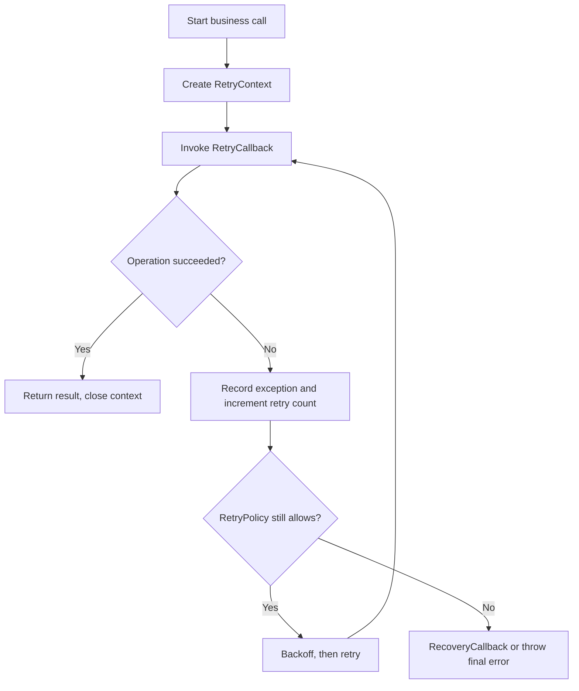
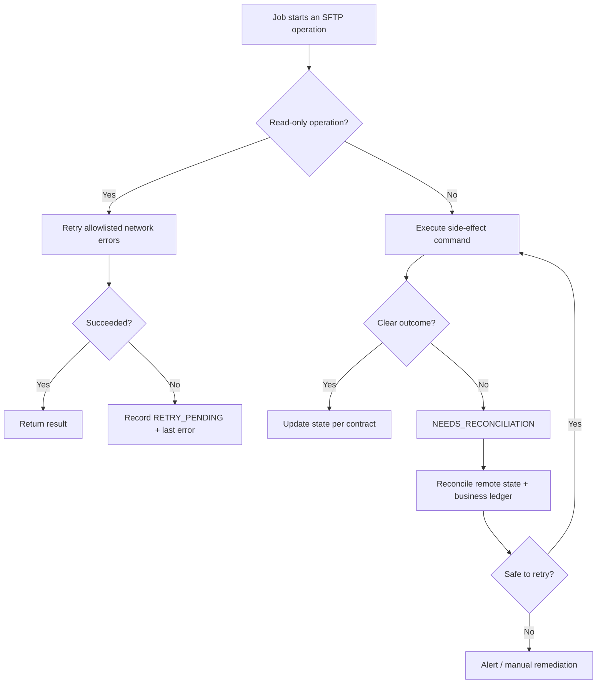
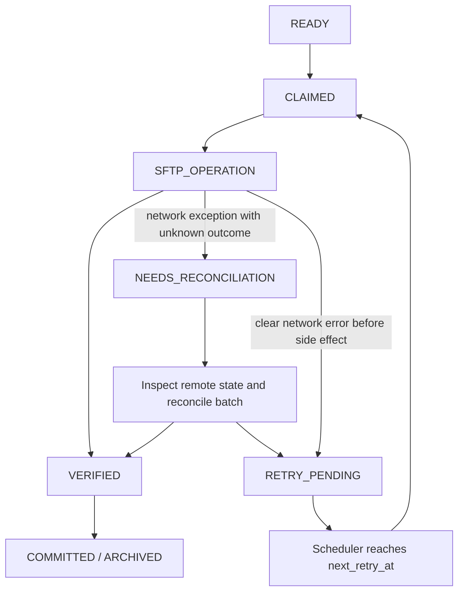

# Retry Context When SFTP Connections Are Interrupted

## 1. Problem Statement: An SFTP Command Fails Right Mid-Transfer

A Spring Boot system must read CSV files from a partner's SFTP server, import data into a database, and send result files back. During a run, the SSH connection suddenly resets: an `ls` command might not have returned its listing yet, a `get` command might have downloaded only 60% of the content, or a `put` command might have finished uploading without the client receiving the final response.

If the application **never retries**, a transient network glitch can abort valid work. If the application **retries every exception**, it can download duplicates, overwrite delivered files, delete the wrong file, or repeat DB imports. In Spring Integration, retry logic must live at the right **processing layer** and match the semantics of each SFTP operation.

`RetryContext` is the Spring Retry object that tracks the state of **a single retry execution**: the failure/retry count, the most recent exception, and attributes attached by the application. It lets code and callbacks know **which attempt is running**, **what failed previously**, and **when to transition to recovery**. However, `RetryContext` is **not** a durable business record and cannot replace `ConcurrentMetadataStore`, a database, or a message queue.

This lesson belongs to the **SFTP Adapter** chapter of the `SPRING_INTEGRATION_ADAPTERS` module, covering external system connectivity via inbound/outbound adapters, gateways, pollers, and `MessageChannel`. Alongside the same principles used for HTTP, JMS, AMQP, Kafka, and databases—**message contracts, retries, timeouts, idempotency, and connection lifecycles**—SFTP adds a specific risk: the outcome of a server-side file operation can be **ambiguous** when the network drops after a side effect.

After this lesson, you will be able to:

- Distinguish retries across `RetryTemplate`, `RequestHandlerRetryAdvice`, pollers/message sources, and business jobs.
- Read `RetryContext#getRetryCount()`, `getLastThrowable()`, and use `setAttribute()` to trace a single execution.
- Build a retry policy with **error classification**, exponential backoff, and bounded attempts.
- Apply retries to `ls`/`get` operations and recognize when `put`/`mv`/`rm` require reconciliation before retrying.
- Protect SFTP inbound flows against lost files, duplicate processing, stale SSH sessions, and stacked retry layers.
- Write test suites simulating network errors and post-crash recovery scenarios.

> **API scope:** examples target Spring Boot with **Spring Integration 6.x** and **Spring Retry 2.x**, with SFTP based on Apache MINA SSHD (`SftpClient.DirEntry`). Cross-check APIs against your actual dependency versions. Code snippets focus on integration patterns and do not represent live server integration testing.

## 2. Four Questions Before Enabling Retries

Before handling an SFTP exception, determine:

1. **Which layer failed?** DNS/TCP, SSH handshake, host key verification, login, SFTP command execution, stream reading, local file writing, or database processing?
2. **Did a side effect occur?** `ls` is essentially read-only, whereas `put` can create a file, `mv` can rename it, and `rm` can delete it before the client sees an exception.
3. **Is there replayable input?** An `InputStream` payload already 60% consumed cannot rewind itself; a complete local file or an immutable remote path can be re-read from the start.
4. **Who owns durable state?** `RetryContext` lives only for one attempt sequence; a dead process or another worker picking up the job needs a DB/outbox/metadata store to know the next step.

| Operation | Typical Semantics | On Connection Loss | Retry Approach |
| --- | --- | --- | --- |
| `ls`, `nlst`, `exists` | Reads server state | Can be re-executed, though results may change over time | Bounded retries for transient network errors |
| `get` | Reads remote file and writes local data/stream | Local file may be only partially downloaded | Close stream, delete/quarantine temp file, open a **fresh read** from the beginning |
| `put` | Writes new/uploaded file to server | Upload may have finished or left a temp file | Reconcile remote target, batch ID/checksum before retrying |
| `mv`/`rename` | Renames/moves a remote file | Server may have renamed despite client timeout | Check source **and** target before retrying |
| `rm` | Deletes a remote file | File may already be deleted even if reply was lost | Verify target state and deletion policy before deciding |
| DB import after `get` | Writes business data | Part of the data may already have committed | Transactions/unique keys/checkpoints; do not rely on SFTP retries |

**Rule:** not every repeatable call is **idempotent**. Retry means "try calling again," whereas idempotency means "calling again causes no unintended side effects." Both problems must be solved together.

## 3. What Is `RetryContext` and How Long Does It Live?

In Spring Retry, `RetryTemplate.execute(...)` creates or uses a `RetryContext` for **one retry execution**. The callback receives `context`, reads `getRetryCount()` and `getLastThrowable()`, attaches metadata via `setAttribute(key, value)`, and either returns a result or throws an exception. While the retry policy permits, Spring Retry re-invokes the callback after a backoff; once exhausted, the exception is thrown or a configured `RecoveryCallback` runs.



Key context members:

| API | Meaning | Proper Usage |
| --- | --- | --- |
| `getRetryCount()` | Number of retries/failures recorded by the context | Logging/metrics; do not confuse with a durable ID |
| `getLastThrowable()` | Most recent exception from the failed callback | Root-cause analysis and classification during recovery |
| `setAttribute(key, value)` | Attaches metadata scoped to the current context | `partnerId`, `batchId`, `operation`, `remotePath` **stripped of secrets** |
| `getAttribute(key)` | Reads stored metadata | Correlation/logging across attempts of the same invocation |
| `RetrySynchronizationManager.getContext()` | Accesses the thread-bound context while inside a retry | Use only when needed; **never treat as an async cross-thread context** |

A **stateless retry execution's** `RetryContext` does not survive a JVM restart, is not shared across pods, and is not persisted in Redis. Spring Retry has a **stateful retry** concept using `RetryState`/caches for special cases, yet that is not a default replacement for a batch status table; understand key, cache, and transaction semantics before using it. Most SFTP calls should start with bounded stateless retries plus a durable **business ledger**.

### Distinguishing `RetryContext` from Message Headers

`RetryContext` is created by the retry mechanism, whereas Spring Integration `MessageHeaders` travel on messages across `MessageChannel`. Having a `batchId` in a message does not mean Spring Retry has a context. Inside a callback, you can attach `batchId` to the context for logging convenience, but **never put passphrases, private keys, or sensitive file contents** into it, as they risk leaking into logs or debug dumps.

When using an `ExecutorChannel`, queue, or async worker, the thread executing the handler may differ from the thread that started the retry. Never rely on `RetrySynchronizationManager.getContext()` to pass context implicitly across message channels; pass **correlation IDs and business identifiers** explicitly in message headers or the DB per contract.

## 4. Error Classification: Which Errors Should Be Retried?

A generic "SFTP connection failed" can mask many causes. Do not use `retryOn(Exception.class)` to apply one policy to everything:

| Error Category | Examples | Auto-Retry? | Why? |
| --- | --- | --- | --- |
| Transient network errors | `SocketTimeoutException`, `ConnectException`, transient `SocketException` | **Conditionally**, with capped attempts and backoff | Server/network may recover |
| SSH session reset mid-session | I/O exception, SSH exception with network root cause | Can retry **after the broken session is closed/replaced** | Never reuse broken streams or dead sessions |
| DNS/misconfigured endpoint | Invalid hostname, wrong port | Usually no | Retries cannot fix bad config |
| Host key mismatch | `known_hosts` mismatch, server key changed | **No** | Requires out-of-band fingerprint verification; potential spoofing risk |
| Client authentication failed | Wrong user, private key, passphrase, or unregistered public key | **No** | Fix secrets/permissions; do not hammer login |
| SFTP permission denied | Not allowed to read/write/rename/delete | **No** | Retries do not grant permissions |
| Remote file not found | File renamed/deleted before read | Contract-dependent; reconcile first | Another worker may have processed the file |
| Local disk full / schema error | Cannot write staging or invalid CSV | **No** via network retry | Fix resources or data |

Spring Integration may wrap root causes inside `MessageHandlingException`, `MessagingException`, or SSH library exceptions. When configuring a retry policy, decide whether to **traverse causes (`traverseCauses`)** and verify it actually matches the intended network errors. Never add `IOException` wholesale to the retry list, as it also covers local file and permission errors.

**Caution with `ConnectException` and `SocketException`:** the exact same exception class can come from a transient outage or a permanent misconfiguration. Cap retries to a few attempts and alert on repeated failures; never interpret an exception class allowlist as proof an error is always transient.

## 5. Dependencies and Secure SSH Configuration

In a Spring Boot project using the BOM to manage versions, declare the required modules:

```groovy
dependencies {
    implementation 'org.springframework.boot:spring-boot-starter-integration'
    implementation 'org.springframework.integration:spring-integration-sftp'
    implementation 'org.springframework.retry:spring-retry'
}
```

Placeholder-only `application.yml` example:

```yaml
app:
  sftp:
    host: ${SFTP_HOST:sftp.partner.example}
    port: ${SFTP_PORT:22}
    username: ${SFTP_USERNAME:settlement_reader}
    private-key: file:${SFTP_PRIVATE_KEY_FILE}
    private-key-passphrase: ${SFTP_PRIVATE_KEY_PASSPHRASE:}
    known-hosts: file:${SFTP_KNOWN_HOSTS_FILE}
    ready-directory: ${SFTP_READY_DIR:/exchange/settlement/ready}
```

The application holds the **client private key** in a secret mount and the passphrase in a secret manager; the partner registers the corresponding public key in `authorized_keys`. To prevent connecting to the wrong server, `known_hosts` must hold the **server host public key** verified out-of-band by fingerprint. On a host key mismatch, **never set `allowUnknownKeys(true)` hoping retries will succeed**.

```java
import org.apache.sshd.sftp.client.SftpClient;
import org.springframework.beans.factory.annotation.Value;
import org.springframework.context.annotation.Bean;
import org.springframework.context.annotation.Configuration;
import org.springframework.core.io.Resource;
import org.springframework.integration.file.remote.session.CachingSessionFactory;
import org.springframework.integration.file.remote.session.SessionFactory;
import org.springframework.integration.sftp.session.DefaultSftpSessionFactory;

@Configuration
public class SftpSessionConfiguration {

    @Bean
    public SessionFactory<SftpClient.DirEntry> sftpSessionFactory(
            @Value("${app.sftp.host}") String host,
            @Value("${app.sftp.port}") int port,
            @Value("${app.sftp.username}") String user,
            @Value("${app.sftp.private-key}") Resource privateKey,
            @Value("${app.sftp.private-key-passphrase:}") String passphrase,
            @Value("${app.sftp.known-hosts}") Resource knownHosts) {

        DefaultSftpSessionFactory delegate = new DefaultSftpSessionFactory(false);
        delegate.setHost(host);
        delegate.setPort(port);
        delegate.setUser(user);
        delegate.setPrivateKey(privateKey);
        if (!passphrase.isBlank()) {
            delegate.setPrivateKeyPassphrase(passphrase);
        }
        delegate.setKnownHostsResource(knownHosts);
        delegate.setAllowUnknownKeys(false);
        delegate.setTimeout(30_000);

        return new CachingSessionFactory<>(delegate, 4);
    }
}
```

`CachingSessionFactory` reuses SSH sessions but does not guarantee a session stays alive forever. When an SFTP stream drops, **close or evict the broken session per the factory/client mechanism** before reopening; never send further commands over a broken `InputStream`. Do not reset the entire cache on every exception, as that can disrupt other healthy work.

## 6. Building `RetryTemplate` with Backoff and an Exception Allowlist

A simple policy capped at **three total executions** with exponential backoff between failures:

```java
import java.net.ConnectException;
import java.net.SocketException;
import java.net.SocketTimeoutException;
import java.util.Map;

import org.springframework.context.annotation.Bean;
import org.springframework.context.annotation.Configuration;
import org.springframework.retry.backoff.ExponentialBackOffPolicy;
import org.springframework.retry.policy.SimpleRetryPolicy;
import org.springframework.retry.support.RetryTemplate;

@Configuration
public class SftpRetryConfiguration {

    @Bean("sftpReadRetryTemplate")
    public RetryTemplate sftpReadRetryTemplate() {
        // traverseCauses=true: locates network errors underneath wrapper exceptions.
        SimpleRetryPolicy policy = new SimpleRetryPolicy(
                3,
                Map.of(
                        SocketTimeoutException.class, true,
                        ConnectException.class, true,
                        SocketException.class, true),
                true);

        ExponentialBackOffPolicy backOff = new ExponentialBackOffPolicy();
        backOff.setInitialInterval(500L); // 0.5 seconds
        backOff.setMultiplier(2.0);
        backOff.setMaxInterval(5_000L);

        RetryTemplate template = new RetryTemplate();
        template.setRetryPolicy(policy);
        template.setBackOffPolicy(backOff);
        return template;
    }
}
```

With three total calls and two waits, backoff intervals are **500 ms and 1,000 ms** (excluding the time spent in each network call). `maxAttempts=3` means **the initial attempt plus up to two retries**, not three extra retries. If an error falls outside the policy, the callback is not retried and goes straight to termination handling.

`traverseCauses=true` helps because a `SocketTimeoutException` may be wrapped inside an exception thrown by Spring Integration. However, the policy above is **only an initial allowlist**: some SSH session-reset errors appear under different exception classes or lack a `SocketException` in the cause chain. To add specific SSH failure types, inspect exceptions observed in tests and keep **permission/authentication/host-key** errors excluded from retries.

### SLA-Driven Configuration Numbers

| Parameter | Example | Impact |
| --- | --- | --- |
| Max attempts | `3` total | Bounds load and latency during server incidents |
| Initial interval | `500 ms` | Avoids hammering immediately on the same error |
| Multiplier | `2.0` | Grows each wait exponentially |
| Maximum interval | `5,000 ms` | Caps policy backoff duration |
| SSH/network timeout | `30,000 ms` | Bounds connection or I/O wait per library layer |
| Poll interval | `10 s` or per SLA | Do not confuse with backoff **within a single retry run** |

With multiple workers, consider **jitter** to keep all workers from retrying in lockstep when the SFTP server recovers, especially with synchronized backoffs. Jitter does not appear automatically from `ExponentialBackOffPolicy` in the snippet above; if needed, choose a backoff policy or sleeper that supports jitter in your Spring Retry version.

## 7. `RetryContext` in Action During `ls`

`ls` is a great starting example because it only reads metadata from the server. `SftpRemoteFileTemplate` can be called directly from a Java service; `RetryTemplate` wraps **each business call** and creates a fresh context for that execution.

```java
import java.util.Arrays;
import java.util.List;

import org.apache.sshd.sftp.client.SftpClient;
import org.springframework.beans.factory.annotation.Qualifier;
import org.springframework.beans.factory.annotation.Value;
import org.springframework.retry.support.RetryTemplate;
import org.springframework.integration.sftp.session.SftpRemoteFileTemplate;
import org.springframework.stereotype.Service;

@Service
public class RemoteListWithRetryService {

    private final SftpRemoteFileTemplate sftp;
    private final RetryTemplate retry;
    private final String readyDirectory;

    public RemoteListWithRetryService(
            SftpRemoteFileTemplate sftp,
            @Qualifier("sftpReadRetryTemplate") RetryTemplate retry,
            @Value("${app.sftp.ready-directory}") String readyDirectory) {
        this.sftp = sftp;
        this.retry = retry;
        this.readyDirectory = readyDirectory;
    }

    public List<String> listReady(String batchId) {
        // One call to listReady() creates one RetryContext for that invocation.
        return retry.execute(context -> {
            context.setAttribute("batchId", batchId);
            context.setAttribute("operation", "ls");
            context.setAttribute("remoteDirectory", readyDirectory);

            // getRetryCount() reflects failures recorded so far in this context.
            int failedAttempts = context.getRetryCount();
            // Log failedAttempts + batchId using the project's logger;
            // never log secrets, private keys, or file contents.

            SftpClient.DirEntry[] entries = sftp.list(readyDirectory);
            return Arrays.stream(entries)
                    .map(SftpClient.DirEntry::getFilename)
                    .filter(name -> !name.equals(".") && !name.equals(".."))
                    .toList();

        }, context -> {
            // Runs only when the policy exhausts attempts and a RecoveryCallback is provided.
            throw new IllegalStateException(
                    "SFTP ls failed for batch " + batchId
                    + ", failed attempts=" + context.getRetryCount(),
                    context.getLastThrowable());
        });
    }
}
```

**Example behavior:** if `sftp.list()` returns results, retry ends immediately. If a network error matching the allowlist occurs, the callback runs again after backoff with **the same `RetryContext`** for that `execute()` invocation. If attempts exhaust, the recovery callback builds an exception with diagnostic context. The next service call gets a **brand-new context**; `failedAttempts` from the previous context is not retained automatically.

Attaching `batchId` via `setAttribute(...)` helps if you add a `RetryListener` or shared logging. Do not use that attribute to drive DB write decisions; business state still belongs in a durable store. With `ls`, results can change between the first and third attempts as files are published or renamed on the server; retries only guarantee **re-executing the command**, not a consistent snapshot.

### `RetrySynchronizationManager`: When a Callback Calls Deep Helpers

If a helper invoked inside a retry callback needs the retry count without threading `RetryContext` through every method signature, it can inspect the thread-bound context:

```java
import org.springframework.retry.RetryContext;
import org.springframework.retry.support.RetrySynchronizationManager;

public int currentRetryCount() {
    RetryContext context = RetrySynchronizationManager.getContext();
    return context == null ? 0 : context.getRetryCount();
}
```

Use this only when you know the helper runs **inside the same Spring Retry execution context**. Never assume the context crosses an `ExecutorChannel`, thread pool, or external system; pass explicit correlation IDs across those boundaries. Outside a retry block, `getContext()` can be `null`.

## 8. `RequestHandlerRetryAdvice` for SFTP Outbound Gateways

If the application already routes work through `MessageChannel`, you can attach `RequestHandlerRetryAdvice` to the **endpoint handler** instead of calling `RetryTemplate` manually in a service. The advice retries calls to the SFTP outbound gateway or outbound adapter right where I/O happens.

```java
import org.apache.sshd.sftp.client.SftpClient;
import org.springframework.beans.factory.annotation.Qualifier;
import org.springframework.context.annotation.Bean;
import org.springframework.context.annotation.Configuration;
import org.springframework.integration.dsl.IntegrationFlow;
import org.springframework.integration.file.remote.session.SessionFactory;
import org.springframework.integration.handler.advice.RequestHandlerRetryAdvice;
import org.springframework.integration.sftp.dsl.Sftp;
import org.springframework.retry.support.RetryTemplate;

@Configuration
public class RetryableSftpGatewayFlow {

    @Bean
    public RequestHandlerRetryAdvice sftpGatewayRetryAdvice(
            @Qualifier("sftpReadRetryTemplate") RetryTemplate retryTemplate) {
        RequestHandlerRetryAdvice advice = new RequestHandlerRetryAdvice();
        advice.setRetryTemplate(retryTemplate);
        // No recovery set: when retries exhaust, the error propagates to caller/error flow.
        return advice;
    }

    @Bean
    public IntegrationFlow retryableListFlow(
            SessionFactory<SftpClient.DirEntry> sftpSessionFactory,
            RequestHandlerRetryAdvice sftpGatewayRetryAdvice) {

        return IntegrationFlow.from("sftpListWithRetryRequests")
                .handle(Sftp.outboundGateway(
                                sftpSessionFactory, "ls", "payload"),
                        endpoint -> endpoint.advice(sftpGatewayRetryAdvice))
                .get();
    }
}
```

`"payload"` is a SpEL expression selecting the directory path from the incoming message. Allow only directories validated by a business service; never pass raw remote paths provided by HTTP clients. `RequestHandlerRetryAdvice` must be attached to **the exact endpoint** performing SFTP I/O; placing it on a header-enriching transformer will not retry a failing SFTP command.

Once the advice exhausts retries, the error can propagate to the caller or a configured `RecoveryCallback`/error channel can route it to error handling. For instance, `ErrorMessageSendingRecoverer` can publish an `ErrorMessage` to a channel for alerting or saving `RETRY_PENDING`. Still, **sending an error to a channel does not reprocess the batch by itself**: you need an error consumer and a durable business ledger. Never swallow the exception and mark a message successful while a file remains untransferred.

### Handler Advice Does Not Catch Inbound Poller Failures

An SFTP inbound adapter has two phases: the **source/poller** contacts the server, lists/downloads files, and only afterward emits `Message<File>` to downstream handlers. If an error occurs **inside the source before a message is created**, a `RequestHandlerRetryAdvice` attached to downstream `.handle(...)` **will not catch it**.

For an inbound source, design retries/error handling at the **polling source** layer, or pair job-state scheduling/recovery with subsequent polls. Spring Integration provides advice and error-channel mechanisms for polling endpoints, yet **do not rely on a downstream message handler's `RequestHandlerRetryAdvice` to wrap remote fetching**. If in-poll retries are needed, use poller-supported advice/callbacks for your version and test specifically where exceptions arise.

| Where the Error Occurs | Where to Place Retries | Extra Considerations |
| --- | --- | --- |
| `SftpRemoteFileTemplate#list/get` called by a service | `RetryTemplate` wrapping the service operation | Context, streams, session lifecycle |
| SFTP outbound gateway `ls` | `RequestHandlerRetryAdvice` on the gateway handler | Reply timeout, error channel |
| SFTP outbound adapter `put` | Handler advice **only when idempotency is clear** | `FileExistsMode`, temp names, uncertain remote state |
| SFTP inbound source `LIST/GET` during poll | Polling/source-layer retry or recovery job | Remote/local filters, metadata store, local `.writing` |
| CSV/DB processing after download | Business retry or transaction-aware service | Unique keys, checkpoints, batch status |

## 9. Do Not Multiply Retry Counts by Stacking Layers

An SFTP error can traverse multiple layers: SSH client, `RemoteFileTemplate`, `RequestHandlerRetryAdvice`, a retry message queue, and a job scheduler. If each layer retries 3 times, a single batch can trigger **far more actual commands than intended**. For example, 3 handler retries multiplied by 3 message replays equals **up to 9 SFTP calls**, excluding scheduled poller rescans.

Pick **one short retry for transient I/O errors** close to the SFTP operation, and make **long-term retries / crash recovery** a stateful durable job. Define overall limits against your SLA: in-request retries must not stretch indefinitely and must never mask host-key or permission failures needing human intervention.

Sample plan:

| Layer | Purpose | Typical Bounds |
| --- | --- | --- |
| SFTP operation retry | Ride out transient network blips | A few attempts, exponential backoff in seconds |
| Scheduler/poller | Scan for new files or batches | Scheduled cadence; never blindly overwrite error states |
| Recovery job | Process `RETRY_PENDING` batches across restarts | Bounded by business attempts and SLA, tracked in DB |
| Manual remediation | Bad key, host key, permissions, malformed data | Halt automation, alert with remediation steps |

`RetryContext#getRetryCount()` tracks only **the current retry execution**, not cumulative runs across days. To enforce a lifetime `attempt_count` per batch, **persist it in the database**, independent of any single `RetryTemplate.execute(...)` context.

## 10. `get`: Retries Must Start from a Fresh Stream

With `SftpRemoteFileTemplate#get(remotePath, InputStreamCallback)`, the callback reads bytes from the server within the current session. If the network drops mid-file, that `InputStream` cannot be assumed resumable on a new connection. Retries must wrap **the entire download attempt**, and each attempt must create a **fresh** temporary file or clean up the previous one before re-reading.

A safe design pattern:

```text
businessJob(batchId, remotePath)
  -> RetryTemplate.execute(context)
      -> create a unique local .part file for this attempt
      -> template.get(remotePath, callbackCopyStreamToPart)
      -> on incomplete bytes / read error: delete .part; callback throws
      -> on success: verify size/checksum if supported by contract
      -> rename local .part -> final name (no overwrite)
      -> return localPath
  -> validate/import idempotently by batchId
  -> mark DB COMMITTED
```

To prevent two workers from writing to the same local filename, create `.part` files with an attempt-unique suffix or UUID inside a per-batch staging directory. On retry, **never open `FileOutputStream(..., append=true)` onto the old file** unless you explicitly designed byte-range resume and confirmed server support.

Avoid placing **DB parsing/importing** directly inside the file-download retry callback unless checkpoints and idempotent transactions exist: after a network failure, `RetryTemplate` restarts the callback from the beginning and could duplicate already-committed records. When streaming from SFTP without local files, use a batch staging table that publishes rows only once the whole file succeeds, or a per-record idempotency strategy.

### SFTP Streaming Inbound Also Carries Session-Closing Responsibility

`SftpStreamingMessageSource` emits `Message<InputStream>`; the underlying session travels in `IntegrationMessageHeaderAccessor.CLOSEABLE_RESOURCE`. Custom handlers must **close both the stream and `closeableResource` on every branch**, including when throwing exceptions or scheduling retries. Never stash a message carrying a failed raw `InputStream` onto a retry queue expecting the stream to restart from byte 0. Business-layer retries must open a **fresh stream** against the remote path while reconciling filter state if the file was already marked accepted.

## 11. `put`, `mv`, `rm`: Timeouts Can Arrive After the Side Effect

Suppose `put` uses a `.writing` temporary name, finishes transferring, and the server renames it to the final name. Right as the server finishes renaming, the network drops so the client throws `SocketTimeoutException`. Retrying blindly with `FileExistsMode.REPLACE` can overwrite a file the partner already spotted. With `FileExistsMode.FAIL`, the retry fails with a collision even though the first attempt **succeeded**.

For `mv`, the source may already be gone while the target appeared; for `rm`, the file may already be deleted. In all three cases, **an exception does not prove the operation never happened**.

| Post-Error Observation | Possibility | Action |
| --- | --- | --- |
| `put`: final file exists, size/checksum/batch ID match | Previous upload likely succeeded | Record verified upload; do not blindly resend |
| `put`: only `.writing` remains | Upload likely incomplete | Per contract: quarantine/clean up temp file safely before retrying |
| `mv`: source remains, target absent | Rename likely did not run | Controlled retry after checking permissions/paths |
| `mv`: source gone, target matches batch | Rename likely succeeded | Mark archived after reconciliation |
| `mv`: both source and target exist or both missing | Another worker/collision/invalid state | Route to `NEEDS_RECONCILIATION`; never overwrite |
| `rm`: file gone, deletion was authorized | Desired end state reached | Treat as deleted per policy and audit |
| `rm`: file still present | Command likely did not run | Check permissions and retention, then retry if allowed |

For side-effecting operations, a `RetryContext` only knows **the exception**, not whether the server executed the command. Even if the callback attaches `operation=mv` and `retryCount=2`, it cannot replace reconciling source/target state. Maintain business states such as `READY`, `UPLOADING`, `UPLOADED`, `COMMITTED`, `ARCHIVING`, `ARCHIVED`, `NEEDS_RECONCILIATION`.



**Do not simply slap `RequestHandlerRetryAdvice` onto `put`, `mv`, or `rm` with the same retry policy as `ls`**. The advice re-invokes the handler on matching exceptions without knowing whether the side effect succeeded. Any retry policy for mutating operations must rest on a clear idempotency contract and usually belongs in job-level recovery rather than immediate replay.

## 12. Inbound Adapter: Filters, Retries, and Downloaded Data

The SFTP file inbound adapter polls the server, applies remote filters, copies files locally (optionally via a temporary suffix), and then uses local filters to emit `Message<File>`. When connectivity drops **during transfer**, the framework can handle partial local files and roll back acceptance markers in some cases if the filter supports it. When transfer **finishes** and downstream import fails, remote/local filters may already have marked the file accepted; retrying inside the downstream handler will not re-fetch the file from the server.

This creates three recovery scopes:

1. **Errors in the poller/source:** handle sessions, backoff, and retries/waiting for the next poll; understand when the filter claimed the file.
2. **Errors reading or parsing the local file:** use DB state and the local copy to retry processing, or perform a controlled filter reset if re-downloading is needed.
3. **DB committed yet remote archive incomplete:** retry only the archive step after reconciliation; never re-import the batch.

With multiple consumers, `SftpPersistentAcceptOnceFileListFilter` backed by a shared `ConcurrentMetadataStore` reduces duplicate fetches. Yet store markers only mean **the file was accepted for fetch**, not **the DB committed**. Never wipe metadata keys for an entire directory when one handler fails: other workers may be streaming or importing related batches. Maintain a separate checkpoint/claim ledger and reset policies scoped to the exact file and version.

### Do Not Use the Poller as an Infinite Retry Loop

A poller can keep firing every 10 seconds even while the SFTP server is down. If each poll runs three 30-second network retries, the system easily builds a backlog and starves threads. Bound attempts within a poll, configure clear error handling, track consecutive poll failures, and consider pausing or applying a circuit breaker when an endpoint is down. A circuit breaker **is not created automatically by Spring Retry** from the config in section 6; it is an additional operational policy when needed.

## 13. Business Ledger: Storing State Across Restarts

Persist business retry information as durable database records, for example:

```text
partner_id
batch_id
remote_source
remote_target
operation
status                // READY, IN_PROGRESS, RETRY_PENDING, ...
attempt_count         // total job attempts, distinct from RetryContext count
last_error_code
last_error_at
next_retry_at
checksum
updated_at
```

A typical state flow:



`attempt_count` in the DB increments when a **business job attempt** starts, whereas `RetryContext.getRetryCount()` increments inside **a single `RetryTemplate.execute`**. Name metrics and logs clearly across both levels so `retryCount=0` is never mistaken to mean the batch never failed previously. If business rules allow at most 20 attempts per day, enforce that from the DB or durable queue state, not from an in-RAM context.

A DB claim using a unique key `(partner_id, batch_id)` and conditional status updates prevents two replicas from importing the same batch. If the process dies after DB commit but before SFTP rename, the recovery job reads `COMMITTED` and performs **only the archive step**, without writing data twice.

## 14. Logging, Metrics, and Alerting with Retry Context

`RetryContext` helps structure per-attempt logs, while avoiding noisy logs and secret leaks. Useful fields:

| Field | Example | Meaning |
| --- | --- | --- |
| `partnerId` | `partner-a` | Identifies endpoint/partner |
| `batchId` | `settlement-0042` | Links retries to the business ledger |
| `operation` | `ls`, `get`, `put`, `mv`, `rm` | Classifies side effects and retry policy |
| `retryCount` | `0`, `1`, `2` | Failure count within one retry execution |
| `exceptionType` | `SocketTimeoutException` | Diagnoses network-layer causes |
| `durationMs` | Per-attempt and total duration | Detects SLA breach risks |
| `outcome` | `SUCCESS`, `RETRY_EXHAUSTED`, `UNKNOWN_RESULT` | Distinguishes recovery from uncertain errors |

Never record private keys, passphrases, raw credentials, sensitive CSV contents, or PII in `RetryContext` or logs. Remote paths sometimes embed customer IDs; consider logging only normalized basenames/batch IDs and limiting retention. Metrics should track `retry_attempt_total`, `retry_exhausted_total`, `sftp_operation_duration`, `session_active`, `source_poll_failure`, `reconciliation_pending`, and backlog.

Alert immediately on: host key mismatch, repeated authentication failures, permission denied after deployments, rising `NEEDS_RECONCILIATION` counts, or unreachable Redis/metadata stores in a cluster. Never raise backoff so high that it hides configuration errors needing operator fixes.

## 15. Testing Both Successful and Ambiguous Outcomes

Practice on a **test** SFTP server with a test account having a registered public key, verified `known_hosts`, and synthetic CSV files. Simulate network/SSH failures with test doubles or chaos testing; never test `mv`/`rm` on production files.

1. **`ls` succeeds on first try:** `RetryContext#getRetryCount()` starts at 0; `RetryTemplate` returns immediately with no backoff delay.
2. **`ls` times out twice then succeeds:** simulate two `SocketTimeoutException`s, verify at most three executions with increasing backoff; the third callback succeeds.
3. **`ls` always times out:** verify `RecoveryCallback` receives `getLastThrowable()` and the final failure reaches the job/monitoring.
4. **Host key mismatch:** verify no retry under the network allowlist and `allowUnknownKeys(true)` stays off; require out-of-band fingerprint verification.
5. **Wrong private key or passphrase:** do not retry like a network error; fail with a configuration alert.
6. **`get` drops at 60%:** confirm `.part` is deleted/quarantined, session/stream closes, and the next attempt opens a **fresh** stream from the start; partial data is never parsed.
7. **`put` completes but reply is lost:** verify the final remote file and checksum; never blindly overwrite or mark failed when data is already intact.
8. **`mv` ran yet timed out:** source disappeared, target matches batch; reconciliation completes `ARCHIVED` without re-running import.
9. **Handler import fails after download:** inbound source does not auto-replay the accepted file; business state moves the batch to `RETRY_PENDING` or `FAILED` per policy.
10. **Two replicas restart together:** old `RetryContext` is gone, business ledger still tracks the batch; only one instance claims recovery when designed properly.
11. **Stacked retries:** configure two retry layers in test and count SFTP calls to demonstrate attempt multiplication; then keep a single primary I/O retry policy.
12. **Prolonged outage:** measure total retry duration, poll lag, and active sessions; ensure the job never holds resources indefinitely.

### Minimum Expected Behavior Matrix

| Test | Retry Expectation | Business State Expectation |
| --- | --- | --- |
| Transient network error on `ls` | Callback retried with backoff | No erroneous side effects |
| Auth or host key error | No blind retries | Alert / configuration fix required |
| `get` fails mid-stream | Next attempt creates fresh stream and `.part` | Incomplete data never committed |
| `put` times out after remote rename | No auto-replace | Reconciliation verifies actual remote file |
| DB committed yet `mv` failed | Retry archive step after reconciliation | Batch never imported twice |
| Process restart | In-memory context gone | DB/outbox retains attempts and recoverable state |

## 16. Common Pitfalls

- **Retrying every `Exception` under one policy:** auth/permission/schema failures repeat uselessly; mutating operations can be re-invoked dangerously.
- **Reading `maxAttempts(3)` as three retries plus the initial call:** total executions in that example is three.
- **Treating `RetryContext` as a distributed state store:** stateless contexts do not survive restarts or sync across replicas.
- **Attaching `RequestHandlerRetryAdvice` to a downstream handler expecting to retry inbound source errors:** pre-message fetch failures happen in an earlier phase.
- **Retrying a broken raw `InputStream`:** open a fresh stream and temp file from the remote path.
- **Resetting the entire session cache on every exception:** disrupts unrelated healthy jobs; evict broken sessions per factory policy.
- **Auto-retrying `put`/`mv`/`rm` upon seeing `SocketTimeoutException`:** the side effect may already have succeeded on the server.
- **Treating `RetryContext` as `PROCESSED` status:** attempt counts do not prove a DB commit.
- **Stacking I/O and business retries across multiple layers without counting total attempts:** easily triggers retry storms when a partner goes down.
- **Swallowing errors in a recoverer and returning fake success:** persist observable `RETRY_PENDING`/`NEEDS_RECONCILIATION` states instead.
- **Skipping DB idempotency:** pollers, metadata filters, and retries do not guarantee business-level exactly-once on their own.

## 17. Self-Check Questions

1. What information does `RetryContext` hold, and why can it not replace a DB batch-status table?
2. Is `getRetryCount()` the same as a job's `attempt_count` spanning multiple restarts?
3. Why is retrying an `ls` command generally far less risky than retrying `put`, `mv`, or `rm`?
4. How do the roles of `SimpleRetryPolicy` and `ExponentialBackOffPolicy` differ?
5. Why does `traverseCauses=true` help detect network errors when Spring Integration wraps exceptions? What is the risk of retrying every `IOException`?
6. Can a `RequestHandlerRetryAdvice` attached to an SFTP outbound gateway catch remote listing failures before an inbound source creates a message?
7. If a `get` stream drops at 60%, what must you do with the `.part` file, session, stream, and any partially imported data?
8. When `mv` times out yet the source is gone and the target exists, what is the next step?
9. If each layer allows three attempts and two retry layers are nested, what is the worst-case total number of executions?
10. Which fields does a recovery job need to resume after a DB commit without re-importing the whole batch?

## References

- [Spring Integration Reference — Retry Advice](https://docs.spring.io/spring-integration/reference/handler-advice.html)
- [Spring Integration API — RequestHandlerRetryAdvice](https://docs.spring.io/spring-integration/docs/current/api/org/springframework/integration/handler/advice/RequestHandlerRetryAdvice.html)
- [Spring Retry Reference](https://docs.spring.io/spring-retry/reference/)
- [Spring Retry API — RetryContext](https://docs.spring.io/spring-retry/docs/current/apidocs/org/springframework/retry/RetryContext.html)
- [Spring Integration Reference — SFTP Inbound Adapter](https://docs.spring.io/spring-integration/reference/sftp/inbound.html)
- [Spring Integration Reference — SFTP Outbound Adapter](https://docs.spring.io/spring-integration/reference/sftp/outbound.html)
- [Spring Integration Reference — SFTP Outbound Gateway](https://docs.spring.io/spring-integration/reference/sftp/using-the-gateway.html)
- [Spring Integration Reference — SFTP Session Factory](https://docs.spring.io/spring-integration/reference/sftp/session-factory.html)
- [Spring Integration Reference — SFTP Session Caching](https://docs.spring.io/spring-integration/reference/sftp/session-caching.html)
