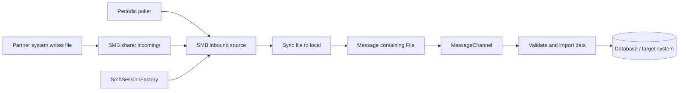
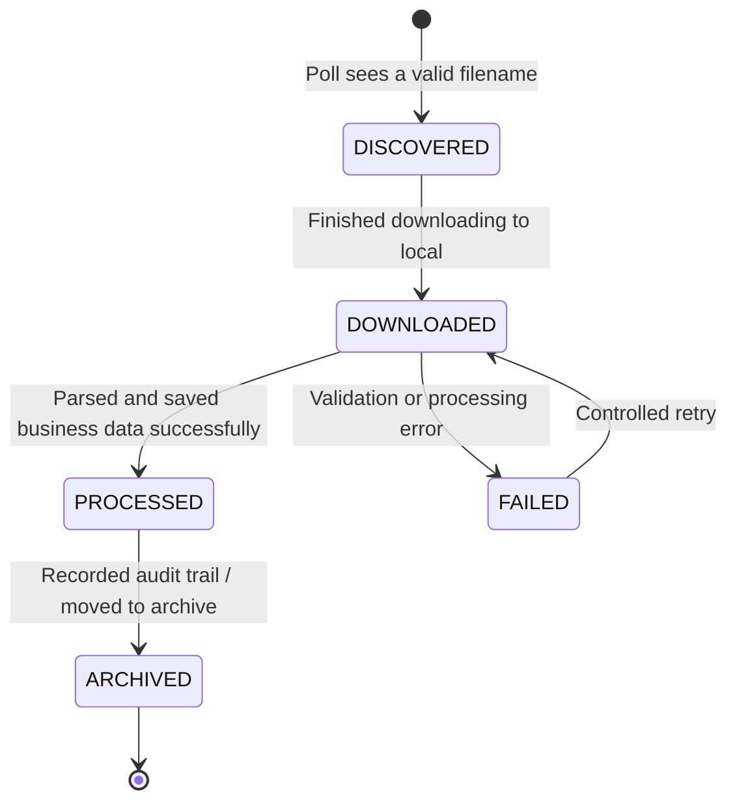

# SMB Inbound Adapter Reading a Shared Directory

## 1. Problem and Objectives

An accounting system places `invoice-2026-11-23.csv` files into a directory shared via SMB (Server Message Block). A Spring Boot application must periodically detect new files, download them to local storage, and forward them to an invoice import service. The source system neither calls an HTTP API nor sends messages through a broker; the only integration point is the **shared directory**.

The **SMB inbound channel adapter** handles the *file reception* part: it connects to the SMB server, lists and synchronizes files to the application machine, and then emits messages for Spring Integration to process. This is a concrete example of connecting an external system to Spring Integration via an **inbound adapter + poller + MessageChannel**. Mechanisms such as routing, payload transformation, error handling, and connection lifecycle management can be reused when integrating with files, SFTP, HTTP, JMS, AMQP, Kafka, or databases; only how data is fetched and each adapter's message contract differ.

After this lesson, learners will be able to:

- Distinguish between a local-sync SMB inbound adapter and a streaming inbound adapter.
- Configure `SmbSessionFactory`, the shared directory, file filters, and the poller using Java DSL.
- Explain when a `Message<File>` is emitted and the role of `MessageChannel`.
- Choose fetch limits, deduplication mechanisms, and file publication conventions to avoid reading partially written files.
- Design observability, testing, and error handling without losing source files.

## 2. Understanding SMB Inbound Correctly

SMB is a protocol for accessing shared resources over a network, commonly used with Windows File Server, NAS, or Samba. For example, a path viewed from a Windows user's perspective is `\\fileserver\partners\incoming`. In code, configuration is typically split into **host** (`fileserver`), **share** (`partners`), and **directory inside the share** (`incoming`). The application must have network connectivity to the server (standard port: TCP 445) and an account with read permissions.

An SMB inbound adapter is a **message source** triggered by a poller; it is not an SMB server service and does not automatically receive an event every time a file appears. If the application stops running, the server can still retain files for the application to retrieve after restarting, depending on the partner's file retention policy.

### Components and Responsibilities

| Component | Role | Things to Note |
|---|---|---|
| `SmbSessionFactory` | Creates SMB access sessions using host, share, credentials, and protocol version | Connectivity, authentication, permissions, and session lifecycle |
| `SmbInboundFileSynchronizer` | Lists, filters, and copies files from SMB to a local directory | Remote filter, remote directory, source file deletion policy |
| `SmbInboundFileSynchronizingMessageSource` | Reads synchronized local files and creates messages | Local directory, local filter, and `File` payload |
| `Smb.inboundAdapter(...)` | Configures the components above via Java DSL | Concise syntax when declaring an `IntegrationFlow` |
| `Poller` | Periodically asks the source for messages | Polling interval, messages per poll, errors during the poll task |
| `MessageChannel` | Delivers messages to downstream steps | Can be `DirectChannel`, `QueueChannel`, or another channel depending on requirements |
| Handler/transformer | Validates, reads CSV, writes to the database, or calls another system | Responsible for business logic, retries, and idempotency |



For example: the poll at 10:00 sees `invoice-001.csv`, which matches the filter. The adapter downloads the file to `./data/smb-inbox/invoice-001.csv`, then emits a message whose `payload` is a `java.io.File` object pointing to the local file. A handler can open that file to read the CSV content. If there are no matching files or no data to emit yet, a poll may produce no messages.

### Local Sync vs. Streaming

| Criterion | Local-Sync Inbound | Streaming Inbound |
|---|---|---|
| Typical payload | `File` | `InputStream` |
| Save file locally before processing | Yes | Not required |
| Benefits | Re-read files, inspect with other tools, decouple download and processing | Reduces disk storage needs |
| Trade-offs | Requires disk space and a cleanup process | Must manage stream/session lifecycle properly |
| Best suited for | Batch imports, keeping audit evidence, or reprocessing | Sequential reading of large files or streams without local persistence |

`SmbStreamingMessageSource` is a different component. With streaming, the associated session must be closed after reading; standard components such as `StreamTransformer`/`FileSplitter` support closing resources, whereas custom handlers must ensure this themselves. The main hands-on section below uses **local synchronization**.

## 3. Setting Up the Hands-On Lab

Assume the system has a share named `exchange`, a subdirectory `incoming`, and an account `integration_reader` permitted to list and read files. The application will download all `.csv` files published by the partner into `./data/smb-inbox` and process them through a `DirectChannel`.

**Gradle** (letting Spring Boot manage compatible library versions):

```gradle
dependencies {
    implementation 'org.springframework.boot:spring-boot-starter-integration'
    implementation 'org.springframework.integration:spring-integration-smb'
}
```

If you do not use Spring Boot dependency management, you must choose a `spring-integration-smb` version compatible with the remaining Spring Integration artifacts. The API illustrated below follows the Spring Integration 6.x line.

**`application.yml`:**

```yaml
demo:
  smb:
    host: ${SMB_HOST}
    port: ${SMB_PORT:445}
    domain: ${SMB_DOMAIN:}
    username: ${SMB_USERNAME}
    password: ${SMB_PASSWORD}
    share: ${SMB_SHARE:exchange}
    remote-directory: ${SMB_REMOTE_DIRECTORY:incoming}
    local-directory: ${SMB_LOCAL_DIRECTORY:./data/smb-inbox}
```

The variables `SMB_HOST`, `SMB_USERNAME`, and `SMB_PASSWORD` are supplied from the runtime environment or a secret manager; never put real passwords in Git, source code, logs, or shared examples. `domain` can be left empty if the server and authentication method allow it. On Windows, you can change `local-directory` to a path such as `C:/app/data/smb-inbox`; on Linux, you need a directory to which the process has write permission.

### Java DSL Example

```java
import java.io.File;

import jcifs.DialectVersion;
import org.springframework.beans.factory.annotation.Value;
import org.springframework.context.annotation.Bean;
import org.springframework.context.annotation.Configuration;
import org.springframework.integration.channel.DirectChannel;
import org.springframework.integration.config.EnableIntegration;
import org.springframework.integration.dsl.IntegrationFlow;
import org.springframework.integration.dsl.Pollers;
import org.springframework.integration.smb.dsl.Smb;
import org.springframework.integration.smb.session.SmbSessionFactory;
import org.springframework.messaging.MessageChannel;

@Configuration
@EnableIntegration
public class SmbInboundConfig {

    @Bean
    SmbSessionFactory smbSessionFactory(
            @Value("${demo.smb.host}") String host,
            @Value("${demo.smb.port}") int port,
            @Value("${demo.smb.domain}") String domain,
            @Value("${demo.smb.username}") String username,
            @Value("${demo.smb.password}") String password,
            @Value("${demo.smb.share}") String share) {

        SmbSessionFactory factory = new SmbSessionFactory();
        factory.setHost(host);
        factory.setPort(port);
        factory.setDomain(domain);
        factory.setUsername(username);
        factory.setPassword(password);
        factory.setShareAndDir(share);
        factory.setSmbMinVersion(DialectVersion.SMB210);
        factory.setSmbMaxVersion(DialectVersion.SMB311);
        return factory;
    }

    @Bean
    MessageChannel smbReadyFiles() {
        return new DirectChannel();
    }

    @Bean
    IntegrationFlow smbInboundFlow(
            SmbSessionFactory factory,
            @Value("${demo.smb.remote-directory}") String remoteDirectory,
            @Value("${demo.smb.local-directory}") String localDirectory) {

        return IntegrationFlow
            .from(Smb.inboundAdapter(factory)
                    .remoteDirectory(remoteDirectory)
                    .regexFilter("(?i).*\\.csv$")
                    .localDirectory(new File(localDirectory))
                    .autoCreateLocalDirectory(true)
                    .preserveTimestamp(true)
                    .maxFetchSize(5),
                endpoint -> endpoint.id("smbInboundEndpoint")
                    .autoStartup(true)
                    .poller(Pollers.fixedDelay(10_000)
                        .maxMessagesPerPoll(5)))
            .channel("smbReadyFiles")
            .handle(message -> {
                File localFile = (File) message.getPayload();
                // Replace with a service that validates, imports data, and records the result.
                System.out.println("Received SMB file: " + localFile.getAbsolutePath());
            })
            .get();
    }
}
```

Key points when reading this configuration:

1. `setShareAndDir(share)` specifies the root share (`exchange`); `remoteDirectory("incoming")` selects the relative directory inside the share. Check the actual path on the server to avoid duplicating the share name.
2. `regexFilter("(?i).*\\.csv$")` only accepts names ending in `.csv`, case-insensitively. The filter is applied when selecting remote files, prior to downloading.
3. `localDirectory(...)` and `autoCreateLocalDirectory(true)` create the storage location for downloaded files. `preserveTimestamp(true)` preserves the modification time transferred from the source file, which is useful for reconciliation.
4. `maxFetchSize(5)` limits the number of files downloaded from the server in a single fetch batch; `maxMessagesPerPoll(5)` limits the number of messages the poller emits per cycle. These are **two distinct limits**.
5. `smbReadyFiles` is a `DirectChannel`: the handler executes synchronously on the message-dispatching thread, so a slow handler can extend the duration of the poll task. When switching to asynchronous processing, you must review ordering, system load, and file lifecycle safety.
6. The sample handler only prints the path for observation; **it is not data import and success-recording logic**. In a production system, replace it with file validation, CSV parsing, and data persistence with deduplication.

In Java DSL, `Smb.inboundAdapter(...)` builds components equivalent to the traditional `SmbInboundFileSynchronizer` + `SmbInboundFileSynchronizingMessageSource` model. If you need deep customization of filters or synchronization behavior, you can declare these two beans separately and use `@InboundChannelAdapter` to trigger the source on a poller.

## 4. Message Contract and Responsibility Boundaries

In the local-sync approach, **the payload is `java.io.File`**. The payload holds the path and file attributes, not the CSV content itself. To process data rows, you must read the file using a suitable parser library (such as Apache Commons CSV or Jackson CSV) and verify encoding and formatting.

| Information | Example | How to Use |
|---|---|---|
| `payload` | `File("./data/smb-inbox/invoice-001.csv")` | Open the downloaded file to validate/import data |
| Standard header `id` | Message UUID | Track a message in the flow; **not** the unique business key of the file |
| Standard header `timestamp` | Time the message was created | Used for tracing; does not replace the source file's `lastModified` |
| Source name/path | Share `exchange`, directory `incoming` | Can be used in a business key; to preserve metadata across all steps, explicitly add application headers |
| Idempotency key | `partnerA/invoice-001.csv` with version/hash | Designed by the system to prevent duplicate processing across restarts/retries |

For example, the adapter might emit the same local path at two different times if the filter or metadata is reset. Different message `id` values do not prove two invoices are different. Build business keys from the partner code, batch code, checksum/content, or identifying fields agreed upon in the file exchange contract.

### Success Confirmation Boundaries

For each file processing run, you should separate three milestones:



`DOWNLOADED` **does not mean `PROCESSED`**. Successful synchronization and successful database persistence belong to two different steps. Therefore, do not delete the source file immediately upon download if business requirements only allow deletion after data import succeeds.

## 5. Poller, File Filtering, and Load Throttling

### How Does the Poller Work?

With `fixedDelay(10_000)`, the next trigger is scheduled after the delay measured from when the previous poll task finishes; this is not a guarantee of receiving a message every 10 seconds. Slow connections, many files, or long-running handlers will make the actual interval longer.

With the limits in the example and assuming the local directory is initially empty:

| `maxFetchSize` | `maxMessagesPerPoll` | Expected Behavior |
|---:|---:|---|
| 1 | 5 | One sync batch fetches at most 1 file; the poller may keep receiving more within the same cycle until the message limit is reached |
| 5 | 2 | Up to 5 files may be downloaded, but at most 2 messages are emitted in the cycle; remaining local files wait for the next cycle |
| 5 | 5 | Limits fetched files per batch and emitted messages to matching levels, easy to control in the lab |

Limits are not fixed processing rates: filters, files already present locally, connectivity, and handler duration can all make the actual count lower. When multiple instances read from the same share, choose a small `maxFetchSize` and use a state coordination mechanism so one instance does not monopolize all pending files.

### New Files Not Yet Finished Writing

Seeing `invoice-001.csv` appear in SMB does not guarantee the partner has closed the file. If downloaded while the partner is still writing, the application risks reading incomplete content. There are two main approaches:

- **Rename-on-publish convention:** the partner uploads `invoice-001.csv.part`, writes and closes it, and then renames it within the same share to `invoice-001.csv`. The adapter only picks up the final `.csv`. This is usually the clearest approach if you control the source system.
- **File age filtering:** use `SmbLastModifiedFileListFilter` (available since Spring Integration 6.2) to pick up only files whose modification time is older than a sufficiently large threshold relative to now. For example, consider a threshold of a few minutes based on file size and upload method. File age reduces risk, though it does not prove writing has completed in all scenarios.

In addition, `SmbSimplePatternFileListFilter` and `SmbRegexPatternFileListFilter` support name filtering. You can combine conditions with `CompositeFileListFilter`; check the order and semantics of each filter when combining name, age, and deduplication filters.

### Remote Filtering vs. Local Filtering

**Remote filter** decides which files on SMB are synchronized to the application machine. **Local filter** decides which downloaded files are emitted as messages. This affects two scenarios:

- The adapter downloaded the file, but the handler has not processed it yet: the local file may remain there for the next poll to emit, depending on the local filter and tracking state.
- Restart or deploying another instance: an in-memory filter may lose the history of seen files; files still present on SMB may be downloaded again.

To prevent duplicate processing after restarts or across multiple instances, look into an accept-once filter backed by a **persistent metadata store** (e.g., a Redis/JDBC metadata store suited to your deployment) combined with an idempotency key at the business layer. Never assume an inbound adapter configuration provides `exactly-once` semantics from file discovery through data commit.

## 6. Safe Design for Production Operations

### Post-Processing File Management

Recommended strategy for the invoice import problem:

1. The partner writes `.part` and publishes the `.csv` name upon completion.
2. The inbound adapter downloads files to the local directory, filtering only valid files.
3. The handler validates format, partner ID, batch ID, and checksum; persists data within an appropriate transaction.
4. Only after processing success is recorded, move the file to `archive/` or update the source status as agreed by both parties.
5. On failure, retain sufficient files and metadata for retries or move them to a `quarantine/` area, avoiding deleting input evidence.

`deleteRemoteFiles(true)` can be set on the **synchronizer** to delete files after they are successfully transferred locally. This option serves a source-cleanup policy after **synchronization**, without waiting for the business handler to finish. If business rules require deletion only after committing to the database, do not enable that option out of habit; handle deletion/moving after confirmed success using a controlled flow or appropriate gateway.

### Error Handling and Retries

| Error | Symptom | Resolution |
|---|---|---|
| Cannot connect to TCP 445 | Poller cannot download files, timeouts | Check DNS, routing, firewall, SMB server, and port |
| Wrong credentials or insufficient permissions | Authentication failure / cannot list directory | Check domain, share permissions, and directory permissions (ACL) |
| Wrong share or remote directory | Files not visible even though partner reports sending | Check root share and subdirectory components, and `/` path rules |
| File still being written | Missing parsed rows, bad checksum, truncated data | Rename-on-publish or filter by modification time |
| Out of local disk space | Synchronization fails | Monitor spool disk usage, enable alerts, define post-success cleanup policy |
| Malformed CSV | Message received but import fails | Save failed file, log batch ID, route to error/quarantine branch |
| File processed multiple times | Duplicate records | Persistent filter combined with idempotency keys and database constraints |

With errors in a synchronous handler over `DirectChannel`, exceptions can propagate back to the poll task and be handled via Spring Integration's error mechanisms. When building for production, configure bounded retries, backoff, an error channel, or advice tailored **to the exact failure point**, while distinguishing transient connection errors from content errors that should not be retried indefinitely. Log filenames, sources, attempt counts, error codes, and correlation IDs; mask credentials.

### Sessions, Security, and Multi-Instance Deployment

- Choose the SMB dialect permitted by your organization; for example, `SMB210` through `SMB311` in the sample. Avoid downgrading to SMBv1 merely to work around connection errors. Actual configuration must align with the server and security policies.
- The inbound account should only have the permissions it needs. Write/delete permissions should be granted separately only if the workflow genuinely requires remote archiving or cleanup.
- `SmbSessionFactory` creates sessions for SMB interaction; under high polling frequency, you can wrap it with `CachingSessionFactory` to reuse sessions and cap connection counts. Pool configuration must include timeouts, limits, and monitoring of active sessions.
- With multiple pods/instances, do not rely on an in-memory metadata store for coordination. Design shared locking, failover pickup when a node dies, and independent local storage per node.
- Local data may contain sensitive information. Apply directory permissions, retention periods, disk encryption if needed, and deletion rules after business confirmation.

## 7. Hands-On Practice and Verification

**Prerequisites:** an SMB/NAS/Samba server you have access to, an `exchange` share containing an `incoming` directory, environment variables matching the configuration, and a Spring Boot application containing the sample flow. No production data changes are needed for this exercise.

**Scenario 1 – Receiving a new file:**

1. Start the application and confirm `./data/smb-inbox` is created with no connection errors.
2. Upload `invoice-001.csv.part` to the share, for example with content:

   ```csv
   invoice_id,customer_id,amount
   INV-001,CUS-17,120000
   INV-002,CUS-18,85000
   ```

3. Observe that `.part` is not picked up; after closing and renaming it to `invoice-001.csv`, wait one or a few poll cycles.
4. Verify the CSV file exists locally and the log prints the `File` payload path. If you have a CSV parsing handler, verify there are exactly two records and a total amount of `205000` in the sample data's unit.

**Scenario 2 – Multiple files:** place 8 `.csv` files in the directory and observe them being synchronized/emitted as messages across cycles. Compare the actual throughput against `maxFetchSize(5)`, `maxMessagesPerPoll(5)`, and handler execution time.

**Scenario 3 – Errors and recovery:** temporarily disconnect SMB or adjust read permissions in the lab environment and record the error; restore permissions/connectivity and verify the file is still picked up. Do not assume a disconnect will automatically produce a successful duplicate or skip the file: inspect the actual file state and filter state.

**Scenario 4 – Restart:** after processing `invoice-001.csv`, restart the application and observe whether the file is re-emitted. Experiment with changing the metadata store/filter in the lab to understand why a payment or invoice import system must have business-layer idempotency.

**Completion criteria:** be able to explain the difference between *downloaded* and *processed*, identify the share/remote/local paths, verify `Message<File>` at the handler, know how to throttle polling, and propose an appropriate retry/deduplication policy.

## 8. Common Misconceptions

| Misconception | Accurate Understanding |
|---|---|
| The inbound adapter receives push events from SMB | The adapter actively polls; the fetch cadence is controlled by the poller |
| The payload is the CSV string itself | With the local-sync adapter, the payload is a `File`; you must open the file to read its data |
| Successful file download means successful import | File synchronization and business commit are two separate milestones |
| `maxFetchSize` equals `maxMessagesPerPoll` | One parameter limits files fetched remotely; the other limits messages emitted per cycle |
| Having an accept-once filter guarantees exactly-once | Filters are bounded by stored state; business logic still needs idempotency and a retry policy |
| SMB files can always be deleted right after sync | Only appropriate if the workflow accepts confirmation at sync time rather than after processing |
| Any file ending in `.csv` is ready to read | The partner may still be writing it; a file-publication convention or stability rule is needed |

## 9. References

- [Spring Integration – SMB Support](https://docs.spring.io/spring-integration/reference/6.5/smb.html): session factory, inbound adapter, streaming adapter, and Java DSL.
- [SmbInboundChannelAdapterSpec API](https://docs.spring.io/spring-integration/docs/6.5.0/api/org/springframework/integration/smb/dsl/SmbInboundChannelAdapterSpec.html): `regexFilter`, `localDirectory`, `maxFetchSize`, and `remoteFileMetadataStore` options.
- [SmbSessionFactory API](https://docs.spring.io/spring-integration/docs/6.5.x/api/org/springframework/integration/smb/session/SmbSessionFactory.html): session configuration, credentials, and SMB dialect.

**Key takeaway:** The SMB inbound adapter is responsible for bringing files from an external system into a Spring Integration flow as messages. The reliability of the overall integration also depends on the file publication contract, filters, business processing state, error handling, and connection management.
