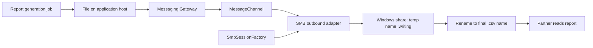
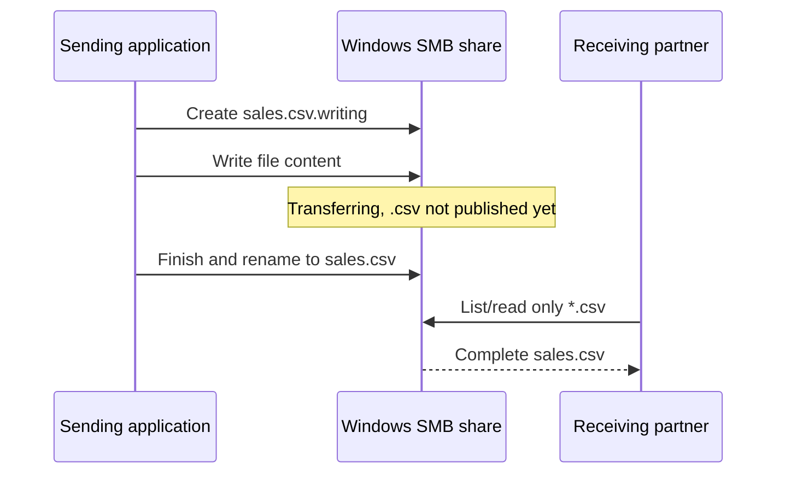
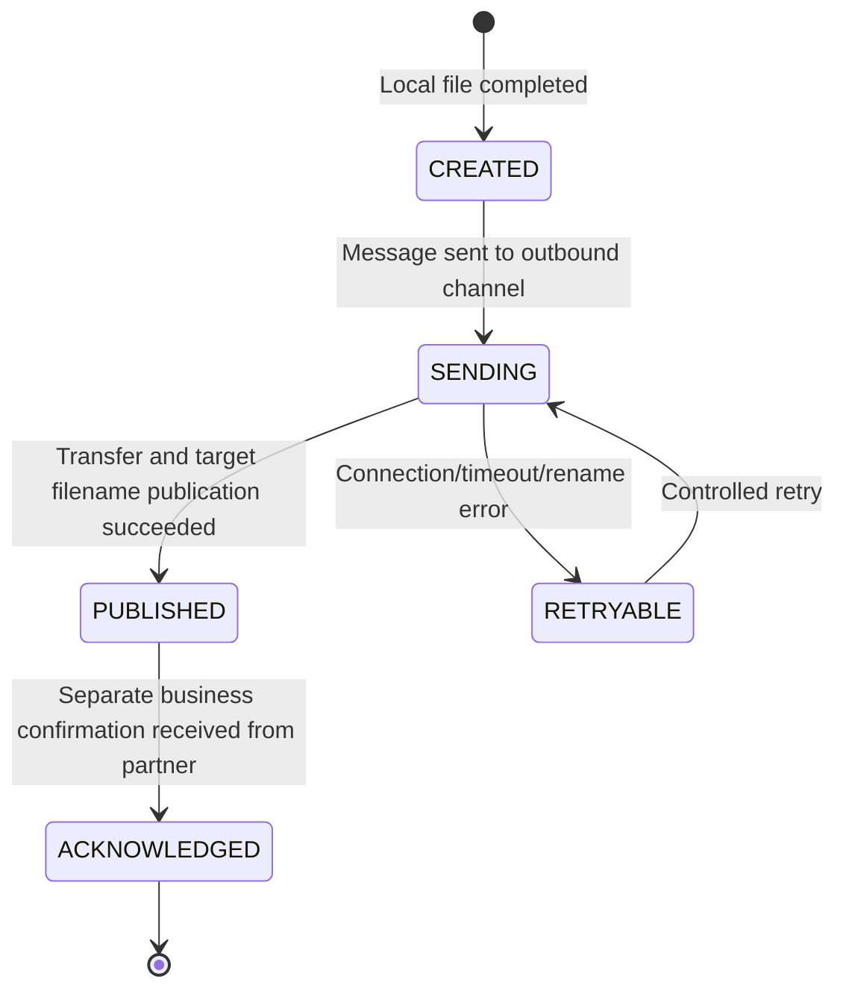

# SMB Outbound Adapter Writing to a Windows Share

## 1. Problem and Desired Outcome

A Spring Boot application aggregates daily revenue reports. The partner only accepts reports by reading a **Windows shared folder** (a directory shared via SMB), such as `\\fs01\partner-data\outgoing\daily`. After generating `sales-2026-11-23.csv` on the application machine, the system needs to write that file to the share for the partner to pick up and process.

In Spring Integration, the **SMB outbound channel adapter** handles delivering a message's content from the application to an SMB directory. The adapter actively opens a connection to the SMB server, sends the data, and can publish the official filename once transmission finishes. This is an example of integrating with an external system using an **outbound adapter**, **MessageChannel**, and **Message** contract. This one-way transfer mechanism can work alongside inbound adapters, gateways, routers, and error-handling steps in a larger flow; the same connection mindset applies to files, SFTP, HTTP, JMS, AMQP, Kafka, or databases, even though each system's API and confirmation capabilities differ.

After this lesson, you will be able to:

- Describe the `Message<File>` → `MessageChannel` → `SmbMessageHandler` → Windows share flow and distinguish outbound from inbound/gateway.
- Configure `SmbSessionFactory`, `IntegrationFlow`, `Smb.outboundAdapter(...)`, and `@MessagingGateway` using Java DSL.
- Define target naming and directory rules, behavior on filename collisions, and temporary-filename upload followed by rename.
- Explain when the send call completes, what errors can occur, and the limits of delivery guarantees.
- Design testing, monitoring, retries, and idempotency to avoid corrupting or duplicating business data.

## 2. How Does the Outbound Adapter Work?

SMB (Server Message Block) is a network file-sharing protocol commonly used with Windows Server, NAS, or Samba. Given a Windows path:

```text
\\fs01\partner-data\outgoing\daily\sales-2026-11-23.csv
 └host┘  └──share───┘ └remote dir──┘ └──filename──────┘
```

The application can configure these as independent values:

| Value | Example | Meaning |
|---|---|---|
| `host` | `fs01` | SMB server hostname or IP address |
| `port` | `445` | Standard direct-TCP SMB port |
| `share` | `partner-data` | Share name granted to the application |
| `remoteDirectory` | `outgoing/daily` | Subdirectory **inside the share** |
| Filename | `sales-2026-11-23.csv` | Target name determined by the naming strategy |
| Local file | `./data/outbox/sales-2026-11-23.csv` | Input data on the application machine |

`remoteDirectory` is usually expressed with `/` in adapter configuration, even when the partner accesses the same path with `\` on Windows. Do not repeat the share name inside `remoteDirectory` when `setShareAndDir(...)` already points to the root share; otherwise, the application may write into a nested directory by mistake.



A typical flow has these milestones:

1. The report generator finishes writing and closes the local file.
2. The application sends a `Message` with a `java.io.File` payload to a channel.
3. `SmbMessageHandler` uses `SmbSessionFactory` to open a session, select the target directory, transfer the content, and perform completion steps according to the configuration.
4. If all required operations succeed, the synchronous send call returns; otherwise, an exception is thrown to the error-handling path.
5. The partner system independently decides when to open, verify, and import the file.

**Key distinction:** an outbound adapter receives a message and **writes a file outward**; it does not poll SMB for new files. A poller only appears if the *flow's input source* is a scheduled `MessageSource` (for example, fetching pending export records from a database). SMB **inbound** is the direction that pulls files from the share into the application. An **outbound gateway** supports request-reply commands such as `ls`, `get`, `put`, `rm`, and `mv`; an outbound adapter is used when you only need a one-way file-sending operation.

## 3. Components to Understand

| Component | Responsibility in Example | Limitations to Remember |
|---|---|---|
| `SmbSessionFactory` | Configures host, share, credentials, SMB dialect, and creates sessions | Does not replace permissions on the Windows share and NTFS |
| `MessageChannel` | Delivers messages to the file-sending endpoint | With `DirectChannel`, runs on the caller thread; with async channels, outcomes and errors are observed differently |
| `SmbMessageHandler` | Executes file writes to SMB | Does not verify that the partner has read or imported the data |
| `Smb.outboundAdapter(...)` | Declares the handler via Java DSL | Typically configures remote directory, filename, mode, and temporary naming |
| `FileExistsMode` | Decides what happens when the target file already exists | Must be chosen based on the naming contract and retry capability |
| `@MessagingGateway` | Lets business code invoke the flow via a Java interface | Not the same as an **SMB outbound gateway** executing `ls/get/put` commands |
| `SmbRemoteFileTemplate` | Lower-level API for remote operations when checking/moving/deleting files | Multi-step operations must design their own success, failure, and retry conditions |

Architecturally, the *adapter* is the boundary between Spring Integration's message model and the SMB protocol. Upstream business handlers only need to produce a valid file and emit a message; they do not have to manage SMB connections or open copy streams to UNC paths themselves.

## 4. Setting Up the Example with Spring Boot and Java DSL

Assume the application uses Spring Boot 3.x and a compatible Spring Integration 6.x line; specific versions are managed by the project's dependency management. The server is `fs01`, the share is `partner-data`, and the target directory is `outgoing/daily`. The integration account has permissions to **create, write, and rename files** in the target directory.

### 4.1. Dependencies

**Gradle:**

```gradle
dependencies {
    implementation 'org.springframework.boot:spring-boot-starter-integration'
    implementation 'org.springframework.integration:spring-integration-smb'
}
```

If you are not using the Spring Boot BOM or an equivalent dependency management mechanism, choose Spring Integration artifacts with mutually compatible versions. The example below uses APIs available in the 6.x line.

### 4.2. Environment Configuration

**`application.yml`:**

```yaml
demo:
  smb:
    host: ${SMB_HOST}
    port: ${SMB_PORT:445}
    domain: ${SMB_DOMAIN:}
    username: ${SMB_USERNAME}
    password: ${SMB_PASSWORD}
    share: ${SMB_SHARE:partner-data}
    remote-directory: ${SMB_REMOTE_DIRECTORY:outgoing/daily}
```

Example environment variables in a lab environment:

```text
SMB_HOST=fs01
SMB_USERNAME=integration_writer
SMB_PASSWORD=<from secret manager>
SMB_SHARE=partner-data
SMB_REMOTE_DIRECTORY=outgoing/daily
```

Do not put real passwords into Git, credentialed URLs, screenshots, or logs. `SMB_DOMAIN` only needs to be populated if the server's authentication policy requires a domain; leave it empty when appropriate. In production, provision secrets through your organization's secret management tool.

### 4.3. Session Factory and Outbound Flow

**`SmbOutboundConfig.java`:**

```java
import jcifs.DialectVersion;

import org.springframework.beans.factory.annotation.Value;
import org.springframework.context.annotation.Bean;
import org.springframework.context.annotation.Configuration;
import org.springframework.integration.annotation.IntegrationComponentScan;
import org.springframework.integration.config.EnableIntegration;
import org.springframework.integration.dsl.IntegrationFlow;
import org.springframework.integration.file.remote.FileExistsMode;
import org.springframework.integration.smb.dsl.Smb;
import org.springframework.integration.smb.session.SmbSessionFactory;

@Configuration
@EnableIntegration
@IntegrationComponentScan
public class SmbOutboundConfig {

    @Bean
    SmbSessionFactory smbSessionFactory(
            @Value("${demo.smb.host}") String host,
            @Value("${demo.smb.port}") int port,
            @Value("${demo.smb.domain}") String domain,
            @Value("${demo.smb.username}") String username,
            @Value("${demo.smb.password}") String password,
            @Value("${demo.smb.share}") String share) {

        SmbSessionFactory factory = new SmbSessionFactory();
        factory.setHost(host);
        factory.setPort(port);
        factory.setDomain(domain);
        factory.setUsername(username);
        factory.setPassword(password);
        factory.setShareAndDir(share);
        factory.setSmbMinVersion(DialectVersion.SMB210);
        factory.setSmbMaxVersion(DialectVersion.SMB311);
        return factory;
    }

    @Bean
    IntegrationFlow smbOutboundFlow(
            SmbSessionFactory sessionFactory,
            @Value("${demo.smb.remote-directory}") String remoteDirectory) {

        return IntegrationFlow.from("toSmbChannel")
                .handle(Smb.outboundAdapter(sessionFactory, FileExistsMode.FAIL)
                        .remoteDirectory(remoteDirectory)
                        .autoCreateDirectory(true)
                        .fileNameExpression("payload.name")
                        .useTemporaryFileName(true))
                .get();
    }
}
```

In this configuration:

- `setShareAndDir(share)` sets the root of the SMB connection to the `partner-data` share.
- `.remoteDirectory("outgoing/daily")` specifies the target directory inside the share. `.autoCreateDirectory(true)` requests creating the directory if missing; the account needs sufficient permissions, otherwise the operation fails.
- `FileExistsMode.FAIL` raises an error if the target filename already exists, which is useful when exporting **a unique name per batch**. Section 5 explains the other options.
- `.fileNameExpression("payload.name")` takes the original filename from the `java.io.File` payload. This configuration **intentionally expects only a File payload**, so it cannot be applied verbatim to `String`/`byte[]` messages without changing the expression.
- `.useTemporaryFileName(true)` writes using a temporary name during transfer and renames to the official name upon completion, helping the partner avoid picking up partially sent files. Final behavior depends on rename support and granted permissions on the SMB server.
- `IntegrationFlow.from("toSmbChannel")` creates/resolves a channel by name; messages sent to the channel are handled by the outbound handler.

To keep the example easy to observe, the flow uses a direct channel with a single handler. The outbound adapter is a message-receiving endpoint, not a scheduler. If reports are generated on a schedule, that schedule lives in the upstream job or initial data-fetching flow.

### 4.4. Calling the Adapter from Business Code via Messaging Gateway

**`PartnerSmbGateway.java`:**

```java
import java.io.File;

import org.springframework.integration.annotation.Gateway;
import org.springframework.integration.annotation.MessagingGateway;

@MessagingGateway
public interface PartnerSmbGateway {

    @Gateway(requestChannel = "toSmbChannel")
    void upload(File localFile);
}
```

The interface must be within Spring's component scan and `@IntegrationComponentScan` scope. After the application has created and closed a report file, a service can call:

```java
File report = new File("./data/outbox/sales-2026-11-23.csv");
if (!report.isFile() || !report.canRead()) {
    throw new IllegalStateException("Cannot read local report: " + report);
}
partnerSmbGateway.upload(report);
```

`partnerSmbGateway` is the bean injected from the interface above. With the default `DirectChannel` in the sample flow, calling `upload(...)` executes the handler synchronously; exceptions while writing to SMB propagate back to the caller as a messaging exception or wrapped cause. The call returns no response payload because this is a **one-way outbound channel adapter**, not a query for partner confirmation.

After a successful file transfer, the expected target location is:

```text
\\fs01\partner-data\outgoing\daily\sales-2026-11-23.csv
```

This is a **server-side** path; the application does not need to mount the Windows share to a local drive. SMB permissions, DNS, and network routing to TCP 445 must still be configured in infrastructure.

## 5. Filenames, Target Directories, and Existence Policies

### 5.1. Naming Files According to Contract

With a `File` payload, Spring Integration has a default naming strategy based on the `FileHeaders.FILENAME` header (if present) or the filename. The example explicitly specified `.fileNameExpression("payload.name")` to avoid header dependency and make the contract clear: **the filename on the share equals the local filename**.

In real-world flows, you may want names containing a partner ID, batch ID, export date, or report version, for example:

```text
sales_partnerA_20261123_batch007.csv
```

When you need to read the name from a message header, you can use an expression such as:

```java
.fileNameExpression("headers['file_name']")
```

`file_name` is the header value defined by `FileHeaders.FILENAME`. If you use this expression, **the upstream message must provide a valid header**; a missing header can cause errors or invalid filenames. For header values originating from users or external systems, strip path characters, `..`, `/`, `\`, and invalid Windows filename characters. Never allow an arbitrary header to change the target directory or overwrite files outside the allowed area.

For Windows shares, avoid forbidden filename characters such as `<`, `>`, `:`, `"`, `/`, `\`, `|`, `?`, `*`, and check filename/path length limits as well as trailing spaces or dots per server policy. Agree with the partner on encoding, timezone, casing, and timestamp conventions in filenames.

### 5.2. Choosing `FileExistsMode`

When the application sends the same filename again, there must be a clear rule:

| `FileExistsMode` | When Target Filename Exists | When to Use |
|---|---|---|
| `FAIL` | Does not overwrite; throws an error | Each batch must have a unique name; overwriting old data is unacceptable |
| `REPLACE` | Replaces old file contents | The contract defines one name for the latest version and overwriting is acceptable |
| `IGNORE` | Skips transferring the duplicate filename | Only when a separate mechanism verifies the existing file has the exact expected content |
| `APPEND` | Appends data to the end of the existing file | Only when the format and partner permit appending, with concurrency controls |

API or version defaults can vary by command type; in this lesson **always declare `FileExistsMode` explicitly**. For daily CSV files, `APPEND` is usually dangerous because retries can append duplicate lines or break CSV structure. `REPLACE` is unsuitable if the report may already be read by the partner and mutating the same filename causes nondeterministic results. `IGNORE` does not prove two files share the same checksum.

A practical rule is: **immutable name per batch + `FAIL` + delivery state persisted in the application**. If the file already exists on retry, inspect the previous send state and checksum on the partner side (if a check mechanism exists); do not blindly treat every duplicate-name error as "sent successfully."

### 5.3. Avoiding Publishing Partially Written Files

If the adapter writes directly to `sales.csv`, the partner system may see and open the file while only part of it has been written. Remote-file outbound adapters support a **temporary filename** mechanism: transfer content under a name with a temporary suffix (commonly `.writing`), then rename it upon completion.



Conditions for this solution to be effective:

- The partner side **only scans the official extension**, such as `*.csv`, and ignores `.writing`.
- The application account has permissions to create, write, and **rename** in the target directory.
- The temporary file and official file reside in the same suitable location so the server can perform the rename; never assume cross-share moves are atomic.
- If the network drops mid-transfer or rename fails, `.writing` files may be left behind. You need a way to detect and handle stale temporary files; never blindly delete files that another process might still be writing.

Renaming after upload reduces the risk of the receiver reading an incomplete file, but **it is not a two-way business confirmation protocol**. The partner still needs to validate structure, checksums, or marker files if required by the contract.

## 6. Message Contract and One-Way Semantics

The sample uses `java.io.File`:

| Message Part | Example | Meaning |
|---|---|---|
| Payload | `File("./data/outbox/sales-2026-11-23.csv")` | A file that **already exists and is completely written** on the application host |
| Header `id` | UUID generated by Spring Message | Used for tracing; not a stable batch ID across retries |
| Header `timestamp` | Message creation time | Not the time the partner processes the file |
| Header `file_name` | `sales_partnerA_batch007.csv` (when present) | Can be used by the target naming strategy if the flow is configured to read the header |
| Business metadata | `partnerId`, `batchId`, `checksum` | Defined by the application and saved alongside send state to check retries/idempotency |

Adapters can support other payload types under the remote file outbound mechanism such as strings or bytes, but **do not assume `payload.name` works for every type**. If sending `byte[]` or `String`, you must change the naming strategy, handle encoding, enforce size limits, and manage file creation responsibilities to match the payload.

Consider the states:



`PUBLISHED` means the SMB write and file publication operation succeeded from the application's perspective. It **does not guarantee** the partner has read, verified, or imported the file; `ACKNOWLEDGED` exists only if both sides have a separate confirmation process (such as an ACK file, status table, or API). If you need to distinguish these two milestones reliably, the one-way outbound adapter must sit inside a broader business protocol.

Moreover, a timeout can occur after the server has received all the data but before the application reads the response. That creates an **uncertain state**: blind retries with `REPLACE`/`APPEND` can corrupt outcomes, while `FAIL` reports the file already exists. Persist the `batchId` key and implement a reconciliation mechanism instead of inferring success solely from the absence of an exception in a prior call.

## 7. Error Handling, Retries, and Connection Lifecycle

### 7.1. Errors You May Encounter

| Scenario | Symptom | How to Check and Handle |
|---|---|---|
| DNS or network cannot reach TCP 445 | Timeout, connection refused | Check server name, routing, firewall, SMB service |
| Wrong domain/username/password | Authentication error | Check secrets and login policy; avoid printing credentials in logs |
| Share permission granted but missing NTFS permission | Can list but cannot write/rename | Check share permissions, NTFS ACLs, and rename/delete permissions together |
| Wrong or missing `remoteDirectory` | File ends up in wrong folder, path creation error | Verify host/share/subdirectory; verify directory creation permissions |
| Target already exists with `FAIL` mode | Exception on duplicate filename | Reconcile `batchId`, checksum, and prior send state |
| Network drops mid-upload | Incomplete temp file remains, task fails | Check stale `.writing` files; controlled retry and conditional cleanup |
| Local file missing or still being written | Source read error or inconsistent file | Only send after file creation finishes; use local publication rules |
| Partner reads while file is incomplete | Missing CSV rows or checksum mismatch | Enable temp name + rename; agree to scan only final extension |

You must separate **retryable errors** (transient network blips, temporary server overload) from **configuration/data errors** (wrong password, missing permissions, invalid filename, duplicate file for a different batch). Retries should have a bounded attempt count, `backoff` intervals, alerts, and persistence for final failure state. Never retry indefinitely on a thread serving a user request.

### 7.2. Duplicate-Causing Retry Scenario

Suppose the server has already received `sales_batch007.csv`, but the application loses connection before receiving the final confirmation. The job marks it `FAILED` and runs again:

1. With `REPLACE` mode, it may overwrite a file the partner is actively processing.
2. With `APPEND` mode, it may append the same content a second time.
3. With `FAIL` mode, the application sees the file exists, but cannot yet conclude it was successfully produced by the prior attempt.

Recommended strategy: generate an **immutable batch ID**, name files using that batch ID, compute a checksum after closing the local file, record state `PENDING/SENDING/PUBLISHED/ACKNOWLEDGED`, and use a reconciliation check upon uncertain errors. If you need to inspect files or perform `ls`/`mv`/`rm` before deciding to retry, consider an **SMB outbound gateway** or `SmbRemoteFileTemplate` for those operations. Never record `ACKNOWLEDGED` solely because the SMB file transfer completed.

### 7.3. Sessions and Scalability

`SmbSessionFactory` creates connections/sessions to execute SMB operations. If the application sends files frequently, you can use `CachingSessionFactory` to reuse sessions and cap concurrency, for example:

```java
import org.springframework.integration.file.remote.session.CachingSessionFactory;

@Bean
CachingSessionFactory<?> cachingSmbSessions(SmbSessionFactory target) {
    CachingSessionFactory<?> cache = new CachingSessionFactory<>(target, 8);
    cache.setSessionWaitTimeout(5_000);
    return cache;
}
```

This is a **conceptual pooling example**; in real usage, replace the `SmbSessionFactory` injected into the outbound flow with the cached `SessionFactory` bean and choose the generic type matching your library version (`SmbFile`). Do not declare both as competing session factory beans and accidentally keep injecting the uncached one. Connection limits must account for file server capacity, timeouts, worker counts, and application throughput.

If multiple instances export files concurrently, each instance needs unique batch names or a batch ownership mechanism. Timestamp-only naming without a sequence number or node ID can cause race conditions; `REPLACE` across concurrent instances risks unintended overwrites. Using `FileExistsMode.FAIL` together with business locks in the database turns name collisions into clear, investigable errors.

### 7.4. Operational Monitoring

Emit logs and metrics at the file-export boundary with useful context:

- `partnerId`, `batchId`, target filename, byte count, checksum if available, outcome, and transfer duration.
- Local file creation time, send start time, official filename publication time, and business ACK time (if applicable).
- Number of reports pending send, retries, terminal failures, connection wait times, and expired temporary files.
- Local directory health, disk usage, SMB connectivity, and share permissions.

Never log passwords, authentication hashes, or file contents containing sensitive data. Secure the local directory and retention period because exports may contain business or personal data.

## 8. When to Use Outbound Adapter, Outbound Gateway, and Poller?

| Need | Suitable Component | Why |
|---|---|---|
| Immediately send one file to a share after generating a report | **SMB outbound channel adapter** | One message triggers one file-write action |
| List existing files on the share before deciding to send | **SMB outbound gateway** with `ls`/`nlst` | Provides reply data for downstream decisions |
| Remotely rename or move a file after a verification step | **SMB outbound gateway** with `mv` or matching template | Requires a remote operation returning a result |
| Periodically pull partner files from a share to local | **SMB inbound channel adapter + poller** | Files originate on the share and the app actively scans |
| Poll an export queue in a database every minute and send SMB files | **Input-side MessageSource/poller + output-side outbound adapter** | Export job scheduling is independent of the SMB write protocol |
| Send a report and wait for confirmation of successful import | **Outbound adapter + business ACK channel** | A single file transfer cannot substitute for processing confirmation |

For example: a database job selects an `EXPORT_READY` record, creates a CSV file, sends the file into the outbound channel, and then updates the record to `PUBLISHED`. Another inbound flow can receive `sales_batch007.ack` and transition the status to `ACKNOWLEDGED`. The two flows are independent yet linked via the same `batchId`. A poller may drive the upstream job, though it is not an intrinsic part of the SMB outbound adapter.

## 9. Scenario-Based Hands-On Practice

**Lab setup:** a Windows share or Samba share named `partner-data`, an `outgoing/daily` directory, an account permitted to create/rename files, and a Spring Boot application containing the flow from Section 4. Do not use a real partner's production data directory to test overwriting or deletion.

### Lab A — Sending a Complete CSV Report

1. On the application machine, create `./data/outbox` and `sales-2026-11-23.csv` with content:

   ```csv
   order_id,amount,currency
   ORD-101,150000,VND
   ORD-102,85000,VND
   ```

2. Close the local file, verify it is readable, and call `partnerSmbGateway.upload(report)` as in Section 4.4.
3. Verify the share contains `outgoing/daily/sales-2026-11-23.csv` with size and content matching the source file. You can compute checksums on both sides within the lab.
4. Notice that the receiver only needs to pick up `.csv`; if the transfer is fast enough you may not catch `.writing` in flight, though that does not mean temporary naming is inactive.

**Expected result:** one new file on SMB with exactly two data rows (excluding the header row) and a total of `amount = 235000` VND.

### Lab B — Filename Collision with `FAIL`

1. Keep the file sent in Lab A in place.
2. Call `upload(report)` a second time with the same filename.
3. Observe the exception caused by `FileExistsMode.FAIL`; verify the original target file's content was not altered.
4. Rename the file for a different batch, such as `sales-2026-11-23-batch002.csv`, and send again.

**Takeaway:** identical names do not automatically mean identical data; the system must enforce naming policies and batch reconciliation before interpreting collision errors.

### Lab C — Share Permissions and Connection Errors

1. In the lab, temporarily revoke create or rename permission for the test account and send a new batch file.
2. Observe the exception and inspect the SMB directory to see whether any temporary file remains.
3. Restore permissions, rename the batch if needed, and resend according to your idempotency policy.
4. Try blocking connectivity to the SMB server in the lab network to distinguish network errors from permission errors.

**Takeaway:** read permission on a share does not imply create, overwrite, and rename permissions; retry policies must depend on the root cause.

### Lab D — Mid-Transfer Disconnect

1. Create a CSV file much larger than Lab A's and start sending it in a controlled environment.
2. Simulate a network drop during transfer and observe leftover temporary files or application errors.
3. Reconnect and run your verification/recovery procedure rather than blindly deleting all `.writing` files or retrying with `APPEND`.
4. Record the send state and verification details before and after retrying.

**Takeaway:** client-side errors do not always reveal the exact final state on the server; batch keys, immutable filenames, and remote inspection determine whether a retry is safe.

### Post-Lab Self-Check Questions

1. If `upload(File)` throws no exception, has the partner already imported the report into their ERP? Why or why not?
2. Why is `.useTemporaryFileName(true)` needed, and what must be agreed upon with the partner's file scanner?
3. If the application sends the same file twice, what are the consequences under each of the four `FileExistsMode` values?
4. When multiple pods export files concurrently, how do you prevent two pods from choosing the same filename and overwriting data?
5. If the receiver wants to report completion, what additional components are needed beyond the outbound adapter?

## 10. Common Pitfalls in Thinking

| Misconception | Accurate Understanding |
|---|---|
| An outbound adapter needs a poller to run | The adapter runs when it receives a message; a poller is only needed for scheduled input sources |
| A `File` payload carries the entire content inside the message | The payload points to a local file; the adapter reads its content when sending |
| Successful SMB file transfer means the partner processed it | It only confirms the write operation from the sender's viewpoint; business ACK is a separate milestone |
| `@MessagingGateway` is the SMB outbound gateway | The annotation sends messages from Java code; an SMB outbound gateway is a command endpoint with a reply |
| `REPLACE` is always safe for retries | It can overwrite a file already read by the partner or mask batch conflicts |
| Any leftover `.writing` file should be deleted immediately | It might belong to an active transfer; check file age, sessions, and ownership first |
| Write permission on the Windows share alone is enough | Effective access is also governed by NTFS ACLs and rename/create/delete rights |
| Message `id` is the unique ID of the export | `id` changes on re-emission; use `batchId` and checksum as business metadata |

## 11. References

- [Spring Integration Reference — SMB Support](https://docs.spring.io/spring-integration/reference/6.5/smb.html): outbound channel adapter, session factory, Java DSL, outbound gateway.
- [Spring Integration Reference — FTP Outbound Channel Adapter](https://docs.spring.io/spring-integration/reference/6.5/ftp/outbound.html): foundational principles of remote file outbound adapters regarding payloads, naming, file-exists modes, and temporary filenames; shared principles should be cross-checked against the SMB API in your running version.
- [Spring Integration API — SmbSessionFactory](https://docs.spring.io/spring-integration/docs/6.5.0/api/org/springframework/integration/smb/session/SmbSessionFactory.html): sessions for connecting to SMB.

**Key takeaway:** The SMB outbound adapter is the point that delivers `Message<File>` from Spring Integration to a Windows share. A reliable flow must manage **filenames, write permissions, upload state, deduplication, retries, temporary files, and business confirmation** alongside SMB connection configuration.
