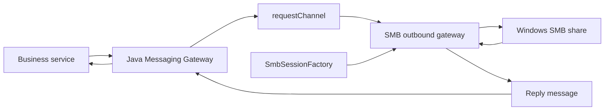
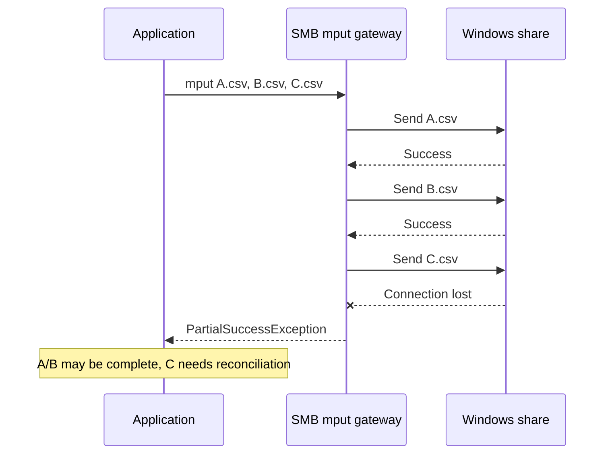
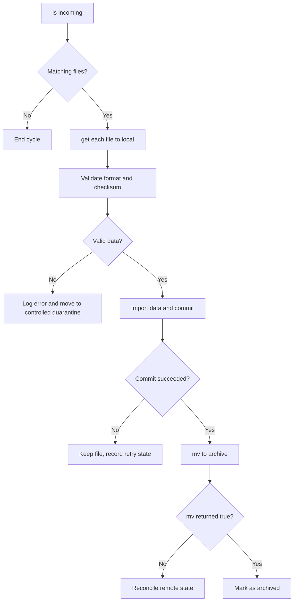

# SMB Outbound Gateway for Resource Operations

## 1. Problem and Lesson Objectives

A report-importing application must work with a Windows shared directory over the SMB protocol. The operations team wants to know which files exist today, download a specific file for inspection, move processed files to an `archive` directory, or delete files that are no longer needed. A one-way file send operation is not enough for these needs because the application needs **to know the returned result** to decide what to do next.

The **SMB outbound gateway** in Spring Integration lets you send SMB resource operation requests and receive **reply messages**. The gateway acts as an integration endpoint between a `MessageChannel` and the SMB server, suited for flows that need to list, read, write, rename, or delete files while inspecting the outcome.

This lesson belongs to the **Adapter SMB** chapter of the `SPRING_INTEGRATION_ADAPTERS` module: connecting external systems using inbound/outbound adapters, gateways, pollers, and `MessageChannel`. Principles of message contracts, error handling, result confirmation, and connection management apply across files, SFTP, HTTP, JMS, AMQP, Kafka, or databases; the commands and payloads of each gateway type still need to be reviewed individually.

After this lesson, you will be able to:

- Explain the differences among an SMB inbound adapter, outbound channel adapter, and outbound gateway.
- Choose the right command from the eight commands `ls`, `nlst`, `get`, `mget`, `rm`, `mv`, `put`, and `mput`.
- Understand request payloads, SpEL expressions, options, headers, and **return data types**.
- Write Java DSL using `Smb.outboundGateway(...)`, `SmbSessionFactory`, and `@MessagingGateway`.
- Design inspection, download, archiving/deletion, retry, and partial-success handling steps.
- Build safe verification exercises on a readable/writable test share.

## 2. Where Does the Gateway Fit in the Flow?

SMB (Server Message Block) is a protocol for accessing files and directories over a network. Suppose the path a Windows user sees is:

```text
\\fileserver\partner-share\incoming\orders-20261123.csv
  host       share         directory      filename
```

When using an SMB client, configuration is typically split into `host = fileserver`, `share = partner-share`, and paths **inside the share** such as `incoming/orders-20261123.csv`. The application needs network connectivity to the server (typically over TCP 445), authentication, and appropriate permissions for each command. Directory read permission does not imply delete or rename permission.



When the service calls `list("incoming")`, the Java interface creates a message with payload `"incoming"`. An SMB outbound gateway listening on the channel executes `ls`, reads the listing from the share, creates a reply message, and sends the result back to the caller. With a synchronous configuration, the calling code receives `List<String>` or an exception without manually opening an SMB session.

| Component | What It Does | Distinction to Keep in Mind |
|---|---|---|
| SMB inbound channel adapter | Proactively pulls files from a share into the app, usually triggered by a poller | Produces messages from an external source; no reply per app command |
| SMB outbound channel adapter | Receives a message and **writes a file** to a share | One-way; produces no reply carrying a command result |
| **SMB outbound gateway** | Executes an SMB resource command and **returns a reply** | Suited when decisions depend on the result of `ls/get/mv/rm/put` |
| `@MessagingGateway` | Java proxy for the application to invoke an `IntegrationFlow` | Entry point into the flow; not the SMB endpoint itself |
| Poller | Triggers a polling source on a schedule | The gateway acts on incoming requests; it does not need a poller itself |

Do not use "gateway" as a synonym for adapter: one has a request/reply contract, while the other is typically used for one-way message pushing or receiving.

## 3. The Eight SMB Outbound Gateway Commands

| Command | What Request Represents | Reply Payload | When to Use |
|---|---|---|---|
| `ls` | Remote directory path | `List<FileInfo<?>>` by default; `List<String>` with `-1` | Inventory files, read metadata |
| `nlst` | Remote directory path | `List<String>` | Only a list of names is needed |
| `get` | Remote file path | Local `File`; `InputStream` with `-stream` | Fetch a single file for processing |
| `mget` | Path/pattern selecting multiple files | `List<File>` | Fetch a batch of files |
| `rm` | Path of file to delete | `Boolean.TRUE` or `Boolean.FALSE` | Delete a file with an explicit result |
| `mv` | Old path; new path via `rename-expression` | `Boolean.TRUE` on success | Rename or move to archive |
| `put` | `File`, `byte[]`, or `String` data to send | `String` path of the file on the server | Upload a file and receive the resulting path |
| `mput` | Local directory or collection of files | `List<String>` of uploaded paths | Upload multiple files |

`FileInfo` is Spring Integration's remote-file info type; the actual generic parameter corresponds to the SMB file type. Do not cast the default `ls` result to `List<String>` unless `-1` is enabled. For `mget/mput`, the reply list represents files transferred successfully, but if an error happens midway you must check **partial success** rather than treating the whole batch as complete.

### 3.1. The `ls` and `nlst` Commands

`ls` supports these options:

| Option | Effect |
|---|---|
| `-1` | Returns only filenames instead of `FileInfo` objects |
| `-a` | Includes names starting with a dot |
| `-f` | Does not sort the listing |
| `-dirs` | Includes directories (excluded by default) |
| `-links` | Includes symbolic links if supported by the server |
| `-R` | Lists recursively through the directory tree |

With `ls -R`, filenames include paths relative to the root directory being listed. If you need to distinguish files from directories during a recursive listing with `-dirs`, keep `FileInfo` objects instead of passing `-1`.

`nlst` returns a list of names and only supports the `-f` option. Both commands populate the operating directory in the `file_remoteDirectory` header. An empty result usually means no matching files were found; do not immediately assume a server error when a request succeeds with an empty list.

### 3.2. The `get` and `mget` Commands

`get` reads a file on SMB and saves it to a local directory. Common options:

- `-P`: preserves the modification timestamp from the server.
- `-stream`: returns an `InputStream` without necessarily saving the file to disk.
- `-D`: deletes the remote file **after successful transfer** according to command rules; this does not mean business processing of the data has finished.

When using `-stream`, **the reader must close the resource/session** after consuming the stream. Spring Integration places the resource to close in the `closeableResource` header; standard consuming components such as `FileSplitter` or `StreamTransformer` help manage resource cleanup. Custom handlers must guarantee closing even on error. Do not hand off an `InputStream` to asynchronous processing while ignoring its lifecycle.

`mget` retrieves multiple files and returns `List<File>`. Options include `-P`, `-R` (recursive), `-x` (throw an error if no files match), and `-D`. A common pattern is `incoming/*`; when `-R` is selected, recursive scanning and directory filtering must be designed carefully. A filter that blocks intermediate directories can prevent files inside them from ever being traversed.

If you need to synchronize multiple files on a schedule, `mget` can combine with `FileExistsMode.REPLACE_IF_MODIFIED` to write locally only when the remote file has changed. This is a local-file feature and **does not replace business-import idempotency**.

### 3.3. The `put` and `mput` Commands

`put` sends a file/content to SMB and replies with **the target path as a String**. The filename is determined by a file name generator or filename expression. Key properties include `remoteDirectoryExpression`, `fileNameExpression`, `useTemporaryFileName`, `autoCreateDirectory`, and `fileExistsMode`.

`mput` uploads multiple files: the request can be a local directory (`File` or `String`) or a collection of matching items. Option `-R` enables descending into subdirectories. `mput` can use `patternMputFilter`, `regexMputFilter`, or a custom filter to select files. If recursion is needed, subdirectories must also pass the filter; allowing only `*.csv` across both files and directories can accidentally block the entire subtree.

For both `put` and `mput`, returning success confirms the file transfer step; **it does not confirm the partner system has imported the file**.

### 3.4. The `rm` and `mv` Commands

`rm` deletes a file at the specified path. It replies `Boolean.TRUE` if deletion succeeded, or `Boolean.FALSE` if it did not succeed per command execution. A `false` reply differs from an exception caused by connectivity, authentication, or deployment rules.

`mv` performs a move/rename. `expression` determines the **source** path; `rename-expression` determines the **target** path, defaulting to the `file_renameTo` header. The target path must be non-empty. You can supply `remoteDirectoryExpression` for relative source and target paths when appropriate, though you should explicitly place paths within the authorized share scope.

`rm` and `mv` **mutate server state**, so permissions and business preconditions must be verified before calling them. For instance, moving `incoming/orders-007.csv` to `archive/orders-007.csv` makes sense only after import and status recording succeed; deleting a file immediately on download can destroy your ability to retry.

## 4. Request/Reply Contract and Paths

In an SMB outbound gateway, the SpEL `expression` is evaluated against the request message to produce the path/file or pattern the command acts upon. For example, `Smb.outboundGateway(factory, "get", "payload")` uses the `payload` string as the source path, whereas `Smb.outboundGateway(factory, "ls", "payload")` uses it as the directory to list.

| Property | Example | Meaning |
|---|---|---|
| Request payload for `ls` | `"incoming"` | Lists the `incoming` directory inside the share |
| Request payload for `get` | `"incoming/orders-007.csv"` | Source file on the server |
| Request payload for `mget` | `"incoming/*"` | Pattern selecting remote files |
| Request payload for `mv` | `"incoming/orders-007.csv"` | Source path |
| Header `file_renameTo` | `"archive/orders-007.csv"` | Target path for `mv` |
| Reply header `file_remoteFile` | `"orders-007.csv"` | Source metadata on some commands such as `get`/`rm`/`mv` |
| Reply header `file_remoteDirectory` | `"incoming"` | Remote directory for the operation |

With `get/mget`, specify a local storage location if you want predictable control over downloaded files. With `put/mput`, specify the target directory and naming rules on the share.

**Path safety rule:** never take an arbitrary path or filename directly from a public HTTP request and pass it to `rm` or `mv`. Map a validated `batchId` to a server-generated path, normalize the path, block `..`, disallow unauthorized absolute paths, and prevent escaping the granted prefix. For an account with broad delete permissions, one missing check can impact other data batches.

## 5. Java DSL Configuration: Listing, Downloading, Moving, and Deleting Files

This example uses Spring Boot 3.x + Spring Integration 6.5.x (or a compatible combination managed by the project's dependency management). The classes reflect the 6.5 API line; verify against actual artifacts if your project uses a different version.

### 5.1. Dependencies and Connection Configuration

**Gradle:**

```gradle
dependencies {
    implementation 'org.springframework.boot:spring-boot-starter-integration'
    implementation 'org.springframework.integration:spring-integration-smb'
}
```

**`application.yml`:**

```yaml
demo:
  smb:
    host: ${SMB_HOST}
    port: ${SMB_PORT:445}
    domain: ${SMB_DOMAIN:}
    username: ${SMB_USERNAME}
    password: ${SMB_PASSWORD}
    share: ${SMB_SHARE:partner-share}
    local-download-dir: ${SMB_LOCAL_DOWNLOAD_DIR:./data/smb-downloads}
```

Never place real usernames/passwords in repositories, logs, or shared files. Use a secret manager and grant least-privilege permissions for the required command group. For example, `ls/get` only require read access, whereas `put/mv/rm` require appropriate write/rename/delete rights in both **share permissions** and **NTFS ACLs**.

**`SmbGatewayConfig.java`:**

```java
import java.io.File;

import jcifs.DialectVersion;
import org.springframework.beans.factory.annotation.Value;
import org.springframework.context.annotation.Bean;
import org.springframework.context.annotation.Configuration;
import org.springframework.integration.annotation.IntegrationComponentScan;
import org.springframework.integration.config.EnableIntegration;
import org.springframework.integration.dsl.IntegrationFlow;
import org.springframework.integration.file.remote.FileExistsMode;
import org.springframework.integration.smb.dsl.Smb;
import org.springframework.integration.smb.session.SmbSessionFactory;

@Configuration
@EnableIntegration
@IntegrationComponentScan
public class SmbGatewayConfig {

    @Bean
    SmbSessionFactory smbSessionFactory(
            @Value("${demo.smb.host}") String host,
            @Value("${demo.smb.port}") int port,
            @Value("${demo.smb.domain}") String domain,
            @Value("${demo.smb.username}") String username,
            @Value("${demo.smb.password}") String password,
            @Value("${demo.smb.share}") String share) {

        SmbSessionFactory factory = new SmbSessionFactory();
        factory.setHost(host);
        factory.setPort(port);
        factory.setDomain(domain);
        factory.setUsername(username);
        factory.setPassword(password);
        factory.setShareAndDir(share);
        factory.setSmbMinVersion(DialectVersion.SMB210);
        factory.setSmbMaxVersion(DialectVersion.SMB311);
        return factory;
    }

    @Bean
    IntegrationFlow smbListFlow(SmbSessionFactory factory) {
        return IntegrationFlow.from("smbListRequest")
                .handle(Smb.outboundGateway(factory, "ls", "payload")
                        .options("-1"))
                .get();
    }

    @Bean
    IntegrationFlow smbGetFlow(
            SmbSessionFactory factory,
            @Value("${demo.smb.local-download-dir}") String localDir) {

        return IntegrationFlow.from("smbGetRequest")
                .handle(Smb.outboundGateway(factory, "get", "payload")
                        .localDirectory(new File(localDir))
                        .autoCreateLocalDirectory(true)
                        .fileExistsMode(FileExistsMode.FAIL))
                .get();
    }

    @Bean
    IntegrationFlow smbMoveFlow(SmbSessionFactory factory) {
        return IntegrationFlow.from("smbMoveRequest")
                .handle(Smb.outboundGateway(factory, "mv", "payload")
                        .renameExpression("headers['file_renameTo']"))
                .get();
    }

    @Bean
    IntegrationFlow smbRemoveFlow(SmbSessionFactory factory) {
        return IntegrationFlow.from("smbRemoveRequest")
                .handle(Smb.outboundGateway(factory, "rm", "payload"))
                .get();
    }
}
```

Notes:

1. `setShareAndDir(share)` sets the **root share**; payloads such as `"incoming"` and `"archive/orders-007.csv"` are relative paths inside the share. Do not repeat `partner-share` in the payload if the root configuration already includes it.
2. `Smb.outboundGateway(...)` creates a request/reply endpoint. In the example, `"payload"` is a **SpEL expression** selecting the path or pattern.
3. `.options("-1")` makes `ls` return filenames as `List<String>`, allowing the Java interface to declare a clean concrete type.
4. `.fileExistsMode(FileExistsMode.FAIL)` applies to `get` when the **local** file already exists, preventing accidental overwrites. For `put`, existence checks target the **remote** side.
5. Synchronous flows are wired via named channels; the gateway receives a message and produces a reply. Calling from Java is illustrated next.

### 5.2. Creating a Request/Reply Interface for the Application

**`SmbOperations.java`:**

```java
import java.io.File;
import java.util.List;

import org.springframework.integration.annotation.Gateway;
import org.springframework.integration.annotation.MessagingGateway;
import org.springframework.messaging.handler.annotation.Header;
import org.springframework.messaging.handler.annotation.Payload;

@MessagingGateway
public interface SmbOperations {

    @Gateway(requestChannel = "smbListRequest")
    List<String> listNames(String remoteDirectory);

    @Gateway(requestChannel = "smbGetRequest")
    File download(String remoteFilePath);

    @Gateway(requestChannel = "smbMoveRequest")
    Boolean move(@Payload String sourcePath,
                 @Header("file_renameTo") String targetPath);

    @Gateway(requestChannel = "smbRemoveRequest")
    Boolean remove(String remoteFilePath);
}
```

A service can inject `SmbOperations` and use it:

```java
List<String> names = smbOperations.listNames("incoming");
File local = smbOperations.download("incoming/orders-007.csv");

// After validating, importing data, and committing successfully:
Boolean archived = smbOperations.move(
        "incoming/orders-007.csv",
        "archive/orders-007.csv");

if (!Boolean.TRUE.equals(archived)) {
    throw new IllegalStateException("Archive move failed");
}
```

`smbOperations` is a bean injected via constructor or Spring DI. The `download(...)` line only illustrates a file retrieval step; production code must validate format, persist business data, and record state **before** moving the file. Do not call `remove(...)` on real data just to test the gateway.

The `@MessagingGateway` interface receives replies from the handler via the reply channel associated with the request. The simple flows above use direct channels, so results normally return immediately to the Java call or exceptions propagate to the caller. When using `ExecutorChannel`, queues, timeouts, or async protocols, you must explicitly design the reply path and error handling.

### 5.3. Adding `put`, `mget`, and `mput` Flows

The following configurations are **add-on snippets** that can be placed as `IntegrationFlow` beans in the same configuration class. They illustrate command-specific options:

```java
@Bean
IntegrationFlow smbPutFlow(SmbSessionFactory factory) {
    return IntegrationFlow.from("smbPutRequest")
            .handle(Smb.outboundGateway(factory, "put", "payload")
                    .remoteDirectoryExpression("'outgoing'")
                    .fileNameExpression("payload.name")
                    .autoCreateDirectory(true)
                    .fileExistsMode(FileExistsMode.FAIL)
                    .useTemporaryFileName(true))
            .get();
}

@Bean
IntegrationFlow smbMGetFlow(SmbSessionFactory factory) {
    return IntegrationFlow.from("smbMGetRequest")
            .handle(Smb.outboundGateway(factory, "mget", "payload")
                    .options("-P")
                    .regexFileNameFilter("(?i).*\\.csv$")
                    .localDirectory(new File("./data/smb-batch-downloads"))
                    .autoCreateLocalDirectory(true)
                    .fileExistsMode(FileExistsMode.IGNORE))
            .get();
}

@Bean
IntegrationFlow smbMPutFlow(SmbSessionFactory factory) {
    return IntegrationFlow.from("smbMPutRequest")
            .handle(Smb.outboundGateway(factory, "mput", "payload")
                    .remoteDirectoryExpression("'outgoing'")
                    .autoCreateDirectory(true)
                    .patternMputFilter("*.csv")
                    .fileExistsMode(FileExistsMode.FAIL)
                    .useTemporaryFileName(true))
            .get();
}
```

To call these three flows from Java, add to the `SmbOperations` interface:

```java
@Gateway(requestChannel = "smbPutRequest")
String upload(File localFile);

@Gateway(requestChannel = "smbMGetRequest")
List<File> downloadBatch(String remotePattern);

@Gateway(requestChannel = "smbMPutRequest")
List<String> uploadBatch(File localDirectory);
```

For example, `downloadBatch("incoming/*")` uses a filter selecting only CSV files; because `-R` is not requested, it operates only on the specified search scope. If `-R` is enabled, adjust the filter to allow traversing intermediate directories. `uploadBatch(new File("./data/outbox"))` selects `*.csv` files directly inside the local directory; for recursion, add `-R` and a filter permitting directories.

`FileExistsMode.IGNORE` in `mget` can cause an already-existing local file to be omitted from the current download results. Do not interpret an empty list as proof that no remote files exist when a skip policy is active. `FileExistsMode.FAIL` in `put/mput` catches name collisions, though a retry after a timeout may require reconciliation because the previous attempt could have finished writing.

## 6. Recognizing Errors, Empty Results, and Partial Success

### 6.1. When Do You Receive a Reply vs. an Exception?

A request/reply call produces different outcomes:

| Situation | Observed by Caller | Interpretation |
|---|---|---|
| `ls` finds no matching files | Empty list | Command ran; no items returned |
| `get` succeeds | One local `File` | Download finished; does not mean parsing/importing finished |
| `rm` returns `false` | `Boolean.FALSE` | Deletion did not complete as intended |
| `mv` succeeds | `Boolean.TRUE` | File was renamed/moved on SMB per command result |
| Wrong password, missing permissions, network loss | Exception during request execution | Classify root cause; do not assume the file was untouched |
| `mget/mput` fails after a few files | `PartialSuccessException` | Some files may have transferred; reconcile item by item |

Exceptions can be wrapped via the gateway's `MessagingException`/exception mechanism. When logging, record `batchId`, normalized relative path, command, timestamp, root cause, and correlation ID. Never log secrets or sensitive file contents.

### 6.2. `PartialSuccessException` in Batch Processing

With `mget` and `mput`, a command may succeed for part of the list and then fail midway. Spring Integration provides `PartialSuccessException` containing:

- `partialResults`: transfer results that **succeeded** before the error occurred;
- `derivedInput`: the list of input items the gateway derived from the request (for example, local files to upload in `mput`);
- `failedMessage` and the underlying cause per `MessagingException`.

For example: uploading three files `A.csv`, `B.csv`, and `C.csv`, the network drops while sending `C.csv`. `partialResults` may contain the target paths for `A.csv` and `B.csv`. Simply retrying the entire batch with `APPEND` or `REPLACE` can create duplicate data or overwrite files the partner has already read.



The recovery workflow should:

1. Extract and record the list of items that succeeded before the error.
2. Inspect the remote state (filename, size, checksum if a reliable mechanism exists) and business state.
3. Mark individual files or batches eligible for retry separately.
4. Retry only unverified files; choose `FileExistsMode` per contract and never treat retries as side-effect-free.

With `mget -D`, files on the server may already be deleted after download while local business processing is not yet finished. Avoid deleting source files right after transfer for data that may require replay.

### 6.3. `FileExistsMode`: Different Inspection Locations

| Mode | `get/mget`: Local File Exists | `put/mput`: Remote File Exists |
|---|---|---|
| `FAIL` | Throws error instead of overwriting local | Throws error instead of overwriting remote |
| `IGNORE` | Skips existing local file | Skips existing remote file |
| `REPLACE` | Overwrites local file | Overwrites remote file |
| `APPEND` | Appends per command/format support | Appends to target file |

These modes must be verified against your actual API/version and file type. Historically, the default for `put/mput` is `REPLACE`, and for `get/mget` is `FAIL`. Therefore **configure the mode explicitly**, especially in flows with deletion and reprocessing.

## 7. An Operable Business Workflow

Suppose a partner places files in `incoming/`. The application needs to download them, validate CSV, import into a database, and archive files to `archive/`:



Separate the states:

- **DISCOVERED:** filename seen via `ls`; partner may not have finished writing. Both sides should use a publication protocol such as `.part` renamed to `.csv`, or a file-age rule.
- **DOWNLOADED:** `get` completed; local file may still be invalid.
- **IMPORTED:** validation, idempotency, and business transaction succeeded.
- **ARCHIVED:** `mv` returned success and state was recorded. If the move fails after import already committed, subsequent runs must avoid re-importing.

An example idempotency key is `partnerId + batchId + checksum`. The message header `id` generated by Spring each time is not a stable key for a batch. In the database, store import outcomes by batch with appropriate unique constraints; retries should resume only from the truly committed state.

For a report **sending** workflow, the reverse uses `put` or `mput` to create files on the share and return paths. To keep the partner from reading partially transferred files, use a temporary name and post-upload rename (e.g., `.writing`) and require the partner to scan only official names. To know when the partner has finished importing, add a dedicated business ACK channel rather than relying on `put`'s `String` reply.

## 8. Session Lifecycle, Security, and Performance

### 8.1. Sessions and Pooling

`SmbSessionFactory` manages connection settings and creates SMB sessions when the gateway executes commands. Under heavy request workloads, you can wrap the factory in `CachingSessionFactory` to reuse sessions and cap concurrent connections. When caching, pass the **wrapped SessionFactory bean** to the gateways instead of continuing to use the raw factory.

Never open a new session outside the flow and leave resources unclosed. With `get -stream`, resource-closing responsibility extends to the stream-consuming component; with standard `get` returning a `File`, the gateway finishes downloading before returning the local file.

### 8.2. Permissions, Data Safety, and Paths

- Separate accounts or share areas if the system requires delete operations and read operations with different privilege levels.
- Avoid SMBv1; choose min/max dialects compatible with the server and your organization's security policy.
- Grant proper permissions on both the **share** and **NTFS ACLs**: `mv` may require rename/delete rights, not just write.
- Restrict allowed path prefixes by partner ID; block path traversal and invalid Windows filenames.
- Enforce retention for local files; secure the download directory because data may contain sensitive information.
- Log command, `batchId`, relative path, outcome, and timestamp; never log passwords, secrets, or unnecessary file contents.

### 8.3. Throughput and Latency

`ls -R` on a large share can generate heavy I/O and huge listings. Recursive `mget/mput` can transfer large volumes of data, filling local disks or saturating links. Set limits at the orchestration layer: concurrent batches, timeouts, cached connection counts, spare disk capacity, maximum size, and retry counts.

The gateway does not have an automatic poller; if scheduled execution is needed, place the poller on the **request-emitting source** (for example, a job fetching unprocessed batches) and send messages into the request channel. In multi-instance systems, coordinate batch ownership and persistent metadata so two nodes never execute `rm/mv` on the same file simultaneously.

## 9. Hands-On Practice on a Windows Share or Samba

Prepare a test share `partner-share` with directories `incoming`, `archive`, and `outgoing`. Place a sample CSV into `incoming` using your lab tools:

```csv
order_id,amount,currency
ORD-001,150000,VND
ORD-002,85000,VND
```

Save the file as `orders-007.csv`. Start the application with the environment variables from Section 5 and verify connectivity.

### Exercise A — Listing and Downloading a File

1. Call `smbOperations.listNames("incoming")`; confirm the list includes `orders-007.csv`.
2. Call `smbOperations.download("incoming/orders-007.csv")`.
3. Inspect the file in `./data/smb-downloads` and verify two data rows totaling `amount = 235000` VND.
4. Call `download(...)` a second time with `FileExistsMode.FAIL`; observe behavior when the local file already exists.

**Result to explain:** `ls -1` returns `List<String>`; `get` returns `File`, and the local-exists error is governed by the download command's mode.

### Exercise B — Renaming / Moving to Archive

1. After confirming the import result was saved to the test database, call:

   ```java
   Boolean moved = smbOperations.move(
       "incoming/orders-007.csv",
       "archive/orders-007.csv");
   ```

2. Verify `moved == true`, `incoming` no longer contains the old name, and `archive` contains the new name.
3. Send the same move request again to observe behavior when the source has already moved.

**Result to explain:** `mv` returns status in a message; a retry after a move must check the target and recorded state rather than blindly failing because the missing source looks "unprocessed."

### Exercise C — Uploading and Verifying a File

1. Create a local file `ack-007.txt` and call `upload(file)` (if `smbPutFlow` is declared).
2. Inspect the `String` reply containing the remote path; call `listNames("outgoing")` to verify the name.
3. Re-send the same name with `FileExistsMode.FAIL` and explain why name-collision errors prevent unintended overwrites.

**Result to explain:** `put` produces a reply unlike an outbound channel adapter; upload success does not prove the receiver has read the ACK.

### Exercise D — Partial Batch Handling

1. Create 3–5 CSV files in a local test directory and call `uploadBatch(localDirectory)`.
2. In an isolated lab, simulate a network failure while sending multiple files; note which files appear at the target and the thrown exception.
3. When encountering `PartialSuccessException`, compare `partialResults` against the actual list; compile the list of files needing verification and retry.
4. Do not rerun the whole batch with `APPEND`; explain the duplicate-data risk.

**Result to explain:** `mput` may complete several files before failing. Individual file states and business outcomes must be managed separately.

### Exercise E — Controlled Deletion

1. Create a disposable **lab-only** file in `outgoing`, such as `delete-me-lab.txt`.
2. Confirm the file exists using `listNames("outgoing")`.
3. Call `smbOperations.remove("outgoing/delete-me-lab.txt")` and verify `Boolean.TRUE`.
4. Try deleting it again to observe `false` or how the gateway reports errors in your environment.

**Result to explain:** delete permissions, existence checks, and reply outcomes are factors that must be verified before allowing business workflows to delete resources.

## 10. Common Misconceptions

| Misconception | Accurate Understanding |
|---|---|
| An SMB outbound gateway is the same as `@MessagingGateway` | The SMB endpoint executes commands; the annotated interface is the Java entry point into the flow |
| `ls` always returns `List<String>` | Default is a list of `FileInfo` objects; pass `-1` to get names |
| `get` returns CSV content as a `String` | By default it returns a local `File`, or an `InputStream` with `-stream` |
| `get -D` only deletes after successful import | It deletes after transfer per command rules; business import is a separate step |
| `rm` has no reply | `rm` returns a `Boolean`; connection errors can raise exceptions |
| `mv` only needs a single path | Needs source from `expression` and target from `rename-expression`/header |
| When `mget/mput` fails, no files were processed | Partial success may have occurred; inspect `PartialSuccessException` |
| `FileExistsMode` always checks the same side | For `get` it checks local files; for `put` it checks remote files |
| Getting a reply from `put` means the partner imported the file | The reply confirms file transfer, not a business ACK |
| Gateway commands run on an automatic schedule | Pollers trigger sources; gateways execute only upon receiving a request |

## 11. References

- [Spring Integration 6.5 — SMB Support](https://docs.spring.io/spring-integration/reference/6.5/smb.html): SMB outbound gateway commands, options, reply payloads, and partial success.
- [Smb Java DSL API (6.5)](https://docs.spring.io/spring-integration/docs/6.5.0/api/org/springframework/integration/smb/dsl/Smb.html): creating `Smb.outboundGateway(...)`.
- [SmbOutboundGatewaySpec API (6.5)](https://docs.spring.io/spring-integration/docs/6.5.x/api/org/springframework/integration/smb/dsl/SmbOutboundGatewaySpec.html): command options, filters, local directory, file exists mode, and rename expression.

**Key takeaway:** The SMB outbound gateway enables Spring Integration to **send an SMB resource operation command and receive the result**, from listing, downloading, and uploading to renaming or deleting. Workflow reliability depends on the request/reply contract, per-file state tracking, idempotency, session management, and proper error-handling policies.
