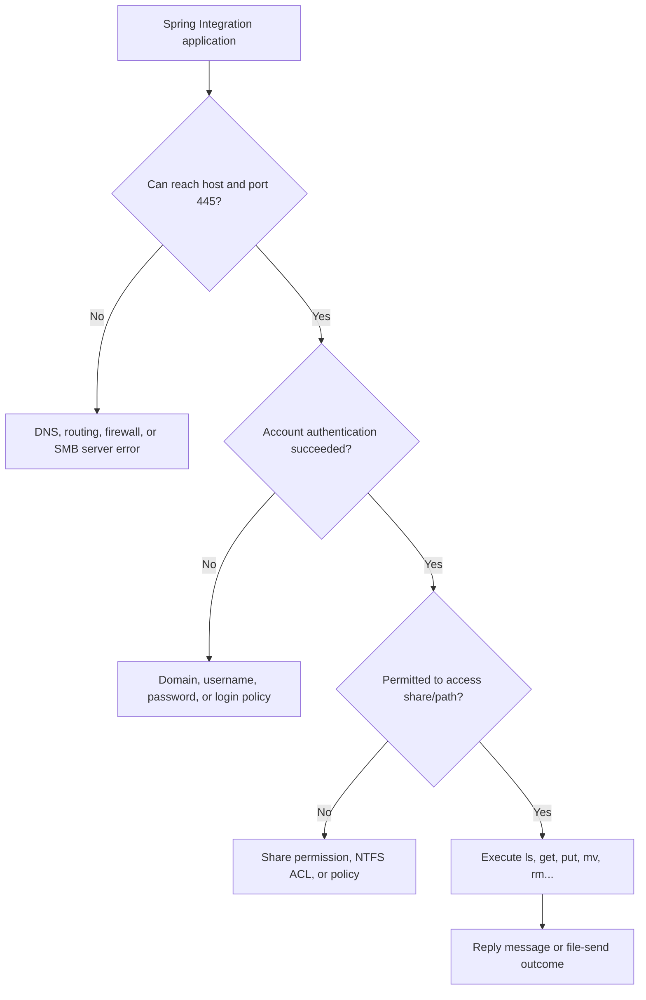

# Domain User Authentication and Credentials in Spring Integration SMB

## 1. Practical Problem and Objectives

An enterprise Spring Boot application needs to read reconciliation files from a Windows File Server at `\\fs01.corp.example\finance-exchange\incoming` and write results to an `outgoing` directory. On Windows, employees log in with an Active Directory account and open shared folders in File Explorer. However, a Java application running on Linux or inside a container **does not automatically inherit an employee's Windows login session**. It requires its own identity and credentials accepted by the Windows File Server.

In Spring Integration, `SmbSessionFactory` combines host, share, domain, username, password, and SMB version settings into sessions used by inbound adapters, outbound adapters, or outbound gateways. If credentials are wrong, all three endpoint types fail on access. If credentials are valid but the account lacks permissions, one command may succeed while another is denied.

This is foundational knowledge in the **Adapter SMB** chapter of the `SPRING_INTEGRATION_ADAPTERS` module: connecting external systems using inbound/outbound adapters, gateways, pollers, and `MessageChannel`; handling message contracts, errors, and connection lifecycles. Across integrations over files, SFTP, HTTP, JMS, AMQP, Kafka, and databases, **managing identities, secrets, access permissions, and connection session lifecycles** is a shared concern, though authentication methods vary by protocol.

After this lesson, you will be able to:

- Distinguish **domain users**, **local users**, application identities, and credentials in an SMB session.
- Configure `setDomain(...)`, `setUsername(...)`, `setPassword(...)`, and related properties with `SmbSessionFactory`.
- Explain three failure layers: network connectivity, authentication, and directory authorization.
- Store/rotate passwords operationally without leaking them in source code or logs.
- Verify read, write, rename, and delete permissions without running destructive tests on a production share.
- Design retries, session caching, error tracking, and responses when an account is locked or expired.

## 2. Three Verification Layers Before File Processing

An SMB request does not jump straight from credentials to data. It must pass through these layers:



| Layer | Question to Answer | Failure Symptom |
|---|---|---|
| **Transport/SMB negotiation** | Is DNS right? Is TCP 445 open? Do both sides support a compatible SMB version? | Cannot connect, timeout, dialect negotiation error |
| **Authentication** | Does the file server accept this identity and credential? | Login error, wrong domain, wrong/expired password, locked account |
| **Authorization** | Does the authenticated identity have rights on the share and directory/file? | Access denied when listing, reading, creating, or renaming/deleting |
| **Application contract** | Is the command operating on the right path and file type? | File not found, filename collision, read/write convention violation |

**Successful authentication does not mean permission to operate on every file.** On a Windows File Server, permissions are evaluated against configured access controls, typically including **share permissions** and **NTFS ACLs**. On Samba/NAS, user, group, and ACL mapping models may differ, yet the principle of separating authentication from authorization still holds.

A read-only account may execute `ls` and `get` yet be denied on `put`, `mv`, or `rm`. Never "fix" permission errors by granting full administrative privileges to every service account.

## 3. Domain Users, Local Users, and Identity Representations

### 3.1. What Is a Domain User?

A **domain user** is typically managed centrally by Active Directory. For example, an organization has NetBIOS domain `CORP` and service account `svc_smb_sync`:

```text
Windows display name: CORP\svc_smb_sync
Domain:               CORP
Username:             svc_smb_sync
Password:             <separately provisioned secret>
```

When configuring the standard `SmbSessionFactory` API, **pass domain and username into two separate properties** so the contract is unambiguous:

```java
factory.setDomain("CORP");
factory.setUsername("svc_smb_sync");
factory.setPassword(passwordFromSecretStore);
```

Avoid setting both `domain = CORP` and `username = "CORP\\svc_smb_sync"` unless you have verified the SMB client supports that combination; some libraries handle `\`/UPN differently. A UPN login like `svc_smb_sync@corp.example` is another representation in Windows environments; **do not assume UPN is equivalent to separating `setDomain` and `setUsername` across every SMB client version**. Confirm the format with the Active Directory administrator and test in the target environment.

### 3.2. How Does a Local User Differ from a Domain User?

A **local user** is managed on the SMB server itself or on a NAS/Samba appliance, such as an account valid only on `fs01`. It does not necessarily exist in Active Directory. How a client specifies the domain for a local account depends on server configuration and the authentication library; some systems use the server hostname, while others allow an empty domain.

Do not assume that:

- `domain = ""` always corresponds to a local user;
- the share name is the domain name;
- if `host = fs01.corp.example`, then `domain` must always equal `corp.example`;
- an application running on a domain-joined machine will automatically log in as the desktop user.

When provisioning an account, document the **authentication authority**, account type, required domain, accepted short/UPN name, and permissions on target directories. The sample below intentionally uses a **domain user**.

### 3.3. Accounts Recommended for Integration Systems

Prefer an **application-dedicated service account**, such as `CORP\svc_smb_sync`, instead of a developer's or administrator's personal account. Ask operations to grant:

| Item | Example for File Ingestion Service | Reason |
|---|---|---|
| Identity | `CORP\svc_smb_ingest` | Separates auditing and lifecycle from human accounts |
| Share | `finance-exchange` | Restricts access scope |
| Read/List | `incoming/` | Read source files |
| Write/Create | None if ingest-only | Reduces blast radius if credentials leak |
| Move/Delete | Grant only if remote archive/cleanup is part of the workflow | Ensures privileges match business needs |
| Password provisioning | Secret manager and rotation process | Avoids static secrets in Git |
| Audit | Track service account + batch ID | Activity traceability and incident investigation |

If one flow downloads files and another deletes files, separate accounts/endpoints or isolate directories following least-privilege principles. Remember that when one account is shared across multiple services, rotating its password impacts more applications.

## 4. Configuring Credentials in Spring Integration

### 4.1. Dependencies and Properties

This example uses Spring Boot 3.x and compatible Spring Integration 6.x, where `spring-integration-smb` provides `SmbSessionFactory`. Manage versions via the Spring Boot BOM or your existing dependency management.

**Gradle:**

```gradle
dependencies {
    implementation 'org.springframework.boot:spring-boot-starter-integration'
    implementation 'org.springframework.integration:spring-integration-smb'
}
```

**`application.yml`:**

```yaml
integration:
  smb:
    host: ${SMB_HOST:fs01.corp.example}
    port: ${SMB_PORT:445}
    domain: ${SMB_DOMAIN:CORP}
    username: ${SMB_USERNAME}
    password: ${SMB_PASSWORD}
    share: ${SMB_SHARE:finance-exchange}
    remote-directory: ${SMB_REMOTE_DIRECTORY:incoming}
```

In this snippet, the host/domain/share values are **illustrative only**; supply them from your real environment configuration. Never commit real passwords, tokens, or homegrown obfuscated strings into a repository. Environment variables may fit a lab, whereas production must follow your platform's secret-management requirements, such as a secret manager, secret read ACLs, and rotation policies.

`SMB_HOST`, `SMB_DOMAIN`, `SMB_USERNAME`, and `SMB_PASSWORD` serve distinct roles. A hostname value **does not replace** the `domain/username` identity. Nor is the share name `finance-exchange` part of the username.

### 4.2. Creating `SmbSessionFactory`

**`SmbSecurityConfig.java`:**

```java
import jcifs.DialectVersion;

import org.springframework.beans.factory.annotation.Value;
import org.springframework.context.annotation.Bean;
import org.springframework.context.annotation.Configuration;
import org.springframework.integration.annotation.IntegrationComponentScan;
import org.springframework.integration.config.EnableIntegration;
import org.springframework.integration.smb.session.SmbSessionFactory;

@Configuration
@EnableIntegration
@IntegrationComponentScan
public class SmbSecurityConfig {

    @Bean
    SmbSessionFactory smbSessionFactory(
            @Value("${integration.smb.host}") String host,
            @Value("${integration.smb.port}") int port,
            @Value("${integration.smb.domain}") String domain,
            @Value("${integration.smb.username}") String username,
            @Value("${integration.smb.password}") String password,
            @Value("${integration.smb.share}") String share) {

        SmbSessionFactory factory = new SmbSessionFactory();
        factory.setHost(host);
        factory.setPort(port);
        factory.setDomain(domain);
        factory.setUsername(username);
        factory.setPassword(password);
        factory.setShareAndDir(share);

        // Only allow negotiating SMB 2.1 through SMB 3.1.1 in this example.
        factory.setSmbMinVersion(DialectVersion.SMB210);
        factory.setSmbMaxVersion(DialectVersion.SMB311);
        return factory;
    }
}
```

Explanation:

1. `setHost(...)` is the DNS/IP of the server hosting the share; `setPort(445)` selects the standard SMB port.
2. `setDomain(...)` specifies the domain used for authentication (`CORP` in the example).
3. `setUsername(...)` is the **account name without a domain prefix** in this configuration style.
4. `setPassword(...)` receives the secret from the configuration source; never print this value in logs.
5. `setShareAndDir("finance-exchange")` identifies the share access point. Endpoints select `incoming` or `outgoing` inside the share via their own configuration.
6. `setSmbMinVersion/setSmbMaxVersion` only bound the negotiable SMB dialect range. They are **not** username/password settings or NTFS permission controls.

This example reflects Spring Integration 6.5 APIs with `jcifs.DialectVersion`. When upgrading to a newer branch with underlying SMB library changes, check imports and constructors against the Javadoc for the **exact dependency version in use**. If supplying a custom `jcifs.CIFSContext` to the factory, Spring Integration 6.x documentation requires configuring dialect bounds on that custom context itself.

### 4.3. Testing Authentication with a **Read-Only** Operation

Create an outbound gateway using `ls -1` to list filenames in the remote directory. This is a far better check than deleting or moving files just to "see if the account can log in."

**`SmbReadProbeConfig.java`:**

```java
import org.springframework.context.annotation.Bean;
import org.springframework.context.annotation.Configuration;
import org.springframework.integration.dsl.IntegrationFlow;
import org.springframework.integration.smb.dsl.Smb;
import org.springframework.integration.smb.session.SmbSessionFactory;

@Configuration
public class SmbReadProbeConfig {

    @Bean
    IntegrationFlow smbReadProbeFlow(SmbSessionFactory sessionFactory) {
        return IntegrationFlow.from("smbReadProbeRequests")
                .handle(Smb.outboundGateway(
                        sessionFactory, "ls", "payload")
                        .options("-1"))
                .get();
    }
}
```

**`SmbReadProbe.java`:**

```java
import java.util.List;

import org.springframework.integration.annotation.Gateway;
import org.springframework.integration.annotation.MessagingGateway;

@MessagingGateway
public interface SmbReadProbe {

    @Gateway(requestChannel = "smbReadProbeRequests")
    List<String> listFileNames(String remoteDirectory);
}
```

Invoke from a service after injecting `SmbReadProbe`:

```java
List<String> files = smbReadProbe.listFileNames("incoming");
System.out.println("Found " + files.size() + " files");
```

This flow tests simultaneously that SMB is reachable, the server accepts the credentials, the identity can list the share, and the `incoming` directory exists. If `files` is empty, that can be a **successful outcome** when no files are present; verify with logs and the test directory's contents.

**Limitation of this check:** `ls` succeeding does not prove the account can read every file's full content, nor does it prove `put/mv/rm` permissions. To verify write permissions, perform a controlled test on an authorized **lab directory** using a dummy file, verify the result, and clean up.

### 4.4. When Does the Factory Actually Authenticate?

Spring creating the `SmbSessionFactory` bean does not guarantee the server accepts the credentials. Failures typically surface **when an adapter or gateway opens an SMB session and executes its first operation**. Therefore:

- `ApplicationContext` starting cleanly **does not mean** SMB checks passed.
- A polled inbound adapter may only reveal an error on its first poll cycle.
- An outbound adapter/gateway may only reveal an error when receiving its first message.
- Account expiration, lockouts, or password rotation failures can happen after hours of normal operation.

Do not mark an integration system as "ready" solely because the bean exists. If SMB is a hard dependency, implement an appropriate health/readiness check with controlled frequency and timeouts; avoid having every health probe trigger excessive logins or list huge directories.

## 5. Domain Authentication Does Not Automatically Imply Kerberos

In Windows environments, common SMB authentication mechanisms include **NTLM** and **Kerberos**, depending on server, client library, policy, and authentication context. Passing `domain`, `username`, and `password` into `SmbSessionFactory` only sets client configuration values; **it does not guarantee the session is running over Kerberos or any SSO mechanism**.

| Concept | Distinction to Keep |
|---|---|
| AD domain | Manages identities/accounts and organizational policies |
| Username + password | Credentials the client uses to prove identity under the negotiated mechanism |
| NTLM | Challenge-response mechanism that may be restricted by enterprise policy |
| Kerberos | Typically relies on tickets/SPNs, DNS, clock sync, and client support |
| SMB dialect | Protocol version, such as SMB 2.1/3.1.1; independent of username |
| SMB signing/encryption | Protects integrity/confidentiality in transit depending on capability, requirements, and policy |

If server policy mandates Kerberos, SMB signing, or encryption at a certain level, verify the **actual capabilities of the SMB client version** and server configuration. Spring Integration lets you provide a custom `CIFSContext` to control underlying client library details; this is an advanced extension, and you should not set arbitrary properties assuming every mechanism will work.

For Kerberos, using a DNS hostname instead of an IP address can affect service principal selection. Do not conclude "changing IP to hostname fixes all Kerberos issues"; verify SPNs, principals, and related settings with your system administrator.

**Never downgrade to SMBv1, disable signing, or relax authentication policies merely to make an example run.** Diagnose compatibility errors and use an operations-approved solution.

## 6. Permissions on Shares and NTFS ACLs

A Windows server can enforce permissions at both the **share** level and the **NTFS directory/file** level. Effective access for an SMB operation must satisfy all applicable checks, not just one of them.

| Spring Integration Endpoint/Command | Resource Accessed | Permissions to Verify |
|---|---|---|
| Inbound adapter or `ls` | Remote directory | List folder and corresponding read permissions |
| Outbound gateway `get` | Remote file | Open and read file |
| Outbound adapter / gateway `put` | Remote target directory | Create/write file, potentially rename permission for temporary filenames |
| Outbound gateway `mv` | Source and target | Rename/move rights per ACL and target constraints |
| Outbound gateway `rm` | Remote source file | Delete rights per ACL and policy |
| `autoCreateDirectory(true)` | Parent directory | Directory creation rights where needed |

For example, `CORP\svc_smb_ingest` might have `Read` on `incoming` and `Modify` on `archive`. Downloading files locally may succeed while deleting directly in `incoming` is blocked. This is a **valid authorization outcome**, not a wrong password.

**Secure design:** grant permissions based on required actions. If the application only ingests files into a database, do not grant delete rights on the source share. If archiving is required, establish a dedicated authorized directory and workflow, recording business commit before moving the file.

## 7. Credential Management and Rotation

### 7.1. Credential Sources

| Storage Option | When Appropriate | Notes |
|---|---|---|
| Platform secret manager | Production | Controls access, auditing, and rotation |
| Kubernetes Secret or controlled secret injection | Cluster workloads | Restrict RBAC; avoid placing secrets in public manifests |
| Environment variables | Labs or policy-approved environments | Still sensitive data; limit exposure via diagnostics or process dumps |
| Mounted secret config file with strict permissions | Systems with secret-mount support | Never sync into Git/artifacts/logs |
| Hard-coded in `application.yml` or Java | Never use | Secrets enter Git history, artifacts, and environment copies |

In the example, Spring reads `SMB_PASSWORD` and passes it to `setPassword`; putting a password in quotes or Base64 provides no "secure encryption." Protect secrets **at rest**, **during runtime injection**, and **in logs/monitoring**.

Never print the entire `SmbSessionFactory` object or configuration URL in logs without verifying `toString` or URL-formatting methods: some API versions allow URLs containing passwords. Log only non-sensitive values such as host alias, share, operation type, sanitized error codes, and correlation/batch IDs; avoid logging full connection strings unless masked.

### 7.2. When Passwords Are Changed

Scenario: `svc_smb_ingest` undergoes scheduled password rotation, yet the running application still holds the old secret in memory. Existing sessions may continue working for a while depending on authentication/connection mechanics; once a new session is opened, old credentials will fail.

A standard rotation workflow:

1. Prepare the new secret and verify the account/policy with administrators.
2. Update the secret source used by the application; sequence the update according to AD password-change mechanics and deployment policies to minimize disruption.
3. Refresh credentials in the application, typically via controlled rollout/restart; **do not assume** `@Value` refreshes automatically on an already-initialized bean.
4. If using a session cache, ensure old sessions are closed/renewed through the application lifecycle or cache rotation procedure.
5. Execute a designated read probe (such as `ls -1` on a lab/probe directory) and check for authentication errors before declaring rotation successful.
6. Record the timestamp, test outcome, and change owner, **never recording the secret value**.

If the platform supports multiple secret versions or grace periods, follow the exact policy. Never keep two fallback passwords in source code, as that delays detecting revoked secrets.

### 7.3. Session Caching and Post-Rotation Permissions

Per Spring Integration 6.x documentation, `SmbSessionFactory` can be wrapped in `CachingSessionFactory` to reuse sessions. This reduces session-creation overhead in high-poll or high-upload workloads, however:

- caching **does not** turn wrong passwords into valid ones;
- stale sessions may retain authentication/permission state from when they were opened;
- never leave sessions or streams unclosed, exhausting the pool;
- when credentials change, you need an explicit mechanism to close/recreate sessions;
- configure cache size limits and session wait timeouts based on load, and monitor connection failures.

Do not swap a shared session factory across all flows without considering effects on the inbound poller, outbound adapter, and gateways sharing it. Flows may need different retry policies while sharing the same secret-protection standards.

## 8. Systematic Authentication Troubleshooting

Inspect from the **outside in**; draw conclusions only from evidence. Errors may be wrapped in `MessagingException` as they pass through `MessageChannel` and gateways.

| Symptom | Common Causes | Diagnostic Steps |
|---|---|---|
| DNS cannot resolve `fs01` | Wrong hostname or DNS config | Test DNS from the exact host/container running the app |
| Timeout reaching SMB | Firewall, routing, TCP 445, or unresponsive server | Check connectivity to host/port before changing passwords |
| SMB dialect negotiation failure | Server and client lack a common SMB version | Check min/max dialect, server capabilities, and SMB policy |
| Wrong password/username | Stale credential, typo, secret injection error | Safely verify *whether* the value is populated and cross-check the secret source without printing the password |
| Invalid domain | Confusing `CORP` with hostname/share or local/domain mapping | Verify authentication authority and admin-issued format |
| Account locked/expired/disabled | AD policy or repeated failed logins | Check server/AD logs and follow unlock/rotation procedure |
| `ls` succeeds, `put` gets Access Denied | Missing create/write rights | Check share permissions and NTFS ACLs on the target folder |
| `put` writes data but rename fails | Missing rename rights or blocking policy | Check rename permissions and `.writing` temporary files |
| `get` cannot find file | Wrong share/remote path or file already moved | Match UNC path to corresponding host/share/remote directory |
| Fails only after running for a long time | Secret rotation, stale cache/session, server disconnect | Check onset time, pool/sessions, and recent account changes |
| Server requires signing/encryption | Incompatible client library or policy | Check server requirements and client capabilities; preserve security policies |

Example analysis:

```text
Scenario A:
- Application starts: OK
- ls("incoming"): authentication error
=> Bean initialized, but the SMB session did not authenticate successfully.

Scenario B:
- ls("incoming"): OK
- get("incoming/a.csv"): OK
- put("outgoing/a.ack"): access denied
=> Credentials accepted; focus investigation on write permissions in outgoing.

Scenario C:
- DNS/port 445: timeout
- ls("incoming"): timeout
=> Check networking first; changing username/password will not fix transport errors.
```

### Logging Enough Without Leaking Secrets

A minimal operational log entry should include: timestamp, host alias, share, command type (`ls/get/put`), sanitized relative directory, `batchId`, duration, error category (network/auth/access denied/path), and retry count. Never log `password`, private credentials, authentication hashes, or sensitive file contents.

Conceptual event example:

```text
event=smb_operation_failed
endpoint=fileshare-finance
command=ls
remoteDirectory=incoming
reasonCategory=AUTHENTICATION
attempt=1
batchId=probe-20261123
```

If alerting on consecutive authentication failures, set a low threshold and **stop aggressive retries** when bad passwords are suspected. Repeated bad attempts can trigger AD account lockout policies and disrupt other systems sharing the identity.

## 9. Transport Security and Least Privilege Principles

### SMB Dialect

Bounding SMB 2.1 to 3.1.1 is a configuration example for Spring Integration 6.x APIs, not a recommendation that every system allow SMB 2.1. Enterprises may require SMB 3.x or stricter protections; set the minimum level according to policy and actual servers. Avoid enabling SMBv1 solely for legacy compatibility.

### Signing and Encryption

SMB signing protects message integrity over the SMB channel; SMB encryption provides confidentiality in transit when negotiated/configured and supported. They complement **identity authentication** and **resource authorization**. A client with valid credentials can still be rejected if server signing/encryption policies are unmet.

Do not equate having a password with having encrypted transport meeting security requirements. Verify server policy, SMB library version, and negotiated properties using appropriate tools/logs without exposing secrets.

### Environment Isolation

- Production, staging, and development should have separate accounts and shares.
- Never reuse an employee's personal password in automated workloads.
- Never expose credentials in HTTP error responses or downloadable log files.
- Grant only read roles for inbound if write/move is unneeded; enable archive permissions only when genuinely required.
- Track account expiration, rotation procedures, and account owners.
- Govern local files downloaded from SMB just like source data: directory permissions, retention, error handling, and deletion upon completion.

## 10. Step-by-Step Hands-On Practice

Prepare an SMB file server/NAS or Samba share in a lab environment along with an authorized domain account. The `incoming` directory contains a safe `probe.csv` file; `lab-outgoing` is reserved for write tests. Configure environment variables as in Section 4.

### Lab A — Verify Domain User Read Permission

1. Configure host, port, share, domain, username, and password from the environment and start the application.
2. Call `smbReadProbe.listFileNames("incoming")`.
3. Confirm the list includes `probe.csv`; if empty, verify the exact directory name and filter/command before assuming a credential error.
4. Record execution duration and outcome **without logging the password**.

**Expected result:** authentication, directory listing permissions, and gateway request/reply all work. This proves read access on the tested path only, not write permission.

### Lab B — Verify Read vs. Write Permission Boundaries

1. Using the same account that succeeded at reading, try creating a small test file in `lab-outgoing/` via an outbound adapter or `put` gateway.
2. If the admin granted read-only access, observe the write/access-denied error. If write access is granted, verify the file appears and validate its content.
3. Never test `rm`/`mv` on a partner's `incoming` directory without explicit authorization and safety checks; clean up only lab-created files in the dedicated directory.
4. Compare results against the lab directory's share permissions and ACLs.

**Expected result:** ability to explain why the same credentials can allow `ls/get` while denying `put/mv/rm`.

### Lab C — Invalid Credentials and Account Lockout

1. In a lab whose policy allows it, change `domain` or `username` to an intentionally invalid value and run **one** `ls` request.
2. Record the error type and verify no secrets appear in logs.
3. Restore the configuration and verify with a single read operation.
4. If a real account risks lockout from bad passwords, **do not retry repeatedly**; coordinate with AD administrators.

**Expected result:** recognize authentication errors as distinct from network or write-permission errors; understand retry impact on bad passwords.

### Lab D — Controlled Secret Rotation

1. In the lab, identify where the secret is stored and how the application loads it at startup.
2. Rotate the secret per lab policy, update the config source, and roll out/restart following normal operations.
3. Observe new session cache/connections being created; run `ls` to verify read access.
4. Confirm logs contain neither the old nor the new password; record the outcome and timestamp.

**Expected result:** never assume properties auto-refresh when secrets change, and understand why sessions must be recreated after rotation.

### Lab E — Diagnose Transport Before Authentication

1. In the lab, configure a bogus host or block the port to induce a controlled network failure.
2. Compare the error message with the username/domain error from Lab C.
3. Restore host/port, verify connectivity, and run `ls`.
4. Explain why TCP 445 success does not prove valid credentials.

**Expected result:** clearly distinguish transport, authentication, authorization, and path-contract errors.

## 11. Design Scenarios and Self-Check Questions

**Scenario 1:** A partner places files in `incoming`. The application must import files and delete the source to prevent re-ingestion. The account was granted `Read` on the share. What do you propose? One approach is keeping read-only access for inbound, enforcing database idempotency, and orchestrating archive/cleanup via a separately authorized account or channel after business confirmation, instead of elevating permissions for the entire service.

**Scenario 2:** `SmbSessionFactory` initializes cleanly, yet the first poll fails with `authentication failed`. Should you conclude the password is unrelated because Spring Boot started up? No. The bean can be constructed before a session actually logs in.

**Scenario 3:** After rotating a password, old pods keep working while newly started pods fail. What should you check? Each pod's secret source, config load timing, account permissions, existing caches/sessions, and rollback/rotation policy; never arbitrarily re-enable revoked credentials.

**Scenario 4:** The Windows share name is `finance-exchange`, host is `fs01.corp.example`, and domain is `CORP`. A developer writes `setDomain("finance-exchange")` and `setShareAndDir("CORP")`. What is wrong? They swapped **the identity authority** with **the shared resource name**.

**Scenario 5:** `ls` succeeds, yet `mv` reports access denied. Should you change the password or check permissions? First check ACLs and source/target scope for `mv`; authentication is already proven by `ls`.

## 12. Common Misconceptions

| Misconception | Accurate Understanding |
|---|---|
| `host`, `domain`, and `share` are the same thing | Host is the server, domain is the identity authority, share is the resource |
| `CORP\svc` must always go verbatim into `setUsername` | In the standard example, pass `CORP` to `setDomain` and `svc` to `setUsername` |
| An app running on a domain auto-authenticates as a Windows user | Java clients need an explicit auth context; SSO is not automatic |
| Creating the `SmbSessionFactory` bean proves credentials work | Authentication is usually tested when a session opens and runs a command |
| If `ls` succeeds, you have delete rights | Read rights and delete rights differ; check share/NTFS ACLs |
| Base64-encoding a password is a secret manager | Base64 is merely encoding, not secret protection |
| Changing a secret externally updates all Java sessions immediately | Controlled reload, session recreation, or rollout is required |
| If login fails, just keep retrying continuously | Can lock out the AD account and prolong the outage |
| Negotiating SMB 3.x proves Kerberos succeeded | Dialect and authentication mechanism are two separate concerns |
| To get connected, disable signing or enable SMBv1 | Check compatibility and policy; never weaken security arbitrarily |

## 13. References

- [Spring Integration Reference 6.5 — SMB Support](https://docs.spring.io/spring-integration/reference/6.5/smb.html): `SmbSessionFactory`, share connection, min/max dialect, session caching, and Java DSL.
- [Spring Integration 6.5 API — `SmbSessionFactory`](https://docs.spring.io/spring-integration/docs/6.5.x/api/org/springframework/integration/smb/session/SmbSessionFactory.html): constructors, `getSession`, configuration parameters inherited from `SmbConfig`.
- [Spring Integration 6.5 API — `SmbConfig`](https://docs.spring.io/spring-integration/docs/6.5.x/api/org/springframework/integration/smb/session/SmbConfig.html): `setHost`, `setPort`, `setDomain`, `setUsername`, `setPassword`, `setShareAndDir`, SMB dialect.
- [Microsoft Learn — Microsoft SMB Protocol Authentication](https://learn.microsoft.com/en-us/windows/win32/fileio/microsoft-smb-protocol-authentication): overview of user authentication and resource sharing models.
- [Microsoft Learn — Overview of SMB Signing](https://learn.microsoft.com/en-us/windows-server/storage/file-server/smb-signing-overview): SMB session integrity and the role of signing.

**Key takeaway:** `SmbSessionFactory` supplies identity and connection settings for Spring Integration SMB endpoints; the success of a file flow also depends on share/path permissions, SMB policies, credential protection and rotation, session management, and per-operation error handling.
