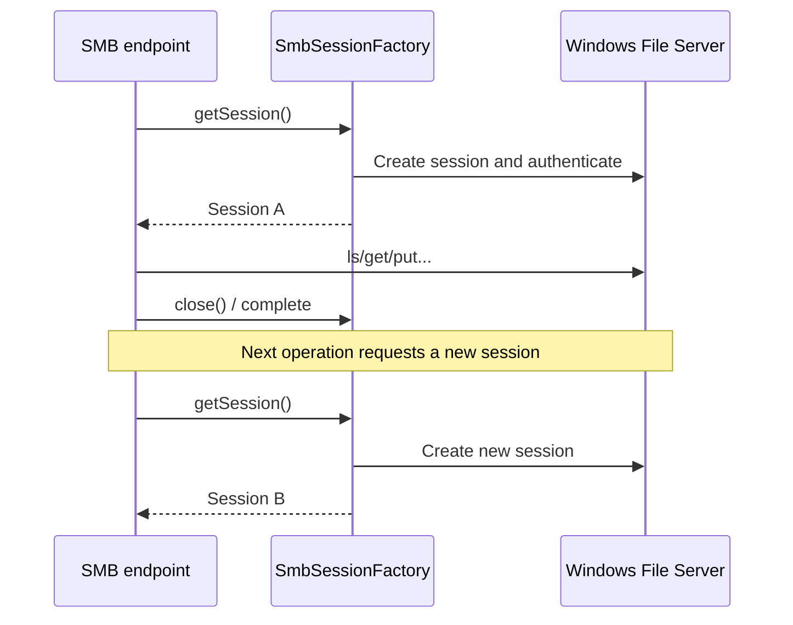
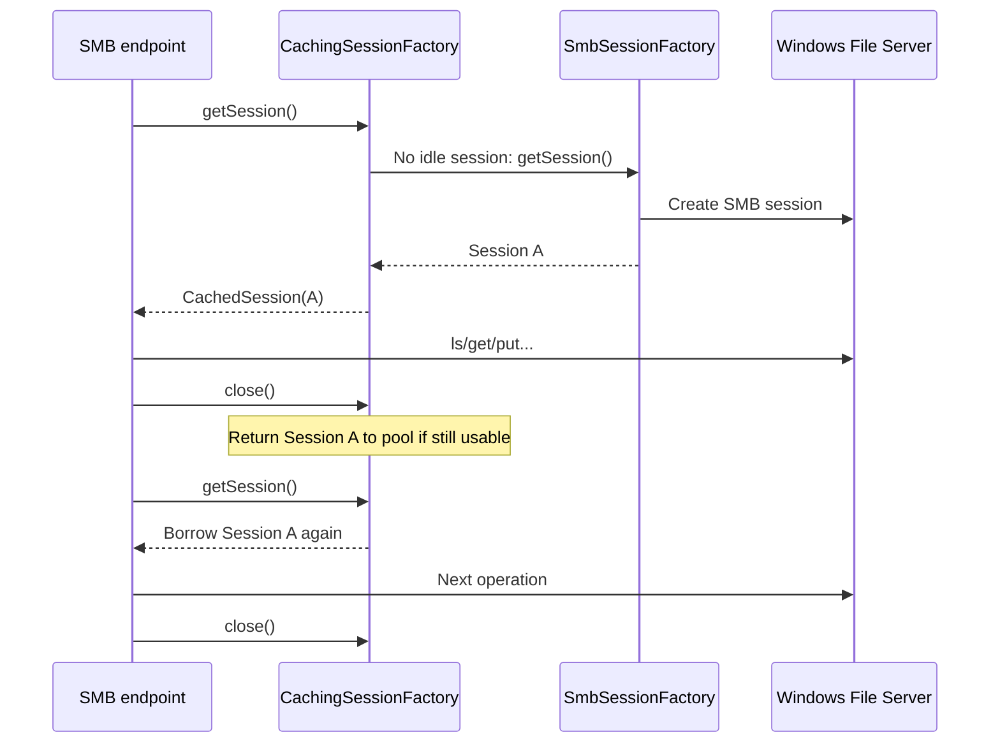
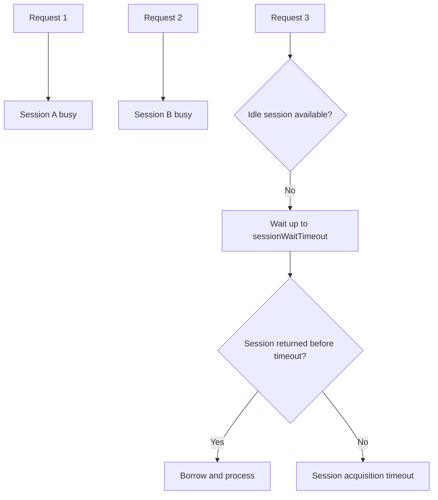
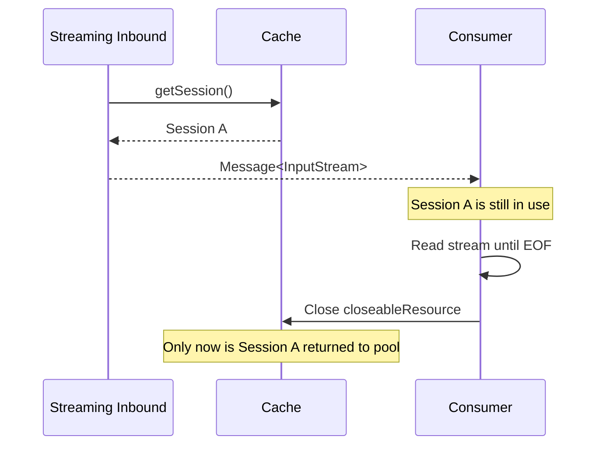

# SMB Session Factory and Session Caching

## 1. Why Manage SMB Sessions?

Suppose a Spring Boot application must read report files from `\\fileserver\partner-share\incoming` every 10 seconds and send confirmation files to `\\fileserver\partner-share\outgoing`. Each time it polls or sends a file, the application must use a session with the Windows File Server. Continuously creating and closing new connections can make connection/authentication overhead take significant time compared to listing a small directory.

In Spring Integration, `SmbSessionFactory` supplies SMB sessions to **inbound adapters**, **outbound adapters**, and **outbound gateways**. By default, when an endpoint requests a session, `SmbSessionFactory` creates a new one. `CachingSessionFactory` can wrap this factory to reuse returned sessions while capping how many sessions the application uses concurrently.

This lesson belongs to the **Adapter SMB** chapter of the `SPRING_INTEGRATION_ADAPTERS` module. The module focuses on connecting external systems via inbound/outbound adapters, gateways, pollers, and `MessageChannel`; practicing exchange flows across files, SFTP, HTTP, JMS, AMQP, Kafka, and databases; and managing message contracts, errors, and connection lifecycles. **Session** here refers to a connection resource specific to the SMB protocol; it is distinct from a `Message<?>` moving across a `MessageChannel`.

After this lesson, you will be able to:

- Distinguish `SmbSessionFactory`, `Session<SmbFile>`, `CachingSessionFactory<SmbFile>`, and SMB endpoints.
- Configure host, port, domain, credentials, share, SMB dialect, and pool size in Java.
- Accurately explain the **borrow session → use → return session** lifecycle, how the pool blocks when exhausted, and when sessions actually close.
- Inject the **cache bean itself** into inbound/outbound/gateway endpoints rather than declaring a cache while endpoints still use the raw factory.
- Evaluate `sessionCacheSize`, `sessionWaitTimeout`, `testSession`, `resetCache`, and when connections are recreated.
- Identify sessions held too long due to `InputStream`, timeouts, retries, network issues, or credential changes.
- Design tests proving caching works, session limits take effect, and recovery does not lose files.

## 2. Core Concepts

| Component | Role | Responsibility |
|---|---|---|
| `SmbSessionFactory` | Creates new SMB sessions on demand | Holds host/share config, domain, username/password, and SMB dialect bounds |
| `Session<SmbFile>` | Interface for operations on SMB resources | Lists, reads, writes, renames, or deletes files; closes when finished |
| `SmbSession` | Spring Integration's SMB session implementation | Uses the underlying SMB client library to work with `jcifs.smb.SmbFile` |
| `CachingSessionFactory<SmbFile>` | Wraps a `SessionFactory<SmbFile>` | Lends sessions and retains healthy ones for future reuse |
| Inbound/outbound adapter | Transfers files between SMB and message flows | Borrows a session when syncing or uploading files |
| Outbound gateway | Executes `ls/get/put/mv/rm` commands and receives replies | Borrows a session to execute a request and produce a flow reply |
| Poller | Triggers an inbound source on a schedule | Drives cadence; does not own the session pool |
| `MessageChannel` | Delivers messages between endpoints | Neither an SMB session nor a manager of SMB connections |

`SmbSessionFactory` implements the common `SessionFactory<jcifs.smb.SmbFile>` interface. Consequently, many Spring Integration SMB endpoints accept both the raw factory and the `CachingSessionFactory<SmbFile>` wrapper without changing the message contract.

For example, an inbound adapter that syncs files locally still emits a `java.io.File` payload. Using cached sessions changes how **server connections are reused**; it **does not change the payload to `SmbFile` and does not alter message semantics**.

### How Does a Session Differ from a TCP Connection?

A `Session<SmbFile>` is Spring Integration's **abstraction** over a working session with a remote system. The underlying SMB library may maintain additional authentication state, transport state, tree/share connections, or its own reuse mechanisms. Therefore, do not assume "a pool of 5 sessions" means the OS always holds exactly 5 open TCP sockets at every moment. Use session counts to bound application demand and measure actual server connections when needed.

## 3. Two Lifecycle Models: Cached vs. Uncached

### 3.1. Without `CachingSessionFactory`



This model is straightforward and can suit jobs that run very infrequently. In exchange, every new session creation can incur connection setup, protocol negotiation, and authentication overhead.

### 3.2. With `CachingSessionFactory`



**Common pitfall:** when code using a cached session calls `close()`, that typically **returns the session to the pool** for reuse. It does not always close the physical connection immediately. If the session is broken, the pool is reset, or the application shuts down, the session is closed per the factory's policy.

Typical lifecycle:

1. The endpoint requests a `Session<SmbFile>` from `CachingSessionFactory`.
2. The cache looks for a valid idle session; if none exists and the limit has not been reached, it asks `SmbSessionFactory` to create a new session.
3. The endpoint uses the session to read/write files or run a gateway command.
4. The endpoint finishes the operation and calls `close()` on the borrowed session.
5. The cache decides whether to return the session to the idle queue or close it if marked non-reusable.
6. Subsequent requests can borrow that session again.

**Never store a borrowed session as a singleton for concurrent use across multiple threads.** Let endpoints or session-using code borrow when needed and return within the processing scope. A session cache enables **sequential reuse** and concurrency control; it does not turn a session into an arbitrarily thread-safe object.

## 4. Hands-On Spring Boot + Java DSL Configuration

The example below uses Spring Boot 3.x and compatible Spring Integration 6.5.x. Imports and structures match Spring Integration 6.5 documentation, so if your project runs a different branch, consult the Javadoc for your exact dependency version.

### 4.1. Dependencies

**Gradle:**

```gradle
dependencies {
    implementation 'org.springframework.boot:spring-boot-starter-integration'
    implementation 'org.springframework.integration:spring-integration-smb'
}
```

Spring Boot dependency management selects versions for its managed artifacts. If managing versions manually, ensure `spring-integration-smb`, `spring-integration-file`, and other Spring Integration components have compatible versions.

### 4.2. Properties

**`application.yml`:**

```yaml
demo:
  smb:
    host: ${SMB_HOST}
    port: ${SMB_PORT:445}
    domain: ${SMB_DOMAIN:}
    username: ${SMB_USERNAME}
    password: ${SMB_PASSWORD}
    share: ${SMB_SHARE:partner-share}
    pool-size: ${SMB_POOL_SIZE:4}
    session-wait-timeout-ms: ${SMB_SESSION_WAIT_TIMEOUT_MS:3000}
```

To run the lab, supply the corresponding environment variables. Use a secret manager or platform secret mechanism for credentials in real environments; **never hard-code passwords** in Java, Git, or logs.

`SMB_POOL_SIZE=4` is a limit **per application instance**. It is not an automatic shared limit across 5 pods or multiple processes. Running 5 pods with that configuration can reach roughly 20 concurrent sessions if each pod requires up to 4 sessions, excluding any extra client-library connections or other applications.

### 4.3. Creating the Raw Factory and Cached Factory

**`SmbConnectionsConfig.java`:**

```java
import jcifs.DialectVersion;
import jcifs.smb.SmbFile;

import org.springframework.beans.factory.annotation.Qualifier;
import org.springframework.beans.factory.annotation.Value;
import org.springframework.context.annotation.Bean;
import org.springframework.context.annotation.Configuration;
import org.springframework.integration.annotation.IntegrationComponentScan;
import org.springframework.integration.config.EnableIntegration;
import org.springframework.integration.file.remote.session.CachingSessionFactory;
import org.springframework.integration.file.remote.session.SessionFactory;
import org.springframework.integration.smb.session.SmbSessionFactory;

@Configuration
@EnableIntegration
@IntegrationComponentScan
public class SmbConnectionsConfig {

    @Bean("rawSmbSessionFactory")
    SmbSessionFactory rawSmbSessionFactory(
            @Value("${demo.smb.host}") String host,
            @Value("${demo.smb.port}") int port,
            @Value("${demo.smb.domain}") String domain,
            @Value("${demo.smb.username}") String username,
            @Value("${demo.smb.password}") String password,
            @Value("${demo.smb.share}") String share) {

        SmbSessionFactory factory = new SmbSessionFactory();
        factory.setHost(host);
        factory.setPort(port);
        factory.setDomain(domain);
        factory.setUsername(username);
        factory.setPassword(password);
        factory.setShareAndDir(share);
        factory.setSmbMinVersion(DialectVersion.SMB210);
        factory.setSmbMaxVersion(DialectVersion.SMB311);
        return factory;
    }

    @Bean("cachedSmbSessionFactory")
    CachingSessionFactory<SmbFile> cachedSmbSessionFactory(
            @Qualifier("rawSmbSessionFactory")
            SmbSessionFactory target,
            @Value("${demo.smb.pool-size}") int poolSize,
            @Value("${demo.smb.session-wait-timeout-ms}") long waitMs) {

        if (poolSize < 1 || waitMs < 1) {
            throw new IllegalArgumentException(
                    "SMB pool-size and wait-timeout must be greater than 0");
        }

        CachingSessionFactory<SmbFile> cache =
                new CachingSessionFactory<>(target, poolSize);
        cache.setSessionWaitTimeout(waitMs);

        // Consider testSession after verifying permissions and load on SMB.
        // cache.setTestSession(true);

        return cache;
    }
}
```

Explanation in initialization order:

- `rawSmbSessionFactory` holds **session creation details** and the negotiable SMB dialect range. In the example, host/share come from configuration and the account has least-privilege access.
- `cachedSmbSessionFactory` wraps **that exact raw factory**. The pool size is passed via constructor; the wait timeout is configured in milliseconds.
- Both are injectable beans in Spring. Since both implement `SessionFactory<SmbFile>`, use `@Qualifier("cachedSmbSessionFactory")` at endpoints to avoid accidentally injecting the raw factory.
- `setTestSession(true)` optionally tests a session when borrowing from the cache. For SMB, a liveness check may perform a remote listing operation; weigh permissions, overhead, and network conditions before enabling it broadly.
- In Spring Integration 6.5, the concrete generic type is `jcifs.smb.SmbFile`. Do not use `java.io.File` as the session factory's generic parameter: `File` is the local file type in some adapter payloads, not the remote SMB resource type.

### 4.4. Injecting the **Cached Factory** into an Outbound Gateway

A read-check flow only needs `ls -1`:

**`SmbFlowsConfig.java`:**

```java
import jcifs.smb.SmbFile;

import org.springframework.beans.factory.annotation.Qualifier;
import org.springframework.context.annotation.Bean;
import org.springframework.context.annotation.Configuration;
import org.springframework.integration.dsl.IntegrationFlow;
import org.springframework.integration.file.remote.session.SessionFactory;
import org.springframework.integration.smb.dsl.Smb;

@Configuration
public class SmbFlowsConfig {

    @Bean
    IntegrationFlow smbListFlow(
            @Qualifier("cachedSmbSessionFactory")
            SessionFactory<SmbFile> sessionFactory) {

        return IntegrationFlow.from("smbListRequests")
                .handle(Smb.outboundGateway(
                        sessionFactory, "ls", "payload")
                        .options("-1"))
                .get();
    }
}
```

**`SmbFilesGateway.java`:**

```java
import java.util.List;

import org.springframework.integration.annotation.Gateway;
import org.springframework.integration.annotation.MessagingGateway;

@MessagingGateway
public interface SmbFilesGateway {

    @Gateway(requestChannel = "smbListRequests")
    List<String> listNames(String remoteDirectory);
}
```

In a Spring service, you can inject `SmbFilesGateway` and call:

```java
List<String> names = smbFilesGateway.listNames("incoming");
System.out.println("Number of files seen: " + names.size());
```

Each call creates a request message sent through `smbListRequests`. The gateway uses a **cached session** to list files and returns `List<String>` to the caller. Two consecutive calls may reuse the same session if still valid; however, do not write tests asserting they must always use the exact same socket, since the server may close sessions proactively and the pool may replace broken sessions.

### 4.5. Reusing the Cached Factory for an Outbound Adapter

To upload files to a share, you can add the following flow using the same cached factory:

```java
import java.io.File;
import jcifs.smb.SmbFile;
import org.springframework.beans.factory.annotation.Qualifier;
import org.springframework.context.annotation.Bean;
import org.springframework.integration.dsl.IntegrationFlow;
import org.springframework.integration.file.remote.FileExistsMode;
import org.springframework.integration.file.remote.session.SessionFactory;
import org.springframework.integration.smb.dsl.Smb;

@Bean
IntegrationFlow smbSendFlow(
        @Qualifier("cachedSmbSessionFactory")
        SessionFactory<SmbFile> sessionFactory) {

    return IntegrationFlow.from("smbSendFiles")
            .handle(Smb.outboundAdapter(
                    sessionFactory, FileExistsMode.FAIL)
                    .remoteDirectory("outgoing")
                    .autoCreateDirectory(true)
                    .fileNameExpression("payload.name")
                    .useTemporaryFileName(true))
            .get();
}
```

This is an **add-on snippet** to place inside a `@Configuration` class, not a standalone top-level Java file. The flow's input is a completed local `File`; the adapter writes to `outgoing` in the share and uses temporary naming as configured. You can add `@Gateway(requestChannel = "smbSendFiles") void upload(File file);` to a dedicated file-sending interface.

Notice that both `smbListFlow` and `smbSendFlow` inject `SessionFactory<SmbFile>` qualified as `cachedSmbSessionFactory`. If both share one cache bean, they share the instance's session limit. For different accounts or remote shares, create a separate factory and cache per identity/endpoint as appropriate.

### 4.6. With a Scheduled Polled Inbound Adapter

The inbound adapter also accepts `SessionFactory<SmbFile>`. It can be configured similarly:

```java
@Bean
IntegrationFlow smbInboundFlow(
        @Qualifier("cachedSmbSessionFactory")
        SessionFactory<SmbFile> sessionFactory) {

    return IntegrationFlow
            .from(Smb.inboundAdapter(sessionFactory)
                        .remoteDirectory("incoming")
                        .localDirectory(new File("./data/smb-inbox"))
                        .autoCreateLocalDirectory(true)
                        .regexFilter("(?i).*\\.csv$"),
                  endpoint -> endpoint.poller(
                        Pollers.fixedDelay(10_000)
                               .maxMessagesPerPoll(5)))
            .handle(message -> {
                File local = (File) message.getPayload();
                System.out.println("SMB file: " + local.getName());
            })
            .get();
}
```

In this snippet, import `java.io.File`, `org.springframework.integration.dsl.Pollers`, and the flow/bean classes. The poller controls **when** to query SMB; the cache controls **which session** is obtained to connect. `maxMessagesPerPoll(5)` caps messages per poll cycle, **not** `sessionCacheSize=5`. How many files are downloaded each time and how many messages are emitted also depend on filters, local files, and sync options.

## 5. Key Cache Properties

| API / Property | Effect | How to Choose |
|---|---|---|
| `new CachingSessionFactory<>(target, N)` | Sets the maximum sessions managed by the cache | Size based on concurrent SMB operations and file server capacity |
| `setSessionWaitTimeout(ms)` | Limits how long callers wait when all sessions are borrowed | Should be shorter than the overall business timeout for synchronous requests |
| `setTestSession(true)` | Tests a session taken from the pool before reuse | May add overhead and require extra permissions; enable based on test results |
| `resetCache()` | Evicts idle sessions from the cache; borrowed sessions close upon return | Use during controlled recovery or configuration transitions |
| `setPoolSize(newSize)` | Adjusts pool limit at runtime | Must consider concurrency and server policies |
| `destroy()` | Closes idle sessions when the bean is destroyed | Typically managed by Spring bean lifecycle |

### 5.1. What Happens When Sessions Run Out?

Suppose `sessionCacheSize=2` and three independent requests arrive:



If the first two requests both hold sessions for 8 seconds while the third request can only wait 3 seconds, the third request can fail because it **could not borrow a session**, even when DNS, the SMB server, and the password are all valid.

Pool exhaustion differs from network timeouts and authentication failures. Diagnostics must determine whether callers are **waiting for a session in the cache** or already hold a session and are waiting on the SMB server.

### 5.2. Sizing the Pool Based on Load

There is no single value that fits every system. Start from the **concurrency you genuinely need to serve**:

| Pattern | Initial Consideration |
|---|---|
| Single inbound poller, synchronous processing, few files | A small pool, e.g., 1–2, may suffice |
| One inbound and one outbound running concurrently | Needs room for two concurrent SMB operations plus appropriate headroom |
| Multiple parallel gateway requests | Pool must align with allowed active requests and server capacity |
| Multiple pods sharing a share | Total load = demand across all instances; caches do not coordinate limits cluster-wide |
| Streaming inbound holding streams in handlers | Account for how long the stream holds the session, not just the initial SMB query |

`sessionCacheSize=4` does not cause every poll to open four connections; sessions are created based on **actual borrowing demand**. Conversely, an overly large pool can increase connections, server load, and recovery time when the server struggles. An overly small pool causes queuing and timeouts.

If latency for an SMB operation spikes unexpectedly, increasing pool size may not solve the problem: the cause could be networking, a congested server, large file processing, or the application holding sessions too long. Measure operation durations and concurrent requests before raising limits.

### 5.3. Benefits and Costs of `setTestSession(true)`

When enabled, `CachingSessionFactory` checks whether a session borrowed from the cache is still alive. If the server disconnected the session, discarding the stale session and creating a new one can prevent errors from reusing a dead connection.

**With SMB**, `SmbSession.isOpen()` may check liveness by listing remote files—an operation involving I/O and requiring appropriate permissions. A write-only account denied directory listing could fail this check even though a specific write operation would succeed. Therefore:

1. Check account permissions and test `isOpen/test` in the lab.
2. Measure extra session-borrowing latency with testing enabled.
3. Decide whether to enable it based on I/O cost, how aggressively the server drops idle sessions, and flow availability goals.
4. Even with testing enabled, you still must handle disconnects **after** the check; a connection can break during the very next SMB operation.

Do not view `testSession(true)` as "automatically fixing all connection errors." It only helps detect unusable sessions at borrow time; it provides neither business retries nor exactly-once guarantees.

## 6. Closing Sessions Properly

### 6.1. Endpoints Can Manage Sessions; Custom Code Must Manage Resources

For local-sync inbound adapters or outbound gateways/adapters executing bounded operations, standard endpoints usually borrow and close/return sessions within their own lifecycle. Downstream business code receiving `Message<File>` does not need to hold a session to read the already-downloaded local file.

If you write code that uses `SessionFactory<SmbFile>` directly, always return sessions with `try-with-resources`:

```java
import jcifs.smb.SmbFile;
import java.io.IOException;
import java.util.Arrays;
import java.util.List;
import org.springframework.integration.file.remote.session.Session;
import org.springframework.integration.file.remote.session.SessionFactory;

public final class SmbDirectoryInspector {

    private final SessionFactory<SmbFile> sessionFactory;

    public SmbDirectoryInspector(SessionFactory<SmbFile> sessionFactory) {
        this.sessionFactory = sessionFactory;
    }

    public List<String> list(String remoteDirectory) throws IOException {
        try (Session<SmbFile> session = sessionFactory.getSession()) {
            String[] names = session.listNames(remoteDirectory);
            return Arrays.asList(names);
        }
    }
}
```

This snippet assumes the caller injects the **cached factory**. Upon exiting the `try` block, `session.close()` runs even if a normal exception occurs, letting the cache reclaim the slot. For a session borrowed from a cache, `close()` normally returns it to the pool. For a raw factory, `close()` closes the underlying session resource.

If an error renders the session unsafe to reuse, the `Session` interface provides `dirty()` to mark the session for removal in supporting implementations. When managing complex I/O manually, handle errors and update session state per the API contract; never retain and reuse a broken session merely because it sits in the cache.

### 6.2. Streaming Inbound Holds Sessions Longer

Unlike adapters that sync files before emitting messages, an **SMB streaming inbound adapter** can emit an `InputStream` payload. When the stream arrives, data is still being read directly from SMB; the session must remain open until reading completes.



Spring Integration supplies the closeable resource via the `IntegrationMessageHeaderAccessor.CLOSEABLE_RESOURCE` header (typically named `closeableResource`). Standard components like `FileSplitter` and `StreamTransformer` help close resources. Custom handlers must close the resource **after** consuming the stream, even on error.

Crucial operational point: a pool of 2 sessions where 2 consumers keep 2 streams open for 30 seconds can make a third request wait or time out during that window. If a streaming consumer hands off reading to another thread, you must coordinate the stream/session lifecycle across thread boundaries and handle exceptions properly; never close before the worker thread genuinely finishes.

### 6.3. Why Not Call `resetCache()` After Every File?

`resetCache()` evicts cached sessions; it is not a required step after every message. Resetting per file destroys reuse benefits and adds connection/authentication overhead. Likewise, never instantiate `new CachingSessionFactory(...)` per request; doing so creates many unmanaged mini-pools.

## 7. When Sessions Break, Networks Drop, or Credentials Change

### 7.1. Error Categories to Distinguish

| Symptom | Suspected Layer | Action |
|---|---|---|
| Cannot reach host or TCP 445 | DNS, network, firewall, server | Test from the exact running container/pod |
| Auth failure when creating new session | Domain, username/password, account | Check secret source and lockout policy; avoid aggressive retries |
| `Access Denied` on `ls/put/mv` | Share permissions, NTFS ACL | Compare specific permissions with command; do not blindly escalate to admin |
| Waits in `getSession()` then times out | Pool out of idle sessions / leaked session | Check concurrency, streaming, timeouts, and resource leaks |
| Got cached session, yet SMB command fails | Stale expired session, mid-op network/server error | Discard bad session, bounded retry, reconcile file state |
| Only old pods work after rotation | Secret config and sessions out of sync | Verify beans/config, rollout, and session cache |
| Raising `pool-size` gives no throughput gain | Server or link is saturated | Measure op duration, server load, file sizes, and contention |

Flow errors may be wrapped as `MessagingException`. Log non-sensitive fields such as host alias, share name, command, batch ID, request ID, latency, and error category. Never log raw passwords, authentication hashes, or credentialed URLs.

### 7.2. Resetting the Pool During Server Incidents

The `CachingSessionFactory.resetCache()` API behaves as follows:

- **Idle sessions:** closed upon reset.
- **Borrowed sessions:** when returned to the cache, they are closed instead of kept for reuse.
- **Future requests:** can create new sessions via the raw factory as needed.

Thus, resetting **purges old sessions from the pool**, but does not ensure failed or in-flight requests succeed. Retries must be handled based on individual file/command outcomes. For example, a timed-out `put` might already have written the file to the server; resending with `REPLACE` or `APPEND` is unsafe without reconciliation.

Example invocation in a **trusted administrative component**:

```java
import jcifs.smb.SmbFile;
import org.springframework.beans.factory.annotation.Qualifier;
import org.springframework.integration.file.remote.session.CachingSessionFactory;

public class SmbCacheAdminService {

    private final CachingSessionFactory<SmbFile> cache;

    public SmbCacheAdminService(
            @Qualifier("cachedSmbSessionFactory")
            CachingSessionFactory<SmbFile> cache) {
        this.cache = cache;
    }

    public void evictCachedSessions() {
        cache.resetCache();
    }
}
```

This is an **illustrative class snippet**; if you want Spring to manage it as a bean, add a bean declaration or appropriate stereotype annotation. Never expose a public unauthenticated REST endpoint to reset the cache; enforce clear access controls and change governance.

### 7.3. When Changing Passwords, Is `resetCache()` Enough?

**No.** The underlying `SmbSessionFactory` is typically initialized once from properties at application startup. If the external secret changed while the raw factory still holds the old password, `resetCache()` clears borrowed/idle sessions, yet **new sessions may still use the old credential**.

A controlled rotation workflow:

1. Prepare the new secret and coordinate credential rotation with your identity system.
2. Update the secret source the application actually reads.
3. Refresh/recreate `SmbSessionFactory` along with `CachingSessionFactory`, typically via a controlled rollout/restart if configuration does not support dynamic reload.
4. Run `ls` against a lab/probe directory to verify authentication and permissions with the new session.
5. Recover failed tasks according to recorded business state; avoid unbounded bulk retries.

Especially in multi-pod deployments, coordinate rollout order so old and new pods do not process the same batch simultaneously without an ownership mechanism.

### 7.4. Do Not Confuse Session Caching with Deduplication

A session cache retains **connection resources**, not a history of received files. It **does not** provide:

- `idempotency` keys for invoices/orders;
- confirmation that a remote file has been processed by business logic;
- safe retries after timeouts;
- batch ownership distribution across multiple instances;
- a persistent metadata store for inbound filters.

If an inbound adapter re-polls an old file or an outbound adapter resends a batch, design filters/metadata stores and business keys separately. Neither a `MessageChannel` nor a session pool automatically turns file transfer and database commit into a single transaction.

## 8. Multi-Instance Configuration and Operations

A cache is **local to a single ApplicationContext/JVM**, unless backed by a specialized distribution mechanism outside the scope of this guide. Therefore:

- **2 instances × pool size 4** allows each instance to borrow up to 4 sessions from its own cache. The file server must handle the combined total request volume.
- If both instances share an inbound share, adding caching alone does not prevent both from downloading or processing the same file. You need a shared metadata store, job locking, or an appropriate partitioning strategy.
- If both use the same SMB account, rotating that account affects both; do not recreate one pod and assume the entire cluster has authenticated with the new secret.
- If multiple flows have different profiles yet share a share/account, choose between **one shared cache** (easy to cap total concurrency) and **multiple caches with separate limits** (isolates impact across flows) based on requirements and server load.
- For different shares/accounts, separate factories to avoid path and permission leakage while configuring credentials independently.

### Practical Load Control

A system with an inbound poller running every 10 seconds does not necessarily have only one active operation at a time. If the poller uses a multi-threaded executor, streaming inbound holds sessions, and gateways query or outbound uploads run concurrently, threads can contend for the pool.

Adjusting `fixedDelay`, `maxMessagesPerPoll`, and `sessionCacheSize` should be evaluated together, though **they govern three different parts**:

| Setting | What Does It Limit? |
|---|---|
| `fixedDelay(10_000)` | Delay before starting the next poll after the previous poll task finishes |
| `maxMessagesPerPoll(5)` | Maximum messages the poller emits in one cycle |
| `maxFetchSize` if set | Remote files fetched in one source sync pass |
| `sessionCacheSize=4` | Concurrent cached SMB sessions supplied within the instance |
| `sessionWaitTimeout=3000` | Wait time when a session is needed and no slot is free |

Changing `sessionCacheSize` does not automatically increase messages per poll cycle, and raising message counts does not make the server tolerate more connections.

## 9. Observing Performance and Session State

To tell whether caching is helping or bottlenecking, watch these signals:

| Signal | Question to Answer |
|---|---|
| Concurrent SMB requests | Is actual demand near or exceeding pool size? |
| Session acquisition latency | Are threads waiting for cache slots? |
| `ls/get/put/mv` command latency | Is slowness inside remote operations or before acquiring a session? |
| Session acquisition timeout count | Is the pool too small, leaking sessions, or are handlers holding streams too long? |
| Server connections / new sessions created | Is caching reducing re-authentication/reconnection overhead? |
| Authentication and permission errors | Are account/policy issues spiking after rotation? |
| Open streams count | Are consumers holding sessions after receiving messages? |
| File backlog size | Is processing keeping pace with the source system? |

Not all of these signals are built-in Spring Integration metrics. They can be measured at the application layer, via Micrometer, sanitized logs, pool instrumentation, and SMB server metrics. When adding instrumentation, never log usernames/passwords, secrets, or file contents.

A simple lab measurement is comparing multiple `ls` calls using the raw factory vs. the cached factory, then observing server sessions/connections (if permitted). Results depend on network latency, directory size, thread count, and server state; never promise a fixed speedup factor.

## 10. Scenario-Based Hands-On Practice

Prepare a **lab-only** Windows File Server, NAS, or Samba share, e.g., `partner-share`, with `incoming` and `outgoing` directories. The account has list permissions on `incoming` and file-creation permissions in `outgoing`. The application includes the two factories and `ls` flow from Section 4.

### Lab A — Verify the Correct Cache Bean Is Used

1. Start the application with `SMB_POOL_SIZE=2` and `SMB_SESSION_WAIT_TIMEOUT_MS=3000`.
2. Call `listNames("incoming")` several times in a row and confirm the gateway replies with `List<String>`.
3. Inspect the wiring of `smbListFlow` and confirm the parameter carries `@Qualifier("cachedSmbSessionFactory")`.
4. If server-side session inspection tools are available, observe reuse; do not judge solely by how many times a filename appears.

**Result:** understand that declaring a cache bean is not enough; endpoints must actually be injected with the cache bean.

### Lab B — Pool Exhaustion and Timeout

1. In an isolated test, borrow `Session<SmbFile>` via `getSession()` and hold two unclosed sessions for a short, controlled duration.
2. From a third request, attempt to borrow again and observe waiting up to the 3000 ms limit; expect a session-wait timeout error.
3. Close the first two sessions in a `finally` block or `try-with-resources`.
4. Borrow a session again and confirm requests can resume.

Never perform Lab B by holding production flow sessions while live traffic is processing. If using test code, guarantee sessions close even when the test fails.

**Result:** distinguish pool timeouts from TCP or SMB authentication errors.

### Lab C — Cached vs. Uncached Comparison

1. In the lab, time 20 `ls` calls with the raw factory and 20 calls with the cached factory, changing only the injected bean in the test environment.
2. Keep directory contents, network, account, and concurrency constant.
3. Record median latency, tail outliers, and observed server sessions if available.
4. Explain why caching can improve connection latency yet will not make `ls` over a million-file directory lightweight.

**Result:** choose configuration from measurements rather than inferring a guaranteed speedup from the definition of caching.

### Lab D — Stale Sessions After an SMB Outage

1. Call `ls` successfully so the cache holds a previously used session.
2. On the lab network, temporarily sever SMB connectivity or restart the test server per authorized procedures.
3. Restore the server, call `ls`, and record any errors or new session creation events.
4. Test enabling `testSession` or controlled cache reset, then call again.
5. Compare results and explain why retries with backoff are still needed when an in-flight command fails.

**Result:** understand the limits of session reuse when the server proactively closes old sessions.

### Lab E — Streaming Holding Sessions and Leak Risk

1. Create a streaming inbound flow on the lab share to read a large file, or simulate code that borrows a session and holds I/O resources.
2. Observe that the session stays occupied while the stream remains open.
3. Finish reading and close `closeableResource` per lifecycle; observe another request can now borrow a session.
4. Test an exception path specifically and verify resources still close.

**Result:** recognize that pool exhaustion can originate in stream consumers rather than an undersized pool config.

### Lab F — Credential Rotation

1. Check when the application reads `SMB_PASSWORD` and when `SmbSessionFactory` is instantiated.
2. In a lab with a rotatable test account, change the password and update the secret.
3. Roll out/restart dependent pods per policy instead of calling `resetCache()` alone and assuming the raw factory picks up the new value.
4. Call `ls` again to verify new sessions authenticate and read the expected directory.
5. Record pod status without logging passwords.

**Result:** explain the relationship among loaded credentials, the session cache, and the `ApplicationContext` lifecycle.

### Self-Check Questions

1. `SmbSessionFactory` is already a factory—why wrap it in `CachingSessionFactory`?
2. Why might `session.close()` on a cached session return it to the pool instead of disconnecting immediately?
3. Is a pool size of 3 enough for two long-lived streaming consumers and two parallel outbound gateways?
4. Why might enabling `testSession(true)` be unsuitable for a write-only account?
5. If `resetCache()` already ran, why can a newly created session still fail with the old password?
6. Why doesn't session caching prevent two pods from importing the same invoice twice?

## 11. Common Pitfalls

| Misconception | Accurate Understanding |
|---|---|
| Just declaring a cache bean makes every SMB endpoint use it | You must inject the cache bean into each adapter/gateway |
| `SmbSessionFactory` always reuses sessions by default | Per SMB docs, it creates a new session per request; caching requires a wrapper |
| `close()` always closes the socket immediately | On a cached session, `close()` normally returns it to the pool if valid |
| Pool size 4 means 4 connections are always open | Sessions are created on demand; physical connections do not map 1:1 statically |
| Pool exhaustion means the SMB server is down | Can be caused by concurrency, streaming holding sessions, or leaked resources |
| `testSession(true)` has zero cost | Adds a liveness check and I/O; with SMB it may require listing permissions |
| `resetCache()` makes the bean re-read the new secret | It evicts old sessions; the factory/config must be updated to use new credentials |
| Caching ensures files are processed only once | It optimizes connections, not file or database idempotency |
| `maxMessagesPerPoll` is the SMB session count | One limits poller messages; the other is the pool size |
| Increasing pool size always increases throughput | Can overload the server further when network/I/O is already saturated |
| A cache on pod A limits sessions on pod B | Each instance has its own pool; sum demand across all instances |
| Once streaming emits a message, the session can be returned | Must wait until the stream is consumed/closed and resources are released |

## 12. References

- [Spring Integration 6.5 — SMB Support](https://docs.spring.io/spring-integration/reference/6.5/smb.html): `SmbSessionFactory`, session caching, Java DSL, and streaming inbound.
- [Spring Integration 6.5 — `SmbSessionFactory` Javadoc](https://docs.spring.io/spring-integration/docs/6.5.x/api/org/springframework/integration/smb/session/SmbSessionFactory.html): implements `SessionFactory<jcifs.smb.SmbFile>`.
- [Spring Integration 6.5 — `CachingSessionFactory` Javadoc](https://docs.spring.io/spring-integration/docs/6.5.0/api/org/springframework/integration/file/remote/session/CachingSessionFactory.html): constructors, pool limits, `setTestSession`, `resetCache`, `setPoolSize`.
- [Spring Integration 6.5 — `Session` Javadoc](https://docs.spring.io/spring-integration/docs/6.5.0/api/org/springframework/integration/file/remote/session/Session.html): `getSession`, `close`, `dirty`, `test`, and general session lifecycle.
- [Spring Integration 6.5 — SMB Java DSL API](https://docs.spring.io/spring-integration/docs/6.5.0/api/org/springframework/integration/smb/dsl/Smb.html): factory methods accepting `SessionFactory<SmbFile>`.

**Key takeaway:** use `SmbSessionFactory` to **create** SMB sessions and `CachingSessionFactory` to **reuse/cap** sessions. Flow reliability also depends on proper lifecycle closing, timeouts, accounts/secrets, error handling, and idempotency; caching is only one part of connection design.
