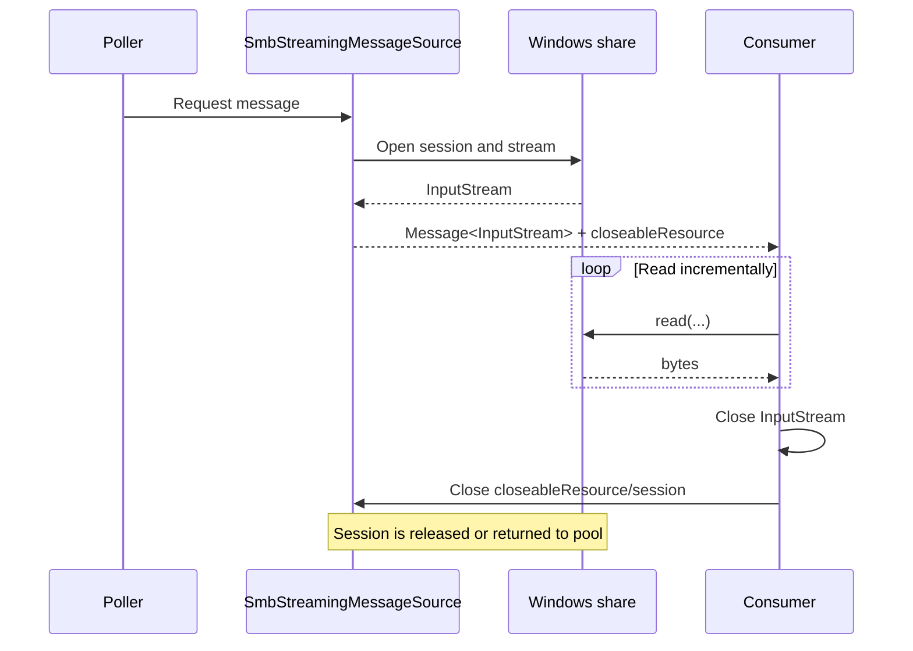
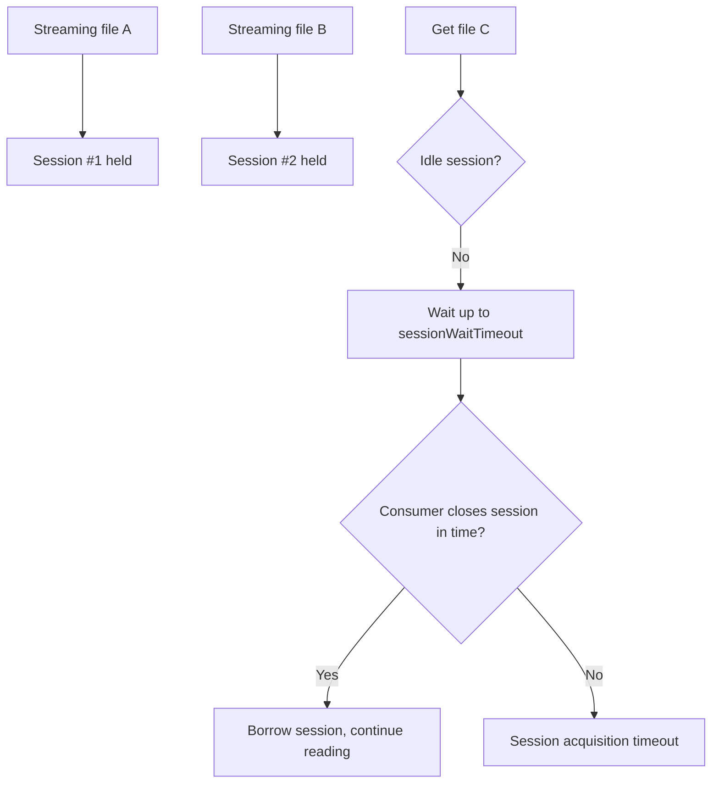
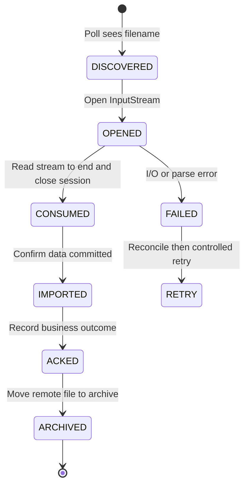

# File Streaming over SMB in Spring Integration

## 1. Problem and Objectives

A partner places a 3 GB file `orders-20261123.csv` in a Windows shared folder `\\fs01\exchange\incoming`. A Spring Boot application needs to read each record, validate the data, and feed records into an order-import pipeline. Downloading the entire file to disk first requires sufficient temporary disk space and a synchronization step. Reading the entire file into a `String` or `byte[]` can consume excessive memory.

The **SMB streaming inbound channel adapter** lets the application receive a `Message<InputStream>` and read data from SMB as the consumer consumes the stream. No full copy needs to be created on local disk before processing. However, the SMB session must remain **open throughout reading**; the consumer is responsible for closing the resource promptly, even on error.

This lesson belongs to the **Adapter SMB** chapter of the `SPRING_INTEGRATION_ADAPTERS` module: connecting external systems using inbound/outbound adapters, gateways, pollers, and `MessageChannel`, and managing message contracts, errors, and connection lifecycles. Although this pattern relates to SFTP/FTP remote-file adapters, it uses SMB-specific components and connections; do not assume identical behavior across SMB and HTTP, JMS, AMQP, Kafka, or databases.

After this lesson, you will be able to:

- Distinguish local file synchronization from reading directly via `InputStream`.
- Configure `SmbStreamingMessageSource` or Java DSL `Smb.inboundStreamingAdapter(...)`.
- Understand payloads and the headers `file_remoteFile`, `file_remoteDirectory`, and `closeableResource`.
- Process streams with `FileSplitter`, `StreamTransformer`, or custom handlers without leaking sessions.
- Use outbound gateway `get -stream` when an on-demand file read is needed.
- Identify the effects of `maxFetchSize`, pollers, metadata filters, and session caches.
- Design retries/idempotency for mid-file read failures, memory bounds, and repeatable tests.

## 2. What Does Streaming Actually Change?

### 2.1. Two Paths for an SMB File

**Local-sync inbound adapter:**


**Streaming inbound adapter:**


| Criterion | Local Sync | Streaming Inbound |
|---|---|---|
| Payload | `java.io.File` | `java.io.InputStream` |
| Full local copy | Usually yes | Not required |
| Processing starts | After local file download | As consumer reads stream from remote |
| SMB connection during business processing | May already be released after download | Usually kept open to read content |
| Ease of re-reading on network drop | Copy available if local file remains | Must reopen source or maintain own checkpoint |
| Local disk pressure | Higher for large files | Lower when not storing a copy manually |
| Memory pressure | Depends on handler | Low **when read incrementally**; very high if buffering whole file |
| Mid-file error handling | Can reprocess local copy | Must manage stream/session cleanup and partial import state |

"Streaming" **does not mean data is automatically processed in constant memory**. For instance, `StreamTransformer("UTF-8")` builds a `String` containing the entire file, so it can consume large amounts of RAM. Streaming avoids creating a local copy upfront; whether the application saves memory depends on how the consumer reads and retains data.

### 2.2. The SMB Session Travels with the Read Stream



After the adapter emits the message, the connection cannot be closed right away: the stream in the payload still depends on the SMB connection. If the consumer forgets to close the resource, sessions stay pinned, exhausting the pool and forcing subsequent requests to wait or time out.

## 3. Components and Message Contract

| Component | Function | Things to Note |
|---|---|---|
| `SmbSessionFactory` | Creates sessions to SMB host/share using account and protocol settings | Needs file read and directory list permissions |
| `CachingSessionFactory<SmbFile>` | Reuses and caps session count | Unclosed streams mean sessions remain held |
| `SmbRemoteFileTemplate` | Wraps SMB operations over a `SessionFactory` | Passed into the streaming message source |
| `SmbStreamingMessageSource` | Selects remote files and creates `InputStream` messages | Does not save files locally on its own |
| `Smb.inboundStreamingAdapter(template)` | Java DSL spec for streaming inbound | Uses `remoteDirectory`, filters, `maxFetchSize`, and poller |
| `FileSplitter` | Splits text files line by line | Supports auto-closing streaming resources when consumed |
| `StreamTransformer` | Reads stream into `String` or `byte[]` | Handy for small files; RAM scales with content size |
| `Smb.outboundGateway(..., "get", ...)` | Proactively fetches a file via request/reply | Pass `-stream` to receive a stream instead of `File` |

### 3.1. Payload and Key Headers

When streaming inbound emits a message:

| Field | Example | Meaning |
|---|---|---|
| `payload` | `InputStream` | Byte stream from the SMB file; sequential one-pass read |
| `closeableResource` | A `Closeable` resource bound to the session | **Close after** reading completes, even on error |
| `file_remoteDirectory` | `incoming/partner-a` | Selected remote directory |
| `file_remoteFile` | `orders-20261123.csv` | Remote filename |
| `file_remoteFileInfo` | JSON describing the remote file | File metadata; can be configured to return `SmbFileInfo` |
| `file_remoteHostPort` | `fs01:445` | Server/port tied to the remote operation |
| `id` / `timestamp` | Spring message metadata | Message tracing, **not** a batch/idempotency key |

Headers use standard names defined in Spring Integration's `FileHeaders` and `IntegrationMessageHeaderAccessor`. Example of safely accessing the resource:

```java
import java.io.Closeable;
import org.springframework.integration.IntegrationMessageHeaderAccessor;
import org.springframework.messaging.Message;

Closeable resource =
    new IntegrationMessageHeaderAccessor(message).getCloseableResource();
```

In custom handlers, ensure both the stream and the resource are closed. `closeableResource` exists to coordinate session lifecycle; merely returning normally from message handling will not make a custom handler automatically close the session.

### 3.2. Remote State Does Not Live in a `File` Variable

In the Java snippets, `jcifs.smb.SmbFile` represents a **remote** resource for sessions; `java.io.File` represents a **local** file path. The streaming adapter's payload is `InputStream`, neither of those `File` types.

Example:

```text
SMB source: \\fs01\exchange\incoming\orders.csv
Java      : jcifs.smb.SmbFile (used internally by the SMB library)
Message   : InputStream (data being read over SMB)
Local     : no ./data/inbox/orders.csv unless created explicitly by the app
```

## 4. Setting Up Spring Boot and Streaming Java DSL

This example targets Spring Integration **6.5.x** and a compatible Spring Boot version. Use your project's BOM/dependency management so Spring Integration modules align on the same line. Spring Integration 7 may use a different JCIFS library, so check `SmbFile` imports for your running version.

### 4.1. Dependencies

**`build.gradle`:**

```gradle
dependencies {
    implementation 'org.springframework.boot:spring-boot-starter-integration'
    implementation 'org.springframework.integration:spring-integration-smb'
}
```

`spring-integration-smb` builds on Spring Integration's remote-file components. Use a compatible `spring-integration-file` (pulled transitively when dependency graphs align); never mix mismatched major versions.

### 4.2. Connection and Path Configuration

**`application.yml`:**

```yaml
demo:
  smb:
    host: ${SMB_HOST}
    port: ${SMB_PORT:445}
    domain: ${SMB_DOMAIN:}
    username: ${SMB_USERNAME}
    password: ${SMB_PASSWORD}
    share: ${SMB_SHARE:exchange}
    remote-directory: ${SMB_STREAM_DIR:incoming/partner-a}
```

In this lesson, `share` is `exchange` and `remote-directory` is only the path **inside the share**. Do not pass `\\host\share\...` into `remoteDirectory` when the session factory already defines host/share. `SMB_PASSWORD` must come from a secret manager or equivalent secure config system; never hard-code it in Git or logs.

### 4.3. Session Factory and Template

**`SmbStreamingConfig.java` — connection setup:**

```java
import jcifs.DialectVersion;
import jcifs.smb.SmbFile;

import org.springframework.beans.factory.annotation.Qualifier;
import org.springframework.beans.factory.annotation.Value;
import org.springframework.context.annotation.Bean;
import org.springframework.context.annotation.Configuration;
import org.springframework.integration.config.EnableIntegration;
import org.springframework.integration.file.remote.session.CachingSessionFactory;
import org.springframework.integration.file.remote.session.SessionFactory;
import org.springframework.integration.smb.session.SmbRemoteFileTemplate;
import org.springframework.integration.smb.session.SmbSessionFactory;

@Configuration
@EnableIntegration
public class SmbStreamingConfig {

    @Bean("rawSmbSessionFactory")
    SmbSessionFactory rawSmbSessionFactory(
            @Value("${demo.smb.host}") String host,
            @Value("${demo.smb.port}") int port,
            @Value("${demo.smb.domain}") String domain,
            @Value("${demo.smb.username}") String username,
            @Value("${demo.smb.password}") String password,
            @Value("${demo.smb.share}") String share) {

        SmbSessionFactory factory = new SmbSessionFactory();
        factory.setHost(host);
        factory.setPort(port);
        factory.setDomain(domain);
        factory.setUsername(username);
        factory.setPassword(password);
        factory.setShareAndDir(share);
        factory.setSmbMinVersion(DialectVersion.SMB210);
        factory.setSmbMaxVersion(DialectVersion.SMB311);
        return factory;
    }

    @Bean("cachedSmbSessionFactory")
    CachingSessionFactory<SmbFile> cachedSmbSessionFactory(
            @Qualifier("rawSmbSessionFactory")
            SmbSessionFactory rawFactory) {

        CachingSessionFactory<SmbFile> cache =
                new CachingSessionFactory<>(rawFactory, 4);
        cache.setSessionWaitTimeout(5_000);
        return cache;
    }

    @Bean
    SmbRemoteFileTemplate smbRemoteFileTemplate(
            @Qualifier("cachedSmbSessionFactory")
            SessionFactory<SmbFile> factory) {
        return new SmbRemoteFileTemplate(factory);
    }
}
```

This creates **a cache of 4 sessions per instance**. When 4 streams or SMB operations hold all 4 sessions, a fifth request may wait up to `sessionWaitTimeout` to borrow a session. The cache does not limit message count or file size; it only coordinates SMB connection resources.

In version 6.5, `Smb.inboundStreamingAdapter(...)` takes a **`RemoteFileTemplate<SmbFile>`**, not an `SmbSessionFactory` directly. Thus you need the `SmbRemoteFileTemplate` bean backed by the cached factory before building the streaming flow.

### 4.4. Streaming Inbound Reading CSV Line by Line

Add these imports and the `IntegrationFlow` bean to the same `@Configuration` class or another Spring configuration class:

```java
import java.nio.charset.StandardCharsets;
import org.springframework.beans.factory.annotation.Value;
import org.springframework.context.annotation.Bean;
import org.springframework.integration.dsl.IntegrationFlow;
import org.springframework.integration.dsl.Pollers;
import org.springframework.integration.file.dsl.Files;
import org.springframework.integration.smb.dsl.Smb;
import org.springframework.integration.smb.session.SmbRemoteFileTemplate;

@Bean
IntegrationFlow smbCsvStreamFlow(
        SmbRemoteFileTemplate template,
        @Value("${demo.smb.remote-directory}") String remoteDir) {

    return IntegrationFlow
            .from(Smb.inboundStreamingAdapter(template)
                    .remoteDirectory(remoteDir)
                    .regexFilter("(?i).*\\.csv$")
                    .maxFetchSize(1),
                e -> e.id("smbCsvStreamingEndpoint")
                      .poller(Pollers.fixedDelay(10_000)
                              .maxMessagesPerPoll(1)))
            .split(Files.splitter()
                    .charset(StandardCharsets.UTF_8))
            .handle(message -> {
                // Payload is now a line of text, no longer an InputStream.
                // Lab observes only; production needs parsing and business logic.
                System.out.println("CSV line: " + message.getPayload());
            })
            .get();
}
```

Step-by-step explanation:

1. `Smb.inboundStreamingAdapter(template)` creates `SmbStreamingMessageSource`. It scans the remote directory and emits `InputStream`.
2. `regexFilter("(?i).*\\.csv$")` picks filenames ending in `.csv`. Having `.csv` alone **does not guarantee** the partner finished writing.
3. `maxFetchSize(1)` limits fetching extra remote metadata/files into the pending queue in one pass. `maxMessagesPerPoll(1)` limits the source to one message per poll. These two limits differ.
4. `FileSplitter` consumes the stream and emits individual text lines. With its default iterator mode, it reads incrementally rather than buffering the whole file into a `List<String>`.
5. `FileSplitter` is a standard component that closes the streaming source resource once the file is consumed. The line-receiving handler does not need to close the stream itself.
6. The sample handler only prints lines for learning architecture; it has no commit, retry, deduplication, or business error handling. Replace it with a controlled parser/validation service in real usage.

**Important:** `FileSplitter` splits on **text lines**, not as a full CSV parser. Under RFC 4180, a quoted CSV field may contain embedded newlines, spanning one record across multiple lines. If inputs allow that format, do not treat one `FileSplitter` output as a complete CSV record; use a proper CSV parser library reading from a `Reader` according to spec.

### 4.5. For Small Files: `StreamTransformer`

If files are typically a few KB to a few MB and business logic wants one message holding the entire content:

```java
.transform(new StreamTransformer("UTF-8"))
.handle(message -> {
    String content = (String) message.getPayload();
    // Parse the entire small file content.
})
```

This is a **replacement snippet** for `.split(...).handle(...)` in Section 4.4, requiring `org.springframework.integration.transformer.StreamTransformer`. `StreamTransformer` reads the stream and releases the session per standard-component contract, yet it **materializes the entire `String` in memory**. Never pick this approach just because "the flow uses streaming" when files can be several GB.

For binary content, `StreamTransformer()` omits charset and produces `byte[]`; RAM consumption still depends on the entire file. If you need the whole file stored for inspection, consider a local-sync inbound adapter or a controlled spooling mechanism depending on requirements.

## 5. Custom Consumers: Closing Streams and Sessions Properly

If you need to parse multi-line CSV records, stream JSON, read binary data, or compute incremental checksums, you can handle `Message<InputStream>` directly. Then **resource-closing responsibility belongs to your application code**.

Example handler receiving a streaming message:

```java
import java.io.BufferedReader;
import java.io.Closeable;
import java.io.IOException;
import java.io.InputStream;
import java.io.InputStreamReader;
import java.nio.charset.StandardCharsets;

import org.springframework.integration.IntegrationMessageHeaderAccessor;
import org.springframework.messaging.Message;

public final class SmbStreamConsumer {

    public void consume(Message<InputStream> message) throws IOException {
        Closeable sessionResource =
                new IntegrationMessageHeaderAccessor(message)
                        .getCloseableResource();

        // Reader.close() closes the InputStream;
        // finally ensures the session is also released.
        try (BufferedReader reader = new BufferedReader(
                new InputStreamReader(
                        message.getPayload(), StandardCharsets.UTF_8))) {

            String line;
            long lineNumber = 0;
            while ((line = reader.readLine()) != null) {
                lineNumber++;
                // Illustrates incremental reading only.
                // Production needs proper format parsing and commit tracking.
                System.out.println(lineNumber + ": " + line);
            }
        } finally {
            if (sessionResource != null) {
                sessionResource.close();
            }
        }
    }
}
```

Notes:

- `try-with-resources` closes `BufferedReader` and `InputStream` even if an `IOException` occurs while reading.
- The `finally` block closes `closeableResource` so the SMB session is returned to the cache or closed per factory policy.
- Do not call only `message.getPayload().close()` assuming the session is definitely reclaimed; use the resource from the header as documented by Spring Integration.
- This snippet illustrates a standalone consumer. To wire it into a flow, configure a handler expecting `Message<InputStream>` and avoid placing `FileSplitter` upstream since that turns payloads into individual `String` lines.
- If a handler launches an asynchronous task to read later, never close the resource before the task finishes; maintain clear stream ownership, timeouts, and cleanup if the task is canceled.

### 5.1. Why Not Send Streams Straight into a `QueueChannel`?

An `InputStream` is a **stateful** resource tied to an open session. If a message sits in a queue for a long time, the session stays occupied just as long. If the app restarts or the queue is serialized/persisted, an `InputStream` itself cannot be safely restored via deserialization.

For flows needing persistent queuing, enqueue **metadata/paths/business keys** and open the stream on demand in a worker, or spool the file first and enqueue the local copy's path. Choose how to preserve source state, batch names, and idempotency appropriately; never push an open resource into a broker expecting to read it after a restart.

### 5.2. Do Not Treat a Stream as a Multi-Read Object

An `InputStream` normally advances from start to end via `read()` calls. Once consumed/closed, other handlers cannot re-read it. For instance, sending the same stream message to two subscribers of a `PublishSubscribeChannel` can leave the second subscriber with an already-consumed or closed stream.

If multiple branches need the same data, split at an appropriate layer: parse once and emit messages carrying immutable values, save a temporary file for multiple reads, or open separate streams by source path when policy permits. Never call `mark/reset` unless the stream guarantees rewind support.

## 6. On-Demand Reading via Outbound Gateway `get -stream`

The streaming inbound adapter is driven by a **poller**. If the application already knows the exact filename and wants to read it on a business request, use an **SMB outbound gateway** with `get` and `-stream`.

| Need | Recommended Component |
|---|---|
| Periodically scan `incoming/*.csv` | SMB streaming inbound + poller |
| Read a specific file by batch ID | SMB outbound gateway `get -stream` |
| Download file locally for audit evidence / multiple reads | Inbound synchronizer or standard gateway `get` |
| Only need a file listing before deciding | Outbound gateway `ls/nlst` |

Add a flow fetching a file by request path:

```java
import jcifs.smb.SmbFile;
import org.springframework.beans.factory.annotation.Qualifier;
import org.springframework.context.annotation.Bean;
import org.springframework.integration.dsl.IntegrationFlow;
import org.springframework.integration.file.remote.session.SessionFactory;
import org.springframework.integration.smb.dsl.Smb;
import org.springframework.integration.transformer.StreamTransformer;

@Bean
IntegrationFlow smbGetStreamFlow(
        @Qualifier("cachedSmbSessionFactory")
        SessionFactory<SmbFile> sessionFactory) {

    return IntegrationFlow.from("smbGetStreamRequests")
            .handle(Smb.outboundGateway(
                    sessionFactory, "get", "payload")
                    .options("-stream"))
            // Example response is String, suitable for small text files.
            // Transformer consumes the stream and closes the session.
            .transform(new StreamTransformer("UTF-8"))
            .get();
}
```

Suppose the Java layer has a request/reply interface:

```java
import org.springframework.integration.annotation.Gateway;
import org.springframework.integration.annotation.MessagingGateway;

@MessagingGateway
public interface SmbReportReader {

    @Gateway(requestChannel = "smbGetStreamRequests")
    String readSmallReport(String remotePath);
}
```

For this interface to work, enable `@IntegrationComponentScan` on an appropriate Spring configuration. Calling `reader.readSmallReport("incoming/partner-a/sample.csv")` sends the relative path inside the share; the gateway returns an `InputStream`, which the transformer converts into a `String`; the caller receives the `String` after resources are closed.

**Limitation:** this flow is **unsuitable for reading a 3 GB file** into a single String; it demonstrates `get -stream` and returning a request/reply result. For large files, process incrementally using `FileSplitter` or a dedicated handler that manages stream lifecycles and replies according to your business contract.

Avoid declaring `@Gateway InputStream read(...)` and leaking raw streams out across layers without passing `closeableResource`: callers easily close the stream while forgetting the session. If your application API must return a streaming download, provide a wrapper that closes both stream and session with clear ownership rules.

## 7. Poller, Filters, and Deduplication

### 7.1. The Streaming Adapter Is Not Push-Based

SMB streaming inbound does not receive real-time push events from the server. The **poller** asks the source to inspect the file list on schedule:

```text
10:00:00  poll -> emits InputStream for A.csv -> consumer reads/closes
10:00:10  poll -> emits InputStream for B.csv -> consumer reads/closes
10:00:20  poll -> no matching files -> emits no message
```

With `fixedDelay(10_000)`, actual timing also depends on poll/consumer completion time, thread scheduling, and network connectivity. This is not a promise of receiving one file every 10 seconds.

### 7.2. How Do Remote Filters Behave?

Per Spring Integration 6.5 documentation, `SmbStreamingMessageSource` defaults to deduplication using `SmbPersistentAcceptOnceFileListFilter` backed by an **in-memory** `SimpleMetadataStore`, alongside configured filename filters. That helps avoid treating the same file as new within a single run, however:

- An in-memory metadata store **does not survive restarts**.
- A file may be marked as received **before the business consumer finishes**.
- A file may be re-emitted after a restart or separate retry.
- A multi-node deployment does not automatically share history when each node keeps its own store.

If you need coordination across multiple instances or persistence across restarts, use an accept-once filter backed by a **persistent, shared metadata store** alongside business-layer idempotency keys. For clusters, documentation recommends `maxFetchSize(1)` combined with a suitable persistent filter to limit one instance from grabbing every file ahead of others.

`AcceptAllFileListFilter` can help labs intentionally reprocess files multiple times, yet it is unsuitable to enable unconditionally in production. It can re-emit the same file on every poll.

### 7.3. Partially Written Files Are a Major Risk

Seeing `orders.csv` appear on the share **does not guarantee** the partner has closed the file. Streaming a file while it is still being written can yield truncated data, I/O errors, or inconsistent results.

Agree on a publication convention:

1. The partner uploads `orders.csv.part` or `orders.csv.writing`.
2. After writing/flushing/closing finishes, the partner renames it to `orders.csv` within the same share.
3. The source selects only `*.csv`.
4. The application verifies checksums, record counts, or manifests if required by contract.

If you cannot control the sender, consider filtering by modification time using `SmbLastModifiedFileListFilter` (since Spring Integration 6.2) with an agreed age threshold. This reduces risk; modification time is not absolute proof that writing finished.

## 8. Session Cache, Heavy Load, and Resource Limits

### 8.1. The Pool Stays Occupied Until Reading Finishes

Suppose the cache has 2 sessions and two streaming consumers are reading large files:



With streaming, session hold time roughly equals **consumer read + processing time** if both run on the same thread. A very slow parser or a service making per-row database calls can hold a session for minutes. Never raise pool sizes unboundedly to mask consumers holding resources with broken lifecycles.

Choose pool size based on the **actually needed concurrent streams**, network latency, file sizes, SMB server limits, and JVM resources. With multiple pods, each pod has its own pool, so aggregate demand can far exceed a single instance's setting.

### 8.2. Reducing RAM and CPU Pressure

| Concern | Solution |
|---|---|
| `StreamTransformer` holds large files in RAM | Use `FileSplitter` or a streaming parser instead of materializing a String |
| Consumer writes DB row-by-row too slowly | Use bounded batching with clear idempotency and checkpoints |
| Files arrive faster than read capacity | Reduce concurrent messages, throttle poller, monitor backlog |
| Open streams left unclosed | Put close in `finally` or use auto-closing standard components |
| Network drops mid-file | Bounded retry, open a fresh stream, reconcile already-written state |
| Using persistent queue for InputStream | Enqueue only `batchId`/remote path; open stream in consumer at execution time |
| Very large files needing replay | Consider spooling to controlled local storage with proper retention |

For large CSV files, `FileSplitter` defaults to reading line by line via an iterator, though if downstream handlers run in parallel or out of order, tracking line progress gets harder. A stream is still read sequentially; avoid retaining iterators/readers after the source session has closed.

### 8.3. `InputStream` Does Not Guarantee Read Speed or Checkpointing

Streaming does not inherently provide random access, offset resume, or cross-resource transactions spanning SMB reads and database writes. When the network drops mid-file, the application may have already committed partial records. Therefore track:

- `batchId` or a stable file identifier;
- file size/checksum or version;
- count of processed/committed records;
- business key per record or batch;
- `NEW/PROCESSING/COMPLETED/FAILED` state with timestamps and errors.

If using line numbers alone as a checkpoint, ensure the format has no multi-line records, file order cannot change, and a file version is pinned; otherwise checkpoints drift if the partner replaces the file. **Database idempotency** is far more reliable than hoping a stream never replays.

## 9. Distinguishing Read Completion, Processing Completion, and File Deletion

A streaming pipeline has these milestones:



The diagram depicts business milestones; in practice, some records may be committed **while** the stream is still being read. Do not assume `CONSUMED` always precedes every commit. Error states must therefore capture intermediate progress.

**Never delete the remote file immediately when the adapter opens the stream.** Successful reading, successful session closing, and successful database commits are distinct conditions. Spring Integration can attach `ExpressionEvaluatingRequestHandlerAdvice` on post-processing handlers or use an outbound gateway `mv/rm` to manage files after business logic truly succeeds. In transactional architectures, place archive/delete calls after commit while also handling the case where DB committed yet the SMB operation failed.

A safer workflow is:

1. Sender publishes the file only when complete.
2. Source picks the file and passes the stream to the consumer.
3. Consumer reads, validates, and imports data idempotently; ensures stream/session closure even on failure.
4. After commit succeeds, record batch state and move the remote file to `archive/` if the contract allows.
5. On retry, reconcile DB state and SMB file state; never assume a timeout means nothing happened.

If partner confirmation is required that the report was received or processed, use a dedicated business ACK. A message traversing `MessageChannel` or `get -stream` succeeding only proves data passed through that integration step.

## 10. Streaming Error Handling

| Error | Symptom | Resolution |
|---|---|---|
| Wrong host/port, TCP 445 unreachable | Poll/get cannot open session | Check DNS, network routing, firewall, SMB server |
| Wrong credentials or missing read rights | Authentication / Access Denied | Check domain, account, share permissions, and ACLs |
| Incomplete file | Truncated CSV or checksum mismatch | Use temp-name/rename convention, age filter, or manifest |
| Network drop mid-`read()` | `IOException`, truncated stream | Close resources, record intermediate state, retry with backoff |
| Forgot to close `closeableResource` | Pool drains, requests wait/time out | Use `finally` or auto-closing splitter/transformer |
| Using `StreamTransformer` on multi-GB files | RAM spikes, OOM risk | Read line-by-line or use a streaming parser |
| Restart loses in-memory accept-once metadata | Old files may reappear | Persistent metadata store + business idempotency key |
| Exception after partial commit | File re-read and records risk duplication | Unique keys, checkpoints, batch status tracking |
| Async consumer closes too early | Stream closed before worker finishes reading | Assign clear resource ownership and close timing |
| Consumer holds stream too long | Session cache occupied, backlog grows | Bound read duration and concurrent stream count |

### 10.1. Reacting When a Stream Read Fails

When an `IOException` occurs in the handler:

1. Close `InputStream` and `closeableResource` inside `finally`.
2. Mark the batch/file as failed and log correlation ID, relative path, and processed record count.
3. Separate retryable transport errors from parse/format errors requiring business handling.
4. Reconcile already-committed records before retrying.
5. Retry with bounded attempts/backoff; if the source uses an accept-once filter, manage metadata/rollback so the file can be reprocessed in a controlled way.

Never report success just because `finally` closed the session. Closing resources is a technical requirement; declaring a batch complete is a business decision.

### 10.2. Remote Headers for Traceability

In handlers, log **non-sensitive** metadata such as filename, remote directory, partner code, and `batchId`; avoid logging passwords, personal data inside file contents, or credentialed SMB URLs.

```java
String remoteDir = (String) message.getHeaders().get("file_remoteDirectory");
String remoteFile = (String) message.getHeaders().get("file_remoteFile");
// Do not concatenate unvalidated headers into arbitrary rm/mv commands.
```

When moving/deleting after successful import, construct paths from validated sources and checked mapping rules. A filename arriving in a header does not automatically authorize access across every folder on the share.

## 11. Practicing on an SMB Share

Prepare a Windows share/NAS/Samba in a **lab environment**, with `incoming/partner-a` and a read-authorized account. The Spring Boot app uses the Java DSL from Section 4. None of the exercises below require deleting real partner files.

### Lab A — Confirm Payload Is `InputStream`

1. Create `incoming/partner-a/orders-small.csv` on the share with content:

   ```csv
   order_id,amount,currency
   ORD-101,150000,VND
   ORD-102,85000,VND
   ```

2. Start the streaming flow with `maxFetchSize(1)` and `maxMessagesPerPoll(1)`.
3. Observe `SmbStreamingMessageSource` emitting `Message<InputStream>` before the splitter; verify `file_remoteFile` and `closeableResource` headers while debugging in the lab.
4. Verify `FileSplitter` emits the lines without creating a local CSV file in the sample config.

**Result:** accurately distinguish streaming inbound payloads from local-sync inbound `Message<File>`.

### Lab B — Large Files and Memory Limits

1. Generate a multi-line text/CSV file in the test environment (no sensitive data).
2. Read with iterator-mode `FileSplitter`; observe heap usage and line counts.
3. For a **smaller** file safe to hold in RAM, test `StreamTransformer("UTF-8")`.
4. Explain why the second approach builds a full `String` and should not be used for multi-GB files.

**Result:** understand that memory savings depend on the consumer and how data is retained.

### Lab C — Closing Resources in a Custom Handler

1. Replace the splitter with a handler calling `SmbStreamConsumer.consume(message)` in the lab.
2. Verify `InputStream` and `closeableResource` both close when reading finishes.
3. Induce a controlled parse error mid-file and verify `finally` still runs.
4. Run an `ls` operation afterward to verify the pool still issues sessions normally.

**Result:** prevent session leaks whether reading succeeds or fails.

### Lab D — Interrupting Transport Mid-File

1. Use a large file and a test network environment where disconnects can be simulated.
2. Drop the network while the stream is being consumed.
3. Record the exception, processed line count, database state, and session release.
4. Reconnect, verify file/version on the share, and retry idempotently by batch ID.

**Result:** establish a recovery plan without duplicating already-committed data.

### Lab E — Multiple Consumers Competing for Session Cache

1. Configure a 2-session cache in the test environment and run relatively long stream-reading tasks.
2. Observe both sessions staying held while consumers have not finished reading.
3. Issue a third SMB request and record wait duration or configured timeout.
4. Close all resources, retry, and observe pool recovery.

**Result:** relate stream reading duration to pool limits instead of assuming raising pool size alone is sufficient.

### Lab F — On-Demand `get -stream`

1. Use outbound gateway `get` with `options("-stream")` in the flow from Section 6.
2. Call `readSmallReport("incoming/partner-a/orders-small.csv")`.
3. Verify the method returns the UTF-8 string matching the file's content.
4. Replace the path with a nonexistent file in the lab, observe the error, and verify the transformer does not leak a session on failure.

**Result:** understand the difference between **polling files automatically** and **reading a file via gateway request**, even though both can use `InputStream`.

### Self-Check Questions

1. Why doesn't streaming inbound need `localDirectory`, yet still needs an SMB session?
2. Why shouldn't you send an open `InputStream` into a persistent queue to process tomorrow?
3. How do `FileSplitter` and `StreamTransformer("UTF-8")` differ in RAM usage?
4. If a custom handler forgets to close `closeableResource`, what symptoms might the system exhibit?
5. How do `get -stream` and streaming inbound differ in trigger mechanism?
6. Can a CSV file with newlines inside quoted strings be processed by `readLine()` as independent records?
7. Why doesn't an in-memory accept-once filter guarantee exactly-once across restarts?
8. If the DB commits 60% of records before a network drop, what is needed before retrying?

## 12. Common Misconceptions

| Misconception | Accurate Understanding |
|---|---|
| Streaming inbound creates a local `File` like normal inbound adapters | Payload is `InputStream`; no full local copy is created automatically |
| Once the message is sent, the session can close | The session must remain open until the consumer finishes reading |
| Closing only `InputStream` in a custom handler is enough | Must also handle `closeableResource` to close/return the session properly |
| `StreamTransformer` always saves RAM | The transformer can materialize the whole file into `String`/`byte[]` |
| `FileSplitter` is a complete CSV parser | It splits lines; CSVs with quoted newlines need a proper parser |
| `maxFetchSize(1)` means only one SMB connection across all pods | Limits the source's fetch batch, not the pool or cluster |
| In-memory `AcceptOnce` guarantees exactly-once | Does not survive restarts and does not confirm business commits |
| `get -stream` is an outbound adapter uploading files to the server | It is a **read command** on an outbound gateway returning an `InputStream` |
| One stream can be broadcast to multiple subscribers all reading from the start | Streams are stateful; materialize intermediate data or open separate streams |
| Deleting the SMB file right after reading finishes is safe | Must verify business commit and replay/ACK policies first |
| Finishing the download means the DB finished saving | These are separate milestones requiring independent state and error tracking |

## 13. References

- [Spring Integration 6.5 — SMB Support](https://docs.spring.io/spring-integration/reference/6.5/smb.html): streaming inbound, `SmbStreamingMessageSource`, `closeableResource`, metadata headers, and `get -stream`.
- [Spring Integration 6.5 — `Smb` Java DSL API](https://docs.spring.io/spring-integration/docs/6.5.0/api/org/springframework/integration/smb/dsl/Smb.html): `inboundStreamingAdapter(RemoteFileTemplate<SmbFile>)` and outbound gateway.
- [Spring Integration 6.5 — `SmbStreamingMessageSource` API](https://docs.spring.io/spring-integration/docs/6.5.0/api/org/springframework/integration/smb/inbound/SmbStreamingMessageSource.html): `InputStream`-emitting source and filter/remote directory properties.
- [Spring Integration — File Splitter](https://docs.spring.io/spring-integration/reference/6.5/file/splitter.html): iterators, line-by-line reading, markers, and streaming resource coordination.
- [Spring Integration — Stream Transformer](https://docs.spring.io/spring-integration/reference/6.5/transformer.html): converting `InputStream` to `String`/`byte[]` and memory caveats.

**Key takeaway:** file streaming over SMB lets Spring Integration receive an `InputStream` directly from a Windows share. The greatest benefit comes when consumers process data incrementally and properly close `closeableResource`; overall reliability also depends on pollers, persistent filters, business idempotency, safe retries, and session management.
