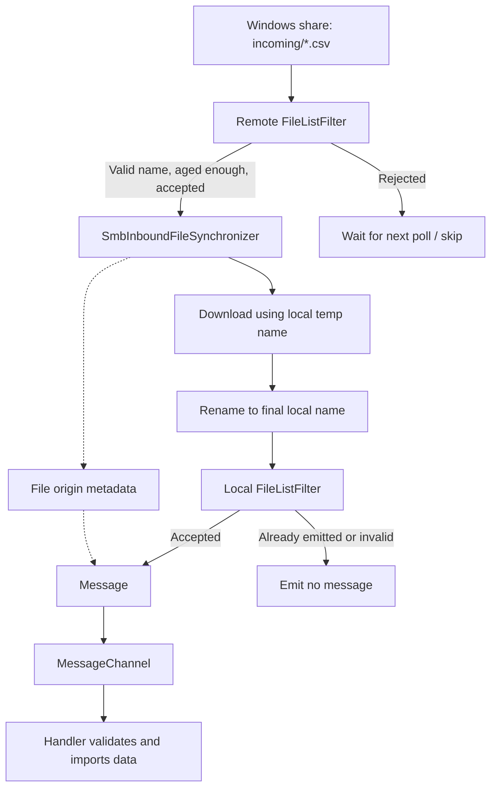
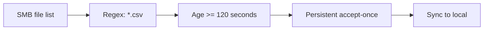
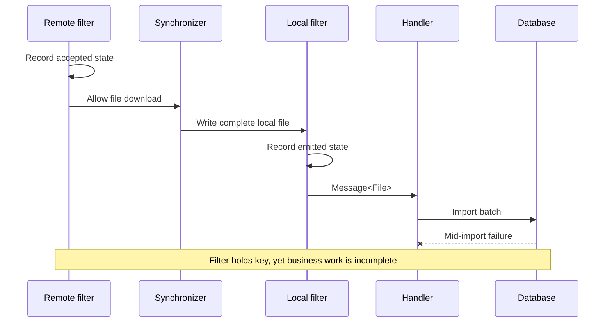
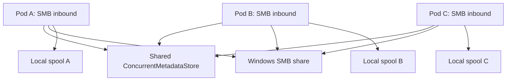

# File Filters and Metadata for SMB Files

## 1. Problem: Picking Only the Right Files and Knowing Their Origin

A partner uploads reports to the Windows share `\\fs01\exchange\incoming\partner-a`. Each day the directory holds multiple file types:

```text
incoming/partner-a/
  orders-20261123.csv.part
  orders-20261123.csv
  orders-20261123.csv.complete
  readme.txt
  orders-20261122.csv
```

The Spring Boot application must **pick only published CSV files**, avoid re-downloading on polls, know which server/directory a received file came from, and avoid importing duplicate orders across process restarts or retries. After downloading, it must save the CSV locally to validate formatting and persist data into a database. The final requirement is preventing a partially uploaded file from being processed by mistake.

In Spring Integration SMB, this is solved by **FileListFilter**, **MetadataStore**, and **message headers**. Filters decide which files may proceed. Metadata stores track state used by filters or file synchronizers. Headers describe origin so downstream handlers can route, log, and reconcile. These three mechanisms serve different roles; none of them alone guarantees **exactly-once** data import transactions.

This lesson belongs to the **Adapter SMB** chapter of the `SPRING_INTEGRATION_ADAPTERS` module. The module teaches connecting external systems via inbound/outbound adapters, gateways, pollers, and `MessageChannel`; practicing file, SFTP, HTTP, JMS, AMQP, Kafka, and database flows; alongside message contracts, errors, and connection lifecycles. Filtering and deduplication principles are reusable across other flows, though the specific resource type and metadata here are **SMB files**.

After this lesson, you will be able to:

- Distinguish remote file filters before download from local file filters before emitting `Message<File>`.
- Use `SmbSimplePatternFileListFilter`, `SmbRegexPatternFileListFilter`, `SmbLastModifiedFileListFilter`, and marker-based filters.
- Chain filters in the right order with `ChainFileListFilter`, and know when to use `CompositeFileListFilter`.
- Use `SmbPersistentAcceptOnceFileListFilter` and `FileSystemPersistentAcceptOnceFileListFilter` with `ConcurrentMetadataStore`.
- Distinguish **deduplication metadata** from **origin metadata** populated into `FileHeaders.REMOTE_*` headers.
- Explain recovery after restarts, mid-download failures, updates to same-named files, and multi-instance deployments.
- Write practical Java DSL and verify behavior with SMB data in a lab environment.

## 2. Where Do Filters Sit in an SMB Inbound Flow?

With a **local-sync SMB inbound channel adapter**, processing normally involves two filtering stages on two different sides:



Suppose a completed file `orders-007.csv` appears on the share. The remote filter allows downloading it to `./data/smb-inbox/orders-007.csv`. After syncing, the local filter decides whether to create a `Message<File>` for the handler. The handler receives the **local path** and corresponding origin headers.

| Layer | Target Object | Timing | Primary Responsibility |
|---|---|---|---|
| Remote filter | `jcifs.smb.SmbFile` | Before syncing or opening remote stream | Check name, file age, markers, and avoid re-fetching |
| Synchronizer | Remote file → local file | When pulling data from SMB | Copy content, rename temp file, record origin metadata |
| Local filter | `java.io.File` | After sync, before emitting message | Select local files to emit to consumers |
| Message headers | Metadata attached to `Message` | When message is created | Tell handlers the remote name/directory/host |
| Business logic | Parsed records/batch | After message reaches handler | Validate, commit, and prevent duplicate imports |

**Key point:** `SmbFile` (remote) differs from `File` (local). Never pass a `FileListFilter<File>` where `FileListFilter<SmbFile>` is required. Also, a `MessageFilter` filtering already-created messages is a different mechanism from a `FileListFilter` filtering candidate files before an adapter emits messages.

### 2.1. How Do Streaming Inbound and Gateways Differ?

- **SMB streaming inbound** emits `Message<InputStream>`; it filters remote files with no default local-copy step. Remote names/directories and file info are supplied via headers.
- **Local-sync SMB inbound** emits `Message<File>`; remote and local filters are two distinct control points.
- **SMB outbound gateway** with `ls/get/mget` handles requests and returns replies; filters can be applied when listing or fetching multiple files. `put/mput` commands handle uploading files to SMB and need matching naming and deduplication strategies.

The poller triggers the inbound source on schedule; it does **not** replace file selection or filter state tracking.

## 3. Common SMB Filters

Spring Integration 6.5 provides filter classes in package `org.springframework.integration.smb.filters`. These classes work with `jcifs.smb.SmbFile`.

| Filter | Pass Condition | Suitable Scenario |
|---|---|---|
| `SmbSimplePatternFileListFilter` | Name matches pattern, e.g. `*.csv` | Simple extension selection |
| `SmbRegexPatternFileListFilter` | Name matches regex, e.g. `(?i).*\\.csv$` | Flexible filename format constraints |
| `SmbLastModifiedFileListFilter` | File is **old enough** per modification time | Reduce risk of reading a file still being written |
| `SmbRecentFileListFilter` | File is **not older** than an age window | Interested only in recent data |
| `SmbPersistentAcceptOnceFileListFilter` | File not yet recorded with its matching modification info | Avoid re-fetching remote files across polls |
| `SmbSystemMarkerFilePresentFileListFilter` | Matching file proceeds only when companion marker exists | Sender uses `.complete` to confirm upload finished |
| `AcceptAllFileListFilter<SmbFile>` | Always passes | Testing to observe repeated emissions |

Both `SmbLastModifiedFileListFilter` and `SmbRecentFileListFilter` exist in Spring Integration 6.5. **Do not confuse the two opposite conditions:**

- "Last modified age ≥ 120 seconds" picks files that have remained stable long enough.
- "Recent age ≤ 120 seconds" picks only fresh files, which may include files currently being written.

A rule based solely on `lastModified` does not guarantee a file has finished writing, especially if timestamps are preserved from the source host or clocks between the two systems drift.

### 3.1. Name Filtering via Pattern or Regex

For receiving only CSV files:

```java
new SmbSimplePatternFileListFilter("*.csv");
new SmbRegexPatternFileListFilter("(?i).*\\.csv$");
```

Regex `(?i)` is case-insensitive, matching `ORDERS.CSV` too. If names must follow `orders-YYYYMMDD.csv`, use:

```java
new SmbRegexPatternFileListFilter("orders-\\d{8}\\.csv");
```

Regex checks only the filename; it does not verify valid CSV content, checksums, partner identity, or write completion. Those checks must happen when reading and processing the file.

### 3.2. Filtering by File Age

`SmbLastModifiedFileListFilter` has a constructor accepting file age in **seconds**, for example:

```java
new SmbLastModifiedFileListFilter(120);
```

It only passes files whose modification time is far enough in the past (about 2 minutes in this example). The filter's default is 60 seconds. Choose the threshold based on file size, sender upload method, and clock skew; never treat 60 or 120 seconds as universally right.

### 3.3. Marker Files Certifying Sender Completion

A solid publication contract looks like:

```text
orders-007.csv          # data
orders-007.csv.complete # marker created after the data file is closed
```

`SmbSystemMarkerFilePresentFileListFilter` can take a data-file filter and a marker suffix:

```java
import org.springframework.integration.smb.filters.SmbSimplePatternFileListFilter;
import org.springframework.integration.smb.filters.SmbSystemMarkerFilePresentFileListFilter;

var readyFilter = new SmbSystemMarkerFilePresentFileListFilter(
        new SmbSimplePatternFileListFilter("*.csv"), ".complete");
```

Only `*.csv` files with a matching marker are selected. This is an **agreement between both parties**; the adapter does not create markers itself and cannot know if a marker is trustworthy if the source system violates the contract.

Marker filters inspect **a list of multiple files** to check companion markers. Consequently, they do not support single-file lazy filtering the way some accept-once filters do. When combining with multiple filters or streaming, pay attention to candidate evaluation and verify behavior in the lab.

## 4. Combining Filters: Why Does Order Matter?

Systems often need three conditions simultaneously:

1. Filename is `*.csv`.
2. File is older than 120 seconds.
3. File has never been accepted at its current version.

You cannot arbitrarily combine three filters in any fashion. `ChainFileListFilter` and `CompositeFileListFilter` have different semantics:

| Criterion | `ChainFileListFilter` | `CompositeFileListFilter` |
|---|---|---|
| Execution | Output of previous filter becomes input to next filter | Each filter evaluates the candidate list; final result must pass all |
| Effect on accept-once | Can place accept-once **at the end of the chain** so unready files are not recorded yet | Accept-once may see a file before the age filter passes it |
| Effect on marker | Needs care because marker filter must see marker files too | Useful when one filter picks data files while marker filter inspects the full list |
| Best suited for | Pattern → age → accept-once | Combining independent filters that all need the full candidate list |

**Typical failure scenario:** inside a `CompositeFileListFilter`, an accept-once filter marks `orders.csv` as "seen" on the very first scan, even though the age filter rejects it because it was just written. A few minutes later the file is old enough, yet accept-once blocks it, silently dropping the file. With `ChainFileListFilter`, placing **age before accept-once** prevents premature marking.



### Example Combining Three Conditions

```java
import jcifs.smb.SmbFile;
import org.springframework.integration.file.filters.ChainFileListFilter;
import org.springframework.integration.file.filters.FileListFilter;
import org.springframework.integration.metadata.ConcurrentMetadataStore;
import org.springframework.integration.smb.filters.SmbLastModifiedFileListFilter;
import org.springframework.integration.smb.filters.SmbPersistentAcceptOnceFileListFilter;
import org.springframework.integration.smb.filters.SmbRegexPatternFileListFilter;

FileListFilter<SmbFile> buildRemoteFilter(ConcurrentMetadataStore store) {
    ChainFileListFilter<SmbFile> chain = new ChainFileListFilter<>();
    chain.addFilter(new SmbRegexPatternFileListFilter("(?i).*\\.csv$"));
    chain.addFilter(new SmbLastModifiedFileListFilter(120));
    chain.addFilter(new SmbPersistentAcceptOnceFileListFilter(
            store, "smb:partner-a:remote-filter:"));
    return chain;
}
```

This illustrative method belongs inside an appropriate configuration class or component. Note the dedicated prefix for the remote filter; metadata at other layers uses distinct prefixes.

When using markers, you can build a chain where the marker filter runs before accept-once, yet because marker filters do not support single-file filtering, verify the semantics of each filter combination in your version. Never blindly copy a "name → marker → accept-once" chain from another protocol while overlooking that the marker filter must see `.complete` files.

## 5. `MetadataStore` Serves Three Very Different Purposes

In local-sync SMB inbound, there are **at least three kinds of state** often loosely called "metadata," despite having different responsibilities:

| Kind | Used By | What It Records | Consequence If Lost |
|---|---|---|---|
| **Remote accept-once state** | `SmbPersistentAcceptOnceFileListFilter` | Remote file accepted by key and modification time | File may be re-downloaded after restart |
| **Local accept-once state** | `FileSystemPersistentAcceptOnceFileListFilter` | Local file emitted as message by path and modification time | Old local files may be re-emitted |
| **Remote origin metadata** | `AbstractInboundFileSynchronizer` | Source host/port/directory/filename of local copy | Messages may lack origin info for tracing |

**`MetadataStore` is not a business outcome database.** It does not record "100 orders committed" or "receiver sent ACK." To prevent duplicate order imports, the application must maintain batch keys, unique constraints, commit state, or dedicated idempotency mechanisms.

### 5.1. `SimpleMetadataStore` vs. Persistent Stores

`SimpleMetadataStore` is an **in-memory** store. Even though the filter class is named `PersistentAcceptOnce`, whether state actually survives restarts depends on the injected store.

```text
SmbPersistentAcceptOnceFileListFilter
   + SimpleMetadataStore (in-memory)
   = deduplication within one app lifecycle, NOT durable across restarts
```

In production, use a `ConcurrentMetadataStore` backed by a shared store, such as a Redis or JDBC metadata store configured to fit your system. Evaluate durable storage, atomicity of `putIfAbsent/replace`, TTL policies, namespaces, backups, and access controls.

If multiple pods each use their own `SimpleMetadataStore`, every pod can see `orders.csv` as new and process it simultaneously.

### 5.2. Remote Accept-Once Evaluates Name and Modification Time

`SmbPersistentAcceptOnceFileListFilter` takes a `ConcurrentMetadataStore` and a prefix:

```java
new SmbPersistentAcceptOnceFileListFilter(
        concurrentStore, "smb:partner-a:remote-filter:");
```

Under persistent remote file filtering, state records the file together with its modification metadata. If a filename has not been seen, it can be accepted. If the name stays the same yet the modification timestamp changes, the filter may treat it as a new version and accept it again.

This is handy when a partner updates a file's contents. However, `lastModified` is not a checksum: timestamps can remain unchanged when content changes or change even if content is identical. If business logic must distinguish exact versions, compute a checksum or use a sender-provided version/batch ID.

**Note on keys:** in Spring Integration 6.x, recursion settings, relative names, and identical filenames across multiple folders can cause metadata collisions if not configured properly. Use distinct prefixes per source/partner; when running `mget -R` or multi-directory scans, inspect how the filter builds keys from paths in your version and plan key migrations if changing key construction.

### 5.3. Local Accept-Once Is an Independent Layer

After synchronization completes, `SmbInboundFileSynchronizingMessageSource` scans local files. You can set a local filter like this:

```java
import org.springframework.integration.file.filters.FileSystemPersistentAcceptOnceFileListFilter;
import org.springframework.integration.metadata.ConcurrentMetadataStore;

new FileSystemPersistentAcceptOnceFileListFilter(
        concurrentStore, "smb:partner-a:local-filter:");
```

If the local filter uses an in-memory store and the application restarts, a local file still sitting on disk can be re-emitted. With a persistent store, emitted state survives restarts; however, you must align on the policy for **reprocessing when local file contents change**.

Suppose the partner updates `orders.csv` on the server, the remote filter accepts and downloads the new copy, yet the local filter does not consider the file new (e.g., local timestamp unchanged or already recorded differently). You can then hit a situation where **remote re-downloaded the file, yet the handler receives no new message**. Test with actual file updates and pick an appropriate local filter.

### 5.4. Origin Metadata for Creating Message Headers

With local-sync inbound, the message source scans **local files**. From `./data/smb-inbox/orders.csv` alone, it cannot tell whether the file originally came from `fs01` or `fs02`. Therefore, the synchronizer stores origin metadata during download:

```text
remote origin:
  smb://fs01:445/incoming/partner-a#orders-007.csv
      host:port / remote directory # remote file name
```

This is a **documented illustrative URI format** linking the local file to its source. It is not a credentialed URL and must never embed username/password. The synchronizer uses this store to populate headers when the local file is emitted.

In Java DSL, two settings serve this purpose:

```java
.remoteFileMetadataStore(metadataStore)
.metadataStorePrefix("smb:partner-a:origin:")
```

**You must use a separate prefix from `SmbPersistentAcceptOnceFileListFilter`** if sharing the same store, because both mechanisms can use the same local filename as part of their key and overwrite each other's state. A clear convention:

```text
smb:partner-a:remote-filter:...
smb:partner-a:local-filter:...
smb:partner-a:origin:...
```

When deleting local files after processing, clean up the corresponding origin metadata as well. `AbstractInboundFileSynchronizer` offers `removeRemoteFileMetadata()` to support this workflow; exact usage depends on your version's API and where you manage local file lifecycles. Never wipe every key in the store simply because one batch finished.

## 6. Complete Java DSL Example: Name + Age + Deduplication

This example targets **Spring Boot 3.x with compatible Spring Integration 6.5.x**. Use project dependency management and do not mix major versions arbitrarily. `SmbFile` in these examples comes from `jcifs.smb.SmbFile` in the 6.5 line; re-check Javadoc if upgrading major versions.

### 6.1. Dependencies

**`build.gradle`:**

```gradle
dependencies {
    implementation 'org.springframework.boot:spring-boot-starter-integration'
    implementation 'org.springframework.integration:spring-integration-smb'
}
```

### 6.2. Properties

**`application.yml`:**

```yaml
demo:
  smb:
    host: ${SMB_HOST}
    port: ${SMB_PORT:445}
    domain: ${SMB_DOMAIN:}
    username: ${SMB_USERNAME}
    password: ${SMB_PASSWORD}
    share: ${SMB_SHARE:exchange}
    remote-dir: ${SMB_REMOTE_DIR:incoming/partner-a}
    local-dir: ${SMB_LOCAL_DIR:./data/smb-inbox/partner-a}
```

Account/password variables must come from the environment or an authorized secret manager. Never put real passwords in Git, SMB URLs, or logs. `remote-dir` is the path **inside the share**, not a full UNC path.

### 6.3. Factory, Metadata Store, and Flow

**`SmbFilterConfig.java`:**

```java
import java.io.File;
import jcifs.DialectVersion;
import jcifs.smb.SmbFile;

import org.springframework.beans.factory.annotation.Value;
import org.springframework.context.annotation.Bean;
import org.springframework.context.annotation.Configuration;
import org.springframework.integration.config.EnableIntegration;
import org.springframework.integration.dsl.IntegrationFlow;
import org.springframework.integration.dsl.Pollers;
import org.springframework.integration.file.FileHeaders;
import org.springframework.integration.file.filters.ChainFileListFilter;
import org.springframework.integration.file.filters.FileListFilter;
import org.springframework.integration.file.filters.FileSystemPersistentAcceptOnceFileListFilter;
import org.springframework.integration.metadata.ConcurrentMetadataStore;
import org.springframework.integration.metadata.SimpleMetadataStore;
import org.springframework.integration.smb.dsl.Smb;
import org.springframework.integration.smb.filters.SmbLastModifiedFileListFilter;
import org.springframework.integration.smb.filters.SmbPersistentAcceptOnceFileListFilter;
import org.springframework.integration.smb.filters.SmbRegexPatternFileListFilter;
import org.springframework.integration.smb.session.SmbSessionFactory;

@Configuration
@EnableIntegration
public class SmbFilterConfig {

    @Bean
    SmbSessionFactory smbSessionFactory(
            @Value("${demo.smb.host}") String host,
            @Value("${demo.smb.port}") int port,
            @Value("${demo.smb.domain}") String domain,
            @Value("${demo.smb.username}") String username,
            @Value("${demo.smb.password}") String password,
            @Value("${demo.smb.share}") String share) {

        SmbSessionFactory factory = new SmbSessionFactory();
        factory.setHost(host);
        factory.setPort(port);
        factory.setDomain(domain);
        factory.setUsername(username);
        factory.setPassword(password);
        factory.setShareAndDir(share);
        factory.setSmbMinVersion(DialectVersion.SMB210);
        factory.setSmbMaxVersion(DialectVersion.SMB311);
        return factory;
    }

    // For lab only: SimpleMetadataStore loses data on restart.
    // Production: replace with a durable, shared ConcurrentMetadataStore.
    @Bean
    ConcurrentMetadataStore smbMetadataStore() {
        return new SimpleMetadataStore();
    }

    @Bean
    FileListFilter<SmbFile> smbRemoteFilter(
            ConcurrentMetadataStore smbMetadataStore) {

        ChainFileListFilter<SmbFile> chain = new ChainFileListFilter<>();
        chain.addFilter(new SmbRegexPatternFileListFilter("(?i).*\\.csv$"));
        chain.addFilter(new SmbLastModifiedFileListFilter(120));
        chain.addFilter(new SmbPersistentAcceptOnceFileListFilter(
                smbMetadataStore, "smb:partner-a:remote-filter:"));
        return chain;
    }

    @Bean
    IntegrationFlow smbInboundFlow(
            SmbSessionFactory factory,
            FileListFilter<SmbFile> smbRemoteFilter,
            ConcurrentMetadataStore smbMetadataStore,
            @Value("${demo.smb.remote-dir}") String remoteDir,
            @Value("${demo.smb.local-dir}") String localDir) {

        return IntegrationFlow
                .from(Smb.inboundAdapter(factory)
                        .remoteDirectory(remoteDir)
                        .filter(smbRemoteFilter)
                        .localDirectory(new File(localDir))
                        .autoCreateLocalDirectory(true)
                        .preserveTimestamp(true)
                        .localFilter(
                                new FileSystemPersistentAcceptOnceFileListFilter(
                                        smbMetadataStore,
                                        "smb:partner-a:local-filter:"))
                        .remoteFileMetadataStore(smbMetadataStore)
                        .metadataStorePrefix("smb:partner-a:origin:")
                        .maxFetchSize(5),
                    endpoint -> endpoint
                        .id("smbFilteredInbound")
                        .poller(Pollers.fixedDelay(10_000)
                                .maxMessagesPerPoll(5)))
                .handle(message -> {
                    File file = (File) message.getPayload();
                    Object remoteName =
                            message.getHeaders().get(FileHeaders.REMOTE_FILE);
                    Object remoteDirHeader =
                            message.getHeaders().get(FileHeaders.REMOTE_DIRECTORY);

                    // Demos message path only.
                    // Production needs CSV validation, idempotency, and commit.
                    System.out.println("Local file: " + file.getAbsolutePath()
                            + "; remote dir: " + remoteDirHeader
                            + "; remote name: " + remoteName);
                })
                .get();
    }
}
```

Key points to read carefully:

1. `smbRemoteFilter` combines three conditions in order: **regex → file age → persistent accept-once**. Because `.filter(...)` is already called, do not add `.regexFilter(...)` on the same remote layer.
2. `FileSystemPersistentAcceptOnceFileListFilter` is the **local file** filter; it uses `File` and a separate prefix.
3. `.remoteFileMetadataStore(...)` together with `.metadataStorePrefix(...)` stores origin info for headers; it is **not** the remote filter's deduplication state.
4. All components share one `SimpleMetadataStore` in the lab to demonstrate **isolated prefixes**. This configuration **does not survive restarts or multi-instance setups**. In production, replace the store with a durable backend and align key/retention policies.
5. `.maxFetchSize(5)` limits files fetched from SMB in one batch, whereas `.maxMessagesPerPoll(5)` limits poller messages per cycle. They are not interchangeable.
6. The handler only prints paths and metadata for observation. **Emitting `Message<File>` does not mean CSV import succeeded.**

### 6.4. How Are Headers Read?

Constants `FileHeaders.REMOTE_FILE` and `FileHeaders.REMOTE_DIRECTORY` keep code from hard-coding strings like `"file_remoteFile"`. In real code, handle missing or unexpected header values before using them as business keys or archive paths.

You can also read `FileHeaders.REMOTE_HOST_PORT` when provided by the endpoint. When logging, avoid exposing credentials or sensitive paths; emit only fields needed for tracing such as partner code, batch ID, remote name, and correlation ID.

## 7. Metadata in Streaming Inbound and Outbound Gateways

With `SmbStreamingMessageSource`, the payload is `InputStream` and the remote source is read directly. The adapter can supply:

| Header | Meaning |
|---|---|
| `FileHeaders.REMOTE_HOST_PORT` | Host and port of the SMB session |
| `FileHeaders.REMOTE_DIRECTORY` | Remote directory when fetching the file |
| `FileHeaders.REMOTE_FILE` | Remote filename for a single-file operation |
| `FileHeaders.REMOTE_FILE_INFO` | Additional metadata for the remote file |
| `closeableResource` | Resource bound to stream/session to close after reading |

Per SMB documentation, `REMOTE_FILE_INFO` may default to **JSON**. If configured with `SmbStreamingMessageSource.setFileInfoJson(false)`, that header holds an `SmbFileInfo` object instead of JSON. Never assume every consumer receives the same Java type when switching between JSON and object settings.

Example inspecting metadata in a handler before processing:

```java
Object info = message.getHeaders().get(FileHeaders.REMOTE_FILE_INFO);
Object source = message.getHeaders().get(FileHeaders.REMOTE_DIRECTORY);

// info may be JSON or SmbFileInfo depending on configuration.
// Do not cast directly before checking the contract.
```

For streaming, a custom handler reading `InputStream` must close **both the stream and `closeableResource`**, or use standard components such as `FileSplitter`/`StreamTransformer` that manage resources per contract. Omitting session closure drains the connection pool.

The **SMB outbound gateway** offers read commands like `ls`, `get`, and `mget`; they return different payloads/headers depending on the command. For example, `ls` can return a list of `FileInfo`, while `get` returns a local file or `InputStream` with `-stream`. Do not force a single metadata shape across every command; follow each endpoint's contract.

### When Multiple Directories Share the Same Filename

`incoming/partner-a/report.csv` and `incoming/partner-b/report.csv` are **two distinct files**, despite having the same filename. If metadata keys or local destinations are built solely from `report.csv`, state will collide. Best practice is namespacing keys by endpoint/partner and source path while ensuring local directories/filenames do not overlap.

With recursive filters in the 6.x line, `forRecursion` and changes in key construction can affect stored metadata. Plan key migrations when toggling recursion or upgrading major versions; never wipe an entire store in production as a test.

## 8. File Change and Restart Scenarios

### 8.1. Outcomes to Distinguish

| Event | Remote Filter | Local Filter | What to Verify |
|---|---|---|---|
| New file, valid name, old enough | Can accept | Can emit after download | Handler receives expected local file and headers |
| File just appeared, not old enough | Rejected by age filter | No new file to emit | Once old enough, remote filter passes it |
| File ending in `.part` | Rejected by name filter | Does not run | File being uploaded is not downloaded |
| File already downloaded and emitted once | Accept-once blocks on next poll | Old file not re-emitted | Metadata store holds state |
| Same-named file modified | May accept because mtime changed | Depends on local metadata/mtime | Intended reprocessing vs. avoiding unwanted edits |
| Restart with in-memory store | Remote state lost | Local state lost | Files may be re-downloaded / re-emitted |
| Restart with durable store | Saved state remains | Local state remains | Need recovery flow for partial files and failed jobs |
| Only local file deleted | Remote origin metadata may remain | Local file gone | Clean up matching metadata; preserve business history |
| Multiple instances sharing a share | May race on same filename if store unshared | Each instance has separate local state | Requires coordination / idempotency |

### 8.2. Metadata Does Not Equal Processing Success

A possible sequence of events:



The remote filter records state when accepting a file to fetch; the local filter records state when emitting the local file. Both happen **before** the application knows whether the database committed. Thus "key exists in metadata store" does not prove data import succeeded.

On normal file-download errors, the remote persistent filter can roll back the state recorded before fetching. However, if the process crashes abruptly mid-download, the key may remain in the durable store, preventing automatic re-fetch. In that situation, you need a reconciliation mechanism for keys/files/batches and a controlled status-repair procedure.

### 8.3. Choosing a Reprocessing Strategy

For business batches, maintain a separate status record:

```text
partnerId | batchId      | checksum | state       | attempts
PARTNER_A | ORD-20261123 | SHA-256  | IMPORTED    | 1
PARTNER_A | ORD-20261124 | SHA-256  | FAILED      | 2
```

States may include `NEW`, `PROCESSING`, `IMPORTED`, `FAILED`, and `ARCHIVED`. Each state must be confirmed by business logic per contract:

- `IMPORTED` only after data commit.
- `ARCHIVED` only when source file move succeeded or source/target state is reconciled.
- Retrying a failed batch uses business keys/unique constraints to avoid duplicate rows.
- If a file keeps the same name yet has a different checksum, apply an explicit "revised file" policy rather than blindly treating it as the old batch.

Where auditing is required, also store source path, size, modification timestamp, checksum, and ACK status. Filters reduce redundant work, yet they cannot replace a business tracking table.

## 9. Multi-Instance Execution and Persistent Metadata

A `SimpleMetadataStore` lives only inside one JVM. If three pods scan the same share, each pod can independently accept the same file. A shared `ConcurrentMetadataStore` supporting atomic operations enables proper coordination.



Design considerations:

1. **Shared store** across cooperating instances with a consistent namespace/key strategy. Verify the backend guarantees proper atomic compare-and-set.
2. **Clear prefixes** by environment, partner, metadata type, and adapter. Never let staging and production share prefixes.
3. **Fetch throttling**: in clusters, documentation recommends `maxFetchSize(1)` with a persistent filter so one pod does not pull too many files at once.
4. **Separate local spools or shared storage** with a clear strategy. A shared metadata store does not magically copy local files across pods.
5. **Database idempotency** to handle duplicates from crashes, retries, or races that filters cannot completely prevent.
6. **Backup/retention/recovery** for metadata: never set TTLs so short that files still on SMB look brand new whenever keys expire.

**Be careful when changing prefixes or enabling recursion:** the system may stop matching old keys, causing many files to be re-accepted. Plan metadata migrations or run controlled idempotent rescans.

## 10. Operations and Observability

### 10.1. Useful Metrics and Logs

| Information | Purpose |
|---|---|
| SMB files listed | Track backlog and source volume |
| Files rejected by regex | Spot partners sending wrong names or breaking contracts |
| Files rejected as too new | Check publication lag and age filter |
| Files blocked as already seen | Verify accept-once filter behavior |
| Files downloaded locally | Separate file selection from sync completion |
| Messages emitted | Track local filter and consumer throughput |
| Batches committed / failed | Track true business outcomes |
| Retries and suspected stuck metadata keys | Detect crashes or lost state |
| SMB latency and active session count | Spot network or pool bottlenecks |
| Overdue local files retained | Control disk usage and retention policy |

Not every filter exposes categorized metrics out of the box. Add instrumentation in adapters, handlers, discard callbacks where appropriate, and sanitized logs. Avoid logging passwords, credentialed SMB URLs, or sensitive file contents.

### 10.2. Symptom-Based Troubleshooting

| Symptom | Causes to Check | Resolution |
|---|---|---|
| File is on share, yet not downloaded | Name mismatch, too new, accept-once key already present | Check which filter rejected it, mtime, and metadata store |
| Local file exists, yet handler does not receive it | Local accept-once recorded it or temp suffix not renamed | Check local filter and `.writing` suffix |
| Old files re-imported after restart | In-memory metadata store, lost state, or short TTL | Use durable store and idempotency |
| Same-named file in another folder skipped | Key/prefix collision or shared local filename | Separate namespaces and local directories |
| File content updated, yet not re-emitted | Local mtime/key unchanged; local filter holds state | Check timestamps, checksums, and update policies |
| Store grows full of unused keys | No retention/cleanup | Define retention per data contract and migration plan |
| Missing remote name header | Origin metadata not saved or already deleted | Check `remoteFileMetadataStore` and prefix |
| Partially uploaded file picked up | Regex matches too early, no marker, age too short | Use rename/marker convention and readiness checks |
| Two pods process the same file | Separate stores or missing business lock | Shared store, batch ownership coordination, unique keys |
| Download failed, yet never retried | Remote key left behind after crash | Reconcile state and surgically remove key per procedure |

## 11. Hands-On Practice on Windows Share / Samba

Prepare a **lab-only** share:

```text
\\fs01\exchange\incoming\partner-a
```

Run the application with the Java DSL config from Section 6. Create a local directory `./data/smb-inbox/partner-a` writable by the process. Never use real partner files to test deleting metadata or resetting state.

### Lab A — Filter Only Aged CSV Files

1. Place `orders-a.csv`, `orders-a.csv.part`, and `readme.txt` on the share.
2. Ensure `orders-a.csv` has a recent modification timestamp, while the other two have non-matching names.
3. Run the poller and observe no CSV is downloaded while the file is under 120 seconds old.
4. Once the file ages past the threshold, verify it downloads and the handler receives `Message<File>`.
5. Note the difference between the name condition and the age condition.

**Expected result:** `*.part`/`*.txt` are excluded; CSV is picked up only after the required age. File age does not replace a sender's publication convention.

### Lab B — Why Use `ChainFileListFilter`?

1. Reuse Lab A's data with `SmbLastModifiedFileListFilter(120)` and accept-once.
2. Watch when the CSV gets recorded in remote metadata under the "regex → age → accept-once" chain.
3. **In the lab only**, swap the chain for composite, reset the test store, and compare behavior.
4. Explain why accept-once seeing a file too early can drop the file once it becomes old enough.

**Expected result:** understand how **filter ordering and the candidate set each filter receives** affect results.

### Lab C — Distinguish the Three Metadata Prefixes

1. Run one download of `orders-a.csv`.
2. Inspect keys under the three prefixes `remote-filter`, `local-filter`, and `origin` in the lab metadata store (via authorized debugging).
3. Cross-check `FileHeaders.REMOTE_FILE` and `FileHeaders.REMOTE_DIRECTORY` headers.
4. Delete the local file using the lab procedure and check if origin metadata remains; clean up only the matching key per verified instructions.

**Expected result:** distinguish "file selected," "local file emitted," and "where this local file came from."

### Lab D — Restart and Swapping the Metadata Store

1. With `SimpleMetadataStore`, process a file and restart the application in the lab.
2. Observe effects on remote/local filters and re-emission.
3. Swap in a durable `ConcurrentMetadataStore` backend available in the test environment.
4. Repeat the test and compare state after restart.
5. Verify database unique keys if the same batch is re-emitted.

**Expected result:** a "persistent filter" only persists across restarts when its **store** is genuinely durable.

### Lab E — Same-Named Files in Two Directories

1. Create `incoming/partner-a/report.csv` and `incoming/partner-b/report.csv` with different data.
2. When building two inbound flows, configure separate prefixes and local directories per partner.
3. Observe both files are received cleanly without overwriting local files or colliding on metadata keys.
4. Deliberately test a misconfiguration in the lab to spot collisions before going to production.

**Expected result:** identify a file by **source/path/batch**, not filename alone.

### Lab F — Sync Failure and Controlled Recovery

1. Place a valid, aged CSV file on the lab share.
2. Simulate an SMB disconnect or local write error during synchronization.
3. Check whether a temporary local file remains and inspect remote metadata state.
4. Restore the system and reconcile batch ID and file before requesting a retry.
5. If a stuck metadata key must be removed, follow a logged recovery procedure targeting **only the test file's key**.

**Expected result:** distinguish normal download-error rollback from a crash leaving state that needs manual repair.

### Self-Check Questions

1. Why can't an `SmbFile` filter be used in place of a local `File` filter?
2. Why should `ChainFileListFilter` place the age filter before accept-once?
3. If `SimpleMetadataStore` is passed to a `PersistentAcceptOnceFileListFilter`, what happens after a restart?
4. What purpose does `metadataStorePrefix("...origin...")` serve?
5. Why might the same file be re-downloaded if remote `lastModified` changes?
6. What format does `REMOTE_FILE_INFO` usually have in streaming? When is it `SmbFileInfo`?
7. Why is `maxFetchSize(1)` helpful when multiple instances scan a share?
8. If the database committed yet SMB archiving failed, does filter metadata solve retry handling?

## 12. Common Misconceptions

| Misconception | Accurate Understanding |
|---|---|
| Regex `*.csv` guarantees the file is ready | Regex checks only the name; rename/marker/age conventions are still needed |
| `SmbLastModifiedFileListFilter` picks the newest files | It picks files old enough; `SmbRecentFileListFilter` targets recent files |
| `CompositeFileListFilter` and `ChainFileListFilter` are always equivalent | They feed candidate lists differently; stateful accept-once makes ordering critical |
| The name `PersistentAcceptOnce` guarantees state across restarts | Depends on the injected `MetadataStore`; `SimpleMetadataStore` is in-memory |
| Remote filter and local filter are the same thing | They run at two stages, on two file types, with separate states |
| `remoteFileMetadataStore` is the deduplication filter | It stores **remote origin** so local files receive origin headers |
| Key present in metadata store means import succeeded | Filters may record state before the database transaction completes |
| Same filename across any share means the same file | Must account for partner, share, remote directory, and key construction |
| A file emitted once can never be emitted again | Restarts, TTLs, mtime changes, filter edits, or replays can re-emit it |
| `REMOTE_FILE_INFO` is always `SmbFileInfo` | In streaming, it may default to JSON; `fileInfoJson(false)` changes the type |
| Metadata filters alone stop two pods from importing one batch | Requires a shared backend with atomic ops plus business idempotency |
| Deleting the local file is enough to clean metadata | Origin metadata may remain; implement synchronized cleanup policies |

## 13. References

- [Spring Integration 6.5 — SMB Support](https://docs.spring.io/spring-integration/reference/6.5/smb.html): inbound/streaming, remote file headers, origin metadata, and SMB filters.
- [Spring Integration 6.5 — Remote Persistent File List Filters](https://docs.spring.io/spring-integration/reference/6.5/file/remote-persistent-flf.html): state persistence, fetch-failure rollback, restarts, and clustering.
- [SmbPersistentAcceptOnceFileListFilter API](https://docs.spring.io/spring-integration/docs/6.5.0/api/org/springframework/integration/smb/filters/SmbPersistentAcceptOnceFileListFilter.html): `ConcurrentMetadataStore` constructor and prefix.
- [SmbLastModifiedFileListFilter API](https://docs.spring.io/spring-integration/docs/6.5.0/api/org/springframework/integration/smb/filters/SmbLastModifiedFileListFilter.html): filtering file age in seconds.
- [RemoteFileInboundChannelAdapterSpec API](https://docs.spring.io/spring-integration/docs/6.5.0/api/org/springframework/integration/file/dsl/RemoteFileInboundChannelAdapterSpec.html): `filter`, `localFilter`, `remoteFileMetadataStore`, `metadataStorePrefix`, and `maxFetchSize`.
- [ChainFileListFilter API](https://docs.spring.io/spring-integration/docs/6.5.0/api/org/springframework/integration/file/filters/ChainFileListFilter.html): chaining output of one filter as input to the next.

**Key takeaway:** in SMB inbound, remote file filters pick which files are fetched, local filters decide which files emit messages, and origin metadata preserves the link between local copies and the Windows share. A reliable flow requires proper filter ordering, stores, and prefixes, combined with business idempotency, error handling, and file lifecycle management.
