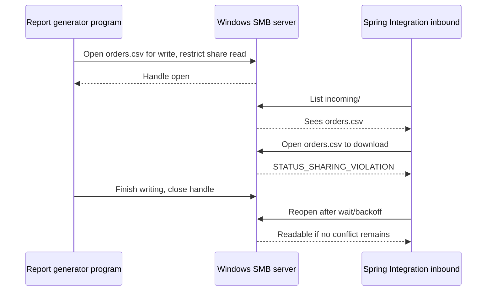
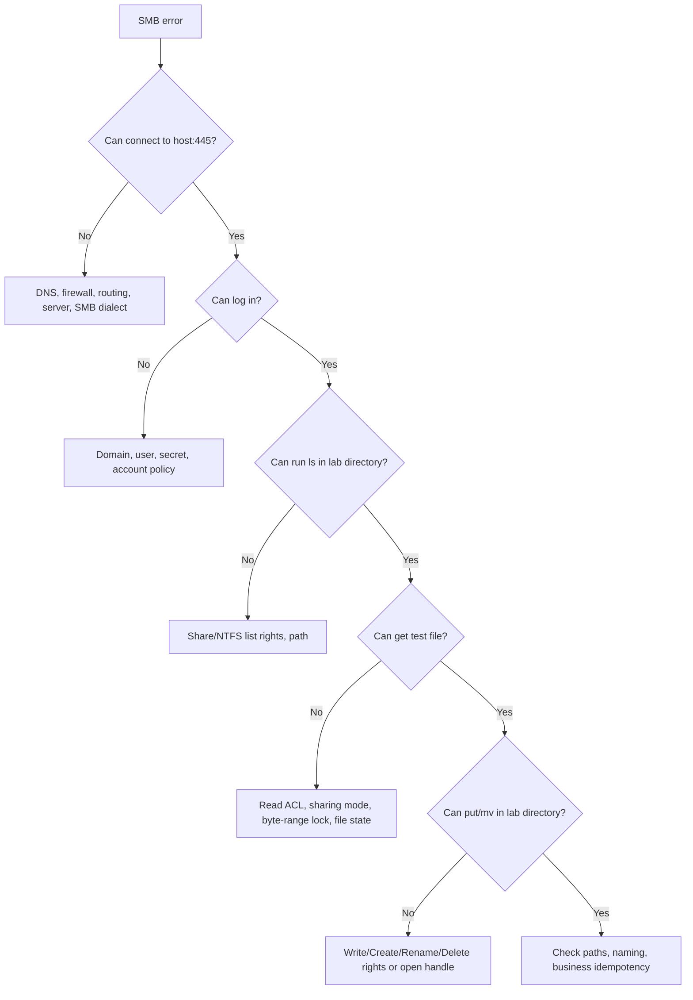
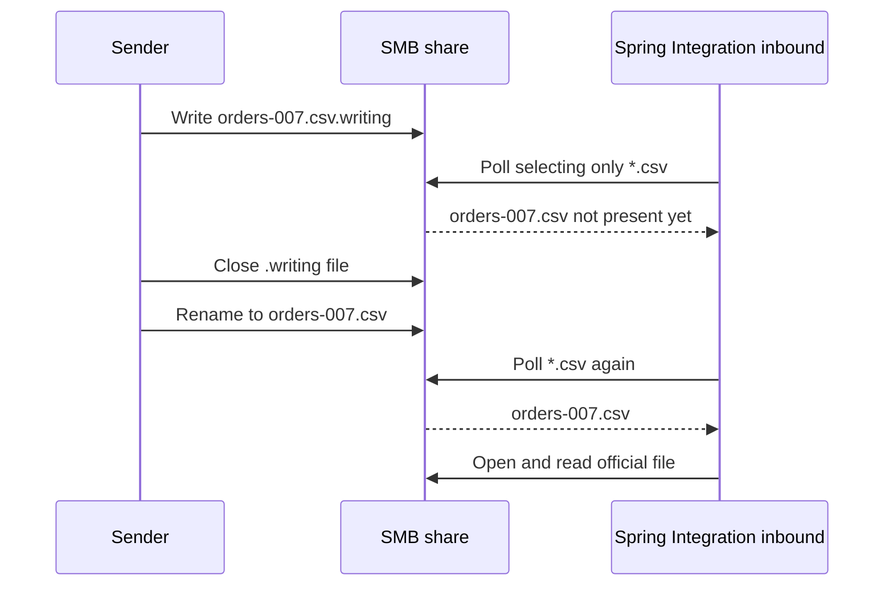
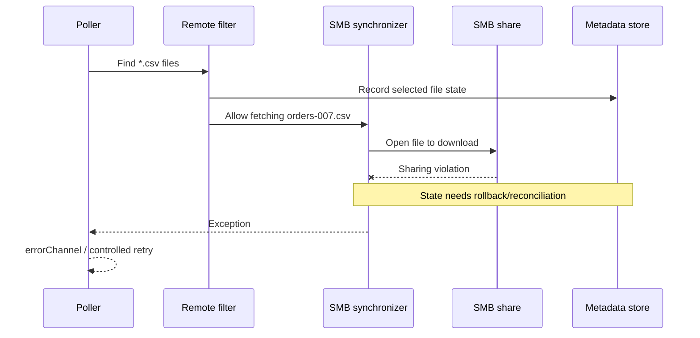
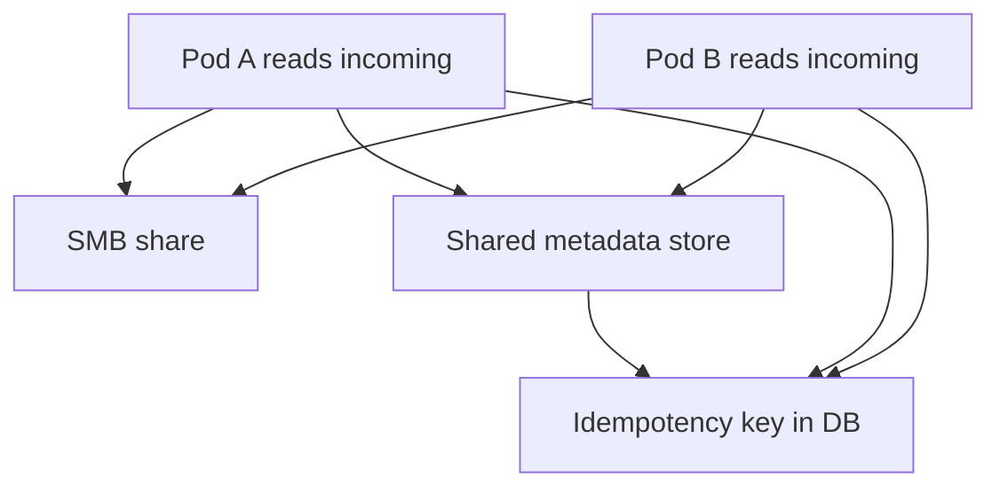

# Handling Locks and Access Permission Errors in Spring Integration SMB

## 1. Problem and Objectives

A Spring Boot application fetches reports from a Windows shared directory `\\fs01\exchange\incoming`, imports data into a database, and moves processed files to `archive`. One day, the application logs these situations:

- `orders-007.csv` appears in listings, yet opening it for reading reports `STATUS_SHARING_VIOLATION`.
- Reading `orders-008.csv` works, yet renaming it to the `archive` directory returns `Access Denied`.
- `ack-009.csv.writing` was uploaded to the share, yet renaming it to `ack-009.csv` failed.
- The same batch gets processed by two instances after one instance times out.

These errors are not synonymous. A file may **currently be held open by another process**, have a **byte-range lock**, be **denied due to permissions**, or simply have the **wrong path**. Furthermore, a business coordination lock between two instances differs from an actual lock on the Windows File Server.

In Spring Integration SMB, inbound/outbound adapters and outbound gateways use `SmbSessionFactory` along with remote-file components to access shares. The application's job is to classify errors accurately, avoid corrupting data, curb futile retries, and track file state across transfer and import.

This lesson belongs to the **Adapter SMB** chapter of the `SPRING_INTEGRATION_ADAPTERS` module: connecting external systems using inbound/outbound adapters, gateways, pollers, and `MessageChannel`, and managing message contracts, errors, and connection lifecycles. Principles of contention control and error classification matter across files, SFTP, HTTP, JMS, AMQP, Kafka, and databases too, yet **SMB locking and access-control mechanics have distinct traits**.

### After This Lesson, You Will Be Able To

1. Distinguish sharing-mode conflicts, byte-range locks, oplocks/leases, ACLs, credentials, and business locks.
2. Recognize common SMB error groups: `STATUS_SHARING_VIOLATION`, `STATUS_FILE_LOCK_CONFLICT`, `STATUS_ACCESS_DENIED`, `STATUS_OBJECT_NAME_NOT_FOUND`, and network or authentication errors.
3. Organize file publication contracts via temp names plus rename, or markers and file-age filters.
4. Configure Spring Integration SMB inbound, outbound, and gateways with error handling via `errorChannel`.
5. Design bounded retries, backoff, idempotency checks, and recovery after ambiguous timeouts.
6. Inspect open handles/SMB sessions on the server with **read-only** administrative tools without forcefully closing another system's files.
7. Practice verifying share/NTFS permissions, open files, incomplete uploads, and multi-worker contention.

## 2. Four Mechanisms Commonly Lumped Together as "Locks"

| Mechanism | Who Decides? | Meaning | Is It an Access Permission? |
|---|---|---|---|
| **Sharing mode / sharing violation** | App opening the file; enforced by SMB/file server | An open handle disallows read/write/delete or conflicting open modes | **No**; can happen even with valid ACLs |
| **Byte-range lock** | Process requesting a region lock; enforced by server | Blocks conflicting operations over a byte range | **No**; common in apps updating files with random access |
| **SMB oplock/lease** | Client and server optimizing caching and consistency | Allows caching under conditions and breaks on concurrent access | Neither business ownership nor proof the file is complete |
| **Application coordination lock** | Application, database, `LockRegistry`, or metadata store | Decides which node/batch processes work | Does not lock files on the SMB server itself |

An **open handle** on Windows can block `mv` or `rm` because the prior opener did not share delete access. A byte-range lock can cause errors for reads/writes in the locked region. A lease/oplock can trigger a server break requiring the client to adjust cache state; it **does not** grant the app permission to delete or import a file once.

### 2.1. Sharing-Mode Conflict Example

Suppose a program on Windows currently has `orders.csv` open for writing and disallows other handles from reading:



**Seeing a filename in a listing does not guarantee the file can be opened.** Even when reading succeeds, it does not prove writing finished: some programs permit concurrent reading while writing. Therefore use a **file publication convention** instead of probing whether a file is locked.

### 2.2. Sharing Mode vs. Byte-Range Lock

Windows/SMB opens files with an access mode and a share mode (e.g., permitting other processes to read, write, or delete/rename). When a new open request is incompatible with an existing handle, the server can return `STATUS_SHARING_VIOLATION`.

A byte-range lock locks a specific byte range. When `READ/WRITE/LOCK` operations conflict, you may see `STATUS_FILE_LOCK_CONFLICT` or `STATUS_LOCK_NOT_GRANTED`. Never explain every lock error as "someone has Excel open": backup software, antivirus scanners, sync services, or another application process can also hold handles or locks.

### 2.3. Spring Locks Do Not Replace SMB Locks

In a multi-instance system, a `LockRegistry` (or database batch lock) can prevent two Spring nodes from processing the same batch ID. However, it **does not force** Excel, Windows apps, NAS processes, or other users to honor that lock. Conversely, an SMB file without a sharing violation does not guarantee two pods will not both import data into the database.

Therefore, control **two independent scopes**:

- **Remote file readiness:** the file was published by the sender per contract and no incompatible operation blocks it.
- **Business ownership/idempotency:** only one workflow is allowed to commit a batch, and retries create no duplicate data.

## 3. Distinguishing Lock, Permission, Login, and Connectivity Errors

When an SMB client fails, the underlying library exception may be wrapped in a `MessagingException` or adapter/gateway error. Inspect the **root cause and server-returned status code if present**, rather than reading only the first line of the log.

| Example Code / Symptom | Common Meaning | Retry Immediately? |
|---|---|---|
| `STATUS_SHARING_VIOLATION` | File open / share mode conflicts with an existing handle | Can retry **bounded**, after backoff; better to wait for publication |
| `STATUS_FILE_LOCK_CONFLICT`, `STATUS_LOCK_NOT_GRANTED` | Read/write/lock byte-range hit a lock | Can retry in a controlled way if the lock holder releases soon |
| `STATUS_ACCESS_DENIED` | Server rejected operation; may be permissions, file attributes, policy, or other access rules | Do not retry blindly; check account, share/NTFS ACLs, and exact operation |
| `STATUS_LOGON_FAILURE` or auth error | Username/password/domain or account policy | Do not retry continuously; risk of account lockout |
| `STATUS_OBJECT_NAME_NOT_FOUND`/`STATUS_OBJECT_PATH_NOT_FOUND` | File or path missing at requested location | Check share, directory, and prior rename/move steps |
| `STATUS_OBJECT_NAME_COLLISION` or file exists | Target name collides or mode forbids overwrite | Reconcile batch/target path; do not switch to `REPLACE` blindly |
| `STATUS_DISK_FULL` | Server out of disk space | Alert and resolve infrastructure; do not fast-retry |
| Network timeout / connection reset | Network or server did not respond in time | Bounded retry and **reconcile outcome** since command may have completed |
| Session cache wait timeout | Sessions busy, unclosed stream, or pool too small | Check pool/resources; not an ACL issue |

Actual error codes vary by SMB server, protocol version, client library, and operation. Insufficient permissions or files held by another app sometimes surface as generic exceptions; **never build a classifier relying solely on substring matching `"access denied"`**.

### 3.1. An Ordered Diagnostic Sequence



`ls` succeeding proves **listing permission at the tested path**, not that the account can open every file or delete/rename them.

## 4. Access Permissions: Share Permissions, NTFS ACLs, and File State

Suppose the service account is `CORP\svc_smb_integration` and the session factory connects to host `fs01`, share `exchange`. With Windows File Server, network access checks normally evaluate **share permissions** and **NTFS ACLs** (plus other policies). An account can authenticate successfully and still lack file-creation or rename permissions.

| Spring Integration Operation | Server-Side Check | Why Can It Still Fail Even When `ls` Works? |
|---|---|---|
| Inbound `ls` | List directory, traverse per ACL | Checks only directory listing, not opening contents |
| Inbound download / gateway `get` | Read data on remote file | File may deny reads or have a share-mode conflict |
| Outbound `put` | Create/Write on target dir; write on existing file if replacing | Share/NTFS may grant only Read; existing target may have its own ACL |
| Write temp name then rename | Create/Write plus appropriate rename/delete rights | Writing `.writing` succeeds, yet final rename is denied |
| Gateway `mv` | Rights on source, target, and parent directories per op | Rename may be blocked by a handle disallowing delete |
| Gateway `rm` | Delete right or parent delete-child right per ACL | Can read file yet cannot delete it |
| `autoCreateDirectory(true)` | Create folder rights | Writing into an existing folder vs. creating a new folder are distinct rights |

"Modify" or "Full Control" carries far greater blast radius than "Read"; never elevate every service account to dodge errors. Provision role-specific accounts or separate permissions across `incoming/outgoing/archive`. For Samba/NAS servers, ACL/mapping models may differ; still verify behavior on the actual server.

### 4.1. When a File Is Open, Rename Can Fail

Windows uses **share modes** selected when opening a handle. An open handle that did not grant delete sharing can cause another client's rename/delete to fail, even if that client has write permissions. This commonly happens while a partner is writing, a backup process runs, or an office application keeps the file open.

Do not automatically blame every rename failure on "missing NTFS permissions." Check both ACLs **and** open handles, inspect the status code returned by the server, and check timing.

### 4.2. Local Errors Can Also Be Mistaken for SMB Errors

An inbound adapter syncs files from SMB into `./data/smb-inbox`. If the local disk is full, the Java process lacks write permission, or another program holds the local file open, syncing fails too. Clearly distinguish **whether failure happened reading remote or writing local**:

```text
SMB share (remote)
  -> read via SmbSessionFactory
     -> application's localDirectory
        -> local FileListFilter
           -> Message<File>
```

On Linux/containers, local paths belong to the process/container filesystem, not UNC paths. Do not ask admins for NTFS permissions on the SMB account when the container's own local mount is read-only.

## 5. Preventing Errors Upfront: File Publication Contracts

A better approach than "poll continuously and hope the file isn't locked" is agreeing on file publication with the partner:

1. Sender creates `orders-007.csv.writing` in the share.
2. Writes all content, flushes, and closes the handle.
3. Within the same directory, renames it to `orders-007.csv`.
4. SMB inbound filters only `*.csv`, ignoring `*.writing`.
5. Receiver validates size, checksum, or manifest when required by contract.



Renaming within the same directory and share is usually a solid publication mechanism, though it depends on permissions, open-handle state, and server capabilities; **never assume moving across two different shares is atomic**. If rename fails, temporary files may remain and require operational handling.

### 5.1. "Ready" Marker Files

If the sender cannot use temporary filenames, agree on a marker file:

```text
orders-007.csv
orders-007.csv.complete
```

The sender creates `.complete` only after closing the source file. The receiver picks CSVs with a matching marker. This is a **contract between two systems**; creating a marker prematurely still fails to guarantee complete content.

### 5.2. Filtering by File Age

Spring Integration 6.2+ supports `SmbLastModifiedFileListFilter`. For example, filtering files older than 120 seconds can reduce the risk of reading while the sender is writing:

```java
new SmbLastModifiedFileListFilter(120);
```

However, modification time is neither a lock detector nor an atomic confirmation. A file may keep being written without timestamps updating properly, or server/client clocks may differ. Prefer temp-name/rename or markers and use file age as an extra safeguard.

### 5.3. Waiting for Stability Does Not Mean Acquiring a Lock

An application might wait for file size to remain unchanged across two polls. That is merely a heuristic: the sender could pause writing during the wait window and resume afterward. Never treat it as an absolute consistency guarantee, especially for large reports or flaky networks.

## 6. Configuring Spring Integration SMB for Error Visibility

This example uses Spring Boot 3.x and compatible Spring Integration 6.x; code follows Spring Integration 6.5 APIs. Dependency versions are managed by the project's BOM/dependency management.

### 6.1. Dependencies and Properties

**Gradle:**

```gradle
dependencies {
    implementation 'org.springframework.boot:spring-boot-starter-integration'
    implementation 'org.springframework.integration:spring-integration-smb'
}
```

**`application.yml`:**

```yaml
demo:
  smb:
    host: ${SMB_HOST}
    port: ${SMB_PORT:445}
    domain: ${SMB_DOMAIN:}
    username: ${SMB_USERNAME}
    password: ${SMB_PASSWORD}
    share: ${SMB_SHARE:exchange}
    remote-incoming: ${SMB_REMOTE_INCOMING:incoming}
    remote-outgoing: ${SMB_REMOTE_OUTGOING:outgoing}
    local-inbox: ${SMB_LOCAL_INBOX:./data/smb-inbox}
```

Never put real passwords in Git, logs, or SMB URLs; supply secrets via your environment's secret mechanism. `incoming/outgoing` are subdirectories **inside the share**, not full UNC paths.

### 6.2. Session Factory and Inbound Flow

**`SmbLockHandlingConfig.java`:**

```java
import java.io.File;
import jcifs.DialectVersion;

import org.springframework.beans.factory.annotation.Value;
import org.springframework.context.annotation.Bean;
import org.springframework.context.annotation.Configuration;
import org.springframework.integration.config.EnableIntegration;
import org.springframework.integration.dsl.IntegrationFlow;
import org.springframework.integration.dsl.Pollers;
import org.springframework.integration.smb.dsl.Smb;
import org.springframework.integration.smb.session.SmbSessionFactory;

@Configuration
@EnableIntegration
public class SmbLockHandlingConfig {

    @Bean
    SmbSessionFactory smbSessionFactory(
            @Value("${demo.smb.host}") String host,
            @Value("${demo.smb.port}") int port,
            @Value("${demo.smb.domain}") String domain,
            @Value("${demo.smb.username}") String username,
            @Value("${demo.smb.password}") String password,
            @Value("${demo.smb.share}") String share) {

        SmbSessionFactory factory = new SmbSessionFactory();
        factory.setHost(host);
        factory.setPort(port);
        factory.setDomain(domain);
        factory.setUsername(username);
        factory.setPassword(password);
        factory.setShareAndDir(share);
        factory.setSmbMinVersion(DialectVersion.SMB210);
        factory.setSmbMaxVersion(DialectVersion.SMB311);
        return factory;
    }

    @Bean
    IntegrationFlow smbInboundFlow(
            SmbSessionFactory factory,
            @Value("${demo.smb.remote-incoming}") String remoteDir,
            @Value("${demo.smb.local-inbox}") String localDir) {

        return IntegrationFlow
                .from(Smb.inboundAdapter(factory)
                        .remoteDirectory(remoteDir)
                        .localDirectory(new File(localDir))
                        .autoCreateLocalDirectory(true)
                        .preserveTimestamp(true)
                        .regexFilter("(?i).*\\.csv$"),
                    e -> e.id("smbInboundWithErrorChannel")
                          .poller(Pollers.fixedDelay(10_000)
                                  .maxMessagesPerPoll(1)
                                  .errorChannel("smbErrors")))
                .handle(message -> {
                    File file = (File) message.getPayload();
                    // Demo: do not commit business data or delete files here.
                    System.out.println("Downloaded: " + file.getName());
                })
                .get();
    }

    @Bean
    IntegrationFlow smbErrorFlow() {
        return IntegrationFlow.from("smbErrors")
                .handle(message -> {
                    Throwable error = (Throwable) message.getPayload();
                    System.err.println(
                            "Error in SMB poller/flow: "
                                    + error.getClass().getSimpleName());
                    // Production: classify root cause, alert, and record state
                    // safely rather than just printing to log.
                })
                .get();
    }
}
```

Explanation:

1. `SmbSessionFactory` holds host, account, and share settings; auth errors usually appear when an endpoint actually opens a session, not necessarily when Spring creates the bean.
2. `regexFilter("(?i).*\\.csv$")` picks only official `.csv` names, avoiding `.writing` temp files. It does not inspect sharing modes.
3. `Pollers.fixedDelay(10_000)` controls polling cadence; `maxMessagesPerPoll(1)` limits messages per turn and does not clear SMB locks.
4. `.errorChannel("smbErrors")` configures where `ErrorMessage` is sent when the poller fails. This is Spring Integration's poll-task error mechanism, not an "unlock command."
5. For synchronous flows called via `DirectChannel` or a messaging gateway, handler exceptions can propagate directly back to the calling thread instead of automatically routing to the scheduled poller's error channel.
6. The sample error flow only prints the exception class name. Production needs sanitized root causes, error categories, batch IDs, and metrics—without exposing passwords or sensitive file contents.

**Limitation:** in the example, the handler does no real business work. A locked file during sync can make the poller throw an error before any `Message<File>` exists. Therefore, attaching retry advice **only to the downstream handler** cannot retry SMB open/download failures. Place error handling at the exact failure boundary.

### 6.3. Outbound: Temp-Name Upload and Collision Control

This add-on snippet can live inside a `@Configuration` class. It uploads a local `File` to the share; it does not solve permission/lock errors on its own, yet prevents publishing official names mid-transfer:

```java
import org.springframework.integration.file.remote.FileExistsMode;

@Bean
IntegrationFlow smbOutboundFlow(
        SmbSessionFactory factory,
        @Value("${demo.smb.remote-outgoing}") String remoteDir) {

    return IntegrationFlow.from("toSmbChannel")
            .handle(Smb.outboundAdapter(factory, FileExistsMode.FAIL)
                    .remoteDirectory(remoteDir)
                    .autoCreateDirectory(true)
                    .fileNameExpression("payload.name")
                    .useTemporaryFileName(true))
            .get();
}
```

Expected steps: create temp file at target, transfer content, rename to official name. If the account lacks rename permissions, the target exists, or another handle blocks rename, the send call can fail and leave a temporary file requiring inspection. `FileExistsMode.FAIL` prevents overwriting an existing name; **name collision and file lock are two different causes**.

If the application needs the result after renaming or deleting a file, use the **SMB outbound gateway** with `mv`/`rm`. Run `mv` to `archive` only after confirming business success, and record the SMB command's outcome separately.

## 7. Classifying and Retrying Properly

### 7.1. Retry Rules by Error Category

| Error Category | Sensible Default Action |
|---|---|
| Transient sharing violation / lock conflict | Wait boundedly, retry with backoff and jitter; avoid hammering and never force-close another party's handle |
| Network drop / timeout | May retry, **reconciling remote state before re-writing, deleting, or renaming** |
| Wrong password, domain, locked account | Stop login retries, alert operators; check secret/policy |
| Access denied due to ACL | Do not retry continuously; request proper permissions on directory and operation |
| File not found | Check path, publish/rename rules, and batch state |
| File already exists, `FileExistsMode.FAIL` | Reconcile batch ID/checksum and prior send; do not switch to REPLACE blindly |
| Server disk full or session pool exhausted | Alert infra / reduce concurrency; release resources and bound retries |

Never **retry infinitely with zero delay**. Lock errors held by another program can last a while; a tight retry loop both hammers the file server and starves threads/pollers.

An example policy for transient locks: **at most 4 attempts**, after 1 s, 2 s, 4 s (with jitter), then transition the batch to `DEFERRED` for a controlled retry schedule. This is an illustration, not a rigid rule; intervals and attempts depend on SLAs and how quickly senders close files.

### 7.2. Retrying in Spring Integration

Spring Integration offers `RequestHandlerRetryAdvice` to retry a **handler** and supports a recovery callback when attempts are exhausted. This is helpful when a handler invokes SMB outbound or gateway calls, keeping in mind:

- Advice wraps a specific endpoint and intercepts only that endpoint's exceptions; attaching it to a CSV handler **after** inbound does not cover errors thrown by the inbound source opening the file.
- You may need to inspect the cause chain since SMB errors are often wrapped in `MessagingException`.
- Retries must be scoped by exception type. Never retry every `RuntimeException` identically.
- Side-effecting operations (`put/mv/rm`) do not become idempotent simply by attaching retry advice.
- When using a poller and task executor, error policies also depend on scheduler/error-channel settings.

If your backend already maintains a retry schedule and batch state in the database, let a poller re-pick **pending work** after backoff expires rather than sleeping a worker thread for minutes. That is also where you enforce quotas and avoid multi-pod retry storms.

### 7.3. Timeout Is an "Uncertain" State

Suppose `mv("incoming/orders-007.csv", "archive/orders-007.csv")` was processed by the server, yet the client lost connection before receiving the reply. A client-side timeout **does not prove** the rename failed to finish.

When retrying:

1. Check whether the source still exists and whether the target exists (via read-only commands when permitted).
2. Match `batchId`, filename, size, or checksum per contract.
3. If the target is already in place, record move success instead of moving again.
4. If the outcome remains unclear, route to controlled manual/automated reconciliation.
5. Delete or overwrite only after confirming with certainty which file must change.

With `put`, dropping connection after the server received data can leave a complete file or an unrenamed temporary file. Blindly retrying with `APPEND` or `REPLACE` can duplicate data or overwrite a file the partner already started reading.

## 8. File Open Errors and Inbound Metadata State

Spring Integration uses remote filters and can use metadata stores to reduce re-downloading files across polls. However, **deduplication metadata is not an SMB lock** and **does not prove the database committed**.

A failure sequence:



With certain remote persistent filters, synchronization can roll back accepted state when fetching fails through normal error paths. Yet if the **process is killed** mid-download, durable metadata may retain the key or a temporary local file may linger. Never rely on a blanket assumption that "retries will always re-pick the file" under all failure modes.

Proper recovery reconciles:

| Target | Questions |
|---|---|
| Remote file | Has the official name appeared? Is the file still changing? Is a handle holding it? |
| Local file | Is there a complete copy or only `.writing`/partial file? Are local write permissions intact? |
| Metadata store | How did the filter mark the file? Is a key stuck after a crash? |
| Business database | Did the batch commit partially or completely? Do unique keys block duplicates? |
| Archive/ACK | Did `mv`/ACK actually happen? Did failure occur before or after the server processed the command? |

Never bulk-delete metadata keys just because one file hit a sharing violation. If key adjustment is necessary, touch only the exact file/batch key after verifying business state.

## 9. Multi-Instance: Preventing Duplicate Processing and Lock Contention

If two pods poll `incoming/` simultaneously, both can see `orders-007.csv`:



To reduce risk:

1. Use a durable/shared metadata store supporting atomic updates for the remote persistent file filter.
2. Consider `maxFetchSize(1)` on clustered inbound adapters so one instance does not grab too many files in a single pass.
3. Enforce **business unique keys** (e.g., `partnerId + batchId`) and durable import states; even if two nodes download the file, only one import commits.
4. When needed, use a distributed lock or database batch-claim mechanism. This lock coordinates **your application**, not share-mode locks on the Windows server.
5. Keep an immutable naming convention per file/batch; separate `incoming/processing/archive/quarantine` if infrastructure and partners permit.
6. When using streaming inbound, close `InputStream` and `closeableResource` after reading; holding streams too long exhausts the session cache and triggers cache timeouts distinct from file locks.

**Never "claim a file" merely via rename without verifying server permissions and semantics.** Rename can fail due to open handles, ACLs, or existing targets. Furthermore, SMB moves and database commits do not form a distributed transaction automatically.

## 10. Diagnosing Open Handles on Windows File Server

When `STATUS_SHARING_VIOLATION` persists, collaborate with server administrators to see who holds the file open rather than repeatedly trying to delete or rename it. On Windows Server, the PowerShell `SmbShare` module provides the **read-only** command `Get-SmbOpenFile`:

```powershell
# Run on the Windows File Server with appropriate admin/read permissions.
Get-SmbOpenFile |
    Where-Object { $_.ShareRelativePath -like '*orders-007.csv*' } |
    Select-Object FileId, SessionId, ClientComputerName, ClientUserName,
                  ShareRelativePath, Path, Locks
```

Commonly returned fields:

| Field | Meaning |
|---|---|
| `FileId`, `SessionId` | Server-side handle ID and SMB session ID |
| `ClientComputerName` | Client machine holding the file open |
| `ClientUserName` | Client identity that opened the handle |
| `ShareRelativePath` or `Path` | Path of the open resource |
| `Locks` | Count of byte-range locks reported by the server—**not** all sharing-mode conflicts |

If you lack permission to run the command, send the administrator the **share name, filename, error timestamp, and correlation ID** to look up. Do not ask for file-server admin privileges for every developer.

Beyond PowerShell, administrators can inspect **Computer Management → Shared Folders → Open Files** or equivalent Samba/NAS tools. This diagnoses server-side state to correlate with client logs and error timestamps.

**Operational warning:** Windows Server's "Close Open File" or forced handle-closing commands can corrupt in-flight writes or crash other applications. Never use them as an automated retry tactic; only authorized administrators should consider them after identifying the handle owner and impact.

### 10.1. If the Server Is Samba/NAS

With Samba, administrators can use `smbstatus` or the NAS UI to view open sessions/files. Check your actual platform's documentation and system permissions; do not assume every NAS exposes identical field names or full byte-range lock details like Windows.

## 11. Logging, Alerting, and Secret Protection

A useful error event:

```text
event=smb_operation_failed
operation=get
partnerId=PARTNER_A
batchId=ORD-20261123-007
remoteDirectory=incoming
remoteFile=orders-007.csv
category=SHARING_VIOLATION
attempt=2
elapsedMs=1470
action=DEFERRED_RETRY
```

This is an **illustrative log format**, not fixed Spring Integration output. In real logging:

- Preserve the sanitized root error and error category, host alias, share, relative path, command type, batch ID, and duration.
- Never log passwords, credentialed URLs, NTLM/Kerberos auth material, or sensitive file contents.
- Distinguish metrics/charts for `AUTHENTICATION_FAILURE`, `ACCESS_DENIED`, `SHARING_VIOLATION`, `NETWORK_TIMEOUT`, `LOCAL_IO`, and `SESSION_POOL_EXHAUSTED`.
- Alert when a file stays locked beyond SLA, backlog grows, retries exceed thresholds, or an account is denied.
- When an error group requires human intervention (ACLs, accounts, full file server), emit an operational incident rather than letting pollers retry endlessly.

## 12. Hands-On Practice on a Windows Share or Samba Lab

Prepare a test share `\\fs01\exchange-lab` with `incoming/`, `outgoing/`, and `archive/`. Provision an account permitted to read `incoming`, write to `outgoing`, and perform needed archive operations. **Never practice locking or forced deletion on production files.**

### Lab A — Open File Error Before Sender Publishes

1. In the lab, create `orders-001.csv.writing` and keep the sender process holding an open handle while writing.
2. Verify `*.csv` inbound **ignores** the temporary name.
3. Have the sender close the handle and rename it to `orders-001.csv`.
4. Run the poller and verify the file downloads and the handler receives `Message<File>`.
5. Test a case where the source program opens the file with a conflicting share mode (if lab tools support it) to contrast with an unpublished filename.

**Result:** temporary-name/rename conventions are far more reliable than assuming "visible in listing" means ready to read.

### Lab B — Read Works, Write Gets Access Denied

1. Grant the test account read/list on `incoming` without file-creation rights on `outgoing`.
2. Run inbound `get` or `ls` to confirm read access works.
3. Send a test file via outbound adapter to `outgoing` and observe the access-denied error.
4. Have the admin inspect share permissions and NTFS ACLs and grant proper permissions on the **lab directory**.
5. Retry and also verify temporary-file rename behavior.

**Result:** understand why the same account/credentials can read yet fail to write/rename—do not confuse with bad passwords.

### Lab C — Rename Blocked by an Open Handle

1. In the lab environment, create `outgoing/ack-003.csv`.
2. Have a Windows program open the file in a mode that does not share delete access.
3. Run a test `mv` command to rename it to `archive/ack-003.csv`.
4. Record the exception/status and run `Get-SmbOpenFile` **read-only** to inspect the handle (if authorized).
5. Close the file from the **program owning the handle**, then retry cleanly.

**Result:** distinguish rename blocked by an open file from missing NTFS permissions. Never force-close open files on the server.

### Lab D — Distinguishing Recoverable Retries from Configuration Errors

1. On a locked test file, test a bounded retry policy (e.g., 4 attempts with backoff).
2. Compare against intentionally misconfiguring the directory and using a lab account lacking permissions.
3. Record attempt counts, error types, and terminal actions.
4. Confirm there are no infinite retry loops and no automatic privilege escalation.

**Result:** lock errors can be transient; path/ACL/auth errors need investigation and config fixes rather than longer retries.

### Lab E — Timeout After Server May Have Executed the Command

1. Use test file `incoming/orders-005.csv` and prepare an `archive` folder.
2. In the lab network, simulate a disconnect while sending an `mv` or `put` request.
3. After reconnecting, check **both source and target** before retrying.
4. Reconcile batch ID/checksum if present and update status to match actual server state.
5. Never retry business CSV uploads with `APPEND`.

**Result:** a client-side timeout does not prove the server failed to transfer or move the file.

### Lab F — Multiple Workers Seeing the Same File

1. Run two test instances scanning `incoming/` simultaneously (without real data).
2. Observe the risk of both downloading/processing when using an in-memory metadata store.
3. Switch to a shared metadata store with atomic updates, throttle fetches, and enforce unique business keys in the lab database.
4. Fail one instance after partial record commits and verify the other instance does not insert duplicates.

**Result:** application filters/locks coordinate batches, yet cannot release another program's locks on the Windows File Server.

### Self-Check Questions

1. Why can `ls` see a file while `get` still reports a sharing violation?
2. What is the difference between `STATUS_SHARING_VIOLATION` and `STATUS_ACCESS_DENIED`?
3. Why might a readable file still fail to rename or delete?
4. Why can't `LockRegistry` close a handle held by Excel?
5. What risk does writing to `.writing` and then renaming eliminate?
6. If `mv` times out, what must you reconcile before retrying?
7. Why doesn't `maxMessagesPerPoll(1)` stop two pods from processing the same file?
8. When enabling retry advice on a downstream handler after inbound, does it catch errors occurring during the remote download step?

## 13. Common Misconceptions

| Misconception | Accurate Understanding |
|---|---|
| Sharing violation means wrong password | Usually a conflict with an open handle/share mode, not an authentication error |
| Access Denied always means a file lock | Can be ACLs, policies, or open conditions; verify root cause and operation |
| `ls` seeing a file means it finished writing | The file may still be mid-write or opened with restricted sharing |
| `FileExistsMode.FAIL` is a file-locking mechanism | It controls target filename collision handling, not SMB locking |
| `SmbLastModifiedFileListFilter` guarantees the file is closed | Checks only file age, not open handles |
| Read permission implies rename/delete permission | Must check ACLs and share modes on any open handles separately |
| Closing the session cache releases other apps' locks | Affects only that client's own session resources |
| Accept-once metadata acts as a file-server distributed lock | Tracks files seen by your app; does not control other Windows clients |
| Retrying any SMB error enough times will succeed | ACL/auth/path errors need root fixes; aggressive retries can lock out accounts |
| Timeout proves the server never ran the command | Check source and target state, especially for `put/mv/rm` |
| Force-closing open handles automatically is harmless | Risks data loss or breaking other applications |
| `errorChannel` automatically fixes SMB errors | Receives `ErrorMessage` for handling; does not fix ACLs or locks itself |
| Successful data import means the file is archived | DB commit and SMB move are two independent outcomes |

## 14. References

- [Spring Integration 6.5 — SMB Support](https://docs.spring.io/spring-integration/reference/6.5/smb.html): adapters, gateways, sessions, remote filters, and SMB connection lifecycles.
- [Spring Integration — Provided Advice Classes](https://docs.spring.io/spring-integration/reference/handler-advice/classes.html): `RequestHandlerRetryAdvice`, backoff, recovery, and advice scope.
- [Spring Integration 6.5 — PollerSpec API](https://docs.spring.io/spring-integration/docs/6.5.0/api/org/springframework/integration/dsl/PollerSpec.html): `errorChannel`, `maxMessagesPerPoll`, `errorHandler`.
- [Microsoft — SMB2 CREATE Request](https://learn.microsoft.com/en-us/openspecs/windows_protocols/ms-smb2/8c61e928-9242-44ed-96a0-98d1032d0d39): file sharing and open status codes like `STATUS_SHARING_VIOLATION`.
- [Microsoft — SMB2 LOCK Request](https://learn.microsoft.com/en-us/openspecs/windows_protocols/ms-smb2/a2f8b1cc-ebe0-4378-9da9-4e25de5c628f): byte-range locks and lock error codes.
- [Microsoft — Creating and Opening Files](https://learn.microsoft.com/en-us/windows/desktop/FileIO/creating-and-opening-files): desired access and share modes when opening handles.
- [Microsoft — Get-SmbOpenFile](https://learn.microsoft.com/en-us/powershell/module/smbshare/get-smbopenfile?view=windowsserver2025-ps): administrative cmdlet to inspect open files on an SMB server.

**Key takeaway:** Windows/SMB locks, share/NTFS permissions, and business coordination locks are three separate layers. A reliable Spring Integration flow must **accept only published files, classify errors accurately, manage sessions/resources, retry boundedly, reconcile after timeouts, and enforce business-layer idempotency**. Never force-close handles or overwrite files without understanding the actual data state.
