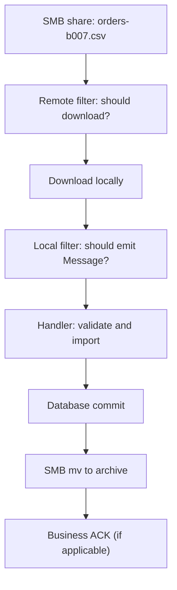
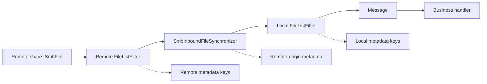
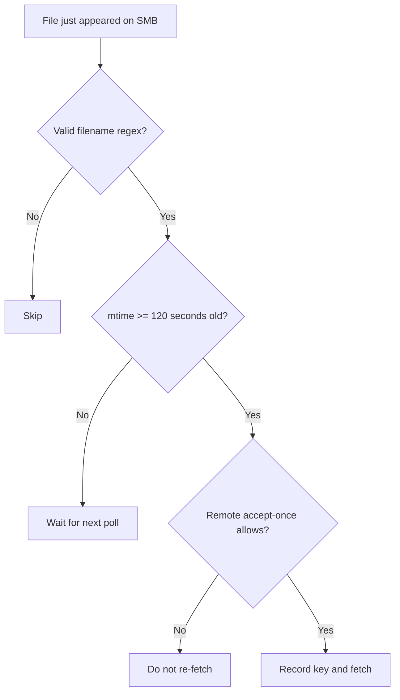
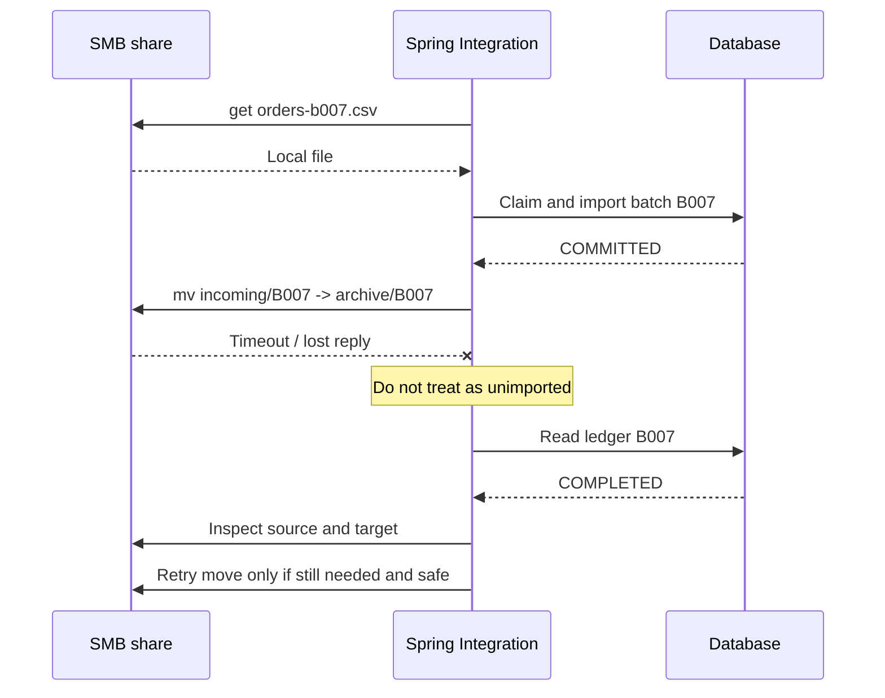
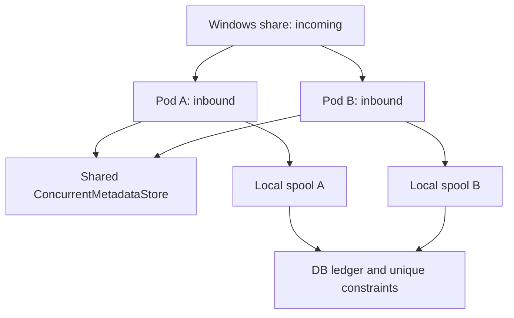
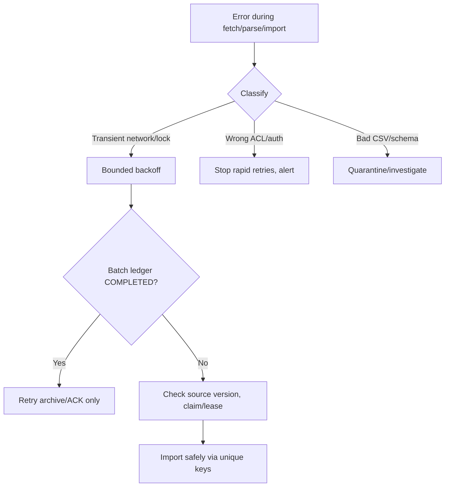

# Ensuring Idempotency When Polling an SMB Share

## 1. Why Can a File Be Processed Multiple Times?

Suppose a Spring Boot application polls `\\fs01\exchange\incoming\partner-a` every 10 seconds to import order reports. A file named `orders-20261123-b007.csv` is downloaded locally and imported into the database. Afterward, the application restarts, drops connection mid-download, or another pod starts polling the same share. Without proper safeguards, **the same order batch can be read, emitted as messages, and written multiple times**.

In Spring Integration SMB, a single poll is not a distributed transaction spanning the Windows File Server, local disk, and database. You must separate these milestones: **file discovery**, **file download**, **`Message<File>` emission**, **data commit**, and **archiving or ACK delivery**. Any step can succeed while the subsequent step fails.

This lesson belongs to the **Adapter SMB** chapter of the `SPRING_INTEGRATION_ADAPTERS` module: using inbound/outbound adapters, gateways, pollers, and `MessageChannel` to connect external systems, and managing message contracts, errors, and connection lifecycles. These deduplication principles also apply to files, SFTP, HTTP, JMS, AMQP, Kafka, or databases, though they cannot substitute for SMB protocol details and file-storage behavior.

**Objective:** design an SMB flow that **tolerates replay (at-least-once at the processing layer) without producing duplicate business side effects**, rather than relying solely on filters skipping previously seen filenames.

After this lesson, you will be able to:

- Distinguish preventing **duplicate downloads**, preventing **duplicate message emissions**, and preventing **duplicate business commits**.
- Understand `SmbPersistentAcceptOnceFileListFilter`, `FileSystemPersistentAcceptOnceFileListFilter`, and `ConcurrentMetadataStore`.
- Configure Java DSL for remote/local filters, origin metadata, pollers, and fetch limits.
- Choose idempotency keys based on partner/batch/version/checksum instead of message IDs that change on every run.
- Handle restarts, crashes, download failures, partial commits, modified same-named files, and multi-instance polling.
- Design recovery, archiving, and ACK workflows so retries remain safe.
- Practice verifying failure paths, including cases where filters do **not** self-recover.

## 2. What Is Idempotency in SMB Integration?

An operation `f` is **idempotent** if running it again with the same input yields the same **desired business outcome** as running it once:

```text
process(batch-007)
process(batch-007)  // safe to re-run, does not increase written order count
                    // and does not send unintended duplicate invoices
```

Idempotency **does not mean** the application never receives the file again. In practice, after a timeout or crash, the system often needs to reprocess work to establish the final outcome.

| Goal | Example | Primary Mechanism |
|---|---|---|
| **Prevent duplicate downloads** | Do not copy the same version of `orders.csv` from the share every cycle | Remote persistent file list filter |
| **Prevent duplicate message emissions** | Do not re-emit the same local file across poll cycles | Local accept-once file list filter |
| **Prevent duplicate imports** | An order is not inserted twice when a batch replays | Unique keys, batch state, transactions |
| **Prevent duplicate side effects** | Do not send the same payment confirmation / HTTP notification twice | Downstream idempotency key or outbox/dedup |
| **Coordinate multiple instances** | Two pods do not claim the same unprocessed batch concurrently | Shared atomic metadata / DB claim / lock |

Filters reduce load and avoid redundant transfers at the transport layer. **The ultimate protection for data lives where side effects happen**, such as a database with unique constraints or a downstream system supporting idempotency keys.

### 2.1. There Is No Automatic Unified Transaction



Suppose the DB committed at step F yet the network failed at step G. The file remains in `incoming`, and the application may see it again after metadata expires or when an operator triggers reprocessing. **Never import it a second time merely because the file still sits in the source share.** This is why business state cannot be replaced by a `seen=true` flag in a remote filter.

## 3. Two `FileListFilter` Layers on the SMB Inbound Adapter

With a **local-sync** inbound adapter, there are two filtering points:



| Location | File Type | Decision | Blind Spot |
|---|---|---|---|
| **Remote filter** | `jcifs.smb.SmbFile` | Which SMB files are accepted to fetch | Does not know whether the database committed successfully |
| **Synchronizer** | Remote → local | Downloads/renames temp files and records origin metadata | Successful download does not mean the handler finished |
| **Local filter** | `java.io.File` | Which local files produce a message | An emitted message does not prove commit |
| **Business ledger** | `batchId` and records | Which batch/version committed and whether retry is needed | Does not replace checking whether the file was completely published |

File streaming differs: `SmbStreamingMessageSource` emits `Message<InputStream>` directly from SMB with no default local spool or local filter. Even so, it still has a **remote persistent accept-once filter** and still requires business idempotency. When consuming streams, you must close `closeableResource` to return the SMB session; leaving sessions unclosed can cause subsequent polls to time out.

### 3.1. Why Can't the Two Filters Replace Each Other?

Suppose the local copy `orders-b007.csv` finished downloading. The remote filter marks the file as fetched. Yet another poll of the local source can re-emit that file if the local filter lacks the key or was reset. Conversely, the local filter may have marked the message as emitted while the handler failed, preventing the next poll from **automatically re-emitting it**.

Each layer maintains its own state and needs its own prefix if sharing a metadata store. You cannot infer a local key from the presence of a remote key, much less infer that a record was committed.

## 4. How Does `SmbPersistentAcceptOnceFileListFilter` Work?

This is the SMB filter class in `org.springframework.integration.smb.filters` in Spring Integration 6.x. Its constructor accepts a `ConcurrentMetadataStore` and a `prefix`:

```java
new SmbPersistentAcceptOnceFileListFilter(
        metadataStore, "prod:partner-a:remote:");
```

Per Spring Integration 6.5's remote persistent file filter behavior, it tracks **file identity according to the filter's key construction and the remote modification timestamp**. If the file has not been seen, the filter passes it; if stored with the same modified time, it can reject it; if modified time changes, the file can be treated as a new version.

| State | Possible Outcome |
|---|---|
| New file, key does not exist | Accepted for download |
| Same key, unchanged mtime | Skipped |
| Same filename, newer mtime | May be accepted again |
| Metadata store cleared/reset | File may be seen as new |
| Prefix or key builder changed | Old keys may no longer match |

**Warning:** modification time is not a checksum. Senders can change content while preserving timestamps, or touch timestamps without changing content. If business rules require identifying a **data version**, agree on a version/batch ID and verify checksums when necessary.

### 4.1. When Is State Recorded?

Since Spring Integration 5.2, remote filters support marking near **fetch start** and can **roll back keys when a fetch fails** along normal error paths. If power fails or the process is killed mid-fetch, the key may remain in the durable store after restart and **the file will not automatically be re-fetched**. That is the difference between a handled exception and a catastrophic crash.

```mermaid
sequenceDiagram
    participant P as Poller
    participant F as Remote filter
    participant S as Synchronizer
    participant DB as MetadataStore
    participant SMB as SMB server
    P->>F: Select candidate file
    F->>DB: Write accept-once key before fetch
    F->>S: Allow fetching orders-b007.csv
    S->>SMB: Download data
    alt Download succeeds
        SMB-->>S: Full content received
        S-->>P: Local file ready
    else Caught download error
        SMB--xS: I/O exception
        S->>F: Roll back key when filter supports it
    else Process crash
        Note over F,DB: Key may remain; needs reconciliation
    end
```

Never claim "filters always roll back automatically" in every situation. In Spring Integration 6.x, per-file filtering depends on `supportsSingleFileFiltering()`; when composing filters, **every child filter** must support it to preserve documented single-file behavior. A marker filter inspecting the whole list can change those semantics.

### 4.2. Choosing Keys and Prefixes

Suppose two partners use the same filename:

```text
incoming/partner-a/report.csv
incoming/partner-b/report.csv
```

If both share a filter and build keys solely from filename, states can collide. Ways to reduce risk:

1. Use **separate prefixes per environment/partner/endpoint**, such as `prod:pA:remote:` and `prod:pB:remote:`.
2. When reading recursively across directories, consider `setForRecursion(true)` on the persistent remote filter so the **full path** enters the key per Spring Integration 6.x mechanics.
3. Never flip `forRecursion` or prefixes in production without a metadata migration plan: old keys may stop matching, causing mass re-ingestion.
4. Keep deduplication metadata separate from the business batch's **COMPLETED** status.

Per 6.5 documentation, `forRecursion=true` also enables always accepting directories during recursive traversal. That option neither guarantees database uniqueness nor replaces proper remote path restrictions.

## 5. Choosing the Right `MetadataStore`

`ConcurrentMetadataStore` offers atomic operations such as `putIfAbsent(key, value)` and `replace(key, oldValue, newValue)`. Those operations let multiple threads or instances coordinate far better than a Map without atomic semantics.

| Store | Characteristics | Limitations |
|---|---|---|
| `SimpleMetadataStore` | In-memory; suits labs or single-run lifecycles | State lost on restart; not shared across pods |
| `JdbcMetadataStore` | Database-backed; supports `ConcurrentMetadataStore` and transactional atomic updates | Requires schema setup, connection management, transactions, retention |
| `RedisMetadataStore` | External store; shareable across instances when properly configured | Check version compatibility; Spring Integration 6.5 notes limitations on atomic `replace` in Redis Cluster due to `WATCH` |
| Other contract-compliant stores | Usable if implementing `ConcurrentMetadataStore` properly | Must prove durability, atomicity, access control, and recovery |

**Important:** the name "persistent filter" does not mean **the default store survives restarts**. Spring Integration defaults many remote file filters to the in-memory `SimpleMetadataStore`. For durability, you must explicitly supply an appropriate backend and configure consistent keys/prefixes.

### 5.1. Separating Metadata Namespaces

An inbound file synchronizer may require three key groups:

```text
prod:smb:partner-a:remote:...   # remote file accepted for download
prod:smb:partner-a:local:...    # local file emitted as Message<File>
prod:smb:partner-a:origin:...   # which host/path/file this local copy came from
```

The third group is **remote-origin metadata**. Since handlers receive a local `java.io.File`, the synchronizer records origin so headers like `FileHeaders.REMOTE_FILE` and `FileHeaders.REMOTE_DIRECTORY` can be attached later.

**Never share prefixes** among remote accept-once, local accept-once, and origin metadata. If keys collide, one component can overwrite another's values. Maintain distinct namespaces for environment, partner, data source, and purpose.

### 5.2. When to Use a JDBC Metadata Store?

If the application runs multiple pods or must recover across restarts, one option is `JdbcMetadataStore`. It lives in `spring-integration-jdbc` and requires a `DataSource`, properly schema-initialized metadata tables, and transaction management. Example *replacing the lab bean*:

```gradle
dependencies {
    implementation 'org.springframework.integration:spring-integration-jdbc'
}
```

```java
import javax.sql.DataSource;
import org.springframework.context.annotation.Bean;
import org.springframework.integration.jdbc.metadata.JdbcMetadataStore;
import org.springframework.integration.metadata.ConcurrentMetadataStore;

@Bean("smbScanMetadataStore")
ConcurrentMetadataStore smbScanMetadataStore(DataSource dataSource) {
    return new JdbcMetadataStore(dataSource);
}
```

This example works only after the database has the `INT_METADATA_STORE` schema (or matching table prefix) from Spring Integration's SQL scripts, a suitable transaction manager, and read/write permissions. If your project uses custom schemas or regions, configure and test them in the target environment.

**Do not infer that** sharing one database makes a DB import transaction and SMB filter state **automatically** become a single distributed transaction. Even on the same `DataSource`, transaction boundaries, metadata update timing, and exception handling must be verified explicitly.

## 6. Java DSL: Polling SMB with Filters and Metadata

This example uses Spring Boot 3.x + compatible Spring Integration 6.5.x (align versions via dependency management/BOM). In 6.5, the remote file type is `jcifs.smb.SmbFile`; never pass `java.io.File` as the generic parameter for remote filters.

### 6.1. Dependencies and External Configuration

**`build.gradle`:**

```gradle
dependencies {
    implementation 'org.springframework.boot:spring-boot-starter-integration'
    implementation 'org.springframework.integration:spring-integration-smb'
}
```

**`application.yml`:**

```yaml
demo:
  smb:
    host: ${SMB_HOST}
    port: ${SMB_PORT:445}
    domain: ${SMB_DOMAIN:}
    username: ${SMB_USERNAME}
    password: ${SMB_PASSWORD}
    share: ${SMB_SHARE:exchange}
    remote-directory: ${SMB_REMOTE_DIRECTORY:incoming/partner-a}
    local-directory: ${SMB_LOCAL_DIRECTORY:./data/smb-inbox/partner-a}
```

Passwords must be supplied via an appropriate secret mechanism; never put passwords in Git or logs. `remote-directory` is the **path inside the share**, not a full UNC path.

### 6.2. Bean Factories, Filters, and Flow

**`SmbIdempotentScanConfig.java`:**

```java
import java.io.File;
import jcifs.DialectVersion;
import jcifs.smb.SmbFile;

import org.springframework.beans.factory.annotation.Qualifier;
import org.springframework.beans.factory.annotation.Value;
import org.springframework.context.annotation.Bean;
import org.springframework.context.annotation.Configuration;
import org.springframework.integration.config.EnableIntegration;
import org.springframework.integration.dsl.IntegrationFlow;
import org.springframework.integration.dsl.Pollers;
import org.springframework.integration.file.filters.ChainFileListFilter;
import org.springframework.integration.file.filters.FileListFilter;
import org.springframework.integration.file.filters.FileSystemPersistentAcceptOnceFileListFilter;
import org.springframework.integration.metadata.ConcurrentMetadataStore;
import org.springframework.integration.metadata.SimpleMetadataStore;
import org.springframework.integration.smb.dsl.Smb;
import org.springframework.integration.smb.filters.SmbLastModifiedFileListFilter;
import org.springframework.integration.smb.filters.SmbPersistentAcceptOnceFileListFilter;
import org.springframework.integration.smb.filters.SmbRegexPatternFileListFilter;
import org.springframework.integration.smb.session.SmbSessionFactory;

@Configuration
@EnableIntegration
public class SmbIdempotentScanConfig {

    @Bean
    SmbSessionFactory smbSessionFactory(
            @Value("${demo.smb.host}") String host,
            @Value("${demo.smb.port}") int port,
            @Value("${demo.smb.domain}") String domain,
            @Value("${demo.smb.username}") String username,
            @Value("${demo.smb.password}") String password,
            @Value("${demo.smb.share}") String share) {

        SmbSessionFactory f = new SmbSessionFactory();
        f.setHost(host);
        f.setPort(port);
        f.setDomain(domain);
        f.setUsername(username);
        f.setPassword(password);
        f.setShareAndDir(share);
        f.setSmbMinVersion(DialectVersion.SMB210);
        f.setSmbMaxVersion(DialectVersion.SMB311);
        return f;
    }

    // LAB: replace with JdbcMetadataStore/shared store in production.
    @Bean("smbScanMetadataStore")
    ConcurrentMetadataStore smbScanMetadataStore() {
        return new SimpleMetadataStore();
    }

    @Bean("smbScanRemoteFilter")
    FileListFilter<SmbFile> smbScanRemoteFilter(
            @Qualifier("smbScanMetadataStore")
            ConcurrentMetadataStore store) {

        ChainFileListFilter<SmbFile> chain = new ChainFileListFilter<>();
        chain.addFilter(new SmbRegexPatternFileListFilter(
                "(?i)orders-\\d{8}-b\\d{3}\\.csv"));
        chain.addFilter(new SmbLastModifiedFileListFilter(120));
        chain.addFilter(new SmbPersistentAcceptOnceFileListFilter(
                store, "prod:smb:partner-a:remote:"));
        return chain;
    }

    @Bean
    IntegrationFlow smbIdempotentInboundFlow(
            SmbSessionFactory sessionFactory,
            @Qualifier("smbScanRemoteFilter")
            FileListFilter<SmbFile> remoteFilter,
            @Qualifier("smbScanMetadataStore")
            ConcurrentMetadataStore store,
            @Value("${demo.smb.remote-directory}") String remoteDir,
            @Value("${demo.smb.local-directory}") String localDir,
            SmbImportService importer) {

        return IntegrationFlow
                .from(Smb.inboundAdapter(sessionFactory)
                        .remoteDirectory(remoteDir)
                        .localDirectory(new File(localDir))
                        .autoCreateLocalDirectory(true)
                        .preserveTimestamp(true)
                        .filter(remoteFilter)
                        .localFilter(
                                new FileSystemPersistentAcceptOnceFileListFilter(
                                        store, "prod:smb:partner-a:local:"))
                        .remoteFileMetadataStore(store)
                        .metadataStorePrefix("prod:smb:partner-a:origin:")
                        .maxFetchSize(1),
                    e -> e.id("smbIdempotentInbound")
                          .poller(Pollers.fixedDelay(10_000)
                                  .maxMessagesPerPoll(1)))
                .handle(message -> {
                    File localFile = (File) message.getPayload();
                    importer.importBatchIfNeeded(localFile, message.getHeaders());
                })
                .get();
    }
}
```

`SmbImportService` in this example is a **project-implemented business service** (Section 7 describes its contract), not a built-in Spring Integration class. To run the code, provide a bean for that service along with your chosen state/transaction persistence. The filter and flow config illustrates the API; no build/test run was executed within this lesson.

### 6.3. Why Is Filter Ordering a Real-World Issue?

We want **valid name → old enough → accept-once**. If accept-once comes before the age filter or uses an unsuitable composite combination, a freshly written file can be marked seen **before it is old enough**; 120 seconds later, the age filter passes it yet accept-once rejects it, causing the app to miss the file.



`ChainFileListFilter` passes each step's filtered list to the next step. `CompositeFileListFilter` presents candidate lists differently; with **stateful** filters like accept-once, never assume the two combinations behave identically.

**Do not confuse `maxFetchSize(1)` with `maxMessagesPerPoll(1)`.** The former limits remote files fetched in one pass; the latter limits messages emitted by the poller. Across multiple instances, small fetches keep one node from grabbing all candidates, yet do not create business exactly-once by themselves.

### 6.4. Notes on the Local Filter

`FileSystemPersistentAcceptOnceFileListFilter` tracks files **on local disk**. If a local file with the same name is updated without mtime changing as the filter expects, it may not re-emit the message. `preserveTimestamp(true)` also affects local file mtime. Write tests for both "remote modified an existing name" and "local file already exists."

When multiple instances have separate local storage, a shared store syncs only **metadata**, not local file copies. Never let two pods touch the same local file on a shared volume without verified locking, atomic file renames, and ownership rules.

## 7. Business Idempotency: What Filters Cannot Do for You

### 7.1. Choosing Batch Keys and Checking Content

Suppose the filename is `orders-20261123-b007.csv`. We can extract:

```text
partnerId = PARTNER_A
businessDate = 2026-11-23
batchId = ORDERS-20261123-B007
checksum = SHA-256(file bytes)
```

Use `(partnerId, batchId)` for **batch identity**, and store checksum as a version attribute. When encountering the same key again:

| DB State | Checksum | How to Respond |
|---|---|---|
| `COMPLETED` | Matching checksum | Do not import again; resume archive/ACK if still pending |
| `COMPLETED` | Different checksum | **Version conflict**; do not silently treat as duplicate or overwrite |
| `PROCESSING` with valid lease | Any | Other nodes must not claim or commit concurrently |
| `PROCESSING` expired | Needs reconciliation | Recovery checks owner/transaction before reclaiming |
| `FAILED_RETRYABLE` | Same checksum | Controlled retry combined with unique keys |
| No batch record | New | Claim batch via atomic insert/update |

Never use `MessageHeaders.ID` or message timestamps as idempotency keys: each poll/retry can generate a new message ID. Never use filename alone if two partners or directories can produce the same name.

### 7.2. Database Ledger and Unique Constraints

Illustrative PostgreSQL schema:

```sql
CREATE TABLE import_batches (
    partner_id       VARCHAR(64)  NOT NULL,
    batch_id         VARCHAR(128) NOT NULL,
    content_sha256   CHAR(64)     NOT NULL,
    state            VARCHAR(32)  NOT NULL,
    claim_owner      VARCHAR(128),
    claim_expires_at TIMESTAMPTZ,
    updated_at       TIMESTAMPTZ NOT NULL DEFAULT now(),
    PRIMARY KEY (partner_id, batch_id)
);

CREATE TABLE imported_orders (
    partner_id VARCHAR(64) NOT NULL,
    order_id   VARCHAR(128) NOT NULL,
    batch_id   VARCHAR(128) NOT NULL,
    amount     NUMERIC(18, 2) NOT NULL,
    PRIMARY KEY (partner_id, order_id)
);
```

This is an **illustrative schema** to adapt to business rules: if an `order_id` can appear across multiple versions, do not blindly enforce uniqueness on `(partner_id, order_id)`; identify the true record or event identity.

One way to claim initially using a unique key:

```sql
INSERT INTO import_batches
    (partner_id, batch_id, content_sha256, state, claim_owner, claim_expires_at)
VALUES
    (:partnerId, :batchId, :sha256, 'PROCESSING',
     :workerId, :leaseDeadline)
ON CONFLICT (partner_id, batch_id) DO NOTHING;
```

**Important:** when INSERT returns 0 rows, **do not** infer the batch is already done. It may be `PROCESSING`, `FAILED`, or `COMPLETED`. Read state and checksum under proper locking/transactions, then decide whether to skip, wait, retry, or flag a conflict. Reclaiming an expired lease must also use conditional updates so two workers never claim ownership simultaneously.

### 7.3. Controlled Import Pseudocode

```java
// BUSINESS PSEUDOCODE - not a built-in Spring Integration API.
void importBatchIfNeeded(File localFile, MessageHeaders headers) {
    BatchKey key = identifyTrustedBatch(localFile, headers);
    String sha256 = checksum(localFile);

    // claimBatchAtomically() uses unique keys and compare-and-set/transactions.
    Claim claim = batchRepository.claimBatchAtomically(key, sha256, workerId);
    if (claim.isCompletedWithSameChecksum()) {
        resumeArchiveOrAckIfNeeded(key);
        return;
    }
    if (!claim.isOwnedBy(workerId)) {
        // Batch is currently handled by another node or data conflicts.
        returnOrRaiseAccordingToPolicy(claim);
        return;
    }

    // Database transaction must cover writing records and COMPLETED status.
    // Staging/batch inserts may be used for large files.
    importAndMarkCompletedInOneDatabaseTransaction(key, sha256, localFile);

    // SMB mv or ACK runs outside the DB transaction.
    // On failure, mark PENDING_ARCHIVE to retry separately; DO NOT re-import.
    archiveOrScheduleRetry(key);
}
```

This snippet describes architecture and is **not standalone compilable code**: `BatchKey`, `Claim`, `batchRepository`, `workerId`, and helper methods must be implemented by your project. To avoid `@Transactional` self-invocation pitfalls, place transactional logic in a bean where Spring applies a transaction proxy or use `TransactionTemplate`. For large files, use staging tables and commit with idempotency at every checkpoint.

If data committed to the DB yet an external API call failed, a DB transaction cannot undo the external system's effect. Consider a **transactional outbox** and target-side idempotency keys instead of firing unguarded side effects inline inside the file-processing code.

## 8. Crash Points and Recovery Plans

| Crash or Error Point | Remote Metadata | Local File / Message | Database | Recovery Action |
|---|---|---|---|---|
| Before remote filter accepts | No new key | No file | Not claimed | Poll normally |
| After writing key, before download completes | **Key may stay stuck** on crash | Temp file may remain | Not imported | Reconcile remote/local; remove targeted key only after checking |
| After download, before emitting message | Remote key may exist | Local file exists | Not imported | Inspect local filter and spool; replay in controlled way |
| Message emitted, handler throws exception | Remote/local keys recorded | Local file remains | Uncommitted or partially committed | Recover via ledger/unique keys; never wipe metadata blindly |
| DB committed, before archive | Filter marks seen | Local file may remain | `COMPLETED` | **Do not re-import**; retry archive/ACK separately |
| Remote `mv` times out | Source/target may have changed | Insufficient to tell | `COMPLETED` | Inspect both `incoming` and `archive`, then update status |
| Metadata store lost data | Keys lost | Local file remains/deleted | DB still holds ledger | Allow rescan, yet skip/verify batches in DB |
| Account expired, SMB unreadable | Filters cannot rescue auth | No new message | Batch stays at prior state | Fix credentials, stop rapid retries, resume cleanly |

### 8.1. Case Study: Committed Yet Not Archived



Never apply a rule like "if the file is still in `incoming`, import it again," because the DB may have already finished while archiving failed.

### 8.2. If a File Is Modified Under the Same Name

Partner replaces `orders-b007.csv` with different contents while keeping the name:

- The remote filter may detect changed mtime and re-download.
- The local filter must check local file state and mtime; otherwise the new copy may not be emitted.
- The ledger sees the same `(partnerId, batchId)` with a different checksum. This is a **batch revision or conflict event**, not automatically a safe duplicate to skip.
- Both sides need clear rules: new batch ID, incrementing version, correction/void files, or routing to an investigation queue.

Never let an already-`COMPLETED` batch be silently overwritten just because a filter accepted a new version.

## 9. Multiple Pods Polling the Same Share



To prevent two pods from claiming the same file:

1. Replace `SimpleMetadataStore` with a **shared durable store** supporting atomic ops; all pods use the same namespace/key policy.
2. Configure the remote persistent accept-once filter properly for remote paths and set `maxFetchSize(1)` so no single node grabs multiple files at once.
3. If multiple directories share filenames, use distinct prefixes or appropriate `forRecursion`; test key migration before changing settings.
4. Keep **separate local spools per pod** or a shared filesystem with verified locking and atomic renames. A shared metadata store does not share local files.
5. Use a DB ledger and unique keys to handle duplicates even if two instances both pass the file filter layer.
6. Design recovery when a node dies mid-processing: bounded claim owner/lease, plus a watchdog verifying state before reassigning batches.
7. If using `JdbcMetadataStore`, keep schemas, transactions, and DB configuration consistent across pods.

**Distinction:** `SmbPersistentAcceptOnceFileListFilter` is idempotency at the **file selection** layer, not a permanent distributed lock for the entire import workflow. Any two pods must still handle cases where filter state diverges from the ledger or files replay after incidents.

## 10. Pollers, File Readiness, and Retries

### 10.1. File Presence Does Not Mean Write Completion

If a partner uploads directly to `orders-b007.csv`, a poller can pick up the file while it is still being written. Downloading mid-write risks missing lines or hitting sharing violations. Both sides should use a **publication contract**:

```text
orders-20261123-b007.csv.writing  // currently writing
    -> close handle, flush
orders-20261123-b007.csv          // official name after rename
```

The inbound filter accepts only official `*.csv` names. If you cannot change the sender, consider `SmbLastModifiedFileListFilter(120)` or marker files confirming completion, keeping in mind that age filters only reduce risk without proving completion.

### 10.2. Age Filtering Before Accept-Once

The chain in Section 6 places `SmbLastModifiedFileListFilter(120)` before persistent accept-once. That prevents newly created files that are not old enough from being **marked "seen" prematurely**. When adding marker filters, check single-file/list filtering behavior and marker timing so unready files are never marked by mistake.

### 10.3. Retries Must Not Create New Side Effects

An error-handling flow:



Never use `FileExistsMode.APPEND` as a general retry strategy for CSVs; resending can append duplicate rows. Never retry bad passwords continuously, or you may lock out the domain account. For timed-out `mv/put/rm` operations, **check remote state** before retrying because the server may have already executed the command.

### 10.4. Downstream Failures Differ from Fetch Failures

Remote persistent filters can roll back state on normal fetch failures, yet **do not automatically roll back** when the database-importing handler throws an exception after download. If the handler fails, rely on the ledger and your reprocessing policy:

- Reprocess from the intact local file without necessarily re-fetching from SMB.
- Reset **only the specific remote/local key** if source re-emission is required, after verifying version and batch status.
- Never wipe the entire metadata store to fix one stuck batch; that can trigger mass re-scanning of every file.
- If data committed yet ACK failed, retry the ACK separately instead of re-importing.

## 11. Operations: Governing Metadata and Logs

### 11.1. States Worth Observing

| Metric / Log | Why It Matters |
|---|---|
| Candidate files on share and backlog | Spot sender spikes and lingering old files |
| Files rejected by regex/age | Understand why files have not reached handlers |
| Files accepted by remote filter | Track fetches and latency |
| Local files emitted as messages | Spot bottlenecks in local filters |
| Count of `PROCESSING/COMPLETED/FAILED` batches | True business outcomes |
| `PROCESSING` batches past lease deadline | Recover from dead workers |
| Re-fetch / reprocess counts per batch | Detect unintended replays |
| Checksum mismatches on same batch key | Spot unversioned file overwrites |
| Latency from publish to commit, archive, ACK | Track end-to-end SLAs |
| Busy SMB sessions and pool errors | Detect streaming leaks / session waits |

Not every metric is built into Spring Integration; add instrumentation in filters, business services, databases, and SMB servers. Log sanitized host aliases, shares, remote directories, and `batchId`; **never** log passwords, sensitive file contents, or credentialed SMB URIs.

### 11.2. Procedure for Clearing a Stuck Metadata Key

Only authorized operators should touch the store:

1. Identify exact `partnerId`, remote path, batch ID, and version/mtime/checksum.
2. Reconcile the remote file, local file, ledger state, and archive/ACK status.
3. Confirm the batch is **not completed** or only needs a specific step retried.
4. Determine the exact key and namespace for **that single file** using your Spring Integration version's key construction rules.
5. Apply the audited change without deleting keys for other versions/batches; ensure no worker currently holds a claim on that batch.
6. Let the poller retry cleanly and monitor the end-to-end outcome.

Deleting a key does not remove local files or roll back the database. Conversely, deleting a local file does not remove the remote accept-once key. That is why you need a runbook covering **all three distinct states**.

## 12. Hands-On Exercises on a Lab SMB Share

Prepare a **lab-only** Windows File Server/Samba/NAS share:

```text
\\fs01\exchange-lab\incoming\partner-a\
  orders-20261123-b001.csv
  orders-20261123-b002.csv.writing
```

The app uses the Java DSL from Section 6, a dedicated local directory, and a lab database with batch status and unique-constraint tables. Each exercise should inspect remote files, metadata keys, local files, and DB state. Never modify/delete real production metadata.

### Lab A — One File Across Multiple Poll Cycles

1. Create `orders-20261123-b001.csv` following the naming convention and age it past 120 seconds in the lab.
2. Start the app; verify the remote filter accepts the file and the adapter downloads it locally.
3. Let the poller run several more cycles; observe no new downloads or emissions occur for that same file version under current settings.
4. Inspect remote/local keys in their separate namespaces; verify the ledger transitions to `COMPLETED` once the mock importer commits.

**Expected result:** filters cut redundant downloads within a run, while the ledger prevents duplicate imports on message replay.

### Lab B — Restart with `SimpleMetadataStore`

1. Complete Lab A and keep the remote file in place.
2. Restart the application using `SimpleMetadataStore`.
3. Observe how losing in-memory remote/local state leads to re-fetching/re-emitting.
4. Confirm database unique keys/ledger prevent a `COMPLETED` batch from importing twice.

**Expected result:** never confuse "persistent filter" with "durable state across restarts" when the backing store is in-memory.

### Lab C — Shared JDBC `MetadataStore`

1. In a lab with database support, create the metadata store table using the version-matched SQL script.
2. Swap the lab store bean for `JdbcMetadataStore` with proper transactions/config.
3. Run a batch, restart the app, and confirm metadata persists.
4. Inspect the separate business ledger; never use a filter key as proof of `COMPLETED`.

**Expected result:** file-selection state persists across restarts, yet business idempotency remains mandatory.

### Lab D — Network Drop and Stuck Keys

1. Have inbound begin downloading a relatively large file on the lab network.
2. Trigger a normal network exception; record whether the filter rolls back the key and whether the file is re-fetched.
3. In an **isolated** test, simulate a crash mid-fetch; observe leftover remote keys or temporary files.
4. Recover using Section 11's runbook, touching only the test key and batch.

**Expected result:** distinguish rollback on normal exceptions from ambiguous state after crashes.

### Lab E — DB Committed, SMB Archive Failed

1. Import a batch successfully and write `COMPLETED` to the lab DB.
2. Simulate a connection failure when calling `mv` to `archive`.
3. Let the flow retry; verify it reads `COMPLETED` and **does not insert duplicate orders**.
4. Verify source/target paths and complete archive/ACK only after reconciling remote state.

**Expected result:** recognize commit and archive as two distinct milestones so retries resume at the right step.

### Lab F — Two Pods Polling the Same Share

1. Run two test instances with separate in-memory metadata stores.
2. Drop a new batch and observe the risk of both seeing the same candidate.
3. Switch to a shared store, set `maxFetchSize(1)`, and repeat with a new batch.
4. Deliberately simulate failover mid-processing; verify DB unique keys block duplicate commits even if the file replays.

**Expected result:** shared metadata reduces file contention; business keys remain the last line of defense.

### Lab G — Same Name with Changed Content/Mtime

1. Process `orders-20261123-b001.csv` to completion with checksum A.
2. Change the file's content **in the lab** while keeping its filename, altering mtime; observe the remote filter may re-fetch it.
3. Verify the importer detects the same batch ID with differing checksum B and routes to correction/conflict handling.
4. Test changing content while preserving timestamps to see the limit of mtime-based filters.

**Expected result:** understand why versions/checksums and data-correction contracts are essential.

### Self-Check Questions

1. At which three points do the remote filter, local filter, and database ledger prevent duplication?
2. Why is `SimpleMetadataStore` insufficient for two pods to coordinate or survive restarts without replay?
3. When is the remote accept-once key written? Does it always roll back on a crash?
4. Does `maxFetchSize(1)` guarantee a batch commits only once? Why or why not?
5. Why shouldn't Spring's message ID be used as an idempotency key?
6. If a batch is `COMPLETED` yet archiving failed, which step is allowed to retry?
7. With the same `batchId` but a different checksum, should you skip, overwrite, or alert?
8. How does `forRecursion=true` affect metadata keys?
9. Why does `ChainFileListFilter` normally put the age filter before accept-once?
10. If a local file downloaded yet the handler failed, does remote metadata automatically reset?

## 13. Common Misconceptions

| Misconception | Accurate Understanding |
|---|---|
| "No duplicate download" means "no duplicate import" | Remote filters operate at the file layer; DB ledgers/unique constraints are still needed |
| `PersistentAcceptOnce` always survives restarts | Durability depends on the injected `MetadataStore` |
| A process crash automatically rolls back metadata | Can leave stuck keys requiring reconciliation and recovery |
| Same filename passed by filter means identical content | Mtime may change or fail to reflect byte edits; verify version/checksum |
| A shared metadata store forms a distributed transaction with SMB | No automatic transaction spans the file server and database |
| The local filter knows whether a batch committed | It tracks emitted local files, not business commits |
| `MessageHeaders.ID` is a good idempotency key | Message IDs change across retries and restarts |
| Same filename in two folders always shares a safe key | Requires proper prefixes/paths/`forRecursion` |
| `maxMessagesPerPoll(1)` locks the entire cluster | Limits messages per poll on that single endpoint only |
| `maxFetchSize(1)` guarantees exactly-once | Limits one remote fetch batch; does not block replays or duplicate commits |
| DB INSERT conflict means the batch is `COMPLETED` | It may be `PROCESSING`, `FAILED`, or a checksum conflict |
| After DB commit, an SMB archive failure means re-import | Retry archive/ACK; never re-import a `COMPLETED` batch |
| Deleting all metadata keys "fixes" a stuck file | Can re-scan the entire backlog and trigger massive replays |
| Streaming needs no session close when a metadata filter is set | `InputStream` holds the SMB session until resources are closed properly |
| Enabling `REPLACE` on output is a safe retry | May overwrite a file the partner already processed; reconcile state first |

## 14. References

- [Spring Integration 6.5 — SMB Support](https://docs.spring.io/spring-integration/reference/6.5/smb.html): inbound, streaming, filters, remote-file metadata, and Java DSL.
- [Spring Integration 6.5 — Remote Persistent File List Filters](https://docs.spring.io/spring-integration/reference/6.5/file/remote-persistent-flf.html): key write timing, fetch rollback, catastrophic crashes, and `forRecursion`.
- [Spring Integration 6.5 — JDBC Metadata Store](https://docs.spring.io/spring-integration/reference/6.5/jdbc/metadata-store.html): `JdbcMetadataStore`, schema, transactions, and atomic updates.
- [Spring Integration 6.5 — Redis Support](https://docs.spring.io/spring-integration/reference/6.5/redis.html): Redis metadata, atomic operations, and Redis Cluster caveats.
- [SmbPersistentAcceptOnceFileListFilter API 6.5](https://docs.spring.io/spring-integration/docs/6.5.0/api/org/springframework/integration/smb/filters/SmbPersistentAcceptOnceFileListFilter.html): `ConcurrentMetadataStore` constructor, `prefix`, and mtime checking.
- [RemoteFileInboundChannelAdapterSpec API 6.5](https://docs.spring.io/spring-integration/docs/6.5.0/api/org/springframework/integration/file/dsl/RemoteFileInboundChannelAdapterSpec.html): `filter`, `localFilter`, `remoteFileMetadataStore`, `metadataStorePrefix`, and `maxFetchSize`.
- [Spring Integration — Metadata Store](https://docs.spring.io/spring-integration/reference/6.5/meta-data-store.html): store contracts, atomic updates, and the idempotent receiver pattern.

**Key takeaway:** idempotency when polling an SMB share is not a single adapter option. The **remote persistent filter** avoids re-fetching unchanged files, the **local filter** avoids re-emitting messages, **durable metadata** supports restarts and clusters, and **business ledgers/transactions/unique keys** ultimately determine whether data imports execute more than once. A sound design permits controlled replay and resumes at the right step after errors, without assuming one poll equals one complete commit.
