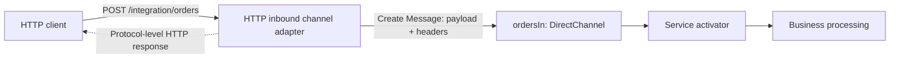

# HTTP Inbound Channel Adapter for Receiving Requests

## 1. Role of the HTTP Inbound Channel Adapter in Spring Integration

In the **SPRING_INTEGRATION_ADAPTERS** module, adapters and gateways connect Spring Integration's `Message` flow with external systems such as files, SFTP, HTTP, JMS, AMQP, Kafka, and databases. For HTTP, the **inbound channel adapter** acts as the entry point that receives requests from an HTTP client, converts the relevant payload data into a `Message<?>`, and sends the message to a `MessageChannel`.

This is a **one-way** model: the client sends a request to trigger an internal flow, while the application does not build a business reply message to send back to the client. HTTP must still return a protocol-level response (an appropriate status code and headers), but that response is not a business result taken from a reply channel. When you need to return JSON containing an order creation result, status lookup, or business error under a request–response contract, consider an **HTTP inbound gateway**.

After this lesson, you will be able to:

- Explain how an HTTP request passes through an inbound endpoint, becomes a Spring `Message`, and enters a channel.
- Configure an endpoint that accepts `POST` requests for a specific path and `Content-Type` using the Java DSL.
- Distinguish between successfully receiving a request and completing business processing, especially when handing off to an asynchronous channel.
- Identify where to control mapping, payload conversion, error handling, security, and endpoint lifecycle.

## 2. Data Flow and Message Contract



Receiving a request consists of five main steps:

1. The client sends a request to a URL mapped by Spring MVC for the adapter. Mapping conditions may include the HTTP method, path, and media type.
2. The HTTP endpoint checks the mapping and uses appropriate HTTP message converters to read the body according to the configured payload type.
3. The adapter creates a Spring Integration `Message<?>`, where the **payload** is typically the converted body data and **headers** contain request metadata mapped by the framework as configured.
4. The adapter sends the message to the input channel; subscribers such as a service activator, transformer, or router continue processing it.
5. The HTTP endpoint completes the response according to the inbound adapter's mechanism and configuration. Because the adapter is one-way, there is no step waiting for a business *reply message*.

A Spring Integration `Message` is not equivalent to the entire `HttpServletRequest` object. A JSON body can become a `String`, a DTO, or another type depending on `requestPayloadType` and the message converter. HTTP headers are mapped selectively; you should not assume that sensitive headers are always included in the message. Identity information, correlation IDs, and caller origin need clear conventions before being propagated across multiple channels or external systems.

> **Note:** An HTTP inbound channel adapter is triggered when a request arrives; it does not need a poller to *receive* requests. A poller is only needed when downstream components must read from a `PollableChannel`, such as a `QueueChannel`.

## 3. Creating a POST Endpoint

The example below uses Spring Boot with Spring MVC and Spring Integration. If the project uses Spring Boot dependency management, the basic Maven dependencies are:

```xml
<dependencies>
    <dependency>
        <groupId>org.springframework.boot</groupId>
        <artifactId>spring-boot-starter-web</artifactId>
    </dependency>
    <dependency>
        <groupId>org.springframework.boot</groupId>
        <artifactId>spring-boot-starter-integration</artifactId>
    </dependency>
    <dependency>
        <groupId>org.springframework.integration</groupId>
        <artifactId>spring-integration-http</artifactId>
    </dependency>
</dependencies>
```

### 3.1. Defining the Inbound Adapter and Channel

```java
import org.springframework.context.annotation.Bean;
import org.springframework.context.annotation.Configuration;
import org.springframework.http.HttpMethod;
import org.springframework.http.MediaType;
import org.springframework.integration.annotation.EnableIntegration;
import org.springframework.integration.channel.DirectChannel;
import org.springframework.integration.dsl.IntegrationFlow;
import org.springframework.integration.http.dsl.Http;
import org.springframework.messaging.MessageChannel;

@Configuration
@EnableIntegration
public class HttpInboundConfiguration {

    @Bean
    public MessageChannel ordersIn() {
        return new DirectChannel();
    }

    @Bean
    public IntegrationFlow orderHttpInboundFlow() {
        return IntegrationFlow
            .from(Http.inboundChannelAdapter("/integration/orders")
                .requestMapping(mapping -> mapping
                    .methods(HttpMethod.POST)
                    .consumes(MediaType.APPLICATION_JSON_VALUE))
                .requestPayloadType(String.class))
            .channel("ordersIn")
            .get();
    }
}
```

In this configuration:

| Component | Role |
|---|---|
| `Http.inboundChannelAdapter("/integration/orders")` | Exposes the HTTP request receiving endpoint in the web application. |
| `methods(HttpMethod.POST)` | Maps only the `POST` method to this endpoint. |
| `consumes(MediaType.APPLICATION_JSON_VALUE)` | Maps only requests with a matching JSON content type. |
| `requestPayloadType(String.class)` | Instructs the converter to read the body as a string; **does not automatically validate JSON syntax**. |
| `ordersIn` (`DirectChannel`) | Delivers messages directly to the subscribed handler; by default, the handler runs on the calling thread. |
| `.channel("ordersIn")` | Connects the inbound adapter's output to the channel with the corresponding name. |

Choosing `String` illustrates the HTTP–message boundary without depending on a DTO. In a real application, you can choose `requestPayloadType(OrderRequest.class)` when a message converter supports mapping JSON to a DTO; in that case, you should add validation and rules for handling malformed bodies. `consumes(application/json)` only checks the declared content type and is not sufficient to guarantee a valid body.

### 3.2. Receiving Messages with a Service Activator

```java
import org.springframework.integration.annotation.ServiceActivator;
import org.springframework.messaging.Message;
import org.springframework.stereotype.Service;

@Service
public class OrderMessageHandler {

    @ServiceActivator(inputChannel = "ordersIn")
    public void receive(Message<String> message) {
        String jsonBody = message.getPayload();
        if (jsonBody == null || jsonBody.isBlank()) {
            throw new IllegalArgumentException("Request body must not be blank");
        }

        // Actual business step: parse JSON, validate, check idempotency,
        // then persist durably or forward to a broker with acknowledgment.
        // Do not log the entire body or authorization header in production logs.
    }
}
```

`@ServiceActivator(inputChannel = "ordersIn")` registers the method as a consumer of the channel. The method accepts `Message<String>` so it can read both the payload and header metadata if needed. Because `DirectChannel` delivers synchronously, the handler's execution time directly affects the HTTP response time; unhandled exceptions in the handler can also propagate back to the HTTP endpoint.

The sample code focuses on wiring the adapter, channel, and handler. The comments must be replaced with real processing before production use: schema parsing/validation, caller authentication, persisting data, or publishing events with guarantees. The fact that the handler does not throw an exception in the example does not prove the order has been saved.

### 3.3. Sending Requests to Observe Behavior

With the application running on `localhost:8080` and no additional servlet context path configured:

```bash
curl -i -X POST 'http://localhost:8080/integration/orders' \
  -H 'Content-Type: application/json' \
  -d '{"orderId":"ORD-1001","amount":125000}'
```

The expectation is that a request matching the mapping enters `ordersIn` and triggers `OrderMessageHandler.receive`. The HTTP response from the inbound adapter records receipt at the protocol level; the specific status code depends on the endpoint configuration and processing, so observe the actual response rather than treating a success code as a guarantee that the order was saved.

Try replacing `POST` with `GET`, or setting `Content-Type: text/plain`: the request may fail to match the mapping and be rejected at the HTTP layer. Try sending a non-JSON string body while still declaring `application/json`: because the example reads a `String`, the data can still reach the handler; the application must parse and validate syntax itself if the contract requires valid JSON.

## 4. Choosing Inbound Adapter vs. Inbound Gateway

| Criterion | HTTP Inbound Channel Adapter | HTTP Inbound Gateway |
|---|---|---|
| Integration direction | HTTP request → internal message | HTTP request → internal message → reply message → HTTP response |
| Business reply | Does not receive a reply message to build a business response | Can wait for a reply and map payload/headers/status into the response |
| Suitable scenarios | Receiving signals, one-way webhooks, pushing work into a processing flow | APIs that need to return data, newly created IDs, query results, or errors per an API contract |
| Misinterpretation risk | HTTP 2xx does not necessarily mean downstream business processing is complete | Requires managing the reply channel and response timeout |

For example: a webhook notifying of a shipping status change can be received with an inbound adapter if the contract only requires acknowledgment. A `POST /orders` endpoint that must return `{"orderId":"...","status":"CREATED"}` based on the database save result is usually clearer with an inbound gateway.

**Do not confuse with an outbound adapter:** outbound HTTP is the direction from the Spring Integration system calling an external HTTP service. The terms *inbound/outbound* describe the direction a message crosses the system boundary, not the HTTP method `GET` or `POST`.

## 5. Channels Determine When Processing Occurs

After an inbound HTTP adapter, which channel you use affects latency, stability, and the meaning of HTTP acknowledgment:

| Channel After Adapter | Main Behavior | Consequences to Consider |
|---|---|---|
| `DirectChannel` | The handler receives the message immediately on the sending thread, synchronous by default. | The request waits for the handler to finish; synchronous errors can be detected at the HTTP boundary. |
| `ExecutorChannel` | Hands off work to an executor so the subscriber runs on another thread. | The HTTP endpoint may complete before business processing finishes; requires managing executor queues, load rejection, and asynchronous errors. |
| `QueueChannel` | Holds messages in a queue for a consumer with a poller to read later. | Requires configuring a poller on the reading side; an in-memory queue does not guarantee durability across restarts. |

A practical high-load design is **receive request → minimal validation → write to inbox/outbox or publish to a durable broker → acknowledge → worker processes next**. You must clearly define whether "received" means validated, durably persisted, or business-completed. Simply offloading to an executor or in-memory queue can make responses faster but does not provide durable delivery guarantees.

There is no automatic one-to-one relationship between an HTTP request and a transaction spanning across adapters. When sending messages to Kafka, JMS, AMQP, or writing to a database, design acknowledgment, retries, transactions/outbox, and idempotency according to each component's mechanism.

## 6. Error Handling and Safety at the HTTP Boundary

| Situation | Detection Point / Handling Approach |
|---|---|
| URL or method mismatch | Check path, servlet context path, and `requestMapping`; typically results in 404/405 decided by the web layer. |
| Unsupported `Content-Type` | Check `consumes`; this typically leads to HTTP 415. |
| Empty body, invalid JSON, or missing fields | Use converters/validators and input error rules; with a `String` payload, you must actively parse and validate. |
| Synchronous handler throws an exception | Determine where the exception is caught and mapped to an HTTP status; do not assume every business error becomes a 4xx. |
| Error occurs after asynchronous handoff | Log with a correlation ID, monitor the error flow, and use retries/dead-letter queues; the original HTTP response cannot be modified to reflect late errors. |
| Client sends duplicates on retry | Use an idempotency key or event identifier with a unique constraint to prevent duplicate processing. |

In addition, inbound endpoints should be protected at the appropriate layers:

- **Authentication and authorization:** apply Spring Security, an API gateway, or webhook signature verification before trusting a request. A valid URL alone does not mean a client is authorized to call it.
- **Resource limits:** control body size, request rate, timeouts, worker count, and queue depth to prevent overload.
- **Data contract:** explicitly choose the payload type, `Content-Type`, schema, required fields, version, and how invalid input is handled.
- **Sensitive data:** forward only necessary headers; do not log tokens, cookies, passwords, or full personal payloads.
- **Flow observability:** log correlation/request IDs, receipt timestamps, processing durations, and save/publish outcomes to distinguish HTTP success from business success.

With synchronous flows, exceptions from a `DirectChannel` can return to the endpoint handling the request; how they map to an HTTP status depends on the application's exception-handling configuration. With asynchronous flows, you need an error channel, consumer-side error handling, and separate retry mechanisms. Do not assume that merely creating a global `errorChannel` automatically returns all HTTP exceptions and downstream errors to the client as JSON.

## 7. Lifecycle, Operations, and Testing

An inbound adapter is an endpoint living in the Spring application context: when the context starts, the HTTP mapping configuration is registered to accept requests; when the application stops or the endpoint is inactive, clients no longer have a valid receiving point through that mapping. Deploying multiple instances behind a load balancer does not automatically solve duplicate requests, processing order, or message durability.

When testing, cover at least the following cases:

1. **Valid flow:** `POST` with the correct path and media type sends a message with the expected payload to the consumer.
2. **Mapping:** another method, wrong path, or unsupported media type is handled at the appropriate HTTP layer.
3. **Body contract:** empty body, invalid JSON, or missing required fields are rejected according to defined rules.
4. **Business errors:** verify the difference between synchronous errors and errors occurring after the response has been returned.
5. **Reliability:** retrying the same event does not cause duplicate side effects; verify behavior when the queue/broker or database fails.
6. **Security and observability:** unauthenticated requests are blocked, trace/correlation IDs are tracked, and logs do not leak sensitive data.

If a request does not reach the handler, trace in order: web starter and servlet mapping → path/method/content type → registered adapter → channel name → channel subscriber or poller → exception in converter/handler. This trace order helps pinpoint whether the issue belongs to the HTTP boundary, the message contract, or downstream processing.

## 8. Key Takeaways

An HTTP inbound channel adapter **brings requests into Spring Integration as one-way messages**. `requestMapping` determines which requests are accepted, `requestPayloadType` along with converters determines what type the body becomes, `MessageChannel` determines how delivery to consumers happens, and error-handling/acknowledgment mechanisms determine what the client observes. Choose an inbound gateway when the contract requires returning business content; choose an appropriate channel and durable persistence strategy if you need high-load ingestion, retries, and safe processing across multiple systems.
