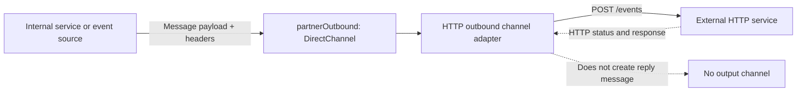
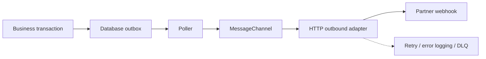

# HTTP Outbound Channel Adapter for Sending One-Way Requests

## 1. What Is the HTTP Outbound Channel Adapter Used For?

In **SPRING_INTEGRATION_ADAPTERS**, Spring Integration provides inbound/outbound adapters, gateways, pollers, and `MessageChannel`s to connect internal message flows with external systems. Depending on requirements, an application can exchange data via files, SFTP, HTTP, JMS, AMQP, Kafka, or databases; each integration requires defining the transfer direction, message contract, error handling, and processing lifecycle.

An **HTTP outbound channel adapter** is a *one-way* endpoint that sends messages **from Spring Integration out to an external HTTP service**. When it receives a message from an input channel, it builds an HTTP request according to the configured URL, HTTP method, headers, and payload, executes the call, and finishes processing without **producing a reply message** containing the HTTP result for downstream flows.

Key points to distinguish:

- **One-way at the Spring Integration level**: the adapter does not push the response body onto an output/reply channel.
- **HTTP is still a request–response protocol**: the HTTP client still has to exchange data and receive a protocol-level response. A typical outbound call still waits for the HTTP exchange to complete or fail.
- **No reply message does not mean ignoring errors**: connection failures, timeouts, or HTTP error statuses can still raise exceptions depending on the HTTP client and error handler.

This lesson focuses on **sending one-way requests**, rather than using an HTTP outbound gateway to read business response data.

After this lesson, you will know how to configure the adapter, publish messages to a channel, control the HTTP method and content type, evaluate synchronous/asynchronous behavior, handle errors, and run integration tests.

## 2. Message Flow from the Application to the HTTP Service



Typical flow:

1. A business step or message producer creates a `Message<?>` and sends it to a channel, such as `partnerOutbound`.
2. The HTTP outbound adapter is the message handler subscribed to that channel.
3. The adapter determines the target URL, HTTP method, request body, and HTTP headers to send externally.
4. The HTTP client establishes a connection, sends the request, and receives the HTTP status/headers/body at the protocol level.
5. The adapter completes message processing if no error occurs; **the response payload is not forwarded as a Spring Integration reply message**.

Example scenario: after a new order is placed, the system sends an event to a partner's webhook. If the flow only needs to deliver the notification and does not need to use the response content to decide the next step, the HTTP outbound channel adapter is the right choice.

> **Business condition to clarify:** a partner returning HTTP 200 or 202 only proves what their HTTP contract specifies; it does not automatically guarantee that the event has been durably processed in the partner's database.

## 3. Message Contract and Outbound HTTP Mapping

An internal message carries two parts: `payload` and `headers`. The adapter translates them into an HTTP request according to its configuration:

| Spring Integration Component | Meaning When Sending HTTP |
|---|---|
| `Message.getPayload()` | Usually becomes the HTTP request body, serialized by an appropriate message converter. |
| `MessageHeaders.CONTENT_TYPE` | Specifies the content media type, e.g. `application/json`, when mapped to HTTP. |
| Configured URL of the adapter | Identifies the target HTTP server and resource. |
| `httpMethod(HttpMethod.POST)` | Specifies the HTTP method used for sending. |
| Business headers such as `eventId` | Useful for internal processing; **you should not assume they automatically become HTTP headers**. |
| Partner HTTP status and response body | Meaningful to the HTTP client/error handler; the adapter does not produce a reply message from the response body. |

An integration contract should document at minimum: target destination, method, content type, JSON schema, required headers, authentication, timeout, retry policy, HTTP codes considered successful, and duplicate-event handling.

Do not manually build JSON by string concatenation from user data: that can produce malformed bodies. Prefer a DTO/record and let a JSON message converter serialize it according to the agreed schema.

## 4. Configuring the HTTP Outbound Channel Adapter with Java DSL

The following example uses a **Spring Boot + Spring Integration HTTP + Spring MVC/Jackson** application, Java 17 or newer, and a mock webhook at `http://localhost:8081/events`. This URL is for practice; production deployments should use HTTPS and externalized configuration.

### 4.1. Maven Dependencies

For a Spring Boot project with managed dependency versions:

```xml
<dependencies>
    <dependency>
        <groupId>org.springframework.boot</groupId>
        <artifactId>spring-boot-starter-integration</artifactId>
    </dependency>
    <dependency>
        <groupId>org.springframework.integration</groupId>
        <artifactId>spring-integration-http</artifactId>
    </dependency>
    <dependency>
        <groupId>org.springframework.boot</groupId>
        <artifactId>spring-boot-starter-web</artifactId>
    </dependency>
</dependencies>
```

`spring-integration-http` provides the endpoints and DSL for HTTP integration; `spring-boot-starter-web` brings in the common web/Jackson components used in the example. If your application already has equivalent dependencies, you do not need to declare them twice.

### 4.2. Configuring the Outbound Endpoint

```java
import org.springframework.beans.factory.annotation.Value;
import org.springframework.context.annotation.Bean;
import org.springframework.context.annotation.Configuration;
import org.springframework.http.HttpMethod;
import org.springframework.integration.annotation.EnableIntegration;
import org.springframework.integration.channel.DirectChannel;
import org.springframework.integration.dsl.IntegrationFlow;
import org.springframework.integration.http.dsl.Http;
import org.springframework.messaging.MessageChannel;

@Configuration
@EnableIntegration
public class PartnerWebhookConfiguration {

    @Bean
    public MessageChannel partnerOutbound() {
        return new DirectChannel();
    }

    @Bean
    public IntegrationFlow partnerWebhookFlow(
            @Value("${partner.webhook.url}") String webhookUrl) {

        return IntegrationFlow.from("partnerOutbound")
            .handle(Http.outboundChannelAdapter(webhookUrl)
                .httpMethod(HttpMethod.POST))
            .get();
    }
}
```

Declare the URL configuration in `application.yml`:

```yaml
partner:
  webhook:
    url: "http://localhost:8081/events"
```

Meaning:

- `partnerOutbound` is the input channel of the HTTP outbound flow; `DirectChannel` is used to illustrate the synchronous mechanism.
- `IntegrationFlow.from("partnerOutbound")` receives messages sent by producers to this channel.
- `Http.outboundChannelAdapter(webhookUrl)` creates an HTTP outbound adapter that executes requests to the webhook.
- `httpMethod(HttpMethod.POST)` specifies sending POST requests, suited for creation/event notifications per the partner's contract.
- There is no output channel or `expectedResponseType`: the goal is to send a one-way message without using the response body in the flow.

### 4.3. Sending Events to the Channel

```java
import org.springframework.beans.factory.annotation.Qualifier;
import org.springframework.http.MediaType;
import org.springframework.messaging.Message;
import org.springframework.messaging.MessageChannel;
import org.springframework.messaging.MessageHeaders;
import org.springframework.messaging.support.MessageBuilder;
import org.springframework.stereotype.Service;

@Service
public class PartnerEventSender {

    private final MessageChannel partnerOutbound;

    public PartnerEventSender(
            @Qualifier("partnerOutbound") MessageChannel partnerOutbound) {
        this.partnerOutbound = partnerOutbound;
    }

    public void sendOrderCreated(String eventId, String orderId) {
        Message<OrderCreatedEvent> message = MessageBuilder
            .withPayload(new OrderCreatedEvent(eventId, orderId))
            .setHeader(
                MessageHeaders.CONTENT_TYPE,
                MediaType.APPLICATION_JSON_VALUE)
            .build();

        boolean accepted = partnerOutbound.send(message);

        if (!accepted) {
            throw new IllegalStateException(
                "No handler accepted the outbound event");
        }
    }

    public record OrderCreatedEvent(String eventId, String orderId) {}
}
```

When the business logic creates a new order, the caller code can execute:

```java
partnerEventSender.sendOrderCreated("evt-1001", "ORD-1001");
```

With an appropriate JSON converter on the classpath, the `OrderCreatedEvent` payload is serialized to JSON for the HTTP request. The expected message received on the partner side looks like:

```http
POST /events HTTP/1.1
Host: localhost:8081
Content-Type: application/json

{"eventId":"evt-1001","orderId":"ORD-1001"}
```

Other protocol-level headers such as `Content-Length` or `Accept` depend on the HTTP client. JSON field order and body formatting may also vary; validate values against the schema rather than performing rigid byte-for-byte comparisons.

**Note on `send`:** `MessageChannel.send(message)` reports whether the message was handed off to the channel. With a `DirectChannel` and a synchronous HTTP handler, the call typically returns only after the HTTP exchange succeeds according to the HTTP client; errors may throw an exception before returning. Even when `send` returns `true`, that does not confirm the partner has finished business processing.

## 5. Distinguishing One-Way Adapters from Outbound Gateways

| Question | HTTP Outbound Channel Adapter | HTTP Outbound Gateway |
|---|---|---|
| Sends an HTTP request from an internal message? | Yes | Yes |
| Creates a reply message from the HTTP response? | **No** | **Yes**, based on reply and response type configuration |
| Performs an HTTP exchange and cares about errors? | Yes | Yes |
| Uses the response body for downstream routing/transformation? | No | Possible |
| Typical use cases | Sending webhooks, pushing one-way notifications or events | Calling APIs to fetch prices, look up customers, receive processing IDs/statuses |

For example: sending an "order created" notification and completing the flow is a case for an outbound adapter. If the HTTP service returns a tracking code that the application must read to update the order, use an outbound gateway to obtain a reply message rather than trying to extract business results from an outbound adapter.

Compared to an **HTTP inbound channel adapter**, the connection direction is reversed: inbound turns external requests into internal messages; outbound takes internal messages to call external services. HTTP methods such as GET/POST do not determine the terms inbound or outbound.

## 6. Synchronous, Asynchronous, and Pollers

**One-way does not mean non-blocking.** In the example, `DirectChannel` hands the message to the HTTP handler directly on the sending thread. If the partner responds slowly, the `sendOrderCreated` call will also be slow; if it times out, an exception can propagate back to the producer.

| Connection Before the Adapter | Behavior | What Must Be Controlled |
|---|---|---|
| `DirectChannel` | The message handler calls HTTP synchronously on the sending thread. | Connect/read timeouts, concurrent request volume, exceptions at the call site. |
| `ExecutorChannel` | The handler runs on a thread managed by an executor. | Thread/queue limits, detecting delayed failures, backpressure. |
| `QueueChannel` + poller | Producers put messages into a queue; a poller reads and sends HTTP. | Poll schedule, persistence/durability, retries, failures on process restart. |

An outbound adapter does **not inherently require a poller** when receiving messages from a `SubscribableChannel` like `DirectChannel`. A poller is needed when the upstream channel is a `PollableChannel`, or when a source is polled periodically to produce messages.

For high load, a more resilient model can look like:



In this model, the business transaction and the outbox record can be saved in the same transaction, and a worker then reads and sends the HTTP request, providing a recovery point after a crash. However, retries can resend events, so idempotency is still required on the receiving side.

## 7. HTTP Responses, Errors, and Retry Policies

Even without a reply message, an outbound adapter still uses an HTTP client. Specific error behavior depends on the configured client and response error handler.

| Observation | Interpretation and Handling |
|---|---|
| HTTP 2xx | The HTTP exchange succeeded according to the contract and HTTP client; does not itself prove the partner's business logic finished. |
| HTTP 400/422 | Usually a schema/data error; inspect payload and contract, do not retry indefinitely with the same invalid data. |
| HTTP 401/403 | Review authentication, authorization, tokens, and clock skew for webhook signatures. |
| HTTP 429 | Partner is rate-limiting; obey throttling/`Retry-After` policy if provided. |
| HTTP 5xx | Partner has an error; consider bounded retries with exponential backoff and jitter. |
| Connection timeout / read timeout | Uncertain whether the partner processed the request; retries risk duplicate side effects. |
| DNS / TLS / connection refused error | Verify network, hostname, certificates, and service health; report observable errors. |

`RestTemplate` with its default error handler typically throws exceptions for HTTP 4xx/5xx; applications can customize the HTTP client and status handling. Therefore, **do not write logic assuming all non-2xx responses return a reply message**, nor assume every error is retryable.

Practical principles:

1. **Finite timeouts:** configure connect timeout and response/read timeout on the HTTP client used by the adapter; never let requests hang indefinitely.
2. **Selective retries:** apply to transient errors; use retry limits, backoff, and jitter; distinguish schema errors from system errors.
3. **Idempotency:** assign a unique `eventId` to each event and pass it per the contract, usually in the JSON payload or an agreed idempotency HTTP header. The receiver should track processed IDs to avoid duplicate side effects.
4. **Failure recording:** persist delivery status, error reason, and retry count; if thresholds are exceeded, move to a dead-letter/failed outbox for investigation or controlled replay.
5. **Distinguish states:** `SENT`, `ACKNOWLEDGED`, and `APPLIED` (if a callback exists) are distinct milestones. Do not claim business completion merely because the adapter finished executing.

With `DirectChannel`, exceptions from the HTTP handler can propagate back to the message sender. When switching to an `ExecutorChannel` or poller, errors occur on the worker thread; you need an error flow, logging, metrics, and retries there. Do not expect an already-returned request to be retroactively modified for a late error.

## 8. Security and Operations

When calling an external HTTP service:

- **TLS and authentication:** use HTTPS; configure Bearer tokens, mTLS, or webhook signatures per the contract. Fetch secrets from a secret manager or secure configuration—never hardcode them in Markdown, URLs, or logs.
- **Data minimization:** do not send more fields than the partner needs; verify schema, body size, and sensitive data classification before publishing messages.
- **Header mapping:** integration headers such as `correlationId` or `eventId` do not automatically become HTTP headers. If the partner requires `X-Correlation-ID` or `Idempotency-Key`, configure explicit header mapping and verify with a mock server.
- **Resources:** configure connection pools, timeouts, concurrency limits, and queue capacities according to expected load; verify DNS, proxy, certificates, and restart recovery.
- **Monitoring:** measure send counts, latency, HTTP status groups, timeouts, retries, and terminal failures; log correlation/event IDs while avoiding tokens and sensitive payloads.

The adapter is a Spring Integration endpoint managed within the application context. When the application starts, the flow/channel/handler are registered; the outbound endpoint only actually **sends** when a message arrives. Whether the partner is online is external state and is not guaranteed simply because the Spring application context started successfully.

## 9. Contract Testing in Practice

Using a mock HTTP server at `http://localhost:8081/events`, start the Spring Integration application and call:

```java
partnerEventSender.sendOrderCreated("evt-1001", "ORD-1001");
```

Verify the mock server receives **one** HTTP POST with JSON content type and a body containing the exact `eventId` and `orderId`. When returning a 200 response with body `{"accepted":true}`, verify that the one-way flow does not generate a reply message for a subsequent transform/router step.

Also test the following scenarios:

| Scenario | What to Observe |
|---|---|
| Partner returns 200/202/204 | HTTP exchange completes; message is not turned into a reply message. |
| Partner returns 400 | Exception/error flow according to the HTTP client; no unconditional retries. |
| Partner returns 500 | Retry/error-logging policy behaves as configured. |
| Partner does not respond | Finite timeout triggers; worker or request does not wait forever. |
| Sending twice with the same `eventId` | Receiver deduplicates per contract or producer proactively avoids duplicate sends. |
| Service is slow when using `DirectChannel` | Latency propagates to the caller; when switching to an executor/poller, errors and acknowledgment change semantics. |
| Required header is missing | Caught via the mock server so you can fix the header mapper or header enrichment step. |

If no HTTP request is observed, check in order: producer sent the message → correct `MessageChannel` name → outbound adapter subscriber exists → URL/method/serializer → DNS/TLS/proxy/timeout → HTTP client error logs. If the partner receives the request but the body/headers are wrong, focus on `request payload type`, converters, and HTTP header mapping before changing channels.

## 10. Summary

The HTTP outbound channel adapter converts internal messages into HTTP requests to call external services under **Spring Integration's one-way mechanism**: the adapter does not produce a reply message from the response body. Even so, the HTTP exchange still takes place and errors can impact the sending flow, especially when using `DirectChannel`. Reliable integration design requires a clear JSON/header contract, timeouts, bounded retries, idempotency, durable persistence, and outcome monitoring. When business logic needs to read the HTTP response for downstream processing, use an HTTP outbound gateway.
