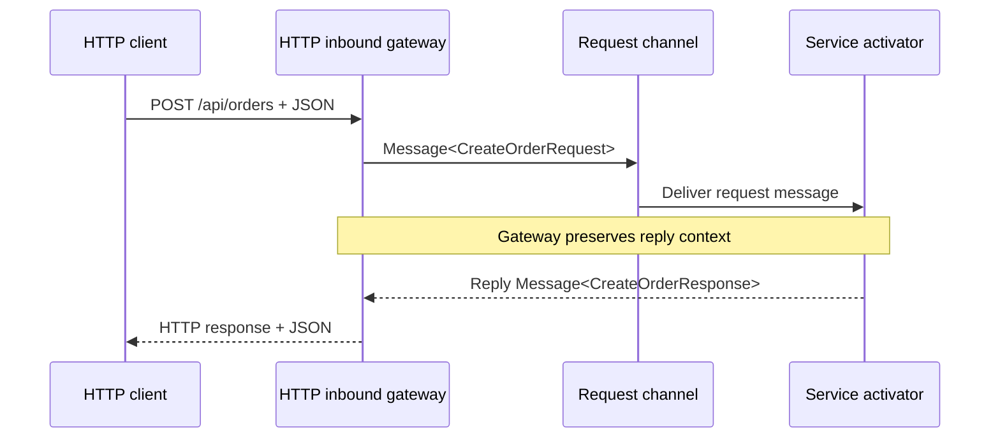
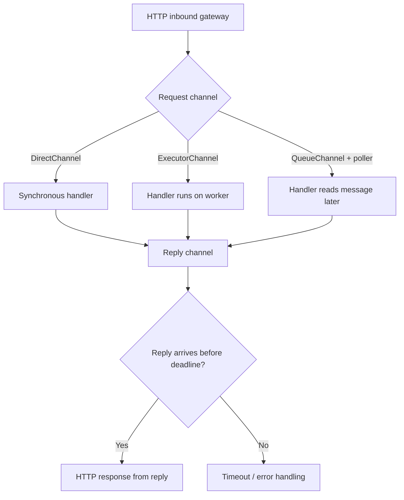

# HTTP Inbound Gateway for Request-Reply

## 1. Purpose and Role in the HTTP Adapter Module

In the **SPRING_INTEGRATION_ADAPTERS** module, Spring Integration connects internal processing flows with external systems through inbound/outbound adapters, gateways, pollers, and `MessageChannel`s. Those connections can use files, SFTP, HTTP, JMS, AMQP, Kafka, or databases. For HTTP specifically, many APIs need to **receive a request, execute a business flow, and return a response built from the processing result**.

An **HTTP inbound gateway** solves this *request–reply* scenario:

1. Receives an HTTP request at an application endpoint.
2. Converts the request into a Spring Integration `Message<?>` and sends it to a request channel.
3. Waits for a **reply message** from the internal processing flow.
4. Converts the reply's payload/headers into an HTTP response for the client.

For example: the application receives `POST /api/orders`, validates the order, and returns JSON containing a receipt ID, status, or business data. If you only need to receive one-way notifications without returning business content, an **HTTP inbound channel adapter** is a better fit; if the application proactively calls an external HTTP API, that is an **HTTP outbound endpoint**.

After this lesson, you will be able to configure an inbound gateway with Java DSL, understand the request channel and reply channel, handle JSON request–reply via a service activator, configure timeouts, handle errors, and test the HTTP contract.

## 2. Request–Reply Flow Across Message Channels



Internally, the gateway typically carries reply routing information in message headers, particularly `replyChannel` (and potentially `errorChannel` depending on configuration). A service activator or downstream component produces the result to send back to that reply channel. For straightforward flows, Spring Integration manages routing the reply back to the gateway; you do not need to write an HTTP controller or invoke an HTTP response writer manually.

The path can be represented as:

```text
HTTP request
  -> HttpRequestHandlingMessagingGateway
  -> requestChannel: orderRequests
  -> ServiceActivator / business handler
  -> replyChannel (usually temporarily provisioned by the gateway)
  -> HttpRequestHandlingMessagingGateway
  -> HTTP response
```

| Component | Responsibility |
|---|---|
| HTTP request mapping | Selects which paths, methods, and media types the endpoint accepts. |
| Request payload converter | Reads the HTTP body into an appropriate Java type before creating the message. |
| Request channel | Delivers the request message to a handler, transformer, router, or another flow. |
| Service activator | Executes business logic and returns a payload or `Message<?>`. |
| Reply channel | Receives the result from downstream so the gateway can use it as the response. |
| HTTP reply converter / header mapper | Converts reply payload, status, and configured HTTP headers into the client response. |

**Distinguish two kinds of headers:** internal message headers like `replyChannel` exist for Spring Integration orchestration; they must not be treated as HTTP headers to send outward. When HTTP status and response headers are needed, configure the appropriate reply mapping mechanism instead of forwarding all message headers into HTTP.

## 3. Complete Example: POST JSON and Return JSON

This example uses **Spring Boot, Spring MVC, Spring Integration HTTP, and Java 17+**. The API receives a product SKU and quantity, then returns an illustrative receipt ID. The focus is the request–reply contract; the sample code does not write to a database or enforce full business rules yet.

### 3.1. Dependencies

For a Maven project already using Spring Boot dependency management:

```xml
<dependencies>
    <dependency>
        <groupId>org.springframework.boot</groupId>
        <artifactId>spring-boot-starter-web</artifactId>
    </dependency>
    <dependency>
        <groupId>org.springframework.boot</groupId>
        <artifactId>spring-boot-starter-integration</artifactId>
    </dependency>
    <dependency>
        <groupId>org.springframework.integration</groupId>
        <artifactId>spring-integration-http</artifactId>
    </dependency>
</dependencies>
```

`spring-boot-starter-web` provides Spring MVC and Jackson commonly used for JSON conversion; `spring-integration-http` provides the HTTP inbound/outbound endpoints and corresponding Java DSL. Spring Boot manages compatible versions when the BOM/starters are used properly.

### 3.2. DTOs as the Exchange Contract

Create a file `OrderDtos.java`:

```java
package example.http;

public final class OrderDtos {
    private OrderDtos() {}

    public record CreateOrderRequest(String sku, int quantity) {}

    public record CreateOrderResponse(String requestId, String status) {}
}
```

With an appropriate JSON converter, the body `{"sku":"BOOK-1","quantity":2}` is mapped to `CreateOrderRequest`. The `sku` and `quantity` fields still require validation: successful JSON parsing **does not mean the data is business-valid**.

### 3.3. Configuring the HTTP Inbound Gateway with Java DSL

Create `OrderHttpConfiguration.java`:

```java
package example.http;

import org.springframework.context.annotation.Bean;
import org.springframework.context.annotation.Configuration;
import org.springframework.http.HttpMethod;
import org.springframework.http.MediaType;
import org.springframework.integration.annotation.EnableIntegration;
import org.springframework.integration.channel.DirectChannel;
import org.springframework.integration.dsl.IntegrationFlow;
import org.springframework.integration.http.dsl.Http;
import org.springframework.messaging.MessageChannel;

@Configuration
@EnableIntegration
public class OrderHttpConfiguration {

    @Bean
    public MessageChannel orderRequests() {
        return new DirectChannel();
    }

    @Bean
    public IntegrationFlow orderHttpInboundFlow() {
        return IntegrationFlow
            .from(Http.inboundGateway("/api/orders")
                .requestMapping(mapping -> mapping
                    .methods(HttpMethod.POST)
                    .consumes(MediaType.APPLICATION_JSON_VALUE)
                    .produces(MediaType.APPLICATION_JSON_VALUE))
                .requestPayloadType(
                    OrderDtos.CreateOrderRequest.class)
                .replyTimeout(5_000))
            .channel("orderRequests")
            .get();
    }
}
```

Configuration explanation:

- `Http.inboundGateway("/api/orders")` registers an HTTP inbound endpoint using the request–reply model.
- `requestMapping(...methods(POST))` allows only `POST` for this mapping; `consumes` and `produces` define supported input/output media types.
- `requestPayloadType(CreateOrderRequest.class)` tells the HTTP converter to convert the body into the DTO before the message enters the flow.
- `replyTimeout(5_000)` sets a 5-second wait time for the reply message in the gateway's reply-waiting mechanism. This is **not a mechanism to actively interrupt a synchronously running handler**.
- `.channel("orderRequests")` forwards the request message to the declared channel.
- `DirectChannel` keeps the example simple: the request message is processed on the current calling thread, and the handler can return the result directly.

The timeout value is illustrative; in practice, choose it based on the API's promised response time, distinguishing the time to send the request to the channel from the time spent waiting for a reply. This setting does not replace servlet/server timeouts, reverse proxy timeouts, or client-side deadlines.

### 3.4. Service Activator Returning Business Results

Create `OrderHandler.java` in the package hierarchy scanned by Spring Boot:

```java
package example.http;

import java.util.UUID;
import org.springframework.integration.annotation.ServiceActivator;
import org.springframework.stereotype.Service;

@Service
public class OrderHandler {

    @ServiceActivator(inputChannel = "orderRequests")
    public OrderDtos.CreateOrderResponse create(
            OrderDtos.CreateOrderRequest request) {

        if (request.sku() == null || request.sku().isBlank()
                || request.quantity() <= 0) {
            throw new IllegalArgumentException(
                "sku must be present and quantity must be positive");
        }

        // Request-reply illustration only: order is not persisted to a database yet.
        return new OrderDtos.CreateOrderResponse(
            "DEMO-" + UUID.randomUUID(), "VALIDATED");
    }
}
```

When `OrderHandler.create` returns `CreateOrderResponse`, Spring Integration creates a reply message and sends the result back to the gateway. The gateway then serializes the payload into an HTTP JSON response using the appropriate converter.

In this example, the `VALIDATED` result means minimal checks passed; **you should not report status `CREATED` or HTTP 201 when no resource was actually persisted**. To build a real order-creation API, replace the illustrative code with a database persistence service featuring transactions, validation, and idempotency handling.

### 3.5. Calling the API with curl

With the application running at `localhost:8080` and no extra servlet context path:

```bash
curl -i -X POST 'http://localhost:8080/api/orders' \
  -H 'Content-Type: application/json' \
  -H 'Accept: application/json' \
  -d '{"sku":"BOOK-1","quantity":2}'
```

A typical successful response:

```http
HTTP/1.1 200 OK
Content-Type: application/json

{"requestId":"DEMO-...","status":"VALIDATED"}
```

The `requestId` value changes each time because the example uses `UUID.randomUUID()`. The exact HTTP status and response headers depend on the gateway and HTTP converter configuration; this example uses a standard success response.

Try sending `quantity = 0`: the handler throws `IllegalArgumentException`, but **do not assume that exception automatically turns into HTTP 400 with a standard JSON error**. You need to design an explicit error flow or exception mapping (Section 7).

## 4. Reply Message Creation and HTTP Status Handling

A service activator can return one of two common forms:

1. **Return a payload** (DTO, `String`, or a serializable object). The framework creates an appropriate reply message and sends it to the reply channel the gateway is waiting on.
2. **Return a `Message<?>`** to explicitly set additional message headers, such as an HTTP status code or a correlation header allowed to be exposed in the response.

For example, **after actually creating and persisting the resource**, the handler can construct a reply with status 201:

```java
import org.springframework.http.HttpStatus;
import org.springframework.messaging.Message;
import org.springframework.messaging.support.MessageBuilder;

// Place inside the handler after a successful data persistence step:
Message<OrderDtos.CreateOrderResponse> reply =
    MessageBuilder
        .withPayload(new OrderDtos.CreateOrderResponse(
            savedOrderId, "CREATED"))
        .setHeader("http_statusCode", HttpStatus.CREATED)
        .build();

return reply;
```

This is an illustrative snippet requiring you to change **the handler's return type to `Message<CreateOrderResponse>`** when applying it to real code; `savedOrderId` must come from the actual persistence result. With an HTTP inbound gateway, the reply header `http_statusCode` is used to determine the response status. When exposing a business header in HTTP, configure reply header mapping per the contract and verify with HTTP tests.

Common pitfalls:

- Handler has a `void` signature or returns `null`: there is no reply payload for the gateway to build a business response; the gateway may wait until timeout or behave according to no-reply settings.
- Using a transformer/router where downstream fails to return a message: the request hangs waiting for a reply or times out.
- Dropping the `replyChannel` metadata on a branch that manually constructs a message: the reply cannot return to the gateway. Let the endpoint/framework route the reply or preserve the required headers.
- Returning `Message<?>` directly as the response body instead of the payload: the client receives an unexpected structure; inspect extraction and conversion.

**The gateway does not save orders or generate JSON errors on its own**; all result semantics come from business logic, reply headers, and converter configuration.

## 5. Request Timeout, Reply Timeout, and Asynchronous Flows

An HTTP inbound gateway has two wait durations to distinguish:

| Parameter | Scope | Most Affected Scenarios |
|---|---|---|
| `requestTimeout` | Wait time when sending a request message to a potentially blocking request channel. | Bounded `QueueChannel` that is full or another blocking send channel. |
| `replyTimeout` | Wait time for a reply message from the reply channel. | Asynchronous handler, poller hasn't read the message yet, or downstream never emits a reply. |
| Servlet/proxy/client timeout | HTTP connection limit and how long the client is willing to wait. | Client disconnects or reverse proxy closes the request before the flow completes. |

With `DirectChannel`, the handler usually runs synchronously right inside the send call. If the handler calls a DB or HTTP service for too long, `replyTimeout` **does not guarantee interrupting** synchronous execution that has already started. Manage timeouts on each blocking operation as well as at the HTTP layer.

With an `ExecutorChannel` or a `QueueChannel` with a polled consumer, processing can continue on another thread, but **the HTTP inbound gateway still must wait for a reply to return a business response**. If the reply arrives too late, the client may already have received a timeout error or closed the connection; a late result cannot become the response to an already-finished request.



When business processing takes minutes, returning the result immediately over the same request–reply gateway is usually a poor fit. Consider an API that durably accepts a job and returns `202 Accepted` with a job ID, after which the client polls a status endpoint or receives a callback. In that case, precisely define when `ACCEPTED` can be confirmed to avoid losing work after returning HTTP success.

## 6. Comparing Spring Integration HTTP Endpoints

| Endpoint | Message Direction | Reply Message for Business Logic? | Example |
|---|---|---|---|
| **HTTP inbound channel adapter** | HTTP request → Spring Integration | No | One-way notification webhook. |
| **HTTP inbound gateway** | HTTP request → Spring Integration → HTTP response | **Yes** | POST API creating a resource or GET querying data. |
| **HTTP outbound channel adapter** | Spring Integration → HTTP request | Does not put response body into a reply flow | Sending a webhook to a partner. |
| **HTTP outbound gateway** | Spring Integration → HTTP request → reply message | **Yes** | Calling an exchange-rate API and using the result in the next step. |

Both the inbound adapter and inbound gateway return an HTTP response at the **protocol level**. The gateway's difference is that it **can take the result from a reply message to build a business response**. Similarly, the outbound adapter still performs the HTTP exchange and handles HTTP client errors, even though it emits no reply message to the flow.

An inbound gateway flow can call an outbound gateway downstream, but you must account for combined timeouts, authentication, intermediate failures, and transaction semantics at both boundaries.

## 7. Error Responses and API Contract

For clients to handle the API reliably, clearly define status codes, content types, and error body structures. Below is an example policy, **not a mapping automatically generated by the Java DSL snippet above**:

| Scenario | Typical HTTP Status | Design Requirement |
|---|---|---|
| Valid request, returning result | 200 OK | Serialize response DTO matching `Accept`. |
| New resource created and persisted | 201 Created | May include `Location` and the real ID. |
| Work durably accepted for later processing | 202 Accepted | Return job ID/status and how to query it. |
| Invalid JSON body, missing field, or validation violation | 400 Bad Request | Convert error into a response with error code and safe details. |
| Missing authentication or unauthorized | 401/403 | Spring Security or API gateway protects the API. |
| Conflicting request / idempotency conflict | 409 Conflict | Describe duplicate or conflict state per contract. |
| Unrecoverable system/DB/broker error | 5xx | Attach correlation ID, hide implementation details, and log the failure. |
| Downstream fails to reply within deadline | 504 Gateway Timeout, if specified by API | Configure corresponding timeout-status/error flow; do not assume the framework always returns 504. |

When JSON fails to parse, the error may be detected before reaching `orderRequests`. When the handler throws an exception, how it turns into an HTTP status/body depends on the exception resolver, error channel, and gateway configuration. Spring Integration provides error-flow mechanisms and HTTP status via the `http_statusCode` header, but a plain `IllegalArgumentException` alone does not automatically guarantee HTTP 400.

A consistent error body might have the structure:

```json
{
  "code": "INVALID_ORDER",
  "message": "quantity must be positive",
  "requestId": "req-12345"
}
```

Never return stack traces, SQL, or token details to the client. Measure errors at the HTTP boundary, at channels, and inside handlers separately to pinpoint where failures happen.

## 8. Message Headers, Security, and Consistency

**Header mapping.** An HTTP request carries headers like `Content-Type`, `Accept`, `Authorization`, and `X-Request-ID`. Only allowed/mapped headers should appear inside integration messages; do not assume every HTTP header passes through every channel and reply. When propagating a correlation ID from inbound to outbound Kafka/JMS/HTTP, use an explicit contract, keep necessary information, and avoid accidentally forwarding cookies/tokens.

**Authentication/authorization.** Use Spring Security or an API gateway for authentication, authorization, CORS (if needed), request size limits, rate limits, and data protection. For signed inbound webhooks, verify signatures, timestamps, and replay protection before trusting the payload.

**Validation.** Validate schema, quantities, lengths, enums, and business constraints. You can add Jakarta Bean Validation with `spring-boot-starter-validation` and an appropriate invocation mechanism, while testing whether mapping/validation errors arise at the HTTP layer or the service handler so the right 4xx status is returned.

**Idempotency.** Retrying after a timeout can create two HTTP requests when the first already wrote data. Use an `Idempotency-Key`, business key, or event ID with a unique constraint. For an order-creation API, key checks must be tied to a transaction/state store under deterministic rules; checking single-instance in-memory state is insufficient in multi-instance deployments.

**Transactions and side effects.** A successful reply should only be emitted after the contract's commit milestone—such as a committed DB transaction or a durably stored job. When a flow also connects to JMS, AMQP, Kafka, or SFTP, do not infer a single distributed transaction spanning all adapters; design outbox patterns, compensating actions, or appropriate retry rules.

**Observability.** Attach correlation/request IDs to logs and metrics; track latency from the HTTP boundary, time in channels, service processing time, timeout rates, and reply status categories. Do not log full PII, sensitive bodies, or `Authorization` tokens.

## 9. Testing and Troubleshooting

A minimal test suite for the gateway should cover:

1. **Happy path:** valid JSON `POST` to `/api/orders` returns `200` and a body with the expected `requestId` and `status`.
2. **Mapping:** `GET` or wrong path is handled by HTTP mapping; unsupported `Content-Type` does not reach the handler.
3. **JSON/converter:** malformed JSON bodies are rejected at the request-reading boundary.
4. **Validation:** blank `sku` or invalid `quantity` maps to a 4xx error per the application's contract.
5. **Handler errors:** simulate DB/broker errors and verify appropriate status/body without leaking internal exceptions.
6. **Reply timeout:** intentionally simulate a slow asynchronous downstream, verifying timeout status and late-reply handling.
7. **Idempotency:** resend the same key and compare the number of side effects produced.
8. **Headers/security:** unauthenticated requests are blocked; correlation IDs are recorded accurately without leaking sensitive headers.
9. **Concurrent load:** test latency, request throughput, pool/queue capacities, and reverse proxy limits.

If an HTTP request does not reach the handler, check: web/HTTP integration dependencies → path/method/`consumes`/`produces` mapping → JSON converter → `orderRequests` channel name → `@ServiceActivator` subscriber. If the handler runs but the client gets no response, check the handler return type, sending the reply to `replyChannel`, reply wait timeout, and reply converter. If the status/body is wrong, check `http_statusCode` header mapping, `Content-Type`, and configured error flows.

An application starting up successfully only indicates that mappings, channels, and beans were registered; it does not prove downstream steps process correctly or replies arrive before the deadline. Client-side HTTP testing is the complete way to verify the request–reply contract.

## 10. Key Takeaways

- An **HTTP inbound gateway** converts an HTTP request into a `Message<?>`, waits for a **reply message**, and converts the reply into an HTTP response.
- The **request channel** hands the request into the processing flow; the **reply channel** brings the result back. The handler must return an appropriate payload or message to complete the request–reply contract.
- `requestPayloadType` and HTTP converters determine the data type; media type mapping does not replace validation.
- `replyTimeout` matters when downstream is asynchronous, but it does not forcibly stop a handler blocking on the same `DirectChannel` thread.
- HTTP statuses, error bodies, authentication, idempotency, and data commit milestones must be designed explicitly.
- Choose an **inbound adapter** for one-way ingestion; choose an **inbound gateway** when the response depends on the business result of the Spring Integration flow.

Official documentation references:

- [Spring Integration — Configuring HTTP Endpoints with Java](https://docs.spring.io/spring-integration/reference/http/java-config.html)
- [Spring Integration — Timeout Handling for HTTP](https://docs.spring.io/spring-integration/reference/http/timeout.html)
- [Spring Integration — HTTP Namespace Support](https://docs.spring.io/spring-integration/reference/http/namespace.html)
