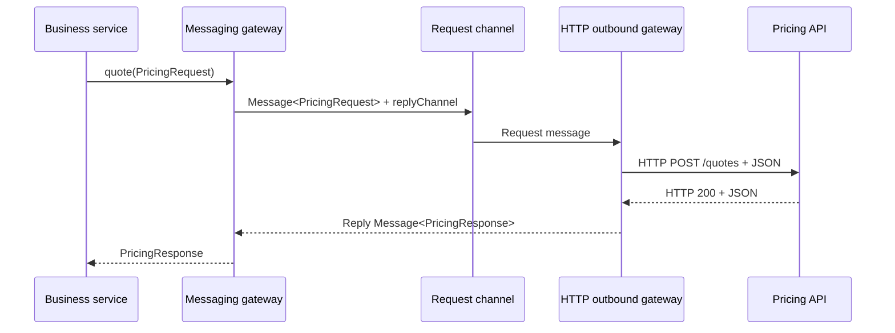
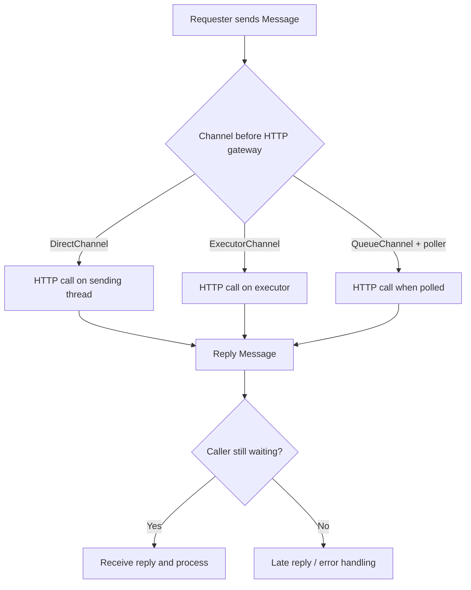

# HTTP Outbound Gateway for Calling Services and Receiving Replies

## 1. Where Does the HTTP Outbound Gateway Sit in an Integration Flow?

In the **SPRING_INTEGRATION_ADAPTERS** module, Spring Integration uses `MessageChannel`s, adapters, gateways, and pollers to exchange messages with external systems. Depending on the protocol and business requirements, a flow can interact with files, SFTP, HTTP, JMS, AMQP, Kafka, or databases. When integrating over HTTP, some steps need to **send a request to an external service, receive response data, and continue processing that data within the flow**.

An **HTTP outbound gateway** implements this *request–reply* model:

1. Receives a Spring Integration `Message<?>` from a request channel.
2. Converts the payload and relevant headers into an HTTP request.
3. Calls the external service URL using the configured HTTP method.
4. Reads the HTTP response and converts the response data into a **reply message**.
5. Sends the reply message back to the flow's reply channel for use by the caller, transformer, router, or next handler.

For example, an order service needs to call a pricing API to fetch `totalAmount` and `currency` before confirming an order. The HTTP result must become a message for further processing; thus, a gateway is more suitable than a one-way HTTP outbound channel adapter.

After this lesson, you will be able to configure an HTTP outbound gateway with Java DSL, receive JSON results as a DTO, understand the reply channel mechanism, handle HTTP errors/timeouts, distinguish polling from request–reply calls, and test the integration contract.

## 2. Path of the Request and Reply



There are **two request–reply layers** to distinguish:

- **HTTP layer:** the outbound gateway's HTTP client sends a request and receives an HTTP response from the target service.
- **Spring Integration layer:** the outbound gateway constructs a reply message from the HTTP response and routes it to the original message's reply channel.

A message may carry the internal header `replyChannel`; this metadata helps Spring Integration route the reply back to the waiting component. `replyChannel` is **not an HTTP header sent to the external service**.

| Component | Responsibility |
|---|---|
| Input/request channel | Receives messages from producers and delivers them to the outbound gateway. |
| URL and HTTP method | Specifies the resource and operation type on the external service. |
| HTTP header mapping | Selects metadata mapped to outgoing request headers and incoming response headers. |
| HTTP message converter | Converts Java payloads to HTTP bodies and response bodies back to the desired Java type. |
| `expectedResponseType` | Declares the expected Java type for the reply payload. |
| Reply channel | Delivers the result message back to the requester or next processing step. |
| HTTP client and error handler | Governs connections, timeouts, status interpretation, and exceptions. |

This pattern can live entirely inside an event-driven application. The word *outbound* describes the call direction **from the application out to an external service**, independent of whether the HTTP method is GET, POST, or PUT.

## 3. When to Use an Outbound Gateway?

| Need | Suitable Endpoint | Reason |
|---|---|---|
| Send a webhook to a partner without using the response body in the flow | HTTP outbound channel adapter | Sends a one-way message without creating a business reply message. |
| Call a Pricing API and retrieve a quote to calculate an order | **HTTP outbound gateway** | The HTTP response becomes a reply payload for further processing. |
| An external client calls the application's own API and expects a result | HTTP inbound gateway | Request goes from HTTP into Spring Integration; reply returns to the client. |
| A client sends a notification to the application requiring no business response content | HTTP inbound channel adapter | One-way notification intake. |

An **HTTP outbound channel adapter** still receives an HTTP response at the protocol level and can throw errors if the HTTP request fails. The difference is that it does not emit the response body as a Spring Integration reply message. An **HTTP outbound gateway** is the right fit when the response is business input for the next step.

An outbound gateway can also be placed behind an HTTP inbound gateway:

```text
External client
   -> HTTP inbound gateway
   -> Request channel
   -> HTTP outbound gateway -> Remote HTTP API
   <- Reply message from remote API
   <- Inbound gateway reply
   <- HTTP response to external client
```

This style of wiring requires managing total latency and timeout budgets at both boundaries; a remote service timeout should not cause the external HTTP client to wait indefinitely.

## 4. Complete Example: Calling a Pricing API and Receiving a DTO

This example uses **Spring Boot, Spring Integration HTTP, Jackson, and Java 17 or newer**. An internal service requests a quote via HTTP POST to `http://localhost:8081/api/quotes`, then receives `PricingResponse` as the return value of a Java interface.

This is a mock URL for learning purposes. In production, externalize the URL configuration and use HTTPS.

### 4.1. Maven Dependencies

If the project uses Spring Boot dependency management:

```xml
<dependencies>
    <dependency>
        <groupId>org.springframework.boot</groupId>
        <artifactId>spring-boot-starter-integration</artifactId>
    </dependency>
    <dependency>
        <groupId>org.springframework.integration</groupId>
        <artifactId>spring-integration-http</artifactId>
    </dependency>
    <dependency>
        <groupId>org.springframework.boot</groupId>
        <artifactId>spring-boot-starter-web</artifactId>
    </dependency>
</dependencies>
```

`spring-integration-http` provides the HTTP outbound endpoints. `spring-boot-starter-web` provides the HTTP components and JSON libraries commonly used in examples. An application that only calls outbound APIs is not required to expose internal HTTP controllers.

### 4.2. Defining the Request and Response Contract

Create two Java files in the same package `example.pricing`:

```java
// PricingRequest.java
package example.pricing;

public record PricingRequest(String productCode, int quantity) {}
```

```java
// PricingResponse.java
package example.pricing;

public record PricingResponse(
    String quoteId,
    String currency,
    long totalAmount) {}
```

A compliant API might accept:

```http
POST /api/quotes HTTP/1.1
Content-Type: application/json

{"productCode":"BOOK-1","quantity":2}
```

and return:

```http
HTTP/1.1 200 OK
Content-Type: application/json

{"quoteId":"Q-1001","currency":"VND","totalAmount":240000}
```

The values here are illustrative; in reality, the contract must specify currency, monetary units, numeric types, error codes, rounding, validity, and API version. For monetary amounts with fractional parts, use `BigDecimal` and explicitly define units rather than defaulting to floating-point numbers.

### 4.3. Creating a Java Interface to Invoke the Request–Reply Flow

Spring Integration supports **messaging gateways** so services can invoke a flow via a Java method and receive the result. Create `PricingClient.java`:

```java
package example.pricing;

import org.springframework.integration.annotation.MessagingGateway;

@MessagingGateway(defaultRequestChannel = "pricingRequests")
public interface PricingClient {
    PricingResponse requestQuote(PricingRequest request);
}
```

When code calls `requestQuote(request)`, the framework sends a request message to the `pricingRequests` channel and waits for a reply to return `PricingResponse`. This interface is an **in-application gateway**, while the HTTP outbound gateway is the handler at the end of the flow calling the external API. Together, they present callers with an ordinary Java method.

### 4.4. Configuring IntegrationFlow and the HTTP Outbound Gateway

Create `PricingIntegrationConfiguration.java`:

```java
package example.pricing;

import org.springframework.beans.factory.annotation.Value;
import org.springframework.context.annotation.Bean;
import org.springframework.context.annotation.Configuration;
import org.springframework.http.HttpMethod;
import org.springframework.http.MediaType;
import org.springframework.integration.annotation.EnableIntegration;
import org.springframework.integration.annotation.IntegrationComponentScan;
import org.springframework.integration.dsl.IntegrationFlow;
import org.springframework.integration.http.dsl.Http;
import org.springframework.messaging.MessageHeaders;

@Configuration
@EnableIntegration
@IntegrationComponentScan
public class PricingIntegrationConfiguration {

    @Bean
    public IntegrationFlow pricingHttpFlow(
            @Value("${pricing.remote.url}") String remoteUrl) {

        return IntegrationFlow.from("pricingRequests")
            .enrichHeaders(headers -> headers.header(
                MessageHeaders.CONTENT_TYPE,
                MediaType.APPLICATION_JSON_VALUE))
            .handle(Http.outboundGateway(remoteUrl)
                .httpMethod(HttpMethod.POST)
                .expectedResponseType(PricingResponse.class))
            .get();
    }
}
```

In `application.yml`:

```yaml
pricing:
  remote:
    url: "http://localhost:8081/api/quotes"
```

How this configuration works:

1. `@IntegrationComponentScan` scans for and registers proxies for `@MessagingGateway` interfaces in scanned packages.
2. `IntegrationFlow.from("pricingRequests")` creates a flow entry point from the channel of that name; Spring Integration can auto-create an appropriate channel if no bean with that name exists yet.
3. `enrichHeaders(...)` attaches `contentType=application/json` to the message so the converter selects JSON HTTP body serialization.
4. `Http.outboundGateway(remoteUrl)` configures the handler that executes the HTTP request and creates the reply message.
5. `httpMethod(POST)` selects POST for the quote contract.
6. `expectedResponseType(PricingResponse.class)` instructs reading the response payload into the DTO when a matching converter is present.
7. `.get()` completes the flow definition; the reply from the HTTP outbound gateway is routed back to the reply channel attached to the message originating from `PricingClient`.

In this simple setup, the default channel is subscribable and calls typically run synchronously on the caller's thread. If no compatible JSON converter is available, the converter fails to read the response, or the response schema differs from the DTO, the call fails; `expectedResponseType` is not a full contract-validation mechanism.

### 4.5. Using the Result in a Business Service

Create `CheckoutService.java`:

```java
package example.pricing;

import org.springframework.stereotype.Service;

@Service
public class CheckoutService {

    private final PricingClient pricingClient;

    public CheckoutService(PricingClient pricingClient) {
        this.pricingClient = pricingClient;
    }

    public PricingResponse calculateQuote(
            String productCode, int quantity) {

        if (productCode == null || productCode.isBlank()
                || quantity <= 0) {
            throw new IllegalArgumentException(
                "productCode and quantity are invalid");
        }

        PricingResponse response = pricingClient.requestQuote(
            new PricingRequest(productCode, quantity));

        if (response == null || response.totalAmount() < 0) {
            throw new IllegalStateException(
                "Remote Pricing API returned an invalid quote");
        }

        return response;
    }
}
```

An illustrative invocation:

```java
PricingResponse quote =
    checkoutService.calculateQuote("BOOK-1", 2);

System.out.println(quote.quoteId());
System.out.println(quote.totalAmount());
```

If the mock API returns the body shown earlier, the values will be `Q-1001` and `240000`. Verifying that returned data is business-valid (signatures, currency, fee calculation, quote expiration) must be designed separately.

**Core point:** the Java method receives `PricingResponse` only because the HTTP outbound gateway **returns a reply message** to the messaging gateway. If you replace the handler with `Http.outboundChannelAdapter(...)`, the flow produces no reply payload as required by the method's contract.

## 5. Reply Channel and Downstream Processing in IntegrationFlow

Using a Java interface like `PricingClient` is not mandatory. Inside a pure message flow, an HTTP outbound gateway can also chain subsequent processing steps after it:

```java
@Bean
public IntegrationFlow enrichOrderWithQuoteFlow() {
    return IntegrationFlow.from("quoteEnrichmentRequests")
        .handle(Http.outboundGateway(
                "http://localhost:8081/api/quotes")
            .httpMethod(HttpMethod.POST)
            .expectedResponseType(PricingResponse.class))
        .handle(PricingResponse.class, (quote, headers) -> {
            // Example: process the result, route, or return the reply further.
            return quote;
        })
        .get();
}
```

The snippet above is **another illustrative flow**, which must be placed inside a `@Configuration` class with appropriate imports and assumes incoming request messages already have a content type and body matching the API. The handler after the HTTP gateway receives `PricingResponse`; the simple example returns the quote to preserve the reply to the requester. In a real application, the next step might check `currency`, compare limits, or combine the quote with order data, while explicitly designing metadata/correlation when transforming payloads.

If a flow needs to keep both the order and the quote, do not simply overwrite the order payload with `PricingResponse` and expect the original data to still be there. Use an enricher, claim-check, or correlation header suited to the message contract. These choices matter even more when crossing JMS/Kafka or asynchronous channels.

### 5.1. What Can a Reply Contain?

| Component | Source of Information | Things to Remember |
|---|---|---|
| Reply payload | HTTP response body read by the converter. | Type depends on `expectedResponseType` and the actual response. |
| Reply headers | Information from the HTTP response per header mapper/config. | Not all response headers are included by default. |
| HTTP status | Exchange result from the HTTP client/endpoint. | Error statuses usually follow exception/error flows per client configuration. |
| Correlation / reply channel | Spring Integration message metadata. | Must be preserved when constructing messages/flows depending on reply routing. |

If the API returns `204 No Content`, there may be no body to convert into `PricingResponse`. Explicitly define the meaning of an empty response and test the HTTP handler's behavior rather than assuming every successful response yields a DTO.

## 6. HTTP Request Mapping: URL, Method, Headers, and Converters

An HTTP outbound gateway interacts with an external endpoint; it does not use `requestMapping` like an HTTP inbound gateway. The target request is defined by the URL template and URL variables (if any), HTTP method, query params, headers, and body.

| Item | Design Decision |
|---|---|
| Static/dynamic URL | Load base URL from configuration per service; if path variables are needed, pass controlled values via URI templates. |
| HTTP method | GET for reads; POST/PUT/PATCH per contract and side effects; do not infer idempotency from method name alone. |
| `Content-Type` | Describes the outgoing body format, e.g. `application/json`. |
| `Accept` | Specifies the desired response format if the service supports content negotiation. |
| Authentication | Bearer token, OAuth2, mTLS, or signatures per contract; never hardcode secrets. |
| Response type | `String.class`, DTO, collection type, or another structure if supported by the converter. |
| Header mapper | Export only permitted message headers as HTTP headers; avoid leaking internal headers or sensitive data unintentionally. |

For URLs parameterized by payload data, use the HTTP endpoint's URI template/builder or an appropriate client rather than raw URL string concatenation. Values like `productCode` must be encoded and validated against the contract. Do not let callers control the entire target URL when SSRF is a risk; apply an allowlist of permitted hosts.

### 6.1. Handling Differing Response Structures

- **JSON object → DTO:** choose `expectedResponseType(MyDto.class)` if the DTO matches the converter.
- **Raw JSON:** choose `String.class` when you need to parse/validate explicitly afterward.
- **JSON array/list:** specify element type information accurately to avoid losing generic type info or ending up with an unexpected list of maps.
- **Binary/file:** consider converters, memory, and streaming; avoid buffering large files in RAM under heavy load.
- **204/empty body:** define the output contract, no-reply behavior, and business errors explicitly; do not blindly coerce into a DTO.

Also inspect the server's response `Content-Type`. A syntactically valid JSON response body can still violate the semantic contract (missing fields, nulls, unsupported currency).

## 7. Timeouts: Request–Reply Does Not Mean Fast Processing

There are distinct wait intervals to consider:

| Wait Interval | Where Does It Live? | Meaning |
|---|---|---|
| Connect timeout | HTTP client connecting to the external service. | Bounds the time to establish a connection. |
| Read/response timeout | HTTP client waiting for data from the server. | Bounds waiting for the external service's response. |
| Messaging gateway reply timeout | Spring Integration caller waiting for the reply message. | Matters when requests traverse async channels and replies can arrive late. |
| Inbound HTTP/proxy deadline (if any) | External client-facing boundary. | Caps the total time the external client can wait. |

With the default `DirectChannel`, the HTTP outbound handler typically executes the HTTP call on the **message-sending thread**. A `replyTimeout` at the messaging gateway layer does not automatically interrupt an HTTP client blocked inside a synchronous handler. Configure timeouts directly on the HTTP client (`RestTemplate`/client request factory depending on version), and verify the end-to-end deadline.

**Time budget example:** suppose your application's API must return a response within 3 seconds, while the remote HTTP call has a 10-second read timeout. A gateway reply timeout alone is not enough to guarantee the external endpoint meets its 3-second deadline. Remote wait limits, retries, sequential call counts, and internal processing time must fit within the endpoint's SLO.

If you place the outbound HTTP gateway behind an `ExecutorChannel` or a `QueueChannel` with a poller, the HTTP call can execute on a different worker thread. The caller still has to wait for the reply if it needs the result; when the reply arrives past the deadline, the caller may no longer be waiting. Monitor late replies and any side effects that may already have occurred on the remote service.



**A poller is not required for an outbound gateway to call HTTP from a `DirectChannel`.** It is only needed for `PollableChannel` sources or scheduled data-pulling mechanisms. The outbound gateway is triggered whenever a message needs to be sent.

## 8. HTTP Statuses, Errors, and Retries

Do not equate every HTTP response with a successful business reply message. The HTTP client has a response error handler, and the HTTP outbound gateway needs an error policy matching the service contract.

| Outcome | Interpretation and Handling |
|---|---|
| HTTP 200 with valid JSON | Convert response to DTO; still validate data completeness and validity. |
| HTTP 201/202 | Check the contract: did the remote create the resource or only accept a job? Body may differ. |
| HTTP 204 | No body; decide how "no result" is represented under the contract. |
| HTTP 400/422 | Usually an input/schema error; inspect payload and avoid infinite retries. |
| HTTP 401/403 | Authentication/authorization failure; check token, scopes, clock skew, or mTLS. |
| HTTP 404 | Resource may not exist, wrong version, or wrong endpoint; handle per contract. |
| HTTP 409 | Version or idempotency conflict; define business semantics. |
| HTTP 429 | Respect rate limits and `Retry-After` if present. |
| HTTP 5xx | Transient or prolonged remote failure; consider bounded retries, backoff, and a circuit breaker. |
| Timeout / connection drop | Indeterminate outcome; the remote may have already applied side effects before the response was lost. |

With `RestTemplate` and its default error handler, 4xx/5xx responses usually cause the HTTP client to throw an exception. That exception may be wrapped by Spring Integration into a messaging exception; do not depend on a single exception class without verifying your client version and configuration.

When an error occurs, distinguish:

1. **Pre-send error:** converter cannot serialize payload, invalid URL, missing required header.
2. **In-flight exchange error:** DNS/TLS, connect timeout, read timeout, remote 4xx/5xx.
3. **Post-response error:** converter cannot deserialize JSON or a downstream handler rejects the data.

Retries should depend on error classification, max attempts, backoff, and jitter. If a `POST` or side-effecting operation succeeded on the partner side but the response was lost, retrying can execute it twice. Pair an **idempotency key** with remote status-query capability; do not infer from a client-side call failure that the remote never processed the request.

In a synchronous flow, exceptions typically propagate back to the caller. With an executor/poller, worker errors require an `errorChannel`, retry advice, dead-letter handling, or persisted send-state depending on design. Configuring a global `errorChannel` does not automatically produce a contract-compliant HTTP error body if the caller is an HTTP inbound endpoint.

## 9. Security, Headers, and Transactions

An HTTP outbound gateway crosses from internal processing out to the network; trust boundaries must be controlled explicitly.

- **HTTPS and authentication:** manage TLS trust, OAuth2/Bearer tokens, mTLS, or API signatures as appropriate. Read secrets from a secret manager or secure environment; never put tokens in source code, logs, or URL query strings.
- **Header mapping:** whitelist only the HTTP headers actually required such as `Authorization`, `Content-Type`, `Accept`, and correlation IDs; avoid forwarding `replyChannel`, internal security context, or unintended cookies.
- **Validation:** validate data before calling and validate the reply upon receipt. A remote API is not an unconditionally trusted data source.
- **SSRF and egress:** enforce an allowlist of permitted hosts/destinations, block sensitive internal IPs, and restrict redirects if URLs contain dynamic components.
- **Resources:** configure connection pools, timeouts, concurrency limits, body size limits, and backpressure to avoid overload when a partner is slow.
- **Observability:** measure latency, request counts, 2xx/4xx/5xx rates, timeouts, retries, and message-to-reply duration using correlation IDs and trace context free of PII.
- **Lifecycle:** an outbound gateway is an endpoint in the Spring application context; HTTP requests are created only when the handler receives a message. Successful application startup does not guarantee the remote service is available.

If a flow both writes to a DB and calls HTTP, **there is no automatic distributed transaction** merely from composing Spring Integration endpoints. A DB rollback does not undo an HTTP request already processed by a partner. When event delivery guarantees are needed, consider a transactional outbox and receiver-side retry/idempotency. When synchronous replies are needed for calculation, define fallback behavior and business states for when the remote is unavailable.

## 10. Testing with an HTTP Mock Server

You can test an HTTP outbound gateway using WireMock, MockWebServer, or a stub HTTP server. Start a stub at `http://localhost:8081/api/quotes`:

- Upon receiving `POST` with JSON `{"productCode":"BOOK-1","quantity":2}`, return `200`, `Content-Type: application/json`, and body `{"quoteId":"Q-1001","currency":"VND","totalAmount":240000}`.
- Call `pricingClient.requestQuote(new PricingRequest("BOOK-1", 2))`.
- Verify Spring Integration emits **one** request with the expected method/path/body, and the caller receives `PricingResponse` with the expected fields.

Also cover:

| Scenario | What to Verify |
|---|---|
| 200 with valid JSON DTO | Reply payload has type `PricingResponse` and accurate values. |
| 200 with missing fields or wrong types | Validation/conversion detects and handles it properly. |
| 204 No Content | Missing body is not misinterpreted as a valid DTO. |
| 400/401/404 | Errors are classified properly; not all errors are retried. |
| 429 with `Retry-After` | Retries are bounded and follow the partner's policy. |
| 500 or connection close | Error flow or retries trigger as configured. |
| Delayed response | Finite HTTP client timeout triggers; caller is not blocked forever. |
| Resending a side-effecting request | Verify idempotency to prevent duplicate side effects. |
| Security/correlation headers | Headers map accurately and secrets do not appear in logs. |
| Flow via executor/poller | Reply reaches the right requester; late replies and worker errors are handled. |

If the flow does not send an HTTP request, trace: producer/`PricingClient` → `pricingRequests` channel name → outbound gateway → URL and method → request serializer → DNS/TLS/connection. If the remote receives the request but the caller receives no DTO, check status/body/content type, `expectedResponseType`, converters, reply channel, and timeouts. If results are accurate but too slow, measure remote HTTP duration separately from channel queue/wait time.

## 11. Key Takeaways

**An HTTP outbound gateway calls an external service and turns the HTTP response into a Spring Integration reply message.** That lets a Java messaging gateway receive the result as a return value, or lets a subsequent handler/transformer/router continue processing the response data directly within the flow.

The most important implementation details are clearly defining the JSON/HTTP header contract, response type, reply routing, real HTTP client timeouts, error classification, and retry/idempotency policies. An outbound gateway does not by itself provide transactional reliability across HTTP, JMS, Kafka, or databases; those guarantees must be engineered per system and business commit milestone.

References:

- [Spring Integration — HTTP Support](https://docs.spring.io/spring-integration/reference/http.html)
- [Spring Integration — Java DSL](https://docs.spring.io/spring-integration/reference/dsl.html)
- [Spring Integration — Messaging Gateways](https://docs.spring.io/spring-integration/reference/gateway.html)
