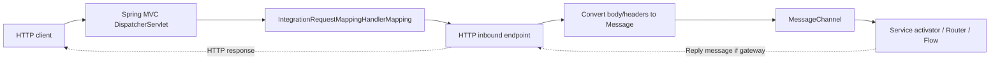

# HttpRequestHandlingEndpoint and Method Mapping

## 1. Why Does an HTTP Endpoint Need Method Mapping?

In the **SPRING_INTEGRATION_ADAPTERS** module, Spring Integration uses inbound/outbound adapters, gateways, pollers, and `MessageChannel`s to connect message flows with external systems such as files, SFTP, HTTP, JMS, AMQP, Kafka, and databases. On the HTTP inbound side, a client request must be **matched to the right endpoint** before it can become a `Message<?>` and enter the integration flow.

For example, the same path `/api/messages` can serve two operations:

- `GET /api/messages`: query data and return results.
- `POST /api/messages`: ingest a new message and produce a result.

If you only check the URL and ignore the HTTP method, the application may invoke the wrong operation. Spring Integration allows mapping requests by **path + HTTP method + additional conditions**, similar to Spring MVC's `@RequestMapping` mechanism.

The name **HttpRequestHandlingEndpoint** in the title is used generically to mean *an endpoint that handles HTTP requests*. In the Spring Integration API, the abstract base class is specifically named **`HttpRequestHandlingEndpointSupport`**, with implementations such as **`HttpRequestHandlingMessagingGateway`** and **`HttpRequestHandlingController`**. Java DSL configurations `Http.inboundGateway(...)` or `Http.inboundChannelAdapter(...)` let you define endpoints without interacting directly with every underlying base class.

After this lesson, you will:

1. Identify where requests are mapped before entering a `MessageChannel`.
2. Configure `GET`, `POST`, and `consumes`/`produces` conditions using the Java DSL.
3. Understand the `RequestMapping` object and how to declare methods with Java configuration.
4. Distinguish **request filtering at the HTTP boundary** from **message routing inside the flow**.
5. Diagnose 404, 405, 415, 406, body errors, and mapping conflicts.

## 2. Classes Involved in HTTP Inbound Processing



Processing has two distinct phases:

**Phase 1 – HTTP request mapping:** Spring MVC uses `IntegrationRequestMappingHandlerMapping` to select the matching endpoint based on path, method, request parameters, headers, and media types. If conditions are not met, the request is usually handled at the web layer and **does not enter the channel**.

**Phase 2 – message processing:** the endpoint reads the request, uses `HttpMessageConverter` when needed, builds a Spring Integration `Message<?>`, and sends it to the request channel. A gateway can wait for a reply message to construct the HTTP response; an inbound channel adapter only performs one-way ingestion.

| Component | Role |
|---|---|
| `HttpRequestHandlingEndpointSupport` | Base class for HTTP inbound endpoints; holds request mapping configuration and HTTP request handling properties. |
| `HttpRequestHandlingMessagingGateway` | Endpoint that receives HTTP requests to send into the messaging system; supports request–reply or send-only mode depending on configuration. |
| `HttpRequestHandlingController` | Implements Spring MVC's `Controller` interface, supporting controller/view models in appropriate configurations. |
| Spring Integration's `RequestMapping` | Describes paths, HTTP methods, parameters, headers, `consumes`, and `produces` for an HTTP endpoint. |
| `IntegrationRequestMappingHandlerMapping` | Bridges Spring Integration mappings into Spring MVC's handler selection mechanism. |
| `Http.inboundGateway(...)` | Java DSL creating a request–reply inbound endpoint. |
| `Http.inboundChannelAdapter(...)` | Java DSL creating a send-only inbound endpoint that does not use a business reply message. |

Note: `org.springframework.integration.http.inbound.RequestMapping` is **different from** the annotation `org.springframework.web.bind.annotation.RequestMapping`. Both express HTTP mapping conditions, but they are separate APIs. Spring Integration's configuration object is translated into mapping metadata understood by Spring MVC.

## 3. Method and Request Mapping Conditions

When declaring a request mapping, you can combine:

| Condition | Example | Purpose |
|---|---|---|
| Path | `/api/messages` or `/api/messages/{id}` | Selects the HTTP resource. |
| Method | `GET`, `POST`, `PUT`, `DELETE` | Selects the operations allowed on the endpoint. |
| `consumes` | `application/json` | Requires the request body to be sent with a compatible media type. |
| `produces` | `application/json` | Maps the endpoint only when it can provide a representation the client accepts. |
| `params` | `mode=sync` | Constrains the presence/value of query parameters. |
| `headers` | `X-Client-Type=partner` | Constrains request header values during matching. |

Conceptual example: an endpoint `POST /api/events` with `consumes=application/json` is selected only when the request path, method, and media type all match. If the request is `GET` or sends `Content-Type: text/plain`, it can be rejected before converting the body into a `Message<?>`.

**Two commonly confused conditions:**

- `consumes` checks the media type of the **request body**, tied to `Content-Type`. It does not itself prove the JSON inside matches the schema.
- `produces` describes the representation the endpoint can **return**, matched against the client's `Accept` header. It does not automatically convert a Java payload to JSON if a converter is missing.

According to the API documentation for `HttpRequestHandlingEndpointSupport`, if you use the default `RequestMapping` without restricting HTTP methods, **GET and POST are supported by default**. To keep the API contract explicit, declare `methods(...)` explicitly rather than relying on defaults.

## 4. Java DSL Example: Same Path, Different HTTP Methods

This example uses Java 17+, Spring Boot with Spring MVC, and Spring Integration HTTP. We create two inbound gateways sharing the path `/integration/echo` while mapping different methods:

- `GET`: returns endpoint health/readiness info.
- `POST`: receives a plain text string and returns an acknowledgment result.

### 4.1. Maven Dependencies

When the project uses Spring Boot dependency management:

```xml
<dependencies>
    <dependency>
        <groupId>org.springframework.boot</groupId>
        <artifactId>spring-boot-starter-web</artifactId>
    </dependency>
    <dependency>
        <groupId>org.springframework.boot</groupId>
        <artifactId>spring-boot-starter-integration</artifactId>
    </dependency>
    <dependency>
        <groupId>org.springframework.integration</groupId>
        <artifactId>spring-integration-http</artifactId>
    </dependency>
</dependencies>
```

`spring-integration-http` provides HTTP endpoints. `spring-boot-starter-web` provides Spring MVC and common HTTP message converters. This example picks `text/plain` to focus on method mapping without depending on DTOs/JSON.

### 4.2. Declaring the IntegrationFlows

```java
package example.http;

import org.springframework.context.annotation.Bean;
import org.springframework.context.annotation.Configuration;
import org.springframework.http.HttpMethod;
import org.springframework.http.MediaType;
import org.springframework.integration.annotation.EnableIntegration;
import org.springframework.integration.dsl.IntegrationFlow;
import org.springframework.integration.http.dsl.Http;

@Configuration
@EnableIntegration
public class EchoHttpFlows {

    @Bean
    public IntegrationFlow echoGetFlow() {
        return IntegrationFlow
            .from(Http.inboundGateway("/integration/echo")
                .requestMapping(mapping -> mapping
                    .methods(HttpMethod.GET)
                    .produces(MediaType.TEXT_PLAIN_VALUE)))
            .handle((payload, headers) -> "Echo endpoint is ready")
            .get();
    }

    @Bean
    public IntegrationFlow echoPostFlow() {
        return IntegrationFlow
            .from(Http.inboundGateway("/integration/echo")
                .requestMapping(mapping -> mapping
                    .methods(HttpMethod.POST)
                    .consumes(MediaType.TEXT_PLAIN_VALUE)
                    .produces(MediaType.TEXT_PLAIN_VALUE))
                .requestPayloadType(String.class))
            .handle(String.class, (payload, headers) ->
                "Received: " + payload)
            .get();
    }
}
```

Here, the two HTTP endpoints share the same path but **do not overlap in method**. When Spring MVC receives `GET /integration/echo`, the GET mapping is selected; when it receives `POST /integration/echo` with `Content-Type: text/plain`, the POST mapping is selected.

The GET flow **does not use a request body**: under the endpoint's default behavior, a GET payload is typically derived from the request parameter map; the illustrative handler ignores the payload and returns a fixed message. The POST flow sets `requestPayloadType(String.class)` to convert the HTTP body into a `String`.

`Http.inboundGateway` in both flows expects a reply message. The `handle(...)` step produces a `String` reply payload, which the HTTP inbound gateway turns into a `text/plain` response. If you used `Http.inboundChannelAdapter`, a downstream handler would not return a reply message through the endpoint as above; that fits cases where only an acknowledgment is needed.

**Distinction:** `.requestMapping(mapping -> mapping.methods(HttpMethod.POST))` specifies the **HTTP method accepted from clients**; it is unrelated to `.httpMethod(HttpMethod.POST)` on an HTTP **outbound** endpoint, which picks the method when the application actively calls an external HTTP service.

### 4.3. Testing with curl

Start the application on `localhost:8080`, with no extra servlet context path:

```bash
curl -i -X GET \
  -H 'Accept: text/plain' \
  'http://localhost:8080/integration/echo'
```

Expected response body:

```text
Echo endpoint is ready
```

Send a POST:

```bash
curl -i -X POST \
  -H 'Content-Type: text/plain' \
  -H 'Accept: text/plain' \
  --data 'hello integration' \
  'http://localhost:8080/integration/echo'
```

Expected response body:

```text
Received: hello integration
```

Try mismatched requests:

```bash
# Method not explicitly defined for this path:
curl -i -X DELETE 'http://localhost:8080/integration/echo'

# Correct POST method, but body media type does not match consumes:
curl -i -X POST \
  -H 'Content-Type: application/json' \
  -d '{"message":"hello"}' \
  'http://localhost:8080/integration/echo'

# Correct POST method, but client does not accept text/plain:
curl -i -X POST \
  -H 'Content-Type: text/plain' \
  -H 'Accept: application/json' \
  --data 'hello' \
  'http://localhost:8080/integration/echo'
```

Depending on Spring MVC configuration and other endpoints in the application, these cases typically result in `405 Method Not Allowed`, `415 Unsupported Media Type`, and `406 Not Acceptable`, respectively. Inspect actual responses; applications with security filters or global exception handlers may return a different status before a request reaches Spring Integration's mapping.

## 5. Method Mapping with Low-Level Java Configuration

Java DSL hides boilerplate details, though sometimes you need to work directly with `RequestMapping` and `HttpRequestHandlingMessagingGateway`, such as when reading an older Java configuration codebase or managing endpoints directly as beans.

Example configuring a standalone HTTP inbound gateway that accepts only `POST /integration/raw`:

```java
package example.http;

import org.springframework.context.annotation.Bean;
import org.springframework.context.annotation.Configuration;
import org.springframework.http.HttpMethod;
import org.springframework.http.MediaType;
import org.springframework.integration.annotation.EnableIntegration;
import org.springframework.integration.channel.DirectChannel;
import org.springframework.integration.http.inbound.HttpRequestHandlingMessagingGateway;
import org.springframework.integration.http.inbound.RequestMapping;
import org.springframework.messaging.MessageChannel;

@Configuration
@EnableIntegration
public class RawHttpEndpointConfiguration {

    @Bean
    public MessageChannel rawRequests() {
        return new DirectChannel();
    }

    @Bean
    public HttpRequestHandlingMessagingGateway rawInboundGateway() {
        RequestMapping mapping = new RequestMapping();
        mapping.setPathPatterns("/integration/raw");
        mapping.setMethods(HttpMethod.POST);
        mapping.setConsumes(MediaType.TEXT_PLAIN_VALUE);
        mapping.setProduces(MediaType.TEXT_PLAIN_VALUE);

        HttpRequestHandlingMessagingGateway gateway =
            new HttpRequestHandlingMessagingGateway(true);
        gateway.setRequestMapping(mapping);
        gateway.setRequestPayloadType(String.class);
        gateway.setRequestChannelName("rawRequests");
        return gateway;
    }
}
```

Paired with a handler receiving messages on the corresponding channel, such as a Spring bean:

```java
package example.http;

import java.util.Locale;
import org.springframework.integration.annotation.ServiceActivator;
import org.springframework.stereotype.Service;

@Service
public class RawRequestHandler {

    @ServiceActivator(inputChannel = "rawRequests")
    public String receive(String body) {
        return "RAW: " + body.toUpperCase(Locale.ROOT);
    }
}
```

The `true` argument in the `HttpRequestHandlingMessagingGateway(true)` constructor selects request–reply mode. `RequestMapping` itself only governs which requests the endpoint accepts; reading the body into a `String` is the responsibility of `requestPayloadType` and the converter, while the reply is produced by the service activator.

You can read this code via a comparison table:

| Java Configuration | Conceptually Equivalent Java DSL |
|---|---|
| `new RequestMapping()` | `.requestMapping(mapping -> ...)` |
| `mapping.setPathPatterns("/integration/raw")` | `Http.inboundGateway("/integration/raw")` |
| `mapping.setMethods(HttpMethod.POST)` | `.methods(HttpMethod.POST)` |
| `mapping.setConsumes("text/plain")` | `.consumes(MediaType.TEXT_PLAIN_VALUE)` |
| `mapping.setProduces("text/plain")` | `.produces(MediaType.TEXT_PLAIN_VALUE)` |
| `gateway.setRequestPayloadType(String.class)` | `.requestPayloadType(String.class)` |
| `gateway.setRequestChannelName("rawRequests")` | `.channel("rawRequests")` in the flow |

The low-level example and the Java DSL example use **two different paths**. When running in the same application, do not create two endpoints with identical mapping conditions, or Spring MVC may report a mapping conflict.

## 6. How Does Method Mapping Differ from Routing by HTTP Method?

These are two stages with different purposes.

**Endpoint selection at the HTTP layer:**

```text
POST /api/events + application/json
    -> Spring MVC matches path/method/consumes/produces
    -> selects HTTP inbound gateway
    -> creates Spring Integration Message
```

If the method is not permitted by the endpoint, the request is normally rejected before a message is created.

**Routing after the message has been created:**

```text
Request accepted by endpoint
    -> Message(payload, headers)
    -> router on headers.http_requestMethod
    -> channel for each GET / POST / DELETE branch
```

Spring Integration documentation describes routing based on the `http_requestMethod` header when a single inbound endpoint accepts multiple methods. This is useful when multiple operations share common preprocessing or need dynamic routing **after crossing the HTTP boundary**.

However, **a router does not replace method restrictions on the endpoint**. If an endpoint should only accept GET and POST, do not open up all methods just to let an internal router decide; place `methods(GET, POST)` directly on the mapping. Then a router can branch on the message header if needed.

| Aspect | HTTP Request Mapping | Message Router |
|---|---|---|
| Where does it run? | Spring MVC / inbound endpoint, before the channel. | Inside the Spring Integration flow, after a message exists. |
| What data does it use? | Path, HTTP method, query params, HTTP headers, media types. | Message payload, headers, expressions, or business logic. |
| When there is no match? | Handled by HTTP mapping / error resolver. | Depends on default channel, discard/error flow, and router config. |
| Used for? | Publishing the contract and restricting accepted requests. | Branching processing of already-accepted messages. |

You can combine both: restrict the mapping to `GET, POST`, then use a router on `headers.http_requestMethod` when you genuinely need a shared endpoint. If two operations differ significantly, two inbound gateways with separate mappings are usually easier to read and test.

## 7. Methods, Path Variables, Query Parameters, and Bodies

Several common mistakes stem from treating every request as an identical JSON body:

- **GET:** typically uses query strings or path variables. Under default endpoint configuration described in the API docs, GET can build a payload from `parameterMap`. When `/items/{id}` is needed, `#pathVariables.id` can be used in supported payload/header expressions.
- **POST:** typically carries a body; `requestPayloadType` and HTTP message converters determine whether the body becomes a `String`, DTO, or another type. `consumes(application/json)` does not automatically validate fields.
- **PUT/PATCH:** update operations per contract; requires controlling body converters, resource state, and authorization.
- **DELETE:** can rely on path variables; do not assume a body will be present.
- **HEAD/OPTIONS:** Spring MVC has built-in support or automatic handling related to GET, CORS, and HTTP mechanics. When testing allowed methods, inspect actual framework behavior rather than assuming only explicitly declared methods can ever produce a response in every scenario.

Example adding query parameter and header constraints in a request mapping:

```java
Http.inboundGateway("/integration/imports")
    .requestMapping(mapping -> mapping
        .methods(HttpMethod.POST)
        .params("mode=sync")
        .headers("X-Source=partner")
        .consumes(MediaType.APPLICATION_JSON_VALUE)
        .produces(MediaType.APPLICATION_JSON_VALUE))
    .requestPayloadType(String.class)
```

This is **an inbound gateway configuration snippet** to pass into `IntegrationFlow.from(...)`, not a complete `IntegrationFlow`. It matches only requests with `mode=sync`, header `X-Source: partner`, and matching media types. When partner-based authorization is required, you still must authenticate identity/permissions; self-declared headers like `X-Source` are not an authentication mechanism.

When two mappings share the same path and method but differ on constraints (such as `consumes`), Spring MVC can choose the more specific mapping. However, if two mappings overlap completely or are not sufficiently distinct, there is a risk of an **ambiguous mapping** at registration time or during request dispatch.

## 8. Distinguishing HTTP Errors from Message Flow Errors

Errors can occur at different locations:

| Symptom | Where to Check | Explanation |
|---|---|---|
| 404 Not Found | Path, context path, servlet mapping, registered endpoints | There may be no handler matching the URL. |
| 405 Method Not Allowed | `methods(...)` and other handlers on the same path | The URL has a mapping, but the HTTP method is not accepted. |
| 415 Unsupported Media Type | `consumes(...)` and `Content-Type` | The request body declares a media type not accepted by the mapping. |
| 406 Not Acceptable | `produces(...)` and `Accept` | The mapping cannot produce the representation requested by the client. |
| 400 Bad Request / conversion error | JSON body, DTO, `HttpMessageConverter`, validation | The request matched the mapping, but the data could not be converted. |
| 401/403 | Filter / Spring Security / API gateway | Authentication or authorization blocked the request before the endpoint. |
| 5xx / timeout | Service activator, reply channel, downstream DB/Kafka/JMS/HTTP | The request entered the channel, but business logic failed or did not reply in time. |

These status codes are **typical behavior**, not an absolute guarantee when custom exception resolvers, filters, or API gateways are present.

Keep this diagnostic order in mind:

1. **Did the request reach the application?** Check web server, reverse proxy, servlet context path, and network.
2. **Did Spring MVC select the endpoint?** Check path, method, params, headers, `consumes`, and `produces`.
3. **Did the converter construct the payload?** Inspect `Content-Type`, Java type, and JSON schema.
4. **Did the message reach the channel/handler?** Check channel name, subscribers, routers, and pollers if using a `PollableChannel`.
5. **Was a contract-compliant reply returned?** If using an inbound gateway, check return type, reply channel, timeouts, response converter, and HTTP status.

Do not fix an HTTP 405 by opening up all methods when the API only supports POST; determine whether the client called the wrong method or the mapping omitted an intended one. Likewise, HTTP 415 should not be solved by removing all media type constraints if the contract strictly requires JSON.

## 9. Security, Operations, and Testing

Method mapping clarifies the API surface but is **not** an access-control mechanism. An endpoint `DELETE /api/items/{id}` with proper method mapping still requires authentication and authorization to determine who is allowed to delete the resource.

Operational principles:

- **Specific method constraints:** expose only methods the API genuinely supports; do not rely on GET/POST defaults.
- **Media type constraints:** declare appropriate `consumes`/`produces`; validate schemas and business data in dedicated steps.
- **Size and rate controls:** enforce body size limits, rate limits, and concurrency limits, especially for state-mutating methods.
- **CORS/OPTIONS:** configure CORS properly if clients are browsers; preflight requests may be handled before reaching the business flow.
- **Protect sensitive data:** map HTTP headers selectively; avoid leaking cookies/authorization tokens into message headers or logs unnecessarily.
- **Idempotency:** clients may retry POST/PUT/DELETE after timeouts; define duplicate-request behavior per business rules and durable persistence.
- **Error observability:** monitor request counts by method/path/status, latency at the HTTP boundary, and processing time in channels/downstream.
- **Endpoint lifecycle:** HTTP mappings are registered when the Spring application context starts and beans are configured; an endpoint ready to accept requests does not guarantee downstream handlers, databases, or brokers are healthy.

A minimal test suite for the `/integration/echo` example should cover: GET on the valid path; POST `text/plain` with a valid body; POST with an invalid content type; requests with an unsupported `Accept` header; disallowed HTTP methods; unauthenticated requests if security is enabled; two mappings on the same path without conflict; and cases where the handler throws an exception or fails to return a reply.

When extending into a flow that sends data to JMS, AMQP, Kafka, or a database, message contracts, retries, idempotency, and transactions for those components are governed separately. Choosing the right HTTP method only addresses intake at the web boundary.

## 10. Key Takeaways

**`HttpRequestHandlingEndpointSupport`** is the base class for HTTP inbound endpoints in Spring Integration. The `IntegrationRequestMappingHandlerMapping` mechanism allows Spring MVC to select an endpoint by path, HTTP method, and request conditions before creating a Spring Integration message.

With the Java DSL, the common configuration pattern is:

```java
Http.inboundGateway("/api/resource")
    .requestMapping(mapping -> mapping
        .methods(HttpMethod.POST)
        .consumes(MediaType.APPLICATION_JSON_VALUE)
        .produces(MediaType.APPLICATION_JSON_VALUE))
    .requestPayloadType(String.class)
```

When an API needs a business response from a reply message, use an **inbound gateway**; when doing one-way ingestion, use an **inbound channel adapter**. You can still route by the HTTP method header inside the flow, but restricting methods, paths, and media types should be declared directly on the request mapping.

### Official Documentation References

- [Spring Integration — Configuring HTTP Endpoints with Java](https://docs.spring.io/spring-integration/reference/http/java-config.html)
- [Spring Integration — HTTP Namespace Support: Request Mapping](https://docs.spring.io/spring-integration/reference/http/namespace.html)
- [Spring Integration — HTTP Header Mappings](https://docs.spring.io/spring-integration/reference/http/header-mapping.html)
- [Spring Integration — Java API: HttpRequestHandlingEndpointSupport](https://docs.spring.io/spring-integration/api/org/springframework/integration/http/inbound/HttpRequestHandlingEndpointSupport.html)
- [Spring Integration — Java API: RequestMapping](https://docs.spring.io/spring-integration/api/org/springframework/integration/http/inbound/RequestMapping.html)
