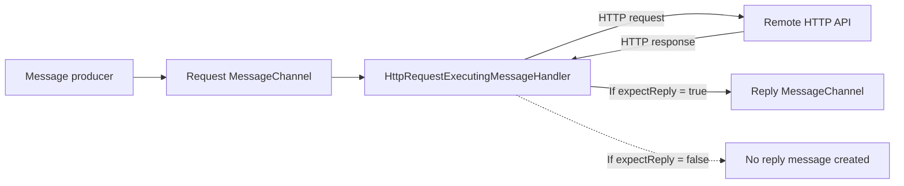
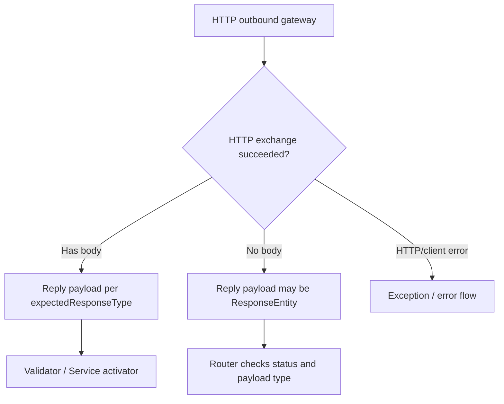

# HttpMessageHandler and HttpRequestExecutingMessageHandler

## 1. How Are the Two Names Related?

In **SPRING_INTEGRATION_ADAPTERS**, messages are exchanged between `MessageChannel`s and endpoints to connect external systems via files, SFTP, HTTP, JMS, AMQP, Kafka, or databases. For HTTP outbound, a handler receives a `Message<?>` from a channel, transforms its payload/headers into an HTTP request, and calls a service outside the application.

There are three easily confused names:

| Name | Nature | Role |
|---|---|---|
| `org.springframework.messaging.MessageHandler` | General Spring Messaging interface | Receives a `Message<?>` to execute an operation. It does not mandate that the operation use HTTP. |
| `org.springframework.integration.http.dsl.HttpMessageHandlerSpec` | **Configuration builder** in the Spring Integration Java DSL | Configures HTTP outbound adapters/gateways, such as URL, method, response type, and header mapping. |
| `org.springframework.integration.http.outbound.HttpRequestExecutingMessageHandler` | **Concrete HTTP handler** | Actually executes the HTTP request via an HTTP client; depending on mode, can generate a reply message from the HTTP response. |

The name **"HttpMessageHandler"** in the title can be understood as shorthand for *a message handler that sends HTTP*. In Spring Integration HTTP outbound, use **`HttpMessageHandlerSpec`** when referring to the DSL class and **`HttpRequestExecutingMessageHandler`** when referring to the executing handler class. Do not try to import a class named `HttpMessageHandler` from the HTTP outbound package if your version's API does not declare one.

The executing handler inherits from the following abstract class hierarchy:

```text
org.springframework.messaging.MessageHandler
                  ▲ implements
                  │
AbstractReplyProducingMessageHandler
                  ▲
                  │
AbstractHttpRequestExecutingMessageHandler
                  ▲
                  │
HttpRequestExecutingMessageHandler
```

This simplified diagram illustrates *inheritance and interface implementation relationships*, without listing every intermediate class. `AbstractHttpRequestExecutingMessageHandler` holds shared HTTP outbound configuration; `HttpRequestExecutingMessageHandler` implements the actual HTTP exchange.

### Expected Outcomes

After this lesson, you will be able to:

1. Explain the roles of `MessageHandler`, `HttpMessageHandlerSpec`, and `HttpRequestExecutingMessageHandler`.
2. Configure an HTTP outbound gateway using the Java DSL and via a `@ServiceActivator` bean.
3. Distinguish a **one-way** sending handler from a **request–reply** handler even though both use HTTP.
4. Understand configuration points for payload, URL, method, converters, headers, and HTTP responses.
5. Design timeouts, retries, error handling, and test the message contract with external services.

## 2. Lifecycle of a Message Through an HTTP Outbound Handler



Step-by-step path:

1. A producer—such as a service activator or a Java messaging gateway—emits a Spring Integration `Message<?>`.
2. The channel delivers the message to the `HttpRequestExecutingMessageHandler` registered as a subscriber.
3. The handler resolves the URL, selects the HTTP method, maps request headers, and prepares the body from the payload using a converter.
4. The HTTP client sends the request and receives the status, headers, and body, or encounters a connection/timeout error.
5. With **`expectReply=true`**, the handler creates a reply message and sends it to the reply channel. With **`expectReply=false`**, the handler finishes as a one-way outbound channel adapter.

`expectReply` controls the **Spring Integration reply message** without changing the nature of HTTP: both modes still perform an HTTP request and HTTP response at the protocol level. Nor does one-way automatically mean sending the request asynchronously.

### Who Is Responsible for What?

| Component | What It Determines |
|---|---|
| `DirectChannel`, `ExecutorChannel`, `QueueChannel` | How the handler receives messages: synchronously, handed off to an executor, or pulled by a poller. |
| `HttpRequestExecutingMessageHandler` | Takes the message, prepares the HTTP request, uses the HTTP client to talk to the external service, and optionally returns a reply. |
| `HttpMessageConverter` | Converts `String`/DTO/`byte[]` into the request body and reads the response body into the corresponding Java type. |
| `HeaderMapper<HttpHeaders>` | Selects and converts metadata between message headers and HTTP headers. |
| Reply channel | Where the result is sent back if the endpoint is in gateway mode. |
| Error flow | Where errors are handled per design; errors on a synchronous flow can propagate back to the caller. |

An HTTP outbound handler does not need a poller to receive messages from a `DirectChannel`. A poller is only required when the upstream source feeding the handler is a `PollableChannel` or when upstream logic polls data on a schedule.

## 3. Java DSL: How Does the Builder Create the Handler?

The Spring Integration Java DSL provides two common factory methods:

```java
Http.outboundChannelAdapter("https://partner.example/api/events")
Http.outboundGateway("https://partner.example/api/quotes")
```

Both return an **`HttpMessageHandlerSpec`** to declare configuration. When building the flow, the DSL uses the spec to create/configure the appropriate **`HttpRequestExecutingMessageHandler`**:

| Java DSL Factory | Handler Mode | Reply Message |
|---|---|---|
| `Http.outboundChannelAdapter(uri)` | `expectReply=false` | Does not emit a reply message back to the flow. |
| `Http.outboundGateway(uri)` | `expectReply=true` | Builds a reply message from the HTTP response for downstream processing. |

Gateway mode is the handler's default when instantiated directly, unless `setExpectReply(false)` is set.

**Note:** `expectedResponseType` primarily applies to gateway mode because it specifies how to read the reply body. For an outbound channel adapter, the response body is not converted into a business message for downstream.

## 4. Request–Reply Practice with Java DSL

We will build an example that fits into a Spring Boot application with Spring Integration. A Java method receives a product SKU, calls a Pricing API via HTTP POST with a `text/plain` body, and receives a quote string.

Choosing `text/plain` keeps the focus on how the handler operates. When using JSON in production, substitute a DTO and an appropriate JSON converter.

### 4.1. Dependencies

With Maven and Spring Boot dependency management:

```xml
<dependencies>
    <dependency>
        <groupId>org.springframework.boot</groupId>
        <artifactId>spring-boot-starter-integration</artifactId>
    </dependency>
    <dependency>
        <groupId>org.springframework.integration</groupId>
        <artifactId>spring-integration-http</artifactId>
    </dependency>
    <dependency>
        <groupId>org.springframework.boot</groupId>
        <artifactId>spring-boot-starter-web</artifactId>
    </dependency>
</dependencies>
```

`spring-integration-http` provides the endpoints and HTTP DSL. `spring-boot-starter-web` is a convenient way to include Spring Web and message converters, though an application that only makes outbound HTTP calls is **not required to expose a servlet endpoint**.

### 4.2. Creating an Interface to Invoke the Message Flow

File `PricingClient.java`:

```java
package example.http;

import org.springframework.integration.annotation.MessagingGateway;

@MessagingGateway(defaultRequestChannel = "pricingRequests")
public interface PricingClient {

    String requestQuote(String sku);
}
```

`@MessagingGateway` generates a proxy that turns the parameter into a message sent to the `pricingRequests` channel. Because the method returns `String`, the caller waits for a reply message and receives the reply payload.

### 4.3. Defining the HTTP Outbound Flow

File `PricingOutboundConfiguration.java`:

```java
package example.http;

import org.springframework.beans.factory.annotation.Value;
import org.springframework.context.annotation.Bean;
import org.springframework.context.annotation.Configuration;
import org.springframework.http.HttpMethod;
import org.springframework.http.MediaType;
import org.springframework.integration.annotation.EnableIntegration;
import org.springframework.integration.annotation.IntegrationComponentScan;
import org.springframework.integration.dsl.IntegrationFlow;
import org.springframework.integration.http.dsl.Http;
import org.springframework.messaging.MessageHeaders;

@Configuration
@EnableIntegration
@IntegrationComponentScan
public class PricingOutboundConfiguration {

    @Bean
    public IntegrationFlow pricingHttpFlow(
            @Value("${partner.pricing.url}") String pricingUrl) {

        return IntegrationFlow.from("pricingRequests")
            .enrichHeaders(headers -> headers.header(
                MessageHeaders.CONTENT_TYPE,
                MediaType.TEXT_PLAIN_VALUE))
            .handle(Http.outboundGateway(pricingUrl)
                .httpMethod(HttpMethod.POST)
                .expectedResponseType(String.class))
            .get();
    }
}
```

With configuration in `application.yml`:

```yaml
partner:
  pricing:
    url: "http://localhost:8081/api/quotes"
```

Key lines:

- `IntegrationFlow.from("pricingRequests")` listens on the channel where `PricingClient` sends requests.
- `enrichHeaders(...)` attaches `contentType=text/plain` so the HTTP client/converter prepares the appropriate body.
- `Http.outboundGateway(pricingUrl)` creates an `HttpMessageHandlerSpec` for request–reply mode.
- `httpMethod(HttpMethod.POST)` sets the HTTP method sent to the partner.
- `expectedResponseType(String.class)` selects the reply payload type when the response carries a matching body.
- `.handle(...)` registers the handler in the flow. During initialization, the spec configuration becomes the actual HTTP handler.

Example service calling the gateway:

```java
package example.http;

import org.springframework.stereotype.Service;

@Service
public class CheckoutService {

    private final PricingClient pricingClient;

    public CheckoutService(PricingClient pricingClient) {
        this.pricingClient = pricingClient;
    }

    public String quote(String sku) {
        if (sku == null || sku.isBlank()) {
            throw new IllegalArgumentException("sku is required");
        }
        return pricingClient.requestQuote(sku);
    }
}
```

Suppose the mock HTTP server accepts `POST /api/quotes` with body `BOOK-1` and returns:

```http
HTTP/1.1 200 OK
Content-Type: text/plain

QUOTE-1001:240000-VND
```

When calling:

```java
String quote = checkoutService.quote("BOOK-1");
```

the expected value of `quote` is `"QUOTE-1001:240000-VND"`. This is the *response body supplied by the mock API*, after the handler converts it into a reply payload; the handler does not calculate prices itself.

### 4.4. Why Does a Method Expecting a Reply Fail Without One?

If you keep `PricingClient.requestQuote` unchanged but replace:

```java
.handle(Http.outboundChannelAdapter(pricingUrl)
    .httpMethod(HttpMethod.POST))
```

the handler sends HTTP but **creates no reply message**. The caller using a messaging gateway with a `String` return type no longer receives a business result; depending on timeouts and error flows, the caller will wait until timeout or fail. Only use an outbound channel adapter if the flow contract does not require response content.

## 5. Configuring HttpRequestExecutingMessageHandler Directly

The Java DSL is recommended for concise flow definitions. However, you will encounter low-level bean configuration in applications using `@ServiceActivator` or when custom handler configuration is needed.

The example below is **an independent alternative** to the DSL flow shown above, using a separate `rawQuoteRequests` channel so two handlers do not compete on the same channel.

```java
package example.http;

import org.springframework.beans.factory.annotation.Value;
import org.springframework.context.annotation.Bean;
import org.springframework.context.annotation.Configuration;
import org.springframework.http.HttpMethod;
import org.springframework.integration.annotation.EnableIntegration;
import org.springframework.integration.annotation.ServiceActivator;
import org.springframework.integration.http.outbound.HttpRequestExecutingMessageHandler;

@Configuration
@EnableIntegration
public class RawHttpHandlerConfiguration {

    @Bean
    @ServiceActivator(inputChannel = "rawQuoteRequests")
    public HttpRequestExecutingMessageHandler rawHttpGateway(
            @Value("${partner.pricing.url}") String pricingUrl) {

        HttpRequestExecutingMessageHandler handler =
            new HttpRequestExecutingMessageHandler(pricingUrl);

        handler.setHttpMethod(HttpMethod.POST);
        handler.setExpectedResponseType(String.class);
        handler.setExpectReply(true);

        return handler;
    }
}
```

Here:

1. Spring Integration invokes the handler when a message arrives on `rawQuoteRequests`.
2. `HttpRequestExecutingMessageHandler` uses the configured URL and HTTP method to send the request.
3. Because `setExpectReply(true)` is set, an HTTP response with a suitable body is converted into a reply message.
4. The reply is sent back to the request message's reply channel if the caller provided one, or to the configured output channel in the flow.

To demonstrate **one-way** mode on the direct handler, replace `setExpectReply(true)` with `setExpectReply(false)`, register the handler on an input channel dedicated to fire-and-forget events, and remove any return-value expectation on the caller.

This shows that **an outbound adapter and an outbound gateway can share the same executing handler class**, differing in `expectReply` configuration and the flow's reply contract.

## 6. Important Properties of the HTTP Handler

`AbstractHttpRequestExecutingMessageHandler` holds many settings shared across both modes:

| Configuration | Meaning | Common Pitfalls |
|---|---|---|
| URL / URI expression | HTTP call target, optionally evaluated per message. | Wrong URI, missing path variable, opening arbitrary URLs from untrusted payloads. |
| `httpMethod` | Outbound HTTP method; defaults to POST per the base class API. | Using GET when the API requires POST or vice versa. |
| `expectedResponseType` | Target type for the converter to read a response with a body. | Expecting a DTO when the response returns a different media type/schema. |
| `extractPayload` | By default extracts the message payload as the HTTP request body. | Confusion over why the whole message versus just the payload is serialized. |
| `extractResponseBody` | In gateway mode, defaults to extracting the body from `ResponseEntity` as the reply payload if present. | Downstream expects status/headers as well, but only receives the body. |
| `headerMapper` | Maps message headers ↔ HTTP headers. | Leaking sensitive headers or omitting required headers. |
| URI variables | Substitutes placeholders in the URL template with values from the message. | Path contains unencoded characters or unexpected data. |
| `transferCookies` | Can transfer cookies from the response into reply headers as configured. | Using stateful cookies without considering security or privacy. |
| `expectReply` | Controls whether the handler emits a Spring Integration reply message. | Caller expects a return value while the handler is in one-way mode. |

URI variable example:

```java
.handle(Http.outboundGateway("https://api.example.com/items/{id}")
    .httpMethod(HttpMethod.GET)
    .uriVariable("id", "payload")
    .expectedResponseType(String.class))
```

The snippet above only illustrates the `.handle(...)` portion inside an `IntegrationFlow`. Given a message whose payload is a product ID, the handler uses the payload to substitute `{id}` in the URI template. Apply proper encoding and validation; do not concatenate URL strings from untrusted input.

### Header Mapping and Correlation

Spring Integration metadata such as `replyChannel`, `errorChannel`, or internal correlation IDs are not synonymous with HTTP headers. Forward only necessary HTTP headers such as `Authorization`, `Content-Type`, `Accept`, `X-Request-ID`, and idempotency keys per the contract.

When integrating alongside JMS/Kafka, agree on correlation rules whenever a message crosses a broker: internal headers holding in-memory channel references cannot automatically translate into a cross-system request–reply correlation contract.

## 7. Response Handling: Body, Status, and Bodyless Responses

With **`expectReply=true`**:

- If the HTTP response has a body and `expectedResponseType` matches a converter, the reply payload is typically the body converted to the expected Java type.
- When `extractResponseBody=false`, the reply payload can be the full `ResponseEntity`, allowing downstream steps to inspect status/headers/body in one object.
- If the response **has no body**, the handler may return `ResponseEntity` as the payload regardless of `expectedResponseType` and `extractResponseBody`; therefore, never assume `204 No Content` always yields a `String` or DTO.
- When a reply message is produced, the HTTP status is represented via headers such as `http_statusCode` per Spring Integration's mechanism; selected response headers are mapped depending on configuration.

Example of response-based routing:



In real applications, test statuses `200`, `201`, `202`, `204`, and context-dependent responses like `304`. Bodyless responses demand an explicit contract; a Java messaging gateway returning `MyDto` may be unsuitable if the service occasionally returns `204`.

**Do not treat all 4xx/5xx responses as normal business replies.** The HTTP client and status/error handler may throw an exception before producing a reply. Only handle error statuses as data when the application explicitly defines and configures how to interpret them.

## 8. RestTemplate, RestClient, and Version-Specific Configuration

`HttpRequestExecutingMessageHandler` performs HTTP exchanges through Spring's HTTP client components. Versions differ:

| Spring Integration Version | What to Know |
|---|---|
| 5.x/6.x branches | Documentation and typical configuration rely on `RestTemplate`; `HttpMessageConverter` handles bodies. |
| From 7.1 | Supports `RestClient` for HTTP outbound; `RestTemplate`-based configuration begins deprecation for removal in a future version. |
| From 7.2 | Adds status/error handler configuration for `RestClient`, via the `defaultStatusHandler(...)` API. |

Because this module does not pin a single Spring Integration version, **do not copy 7.1/7.2 options into a 6.x project** without checking dependencies. The two core DSL factories `Http.outboundGateway(...)` and `Http.outboundChannelAdapter(...)` along with `HttpRequestExecutingMessageHandler` carry the concepts across versions; custom HTTP client APIs should be checked against your project's exact Javadoc.

### Timeouts Must Be Set on the HTTP Client

Suppose `PricingClient.requestQuote` runs over a `DirectChannel`. The HTTP call typically runs directly on the caller's thread. A timeout on the **messaging gateway** is not guaranteed to interrupt a blocking HTTP call; configure connect timeout and read/response timeout on the **HTTP client/request factory** used by the handler.

Conceptual example for `RestTemplate`-style configuration on versions supporting `setRequestFactory(...)`:

```java
import org.springframework.http.client.SimpleClientHttpRequestFactory;

SimpleClientHttpRequestFactory factory =
    new SimpleClientHttpRequestFactory();
factory.setConnectTimeout(2_000);
factory.setReadTimeout(5_000);

// Attach to the managed HttpRequestExecutingMessageHandler:
handler.setRequestFactory(factory);
```

This is an additional configuration snippet inside the handler factory method, not a standalone program; `handler` is the variable created in the earlier example. For versions using `RestClient`, configure the client/request factory using the corresponding API and test actual timeout behavior.

If you place the handler behind an `ExecutorChannel` or `QueueChannel` + poller, the HTTP exchange can run off the producer's thread. Even then, a caller waiting for a reply still has its own deadline, and async errors must be observed on the worker; switching to an async channel does not magically make the HTTP client non-blocking.

## 9. Errors, Retries, and Business Guarantees

Errors can occur at three stages:

| Stage | Examples | Handling Approach |
|---|---|---|
| Before HTTP exchange | Invalid URI, converter fails to serialize DTO, missing header. | Validate message/URI, verify mappers and schema before sending. |
| During HTTP exchange | DNS/TLS, connect/read timeout, 429, 500. | Classify transient vs. permanent, enforce timeouts, bounded retry/backoff. |
| After receiving HTTP response | JSON violates schema, reply fails deserialization, downstream rejects payload. | Check converter/`expectedResponseType` and perform business validation. |

A common policy:

1. **4xx due to bad data**: return a business error or route to a data-repair workflow; avoid infinite retries.
2. **401/403**: check authentication, authorization, tokens/mTLS; do not blindly retry with the same invalid credentials.
3. **429/5xx**: consider bounded retries with exponential backoff and jitter; respect `Retry-After` if published by the partner.
4. **Timeout or dropped connection**: uncertain whether the remote already processed the request. For side-effecting operations, use an idempotency key and status lookup to prevent double execution.
5. **Retries exhausted**: record the failure to an outbox/dead-letter store or recoverable monitoring queue, including correlation/event ID.

With `DirectChannel`, exceptions from the HTTP handler typically propagate back to the caller. With an executor or poller, errors arise on worker threads and require an error flow, retry advice, and appropriate metrics. Do not assume a default `errorChannel` turns exceptions into JSON HTTP responses if the original caller came through an inbound gateway.

**Transactions:** a local database transaction does not automatically roll back an HTTP request already sent to another service. When also integrating JMS, AMQP, Kafka, or databases, define commit milestones, idempotency, and compensation/outbox mechanisms per system.

### Security and Resources

- Use **HTTPS**, manage certificates, OAuth2/Bearer, or mTLS per contract; load secrets from secure configuration, never hardcode them.
- Restrict target destinations to defend against SSRF when URIs are built from messages or external input.
- Map only required headers; do not accidentally leak `replyChannel`, cookies, or internal tokens.
- Set connect/read timeouts, connection pool limits, body size limits, and concurrency caps for when remotes slow down.
- Track latency, HTTP statuses, retry counts, and success/failure counts; log correlation IDs while avoiding sensitive payloads.
- Distinguish `HTTP 2xx` from business outcome: a 202 response usually only confirms the remote accepted the job.

## 10. Testing with a Mock HTTP Server

You can use WireMock, MockWebServer, or a stub HTTP server on `localhost:8081`. For the flow in Section 4, the stub returns `200`, `Content-Type: text/plain`, and body `QUOTE-1001:240000-VND` for a `POST /api/quotes` request containing `BOOK-1`.

Core test matrix:

| Scenario | What to Verify |
|---|---|
| `200` with text body | `PricingClient.requestQuote("BOOK-1")` receives the expected `String`. |
| Request with wrong method or Content-Type | Mock server detects the request contract mismatch; fix the handler/spec rather than bending the partner. |
| `204 No Content` | Reply payload/routing handles `ResponseEntity` properly; do not coerce into `String`. |
| JSON response when `expectedResponseType(String.class)` | Check converter and contract; if using a DTO, configure the right response type. |
| `400` or `401` | Errors are classified; do not retry unconditionally. |
| `429`, `500` | Bounded retry/backoff per policy. |
| Read timeout | HTTP call terminates finitely; caller/error flow is notified as designed. |
| Remote processes request but response is lost | Retry may re-invoke; test idempotency. |
| `expectReply=false` | Outbound adapter sends request without emitting a Spring Integration reply message. |
| `extractResponseBody=false` | Reply payload is `ResponseEntity` when configured, enabling body/status inspection. |
| Async channel | Reply still reaches the right requester before deadline; worker errors are tracked. |

When no HTTP request appears at the mock server, trace in order: producer → request channel → subscriber/`@ServiceActivator` → URI, method, converter → DNS/TLS/timeout. When the HTTP request succeeds but the caller receives no reply, check `expectReply`, `expectedResponseType`, reply channel, converters, and empty bodies. When errors only appear after the handler, check downstream validation and routing.

## 11. Key Takeaways

**`HttpMessageHandlerSpec` is how HTTP outbound is configured in the Java DSL; `HttpRequestExecutingMessageHandler` is the handler that executes HTTP requests.** The executing class can operate as an **outbound channel adapter** (`expectReply=false`) or an **outbound gateway** (`expectReply=true`), depending on the flow's message contract.

When the handler returns a reply, the HTTP response becomes a Spring Integration message whose body and metadata depend on `expectedResponseType`, converters, and extraction/header mapping settings. HTTP outbound does not inherently give you safe retries or distributed transactions; timeouts, error flows, idempotency, and security must be engineered for your HTTP client and partner systems.

### Official Documentation References

- [Spring Integration — HTTP Outbound Components](https://docs.spring.io/spring-integration/reference/http/outbound.html)
- [Spring Integration — Configuring HTTP Endpoints with Java](https://docs.spring.io/spring-integration/reference/http/java-config.html)
- [Spring Integration API — HttpRequestExecutingMessageHandler](https://docs.spring.io/spring-integration/api/org/springframework/integration/http/outbound/HttpRequestExecutingMessageHandler.html)
- [Spring Integration API — AbstractHttpRequestExecutingMessageHandler](https://docs.spring.io/spring-integration/api/org/springframework/integration/http/outbound/AbstractHttpRequestExecutingMessageHandler.html)
- [Spring Integration API — HttpMessageHandlerSpec](https://docs.spring.io/spring-integration/api/org/springframework/integration/http/dsl/HttpMessageHandlerSpec.html)
