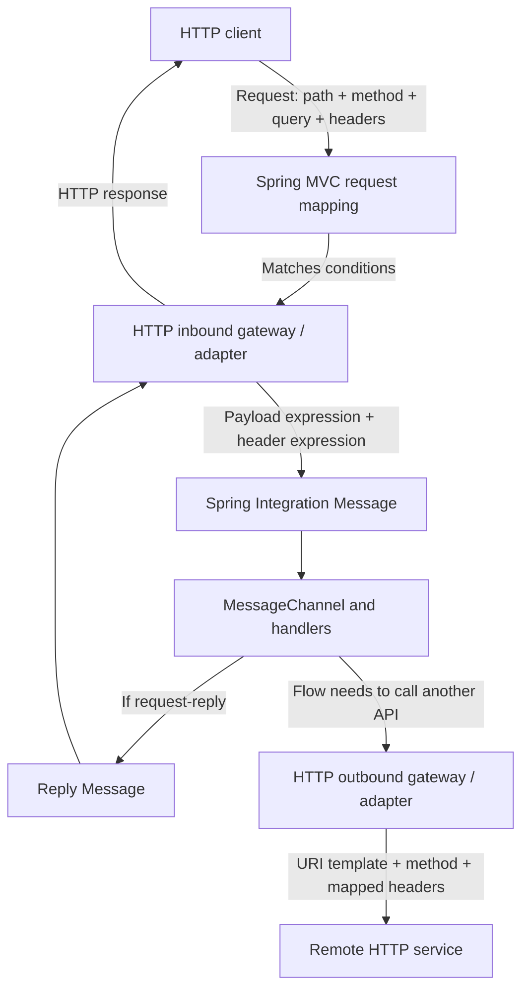

# Path, Method, Query, and Header Mapping

## 1. What Is HTTP Mapping in Spring Integration?

In the **HTTP Adapter** chapter of the **SPRING_INTEGRATION_ADAPTERS** module, HTTP endpoints are one way to bring data from clients into a `MessageChannel` or turn internal messages into requests to external services. The same adapter, gateway, and poller wiring principles apply when integrating files, SFTP, JMS, AMQP, Kafka, or databases; what makes HTTP distinct is its **request contract**, which encompasses the path, method, query string, headers, and body.

A URL request such as:

```http
GET /api/catalog/BOOK-1?view=summary HTTP/1.1
Host: localhost:8080
Accept: application/json
X-Consumer: storefront
```

carries multiple independent pieces of information:

| Component | Value in Example | Purpose |
|---|---|---|
| **Path** | `/api/catalog/BOOK-1` | Identifies the target resource or endpoint being called. |
| **Path variable** | `itemId = BOOK-1` | Extracts a dynamic value at a position in the path template. |
| **HTTP method** | `GET` | Identifies the operation under the HTTP contract. |
| **Query parameter** | `view=summary` | Adjusts selection, filtering, pagination, or response format. |
| **Request header** | `Accept: application/json` | Declares the representation the client wants to receive. |
| **Custom request header** | `X-Consumer: storefront` | Extra metadata per application contract; does not by itself prove caller identity. |
| **Body** | None in the GET example | When present, read separately according to content type and message converters. |

The goal of this lesson is to distinguish **selecting an endpoint by HTTP conditions** from **extracting request data into a message**, while also clarifying how URLs/headers are constructed for **HTTP outbound**. After this lesson, you will be able to configure mappings, read path variables, query parameters, and headers, and diagnose why requests fail to enter the flow.

## 2. Two Directions of Mapping: Inbound and Outbound



There are three operations that must not be conflated:

1. **HTTP inbound request mapping:** Spring MVC together with `IntegrationRequestMappingHandlerMapping` decides whether an endpoint accepts a request based on path, method, parameters, headers, `consumes`, and `produces`.
2. **Inbound message mapping:** once selected, the endpoint extracts path variables, query parameters, or HTTP headers to populate `Message.payload` and `Message.headers` for the flow.
3. **HTTP outbound mapping:** the handler takes payload/headers from a Spring Integration message to build the URI, method, HTTP headers, and body when calling an external API.

For example, adding the condition `params("view=summary")` **only requires the request to contain that parameter with that value**. To actually use the value inside a handler, you still need to extract it from the request—for instance with `#requestParams.getFirst('view')`—and place it into a message header.

Similarly, the condition `headers("X-Consumer=storefront")` selects matching requests. It **does not authenticate** the caller and does not mean every HTTP header is automatically copied verbatim into the integration message.

## 3. Path Mapping: Static Paths and Path Variables

### 3.1. Declaring a Path Template

These two paths share the same structure while referencing two different items:

```text
/api/catalog/BOOK-1
/api/catalog/BOOK-2
```

A path template unifies them:

```text
/api/catalog/{itemId}
```

When `GET /api/catalog/BOOK-1` matches the template, Spring MVC extracts:

```text
pathVariables["itemId"] = "BOOK-1"
```

In SpEL expressions on an HTTP inbound endpoint, Spring Integration provides the `#pathVariables` variable. For example:

```java
.payloadExpression("#pathVariables['itemId']")
```

This extracts the `itemId` variable as the **payload** of the Spring Integration message. It is evaluated after the HTTP request has matched the mapping; it does not restrict the HTTP method and does not replace validation.

Multiple path variables can be placed into message headers:

```java
.headerExpression("itemId", "#pathVariables['itemId']")
.headerExpression("shopId", "#pathVariables['shopId']")
```

When doing so, the path template must also declare those corresponding variables, e.g. `/shops/{shopId}/items/{itemId}`.

### 3.2. Difference Between Path Variables and Query Parameters

| Scenario | Example | Recommended Handling |
|---|---|---|
| Identifying a resource | `/items/BOOK-1` | Path variable `itemId`. |
| Filtering a list | `/items?category=book` | Query parameter `category`. |
| Pagination | `/items?page=2&size=20` | Query parameters `page`, `size`; enforce bounds on values. |
| Selecting a representation | `/items/BOOK-1?view=summary` | Query parameter `view`; validate allowed values. |
| Security credentials | Bearer token or mTLS | HTTP security mechanism; never put secrets in paths/queries. |

Whether coming from a path variable or a query parameter, client-supplied data is **untrusted**. Validate type, length, format, and authorization for the corresponding resource. Avoid placing confidential data in URLs because URLs frequently appear in browser history, access logs, and monitoring tools.

## 4. Method Mapping: Selecting the Operation Before Creating a Message

The same path can support different HTTP methods:

| Method | Example | Common Meaning |
|---|---|---|
| `GET` | `GET /items/BOOK-1` | Read data; should not produce business side effects. |
| `POST` | `POST /items` | Create or submit a processing request. |
| `PUT` | `PUT /items/BOOK-1` | Replace/update per contract. |
| `PATCH` | `PATCH /items/BOOK-1` | Partial update per contract. |
| `DELETE` | `DELETE /items/BOOK-1` | Delete or mark a resource as deleted. |

In the Spring Integration Java DSL, the inbound method is specified via `requestMapping`:

```java
.requestMapping(mapping -> mapping
    .methods(HttpMethod.GET)
    .produces(MediaType.APPLICATION_JSON_VALUE))
```

This is **different from**:

```java
.handle(Http.outboundGateway("https://api.example.com/items")
    .httpMethod(HttpMethod.GET)
    .expectedResponseType(String.class))
```

In the first snippet, `GET` is a matching condition for requests **entering** the application. In the second snippet, `GET` is the HTTP method the application **sends outward**.

If a request only has the wrong method, Spring MVC typically returns `405 Method Not Allowed` when the path itself exists. If the path is wrong, it typically returns `404`. However, filters, security, or other mapping configurations can change the actual response.

## 5. Query Parameters: Match Conditions and Value Extraction

Consider the request:

```http
GET /api/catalog/BOOK-1?view=summary&tag=java&tag=spring HTTP/1.1
Accept: application/json
X-Consumer: storefront
```

`view` has a single value, whereas `tag` appears twice. Spring Integration provides the expression variable `#requestParams`, which exposes request parameters as a `MultiValueMap`.

SpEL example:

```java
.payloadExpression("#requestParams.getFirst('view')")
.headerExpression("allTags", "#requestParams['tag']")
```

`getFirst('view')` reads a single value. When multiple `tag` values are needed, retrieve the corresponding list and clearly specify how to filter/validate them. Never assume a query parameter always has at most one value.

### 5.1. Constraining Parameters in HTTP Request Mapping

```java
.requestMapping(mapping -> mapping
    .methods(HttpMethod.GET)
    .params("view=summary"))
```

The mapping accepts only requests where parameter `view` equals `summary` per Spring MVC rules. Common condition forms:

| Condition | Meaning |
|---|---|
| `params("view")` | The `view` parameter must be present. |
| `params("!view")` | The `view` parameter must not be present. |
| `params("view=summary")` | The `view` parameter must have the value `summary`. |
| `params("view!=full")` | Negation condition per Spring MVC request mapping rules. |

Note: request parameters at the Servlet layer can include both query string and form parameters depending on method/content type. In the GET example, values come from the query string. Do not use `params(...)` as a substitute for business validation (such as negative page numbers, oversized limits, or injection attempts in search strings).

### 5.2. When a Parameter Is Optional

If `view` is optional, **do not** put `view=summary` in the mapping and expect the endpoint to also accept requests missing `view`. Instead, restrict the mapping only by path/method, then read the parameter via `#requestParams` and handle defaults/validation in the flow.

Avoid creating too many HTTP endpoints just to branch on minor query variations. Use a single endpoint with an internal router/transformer when the endpoint contract is genuinely shared.

## 6. Headers: Request Conditions, Mapping, and Security

HTTP headers serve many roles: content negotiation, auth, correlation, idempotency, and custom metadata. Distinguish three actions:

| Action | Example | Purpose |
|---|---|---|
| **Match request header** | `headers("X-Consumer=storefront")` | Selects the endpoint only when the HTTP header satisfies the condition. |
| **Read one value into a message** | `headerExpression("consumer", "#requestHeaders.getFirst('X-Consumer')")` | Creates the Spring Integration message header `consumer`. |
| **Map multiple HTTP headers** | `mappedRequestHeaders("X-Trace-Id")` | Selects HTTP headers to copy into the message or emit to HTTP, depending on endpoint direction. |

The SpEL variable `#requestHeaders` is an `HttpHeaders` object. Methods like `getFirst(...)` read a single value, and HTTP header names are case-insensitive.

**Distinguish HTTP headers from integration headers:** an HTTP header `X-Trace-Id` does not automatically become a header named `traceId`. If you want consistent internal naming, map it with an expression or header enricher; when forwarding across Kafka/JMS/SFTP, explicitly define which headers to retain.

### 6.1. Content-Type and Accept

- `Content-Type` describes the **request body** sent to the server. `consumes(MediaType.APPLICATION_JSON_VALUE)` specifies which request media types the endpoint supports; it does not itself validate JSON structure.
- `Accept` describes the **response format** the client desires. `produces(MediaType.APPLICATION_JSON_VALUE)` participates in content negotiation; the application still needs an HTTP message converter capable of serializing the reply payload.
- For bodyless `GET` requests, `consumes` is usually unnecessary; for `POST` or `PUT` accepting JSON, declare it explicitly per contract.

Example:

```java
.requestMapping(mapping -> mapping
    .methods(HttpMethod.POST)
    .consumes(MediaType.APPLICATION_JSON_VALUE)
    .produces(MediaType.APPLICATION_JSON_VALUE))
```

Requests with the wrong media type typically result in `415 Unsupported Media Type`; an `Accept` header incompatible with available representations can lead to `406 Not Acceptable`.

### 6.2. Do Not Treat Custom Headers as Proof of Authentication

`headers("X-Consumer=storefront")` only checks **a string sent by the client**. Any other caller can easily send the exact same value. Real APIs need Spring Security, mTLS, JWT/OAuth2, webhook HMAC signatures, or an appropriate authentication/authorization mechanism. Never log raw `Authorization` headers, cookies, tokens, or personal data.

## 7. Inbound Gateway Example: Combining Path, Method, Query, and Header

Let's build an HTTP endpoint with the following contract:

```text
GET /api/catalog/{itemId}?view=summary
Accept: application/json
X-Consumer: storefront
```

The gateway returns JSON to the client. The example uses **Spring Boot + Spring MVC + Spring Integration HTTP**, Java 17 or newer, and Jackson to serialize records to JSON.

### 7.1. Maven Dependencies

For a project with Spring Boot dependency management:

```xml
<dependencies>
    <dependency>
        <groupId>org.springframework.boot</groupId>
        <artifactId>spring-boot-starter-web</artifactId>
    </dependency>
    <dependency>
        <groupId>org.springframework.boot</groupId>
        <artifactId>spring-boot-starter-integration</artifactId>
    </dependency>
    <dependency>
        <groupId>org.springframework.integration</groupId>
        <artifactId>spring-integration-http</artifactId>
    </dependency>
</dependencies>
```

### 7.2. Configuring Request Mapping and Extracting Data into Messages

Create `CatalogInboundConfiguration.java`:

```java
package example.http;

import org.springframework.context.annotation.Bean;
import org.springframework.context.annotation.Configuration;
import org.springframework.http.HttpMethod;
import org.springframework.http.MediaType;
import org.springframework.integration.annotation.EnableIntegration;
import org.springframework.integration.channel.DirectChannel;
import org.springframework.integration.dsl.IntegrationFlow;
import org.springframework.integration.http.dsl.Http;
import org.springframework.messaging.MessageChannel;

@Configuration
@EnableIntegration
public class CatalogInboundConfiguration {

    @Bean
    public MessageChannel catalogRequests() {
        return new DirectChannel();
    }

    @Bean
    public IntegrationFlow catalogReadFlow() {
        return IntegrationFlow
            .from(Http.inboundGateway("/api/catalog/{itemId}")
                .requestMapping(mapping -> mapping
                    .methods(HttpMethod.GET)
                    .params("view=summary")
                    .headers("X-Consumer=storefront")
                    .produces(MediaType.APPLICATION_JSON_VALUE))
                .payloadExpression("#pathVariables['itemId']")
                .headerExpression(
                    "requestedView",
                    "#requestParams.getFirst('view')")
                .headerExpression(
                    "consumer",
                    "#requestHeaders.getFirst('X-Consumer')"))
            .channel("catalogRequests")
            .get();
    }
}
```

Three key parts:

1. **`requestMapping(...)`** matches requests with path `/api/catalog/{itemId}`, HTTP method GET, query `view=summary`, header `X-Consumer=storefront`, and accepting a JSON response.
2. **`payloadExpression(...)`** extracts `itemId` from the path and sets it as `Message.payload`.
3. **`headerExpression(...)`** extracts the query parameter and HTTP header, creating the **integration headers** `requestedView` and `consumer`.

These expressions operate on the HTTP request already matched by Spring MVC. They do not trigger a new HTTP request.

### 7.3. Service Activator and JSON Reply

Create `CatalogHandler.java` in a package scanned by Spring Boot:

```java
package example.http;

import org.springframework.integration.annotation.ServiceActivator;
import org.springframework.messaging.Message;
import org.springframework.stereotype.Service;

@Service
public class CatalogHandler {

    @ServiceActivator(inputChannel = "catalogRequests")
    public CatalogResponse read(Message<String> message) {
        String itemId = message.getPayload();
        String view = (String) message.getHeaders().get("requestedView");
        String consumer = (String) message.getHeaders().get("consumer");

        if (itemId.isBlank()) {
            throw new IllegalArgumentException("itemId is required");
        }

        // Illustrates mapping; a real system needs data lookup and authorization checks.
        return new CatalogResponse(
            itemId, view, consumer, "AVAILABLE");
    }

    public record CatalogResponse(
        String itemId,
        String view,
        String clientTag,
        String availability) {}
}
```

`@ServiceActivator` receives the message from `catalogRequests` and returns the record. The inbound gateway waits for the reply message and uses a converter to produce the JSON response. The `clientTag` field shows that the header was mapped; it **does not represent an authenticated identity**.

### 7.4. Calling with curl

```bash
curl -i \
  -H 'Accept: application/json' \
  -H 'X-Consumer: storefront' \
  'http://localhost:8080/api/catalog/BOOK-1?view=summary'
```

Illustrative response body:

```json
{
  "itemId": "BOOK-1",
  "view": "summary",
  "clientTag": "storefront",
  "availability": "AVAILABLE"
}
```

Exact status codes and response headers depend on the gateway, HTTP converters, and application configuration. Because the handler is illustrative, `AVAILABLE` has not been verified against a database.

Try changing one condition at a time:

| Test Request | What to Observe |
|---|---|
| `GET` with valid path/query/header | Message reaches `catalogRequests` and returns JSON. |
| `POST` to the same URL | Fails to match GET method; typically HTTP 405. |
| `GET` missing `view` | Fails `params("view=summary")`. |
| `GET` with `view=full` | Fails query mapping value. |
| `GET` missing `X-Consumer` | Fails header mapping constraint. |
| `GET` with `Accept: text/plain` | Incompatible with `produces(application/json)`; typically 406. |
| `GET` to another path | Fails mapping; typically 404. |

HTTP statuses from non-matching requests can vary when an application has multiple endpoints, filters, exception handlers, or a reverse proxy. Verify that the request is rejected **before the service activator**, rather than checking only the status code.

## 8. Outbound Mapping: Building Path, Query, and HTTP Headers from a Message

In an HTTP outbound gateway, we work in the reverse direction: turning an **internal message** into an HTTP request to an external system. Suppose a partner exposes the API:

```http
GET /api/items/BOOK-1?region=vn-south HTTP/1.1
Host: partner.example
X-Tenant: shop-a
```

In the Java DSL, you can use a **URI template** and `uriVariable(...)`:

```java
package example.http;

import org.springframework.context.annotation.Bean;
import org.springframework.context.annotation.Configuration;
import org.springframework.http.HttpMethod;
import org.springframework.integration.annotation.EnableIntegration;
import org.springframework.integration.dsl.IntegrationFlow;
import org.springframework.integration.http.dsl.Http;

@Configuration
@EnableIntegration
public class PartnerItemHttpConfiguration {

    @Bean
    public IntegrationFlow partnerItemLookupFlow() {
        return IntegrationFlow.from("partnerItemLookup")
            .handle(Http.outboundGateway(
                    "https://partner.example/api/items/{itemId}"
                    + "?region={region}")
                .httpMethod(HttpMethod.GET)
                .uriVariable("itemId", "payload")
                .uriVariable("region", "headers['region']")
                .mappedRequestHeaders("X-Tenant")
                .expectedResponseType(String.class))
            .get();
    }
}
```

To build input messages matching the contract, you can use a **Java messaging gateway**:

```java
package example.http;

import org.springframework.integration.annotation.MessagingGateway;
import org.springframework.messaging.handler.annotation.Header;

@MessagingGateway(defaultRequestChannel = "partnerItemLookup")
public interface PartnerItemClient {

    String findItem(
        String itemId,
        @Header("region") String region,
        @Header("X-Tenant") String tenant);
}
```

With `@IntegrationComponentScan` configured or Spring Boot scanning messaging gateways, calling:

```java
String result = partnerItemClient.findItem(
    "BOOK-1", "vn-south", "shop-a");
```

produces an integration message with:

```text
payload = "BOOK-1"
headers["region"] = "vn-south"
headers["X-Tenant"] = "shop-a"
```

The HTTP outbound gateway uses:

- `payload` to substitute `{itemId}` in the **path**.
- `headers['region']` to substitute `{region}` in the **query string**.
- `mappedRequestHeaders("X-Tenant")` to map message header `X-Tenant` to an **HTTP header**.
- `httpMethod(GET)` to choose the outgoing HTTP method.
- `expectedResponseType(String.class)` to convert the HTTP response body into a `String` reply payload when the service returns compatible data.

From the values above, the target HTTP request takes the form `GET /api/items/BOOK-1?region=vn-south` with `X-Tenant: shop-a`. The domain `partner.example` is a documentation example; to practice, replace it with an accessible mock HTTP service and inspect real responses.

**Additional note:** the code above places classes in the same package for readability. In a runnable project, register the `@MessagingGateway` interface using `@IntegrationComponentScan` on a configuration class in the appropriate package. Do not add an HTTP controller if the application acts solely as an outbound client.

### 8.1. Why Use a URI Template?

Do not construct URLs manually with string concatenation such as:

```java
String url = baseUrl + "/" + itemId + "?region=" + region;
```

Because `itemId` or `region` might contain spaces, `&`, `?`, `/`, Unicode, or characters needing encoding. URI templates paired with the HTTP client's encoding mechanism control variable substitution; you still need validation and tests for values with special characters.

Do not let uncontrolled client input set the URL host directly, as this can lead to **SSRF**. Configure the base host from application configuration and allow only validated path/query variables against an allowlist. When data already contains percent-encoded characters, avoid double-encoding by using the appropriate encoding mode and URI builder; do not disable encoding arbitrarily.

### 8.2. Request Headers and Response Headers Go in Different Directions

In an HTTP outbound endpoint:

- `mappedRequestHeaders(...)` selects **integration headers → HTTP request headers**.
- `mappedResponseHeaders(...)` selects **HTTP response headers → reply message headers**.

In an HTTP inbound endpoint:

- `mappedRequestHeaders(...)` selects **HTTP request headers → integration message headers**.
- `mappedResponseHeaders(...)` selects **reply message headers → HTTP response headers**.

The method names are identical, but the mapping direction depends on whether the endpoint is inbound or outbound. `DefaultHttpHeaderMapper` supports a default set of headers and configured patterns; never assume every header is mapped.

## 9. Header Mapping and Sensitive Data Across Multiple Systems

A Spring Integration message can hold many headers for routing, correlation, tracing, or replies:

```text
id
timestamp
replyChannel
errorChannel
correlationId
contentType
userDefinedHeader
```

Not every header is suitable to send over the network. `replyChannel` or `errorChannel` can contain in-memory channel references and must not be treated as HTTP headers for communicating with a partner.

A solid HTTP outbound contract should specify:

| Header | Source | Principle |
|---|---|---|
| `Content-Type` | Payload/converter and config | Matches outgoing body, e.g. `application/json`. |
| `Accept` | Caller requirement | Requests desired response representation. |
| `Authorization` | Security context or token service | Add only when permitted; mask from logs. |
| `X-Correlation-ID` | Controlled trace/correlation ID | Enables correlating logs across services. |
| `Idempotency-Key` | Stable business key | Helps prevent duplicate side effects on retries, if supported by partner. |
| `X-Tenant` | Internally authenticated tenant context | Never trust an unverified header arbitrarily sent by an external client. |

If the message continues onward through JMS, AMQP, or Kafka, each adapter's serialization and header mapping has its own rules. Do not rely on all HTTP headers passing automatically across protocols; establish an explicit contract for `correlationId`, event IDs, and metadata that downstream genuinely requires.

## 10. Layer-by-Layer Mapping Testing

When testing HTTP inbound, verify **two distinct outcomes**: whether the request selects the endpoint, and whether the data maps accurately into the message.

### 10.1. Inbound Testing

1. Send a request with the right method, path, query, `Accept`, and custom header; assert the handler receives `Message.payload = "BOOK-1"` along with the expected `requestedView` and `consumer`.
2. Vary one condition at a time: wrong path, wrong method, missing/different query, missing/different header, incompatible `Accept`.
3. Test paths with URL-encoded characters, empty query values, and repeated query parameters; verify contract behavior.
4. If adding `POST`, test wrong `Content-Type`, schema-invalid JSON bodies, and oversized bodies.
5. Test unauthenticated and unauthorized requests; verify Spring Security/filters block them per policy.
6. Check the reply payload, content type, and service activator errors—not merely an HTTP 200 code.

### 10.2. Outbound Testing

Use a mock HTTP server such as WireMock or MockWebServer to verify:

| Case | Assertion |
|---|---|
| Path variable | `BOOK-1` appears in the right position of `/api/items/{itemId}`. |
| Query variable | `region=vn-south` is properly encoded. |
| Method | The gateway sends `GET` per contract. |
| Mapped request header | `X-Tenant: shop-a` is present and no unintended internal headers leak. |
| Response | JSON/text body is converted to `expectedResponseType`. |
| HTTP 4xx/5xx | Error handler/exception or error flow classifies errors as configured. |
| Timeout | HTTP client has finite connect/read timeouts. |
| Retry | Retries do not cause duplicate side effects, using an idempotency key when needed. |

Tests should use a local mock server to avoid depending on partner networks when verifying mapping logic.

### 10.3. When a Request Does Not Reach the Handler

For inbound, trace in order:

```text
Client
  -> Reverse proxy / Spring Security
  -> Path + HTTP method mapping
  -> params + headers + consumes + produces
  -> payloadExpression + headerExpression
  -> MessageChannel
  -> Service activator / Router
  -> Reply channel (if gateway)
```

| Commonly Seen HTTP Status | What to Check |
|---|---|
| `404` | Wrong path/context path or no matching endpoint exists. |
| `405` | Path has a handler, but the method is not accepted. |
| `415` | `Content-Type` does not match `consumes`. |
| `406` | `Accept` does not match `produces`. |
| `400` | Possibly missing a required query parameter, invalid request body, or converter failure. |
| `401/403` | Authentication/authorization or a filter blocked it. |
| `5xx/timeout` | Handler, converter, downstream service, reply channel, or timeout. |

These codes represent common scenarios, **not an absolute guarantee** when multiple mappings, exception resolvers, and custom API gateways exist. In particular, requests failing `params` or `headers` can yield different statuses depending on conditions and other registered handlers.

## 11. Lifecycle, Security, and Contract Design

Mappings must be correct both at configuration time and at runtime:

- Inbound endpoints are registered when the Spring application context initializes; if mappings conflict, the application may fail at startup or during dispatch.
- Public URLs may include a servlet context path or a reverse proxy prefix; document the base path clearly so clients are not confused.
- Outbound endpoints call external services only when a message enters the channel; no poller is needed when using `DirectChannel`.
- Enforce body size limits, rate limits, concurrency caps, and timeouts—especially when a synchronous inbound gateway calls a slow outbound gateway.
- Map only genuinely necessary headers. Tokens, cookies, and user data must follow security policies and never be logged indiscriminately.
- When changing paths, query parameters, or required headers, apply versioning or a compatibility plan; never break active client contracts unexpectedly.
- For side-effecting events crossing HTTP, JMS/Kafka, or databases, require idempotency, bounded retries, and clear data commit milestones. Correct mapping alone does not create distributed transactions.

## 12. Key Takeaways

- **Path** identifies the resource, **method** identifies the operation, **query** supplies additional parameters, and **headers** carry metadata or content negotiation info.
- `requestMapping(...methods/params/headers/consumes/produces...)` matches requests **before** creating a Spring Integration message.
- `#pathVariables`, `#requestParams`, and `#requestHeaders` are used inside `payloadExpression` or `headerExpression` to **extract data into payload/headers**.
- For outbound gateways/adapters, `uriVariable(...)` populates path and query variables from the message; `mappedRequestHeaders(...)` controls which HTTP request headers are emitted.
- `mappedResponseHeaders(...)` handles the return direction; it does not automatically carry every header across systems.
- Verify validation, authentication, encoding, timeouts, retries, and idempotency at the HTTP boundary; a matching mapping alone does not prove business success.

### Official Documentation References

- [Spring Integration — HTTP Namespace Support: request mapping, URI variables, and expressions](https://docs.spring.io/spring-integration/reference/http/namespace.html)
- [Spring Integration — Configuring HTTP Endpoints with Java](https://docs.spring.io/spring-integration/reference/http/java-config.html)
- [Spring Integration — HTTP Header Mapping](https://docs.spring.io/spring-integration/reference/http/header-mapping.html)
- [Spring Integration — HttpInboundEndpointSupportSpec API](https://docs.spring.io/spring-integration/api/org/springframework/integration/http/dsl/HttpInboundEndpointSupportSpec.html)
- [Spring Integration — BaseHttpMessageHandlerSpec API](https://docs.spring.io/spring-integration/api/org/springframework/integration/http/dsl/BaseHttpMessageHandlerSpec.html)
