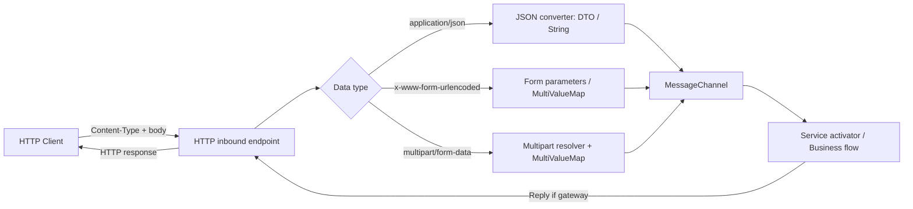
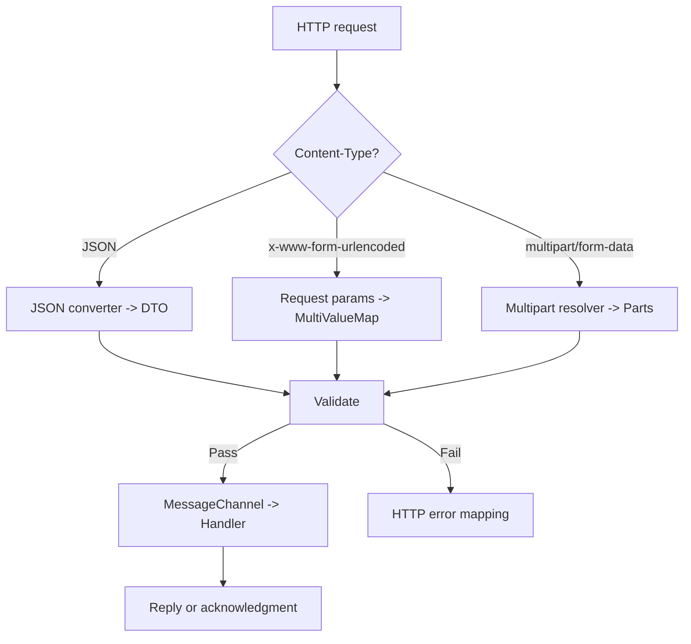

# JSON, Form-Data, and Multipart Payloads

## 1. Why Must We Distinguish the Three Payload Types?

In the **HTTP Adapter** chapter of the **SPRING_INTEGRATION_ADAPTERS** module, HTTP inbound/outbound adapters and gateways exchange data with external systems through `MessageChannel`s. The payload of a Spring Integration `Message<?>` is a **Java object**; the body of an HTTP request/response is **data encoded according to a media type**. HTTP message converters and multipart parsing determine how conversion happens between those two forms.

Three common formats:

| HTTP Format | `Content-Type` | Wire Body | Common Java Payload |
|---|---|---|---|
| **JSON** | `application/json` | JSON text structured as object/array | DTO/record, `Map`, `String`, or `byte[]` depending on configuration |
| **Form URL-encoded** | `application/x-www-form-urlencoded` | `name=An&tag=java&tag=spring`, with URL-encoded characters | `MultiValueMap<String, String>` or data extracted from request parameters |
| **Multipart form-data** | `multipart/form-data; boundary=...` | Multiple separate parts, each with its own headers and body | `MultiValueMap` containing text, bytes, or `MultipartFile` depending on resolver/converter |

**Important:** `multipart/form-data` and `application/x-www-form-urlencoded` are both casually called "form-data", yet they **do not share the same wire structure**. Form URL-encoded is meant for textual key/value pairs; multipart supports mixing text fields and binary data such as documents, images, or CSV files.

Business examples:

- An application receives a JSON order and returns validation results.
- A website submits a registration form using `application/x-www-form-urlencoded`.
- A user uploads an attachment along with a description via `multipart/form-data`.
- A Spring Integration flow calls a partner's HTTP API, selecting the appropriate converter to produce JSON, form, or multipart.

The goal of this lesson is to understand the **body contract**, build inbound endpoints for the right format, prepare outbound payloads, handle conversion errors, and ensure safety when receiving files. The same message contract, retry, and connection lifecycle principles also apply when flows forward data to files, SFTP, JMS, AMQP, Kafka, or databases.

## 2. How Does an HTTP Body Become a Spring Integration Message?



In an **HTTP inbound gateway**, requests are mapped by path, method, and `consumes`; the endpoint then uses a converter or payload expression to build a message. When the handler returns a reply, the gateway converts the reply payload into an HTTP response using an appropriate converter.

In an **HTTP inbound channel adapter**, the request is also converted into a message, but the flow emits no business reply message back to the client. Choose an inbound gateway when you need to return JSON with results; choose an inbound adapter when the contract only needs receipt acknowledgment.

In an **HTTP outbound gateway**, the conversion direction reverses: message payload/headers become the HTTP request body/headers, and the HTTP response is turned into a reply message. With an **HTTP outbound channel adapter**, HTTP still receives a protocol-level response, but the response body is not forwarded as a reply message.

### 2.1. Four Factors That Determine the Payload Type

1. **Request `Content-Type`:** indicates how to read the wire body. It cannot be determined solely from a Java class name.
2. **`requestPayloadType(...)` on inbound:** guides `HttpMessageConverter` on which Java type to read the body into, e.g. `OrderRequest.class`.
3. **`payloadExpression(...)` on inbound:** can select other data as the payload, such as `#requestParams` for form parameters or a path variable.
4. **Available converters and multipart resolver:** if a suitable converter/resolver is missing, the body may not be read as expected or an error may occur.

If `requestPayloadType` is not declared, the inbound API documentation notes that the default type can be `String` for text content types and `byte[]` for others. However, **multipart is a special case** when the request has been parsed by a multipart resolver into a `MultipartHttpServletRequest`; the payload may be a `MultiValueMap`. Always test the actual runtime payload type with your application's version and configuration.

## 3. Example 1: Receiving JSON as a DTO with an HTTP Inbound Gateway

We will build an API that accepts an order-validation request and returns JSON results. The sample code runs on **Spring Boot, Spring MVC, Spring Integration HTTP, and Java 17 or newer**; it does not yet persist orders or perform external transactions.

### 3.1. Maven Dependencies

With Spring Boot dependency management:

```xml
<dependencies>
    <dependency>
        <groupId>org.springframework.boot</groupId>
        <artifactId>spring-boot-starter-web</artifactId>
    </dependency>
    <dependency>
        <groupId>org.springframework.boot</groupId>
        <artifactId>spring-boot-starter-integration</artifactId>
    </dependency>
    <dependency>
        <groupId>org.springframework.integration</groupId>
        <artifactId>spring-integration-http</artifactId>
    </dependency>
</dependencies>
```

`spring-boot-starter-web` provides Spring MVC and the JSON converter typically backed by Jackson; `spring-integration-http` provides HTTP inbound/outbound endpoints. Enable component scanning for the example package when integrating into an application.

### 3.2. Request and Reply DTOs

File `OrderPayloads.java`:

```java
package example.http;

public final class OrderPayloads {
    private OrderPayloads() {}

    public record OrderRequest(String sku, int quantity) {}

    public record OrderReply(String sku, String status) {}
}
```

A syntactically valid request body:

```json
{"sku":"BOOK-1","quantity":2}
```

DTOs only describe data structure. **Business validation still needs to check** blank `sku`, invalid `quantity`, API permissions, and other constraints. Successful JSON parsing into a record does not prove an order is accepted.

### 3.3. Endpoint Configuration

File `JsonInboundConfiguration.java`:

```java
package example.http;

import org.springframework.context.annotation.Bean;
import org.springframework.context.annotation.Configuration;
import org.springframework.http.HttpMethod;
import org.springframework.http.MediaType;
import org.springframework.integration.annotation.EnableIntegration;
import org.springframework.integration.channel.DirectChannel;
import org.springframework.integration.dsl.IntegrationFlow;
import org.springframework.integration.http.dsl.Http;
import org.springframework.messaging.MessageChannel;

@Configuration
@EnableIntegration
public class JsonInboundConfiguration {

    @Bean
    public MessageChannel jsonOrders() {
        return new DirectChannel();
    }

    @Bean
    public IntegrationFlow jsonOrderFlow() {
        return IntegrationFlow
            .from(Http.inboundGateway("/examples/json-orders")
                .requestMapping(m -> m
                    .methods(HttpMethod.POST)
                    .consumes(MediaType.APPLICATION_JSON_VALUE)
                    .produces(MediaType.APPLICATION_JSON_VALUE))
                .requestPayloadType(OrderPayloads.OrderRequest.class))
            .channel("jsonOrders")
            .get();
    }
}
```

File `JsonOrderHandler.java`:

```java
package example.http;

import org.springframework.integration.annotation.ServiceActivator;
import org.springframework.stereotype.Service;

@Service
public class JsonOrderHandler {

    @ServiceActivator(inputChannel = "jsonOrders")
    public OrderPayloads.OrderReply accept(
            OrderPayloads.OrderRequest request) {

        if (request.sku() == null || request.sku().isBlank()
                || request.quantity() <= 0) {
            throw new IllegalArgumentException("Invalid order payload");
        }

        // Request -> reply conversion illustration only, not persisted to DB yet.
        return new OrderPayloads.OrderReply(request.sku(), "VALIDATED");
    }
}
```

When calling:

```bash
curl -i -X POST 'http://localhost:8080/examples/json-orders' \
  -H 'Content-Type: application/json' \
  -H 'Accept: application/json' \
  -d '{"sku":"BOOK-1","quantity":2}'
```

a typical response body is:

```json
{"sku":"BOOK-1","status":"VALIDATED"}
```

**`requestPayloadType(OrderRequest.class)`** instructs the converter to deserialize JSON into the record. If you use `String.class`, the message payload is a JSON string and the handler must parse/validate it manually. If `consumes(application/json)` is set but `text/plain` is sent, the request normally fails mapping; if syntactically invalid JSON is sent, failure can happen **before** the message enters `jsonOrders`.

In the example, the handler throws `IllegalArgumentException` on invalid data, which **does not automatically guarantee a 400 response with a standard JSON error**. Design appropriate exception mapping/error flows if the API must return a stable error contract.

## 4. Example 2: application/x-www-form-urlencoded

Form URL-encoded does not represent a JSON object. It is a sequence of name/value pairs, for example:

```http
POST /examples/preferences HTTP/1.1
Content-Type: application/x-www-form-urlencoded

customerId=C-100&language=vi&tag=java&tag=spring
```

Special characters are encoded per form URL-encoding rules; `+` typically represents a space in form values, while `&`, `=`, or Unicode characters must be properly encoded. Query parameters and form parameters can share the same names; applications should define precedence/source rules before merging them.

### 4.1. Why Use MultiValueMap?

`tag` can appear multiple times. If you convert the form into `Map<String,String>` keeping one value per key, data is lost.

```java
MultiValueMap<String, String> data = new LinkedMultiValueMap<>();
data.add("customerId", "C-100");
data.add("language", "vi");
data.add("tag", "java");
data.add("tag", "spring");
```

`MultiValueMap` stores a **list of values for the same key**. This structure is useful for `application/x-www-form-urlencoded` and is also commonly used to hold multipart parts, though **the value types differ**.

### 4.2. Receiving Form Parameters with payloadExpression

On an HTTP inbound endpoint, `#requestParams` gives access to request parameters from the servlet request. This example uses `payloadExpression("#requestParams")` to build the payload from form parameters parsed by Spring MVC:

```java
package example.http;

import org.springframework.context.annotation.Bean;
import org.springframework.context.annotation.Configuration;
import org.springframework.http.HttpMethod;
import org.springframework.http.MediaType;
import org.springframework.integration.annotation.EnableIntegration;
import org.springframework.integration.channel.DirectChannel;
import org.springframework.integration.dsl.IntegrationFlow;
import org.springframework.integration.http.dsl.Http;
import org.springframework.messaging.MessageChannel;

@Configuration
@EnableIntegration
public class FormInboundConfiguration {

    @Bean
    public MessageChannel preferenceForms() {
        return new DirectChannel();
    }

    @Bean
    public IntegrationFlow preferenceFormFlow() {
        return IntegrationFlow
            .from(Http.inboundGateway("/examples/preferences")
                .requestMapping(m -> m
                    .methods(HttpMethod.POST)
                    .consumes(
                        MediaType.APPLICATION_FORM_URLENCODED_VALUE)
                    .produces(MediaType.APPLICATION_JSON_VALUE))
                .payloadExpression("#requestParams"))
            .channel("preferenceForms")
            .get();
    }
}
```

Handler (file `PreferenceHandler.java`):

```java
package example.http;

import java.util.List;
import org.springframework.integration.annotation.ServiceActivator;
import org.springframework.stereotype.Service;
import org.springframework.util.MultiValueMap;

@Service
public class PreferenceHandler {

    @ServiceActivator(inputChannel = "preferenceForms")
    public PreferenceReply accept(
            MultiValueMap<String, String> parameters) {

        String customerId = parameters.getFirst("customerId");
        String language = parameters.getFirst("language");
        List<String> tags = parameters.get("tag");

        if (customerId == null || customerId.isBlank()) {
            throw new IllegalArgumentException("customerId required");
        }

        return new PreferenceReply(
            customerId,
            language == null ? "vi" : language,
            tags == null ? List.of() : List.copyOf(tags));
    }

    public record PreferenceReply(
        String customerId, String language, List<String> tags) {}
}
```

Test send:

```bash
curl -i -X POST 'http://localhost:8080/examples/preferences' \
  -H 'Accept: application/json' \
  --data-urlencode 'customerId=C-100' \
  --data-urlencode 'language=vi' \
  --data-urlencode 'tag=java' \
  --data-urlencode 'tag=spring'
```

Using `--data-urlencode` makes curl build a form URL-encoded body and the corresponding Content-Type. Illustrative reply:

```json
{
  "customerId": "C-100",
  "language": "vi",
  "tags": ["java", "spring"]
}
```

**Important note:** `#requestParams` is the servlet's request parameter map, which can include **both query string and form body**, not exclusively the form body. Do not send `?customerId=A` and `customerId=B` in the body simultaneously and assume `getFirst` always picks one specific source. APIs requiring signatures or parameter-pollution protection must explicitly define how to reject duplicate keys and normalize inputs.

Another option is `requestPayloadType(MultiValueMap.class)` with an appropriate form converter, though behavior must be verified against your Spring Integration/Spring MVC version, request wrappers, and configured converters. This lesson uses `#requestParams` to make the data source explicit.

## 5. Example 3: multipart/form-data and File Upload

Multipart has **separate parts** delimited by a boundary. Each part has its own headers. Conceptual example:

```http
POST /examples/upload HTTP/1.1
Content-Type: multipart/form-data; boundary=----demoBoundary

------demoBoundary
Content-Disposition: form-data; name="description"

Profile image
------demoBoundary
Content-Disposition: form-data; name="document"; filename="avatar.png"
Content-Type: image/png

<binary PNG bytes>
------demoBoundary--
```

The `boundary` value is illustrative only. **Do not manually set `Content-Type` to plain `multipart/form-data` without a boundary** when using an HTTP client/curl that constructs multipart payloads; the client generates a boundary matching the body automatically.

### 5.1. How Does Spring Integration Receive Multipart?

For servlet-based inbound HTTP endpoints, when a request is processed by a multipart resolver into a `MultipartHttpServletRequest`, Spring Integration can populate the payload with the parts as a `MultiValueMap`. Each part's value can be `String`, `byte[]`, `MultipartFile`, or another form depending on content type, resolver, and converters.

Spring Integration's HTTP inbound documentation highlights looking up a `MultipartResolver` bean named `multipartResolver`. In Spring Boot MVC, multipart is usually auto-configured when multipart support is enabled; when configuring manually, verify that the resolver is properly registered. Without a matching resolver, **never assume multipart parts automatically become `MultipartFile`**.

### 5.2. Inbound Gateway Receiving Multipart

File `UploadInboundConfiguration.java`:

```java
package example.http;

import org.springframework.context.annotation.Bean;
import org.springframework.context.annotation.Configuration;
import org.springframework.http.HttpMethod;
import org.springframework.http.MediaType;
import org.springframework.integration.annotation.EnableIntegration;
import org.springframework.integration.channel.DirectChannel;
import org.springframework.integration.dsl.IntegrationFlow;
import org.springframework.integration.http.dsl.Http;
import org.springframework.messaging.MessageChannel;

@Configuration
@EnableIntegration
public class UploadInboundConfiguration {

    @Bean
    public MessageChannel uploadRequests() {
        return new DirectChannel();
    }

    @Bean
    public IntegrationFlow uploadFlow() {
        return IntegrationFlow
            .from(Http.inboundGateway("/examples/upload")
                .requestMapping(m -> m
                    .methods(HttpMethod.POST)
                    .consumes(MediaType.MULTIPART_FORM_DATA_VALUE)
                    .produces(MediaType.APPLICATION_JSON_VALUE)))
            .channel("uploadRequests")
            .get();
    }
}
```

Here, the example **does not force the entire multipart body into a JSON DTO**. The handler checks the actual payload and part types before processing. For requests converted into a `MultipartHttpServletRequest` by the resolver, the default converter can provide a `MultiValueMap`.

File `UploadHandler.java`:

```java
package example.http;

import org.springframework.integration.annotation.ServiceActivator;
import org.springframework.messaging.Message;
import org.springframework.stereotype.Service;
import org.springframework.util.MultiValueMap;
import org.springframework.web.multipart.MultipartFile;

@Service
public class UploadHandler {

    @ServiceActivator(inputChannel = "uploadRequests")
    public UploadReply accept(Message<?> message) {
        Object body = message.getPayload();

        if (!(body instanceof MultiValueMap<?, ?> parts)) {
            throw new IllegalArgumentException(
                "Expected multipart parts as MultiValueMap");
        }

        Object uploaded = parts.toSingleValueMap().get("document");
        if (uploaded == null) {
            throw new IllegalArgumentException("document part missing");
        }

        String filename;
        long bytes;

        if (uploaded instanceof MultipartFile file) {
            if (file.isEmpty()) {
                throw new IllegalArgumentException("Empty document");
            }
            // Original filename provided by the client, not safe to use as a file path.
            filename = file.getOriginalFilename();
            bytes = file.getSize();
        } else if (uploaded instanceof byte[] content) {
            // Some converters/part configurations return byte[].
            filename = "unnamed-binary-part";
            bytes = content.length;
        } else {
            throw new IllegalArgumentException(
                "Unexpected part type: " + uploaded.getClass());
        }

        // Returns illustrative metadata only; file is not saved yet.
        return new UploadReply(filename, bytes, "RECEIVED");
    }

    public record UploadReply(
        String originalFilename, long size, String status) {}
}
```

The code explicitly accepts `MultipartFile` or `byte[]` and rejects unsupported types; the payload type **is not guaranteed merely because the request has `Content-Type: multipart/form-data`**. A production handler also typically extracts `description` and multiple parts with the same name, validates file counts, MIME types, and filenames, and stores files safely.

**Do not use `getOriginalFilename()` as a storage file path.** It is an untrusted client-supplied string. Generate your own storage name, validate extension/MIME/file signatures, enforce size limits, and scan content if required by policy. For temporary content managed by the servlet container, complete copying/saving before the request finishes; if long-running worker/broker processing is needed, persist the file durably first and pass a **file identifier** through the message.

### 5.3. Sending Multipart with curl

```bash
curl -i -X POST 'http://localhost:8080/examples/upload' \
  -H 'Accept: application/json' \
  -F 'description=Demo attachment' \
  -F 'document=@./demo.txt;type=text/plain'
```

`-F` causes curl to construct a multipart body and boundary. With a `text/plain` part, **the payload type of the `document` part may be text rather than `MultipartFile`/`byte[]`** depending on the converter: the illustrative handler above will reject other types. To exercise the binary branch in a controlled way, use an image file or send the part with media type `application/octet-stream`:

```bash
curl -i -X POST 'http://localhost:8080/examples/upload' \
  -H 'Accept: application/json' \
  -F 'document=@./demo.txt;type=application/octet-stream'
```

The file `demo.txt` must exist in the directory where the command runs. Inspect actual requests with a mock server when verifying that part headers and the multipart resolver behave properly.

### 5.4. Upload Size Limits

With Spring Boot MVC, you can declare:

```yaml
spring:
  servlet:
    multipart:
      enabled: true
      max-file-size: 5MB
      max-request-size: 6MB
```

These are **illustrative thresholds** that must be tuned to your API contract and actual traffic. Reverse proxies, web servers, and storage backends may have their own limits. When limits are exceeded, errors may occur inside the multipart resolver before a message ever reaches the service activator. Beyond size, bound the number of parts, field lengths, upload duration, and overall resource consumption.

## 6. Sending JSON, Form, and Multipart from an HTTP Outbound Gateway

On outbound, the Java DSL does not infer format from the endpoint name: **payload object + `Content-Type` + converters** determine the HTTP body.

### 6.1. A Shared Outbound Flow Varying by Message

This demo sends to an HTTP mock server at `http://localhost:8081/receive` and reads the response body as a `String`:

```java
package example.http;

import org.springframework.context.annotation.Bean;
import org.springframework.context.annotation.Configuration;
import org.springframework.http.HttpMethod;
import org.springframework.integration.annotation.EnableIntegration;
import org.springframework.integration.dsl.IntegrationFlow;
import org.springframework.integration.http.dsl.Http;

@Configuration
@EnableIntegration
public class FormatOutboundConfiguration {

    @Bean
    public IntegrationFlow formattedHttpOutboundFlow() {
        return IntegrationFlow.from("outboundPayloads")
            .handle(Http.outboundGateway(
                    "http://localhost:8081/receive")
                .httpMethod(HttpMethod.POST)
                .expectedResponseType(String.class))
            .get();
    }
}
```

The producer must send messages with an **appropriate payload** and matching `contentType`. The handler snippet above does not decide on its own which message is form vs. multipart. In real applications, separate channels/URLs per contract are typical so each integration has its own schema, timeout, and error handling.

### 6.2. Producer Sending JSON

```java
import org.springframework.http.MediaType;
import org.springframework.messaging.Message;
import org.springframework.messaging.MessageHeaders;
import org.springframework.messaging.support.MessageBuilder;

record CustomerEvent(String customerId, String action) {}

Message<CustomerEvent> jsonMessage =
    MessageBuilder
        .withPayload(new CustomerEvent("C-100", "UPDATED"))
        .setHeader(
            MessageHeaders.CONTENT_TYPE,
            MediaType.APPLICATION_JSON_VALUE)
        .build();
```

Send this message to `outboundPayloads` via an appropriate producer/messaging gateway. With a JSON converter available, the HTTP request body will be serialized as JSON.

### 6.3. Producer Sending Form URL-Encoded

```java
import org.springframework.http.MediaType;
import org.springframework.messaging.Message;
import org.springframework.messaging.MessageHeaders;
import org.springframework.messaging.support.MessageBuilder;
import org.springframework.util.LinkedMultiValueMap;
import org.springframework.util.MultiValueMap;

MultiValueMap<String, String> fields = new LinkedMultiValueMap<>();
fields.add("customerId", "C-100");
fields.add("language", "vi");
fields.add("tag", "java");
fields.add("tag", "spring");

Message<MultiValueMap<String, String>> formMessage =
    MessageBuilder.withPayload(fields)
        .setHeader(
            MessageHeaders.CONTENT_TYPE,
            MediaType.APPLICATION_FORM_URLENCODED_VALUE)
        .build();
```

`FormHttpMessageConverter` or an appropriate converter serializes `MultiValueMap<String,String>` into a form body following URL-encoding rules. Multiple values for the same name are sent as repeated key pairs. Do not double-encode values before handing them to the converter.

### 6.4. Producer Sending Multipart

```java
import java.nio.charset.StandardCharsets;
import org.springframework.core.io.ByteArrayResource;
import org.springframework.http.MediaType;
import org.springframework.messaging.Message;
import org.springframework.messaging.MessageHeaders;
import org.springframework.messaging.support.MessageBuilder;
import org.springframework.util.LinkedMultiValueMap;
import org.springframework.util.MultiValueMap;

byte[] fileBytes =
    "example,csv\n1,2\n".getBytes(StandardCharsets.UTF_8);

ByteArrayResource document = new ByteArrayResource(fileBytes) {
    @Override
    public String getFilename() {
        return "example.csv";
    }
};

MultiValueMap<String, Object> parts = new LinkedMultiValueMap<>();
parts.add("description", "Demo CSV");
parts.add("document", document);

Message<MultiValueMap<String, Object>> multipartMessage =
    MessageBuilder.withPayload(parts)
        .setHeader(
            MessageHeaders.CONTENT_TYPE,
            MediaType.MULTIPART_FORM_DATA_VALUE)
        .build();
```

With an appropriate multipart converter, the HTTP client generates the boundary and part headers. `Resource#getFilename()` supplies the filename in `Content-Disposition`; `ByteArrayResource` keeps the example self-contained without touching disk files. In production, use `FileSystemResource` or supported streaming mechanisms to avoid loading large files into memory.

**Do not manually append a fixed `boundary` to `Content-Type`** when the converter is responsible for generating the multipart body. When you need to specify the media type of *an individual part*, wrap the part value in `HttpEntity<?>` with the appropriate part headers.

### 6.5. Sending Messages and Receiving Replies from the Outbound Gateway

Because the flow in Section 6.1 uses an **HTTP outbound gateway** (`expectedResponseType(String.class)`), callers should send messages with a **reply channel**. A convenient approach is a `@MessagingGateway` interface so Spring Integration manages the reply channel and returns the result to the Java method.

File `FormatClient.java`:

```java
package example.http;

import org.springframework.integration.annotation.MessagingGateway;
import org.springframework.messaging.Message;

@MessagingGateway(defaultRequestChannel = "outboundPayloads")
public interface FormatClient {

    String exchange(Message<?> request);
}
```

Add `@IntegrationComponentScan` to the outbound flow's `@Configuration` class (or equivalent scan configuration) so this interface is registered as a gateway proxy. Once the producer builds one of the three messages from the earlier examples, you can call:

```java
String jsonReply = formatClient.exchange(jsonMessage);
String formReply = formatClient.exchange(formMessage);
String multipartReply = formatClient.exchange(multipartMessage);
```

These calls belong inside a service with `FormatClient formatClient` injected via constructor, using `jsonMessage`, `formMessage`, and `multipartMessage` created per Sections 6.2–6.4. The mock server should accept each request's media type and return text for `String.class`.

`MessageChannel.send(message)` only reports delivery of the message into the channel per channel semantics—it **does not return the HTTP response body**. Sending directly to a flow with an outbound gateway without a reply channel or output channel leaves the reply nowhere to go. Using a request–reply `@MessagingGateway` as shown lets the caller receive the result properly.

## 7. Common Payload Conversion Errors

| Symptom | Possible Cause | What to Check |
|---|---|---|
| HTTP 415 Unsupported Media Type | `Content-Type` does not match `consumes` or no converter can read the body | Request headers, mapping, and converter list |
| JSON parse error | Malformed JSON, wrong field type, or missing creator/constructor | DTO, Jackson version, error mapping |
| Valid JSON, yet handler fails | Missing validation or business contract mismatch | Schema/field constraints, idempotency |
| Form drops repeated values | Used `Map<String,String>` instead of `MultiValueMap` | `get("tag")`, multiple values per key |
| Form parameters mixed up | Query string and form body share the same key | `#requestParams` and parameter pollution rules |
| Multipart missing file part | Resolver/converter not configured, wrong part name | `multipartResolver`, `Content-Disposition`, part name |
| Multipart body fails to parse | Missing/mismatched boundary or client forced invalid header | Let HTTP client/curl generate the boundary |
| File part is not `MultipartFile` | Converter produced `byte[]`, `String`, or another type | Check runtime part type and part content type |
| Request too large | Multipart limit or reverse proxy limit exceeded | `max-file-size`, `max-request-size`, proxy config |
| Outbound form sent as JSON | Wrong `contentType` or payload type | `MessageHeaders.CONTENT_TYPE`, `MultiValueMap` |
| Outbound reply never returns to caller | Used outbound channel adapter or lost reply routing | Choose outbound gateway and preserve reply channel |

For HTTP inbound, converters can throw exceptions **before** the handler receives a message. For HTTP outbound, converters can fail **before sending**, or the response body can fail deserialization **after the HTTP exchange has already happened**. Distinguish these stages to retry safely.

## 8. Security and Operations When Receiving Forms/Files

- **Authentication/authorization:** upload and form endpoints must verify caller permissions. Client-declared form fields or custom headers do not substitute for authentication.
- **CSRF:** if browser users submit forms using cookie/session auth, configure Spring Security CSRF per your auth model; token-based APIs have different rules.
- **Validation:** limit form field lengths, field counts, and file counts; validate enums, Unicode normalization, and JSON schemas. Never pass unvalidated values directly into SQL, file paths, or logs.
- **Filenames and file types:** do not trust client-supplied filenames/extensions or `Content-Type` headers. Generate safe storage names, check file magic bytes/signatures, and scan content if required.
- **Resource limits:** avoid holding large files in heap or message queues; enforce upload limits, streaming, or file staging based on load.
- **Temporary storage and lifecycle:** `MultipartFile` instances are often tied to the active HTTP request. Before handing off to an `ExecutorChannel`, JMS, or Kafka for later processing, persist the file durably and pass an accessible file ID/URL; never pass request-scoped objects across threads or processes.
- **Logging:** never log raw multipart bodies, access tokens, cookies, or sensitive user data. Log request IDs, sizes, media types, part counts, and storage status per security policy.
- **Idempotency:** retrying an upload or POST after a timeout can create duplicate records/files. Use event IDs, checksums, request keys, or business deduplication rules.
- **Downstream:** saving a file to SFTP and metadata to a database/JMS/Kafka does not automatically form a distributed transaction; use outbox patterns, processing states, and failure compensation rules.

## 9. Recommended Test Scenarios



**Inbound JSON:** test valid JSON, missing required fields, wrong `quantity` type, malformed JSON, `Content-Type: text/plain`, and empty body. Verify whether the handler is invoked or rejected before the channel.

**Inbound form:** test multiple `tag` values, spaces, `&`, Unicode, empty keys, duplicate parameter names across query and body, and wrong `Content-Type`. Confirm `MultiValueMap` preserves the full list of values.

**Inbound multipart:** test small files, multiple files under one part name, missing `document`, text part, empty file, oversized file, bad boundary, filenames with `../`, spoofed MIME types, and post-request lifecycle handling. Verify the application rejects files outside allowed rules.

**Outbound:** use a mock HTTP server to verify method/path, `Content-Type`, JSON body, repeated form fields, multipart part names, file bytes, boundary, 2xx/4xx/5xx statuses, timeouts, and retries. Do not rely on live partner environments to test converters.

An effective diagnostic chain is:

```text
HTTP Content-Type and boundary
  -> servlet/multipart resolver
  -> request mapping and converters
  -> payloadExpression / requestPayloadType
  -> MessageChannel
  -> service activator, validation, data persistence
  -> reply converter / HTTP status
```

When a payload has the wrong format, inspect **the exact layer performing the conversion** instead of guessing at changes in the message handler.

## 10. Key Takeaways

**JSON, form URL-encoded, and multipart are three distinct HTTP contracts.** JSON typically maps to a DTO via `requestPayloadType`; forms with repeated field names fit `MultiValueMap`; multipart requires an HTTP multipart resolver and yields a payload whose parts may have varying Java types.

In Spring Integration, conversion between HTTP bodies and `Message.payload` depends on content type, converters, payload expressions, and endpoint configuration. When sending outbound, provide the right payload, `Content-Type`, and matching converters, letting the client/converter generate multipart boundaries. Every endpoint requires its own validation, resource limits, security controls, error handling, and durable persistence strategy before continuing to files, SFTP, JMS, AMQP, Kafka, or databases.

### Official Documentation References

- [Spring Integration — HTTP Inbound Components](https://docs.spring.io/spring-integration/reference/http/inbound.html)
- [Spring Integration — HTTP Outbound Components](https://docs.spring.io/spring-integration/reference/http/outbound.html)
- [Spring Integration — HTTP Samples: multipart request](https://docs.spring.io/spring-integration/reference/http/samples.html)
- [Spring Integration — HttpInboundEndpointSupportSpec API](https://docs.spring.io/spring-integration/api/org/springframework/integration/http/dsl/HttpInboundEndpointSupportSpec.html)
- [Spring Integration — Messaging Gateways](https://docs.spring.io/spring-integration/reference/gateway.html)
- [Spring Framework — HTTP Message Conversion](https://docs.spring.io/spring-framework/reference/integration/rest-clients.html)
