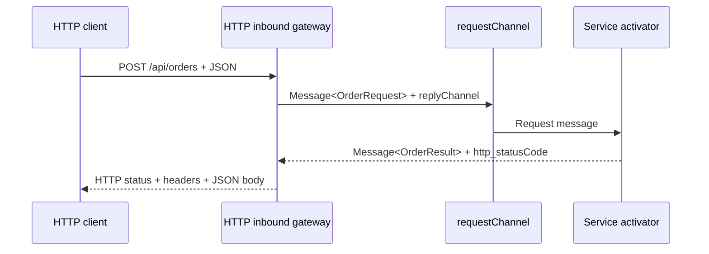

# HTTP Status Codes and ResponseEntity

## 1. Where Do HTTP Status and Response Live in Spring Integration?

In the **HTTP Adapter** chapter of the **SPRING_INTEGRATION_ADAPTERS** module, inbound/outbound adapters, gateways, pollers, and `MessageChannel`s enable Spring Integration to exchange data with external systems. Flows can connect HTTP with files, SFTP, JMS, AMQP, Kafka, or databases. For HTTP, beyond the payload, implementers must understand **response status codes**, **response headers**, and **response bodies**, because that is the contract observed by HTTP clients or downstream systems.

An HTTP response has the structure:

```http
HTTP/1.1 201 Created
Content-Type: application/json
Location: /api/orders/ORD-1001
X-Request-ID: req-123

{"orderId":"ORD-1001","status":"CREATED"}
```

Four pieces of information to distinguish:

- **Status code** (`201`): the outcome of the request at the HTTP protocol/contract level.
- **Headers** (`Content-Type`, `Location`, `X-Request-ID`): response metadata.
- **Body** (JSON): business data, when the response type permits a body.
- **Spring Integration reply message**: a `Message<?>` carrying payload and headers so a gateway can turn it into an HTTP response, or so downstream handlers can keep processing after an HTTP outbound call.

This lesson explains how those parts map in Spring Integration, specifically **`http_statusCode`** and **`org.springframework.http.ResponseEntity<T>`**. After studying it, you will be able to set HTTP statuses on inbound gateways, read status/body from outbound gateways, handle bodyless responses, manage errors, and write contract tests.

> **Principle:** an HTTP status code describes what the system guarantees at the moment it replies. A `200` or `202` code does not itself guarantee that a database or backend service has finished every business step.

## 2. Status Codes Are Not Payloads

HTTP status codes are three-digit integers. Main groups:

| Group | General Meaning | Examples |
|---|---|---|
| `1xx` | Informational response during HTTP exchange | `100 Continue` |
| `2xx` | Request was processed successfully per the specific status semantics | `200 OK`, `201 Created`, `202 Accepted`, `204 No Content` |
| `3xx` | Redirection or conditional cache handling | `301 Moved Permanently`, `302 Found`, `304 Not Modified` |
| `4xx` | Client-side issue or contract precondition violation | `400 Bad Request`, `401 Unauthorized`, `403 Forbidden`, `404 Not Found`, `409 Conflict`, `429 Too Many Requests` |
| `5xx` | Server or an upstream dependency failed to fulfill the request | `500 Internal Server Error`, `502 Bad Gateway`, `503 Service Unavailable`, `504 Gateway Timeout` |

Common statuses in integration flows:

| Status | When Used | Notes |
|---|---|---|
| `200 OK` | API processed successfully and returns result content | Can return JSON/text per `Content-Type`. |
| `201 Created` | A new resource was genuinely created | Usually includes the resource ID and optionally a `Location` header. |
| `202 Accepted` | Request was accepted for later processing | Does not mean work is finished; should include a job ID or lookup mechanism. |
| `204 No Content` | Succeeded with no representation in the body | Must not send a response body. |
| `400 Bad Request` | Invalid input syntax or data | Define an explicit error body and validation. |
| `401/403` | Missing authentication or insufficient permissions | Block at the appropriate security boundary. |
| `404 Not Found` | Resource or route does not exist per contract | Distinguish wrong URL from non-existent resource ID. |
| `409 Conflict` | Version/state conflict or idempotency conflict | Document the conflict condition. |
| `422 Unprocessable Content` | Syntactically valid body violating API semantics | Use if the contract chooses 422 instead of 400. |
| `429 Too Many Requests` | Rate limited | May include `Retry-After`. |
| `500/503/504` | System error, service unavailable, or timeout | Do not claim every timeout defaults to 504. |

**Distinguish HTTP status from business status:** `HTTP 200` can carry a body like `{"paymentStatus":"DECLINED"}` if that is the API contract, meaning the query/payment attempt was handled in a defined way. Conversely, do not return `200` when every layer failed and the contract expects an HTTP error. Choose status codes by API semantics rather than a habit of always returning 200.

## 3. Message, ResponseEntity, and HttpHeaders: Three Distinct Data Layers

Spring provides common data types:

| Type | Where Does It Live? | What Does It Provide? |
|---|---|---|
| `org.springframework.messaging.Message<T>` | Spring Integration flow | `payload` and `MessageHeaders` for routing and processing. |
| `org.springframework.http.ResponseEntity<T>` | Spring HTTP client/server APIs | `statusCode`, `HttpHeaders`, and `body` of an HTTP response. |
| `org.springframework.http.HttpHeaders` | HTTP boundary | HTTP headers such as `Content-Type`, `ETag`, `Location`, `Retry-After`. |
| `org.springframework.http.HttpStatusCode` | Spring Framework 6+ | Abstraction for HTTP status codes, including non-standard numeric codes. |
| `org.springframework.http.HttpStatus` | Spring Framework | Enum of well-known HTTP statuses such as `OK`, `CREATED`, `BAD_REQUEST`. |

Example constructing a `ResponseEntity` in Spring MVC or when representing an HTTP response:

```java
import java.net.URI;
import org.springframework.http.MediaType;
import org.springframework.http.ResponseEntity;

ResponseEntity<String> httpResponse =
    ResponseEntity.created(URI.create("/api/orders/ORD-1001"))
        .contentType(MediaType.APPLICATION_JSON)
        .body("{\"orderId\":\"ORD-1001\"}");

int code = httpResponse.getStatusCode().value(); // 201
String location =
    httpResponse.getHeaders().getLocation().toString();
String body = httpResponse.getBody();
```

**Do not equate `ResponseEntity` with a reply message.** In a Spring MVC `@RestController`, the framework uses `ResponseEntity` as a return value to build the HTTP response. In a **Spring Integration HTTP inbound gateway**, the documented path is **reply `Message<?>` → payload/headers → HTTP response**; the explicit way to set the status is the `http_statusCode` header. Placing a `ResponseEntity` directly as the reply payload without checking extraction mechanics can send clients an unexpected structure.

Conversely, an **HTTP outbound gateway** can produce a reply message whose payload is `ResponseEntity<?>` when you want to retain full HTTP status/headers/body. This is very useful for branching on status codes.

## 4. Status Mapping on an HTTP Inbound Gateway

### 4.1. Path of the Reply



On the inbound side, the gateway typically performs:

1. Spring MVC selects the endpoint based on path, HTTP method, `consumes`, and `produces`.
2. An HTTP converter turns the body into a Java payload.
3. The gateway sends the message to the request channel and waits for a reply.
4. The service activator returns a payload or `Message<?>`.
5. The gateway reads the **`http_statusCode` header from the reply message** and uses the converter and header mapper to construct the HTTP response.

The special header name **`http_statusCode`** is the bridge between Spring Integration and the HTTP status. It is internal message metadata, not a literal HTTP header sent out to the client.

### 4.2. Practical Example: Returning JSON and 200/400 Codes

This example uses Java 17+, Spring Boot with Spring MVC, Spring Integration, and Jackson. The goal is to **validate the payload** and return an appropriate status; no order is created or saved yet, so a successful response returns `200 OK` rather than `201 Created`.

For a project with Spring Boot dependency management, the main Maven dependencies are:

```xml
<dependencies>
    <dependency>
        <groupId>org.springframework.boot</groupId>
        <artifactId>spring-boot-starter-web</artifactId>
    </dependency>
    <dependency>
        <groupId>org.springframework.boot</groupId>
        <artifactId>spring-boot-starter-integration</artifactId>
    </dependency>
    <dependency>
        <groupId>org.springframework.integration</groupId>
        <artifactId>spring-integration-http</artifactId>
    </dependency>
</dependencies>
```

Create `OrderDtos.java`:

```java
package example.http;

public final class OrderDtos {
    private OrderDtos() {}

    public record OrderRequest(String sku, int quantity) {}

    public record OrderResult(String sku, String status) {}

    public record ApiError(String code, String message) {}
}
```

Create `OrderInboundConfiguration.java`:

```java
package example.http;

import org.springframework.context.annotation.Bean;
import org.springframework.context.annotation.Configuration;
import org.springframework.http.HttpMethod;
import org.springframework.http.MediaType;
import org.springframework.integration.annotation.EnableIntegration;
import org.springframework.integration.channel.DirectChannel;
import org.springframework.integration.dsl.IntegrationFlow;
import org.springframework.integration.http.dsl.Http;
import org.springframework.messaging.MessageChannel;

@Configuration
@EnableIntegration
public class OrderInboundConfiguration {

    @Bean
    public MessageChannel orderValidationRequests() {
        return new DirectChannel();
    }

    @Bean
    public IntegrationFlow orderValidationHttpFlow() {
        return IntegrationFlow
            .from(Http.inboundGateway("/api/orders/validate")
                .requestMapping(mapping -> mapping
                    .methods(HttpMethod.POST)
                    .consumes(MediaType.APPLICATION_JSON_VALUE)
                    .produces(MediaType.APPLICATION_JSON_VALUE))
                .requestPayloadType(OrderDtos.OrderRequest.class))
            .channel("orderValidationRequests")
            .get();
    }
}
```

Create `OrderValidationHandler.java` in a package scanned by Spring Boot:

```java
package example.http;

import org.springframework.http.HttpStatus;
import org.springframework.http.MediaType;
import org.springframework.integration.annotation.ServiceActivator;
import org.springframework.messaging.Message;
import org.springframework.messaging.MessageHeaders;
import org.springframework.messaging.support.MessageBuilder;
import org.springframework.stereotype.Service;

@Service
public class OrderValidationHandler {

    @ServiceActivator(inputChannel = "orderValidationRequests")
    public Message<?> validate(OrderDtos.OrderRequest request) {
        if (request.sku() == null || request.sku().isBlank()
                || request.quantity() <= 0) {

            return MessageBuilder
                .withPayload(new OrderDtos.ApiError(
                    "INVALID_ORDER",
                    "sku is required and quantity must be positive"))
                .setHeader("http_statusCode", HttpStatus.BAD_REQUEST)
                .setHeader(
                    MessageHeaders.CONTENT_TYPE,
                    MediaType.APPLICATION_JSON_VALUE)
                .build();
        }

        // Demo only validates data; order is not persisted to the database yet.
        return MessageBuilder
            .withPayload(
                new OrderDtos.OrderResult(request.sku(), "VALIDATED"))
            .setHeader("http_statusCode", HttpStatus.OK)
            .setHeader(
                MessageHeaders.CONTENT_TYPE,
                MediaType.APPLICATION_JSON_VALUE)
            .build();
    }
}
```

This configuration demonstrates **two outcomes that are both valid reply messages**. With the message returned from `@ServiceActivator`, Spring Integration routes the reply back to the waiting gateway. The gateway chooses the HTTP status from `http_statusCode`, and the converter serializes the DTO to JSON.

Note: the handler itself returns `BAD_REQUEST` for business constraints. If the body **cannot be parsed as JSON** or cannot construct `OrderRequest`, an error may occur **before** `@ServiceActivator` is called; that scenario requires dedicated HTTP exception mapping or an error flow.

### 4.3. Testing Both Response Types with curl

Valid request:

```bash
curl -i -X POST 'http://localhost:8080/api/orders/validate' \
  -H 'Content-Type: application/json' \
  -H 'Accept: application/json' \
  -d '{"sku":"BOOK-1","quantity":2}'
```

Expected response:

```http
HTTP/1.1 200 OK
Content-Type: application/json

{"sku":"BOOK-1","status":"VALIDATED"}
```

Request with invalid quantity:

```bash
curl -i -X POST 'http://localhost:8080/api/orders/validate' \
  -H 'Content-Type: application/json' \
  -H 'Accept: application/json' \
  -d '{"sku":"BOOK-1","quantity":0}'
```

Expected response:

```http
HTTP/1.1 400 Bad Request
Content-Type: application/json

{"code":"INVALID_ORDER","message":"sku is required and quantity must be positive"}
```

The HTTP code and body here are **explicitly designed inside the handler**. This is not default behavior applied to every exception. Secondary HTTP headers like `Content-Length`, `Date`, or JSON field order depend on the HTTP server and converter.

### 4.4. When to Return 201 Created?

Only after genuinely creating the resource per contract—for instance, after the DB transaction has committed or the persistence step has reached the committed milestone. At that point, you can construct the reply:

```java
import org.springframework.http.HttpStatus;
import org.springframework.messaging.Message;
import org.springframework.messaging.support.MessageBuilder;

Message<OrderDtos.OrderResult> reply =
    MessageBuilder
        .withPayload(
            new OrderDtos.OrderResult(savedOrderId, "CREATED"))
        .setHeader("http_statusCode", HttpStatus.CREATED)
        .build();

return reply;
```

This snippet is a **replacement inside the business handler after successful persistence**, where `savedOrderId` must come from the real persistence step. To return `Location: /api/orders/{id}`, declare appropriate response header mapping on the inbound endpoint or configure the corresponding header per contract and verify with HTTP tests. Putting `CREATED` in the body before persisting the resource can mislead clients about the success milestone.

## 5. Inbound Channel Adapter: Status for One-Way Flows

An **HTTP inbound channel adapter** brings requests into Spring Integration as messages, without **receiving a business reply message** to construct a response. Even so, the HTTP client still receives a protocol-level status.

According to Spring Integration documentation, a normal inbound adapter defaults to **`200 OK`** unless configured otherwise. You can use `statusCodeExpression` to return a specific status, such as `202 Accepted`:

```java
@Bean
public IntegrationFlow eventInboundFlow() {
    return IntegrationFlow
        .from(Http.inboundChannelAdapter("/api/events")
            .requestMapping(m -> m.methods(HttpMethod.POST))
            .requestPayloadType(String.class)
            .statusCodeExpression(
                "T(org.springframework.http.HttpStatus).ACCEPTED"))
        .channel("incomingEvents")
        .get();
}
```

This snippet belongs in a `@Configuration` class importing `IntegrationFlow`, `Http`, `HttpMethod`, along with an `incomingEvents` bean and its consumer. This example sets the **HTTP status at the endpoint level**, rather than configuring a business response body.

**Semantic warning:** setting `202 Accepted` does not automatically make processing asynchronous or durable. If the message is only pushed onto an in-memory queue, a restart can lose "accepted" work. When a `202` contract must guarantee durable acceptance, write to an inbox/outbox or publish to a broker with acknowledgment before sending the HTTP acknowledgment.

`statusCodeExpression` on an inbound endpoint is also used when a **gateway receives no reply before timeout**, whereas for a normal request–reply gateway that produces a reply, **`http_statusCode` on the reply message** is the source determining the HTTP status.

## 6. ResponseEntity on an HTTP Outbound Gateway

### 6.1. When Is the Reply Payload the Body vs. ResponseEntity?

Suppose an internal flow calls an external Pricing API or Inventory API using `Http.outboundGateway(...)`. The HTTP client receives:

```http
HTTP/1.1 200 OK
Content-Type: application/json
ETag: "inventory-v3"

{"sku":"BOOK-1","available":true}
```

`HttpRequestExecutingMessageHandler` uses the HTTP client to execute the request, then builds a Spring Integration **reply message**.

Outcomes vary by configuration/response:

| Configuration / Response | Typical Reply Payload |
|---|---|
| `expectedResponseType(InventoryReply.class)`, 200 response with JSON body, `extractResponseBody=true` (default) | `InventoryReply` (converted DTO). |
| `expectedResponseType(String.class)`, 200 response with text body | `String`. |
| `extractResponseBody(false)`, successful response | **`ResponseEntity<?>`**, preserving status, HTTP headers, and body. |
| **Bodyless** response, e.g. `204 No Content` | **`ResponseEntity<?>`** even when `expectedResponseType` and `extractResponseBody=true` are configured. |
| 4xx/5xx response with default HTTP client error handler | Usually **throws an exception**, rather than producing a normal reply payload. |

Two easily missed details from the Spring Integration documentation:

1. When a body is present, `expectedResponseType` must match the `Content-Type` and an `HttpMessageConverter`. Without a suitable response type configured, the gateway may return a `ResponseEntity` without the body converted as expected.
2. Since Spring Integration **5.5**, `extractResponseBody` lets you choose whether the reply payload is the **body** or the full **`ResponseEntity`**; when a body is absent, the handler still returns `ResponseEntity`.

Whether or not the response has a body, **the `http_statusCode` header on the outbound gateway's reply message** provides the HTTP status for downstream branching. Other HTTP headers are mapped according to mapper configuration.

### 6.2. Outbound Gateway Example Preserving the Full ResponseEntity

A mock Inventory API at `http://localhost:8081/inventory/{sku}` returns JSON when an item is found. We want to keep both the status and `ETag` for caching or business logic.

Create `InventoryReply.java`:

```java
package example.http;

public record InventoryReply(String sku, boolean available) {}
```

Create the interface `InventoryClient.java`:

```java
package example.http;

import org.springframework.integration.annotation.MessagingGateway;
import org.springframework.messaging.Message;

@MessagingGateway(defaultRequestChannel = "inventoryLookups")
public interface InventoryClient {

    Message<?> lookup(String sku);
}
```

Configure the flow `InventoryOutboundConfiguration.java`:

```java
package example.http;

import org.springframework.context.annotation.Bean;
import org.springframework.context.annotation.Configuration;
import org.springframework.http.HttpMethod;
import org.springframework.integration.annotation.EnableIntegration;
import org.springframework.integration.annotation.IntegrationComponentScan;
import org.springframework.integration.dsl.IntegrationFlow;
import org.springframework.integration.http.dsl.Http;

@Configuration
@EnableIntegration
@IntegrationComponentScan
public class InventoryOutboundConfiguration {

    @Bean
    public IntegrationFlow inventoryLookupFlow() {
        return IntegrationFlow.from("inventoryLookups")
            .handle(Http.outboundGateway(
                    "http://localhost:8081/inventory/{sku}")
                .httpMethod(HttpMethod.GET)
                .uriVariable("sku", "payload")
                .expectedResponseType(InventoryReply.class)
                .extractResponseBody(false))
            .get();
    }
}
```

Consuming the reply:

```java
import org.springframework.http.HttpStatusCode;
import org.springframework.http.ResponseEntity;
import org.springframework.messaging.Message;

Message<?> reply = inventoryClient.lookup("BOOK-1");

if (!(reply.getPayload() instanceof ResponseEntity<?> entity)) {
    throw new IllegalStateException(
        "Expected ResponseEntity as reply payload");
}

HttpStatusCode status = entity.getStatusCode();
String etag = entity.getHeaders().getETag();
Object body = entity.getBody();

if (status.is2xxSuccessful() && body instanceof InventoryReply data) {
    // Check inventory and ETag per the Inventory API contract.
    System.out.println(data.sku() + " / " + data.available());
}
```

The consumption snippet belongs in a service with an injected `InventoryClient inventoryClient` instance; adjust imports and packages for your project. The mock HTTP service must return valid JSON with `Content-Type: application/json`. `HttpStatusCode` is a Spring Framework 6+ API, matching the example's Java 17/Spring Boot 3+ baseline.

If your business logic only needs `InventoryReply` and does not need HTTP headers or status, you can **omit `extractResponseBody(false)`** and have the messaging gateway return the DTO directly. That gives a simpler contract.

### 6.3. Cases for 204 No Content and 304 Not Modified

An HTTP response with no body:

```http
HTTP/1.1 204 No Content
ETag: "inventory-v3"
```

In an HTTP outbound gateway, the reply payload can be a **`ResponseEntity`** with `getBody()==null`, even when the flow declares `expectedResponseType(InventoryReply.class)`. Consequently, code like the following is unsafe if the service occasionally returns 204:

```java
InventoryReply data = (InventoryReply) reply.getPayload();
```

Check the runtime type and status before casting. For `304 Not Modified`, no-body rules also apply, though how HTTP clients handle 3xx/redirects/caching can vary; never assume every client always converts `304` into a normal reply message.

To handle both explicitly:

```java
Object payload = reply.getPayload();

if (payload instanceof ResponseEntity<?> response) {
    int status = response.getStatusCode().value();
    if (status == 204) {
        // No body: handle according to contract.
    } else {
        // Inspect response and body if present.
    }
} else if (payload instanceof InventoryReply data) {
    // Response has a body and the gateway is in extract-body mode.
}
```

In practice, you do not need both branches if you pin `extractResponseBody(false)`. The two-branch example illustrates handling when a flow might produce **either payload type** depending on configuration and the HTTP response.

## 7. Comparing Status Representation on Inbound vs. Outbound

| Scenario | Source of HTTP Status | Data Representation |
|---|---|---|
| **Inbound channel adapter** (one-way intake) | Endpoint default status or `statusCodeExpression` | No business reply message. |
| **Inbound gateway** with normal reply | **Reply header `http_statusCode`** | Reply payload written as HTTP body by converter. |
| **Inbound gateway** timing out waiting for reply | Configured timeout status rule or error flow | May default to 500; custom status/body requires configuration. |
| **Outbound channel adapter** (one-way send) | HTTP client still sees status, but emits no reply message from body | Non-2xx errors may throw exceptions depending on client. |
| **Outbound gateway** with body and extracted body | Status in reply header; payload is converter-read body | Typically DTO/`String`. |
| **Outbound gateway** with `extractResponseBody(false)` | Status in `ResponseEntity` and reply header | Payload is `ResponseEntity<?>`. |
| **Outbound gateway** receiving a bodyless response | Status in `ResponseEntity` and reply header | Payload can be `ResponseEntity<?>` regardless of expected type. |

Common mistake: **`http_statusCode` is a Spring Integration header**, while `ResponseEntity.getStatusCode()` is HTTP data wrapped in a Java object. Both can express the same status code, yet they do not live in the same place.

## 8. Timeouts and Missing Replies

For an HTTP inbound gateway, if downstream does not emit a reply before `replyTimeout` expires, there is no business body to respond with. Per Spring Integration documentation, since version 4.2, a no-reply timeout **defaults to returning `500 Internal Server Error`**, and you can configure a status code expression or error channel to change it.

Conceptual flow for an API that wants to return 504 when processing exceeds its deadline:

```text
HTTP inbound gateway
   -> request channel
   -> async worker
   -> reply too slow / no reply
   -> timeout policy / error channel
   -> HTTP 504 Gateway Timeout per API contract
```

Returning `504` is an **application contract decision**, not the framework's sole default.

Distinguish these timeouts:

| Timeout | Scope | Example |
|---|---|---|
| Inbound gateway `requestTimeout` | Waiting to send the request message into a potentially blocking channel | Bounded queue is full. |
| Inbound gateway `replyTimeout` | Waiting for a reply message from downstream | Worker fails to return a result in time. |
| Outbound gateway HTTP connect timeout | Establishing connection to remote service | Partner API is unreachable. |
| Outbound gateway HTTP read/response timeout | Waiting for the HTTP response | Partner API responds too slowly. |
| Servlet/proxy/client deadline | HTTP connection limit from external client | Nginx/ALB or client times out first. |

**`replyTimeout` does not interrupt a handler blocking synchronously on a `DirectChannel`.** To enforce latency at the HTTP boundary, configure real deadlines on downstream HTTP clients/databases/brokers and weigh synchronous vs. asynchronous channels.

## 9. Are HTTP Errors Returned as ResponseEntity?

This is a very common point of confusion:

- **HTTP inbound gateway:** a service activator **can intentionally build a reply message** with `http_statusCode=400` or `503` and an `ApiError` payload. The gateway turns it into a normal HTTP response per contract.
- **HTTP outbound gateway:** when a remote server returns 4xx/5xx, `RestTemplate` and many HTTP clients with a default error handler **typically throw an exception**. The flow may **not receive** a `ResponseEntity` reply payload for those statuses.
- **Custom HTTP client/error handler:** can alter this policy to receive and handle certain HTTP statuses as data, though it must be configured and tested specifically for your Spring Integration/Spring Framework version.

Therefore, code like:

```java
ResponseEntity<?> response = (ResponseEntity<?>) reply.getPayload();
if (response.getStatusCode().value() == 404) {
    // ...
}
```

**is not a reliable default way** to handle every HTTP 404 from an outbound gateway: the default error handler can throw an exception before any reply is created.

### 9.1. Classifying Errors and Responses

| Result from Remote HTTP | Classification | Suggested Handling |
|---|---|---|
| 200 valid JSON | HTTP-level success | Parse, validate semantic contract, continue flow. |
| 201 with Location | Resource created per remote contract | Store ID/Location and verify consistency. |
| 202 | Accepted for async processing | Store job ID / poll or await callback per contract. |
| 204 | No body | Handle `ResponseEntity` reply type; do not coerce into DTO. |
| 400/422 | Invalid data/schema | Fix request; do not retry unconditionally. |
| 401/403 | Auth/authorization error | Check credentials/scopes; do not blindly retry. |
| 404 | Resource missing or wrong URL | Decide per contract whether expected miss or error. |
| 409 | Version/idempotency conflict | Check key, remote state, and business rules. |
| 429 | Rate-limited | Bounded retry, respecting `Retry-After` and backoff. |
| 500/503 | Remote unavailable | Bounded retry / circuit breaker; log failure. |
| Timeout / lost response | Uncertain whether remote executed side effects | Idempotency key; query status before retrying. |

**Do not treat HTTP 2xx as proof of distributed transaction completion.** If a flow writes to a DB, calls HTTP, and publishes to JMS/Kafka, those steps do not automatically belong to a single transaction; define commit points, outboxes, retries, and deduplication mechanisms.

### 9.2. Error Messages Differ from Reply Messages

In Spring Integration, normal messages carry business results; error flows usually receive an `ErrorMessage` whose payload is an exception. To turn an error into a JSON HTTP response on an inbound gateway, **transform the error into a serializable payload**, set the corresponding status, and route back to the waiting gateway. Do not assume that merely defining a global `errorChannel` bean automatically turns every exception into a contract-compliant error body.

An error body structure should remain stable:

```json
{
  "code": "UPSTREAM_UNAVAILABLE",
  "message": "Pricing service is temporarily unavailable",
  "requestId": "req-123"
}
```

Never return stack traces, SQL details, tokens, or sensitive internal details to clients. Keep correlation/request IDs in logs and response headers per policy.

## 10. Response Headers and Content Negotiation

An HTTP response is more than status and body. Key headers include:

| Header | When Used | Notes |
|---|---|---|
| `Content-Type` | Indicates body format | Must match body and converter. |
| `Location` | Newly created resource or redirect | On 201, should point to the resource per contract. |
| `ETag` | Cache validation / optimistic concurrency | Contract using `If-None-Match`/`If-Match` must be explicitly defined. |
| `Cache-Control` | Controls cacheability | Avoid caching sensitive data contrary to policy. |
| `Retry-After` | Suggests when to retry, often with 429/503 | Must parse both seconds and HTTP-date formats properly. |
| `X-Request-ID` / trace header | Correlation and request observability | Must not contain secrets or sensitive identifiers. |
| `Set-Cookie` | Session/stateful integration when present | Do not forward cookies between services unnecessarily. |

On an inbound gateway, `mappedResponseHeaders(...)` determines which message headers map to HTTP response headers. On an outbound gateway, `mappedResponseHeaders(...)` determines which HTTP response headers are copied onto the reply message. Same API name, but **mapping direction depends on inbound vs. outbound**.

**The special `http_statusCode` header is processed separately to determine the HTTP status**; do not treat it as a custom header to expose to HTTP clients under the literal name `http_statusCode`.

For JSON response bodies, `Accept: application/json` and `produces(application/json)` participate in selecting the representation, while actual serialization depends on the HTTP message converter. Conversely, a `204 No Content` response must not try to return JSON simply because the client sent `Accept: application/json`.

## 11. Lifecycle, Security, and Observability

HTTP endpoints live inside the Spring application context. Inbound mappings are registered when the application starts; outbound handlers initiate HTTP requests when messages arrive on the channel. Endpoint readiness **does not imply** that remote services, databases, or downstream brokers are available.

Operational controls to verify:

1. **Status contract:** clearly define when to return 200, 201, 202, 204, 4xx, and 5xx; separate acknowledgment from business completion.
2. **Validation:** handle parse/body/schema errors both before and after the channel; avoid assuming all errors occur in the service activator.
3. **Timeouts:** bound request/reply and HTTP client deadlines; monitor late replies from executors/pollers.
4. **Retries/idempotency:** clients may retry after timeouts even if the remote succeeded. Use stable request/event IDs and deduplication when side effects exist.
5. **Security:** authentication, authorization, mTLS/OAuth2, CORS if needed; filter outbound/response headers to avoid leaking tokens/cookies.
6. **Resource limits:** body sizes, HTTP connection pools, concurrency, queue capacities; prevent thread starvation when remotes slow down.
7. **Metrics/logs:** track 2xx/4xx/5xx status groups, latency, timeouts, retries, conversion errors, and correlation IDs without logging sensitive payloads.
8. **Transactions:** if an HTTP flow writes files/SFTP, JMS, AMQP, Kafka, or DB, plan compensation/outbox and separate commit milestones per system.

When returning `202 Accepted` for a multi-minute task, durably persist the task ID and initial status before returning the response. When clients expect immediate results, use a request–reply inbound gateway while ensuring all downstream steps can meet the published deadline.

## 12. Testing HTTP Status and ResponseEntity

A minimal test suite should cover both the **HTTP boundary** and **payloads/headers inside Spring Integration**.

### 12.1. Inbound Gateway

| Scenario | Assertion |
|---|---|
| Valid body | HTTP 200; JSON response contains `sku` and `VALIDATED`. |
| `quantity=0` | HTTP 400 and JSON error contract; handler was invoked. |
| Malformed JSON | Failure happens before handler; HTTP error mapping must be deterministic. |
| Wrong method | Mapping returns appropriate HTTP status, typically 405. |
| Wrong `Content-Type` | Fails `consumes`, typically 415. |
| Incompatible `Accept` | Content negotiation failure, typically 406. |
| Handler sets `http_statusCode` reply header | HTTP status matches the header value. |
| Handler returns no reply | Timeout status follows configuration; do not assume 504 by default. |
| Late reply | Cannot alter already-completed response; late reply is recorded. |

### 12.2. Outbound Gateway

Use a mock HTTP service such as WireMock or MockWebServer on `localhost:8081`:

| Mock Response | Assertion |
|---|---|
| 200 JSON DTO | `expectedResponseType(InventoryReply.class)` reads the body accurately. |
| 200 JSON with `ETag` | With `extractResponseBody(false)`, reply payload is `ResponseEntity` containing the ETag. |
| 204 No Content | Reply payload properly handles bodyless `ResponseEntity`. |
| 304 Not Modified | Verify HTTP client/redirect/cache behavior; do not assume 200. |
| 400/404 | Error handler classifies errors properly; do not expect a normal reply if client throws an exception. |
| 429 + `Retry-After` | Retry policy is bounded and fits within caller's budget. |
| 500/503 | Error flow and retry/circuit breaker behave as designed. |
| Connection/read timeout | Bounded failure, correlation ID logged, indeterminate side effects handled. |
| Schema-invalid response body | Converter/validation does not silently produce a broken DTO without error. |

### 12.3. Tracing When a Response Is Wrong

```text
HTTP client
  -> Request mapping (path / method / media type)
  -> Request converter
  -> Integration request channel
  -> Handler / outbound HTTP client
  -> Reply Message payload + http_statusCode
  -> Reply header mapper / HttpMessageConverter
  -> HTTP status + response headers + body
```

If **the status is wrong while the body is right**, check `http_statusCode` on the reply, timeout policy, and exception resolvers. If **the status is right while the body is wrong**, check reply payload type, HTTP converters, `Content-Type`, and `ResponseEntity` extraction. If **there is no reply**, check `replyChannel`, timeouts, consumers, and error flows.

## 13. Key Takeaways

- An HTTP response consists of **status, headers, and body**; a Spring Integration reply message consists of **payload and message headers**. The gateway maps between them at the HTTP boundary.
- For an **inbound gateway**, set the business status via the **`http_statusCode` header** on the reply message. For an **inbound channel adapter**, status comes from the endpoint default or `statusCodeExpression`.
- For an **outbound gateway**, `expectedResponseType` and converters determine the body type; `extractResponseBody(false)` preserves **`ResponseEntity<?>`** as the reply payload.
- When a response **has no body**, an outbound gateway can return `ResponseEntity` even when another expected response type is configured. Always handle `204` per contract.
- Some 4xx/5xx statuses cause the HTTP client to **throw an exception before creating a reply message**, requiring dedicated error flows and retries.
- `202` codes, timeouts, retries, idempotency, and commit milestones must accurately state business guarantees across HTTP, databases, and message brokers.

### Official Documentation References

- [Spring Integration — HTTP Namespace Support: Response Status Code](https://docs.spring.io/spring-integration/reference/http/namespace.html)
- [Spring Integration — HTTP Outbound Components: Empty Response Bodies, ResponseEntity](https://docs.spring.io/spring-integration/reference/http/outbound.html)
- [Spring Integration — Timeout Handling](https://docs.spring.io/spring-integration/reference/http/timeout.html)
- [Spring Integration — HTTP Header Mappings](https://docs.spring.io/spring-integration/reference/http/header-mapping.html)
- [Spring Integration API — BaseHttpInboundEndpoint](https://docs.spring.io/spring-integration/api/org/springframework/integration/http/inbound/BaseHttpInboundEndpoint.html)
- [Spring Integration API — BaseHttpMessageHandlerSpec](https://docs.spring.io/spring-integration/api/org/springframework/integration/http/dsl/BaseHttpMessageHandlerSpec.html)
