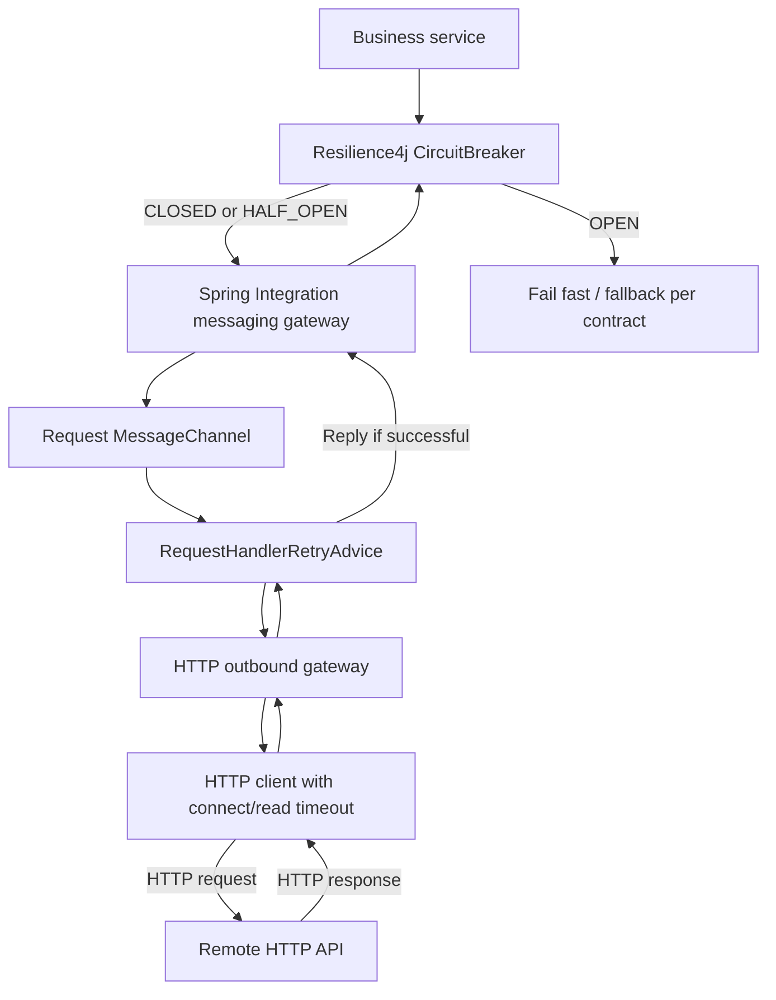
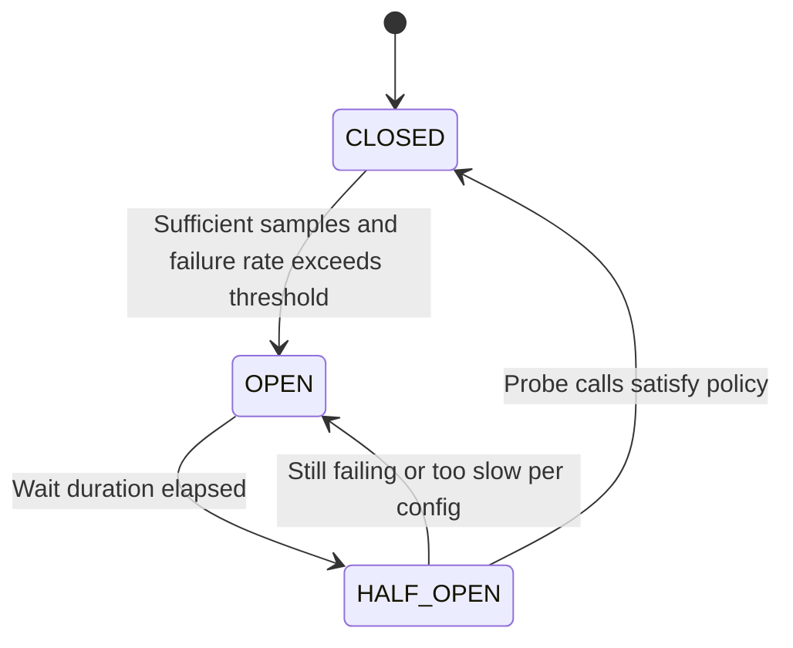
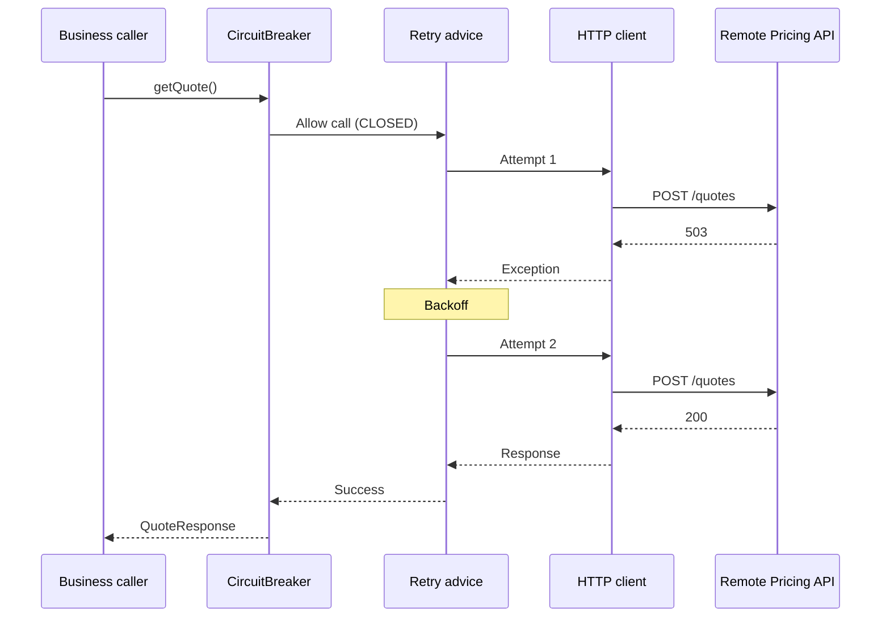

# Timeout, Retry, and Circuit Breaker for HTTP

## 1. The Problem: One Slow HTTP Service Can Bring Down an Entire Integration Flow

In the **SPRING_INTEGRATION_ADAPTERS** module, Spring Integration uses inbound/outbound adapters, gateways, pollers, and `MessageChannel`s to exchange messages with external systems. A flow might receive an HTTP request, call a partner's HTTP service, and then write to a database, send to JMS/AMQP/Kafka, or transfer files/SFTP. Because every boundary has its own failure modes, **unbounded waiting or uncontrolled retries at the HTTP step** can stall the entire processing chain.

Consider a quote-check flow:

```text
Client -> HTTP inbound gateway -> MessageChannel
       -> HTTP outbound gateway -> Pricing API
       <- Quote JSON            <- HTTP response
       <- reply message
Client <- HTTP response
```

If the Pricing API stops responding, several things can happen:

- Request-handling threads stay tied up waiting on the remote server.
- Connection pools and queues gradually exhaust; healthy requests also degrade.
- Clients time out and resend while the original requests are still running.
- Coordinated retries make an overloaded service even harder to recover.
- When the remote operation has side effects, a request that already succeeded but lost its response can be re-sent, causing duplicate side effects.

The three techniques in this lesson address **three distinct classes of problems**:

| Technique | Question Solved | What It Does Not Solve Alone |
|---|---|---|
| **Timeout** | How long at most to wait for one connection/response? | Does not retry automatically; does not prove the remote never executed the request. |
| **Retry** | Which errors are likely transient and how many times at most to try again? | Unsafe for side effects without idempotency; does not protect against retry overload. |
| **Circuit breaker** | When a remote repeatedly fails/slows down, should new calls be temporarily rejected? | Does not cancel already in-flight requests; does not synthesize fallback data on its own. |

After this lesson, you will be able to distinguish timeout types, attach retry advice to an HTTP outbound gateway, use a circuit breaker to **fail fast**, reason about protection ordering, build idempotency-safe policies, and test failures with a mock HTTP server.

## 2. Architecture Combining Timeout, Retry, and Circuit Breaker



In this architecture example:

1. The **circuit breaker** sits outside one business call, deciding whether access to the Pricing API is permitted.
2. **Retry advice** sits directly on the outbound HTTP handler, retrying only when the error matches policy.
3. **HTTP client timeouts** bound the duration of **each attempt**, rather than automatically bounding the entire retry loop.
4. If all attempts fail, the error returns to the caller; the circuit breaker records **the final outcome of the single logical call**.
5. When the breaker is open, new calls are rejected early without issuing requests to the remote. Callers handle it per contract: return an explicit error, serve permitted cached data, or defer work for later processing.

Placing the breaker **outside retries** means the breaker typically counts one logical call instead of counting every attempt. Placing the breaker **inside retries** exposes each attempt to the breaker; the two orders carry different metric and load-shedding semantics. There is no single order "right for every system"; this lesson uses the order that is straightforward to reason about and usually practical for synchronous APIs.

> **Core point:** both a one-way HTTP outbound channel adapter and a request–reply HTTP outbound gateway require timeouts and can raise errors. "Does not produce a reply message" does not mean the HTTP request runs non-blocking or needs no exception handling.

## 3. Timeouts: Limits at Which Layer?

### 3.1. Easily Confused Timeout Types

| Timeout / Deadline | Where Does It Live? | When It Expires | What It Does Not Guarantee |
|---|---|---|---|
| **Connect timeout** | Outbound HTTP client | Connection could not be established within the configured limit. | Does not bound total exchange duration. |
| **Read/response timeout** | Outbound HTTP client | Data/response was not received within the client's timeout. | Not necessarily the end-to-end deadline, depending on implementation. |
| **Connection-pool acquisition timeout** | HTTP client pool | Could not borrow a connection from the pool quickly enough. | Not controlled by connect timeout alone. |
| **Messaging gateway `requestTimeout`** | Spring Integration, send step | Sending to a blocking channel did not finish in time. | Not synonymous with HTTP connect timeout. |
| **Messaging gateway `replyTimeout`** | Spring Integration, reply wait step | No reply message arrived within the wait window. | Does not interrupt a handler blocking on the same `DirectChannel` thread. |
| **HTTP server/proxy/client deadline** | Inbound client boundary | Client/proxy closes or cancels the request. | Does not roll back side effects on the remote server or DB. |

**Connect timeout differs from read timeout.** A TCP/TLS connection can succeed while the remote delays responding. Conversely, a read timeout can occur after the remote already processed the request and was sending the response. A timeout error therefore **does not prove the request caused no side effects**.

**`replyTimeout` does not interrupt a synchronous handler.** When requests traverse a `DirectChannel`, the HTTP outbound handler typically runs on the caller's thread. If that thread is blocked inside the HTTP client, a messaging gateway reply timeout is not a preemption mechanism. Place timeouts directly on the HTTP client and every downstream blocking operation.

### 3.2. Time Budgeting

Suppose an inbound API has a 4-second response budget. The flow needs:

- Request validation and mapping: roughly 100 ms under normal conditions.
- Calling the Pricing API: multiple attempts if retrying.
- Result transformation and logging: roughly 100 ms.
- Headroom for queueing, scheduling, reverse proxies, and network variance.

If each HTTP attempt has a 1-second connect timeout and a 2-second read timeout, three retries can **easily exceed 4 seconds**, especially with backoff. Individual timeouts do not add up to a single unified deadline on their own.

Production designs should enforce an **overall deadline** per API contract and allocate budget to each attempt. When insufficient budget remains for another attempt, stop retrying, return an appropriate status, and log the reason. For very long tasks, switch to returning `202 Accepted` after durably persisting the job, letting clients query the result later instead of holding a synchronous request open.

### 3.3. Example Configuring HTTP Client Timeouts

With Spring Framework using `ClientHttpRequestFactory`, you can declare a request factory with timeouts configured:

```java
package example.http;

import org.springframework.context.annotation.Bean;
import org.springframework.context.annotation.Configuration;
import org.springframework.http.client.ClientHttpRequestFactory;
import org.springframework.http.client.SimpleClientHttpRequestFactory;

@Configuration
public class PartnerHttpClientConfiguration {

    @Bean
    public ClientHttpRequestFactory partnerRequestFactory() {
        SimpleClientHttpRequestFactory factory =
            new SimpleClientHttpRequestFactory();
        factory.setConnectTimeout(1_000); // 1 second
        factory.setReadTimeout(2_000);    // 2 seconds
        return factory;
    }
}
```

This is an illustrative configuration for a Spring `RestTemplate`/request-factory style HTTP client, not the only way across all Spring Integration versions. Newer versions support `RestClient` and dedicated customization APIs for HTTP outbound; verify your project's version and **attach the factory to the exact HTTP client the handler actually uses**.

For a directly instantiated handler on versions supporting `setRequestFactory(...)`, configuration looks like:

```java
import org.springframework.integration.http.outbound.HttpRequestExecutingMessageHandler;
import org.springframework.http.client.ClientHttpRequestFactory;

HttpRequestExecutingMessageHandler handler =
    new HttpRequestExecutingMessageHandler(
        "https://partner.example/api/quotes");

handler.setRequestFactory(partnerRequestFactory);
```

The snippet above only illustrates **configuring the handler**, where `partnerRequestFactory` is an initialized bean. You still need to configure the method, response type, and channel registration. Do not simply create a `RestTemplate` bean with timeouts and assume the HTTP outbound handler automatically uses that instance.

## 4. Retry: Retrying the Right Errors at the Right Time

Retries fit errors that are **likely transient**. Do not automatically retry every exception thrown by an HTTP handler.

### 4.1. Basic Classification Table

| Outcome | Should Default Retry Be Considered? | Why |
|---|---|---|
| Connect timeout / connection refused | **Conditionally yes** | May be transient network or service unavailability; still needs limits and control. |
| Read timeout / lost response | **Conditionally yes, duplicate risk** | Remote may have already processed the request when the response was lost. |
| HTTP `500`, `502`, `503`, `504` | Usually **conditionally yes** | May recover, though aggressive retries amplify load. |
| HTTP `429 Too Many Requests` | Per `Retry-After` / rate-limit contract | Do not retry immediately; respect partner limits. |
| HTTP `400`, `422` | Usually **no** | Invalid payload/schema will not fix itself on retry. |
| HTTP `401`, `403` | Usually **no** | Credential/scope/permission issues require separate handling. |
| HTTP `404`, `409` | Depends on API semantics | "Not found" or "state conflict" may be a deterministic business result. |
| Conversion/serialization error | **No** | Broken DTO, converter, or contract must be fixed. |
| `CallNotPermittedException` from OPEN circuit breaker | **No** | Breaker intentionally rejected the call; immediate retries create useless work. |

A single failure should never cause the entire system to retry forever. You need:

- **Max attempts** (including the initial attempt).
- **Exponential backoff** to avoid hammering continuously.
- **Jitter** when multiple instances run concurrently, preventing *thundering herds*.
- **Retryable exception/status classification**, not just a rigid HTTP code range.
- **Overall deadline**, stopping attempts once the wait budget expires.
- **Idempotency** or proof that the operation can be safely repeated.

### 4.2. A RetryTemplate Configuration Restricting Retryable Errors

Spring Integration supports `RequestHandlerRetryAdvice`, which uses Spring Retry to wrap a message handler. The following example targets a `RestTemplate`-style HTTP client, where network errors throw `ResourceAccessException` and 5xx responses are represented by `HttpServerErrorException`.

```java
package example.http;

import java.util.HashMap;
import java.util.Map;

import org.springframework.context.annotation.Bean;
import org.springframework.context.annotation.Configuration;
import org.springframework.integration.handler.advice.RequestHandlerRetryAdvice;
import org.springframework.retry.backoff.ExponentialBackOffPolicy;
import org.springframework.retry.policy.SimpleRetryPolicy;
import org.springframework.retry.support.RetryTemplate;
import org.springframework.web.client.HttpServerErrorException;
import org.springframework.web.client.ResourceAccessException;

@Configuration
public class PartnerRetryConfiguration {

    @Bean
    public RequestHandlerRetryAdvice partnerRetryAdvice() {
        Map<Class<? extends Throwable>, Boolean> retryable =
            new HashMap<>();
        retryable.put(ResourceAccessException.class, true);
        retryable.put(HttpServerErrorException.class, true);

        // 3 attempts total; traverse deep into the cause chain.
        SimpleRetryPolicy retryPolicy =
            new SimpleRetryPolicy(3, retryable, true);

        ExponentialBackOffPolicy backOff =
            new ExponentialBackOffPolicy();
        backOff.setInitialInterval(200L); // ms
        backOff.setMultiplier(2.0);
        backOff.setMaxInterval(1_000L);

        RetryTemplate retryTemplate = new RetryTemplate();
        retryTemplate.setRetryPolicy(retryPolicy);
        retryTemplate.setBackOffPolicy(backOff);

        RequestHandlerRetryAdvice advice =
            new RequestHandlerRetryAdvice();
        advice.setRetryTemplate(retryTemplate);
        return advice;
    }
}
```

What this configuration means:

1. `SimpleRetryPolicy(3, ...)` allows at most **three attempts including the initial call**.
2. `traverseCauses=true` helps classify the root cause when Spring Integration or a messaging gateway wraps errors in intermediate exceptions.
3. `ExponentialBackOffPolicy` spaces out retries. In this typical example, delays before attempts two and three are roughly 200 ms and 400 ms, without jitter yet.
4. Only permitted exceptions trigger retries. HTTP 400 and mapping errors are excluded from the retry list.
5. Once exhausted, the remaining exception must be handled by the caller/error flow; **retry advice does not automatically turn errors into JSON HTTP responses**.

**Limitations of the example:** Spring Integration, HTTP clients, and error handlers can produce different exception types depending on version. Test actual runtime exceptions, especially for 429 and multi-layered wrapped exceptions. The table above is a controlled learning policy, not an exact rule for every partner API.

## 5. Attaching Retry Advice to an HTTP Outbound Gateway

### 5.1. Required Dependencies

This example uses Spring Boot 3+, Java 17+, and Spring Integration HTTP. The main dependencies below assume Spring Boot dependency management:

```xml
<dependencies>
    <dependency>
        <groupId>org.springframework.boot</groupId>
        <artifactId>spring-boot-starter-integration</artifactId>
    </dependency>
    <dependency>
        <groupId>org.springframework.boot</groupId>
        <artifactId>spring-boot-starter-web</artifactId>
    </dependency>
    <dependency>
        <groupId>org.springframework.integration</groupId>
        <artifactId>spring-integration-http</artifactId>
    </dependency>
    <dependency>
        <groupId>org.springframework.retry</groupId>
        <artifactId>spring-retry</artifactId>
    </dependency>
</dependencies>
```

For projects without the Spring Boot BOM, declare compatible dependency versions explicitly. `spring-retry` is the library applying the retry policy; Spring Integration HTTP does not automatically perform safe retries just because you declared `Http.outboundGateway`.

### 5.2. DTOs and Messaging Gateway

File `QuoteDtos.java`:

```java
package example.http;

public final class QuoteDtos {
    private QuoteDtos() {}

    public record QuoteRequest(String productId, int quantity) {}

    public record QuoteResponse(
        String quoteId, String currency, long amountMinorUnits) {}
}
```

File `QuoteClient.java`:

```java
package example.http;

import org.springframework.integration.annotation.MessagingGateway;

@MessagingGateway(defaultRequestChannel = "quoteRequests")
public interface QuoteClient {
    QuoteDtos.QuoteResponse quote(QuoteDtos.QuoteRequest request);
}
```

The Java messaging gateway builds the request message and waits for a reply from the flow. The result is read as `QuoteResponse`. Because this is a request–reply contract, the handler **must use an HTTP outbound gateway**, not an outbound channel adapter.

### 5.3. HTTP Outbound Flow with Retry Advice

File `QuoteIntegrationConfiguration.java`:

```java
package example.http;

import org.springframework.beans.factory.annotation.Value;
import org.springframework.context.annotation.Bean;
import org.springframework.context.annotation.Configuration;
import org.springframework.http.HttpMethod;
import org.springframework.http.MediaType;
import org.springframework.integration.annotation.EnableIntegration;
import org.springframework.integration.annotation.IntegrationComponentScan;
import org.springframework.integration.dsl.IntegrationFlow;
import org.springframework.integration.handler.advice.RequestHandlerRetryAdvice;
import org.springframework.integration.http.dsl.Http;
import org.springframework.messaging.MessageHeaders;

@Configuration
@EnableIntegration
@IntegrationComponentScan
public class QuoteIntegrationConfiguration {

    @Bean
    public IntegrationFlow quoteOutboundFlow(
            @Value("${partner.quote.url}") String quoteUrl,
            RequestHandlerRetryAdvice partnerRetryAdvice) {

        return IntegrationFlow.from("quoteRequests")
            .enrichHeaders(headers -> headers.header(
                MessageHeaders.CONTENT_TYPE,
                MediaType.APPLICATION_JSON_VALUE))
            .handle(Http.outboundGateway(quoteUrl)
                .httpMethod(HttpMethod.POST)
                .expectedResponseType(QuoteDtos.QuoteResponse.class),
                endpoint -> endpoint.advice(partnerRetryAdvice))
            .get();
    }
}
```

`application.yml`:

```yaml
partner:
  quote:
    url: "http://localhost:8081/api/quotes"
```

The flow above illustrates **attaching retry advice to a message handler** via Java DSL endpoint configuration. The actual HTTP client used in the flow **still needs timeouts configured** as in Section 3, such as via a request factory or customized HTTP client per your Spring Integration version's API.

A common mistake is defining a `partnerRequestFactory` bean with timeouts in the application context without wiring it to the HTTP outbound gateway, assuming timeouts are already active. Use a mock server to verify that connect/read timeouts actually fire as configured on the called endpoint.

### 5.4. What Gets Retried?

When `QuoteClient.quote(...)` sends a message:

1. The retry advice invokes the HTTP handler.
2. If the handler receives a valid HTTP 200 JSON reply, the reply message returns to the caller with no retries.
3. If the HTTP client throws `HttpServerErrorException`, the retry advice classifies the cause and retries within limits.
4. If the HTTP client throws `HttpClientErrorException.BadRequest`, the exception is non-retryable and returns immediately to the caller/error flow.
5. If the HTTP client hits a read timeout and the root cause is `ResourceAccessException`, the advice may retry; **side effects from the earlier request may have already occurred**.

Because the example method uses **POST**, only allow retries when the Pricing API's contract permits resending the same request or supports an **idempotency key**. Without that guarantee, production policies must vary by operation type or only retry cases known not to have sent the request—which often cannot be determined from a simple exception alone.

## 6. Circuit Breaker: Avoiding Repeated Calls to a Failing Service

Retries try again a few times; a **circuit breaker** tracks outcomes across multiple calls over time and stops issuing new requests when a partner system is unhealthy.

Three primary states:

| State | Behavior |
|---|---|
| **CLOSED** | Allows calls normally, recording successes/failures in a statistical window. |
| **OPEN** | Rejects new calls immediately; makes no HTTP requests. |
| **HALF_OPEN** | Permits a limited number of probe calls; success/failure decides whether to close or re-open. |



A breaker requires a policy:

- **Sliding window:** count-based or time-based window.
- **Minimum number of calls:** avoids opening the breaker from a single error before sufficient data exists.
- **Failure rate threshold:** failure percentage before opening.
- **Slow-call threshold:** if configured, high slow-call rates can also open the breaker.
- **Open-state wait duration:** pause duration before probing again.
- **Permitted calls in half-open:** number of probe calls used to assess recovery.
- **Record/ignore exceptions:** bad-input errors (typically HTTP 400) do not necessarily reflect dependency health.

**A circuit breaker does not enforce timeouts.** A permitted call still requires HTTP client timeouts. Nor does it cancel in-flight requests when transitioning from CLOSED to OPEN.

### 6.1. Resilience4j CircuitBreaker Example

To illustrate a breaker with an API independent of auto-configuration annotations, we use the `resilience4j-circuitbreaker` library. Add the Maven dependency with a **compatible version managed by your project's BOM or property**:

```xml
<dependency>
    <groupId>io.github.resilience4j</groupId>
    <artifactId>resilience4j-circuitbreaker</artifactId>
    <version>${resilience4j.version}</version>
</dependency>
```

The `resilience4j.version` property must be declared with a version compatible with your project; do not pick an arbitrary version number. The example below uses the standard Resilience4j 2.x API.

Create `QuoteCircuitBreakerConfiguration.java`:

```java
package example.http;

import java.time.Duration;

import io.github.resilience4j.circuitbreaker.CircuitBreaker;
import io.github.resilience4j.circuitbreaker.CircuitBreakerConfig;
import org.springframework.context.annotation.Bean;
import org.springframework.context.annotation.Configuration;
import org.springframework.web.client.HttpClientErrorException;

@Configuration
public class QuoteCircuitBreakerConfiguration {

    @Bean
    public CircuitBreaker quoteCircuitBreaker() {
        CircuitBreakerConfig config = CircuitBreakerConfig.custom()
            .slidingWindowSize(20)
            .minimumNumberOfCalls(10)
            .failureRateThreshold(50.0f)
            .waitDurationInOpenState(Duration.ofSeconds(30))
            .permittedNumberOfCallsInHalfOpenState(3)
            .recordException(error -> {
                // Spring Integration may wrap HTTP errors in multiple layers.
                Throwable current = error;
                while (current.getCause() != null) {
                    current = current.getCause();
                }
                // Demo: do not treat caller-side HTTP 4xx as remote health failures.
                return !(current instanceof HttpClientErrorException);
            })
            .build();

        return CircuitBreaker.of("pricingApi", config);
    }
}
```

Meaning of this illustrative configuration: once at least 10 calls have occurred within the latest window of up to 20 calls, if the classified failure rate reaches 50%, the breaker can open. After 30 seconds, the breaker tests recovery using up to three HALF_OPEN calls. Exact runtime transitions depend on state, record/ignore predicates, and concurrency.

**Note:** the demo ignores the entire 4xx group, including `429`. In production, 429 can signal overload and warrant its own policy; classify by exact HTTP status, `Retry-After` contract, and actual error type. When error handlers wrap exceptions in multiple layers, inspect causes carefully rather than blindly checking the outermost exception class. Misclassifying exceptions can cause the breaker to never open, or to trip on caller payload errors.

### 6.2. Placing the Breaker Outside the Spring Integration Call

Create `ResilientQuoteService.java`:

```java
package example.http;

import io.github.resilience4j.circuitbreaker.CallNotPermittedException;
import io.github.resilience4j.circuitbreaker.CircuitBreaker;
import org.springframework.stereotype.Service;

@Service
public class ResilientQuoteService {

    private final QuoteClient quoteClient;
    private final CircuitBreaker quoteCircuitBreaker;

    public ResilientQuoteService(
            QuoteClient quoteClient,
            CircuitBreaker quoteCircuitBreaker) {
        this.quoteClient = quoteClient;
        this.quoteCircuitBreaker = quoteCircuitBreaker;
    }

    public QuoteDtos.QuoteResponse getQuote(
            QuoteDtos.QuoteRequest request) {

        if (request.productId() == null
                || request.productId().isBlank()
                || request.quantity() <= 0) {
            throw new IllegalArgumentException("Invalid quote request");
        }

        try {
            return CircuitBreaker.decorateSupplier(
                quoteCircuitBreaker,
                () -> quoteClient.quote(request)).get();
        } catch (CallNotPermittedException ex) {
            // Caller/API layer must map to an appropriate contract error.
            throw new IllegalStateException(
                "Pricing API is temporarily unavailable", ex);
        }
    }
}
```

Here, the breaker guards **the entire `QuoteClient.quote(...)` call**. Because retry advice lives inside the outbound flow, each logical call is recorded by the breaker only after all attempts finish. When the breaker is OPEN, calls are rejected before sending any message into the HTTP outbound flow.

The service class simply **throws a simple domain-facing exception** when the breaker is OPEN; it does not automatically turn it into HTTP 503. If this service is invoked from an HTTP inbound gateway, configure an error flow or handler to produce the right reply/status. If invoked from a JMS/Kafka consumer, apply appropriate retry/dead-letter policies to avoid infinite retry loops.

## 7. Retry + Breaker + Timeout: Ordering and Retry Storms

Suppose multiple instances encounter HTTP 503 simultaneously:



One caller invocation can generate **multiple HTTP requests**. If 100 concurrent callers each retry up to 3 times, total attempts under failure can surge sharply. Therefore, retries must be paired with:

- Backoff and jitter so all instances do not retry at the exact same instant.
- Concurrency limits, connection pool limits, or bulkheads to cap in-flight calls.
- A circuit breaker to pause when the remote continuously fails.
- Rate limiting honoring `429` and `Retry-After` if published by the partner.
- An overall deadline: stop retrying when insufficient time remains for another attempt.
- Observability: separate **logical call** counts from **HTTP attempt** counts.

**Ordering changes what metrics mean.** Placing the breaker outside retries lets the breaker observe the final outcome of a logical call. Placing the breaker inside retries lets it observe each individual attempt; if it opens mid-retry, subsequent attempts are rejected. Whichever order you choose, test it and explicitly document the SLI/SLO metrics being measured.

## 8. Idempotency: Mandatory When Retrying Side-Effecting Requests

A timeout can unfold along this sequence:

```text
Caller                   Remote service
  |---- POST /orders ----->|
  |                        |  Order saved successfully
  |                        |  Commit transaction
  |<--- response lost -----|
  |
  |---- retry POST -------->|
  |                        |  Risk of creating duplicate order
```

For APIs that create orders, transfer funds, reserve inventory, or upload files, **retrying is not safe merely because the exception was a timeout**. You need contract-level deduplication:

1. The producer generates an `Idempotency-Key` or `eventId` **that stays constant across attempts for the same operation**, never generating a new value on each retry.
2. The remote service stores the outcome or execution state keyed by that ID, bound to the valid request data.
3. Upon receiving the same key again, the remote returns the prior result or handles it deterministically without applying side effects a second time.
4. Use transactions, unique constraints, and an appropriate key retention window. Single-instance in-memory caches are insufficient when the remote runs across multiple nodes.
5. For indeterminate timeout outcomes, provide a status-lookup API by key before retrying when possible.

Example attaching an idempotency key to a message:

```java
import org.springframework.messaging.Message;
import org.springframework.messaging.support.MessageBuilder;

Message<QuoteDtos.QuoteRequest> request =
    MessageBuilder
        .withPayload(new QuoteDtos.QuoteRequest("BOOK-1", 2))
        .setHeader("Idempotency-Key", "quote-req-12345")
        .build();
```

This header **only becomes an HTTP header if the outbound HTTP header mapper permits it**. When calling via `@MessagingGateway` with a DTO, add `@Header("Idempotency-Key")` to the method or use a header enricher alongside `mappedRequestHeaders(...)` on the handler. Never assume an arbitrary integration header appears on the wire automatically.

For **pure read-only GETs**, retries usually carry lower risk, yet still require error classification, backoff, load limits, and time limits. Nor should you equate the HTTP method `POST` with guaranteed non-idempotency: POST APIs can also support idempotency keys and retry-safe semantics.

## 9. Avoiding Mistakes When HTTP Inbound Calls HTTP Outbound

A common pattern:

```text
External client
    -> HTTP inbound gateway
    -> DirectChannel
    -> HTTP outbound gateway
    -> Partner API
    -> reply message or exception
    -> HTTP response to client
```

Key principles:

- **Do not assume exceptions automatically turn into contract-compliant status codes.** Outbound HTTP errors can reach the inbound gateway as a `MessagingException` with root cause `HttpServerErrorException` or `ResourceAccessException`. You need an error flow or handler to produce the appropriate JSON body and `http_statusCode`.
- **Circuit OPEN does not automatically emit HTTP 503.** `CallNotPermittedException` must be handled at the API or application boundary.
- **`replyTimeout` does not replace HTTP client timeouts.** With `DirectChannel`, blocking calls still require their own client configuration.
- **Do not return 200 before downstream reaches its commit milestone.** If returning `202 Accepted`, ensure the task is durably persisted per contract.
- **Do not retry the entire flow after writing data if only the HTTP step failed.** Scope retries tightly around the outbound handler or use an outbox to avoid re-running side-effecting business logic.
- **Distinguish synchronous from asynchronous errors.** With `ExecutorChannel`/`QueueChannel` + poller, errors can surface after the HTTP client already closed the connection; you need an error channel, failure persistence, metrics, and controlled replay.

When a flow continues to files, SFTP, JMS, AMQP, Kafka, or databases, HTTP timeouts and retries **do not automatically create a unified transaction**. Each step needs its own commit point and recovery rules, using outbox/inbox or saga patterns as needed.

## 10. Observing Breakers, Retries, and Timeouts in Production

Separate these metrics:

| Metric | What It Shows |
|---|---|
| `http_client_request_duration` by endpoint/status | Latency of individual HTTP attempts, not identical to logical calls. |
| `retry_attempts_total` | Attempt counts and errors triggering retries. |
| `retry_exhausted_total` | Logical calls failing after all retries were exhausted. |
| Circuit breaker state | CLOSED, OPEN, HALF_OPEN per dependency. |
| Failure rate, slow-call rate | Why the breaker opened within the statistical window. |
| `call_not_permitted_total` | Calls rejected while the breaker is OPEN. |
| Timeout count | Distinguish connect, read, pool acquisition, and caller deadlines. |
| Queue depth / executor active threads | Congestion and backpressure signals ahead of the handler. |
| Business outcome / idempotency duplicates | Whether the remote actually applied side effects. |

Logs should record `correlationId`, `eventId`, sanitized request target **with secrets stripped**, attempt count, elapsed duration, and terminal cause. Never log raw `Authorization` headers, cookies, access tokens, or sensitive personal payloads.

With Resilience4j, you can observe events/states and export corresponding metrics when Micrometer is present. However, the core `resilience4j-circuitbreaker` library **does not automatically provide dashboards, alerts, or persistence**; configure metrics, exporters, and alert thresholds for your environment.

### Security and Resources

- Use HTTPS, token/mTLS authentication, and externalized secret management outside source code.
- Restrict target URIs to defend against SSRF if endpoints or paths are derived from external data.
- Pair retries/breakers with **bulkheads** or bounded connection pools. A circuit breaker does not replace concurrency limits.
- Enforce body/response size limits, timeouts, queue capacities, and concurrent request caps; never queue waiting requests unboundedly.
- Implement graceful shutdown: stop accepting new work, finish or durably persist in-flight messages, and release HTTP client resources.

## 11. Testing with a Mock HTTP Server

You do not need to break a real Pricing API to verify retries and breakers. Use WireMock, MockWebServer, or a stub server to simulate HTTP responses.

### 11.1. Test Matrix

| Mock Behavior | What to Verify |
|---|---|
| `200` on first try | One HTTP attempt, `QuoteResponse` received; breaker records success. |
| `503` twice, then `200` | Three attempts total with backoff; logical call succeeds. |
| `400` on first try | No retries; error classified properly. |
| `401` or `403` | No blind retries with identical credentials. |
| `429` with `Retry-After` | Dedicated policy applied; not treated as immediately retryable. |
| Remote delay exceeding read timeout | Attempt terminates finitely and retries if policy permits. |
| TCP connection refused | Connect error and retry classification verified. |
| Multiple consecutive failing logical calls | Breaker opens once minimum samples and threshold are met. |
| Breaker OPEN | New calls rejected; **zero HTTP requests** reach the mock server. |
| Open wait duration elapsed | Bounded HALF_OPEN probe calls occur and breaker closes/re-opens based on results. |
| 204 / bodyless response | Handler/caller does not blindly cast to a DTO. |
| Reply arrives after inbound HTTP caller's deadline | Does not attempt to write to a closed response; late reply/error is logged. |
| POST timeout after remote committed | Retries do not cause duplicate side effects thanks to the idempotency key. |

### 11.2. Verifying Retry Policy by Request Count

Example test fixture: mock server returns `503` for the first two requests and `200` on the third. Call `QuoteClient.quote(...)` **once** and assert:

- Mock server received exactly **three** requests (`maxAttempts` includes the initial call).
- All attempts carried the same payload and idempotency key if specified by contract.
- Caller received the JSON reply deserialized into `QuoteResponse`.
- Metrics distinguish three HTTP attempts from one logical call.

Repeat with `400`: the mock server must receive exactly **one** request, not three. If three requests arrive, retry classification or exception wrapping in Spring Integration is misconfigured.

### 11.3. Testing Stateful Circuit Breakers Deterministically

Breakers use sample windows, so tests must remain isolated—instantiate a fresh breaker per test to avoid leaking state. Avoid long `Thread.sleep` calls in tests when you can control clocks, state transitions, or use library test utilities.

Assertions:

1. In CLOSED, calls are permitted.
2. After enough recorded failure outcomes, the breaker transitions to OPEN.
3. In OPEN, callers fail fast and **no new HTTP attempts** are made.
4. When probing is permitted, HALF_OPEN call counts are bounded.
5. Good probe outcomes return the breaker to CLOSED; bad outcomes re-open it.
6. Input errors (such as HTTP 400) are ignored in health metrics if the contract and predicate specify so.

### 11.4. Tracing When the System Is Still Slow

```text
Caller deadline
   -> Circuit breaker state
   -> MessageChannel / executor / queue
   -> Retry advice + attempt count
   -> HTTP client connection acquisition
   -> Connect timeout / read timeout
   -> Remote HTTP status
   -> Reply conversion / errorChannel
   -> Caller reply timeout
```

If responses are still too slow, measure duration per segment instead of blindly raising `replyTimeout`. If the breaker never opens despite `500` responses from the remote, check the **exception classifier**, `minimumNumberOfCalls`, and breaker placement relative to retries. If the breaker opens from `400` errors alone, check whether exception root causes are classified accurately.

## 12. Key Takeaways

**Timeouts** guard wait times at each layer; **retries** recover from transient faults within bounded attempts and backoff; **circuit breakers** halt calls to failing remotes once error thresholds are breached. The three mechanisms complement rather than replace one another.

With Spring Integration HTTP:

1. Set **connect/read timeouts on the exact HTTP client** used by the outbound handler.
2. Use `RequestHandlerRetryAdvice` to retry close to the HTTP handler, classifying exceptions and accounting for your HTTP client's behavior.
3. Wrap the messaging gateway call in a Resilience4j circuit breaker when you want the breaker to track **the final outcome of logical calls** rather than counting each attempt independently.
4. Do not treat `replyTimeout` as a preemption mechanism for a synchronous handler waiting on an HTTP response.
5. For POST/PUT or side-effecting operations, **idempotency keys and status verification** are critical prerequisites for retrying timeouts.
6. When callers enter via an HTTP inbound gateway, convert retry exhaustion, OPEN breakers, and timeouts into **explicit contract HTTP statuses/bodies**; exceptions do not automatically become 503 or 504.

End-to-end reliability also depends on how flows handle files/SFTP, JMS/AMQP/Kafka, databases, transactions, durable persistence, backpressure, and connection lifecycles. Test with a mock server and observe both **logical calls** and **HTTP attempts** before going to production.

### Official Documentation References

- [Spring Integration — HTTP Outbound Components](https://docs.spring.io/spring-integration/reference/http/outbound.html)
- [Spring Integration — Retry Advice](https://docs.spring.io/spring-integration/reference/handler-advice/classes.html)
- [Spring Integration — HTTP Timeout Handling](https://docs.spring.io/spring-integration/reference/http/timeout.html)
- [Spring Retry — Reference](https://docs.spring.io/spring-retry/reference/)
- [Resilience4j — CircuitBreaker Documentation](https://resilience4j.readme.io/docs/circuitbreaker)
- [Spring Framework — HTTP Client Request Factories](https://docs.spring.io/spring-framework/reference/integration/rest-clients.html)
