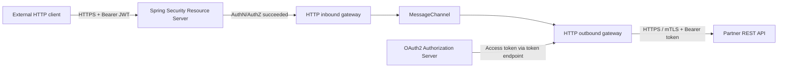
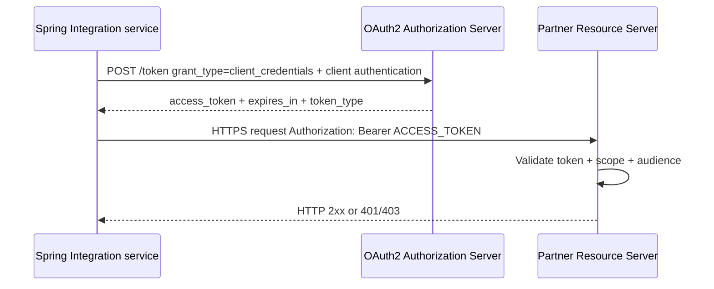

# Authentication, TLS, OAuth2, and Credentials

## 1. Security Goals and Scope of the HTTP Adapter

In the **SPRING_INTEGRATION_ADAPTERS** module, Spring Integration connects external systems using inbound/outbound adapters, gateways, pollers, and `MessageChannel`s. An integration flow can receive an HTTP request, forward to a partner HTTP API, write to a database, or move messages across files, SFTP, JMS, AMQP, and Kafka. Every step crosses a **trust boundary**: who may connect, who may invoke business operations, and whether the system is talking to the genuine partner.

The topic **"Authentication, TLS, OAuth2, and Credentials"** focuses on three complementary mechanisms:

- **TLS/HTTPS**: encrypts transport and verifies server identity via digital certificates, trust chains, and hostnames.
- **Mutual TLS (mTLS)**: adds a client certificate so **both parties** authenticate each other at the connection layer.
- **OAuth2**: issues and uses **access tokens** carrying permissions; the client sends a token to a protected resource, and the server validates the token and checks scopes/permissions.

All **credentials**—such as client ID/client secret, private keys in keystores, tokens, or API keys—must be managed throughout their entire lifecycle: provisioning, least-privilege scoping, secure storage, rotation, and revocation.

After this lesson, you will be able to distinguish TLS from authorization, configure an HTTP inbound gateway protected by Spring Security, call an HTTP outbound gateway using OAuth2 `client_credentials`, wire TLS truststores/mTLS into an HTTP client, and build a test plan covering 401/403/TLS handshakes/token expiry.

**Scope:** the Java examples target **Spring Boot 3.2+, Spring Framework 6.1+, and Spring Integration 6.x** (Java 17+), using `RestTemplate` to illustrate HTTP outbound. Some client APIs have changed or been deprecated in newer Spring Integration branches featuring `RestClient`. When applying this, select APIs compatible with your actual version; do not assume the code runs unchanged across every Spring generation.

## 2. Distinguishing TLS, mTLS, OAuth2, and API Keys

| Mechanism | Proof | What Does It Verify? | What It Cannot Do Alone |
|---|---|---|---|
| **TLS server authentication** | Certificate chain and hostname | Client is connecting to a server with a trusted certificate for the target hostname. | Does not determine whether a user is authorized to call the API. |
| **mTLS** | Both server and client certificates | Server can authenticate the client at the TLS connection, in addition to the client authenticating the server. | Does not itself express fine-grained business permissions like `orders.write`. |
| **OAuth2 access token** | Bearer token / JWT / opaque token | Resource server validates the token and enforces scopes, audience, tenant, and associated permissions. | Does not encrypt HTTP traffic without TLS. |
| **OAuth2 client ID/secret** | OAuth2 client credential | Lets the authorization server authenticate the client when issuing tokens under the matching grant. | Not an access token to send directly to arbitrary resource servers. |
| **API key** | Partner-issued key | Identifies or authorizes a client per the service's proprietary rules. | Does not by default provide standard scopes/lifecycle like OAuth2; does not replace TLS. |

**Authentication** answers "which identity is connecting/calling?"; **authorization** answers "what is that identity permitted to do?". TLS only protects/authenticates the connection boundary; OAuth2 access tokens enforce policy at the application boundary. Depending on security requirements, an API may require **both mTLS + an access token**.

### Trust Boundary Diagram



The diagram illustrates the logical flow: token acquisition is typically triggered by the **OAuth2 client manager** before sending the HTTP request, and an HTTP interceptor attaches the token to the header. Do not blindly copy inbound client tokens to outbound APIs unless an explicit delegation/token-exchange protocol is designed.

## 3. How Do TLS and mTLS Work?

### 3.1. One-Way TLS

When an outbound gateway calls `https://api.partner.example/v1/quotes`:

1. The HTTP client opens a connection to the configured hostname.
2. The server presents its certificate chain during the TLS handshake.
3. The client verifies certificate validity dates, signature chain up to a CA in its **truststore**, and hostname matching against **SAN (Subject Alternative Name)**.
4. Both sides negotiate session keys and encrypt traffic.
5. Only after TLS is established are the HTTP method, headers, body, and access token sent inside the protected channel.

TLS can fail directly during the handshake: in that case, **there is no HTTP 401/403/500 response status from the resource server**. Common symptoms are SSL handshake exceptions, certificate path validation errors, hostname mismatches, or TLS protocol/cipher configuration errors.

### 3.2. mTLS

In mTLS, the server also requires the client to present a certificate; the client proves possession of the corresponding private key. The server can map the subject/SAN/thumbprint to a technical identity or enforce certificate policies. Even then, permission to call individual APIs still must be enforced by server policy.

| TLS Artifact | Where Typically Stored | What Must Be Protected |
|---|---|---|
| **Truststore** holding trusted CAs/certs | HTTP client or JVM side | Integrity and change control; avoid adding unnecessary CAs. |
| **Keystore** holding client private key and certificate chain | Client side when using mTLS | Private key secrecy, password, file permissions, and process access. |
| **Server key + certificate** | Server / reverse proxy / Ingress | Private key, deployment permissions, expiration, and rotation lifecycle. |
| **Public CA certificates** | System trust or trust bundle | Not secret, though origin and trustworthiness must be controlled. |

**Keystore and truststore are not synonymous.** A keystore holds the identity/key that this side presents; a truststore holds the CAs/certificates that this side **trusts** when verifying a peer.

Never use `TrustAll`/`NoopHostnameVerifier`/`verify=false` as a "quick fix" for TLS errors, even in shared staging environments. When self-signed certificates are used for local mocks, create a test CA and add that specific CA to the test client's truststore; never disable verification.

### 3.3. TLS Termination at a Reverse Proxy

An HTTP inbound gateway may sit behind Nginx/Ingress/API Gateway:

```text
Client --HTTPS--> Reverse proxy --HTTP or HTTPS--> Spring Boot
```

If the proxy terminates TLS, the backend Spring Boot application **does not directly verify client certificates** unless there is a trusted identity-forwarding mechanism or end-to-end TLS. Never trust an HTTP header such as `X-Client-Cert` supplied directly by an external caller. When a proxy forwards identity, accept headers only from authenticated proxies, strip spoofed incoming headers, and restrict the network path between proxy and application.

Forwarded header/`X-Forwarded-Proto` handling must verify trusted sources; otherwise, applications can construct incorrect redirects/absolute URLs or be tricked about the original protocol.

## 4. OAuth2: Tokens Are Not Client Secrets

In the **OAuth2 Client Credentials Grant**, a backend service does not act on behalf of a specific human user. It authenticates its own application identity with the authorization server, requests an access token for granted scopes, and uses that token when calling protected APIs:



Key distinctions:

- **Client ID** is usually not secret, but identifies the registered application.
- **Client secret / private key** is the credential used by the authorization server to authenticate the client. It must not be embedded directly in resource-server HTTP requests when the contract expects a Bearer token.
- **Access token** carries time-limited access rights. A leaked Bearer token can be abused by unauthorized parties until it expires or is revoked.
- **Refresh tokens** are not always issued; in `client_credentials`, the client typically **requests a fresh access token** when the old one expires.
- **Scopes** describe permissions per registration/token, e.g. `quotes.read` or `orders.write`. A scope on a token does not replace tenant-level and resource-level authorization checks.

An access token can take either format:

| Token Format | What the Resource Server Typically Checks |
|---|---|
| **JWT** | Signature via JWKs/trusted keys, `iss`, `exp`, `nbf`, **audience**, scopes, allowed algorithms, and business claims. |
| **Opaque token** | Calls an introspection endpoint or IdP token validation mechanism to check validity/permissions; protect introspection credentials and cache per policy. |

**Never decode a JWT yourself and trust its claims.** Base64 decoding is not equivalent to verifying signature, issuer, and audience. Spring Security Resource Server validates tokens before requests reach the HTTP inbound endpoint.

### 4.1. 401 and 403 Are Different

- **401 Unauthorized**: missing valid authentication or invalid/expired token; typically includes a `WWW-Authenticate` challenge.
- **403 Forbidden**: identity was authenticated, but lacks required permissions/scopes per security policy.
- **TLS handshake failure**: occurs **before** the HTTP application layer, so there may be **no HTTP status** from the server.
- **429/5xx from the authorization server**: token acquisition failed; do not mistake it for a business error from the Pricing API.

A valid token whose **audience targets a different API** must be rejected if the contract requires a specific audience. Checking signature and issuer alone is insufficient in a multi-resource-server architecture.

## 5. Inbound Example: HTTP Gateway Protected by OAuth2 Resource Server

This inbound example receives `POST /integrations/orders/validate` and returns minimal validation JSON. Spring Security executes **before** the HTTP inbound gateway: requests without a properly scoped token are never converted into Spring Integration messages.

### 5.1. Dependencies

In a Spring Boot project with dependency management:

```xml
<dependencies>
    <dependency>
        <groupId>org.springframework.boot</groupId>
        <artifactId>spring-boot-starter-web</artifactId>
    </dependency>
    <dependency>
        <groupId>org.springframework.boot</groupId>
        <artifactId>spring-boot-starter-integration</artifactId>
    </dependency>
    <dependency>
        <groupId>org.springframework.integration</groupId>
        <artifactId>spring-integration-http</artifactId>
    </dependency>
    <dependency>
        <groupId>org.springframework.boot</groupId>
        <artifactId>spring-boot-starter-oauth2-resource-server</artifactId>
    </dependency>
</dependencies>
```

For JWT, an example issuer configuration in `application.yml`:

```yaml
spring:
  security:
    oauth2:
      resourceserver:
        jwt:
          issuer-uri: "https://idp.example.com/realms/integrations"
```

This is an illustrative URL: real applications need a reachable IdP/JWKs endpoint, matching token issuer, and properly trusted TLS connections to the IdP. Default providers usually validate signature, issuer, and expiration; **audience/tenant validation must be added per API contract** if not already configured by the security framework. For opaque tokens, replace this with your provider's introspection configuration rather than the JWT settings above.

### 5.2. SecurityFilterChain for the Inbound API

```java
package example.http;

import org.springframework.context.annotation.Bean;
import org.springframework.context.annotation.Configuration;
import org.springframework.http.HttpMethod;
import org.springframework.security.config.Customizer;
import org.springframework.security.config.annotation.web.builders.HttpSecurity;
import org.springframework.security.config.annotation.web.configurers.AbstractHttpConfigurer;
import org.springframework.security.config.http.SessionCreationPolicy;
import org.springframework.security.web.SecurityFilterChain;

@Configuration
public class IntegrationApiSecurity {

    @Bean
    SecurityFilterChain orderApiSecurity(HttpSecurity http)
            throws Exception {

        return http
            .securityMatcher("/integrations/orders/**")
            .authorizeHttpRequests(auth -> auth
                .requestMatchers(
                    HttpMethod.POST,
                    "/integrations/orders/validate")
                .hasAuthority("SCOPE_orders.validate")
                .anyRequest().denyAll())
            .oauth2ResourceServer(oauth2 ->
                oauth2.jwt(Customizer.withDefaults()))
            .sessionManagement(session -> session
                .sessionCreationPolicy(SessionCreationPolicy.STATELESS))
            // Applies only to this matched stateless Bearer token chain.
            .csrf(AbstractHttpConfigurer::disable)
            .build();
    }
}
```

Explanation:

1. `securityMatcher` scopes the filter chain to `/integrations/orders/**`. Other routes in the application need their own appropriate **SecurityFilterChain**; do not rely on this chain to guard the entire application.
2. Only `POST /integrations/orders/validate` with authority `SCOPE_orders.validate` is allowed. By default, Spring Security maps the `orders.validate` scope to an authority prefixed with `SCOPE_`.
3. `oauth2ResourceServer(...jwt(...))` verifies the JWT before requests enter the inbound gateway.
4. Sessions are configured stateless. In this bearer-token API example, CSRF is disabled **only on this scoped chain**; do not apply that mechanically to browser session/cookie authentication.

A valid Bearer token alone is **not sufficient** if the user/application is unauthorized to access a specific tenant or order. Enforce business-layer authorization and prevent cross-tenant data leakage.

### 5.3. Protected IntegrationFlow

```java
package example.http;

import org.springframework.context.annotation.Bean;
import org.springframework.context.annotation.Configuration;
import org.springframework.http.HttpMethod;
import org.springframework.http.MediaType;
import org.springframework.integration.annotation.EnableIntegration;
import org.springframework.integration.dsl.IntegrationFlow;
import org.springframework.integration.http.dsl.Http;

@Configuration
@EnableIntegration
public class OrderValidationFlow {

    public record OrderRequest(String sku, int quantity) {}
    public record ValidationReply(String sku, String status) {}

    @Bean
    IntegrationFlow validateOrderInboundFlow() {
        return IntegrationFlow
            .from(Http.inboundGateway(
                    "/integrations/orders/validate")
                .requestMapping(mapping -> mapping
                    .methods(HttpMethod.POST)
                    .consumes(MediaType.APPLICATION_JSON_VALUE)
                    .produces(MediaType.APPLICATION_JSON_VALUE))
                .requestPayloadType(OrderRequest.class))
            .handle(OrderRequest.class, (request, headers) -> {
                if (request.sku() == null
                        || request.sku().isBlank()
                        || request.quantity() <= 0) {
                    throw new IllegalArgumentException(
                        "Invalid order payload");
                }
                return new ValidationReply(
                    request.sku(), "VALIDATED");
            })
            .get();
    }
}
```

With a real token carrying scope `orders.validate`:

```bash
curl -i -X POST \
  'https://localhost:8443/integrations/orders/validate' \
  -H "Authorization: Bearer $ACCESS_TOKEN" \
  -H "Content-Type: application/json" \
  -H "Accept: application/json" \
  -d '{"sku":"BOOK-1","quantity":2}'
```

The URL `https://localhost:8443` only works if you have configured an HTTPS server and certificate. A successful response looks like:

```json
{"sku":"BOOK-1","status":"VALIDATED"}
```

**Never use `curl -k` to bypass server certificate verification** during security tests. In local environments with a private CA, add that CA to the truststore or pass the valid CA option. If the token is missing, invalid, or lacks the required scope, Spring Security blocks the request and **the handler should never run**.

The illustrative handler throws `IllegalArgumentException` on invalid bodies; that is a business validation failure and **does not automatically return a 400 JSON error** without exception mapping configured. Do not confuse post-auth validation failures with OAuth2 401/403 errors.

## 6. Outbound OAuth2 client_credentials: Acquiring a Token Before Calling a Partner

An application sending messages through an HTTP outbound gateway typically acts as both an **OAuth2 Client** and an **HTTP client**. When calling the Pricing API, it must obtain an access token for the matching client registration, attach `Authorization: Bearer ...`, and send the request over HTTPS.

This example uses **machine-to-machine `client_credentials`**, appropriate when the application acts under its own identity rather than on behalf of an end user. If user identity must be propagated to a partner, use a mutually supported token-exchange/delegation protocol rather than forwarding raw inbound tokens to another resource server.

### 6.1. Dependencies and Registration Configuration

Add the OAuth2 Client dependency:

```xml
<dependency>
    <groupId>org.springframework.boot</groupId>
    <artifactId>spring-boot-starter-oauth2-client</artifactId>
</dependency>
```

In `application.yml`, pull secrets from environment variables or a secret manager:

```yaml
spring:
  security:
    oauth2:
      client:
        registration:
          pricing-partner:
            provider: pricing-idp
            client-id: "${PARTNER_CLIENT_ID}"
            client-secret: "${PARTNER_CLIENT_SECRET}"
            authorization-grant-type: client_credentials
            scope: quotes.read
        provider:
          pricing-idp:
            token-uri: "https://idp.partner.example/oauth2/token"

partner:
  pricing:
    url: "https://api.partner.example/v1/quotes"
```

`pricing-partner` is the **registration ID** used to look up the right credentials and token endpoint. Never send `client-secret` to the Pricing API in an HTTP `Authorization` header; the secret is used to authenticate with the **authorization server** during token acquisition.

Never commit secrets to `application.yml`, Docker images, Git, or build logs. Environment variables are just one configuration mechanism; in production, use a secret manager, permissioned secret volume mounts, or workload identity if supported by your IdP. Limit scopes and periodically audit client registration permissions.

### 6.2. AuthorizedClientManager Without Servlet Request Dependency

An HTTP outbound flow may execute from a Kafka/JMS consumer, poller, or scheduled task **with no HTTP servlet request**. Therefore, use `AuthorizedClientServiceOAuth2AuthorizedClientManager` instead of relying on a manager that only works within a web request context.

```java
package example.http;

import org.springframework.context.annotation.Bean;
import org.springframework.context.annotation.Configuration;
import org.springframework.security.oauth2.client.AuthorizedClientServiceOAuth2AuthorizedClientManager;
import org.springframework.security.oauth2.client.OAuth2AuthorizedClientManager;
import org.springframework.security.oauth2.client.OAuth2AuthorizedClientProviderBuilder;
import org.springframework.security.oauth2.client.OAuth2AuthorizedClientService;
import org.springframework.security.oauth2.client.registration.ClientRegistrationRepository;

@Configuration
public class OAuth2ClientConfiguration {

    @Bean
    OAuth2AuthorizedClientManager partnerAuthorizedClientManager(
            ClientRegistrationRepository registrations,
            OAuth2AuthorizedClientService authorizedClients) {

        var manager =
            new AuthorizedClientServiceOAuth2AuthorizedClientManager(
                registrations, authorizedClients);

        manager.setAuthorizedClientProvider(
            OAuth2AuthorizedClientProviderBuilder.builder()
                .clientCredentials()
                .build());

        return manager;
    }
}
```

The manager uses the client registration/provider to request tokens and manage authorized clients for that service. When a token expires, the client credentials provider fetches a new token according to policy. Do not write custom file-based token persistence or manually parse `expires_in`.

If the token endpoint itself requires **mTLS or a private CA**, you must configure the **HTTP client used to call the token endpoint** accordingly. A TLS bundle attached only to the Pricing API client **does not guarantee** that OAuth2 token requests use the same TLS context.

### 6.3. Interceptor Attaching Bearer Token at the HTTP Boundary

The goal is for tokens **not to become payloads or message headers** traveling through Spring Integration flows and message brokers. The HTTP client interceptor attaches the token **right before sending the outbound HTTP request**.

```java
package example.http;

import org.springframework.context.annotation.Bean;
import org.springframework.context.annotation.Configuration;
import org.springframework.http.client.ClientHttpRequestInterceptor;
import org.springframework.security.oauth2.client.OAuth2AuthorizeRequest;
import org.springframework.security.oauth2.client.OAuth2AuthorizedClient;
import org.springframework.security.oauth2.client.OAuth2AuthorizedClientManager;

@Configuration
public class PartnerTokenInterceptorConfiguration {

    @Bean
    ClientHttpRequestInterceptor partnerBearerTokenInterceptor(
            OAuth2AuthorizedClientManager manager) {

        return (request, body, execution) -> {
            OAuth2AuthorizeRequest authRequest =
                OAuth2AuthorizeRequest
                    .withClientRegistrationId("pricing-partner")
                    .principal("spring-integration-pricing-service")
                    .build();

            OAuth2AuthorizedClient authorizedClient =
                manager.authorize(authRequest);

            if (authorizedClient == null) {
                throw new IllegalStateException(
                    "Unable to authorize pricing-partner client");
            }

            request.getHeaders().setBearerAuth(
                authorizedClient.getAccessToken().getTokenValue());

            return execution.execute(request, body);
        };
    }
}
```

`principal("spring-integration-pricing-service")` is a **stable technical identifier for the authorized client inside the application**, not an external user's JWT. When supporting multiple tenants or multiple client identities, define how authorized clients and token caches are isolated so tokens never mix across tenants.

Never log `authorizedClient`, access tokens, or full outgoing HTTP headers. If you use a request logging interceptor, **redact `Authorization`, `Cookie`, and all secret headers**.

### 6.4. RestTemplate with TLS Truststore/mTLS via SSL Bundles

The example below uses Spring Boot SSL bundles and Java `HttpClient`. Configuring an SSL bundle for the client keeps CA trust and client certificate presentation separate from business logic.

For **TLS server authentication**, you may declare only a truststore; if the partner requires **mTLS**, add a keystore containing the client's private key/certificate:

```yaml
spring:
  ssl:
    bundle:
      jks:
        pricing-partner:
          truststore:
            location: "file:/run/secrets/pricing-truststore.p12"
            password: "${PARTNER_TRUSTSTORE_PASSWORD}"
            type: PKCS12
          keystore:
            location: "file:/run/secrets/pricing-client.p12"
            password: "${PARTNER_KEYSTORE_PASSWORD}"
            type: PKCS12
```

The path `/run/secrets/...` only illustrates a deployment delivering secret files securely—it is **not a file pre-existing in a repository**. When only standard TLS to a server with a public CA is needed, the JVM's default truststore can be used without creating a custom truststore. With mTLS, the keystore must contain the correct client certificate chain and private key.

Example creating `RestTemplate`:

```java
package example.http;

import java.net.http.HttpClient;
import java.time.Duration;

import org.springframework.beans.factory.annotation.Qualifier;
import org.springframework.boot.ssl.SslBundles;
import org.springframework.context.annotation.Bean;
import org.springframework.context.annotation.Configuration;
import org.springframework.http.client.ClientHttpRequestInterceptor;
import org.springframework.http.client.JdkClientHttpRequestFactory;
import org.springframework.web.client.RestTemplate;

@Configuration
public class PartnerHttpTransportConfiguration {

    @Bean("partnerRestTemplate")
    RestTemplate partnerRestTemplate(
            SslBundles sslBundles,
            @Qualifier("partnerBearerTokenInterceptor")
            ClientHttpRequestInterceptor oauthInterceptor) {

        var sslContext = sslBundles
            .getBundle("pricing-partner")
            .createSslContext();

        HttpClient httpClient = HttpClient.newBuilder()
            .sslContext(sslContext)
            .connectTimeout(Duration.ofSeconds(2))
            .followRedirects(HttpClient.Redirect.NEVER)
            .build();

        JdkClientHttpRequestFactory factory =
            new JdkClientHttpRequestFactory(httpClient);
        factory.setReadTimeout(Duration.ofSeconds(5));

        RestTemplate template = new RestTemplate(factory);
        template.getInterceptors().add(oauthInterceptor);

        return template;
    }
}
```

Points to remember:

- The **SSLContext** created from the SSL bundle carries truststore details and, if configured, client key material for mTLS.
- **Connect timeout** bounds connection setup; **read timeout** bounds waiting for data per the client implementation—neither replaces an end-to-end deadline.
- Enable redirects only if required by contract and after assessing the risk of tokens/headers leaking to another host. Here, `Redirect.NEVER` makes destination control explicit.
- Set `Authorization` in the interceptor rather than copying tokens into `MessageHeaders`.
- Spring Integration 7.1+ supports outbound configuration via `RestClient`; on that version, update the transport/client integration using the new API rather than assuming `RestTemplate` alone.

Certificate and private key rotation must match how the application actually reloads them: many SSL bundle/HTTP client implementations create `SSLContext` once at bean creation and **do not automatically reload new certificates** when files update on disk. Verify reload mechanics or safe rollout/restart procedures before expiration dates.

### 6.5. Wiring the Secured HTTP Client into the Outbound Gateway

Create the DTOs and Java messaging gateway:

```java
// File: QuoteDtos.java
package example.http;

public final class QuoteDtos {
    private QuoteDtos() {}

    public record QuoteRequest(String productCode, int quantity) {}

    public record QuoteReply(
        String quoteId, String currency, long amountMinorUnits) {}
}
```

```java
// File: PartnerQuoteClient.java
package example.http;

import org.springframework.integration.annotation.MessagingGateway;
import org.springframework.integration.annotation.Gateway;
import org.springframework.integration.annotation.GatewayHeader;
import org.springframework.messaging.MessageHeaders;

@MessagingGateway(defaultRequestChannel = "securedQuoteRequests")
public interface PartnerQuoteClient {

    @Gateway(headers = @GatewayHeader(
        name = MessageHeaders.CONTENT_TYPE,
        value = "application/json"))
    QuoteDtos.QuoteReply requestQuote(QuoteDtos.QuoteRequest request);
}
```

Use `HttpRequestExecutingMessageHandler` with `@ServiceActivator` to control the exact `RestTemplate` instance:

```java
package example.http;

import org.springframework.beans.factory.annotation.Qualifier;
import org.springframework.beans.factory.annotation.Value;
import org.springframework.context.annotation.Bean;
import org.springframework.context.annotation.Configuration;
import org.springframework.http.HttpMethod;
import org.springframework.integration.annotation.EnableIntegration;
import org.springframework.integration.annotation.IntegrationComponentScan;
import org.springframework.integration.annotation.ServiceActivator;
import org.springframework.integration.http.outbound.HttpRequestExecutingMessageHandler;
import org.springframework.web.client.RestTemplate;

@Configuration
@EnableIntegration
@IntegrationComponentScan
public class SecuredQuoteOutboundConfiguration {

    @Bean
    @ServiceActivator(inputChannel = "securedQuoteRequests")
    public HttpRequestExecutingMessageHandler securedQuoteHandler(
            @Value("${partner.pricing.url}") String pricingUrl,
            @Qualifier("partnerRestTemplate") RestTemplate template) {

        HttpRequestExecutingMessageHandler handler =
            new HttpRequestExecutingMessageHandler(pricingUrl);

        handler.setHttpMethod(HttpMethod.POST);
        handler.setExpectedResponseType(QuoteDtos.QuoteReply.class);
        handler.setRestTemplate(template);
        handler.setExpectReply(true);

        return handler;
    }
}
```

When a service calls:

```java
QuoteDtos.QuoteReply quote =
    partnerQuoteClient.requestQuote(
        new QuoteDtos.QuoteRequest("BOOK-1", 2));
```

the expected flow is:

1. `@MessagingGateway` sends the request message to `securedQuoteRequests`, setting JSON content type and a reply channel.
2. `HttpRequestExecutingMessageHandler` uses `partnerRestTemplate`, serializes the DTO to JSON via the converter, and sends an HTTP POST over TLS.
3. The HTTP interceptor uses the OAuth2 manager to obtain a valid access token and adds `Authorization: Bearer ...`.
4. The partner verifies TLS identity (if mTLS is required), access token, audience, and scope, then returns an HTTP response.
5. The handler reads the JSON body into `QuoteReply` and sends the reply message back to the `PartnerQuoteClient` proxy.

The examples show **two independent applications/roles**: inbound protects the application's API as a Resource Server; outbound lets the application call a partner via `client_credentials`. Both can live in the same service if business logic requires it, yet **inbound credentials are never automatically forwarded to outbound**.

If the HTTP client in your Spring Integration version transitions to `RestClient`, redesign the client injection around the new API. Never try to mix a `RestTemplate` interceptor into an HTTP handler configured with a different client.

## 7. Credential Lifecycle: Where Do Secrets Live and How Are They Rotated?

Each credential type has its own lifecycle and risks:

| Credential | Where Used? | Protection Rules |
|---|---|---|
| **Client secret** | OAuth2 token endpoint when requesting tokens | Store in secret manager / secret volume; never put in code or URLs. |
| **Access token** | Sent to authorized resource servers | Keep in memory / secure cache, short-lived, never logged; send only over HTTPS to the right audience. |
| **Client private key** | mTLS or `private_key_jwt` | Never emit into logs or public backups; restrict file permissions and process access. |
| **Truststore/CA** | Verifying peer certificates | Protect integrity; test chain and hostname when changing CAs. |
| **API key** | Some legacy APIs | Send only to designated hosts, limit permissions; prefer headers over query strings per contract. |

Minimum production lifecycle:

1. **Provision** via IdP/PKI and issue separate credentials per environment, application, or tenant; avoid broad sharing.
2. **Least privilege**: constrain scopes/audiences and endpoint permissions strictly to what is required.
3. **Distribution**: secret manager, KMS, mounted secret files, or workload identity; restrict IAM, ownership, and deployment access.
4. **Rotation**: allow an overlap period when rotating secrets/certificates if supported by the partner; verify both token caches and certificate load/reload.
5. **Revocation**: have procedures to disable clients, revoke certificates, or invalidate tokens/keys upon compromise.
6. **Audit**: record who issued/rotated credentials and when; never log the secret values themselves.

**Never use non-expiring tokens**, because tokens that never expire or get revoked expand the blast radius of a leak. With `client_credentials`, applications normally fetch a fresh token near expiration; account for clock skew and bounded retries on the token endpoint.

### 7.1. Token Caching and Concurrency

A service with many workers may invoke `OAuth2AuthorizedClientManager` concurrently. Consider:

- The authorized-client service caches tokens by client registration and principal; use a stable identity for a machine client.
- Prevent hundreds of workers from requesting tokens simultaneously on cache miss or expiry (*token stampede*); libraries include synchronization, yet production still needs monitoring and appropriate rate limits.
- In multi-instance deployments, each instance typically maintains its own in-memory cache. Do not assume tokens are automatically shared across nodes without designing shared storage.
- A `401` from a partner API does not always mean you should automatically retry forever or endlessly refresh tokens. It may stem from a revoked token, wrong audience, missing scope, or wrong mTLS identity.

When rotating a client secret, previously issued tokens may remain valid until expiry depending on the IdP. When immediate cutoff is needed, revoke/disable on the server side rather than merely swapping the secret inside the app.

### 7.2. Never Blindly Forward User Tokens

An inbound request may carry an access token intended for **API A**. The HTTP outbound gateway calls **API B**. Passing the raw token from A to B can violate audience, scope, tenant, or trust policies. Some environments support formal token exchange/delegation, which must be explicitly designed and authorized.

For backend-to-backend communication, `client_credentials` fits when API B allows application A to act under its own identity. When acting **on behalf of a user**, check which delegated grant / token-exchange mechanism both the IdP and API B genuinely support.

## 8. Error Handling and Differences Between 401/403/TLS/HTTP Statuses

| Observation | Likely Cause | Handling Approach |
|---|---|---|
| TLS `PKIX path building failed` | Truststore missing CA/certificate or broken chain. | Inspect chain and trusted CAs; never disable certificate validation. |
| TLS hostname mismatch | SAN does not match URL hostname. | Use the proper FQDN/certificate; never disable hostname verification. |
| TLS client certificate rejected | Wrong mTLS key/chain, expired certificate, or server does not trust CA. | Check keystore, alias, permissions, and CAs on both sides. |
| Token endpoint 400/401 | Invalid client ID/secret, grant, or scope. | Check registration, token endpoint, and credential lifecycle. |
| Resource server 401 | Missing/expired token or invalid signature/issuer/audience. | Check token claims, clock skew, JWKS, and token cache. |
| Resource server 403 | Valid token lacking required scope/permission/tenant access. | Review authorization policy; never over-provision permissions arbitrarily. |
| 429 Too Many Requests | IdP or partner resource server rate limiting. | Apply backoff, quotas, `Retry-After`, and reduce concurrency. |
| 502/503/504 or socket timeout | Partner/proxy/backend error or slowness. | Timeouts, circuit breakers, bounded retries per request type and idempotency. |
| JSON conversion error | Response body does not match DTO/media type. | Fix converter/schema contract; do not treat as an auth failure. |

In Spring Integration outbound HTTP, exceptions from `RestTemplate` can be wrapped in messaging exceptions. **Default HTTP error handlers usually throw exceptions for 4xx/5xx** before creating a reply message, so do not design flows as if every 401/403 arrives downstream as a DTO.

A TLS failure may prevent the outbound handler from sending an HTTP request body at all; a read timeout after the server already received the request **does not guarantee side effects haven't happened**. For APIs that create resources, transfer money, or upload data, apply idempotency keys and status lookups before retrying.

### 8.1. Keeping Credentials Out of Logs and Error Channels

Common leak vectors:

- Logging interceptors printing all request headers, especially `Authorization`.
- Exception messages containing URLs with secret query parameters.
- Spring Integration `ErrorMessage` retaining an original message with PII payloads or secrets embedded in headers.
- Tracing/span attributes capturing raw tokens, client secrets, or form contents.
- Actuator/env diagnostic endpoints exposing secrets when access controls and sanitization are misconfigured.

Restrict logs to request IDs, endpoint types, status, latency, and error categories; redact tokens, private keys, and secrets, and avoid logging raw HTTP bodies containing sensitive data. Error handlers must never return stack traces, client secrets, or certificate details to callers.

## 9. Protocol Security and End-to-End Flow Design

### 9.1. Inbound Protects Before Messages Enter Channels

```text
External caller
 -> HTTPS / mTLS (if terminated/enforced at Ingress)
 -> Spring Security Resource Server: validate JWT/opaque token
 -> Authorization by method, path, scope, tenant
 -> Spring Integration HTTP inbound gateway
 -> MessageChannel -> handler
```

If a request lacks a token or required scope, Spring Security blocks it before the inbound endpoint creates a business message. This is a major benefit: never rely on a downstream service activator to perform basic authentication.

When authenticating identity at the edge and copying it into internal message headers, distinguish **server-verified identity** from client-supplied headers. Never trust `X-User-ID` or `X-Tenant-ID` unless a proxy authentication mechanism strips spoofed headers before forwarding.

### 9.2. Outbound Attaches Credentials Right at the HTTP Call

```text
Business service / JMS-Kafka poller
 -> MessageChannel with business payload
 -> HTTP outbound gateway
 -> OAuth2 client obtains cached/new access token
 -> HTTP interceptor adds Bearer token
 -> TLS/mTLS request to allowlisted host
 -> Protected partner API
 -> HTTP response -> reply Message / error flow
```

Tokens should not be copied into JMS, Kafka, SFTP, or logs because intermediate systems have separate trust boundaries and retention policies. When identity context is needed for downstream auditing, pass a **correlation ID** or an approved identity claim, never secrets.

### 9.3. Reliability Remains a Separate Concern

Security does not solve all integration failures:

- **Timeouts** at the HTTP client, token endpoint, connect/read, reply channel, and proxy must each be configured.
- **Retries** must be bounded and properly classified: 401/403 should generally not be retried blindly; 429/503 can back off per policy; side-effecting POSTs require idempotency.
- **Circuit breakers** shed load when partners fail repeatedly, but do not refresh tokens or fix expired certificates.
- **Transactions** spanning HTTP, DB, JMS/AMQP/Kafka, or SFTP do not automatically form a distributed transaction; design outbox/inbox or compensation mechanisms per business logic.
- **Connection lifecycles** cover pooling, idle connections, TLS sessions, token/certificate rotation, and graceful shutdown.

## 10. Testing and Operations Scenarios

Split testing across **TLS**, **OAuth2 resource server**, **OAuth2 outbound client**, **message flow**, and **secret operations**. Use a test IdP, local CA, and mock HTTP service so you never intentionally break real credentials.

| Scenario | Expected Outcome to Verify |
|---|---|
| HTTPS server with valid certificate, matching hostname | TLS handshake succeeds; inbound/outbound APIs work. |
| Truststore missing CA or hostname mismatch | TLS handshake fails; **never bypass verification**. |
| mTLS missing client certificate | Server rejects handshake or denies access per configuration. |
| Expired/revoked mTLS cert | Connection rejected per server/PKI policy. |
| Inbound without Bearer token | Spring Security returns 401; handler does not run. |
| Inbound JWT with invalid signature/issuer/audience/expiry | Request rejected; no business message enters channel. |
| Valid token missing `orders.validate` | HTTP 403; handler does not run. |
| Valid token with matching scope | Inbound gateway creates message and returns business response. |
| Valid OAuth2 `client_credentials` | Client manager obtains token; outbound interceptor adds proper Bearer header. |
| Wrong client secret or token endpoint error | Pricing API is not called without a valid token; error is classified. |
| Access token expired | Manager requests a new token per policy; no infinite retry loops. |
| Outbound token has wrong audience/scope | Partner API rejects with 401/403; not treated as a network error. |
| Retry on Pricing API 503 | Bounded retry/backoff; token not logged; idempotent if POST has side effects. |
| Certificate reload/rotation | New connections use updated certificate after planned rollout/reload. |
| Logs / error channel / traces | No `Authorization`, private keys, client secrets, or raw JWTs leaked. |

### 10.1. Testing Example with curl

Once you obtain a **valid test access token** from the test environment's IdP, send an inbound request:

```bash
curl --fail-with-body -i \
  -H "Authorization: Bearer $ACCESS_TOKEN" \
  -H "Content-Type: application/json" \
  -d '{"sku":"BOOK-1","quantity":2}' \
  'https://localhost:8443/integrations/orders/validate'
```

Retest without the `Authorization` header or with a token lacking the required scope. For TLS with a private CA, pass the dedicated test CA bundle rather than using `-k` to disable certificate verification.

### 10.2. Production Deployment Checklist

1. All hosts/URLs are configured accurately, HTTPS is verified, and outbound destinations are allowlisted.
2. CA trust, server certificates, client mTLS certificates, OAuth2 client secrets, and token endpoints have clear ownership.
3. Access tokens are sent only to the intended host/audience; scopes follow least privilege.
4. Resource servers verify signature/introspection, issuer, expiry, audience, and tenant-level authorization policies.
5. TLS certificates and secrets have rotation schedules, expiration alerts, rollback procedures, and tested reload/restart mechanics.
6. Token caching and `client_credentials` renewal work when triggered outside a Servlet request (Kafka/JMS/poller).
7. Logs, traces, and error channels are redacted; secret files and dashboard configs have restricted access.
8. HTTP timeouts, retries, circuit breakers, rate limits, and idempotency prevent duplicate side effects.
9. 401, 403, TLS handshake failures, token endpoint outages, and partner API outages have alerts and runbooks.
10. Secret-leak incident response covers revocation/disabling, rotation, evaluating issued tokens, and auditing trails.

## 11. Summary

**TLS authenticates and protects connections; mTLS additionally authenticates the client; OAuth2 access tokens express API-layer authorization.** Client ID/secrets, private keys, and access tokens are distinct credential types that must be provisioned, protected, used, and rotated according to their respective roles.

In **Spring Integration HTTP**:

- For **inbound gateways**, let Spring Security Resource Server validate tokens **before** constructing Spring Integration messages.
- For **outbound gateways**, use OAuth2 `client_credentials` and an HTTP client interceptor/token provider to attach Bearer tokens **right at the HTTP boundary**, rather than carrying tokens across the entire message flow.
- Configure truststores/keystores properly for HTTPS/mTLS, verify hostnames, and avoid all "trust all" shortcuts.
- Pick HTTP client APIs matching your Spring Integration version, wire timeouts onto the exact client instance used, and test token/certificate reload behavior.
- Do not confuse 401/403 with TLS handshake failures; do not confuse token expiry with JSON conversion errors or timeouts.
- When continuing to databases, files/SFTP, JMS, AMQP, or Kafka, you still need separate message contracts, idempotency, metadata security, and connection lifecycle management.

### Official Documentation References

- [Spring Integration — HTTP Support](https://docs.spring.io/spring-integration/reference/http.html)
- [Spring Integration — HTTP Outbound Components](https://docs.spring.io/spring-integration/reference/http/outbound.html)
- [Spring Security — OAuth2 Resource Server JWT](https://docs.spring.io/spring-security/reference/servlet/oauth2/resource-server/jwt.html)
- [Spring Security — OAuth2 Client Core Interfaces](https://docs.spring.io/spring-security/reference/servlet/oauth2/client/core.html)
- [Spring Boot — SSL Bundles](https://docs.spring.io/spring-boot/reference/features/ssl.html)
- [Spring Framework — REST Clients](https://docs.spring.io/spring-framework/reference/integration/rest-clients.html)
