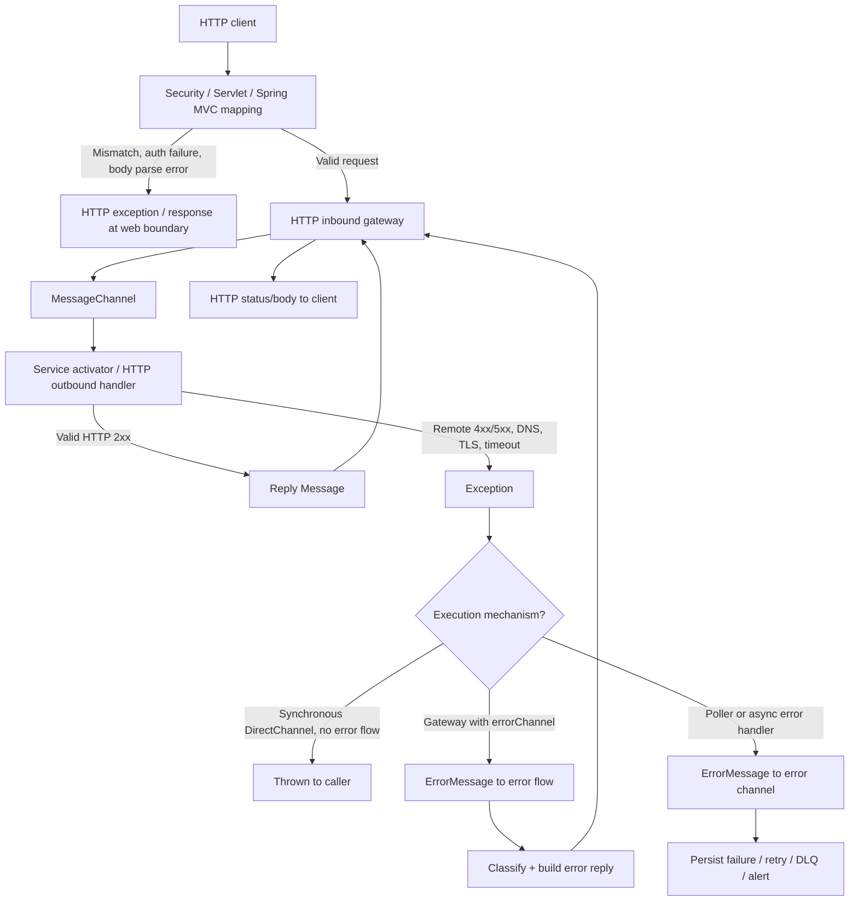
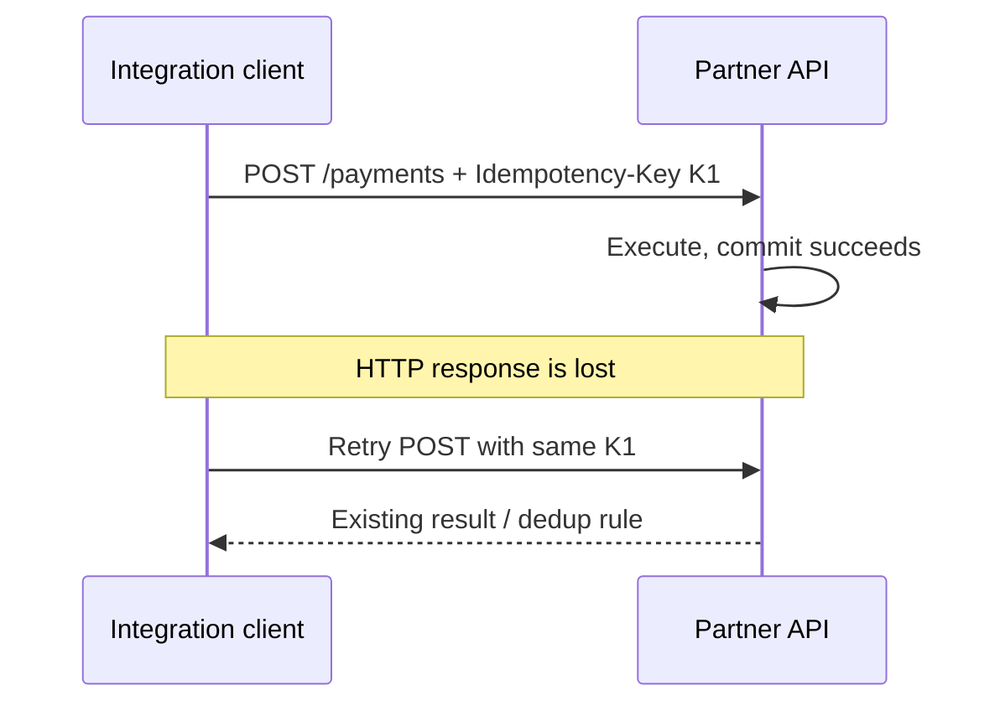

# HTTP Error Channels and Remote Error Handling

## 1. Why Is an HTTP Error Channel Its Own Topic?

In **SPRING_INTEGRATION_ADAPTERS**, inbound/outbound adapters, gateways, pollers, and `MessageChannel`s connect the application with HTTP, files, SFTP, JMS, AMQP, Kafka, and databases. An error at the HTTP boundary can affect the entire flow: a client request fails to parse, a partner service returns 503, an HTTP client times out, a downstream handler throws an exception, or an asynchronous worker fails after the caller has already disconnected.

Example flow:

```text
HTTP client
  -> HTTP inbound gateway
  -> MessageChannel
  -> HTTP outbound gateway -> Pricing API
  <- reply payload or exception <- HTTP response / network error
  <- reply message or error flow
HTTP client <- HTTP status + JSON body
```

Depending on where the error occurs and whether the flow is synchronous or asynchronous, Spring Integration can:

1. **Throw the exception back to the caller** on the same thread.
2. **Send an `ErrorMessage` to an error channel** configured by a gateway, message header, poller, or error handler.
3. **Let Spring MVC/Spring Security handle it** when the error happens before an integration message is created.
4. **Build a contract-compliant error reply message** for an HTTP inbound gateway that is still waiting.
5. **Persist the failed work for retry** in an asynchronous flow designed with data durability.

After this lesson, you will be able to distinguish those error paths, inspect `ErrorMessage` and `MessagingException`, configure an error channel on an HTTP inbound gateway, classify HTTP 4xx/5xx from an outbound gateway, handle poller errors, design safe error responses, and test with a mock server.

> **Core point:** `errorChannel` is a mechanism for routing **messages containing errors**, not an HTTP header named `errorChannel`, nor an "automatic catch-all for every exception in the application." It is not a durable dead-letter queue by default.

## 2. Error Map: Does It Happen Before, During, or After the Flow?



There are three layers to separate:

| Layer | Examples | Typical Handling Path |
|---|---|---|
| **Web boundary** | Wrong method/path, `Content-Type` mismatch, missing Bearer token, JSON rejected before handler | Spring MVC, Spring Security, converters, exception resolvers; in some cases a gateway error channel can be configured to receive request-preparation errors. |
| **Synchronous messaging flow** | Service activator or HTTP outbound handler throws an exception on `DirectChannel` | Exception propagates to the sender/messaging gateway; if the gateway has an `errorChannel`, the error can route to an error flow to build a reply. |
| **Asynchronous flow** | Poller reads `QueueChannel` and calls a partner HTTP API; worker fails after sender already returned | Error is wrapped into `ErrorMessage` and sent to `errorChannel`/poller error handler; persistence and recovery mechanisms are required. |

You cannot fix an HTTP 401 rejected by Spring Security by adding an `errorChannel` subscriber at the end of a flow: **the request may never have entered Spring Integration**. Similarly, an outbound HTTP client timeout must be classified by transport/remote API semantics rather than conflated with a messaging gateway `replyTimeout`.

## 3. How Do `ErrorMessage` and `errorChannel` Work?

### 3.1. Core Data Types

`ErrorMessage` belongs to Spring Messaging and is itself a `Message<Throwable>`:

```java
import org.springframework.messaging.Message;
import org.springframework.messaging.MessagingException;
import org.springframework.messaging.support.ErrorMessage;

void inspect(ErrorMessage error) {
    Throwable failure = error.getPayload(); // Throwable
    Message<?> original = error.getOriginalMessage();

    if (original == null && failure instanceof MessagingException ex) {
        original = ex.getFailedMessage();
    }

    // Use only permitted metadata for logging or recovery.
}
```

An exception may be wrapped by Spring Integration into a `MessagingException` or `MessageHandlingException` containing `failedMessage`. When classifying HTTP errors, inspect the **cause chain** to find the underlying HTTP client exception. `getOriginalMessage()` and `getFailedMessage()` are not always present; never cast or dereference them without checking for `null`.

Related headers and fields:

| Item | Meaning |
|---|---|
| `MessageHeaders.ERROR_CHANNEL` / `errorChannel` | Internal channel address used to receive `ErrorMessage` when error publishing applies. |
| `MessageHeaders.REPLY_CHANNEL` / `replyChannel` | Destination for normal reply messages or results from an error flow while a gateway is still waiting. |
| `ErrorMessage.payload` | Exception (`Throwable`), not an HTTP error DTO suitable for direct serialization. |
| `ErrorMessage.originalMessage` | Message associated with the failure when supported by the error message strategy. |
| `MessagingException.failedMessage` | The message the exception relates to, if available. |
| `http_statusCode` | Header for the **HTTP status on a reply message** of an HTTP inbound gateway, not an error channel address. |

Never return a raw `Throwable` as a JSON response. Exceptions can expose internal URLs, SQL details, raw payloads, access tokens, credentials, or stack traces; convert them into a **safe error DTO** with a public error code and appropriate correlation/request ID.

### 3.2. Global Error Channel and Flow-Specific Error Channels

Spring Integration creates a default **global `errorChannel`** if the application does not declare one. It is typically a `PublishSubscribeChannel` with a logging handler that logs asynchronous errors. However, seeing a log entry does not mean the error was **durably persisted** or retried.

When an error publisher is involved, channel selection generally follows this order:

1. The current message's `errorChannel` header, if the publisher supports it and the header points to a valid channel.
2. An error channel explicitly configured on the gateway, poller, or error handler.
3. The global channel named `errorChannel` when no specific destination exists.

Exact precedence depends on the publishing component and request path; do not assume a header always overrides every configuration. **Design error contracts around the exact error-emitting point**, and verify with tests.

A `MessageChannel` used for an error flow can be a `DirectChannel` or `PublishSubscribeChannel`:

- `DirectChannel` fits when one consumer needs to receive `ErrorMessage` and return a reply synchronously.
- `PublishSubscribeChannel` fits when multiple subscribers monitor the same error; account for policy if a subscriber throws or none are subscribed.
- `QueueChannel` fits poller-driven processing, though by default it remains **in memory** and is not automatically a durable DLQ.

### 3.3. Why Doesn't `DirectChannel` Usually Send to the Global errorChannel?

In a synchronous flow, the handler runs on the caller's thread and exceptions are **thrown back up the call stack**, just like a regular Java method. Because no asynchronous error-reporting mechanism is needed, the global `errorChannel` does not automatically catch all such errors.

```text
Sender -> DirectChannel -> HTTP outbound handler -> exception
   ^                                              |
   |------------------ thrown back ----------------|
```

Conversely, with an executor/poller:

```text
Sender -> QueueChannel -> returns control
                          |
                      Poller worker
                          -> HTTP outbound -> exception
                          -> ErrorMessage -> errorChannel
```

The sender may have already received "message enqueued" before the HTTP request was even sent. Thus **enqueue success does not equal remote HTTP API success**.

## 4. Remote HTTP 4xx/5xx: Reply or Exception?

An HTTP outbound gateway typically uses `HttpRequestExecutingMessageHandler` to call an external API. In implementations based on `RestTemplate` with the default error handler, HTTP 4xx/5xx responses usually cause the HTTP client to throw an exception **before the handler creates a normal reply message**.

| Case | Typical Error / Result | Meaning |
|---|---|---|
| HTTP 200 + valid JSON | Reply DTO via `expectedResponseType` | Continue processing in the flow. |
| HTTP 201/202 with body | Reply via converter, if properly configured | Clarify whether a resource was created or a job was merely accepted. |
| HTTP 204 No Content | May produce a `ResponseEntity` reply payload with no body | Do not blindly cast to a DTO. |
| HTTP 400/422 | `HttpClientErrorException` or `RestClientResponseException` | Likely request violates contract; usually do not retry. |
| HTTP 401/403 from partner | HTTP client exception thrown | Check tokens, scopes, audience, credentials; do not blindly pass 401 through to external clients. |
| HTTP 404/409 | HTTP client exception or business outcome under custom policy | Define whether missing/conflict is treated as data by the API. |
| HTTP 429 | HTTP client exception with status 429 | Check quotas and `Retry-After`; do not retry immediately without limits. |
| HTTP 500/502/503/504 | `HttpServerErrorException` or `RestClientResponseException` | Dependency failure; classify retryability and circuit breaker behavior. |
| DNS/connect/read timeout | `ResourceAccessException` or wrapped IO/transport exception | May have no HTTP status; side effects may be indeterminate. |
| TLS handshake / hostname error | SSL exception usually inside the cause chain | Security/transport failure; never disable TLS verification. |
| Schema-invalid response body | Converter/deserialization exception | HTTP exchange may have succeeded, yet payload could not be read. |

**Version note:** starting in Spring Integration 7.1, HTTP outbound supports `RestClient` and `RestTemplate`-based configurations begin deprecation; starting in 7.2, `RestClient` status/error handler options are available. APIs and exception classes vary by client. Therefore, the examples below use the common **Spring Boot 3 / Spring Integration 6.x / default `RestTemplate`** model and note where to adjust if your project uses a different client.

### 4.1. Do Not Mechanically Pass Partner Status Codes Through

If an external client calls your API and your outbound Pricing API call returns 401, that usually means **credentials between your application and the partner** failed—**not that your external client is unauthenticated**. Returning a raw 401 can mislead callers about who is responsible.

A sensible public API policy might look like:

| Remote Incident | Possible Public Status | Notes |
|---|---|---|
| Remote 400 because app built bad payload | `502 Bad Gateway` or internal error per contract | Do not blame caller if caller input was valid; alert on integration bug. |
| Remote 401/403 due to service credentials | `502` or `503` | Hide credential details; investigate client registration/secret. |
| Remote 404 for caller-queried resource | `404` **if** contract defines equivalence | If caused by a wrong integration URL, surface as an upstream error instead of public 404. |
| Remote 429 | `503` or `429` depending on which quota was exceeded | Propagate `Retry-After` only when allowed and meaningful to the client. |
| Remote 5xx | `502` or `503` depending on dependency semantics | Return a stable error DTO without exposing raw response bodies. |
| Remote read timeout | `504 Gateway Timeout` when genuinely timed out at upstream boundary | Do not assume every IO exception is a 504. |
| Remote network unreachable | `503 Service Unavailable` | May trip the circuit breaker. |
| Remote response parse failure | `502` or internal contract error | Inspect schema/version/converter. |

These are **contract design suggestions**, not a mandatory Spring Integration mapping table. Align with the API owner and test actual behavior.

## 5. Inbound Gateway Example Handling Errors from an HTTP Outbound Gateway

Let's build a **request–reply API**: the client sends a quote request to the application, the application calls the Pricing API, and returns JSON or a safe JSON error.

Assumptions:

- Java 17+, Spring Boot 3.x, and Spring Integration HTTP 6.x.
- Mock Pricing API at `http://localhost:8081/api/quotes`.
- Public API at `POST http://localhost:8080/api/quotes/check`.
- Remote API returns quote JSON on HTTP 200; 4xx/5xx responses raise exceptions via the default HTTP client.
- The demo illustrates basic error classification only. Production requires authentication, authorization, idempotency, timeouts, and telemetry.

### 5.1. Maven Dependencies

With Spring Boot dependency management:

```xml
<dependencies>
    <dependency>
        <groupId>org.springframework.boot</groupId>
        <artifactId>spring-boot-starter-web</artifactId>
    </dependency>
    <dependency>
        <groupId>org.springframework.boot</groupId>
        <artifactId>spring-boot-starter-integration</artifactId>
    </dependency>
    <dependency>
        <groupId>org.springframework.integration</groupId>
        <artifactId>spring-integration-http</artifactId>
    </dependency>
</dependencies>
```

The application does not need a separate `@RestController` just to accept `/api/quotes/check`; `Http.inboundGateway(...)` registers an HTTP inbound endpoint through Spring MVC integration.

### 5.2. DTOs and Business Exception

File `QuoteDtos.java`:

```java
package example.http;

public final class QuoteDtos {
    private QuoteDtos() {}

    public record QuoteRequest(String sku, int quantity) {}

    public record QuoteReply(
        String quoteId, String currency, long amountMinorUnits) {}

    public record ApiError(String code, String message) {}
}
```

File `InvalidQuoteRequestException.java`:

```java
package example.http;

public final class InvalidQuoteRequestException
        extends RuntimeException {

    public InvalidQuoteRequestException(String message) {
        super(message);
    }
}
```

A dedicated exception distinguishes **invalid client input** from **upstream HTTP service errors**. The `amountMinorUnits` field represents monetary amounts in the agreed smallest currency unit, avoiding `double` for currency math.

### 5.3. Request–Reply Flow with an Explicit Error Channel

File `QuoteHttpConfiguration.java`:

```java
package example.http;

import org.springframework.context.annotation.Bean;
import org.springframework.context.annotation.Configuration;
import org.springframework.http.HttpMethod;
import org.springframework.http.MediaType;
import org.springframework.integration.annotation.EnableIntegration;
import org.springframework.integration.dsl.IntegrationFlow;
import org.springframework.integration.http.dsl.Http;
import org.springframework.messaging.MessageHeaders;

@Configuration
@EnableIntegration
public class QuoteHttpConfiguration {

    @Bean
    public IntegrationFlow quoteHttpFlow() {
        return IntegrationFlow
            .from(Http.inboundGateway("/api/quotes/check")
                .requestMapping(mapping -> mapping
                    .methods(HttpMethod.POST)
                    .consumes(MediaType.APPLICATION_JSON_VALUE)
                    .produces(MediaType.APPLICATION_JSON_VALUE))
                .requestPayloadType(QuoteDtos.QuoteRequest.class)
                .errorChannel("quoteHttpErrors"))
            .handle(QuoteDtos.QuoteRequest.class, (request, headers) -> {
                if (request.sku() == null
                        || request.sku().isBlank()
                        || request.quantity() <= 0) {
                    throw new InvalidQuoteRequestException(
                        "sku and quantity are invalid");
                }
                return request;
            })
            .enrichHeaders(headers -> headers.header(
                MessageHeaders.CONTENT_TYPE,
                MediaType.APPLICATION_JSON_VALUE))
            .handle(Http.outboundGateway(
                    "http://localhost:8081/api/quotes")
                .httpMethod(HttpMethod.POST)
                .expectedResponseType(QuoteDtos.QuoteReply.class))
            .get();
    }
}
```

Flow analysis:

1. The inbound gateway receives JSON `QuoteRequest` and constructs the request message.
2. `errorChannel("quoteHttpErrors")` specifies the **HTTP gateway's error flow**. When the gateway catches an error within its scope while it can still send a response, the error flow gets a chance to construct a reply instead of throwing directly.
3. The first handler validates the input and throws `InvalidQuoteRequestException` if invalid.
4. The `contentType=application/json` header guides the outbound converter to serialize JSON.
5. `Http.outboundGateway(...)` calls the Pricing API and returns `QuoteReply` on success.
6. Remote HTTP 4xx/5xx or transport failures throw exceptions, which gateway error handling routes to the configured error channel.

**Do not confuse an HTTP inbound gateway's `errorChannel` with the global `errorChannel`.** They can be completely different channels. Naming a dedicated channel keeps your HTTP error contract independent of global logging subscribers.

### 5.4. Error Flow Converting `ErrorMessage` into a Safe Reply DTO

Create `QuoteHttpErrorConfiguration.java`:

```java
package example.http;

import org.springframework.context.annotation.Bean;
import org.springframework.context.annotation.Configuration;
import org.springframework.http.HttpStatus;
import org.springframework.http.MediaType;
import org.springframework.integration.dsl.IntegrationFlow;
import org.springframework.messaging.Message;
import org.springframework.messaging.MessageHeaders;
import org.springframework.messaging.support.MessageBuilder;
import org.springframework.web.client.ResourceAccessException;
import org.springframework.web.client.RestClientResponseException;

@Configuration
public class QuoteHttpErrorConfiguration {

    @Bean
    public IntegrationFlow quoteHttpErrorFlow() {
        return IntegrationFlow.from("quoteHttpErrors")
            // GenericHandler receives the Throwable payload of ErrorMessage.
            .handle(Throwable.class, (failure, headers) ->
                toPublicReply(failure))
            .get();
    }

    private Message<QuoteDtos.ApiError> toPublicReply(
            Throwable failure) {

        HttpStatus status;
        String code;
        String message;

        if (findCause(failure, InvalidQuoteRequestException.class)
                != null) {
            status = HttpStatus.BAD_REQUEST;
            code = "INVALID_QUOTE_REQUEST";
            message = "sku or quantity is invalid";
        } else if (findCause(
                failure, RestClientResponseException.class) != null) {
            // Remote returned 4xx/5xx: do not pass status through directly,
            // body or message may contain internal data.
            status = HttpStatus.BAD_GATEWAY;
            code = "UPSTREAM_HTTP_ERROR";
            message = "Pricing service returned an invalid response";
        } else if (findCause(
                failure, ResourceAccessException.class) != null) {
            // IO/network/TLS/timeout may sit in the cause chain.
            status = HttpStatus.SERVICE_UNAVAILABLE;
            code = "UPSTREAM_UNREACHABLE";
            message = "Pricing service is temporarily unavailable";
        } else {
            status = HttpStatus.INTERNAL_SERVER_ERROR;
            code = "INTEGRATION_FAILURE";
            message = "Unable to process quote request";
        }

        return MessageBuilder
            .withPayload(new QuoteDtos.ApiError(code, message))
            .setHeader("http_statusCode", status)
            .setHeader(
                MessageHeaders.CONTENT_TYPE,
                MediaType.APPLICATION_JSON_VALUE)
            .build();
    }

    private static <T extends Throwable> T findCause(
            Throwable failure, Class<T> expected) {

        for (Throwable current = failure;
                current != null;
                current = current.getCause()) {
            if (expected.isInstance(current)) {
                return expected.cast(current);
            }
            if (current.getCause() == current) {
                break;
            }
        }
        return null;
    }
}
```

Key characteristics:

- `ErrorMessage.payload` is an exception; the error flow **never returns the raw exception over HTTP**.
- `findCause(...)` locates the real underlying exception inside Spring Integration's wrapper chain. This helps when the outbound handler throws `MessageHandlingException` wrapping a `RestClientResponseException`.
- The error reply is a `Message<ApiError>` with an `http_statusCode` header so the inbound gateway emits the right HTTP status.
- All remote 4xx/5xx errors in the example are **mapped to 502**, without copying `Authorization` or external response bodies.
- All `ResourceAccessException` instances currently map to **503**. Production should classify timeout, DNS, TLS, and connect/read failures accurately, potentially using 504 for appropriate upstream deadline timeouts.

With an **HTTP inbound gateway**, when the error flow returns a reply in time, the gateway sends the response with the `http_statusCode` header. If the error flow itself throws an exception or fails to return a reply, the fallback/timeout status depends on gateway configuration; never assume it will always return `ApiError`.

### 5.5. Testing Success, Input Errors, and Upstream Errors

When the mock Pricing API returns HTTP 200 with:

```json
{
  "quoteId": "Q-1001",
  "currency": "VND",
  "amountMinorUnits": 240000
}
```

send:

```bash
curl -i -X POST 'http://localhost:8080/api/quotes/check' \
  -H 'Content-Type: application/json' \
  -H 'Accept: application/json' \
  -d '{"sku":"BOOK-1","quantity":2}'
```

Example response:

```http
HTTP/1.1 200 OK
Content-Type: application/json

{"quoteId":"Q-1001","currency":"VND","amountMinorUnits":240000}
```

Send an invalid quantity:

```bash
curl -i -X POST 'http://localhost:8080/api/quotes/check' \
  -H 'Content-Type: application/json' \
  -H 'Accept: application/json' \
  -d '{"sku":"BOOK-1","quantity":0}'
```

Target response:

```http
HTTP/1.1 400 Bad Request
Content-Type: application/json

{"code":"INVALID_QUOTE_REQUEST","message":"sku or quantity is invalid"}
```

If the mock Pricing API returns HTTP 503, the example error flow maps it to:

```http
HTTP/1.1 502 Bad Gateway
Content-Type: application/json

{"code":"UPSTREAM_HTTP_ERROR","message":"Pricing service returned an invalid response"}
```

**These responses reflect the example configuration**, not a universal framework default across all applications. If the HTTP client replaces the default error handler, status 503 might be treated as data rather than throwing an exception, requiring corresponding updates to the error flow.

## 6. Errors Before a Message Enters the Channel: Which Cases Does the Error Flow Miss?

Not every failure of an HTTP request appears as an `ErrorMessage` in `quoteHttpErrors`.

| Stage | Examples | Handling Mechanism |
|---|---|---|
| Reverse proxy / firewall | Blocked connection, TLS failure | Request may never reach the application. |
| Spring Security | Missing Bearer token, insufficient scope | `AuthenticationEntryPoint` / `AccessDeniedHandler` returns 401/403 before the integration gateway. |
| Spring MVC request mapping | Wrong path/method, `consumes`, `produces` | Usually 404/405/415/406 from the web layer; never enters request channel. |
| HTTP request body parsing | Malformed JSON, converter fails to build DTO | May be handled by web layer; in supporting Spring Integration versions, **request message preparation** failures can be sent to the configured inbound gateway error channel. |
| Spring Integration handler | Business validation, outbound HTTP 5xx, reply conversion error | Routed to gateway error channel if configured; otherwise propagates to caller. |
| HTTP response writing | Client closed connection, response write failure | Often too late to send a different error body; only logging/metrics remain. |

Since Spring Integration **5.4**, errors during **request message preparation** on an HTTP inbound endpoint can be sent to a configured error channel. However, requests rejected by Spring MVC mapping or blocked by Spring Security **cannot** by default be handled as business flow errors.

If an API requires all errors to share the same JSON schema, coordinate across layers:

- Security exception handlers for 401/403.
- `@ControllerAdvice`/`HandlerExceptionResolver` for MVC/converter errors outside the flow.
- Gateway error flow for errors caught by Spring Integration.
- HTTP server/proxy error responses for infrastructure-layer failures.

Never assume a single `IntegrationFlow.from("quoteHttpErrors")` replaces all of those layers.

## 7. Global `errorChannel`, Pollers, and Asynchronous Error Handling

### 7.1. When No Caller Is Waiting for a Reply

Suppose a webhook is placed into a `QueueChannel` for a poller to invoke an HTTP outbound channel adapter:

```text
Producer -> QueueChannel (enqueued)
                      |
                   Poller
                      |
             HTTP outbound adapter -> remote server
                      |
                  Exception
                      |
             ErrorMessage -> webhookErrors
                      |
                  Log / DLQ / retry
```

In this model, the producer may receive confirmation that the message was enqueued **before** the poller ever runs. An error channel cannot "turn back time" to change an already-returned enqueue outcome into a different HTTP response.

### 7.2. Poller Example with a Dedicated Error Channel

File `AsyncWebhookConfiguration.java`:

```java
package example.http;

import org.springframework.context.annotation.Bean;
import org.springframework.context.annotation.Configuration;
import org.springframework.http.HttpMethod;
import org.springframework.integration.annotation.EnableIntegration;
import org.springframework.integration.annotation.ServiceActivator;
import org.springframework.integration.annotation.Poller;
import org.springframework.integration.channel.QueueChannel;
import org.springframework.integration.http.outbound.HttpRequestExecutingMessageHandler;

@Configuration
@EnableIntegration
public class AsyncWebhookConfiguration {

    @Bean
    public QueueChannel pendingWebhooks() {
        return new QueueChannel(100); // Bounded in-memory queue.
    }

    @Bean
    @ServiceActivator(
        inputChannel = "pendingWebhooks",
        poller = @Poller(
            fixedDelay = "1000",
            maxMessagesPerPoll = "1",
            errorChannel = "webhookErrors"))
    public HttpRequestExecutingMessageHandler webhookSender() {
        HttpRequestExecutingMessageHandler handler =
            new HttpRequestExecutingMessageHandler(
                "http://localhost:8081/webhooks");

        handler.setHttpMethod(HttpMethod.POST);
        handler.setExpectReply(false);
        return handler;
    }
}
```

File `WebhookErrorHandler.java`:

```java
package example.http;

import org.slf4j.Logger;
import org.slf4j.LoggerFactory;
import org.springframework.integration.annotation.ServiceActivator;
import org.springframework.messaging.Message;
import org.springframework.messaging.MessagingException;
import org.springframework.messaging.support.ErrorMessage;
import org.springframework.stereotype.Service;

@Service
public class WebhookErrorHandler {

    private static final Logger log =
        LoggerFactory.getLogger(WebhookErrorHandler.class);

    @ServiceActivator(inputChannel = "webhookErrors")
    public void onFailure(ErrorMessage error) {
        Message<?> original = error.getOriginalMessage();

        if (original == null
                && error.getPayload() instanceof MessagingException ex) {
            original = ex.getFailedMessage();
        }

        Object eventId = original == null
            ? "unknown"
            : original.getHeaders().getOrDefault("eventId", "unknown");

        // Illustrative: log only ID and error type, never raw tokens/bodies.
        log.error("Webhook delivery failed: eventId={}, type={}",
            eventId, error.getPayload().getClass().getSimpleName());

        // Production: persist error + eventId + attempt/nextRetryAt to
        // a persistent outbox/DLQ, or route to a recovery channel.
    }
}
```

Key points:

1. `pendingWebhooks` is a bounded `QueueChannel` and is **not durable across restarts** without a persistent message store.
2. `@Poller(...errorChannel="webhookErrors")` chooses where `ErrorMessage` is sent when the poller fails.
3. `HttpRequestExecutingMessageHandler` with `setExpectReply(false)` acts as an HTTP outbound **channel adapter**, fitting one-way webhooks at the message level; the HTTP client still receives protocol-level statuses/exceptions.
4. `@ServiceActivator(inputChannel="webhookErrors")` receives the error message and extracts the event ID if present.
5. Logging is **not a recovery mechanism**. For critical events, the error sink must durably persist failures or forward them to an acked/monitored DLQ before considering the failure safely captured.

**Demo limitations:** when the queue is full, message sends may fail or block depending on timeout; if the JVM crashes, queued messages may be lost. Production should use a persistent outbox/JMS/Kafka/MessageStore with proper retry, ack, deduplication, and dead-letter policies rather than relying solely on `webhookErrors` logging.

### 7.3. The `ExecutorChannel` Case

`ExecutorChannel` dispatches processing to a thread pool; exceptions can be published via `MessagePublishingErrorHandler` to the `errorChannel` header or global error channel depending on configuration. Synchronous callers typically **no longer receive** exceptions directly on their original call stack.

The design must bound executor queues, enforce timeouts, handle pool task rejection, and distinguish "submitted to executor" from "HTTP processed successfully." Never assume the global `errorChannel` can send an HTTP error back to an external client that already received `202 Accepted`.

## 8. Retry, Recoverers, and Dead-Letter Queues: How Do They Differ from an Error Channel?

**Retry** decides to **re-attempt the operation**; an **error channel** **notifies/routes failures**; **dead-letter storage** **retains failed items** once policy retries are exhausted. They work together rather than replacing one another.

| Mechanism | Role | Common Pitfalls |
|---|---|---|
| `RequestHandlerRetryAdvice` | Retries around a message handler with backoff/policy. | Retrying HTTP 400 or non-idempotent POSTs. |
| `ErrorMessageSendingRecoverer` | Turns exhausted-retry failures into an `ErrorMessage` sent to a recovery channel. | Assuming sending an error means durable persistence; the channel may be in memory. |
| Gateway `errorChannel` | Handles exceptions in a request–reply flow and can build a safe HTTP reply. | Error flow returns a raw `Throwable` or times out without a schema-compliant public body. |
| Poller `errorChannel` | Routes worker failures with no synchronous caller into an error flow. | Logging only, without storing the message for replay. |
| Persistent DLQ/outbox | Persists failed events and retry/attempt metadata for replay. | Lacking deduplication/idempotency, causing duplicate execution on replay. |
| Circuit breaker | Stops hammering a failing remote; fails fast. | Does not fix broken payloads or perform recovery itself. |

### 8.1. Remote Error Retry Policy

| Error | Retry? | Reason |
|---|---|---|
| Remote `400`/`422` | Usually **no** | Broken payload/schema must be fixed first. |
| Remote `401`/`403` | Usually **no** with identical credentials | Check token, scope, mTLS, or API permissions. |
| Remote `404`/`409` | Depends on contract | May be a business outcome or wrong endpoint. |
| Remote `429` | Per quota and `Retry-After` | Needs backoff, jitter, and rate limiting. |
| Remote `502`/`503`/`504` | Conditionally | Fits transient failures, still requires max attempts and deadline. |
| Read timeout | Retry only when safe | Remote may have completed side effects before the response was lost. |
| Wrong DNS/TLS config | Usually do not retry continuously | Config/trust errors persist until fixed operationally. |
| Response converter error | Do not retry blindly | Contract/version mismatch or invalid data. |

`RequestHandlerRetryAdvice` can handle errors before they ever reach an error channel. Once retries are exhausted, use exception propagation or a recovery channel per design; **never stack multiple retry layers that multiply attempts excessively**.

### 8.2. Why Do POST Timeouts Need Idempotency?



If the client generates a fresh key on each attempt, a retry can create a second transaction. You need:

- An `eventId`/`Idempotency-Key` kept stable across attempts.
- Deduplication rules supported by the remote, backed by appropriate unique constraints/transactions.
- Durable processing state and a result-lookup mechanism when responses are lost.
- Bounded retry counts, backoff, and key retention windows.
- Never infinitely requeue permanent errors.

An `ErrorMessage` can hand the failed message to recovery, yet it cannot by itself resolve whether an external system already executed the request.

## 9. Controlling Timeouts and Error Replies

Multiple timeouts live at different layers:

| Timeout | Effect |
|---|---|
| HTTP outbound connect timeout | Unable to establish connection fast enough; typically a transport exception. |
| HTTP outbound read/response timeout | Waited too long for remote response; side effects may already have occurred. |
| Messaging gateway `requestTimeout` | Waiting to send message into a potentially blocking channel. |
| Messaging gateway `replyTimeout` | Waiting for a reply message; critical with executors/queues. |
| HTTP inbound request/proxy timeout | Caller/proxy stopped waiting; writing an error response may no longer be possible. |

**A `replyTimeout` does not interrupt an HTTP handler blocking inside a `DirectChannel`.** Configure connect/read timeouts directly on the HTTP client used by the outbound handler.

For an HTTP inbound gateway, when downstream fails to send a reply before `replyTimeout`, Spring Integration since version 4.2 defaults to returning **HTTP 500** when no reply arrives. This can be customized with a timeout status expression or error channel. Any flow handling `MessageTimeoutException` must convert the throwable into a **serializable payload** (such as `ApiError` or `String`) and set `http_statusCode` appropriately instead of exposing the raw exception in the HTTP body.

Returning **504 Gateway Timeout** for upstream deadlines is an **API contract choice**; not every error defaults to 504. If the client already closed the connection, the remaining error flow mainly serves logging, metrics, or recovery, and cannot reliably send a new response.

## 10. Security: Error Flows Can Leak Data

Spring Integration exceptions can carry `failedMessage`, URIs, headers, payloads, stack traces, and partner details. When building HTTP error replies or logs, control:

- **Never expose credentials:** never return or log Bearer tokens, API keys, client secrets, cookies, private keys, or raw signed URLs.
- **Never echo raw upstream bodies:** remote error bodies can contain PII, debug dumps, or malicious content. Return only safe error codes and messages.
- **Never let callers spoof error classification:** unauthenticated `X-Tenant`/`X-User` headers are not proof of identity.
- **Never log payloads by default:** uploaded files, forms, JSON, or brokered messages can contain sensitive data.
- **Never turn internal auth failures into caller login errors:** a remote 401 from expired client credentials is an **upstream integration failure**, not a 401 on your public API.
- **Bound metric cardinality:** tag logs/metrics by error category, endpoint template, HTTP status, and correlation ID; avoid raw URLs/query strings containing personal data as metric labels.
- **Prevent SSRF:** constrain HTTP outbound URLs; never extract hosts from exceptions or untrusted input to re-call.
- **Capture enough cause detail to debug:** internal logs should include trace IDs, failure categories, attempt counts, and timestamps without exposing secrets.

When returning `5xx` with `Retry-After`, do so only with an appropriate retry policy that does not encourage duplicate transactions. For business `4xx` responses, keep error codes and messages stable so clients branch on codes rather than fragile prose parsing.

## 11. Observing and Operating Error Channels

Recommended metrics and logs:

| Metric / Log | What It Helps Detect |
|---|---|
| HTTP inbound request count by method/path template/status | Which boundary of the public API is failing. |
| HTTP outbound attempts and latency | Remote latency/timeouts, keeping attempts distinct from logical calls. |
| Remote 4xx/5xx by dependency | Auth/contract mismatches, rate limits, or remote outages. |
| `ErrorMessage` count by error channel and exception class | Which errors reach the error flow and whether the channel is overloaded. |
| Retry attempts / exhausted | Whether a retry storm is occurring or permanent errors are wrongly retried. |
| Queue depth, oldest pending age | Whether webhooks/jobs are backing up ahead of the HTTP handler. |
| DLQ depth / replay success | Real post-incident recoverability. |
| Circuit breaker state | Whether a guarded remote is OPEN/HALF_OPEN or CLOSED. |
| Timeout / connection pool saturation | Whether the system is holding too many threads or connections. |

**Error channels themselves can fail.** An error handler might throw an exception, a subscriber might be unavailable, or the DLQ might be down. Establish fallback paths, metrics, and alerts for when the **error-handling path** fails; never design an infinite recursive loop where an error handler's own errors route right back to the same error channel forever.

For applications using JMS/AMQP/Kafka or databases as event stores, define exactly when source ack/commit happens. Sending an `ErrorMessage` to an in-JVM channel **is not equivalent** to committing a DLQ record or rolling back the source message.

## 12. Test Scenarios Using a Mock HTTP Server

Use WireMock, MockWebServer, or a stub server on `localhost:8081`. Verify **both HTTP statuses** and **whether messages reach the error channel**, rather than checking exception logs alone.

### 12.1. Test Matrix for Synchronous HTTP Gateway

| Scenario | Expected Result |
|---|---|
| Pricing API returns 200 contract-valid JSON | Inbound gateway returns 200 and `QuoteReply`; never enters `quoteHttpErrors`. |
| Input has `quantity=0` | Validation throws domain exception; error flow returns `400 INVALID_QUOTE_REQUEST`. |
| Pricing API returns 400 | Outbound client typically throws exception; demo error flow returns `502 UPSTREAM_HTTP_ERROR`. |
| Pricing API returns 401/403 | No token/remote body leaked; demo returns normalized 502 error. |
| Pricing API returns 429/503 | Error classified; if retrying, bounded policy applies cleanly. |
| Pricing API unreachable | `ResourceAccessException` or matching cause; demo returns `503 UPSTREAM_UNREACHABLE`. |
| Pricing API returns unparseable JSON | Converter exception; safe error reply returned without stack trace. |
| Inbound JSON payload has syntax error | Verify web exception mapping; do not assume the business handler runs. |
| Missing Bearer token or wrong scope | Spring Security returns 401/403; request never enters business flow. |
| Handler/error flow returns no reply | Configured timeout status triggers; request does not hang forever. |
| Caller disconnects early | Does not attempt to write an already-completed HTTP response; error observed server-side. |

### 12.2. Test Matrix for Asynchronous Webhook Poller

| Scenario | Expected Result |
|---|---|
| Message enqueued and remote returns 200 | Poller completes one HTTP attempt successfully. |
| Remote returns 500 | `webhookErrors` receives `ErrorMessage` with cause and event metadata when available. |
| Remote returns 400 | Classified as permanent; no infinite retries. |
| Remote times out after receiving request | Idempotency key stays constant on replay, avoiding duplicate side effects. |
| Queue full | Producer receives timeout/rejection per contract; never silently drops. |
| JVM restart while queue still has items | With an in-memory `QueueChannel`, messages risk loss; production must use durable storage. |
| Error handler / DLQ fails | Alert fires and policy prevents silent error loss. |
| Error message lacks `originalMessage` | Handler performs safe null checks and still logs failure category. |

### 12.3. Testing Error DTO Contents

You can run black-box tests with curl. With the mock remote returning `503`:

```bash
curl -i -X POST 'http://localhost:8080/api/quotes/check' \
  -H 'Content-Type: application/json' \
  -H 'Accept: application/json' \
  -d '{"sku":"BOOK-1","quantity":2}'
```

Key assertions:

1. Public status is `502` per the demo mapping.
2. Body contains `code=UPSTREAM_HTTP_ERROR` and a public-safe message.
3. Body contains no stack traces, internal URLs with secrets, Bearer tokens, or raw response text.
4. Error message is classified to the right origin rather than falling into a 400 input error.
5. If retries are enabled, HTTP attempt count matches max attempts with no duplicate side effects.
6. Correlation ID / trace ID links inbound and outbound logs when implemented.

### 12.4. Debugging When an Error Flow Does Not Run

```text
HTTP client
 -> Security / request mapping / request converter
 -> HTTP inbound gateway (is errorChannel attached?)
 -> request channel
 -> DirectChannel handler or executor/poller
 -> HTTP outbound handler / HTTP client exception
 -> Where is ErrorMessage published?
 -> quoteHttpErrors / webhookErrors / global errorChannel
 -> Does handler have a subscriber? Does it throw?
 -> Does reply message have http_statusCode + serializable payload?
 -> HTTP response / DLQ
```

If no `ErrorMessage` appears, first ask **whether the failure actually occurred inside the Spring Integration flow**. If an exception occurred on `DirectChannel` without a gateway error channel configured, the exception likely propagated directly back to the caller. If the error came from an HTTP client off the request thread, inspect the task executor/poller and where the publisher resolves `errorChannel`.

## 13. Production Design Checklist

1. **Draw error boundaries:** web/security/mapping, inbound gateway, outbound HTTP client, message handler, executor/poller, broker/database.
2. **Define the public error contract:** status, error code, message, request ID; separate client errors from dependency errors.
3. **Pick error channels with the right scope:** gateway error flow for request–reply; poller/async error flow once the message has left the caller.
4. **Never return a raw Throwable:** convert errors into a serializable DTO, set `http_statusCode` on the reply message, and verify content type.
5. **Configure HTTP clients explicitly:** connect/read timeouts, connection pools, TLS/mTLS, OAuth2 credentials, and response status handlers.
6. **Classify retries:** never blindly retry 400/401/403; use backoff/jitter, max attempts, deadlines, and circuit breakers.
7. **Safeguard side effects:** idempotency keys, outbox/inbox, deduplication, and remote status lookup.
8. **Persist failures durably:** DLQ/outbox or broker; never rely solely on logs or an in-memory `QueueChannel`.
9. **Monitor the error path itself:** queue depth, exhausted retries, error-channel delivery failures, DLQ/replays, timeouts, and HTTP statuses.
10. **Test each layer separately:** HTTP security, MVC conversion, synchronous exception propagation, gateway error replies, and asynchronous poller error publishing.

## 14. Key Takeaways

**`errorChannel` in Spring Integration is a path for delivering `ErrorMessage<Throwable>` to an error flow when the failing component uses that mechanism.** It is not synonymous with an HTTP response; to return an error to an HTTP client, construct a **reply message with a safe payload** and set **`http_statusCode`**.

With an HTTP inbound gateway, an explicit error channel can normalize downstream failures into contract-compliant JSON and status codes. With an HTTP outbound gateway, 4xx/5xx responses from external services typically become **HTTP client exceptions** rather than normal DTO replies under default settings. With pollers/`ExecutorChannel`, errors occurring off the caller thread require `ErrorMessage`, monitoring, and durable recovery mechanisms.

Finally, retries, timeouts, circuit breakers, and DLQs must be designed alongside the idempotency and transaction boundaries of files, SFTP, JMS, AMQP, Kafka, or databases. A flow receiving an error message **does not by itself mean the error was recovered or durably persisted**.

### Official Documentation References

- [Spring Integration — Error Handling](https://docs.spring.io/spring-integration/reference/error-handling.html)
- [Spring Integration — HTTP Namespace Support: error-channel and timeout](https://docs.spring.io/spring-integration/reference/http/namespace.html)
- [Spring Integration — HTTP Outbound Components](https://docs.spring.io/spring-integration/reference/http/outbound.html)
- [Spring Integration — Messaging Gateways: Error Handling](https://docs.spring.io/spring-integration/reference/gateway.html)
- [Spring Integration — Message Endpoints and Pollers](https://docs.spring.io/spring-integration/reference/endpoint.html)
- [Spring Integration — Retry Advice](https://docs.spring.io/spring-integration/reference/handler-advice/classes.html)
