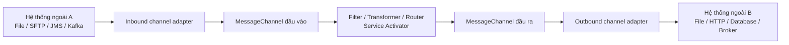
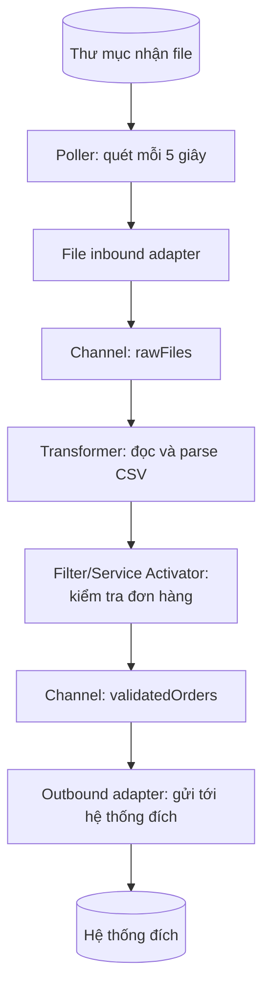

# Vai trò của channel adapter trong kiến trúc messaging

## Mục tiêu học tập

Sau bài này, bạn có thể:

- Giải thích vì sao một hệ thống tích hợp cần **channel adapter** và adapter nằm ở đâu trong một luồng Spring Integration.
- Phân biệt **inbound channel adapter**, **outbound channel adapter** và **messaging gateway** theo hướng truyền thông điệp.
- Mô tả cách adapter phối hợp với `Message`, `MessageChannel`, poller và các endpoint xử lý để kết nối hệ thống ngoài.
- Đọc, xây dựng và kiểm tra một luồng đơn giản từ thư mục đầu vào sang thư mục đầu ra bằng Java DSL.
- Nhận diện các vấn đề vận hành thực tế như trùng lặp thông điệp, lỗi I/O, giới hạn tốc độ, giao dịch và quan sát hệ thống.

## 1. Vì sao cần channel adapter?

Giả sử một ứng dụng phải nhận tệp CSV từ đối tác qua SFTP, kiểm tra dữ liệu, chuyển đổi sang mô hình nội bộ, gửi sự kiện lên Kafka và ghi trạng thái xử lý xuống cơ sở dữ liệu. Mỗi hệ thống có giao thức, định dạng dữ liệu và cách điều phối khác nhau. Nếu nghiệp vụ trực tiếp mở kết nối SFTP, quản lý Kafka producer, tự lên lịch quét thư mục và xử lý lỗi mạng, mã nguồn sẽ phụ thuộc chặt vào từng công nghệ ngoại vi.

**Spring Integration** áp dụng mô hình *Enterprise Integration Patterns* (EIP): các thành phần trao đổi với nhau qua `MessageChannel` bằng đối tượng `Message<?>`. Một message gồm **payload** (dữ liệu chính) và **headers** (siêu dữ liệu phục vụ định tuyến, tương quan, theo dõi hoặc điều khiển). Với cách tổ chức này, phần xử lý nghiệp vụ có thể tập trung vào thông điệp thay vì phải biết kết nối bên ngoài hoạt động ra sao.

**Channel adapter** là endpoint ở ranh giới giữa Spring Integration và thế giới bên ngoài:

- **Inbound channel adapter** đưa dữ liệu/sự kiện **từ hệ thống ngoài vào** một `MessageChannel`.
- **Outbound channel adapter** nhận message **từ `MessageChannel` và gửi ra** hệ thống ngoài.

Hướng *inbound/outbound* luôn được xác định **so với ứng dụng Spring Integration**, không phải theo cách một hệ thống bên ngoài tự gọi nó là client hay server.



Trong sơ đồ, adapter chịu trách nhiệm **kết nối tại biên**; các channel chịu trách nhiệm **chuyển giao message giữa các endpoint**; các endpoint ở giữa đảm nhiệm kiểm tra, chuyển đổi, định tuyến hoặc thực thi nghiệp vụ.

## 2. Vai trò và ranh giới trách nhiệm

| Thành phần | Trách nhiệm chính | Ví dụ |
| --- | --- | --- |
| Inbound channel adapter | Nhận/đọc dữ liệu từ bên ngoài, tạo message, gửi vào channel | Đọc tệp mới, nhận message từ queue, tiêu thụ bản ghi Kafka |
| `MessageChannel` | Là đường chuyển message giữa các endpoint theo ngữ nghĩa channel đã chọn | `DirectChannel`, `QueueChannel`, `ExecutorChannel` |
| Transformer / Filter / Router | Chuyển đổi payload, chọn hoặc bỏ message, chọn nhánh luồng | Parse CSV thành DTO, bỏ dữ liệu không hợp lệ, định tuyến theo loại sự kiện |
| Service Activator | Gọi logic ứng dụng khi có message | Kiểm tra quy tắc nghiệp vụ, ghi kết quả xử lý |
| Outbound channel adapter | Chuyển message thành tác động ra bên ngoài | Ghi tệp, gửi message tới broker, ghi cơ sở dữ liệu |
| Gateway | Là cầu nối cho tương tác có yêu cầu phản hồi hoặc cho API gọi theo kiểu request–reply | HTTP inbound gateway trả HTTP response; messaging gateway gọi flow và nhận kết quả |

Adapter **không đồng nghĩa** với channel. Adapter đưa dữ liệu qua ranh giới giao thức; channel nối các endpoint trong ứng dụng. Tách hai khái niệm này giúp thay SFTP bằng Kafka hoặc thay đầu ra bằng HTTP mà không nhất thiết phải viết lại toàn bộ bước xử lý ở giữa. Tuy nhiên, việc thay adapter vẫn phải xem xét lại hợp đồng message và ngữ nghĩa giao nhận của hệ thống mới.

### 2.1. Inbound adapter: đưa sự kiện vào luồng

Một inbound adapter thường thực hiện chuỗi công việc sau:

1. Kết nối hoặc theo dõi nguồn bên ngoài.
2. Nhận bản ghi, sự kiện, tệp hoặc dữ liệu đầu vào.
3. Biểu diễn dữ liệu đó dưới dạng `Message<?>` với payload và headers phù hợp.
4. Đẩy message vào `MessageChannel` cấu hình cho endpoint.

Inbound adapter có hai cách nhận dữ liệu phổ biến:

- **Polling:** chủ động hỏi nguồn theo lịch, chẳng hạn quét thư mục, truy vấn bảng cơ sở dữ liệu hoặc kiểm tra nguồn SFTP. Endpoint thường cần một `Poller` với chu kỳ và giới hạn số message lấy mỗi lần.
- **Event-driven:** nhận sự kiện khi nguồn chủ động phát ra, chẳng hạn listener của JMS/AMQP hoặc consumer được kích hoạt bởi broker. Lịch poller của Spring Integration không nhất thiết tham gia vào endpoint này; cơ chế nhận phụ thuộc adapter và client của giao thức.

Không nên hiểu rằng *mọi* inbound adapter đều cần poller: đây là đặc điểm của **nguồn có cơ chế polling**, không phải điều kiện bắt buộc cho mọi kết nối.

### 2.2. Outbound adapter: tạo tác động ra ngoài

Một outbound adapter nhận message và chuyển thành thao tác đối với hệ thống đích, chẳng hạn tạo tệp, gửi message tới một queue hoặc ghi bản ghi vào database. Thông thường nó là endpoint **một chiều**: message được xử lý để tạo tác động, và flow không chờ một message phản hồi nghiệp vụ trên cùng tương tác đó.

Điều này khác với **outbound gateway**, vốn phục vụ request–reply. Ví dụ, khi gọi HTTP API và cần lấy response để quyết định bước tiếp theo, outbound HTTP gateway thích hợp hơn outbound HTTP channel adapter một chiều. Lưu ý một adapter vẫn có thể nhận xác nhận hoặc báo lỗi ở cấp giao thức; điều đó **không biến** nó thành gateway trả về một `Message` phản hồi cho flow.

## 3. Một luồng điển hình: từ File đến xử lý và gửi đi

Xét bài toán tiếp nhận đơn hàng từ tệp do đối tác thả vào thư mục. Một thiết kế thực tế có thể gồm:



Ở đây:

- Adapter đầu vào hiểu **cách lấy file**, không cần hiểu quy tắc nghiệp vụ “đơn hàng hợp lệ”.
- Transformer hiểu **cách chuyển file thành dữ liệu**, không cần biết file được lấy từ ổ đĩa hay SFTP.
- Bộ kiểm tra nghiệp vụ hiểu **quy tắc đơn hàng**, không phải giao thức nhận hoặc gửi.
- Adapter đầu ra hiểu **cách ghi/gửi** đến hệ thống đích, không phải toàn bộ nguồn gốc của đơn hàng.

Nhờ phân tách trách nhiệm, khi thay nguồn file cục bộ bằng SFTP, chỉ những thành phần liên quan đến kết nối, hợp đồng message và vận hành đầu vào cần được rà soát, thay vì sửa toàn bộ logic xử lý đơn hàng.

## 4. Ví dụ Java DSL: kết nối hai thư mục bằng adapter

Ví dụ dưới đây cố ý giữ nguyên payload để thấy rõ vai trò kết nối của **inbound** và **outbound** adapter. Luồng quét `./data/inbox` mỗi 5 giây, lấy các tệp `*.csv`, gửi chúng qua channel `incomingFiles`, rồi ghi bản sao vào `./data/archive`. Đây là ví dụ **chuyển tệp**, chưa phải ví dụ parse CSV hay xử lý đơn hàng.

Đối với Spring Boot, có thể dùng `spring-boot-starter-integration` và module `spring-integration-file` tương ứng với phiên bản Spring Integration được Spring Boot quản lý.

```java
import java.io.File;
import java.time.Duration;

import org.springframework.context.annotation.Bean;
import org.springframework.context.annotation.Configuration;
import org.springframework.integration.channel.DirectChannel;
import org.springframework.integration.config.EnableIntegration;
import org.springframework.integration.dsl.IntegrationFlow;
import org.springframework.integration.dsl.Pollers;
import org.springframework.integration.file.dsl.Files;
import org.springframework.messaging.MessageChannel;

@Configuration
@EnableIntegration
public class FileAdaptersConfiguration {

    @Bean
    public MessageChannel incomingFiles() {
        return new DirectChannel();
    }

    @Bean
    public IntegrationFlow fileArchiveFlow() {
        return IntegrationFlow
            .from(
                Files.inboundAdapter(new File("./data/inbox"))
                    .autoCreateDirectory(true)
                    .patternFilter("*.csv"),
                endpoint -> endpoint.poller(
                    Pollers.fixedDelay(Duration.ofSeconds(5))
                        .maxMessagesPerPoll(10)))
            .channel("incomingFiles")
            .handle(
                Files.outboundAdapter(new File("./data/archive"))
                    .autoCreateDirectory(true))
            .get();
    }
}
```

**Đọc code theo chiều dữ liệu:**

1. `Files.inboundAdapter(...)` tạo nguồn nhận các `File` từ thư mục đầu vào. Mỗi message nhận được có payload là đối tượng `File` trỏ đến tệp được chọn.
2. `patternFilter("*.csv")` giới hạn tệp được nguồn xem xét. Chỉ lọc theo đuôi tệp **không bảo đảm** tệp đã ghi xong hoặc nội dung CSV hợp lệ.
3. `Pollers.fixedDelay(...)` thiết lập lịch quét. `maxMessagesPerPoll(10)` giới hạn số message được lấy trong **mỗi lần chạy poll**, không phải giới hạn tổng số file toàn hệ thống.
4. `incomingFiles` là `DirectChannel`: subscriber xử lý message trong luồng gọi gửi, nếu không có cấu hình thực thi bất đồng bộ khác.
5. `Files.outboundAdapter(...)` ghi file sang thư mục đích. Luồng này không tự kiểm tra nội dung hay xác nhận đã hoàn tất một nghiệp vụ.

Có thể thử nhanh bằng cách tạo hai thư mục, khởi động ứng dụng, đặt `order-001.csv` vào `./data/inbox` rồi kiểm tra tệp xuất hiện trong `./data/archive`. Thử thêm `readme.txt` để xác nhận bộ lọc không chọn file ngoài mẫu `*.csv`. Với xử lý thật, cần thiết kế thêm cơ chế chờ file hoàn tất, phòng trùng lặp, đặt tên file khi ghi và xử lý lỗi; hành vi sau khi khởi động lại còn phụ thuộc bộ lọc và cấu hình trạng thái của nguồn.

> **Điểm cốt lõi:** Code minh họa adapter kết nối ngoại vi với luồng message. Nếu cần parse CSV, có thể chèn transformer sau `incomingFiles`; nếu cần đưa sự kiện sang broker, thay outbound file adapter bằng outbound adapter tương ứng và thiết kế lại payload/headers theo hợp đồng của broker.

## 5. Adapter tương tác với Message và MessageChannel như thế nào?

### 5.1. Hợp đồng message tại biên

Một message trong Spring Integration có dạng khái niệm:

```text
Message
├── payload: File | byte[] | String | DTO | ...
└── headers
    ├── id, timestamp
    ├── correlationId, replyChannel, errorChannel (nếu có)
    └── metadata riêng của adapter/giao thức (nếu có)
```

Trong luồng file ở trên, payload là `File`. Một adapter Kafka có thể cung cấp record và metadata liên quan tới topic, partition hoặc offset, tùy cấu hình. Adapter SFTP có thể bổ sung metadata về tên file từ xa. **Không giả định** hai adapter sẽ sinh payload hoặc headers giống nhau chỉ vì chúng phục vụ cùng một nghiệp vụ.

Khi thiết kế ranh giới, cần xác định:

| Câu hỏi hợp đồng | Điều cần quyết định |
| --- | --- |
| Payload ở đầu vào là gì? | `File`, `String`, byte, DTO hay message của thư viện giao thức? |
| Ai chuẩn hóa dữ liệu? | Adapter cấu hình converter hay transformer riêng trong flow? |
| Metadata nào cần giữ? | Mã tương quan, tên nguồn, key, thông tin truy vết, thời điểm nhận |
| Header nào có thể truyền ra ngoài? | Chỉ những header được adapter đích hỗ trợ hoặc được ánh xạ rõ ràng |
| Làm sao xử lý lại? | Khóa idempotency, offset/acknowledgment, trạng thái file, cơ chế retry |

Ví dụ, chuyển từ `File` sang DTO làm thay đổi kiểu payload. Downstream handler phải khai báo đúng kiểu; nếu không, có thể xuất hiện lỗi chuyển đổi hoặc lỗi khi xử lý. Headers là metadata của message trong flow; việc một header có được ánh xạ sang Kafka/JMS/HTTP hay không phụ thuộc bộ ánh xạ và cấu hình của adapter đích.

### 5.2. Lựa chọn channel thay đổi cách luồng vận hành

Adapter gửi/nhận message thông qua channel, nhưng ngữ nghĩa đồng bộ, bất đồng bộ và xếp hàng nằm ở **loại channel**:

| Channel | Cách chuyển giao | Hệ quả thiết kế |
| --- | --- | --- |
| `DirectChannel` | Gọi subscriber đồng bộ trên luồng gửi | Dễ theo dõi thứ tự xử lý; tác vụ downstream chậm có thể giữ luồng nhận lâu |
| `ExecutorChannel` | Giao việc cho executor | Tách luồng gửi khỏi xử lý, cần quản lý pool, nghẽn tải và thứ tự |
| `QueueChannel` | Đưa message vào hàng đợi để bên nhận poll | Có vùng đệm; phải cấu hình capacity, consumer/poller và chính sách khi đầy |
| `PublishSubscribeChannel` | Phân phát đến các subscriber | Phù hợp khi nhiều nhánh cần nhận cùng sự kiện; không tương đương cơ chế chia đều tải |

`DirectChannel` không tự làm cho việc gửi thông điệp bền vững; `QueueChannel` mặc định cũng không đồng nghĩa với hàng đợi durable lưu trên đĩa. Độ bền, giao dịch, thứ tự và khả năng giao lại message phải được xét trên **toàn tuyến** gồm adapter, channel, broker và handler.

## 6. Poller, nhịp xử lý và vòng đời kết nối

Với inbound polling adapter, poller điều khiển **khi nào** và **bao nhiêu lần** hệ thống thử nhận dữ liệu. Cần xét ít nhất bốn yếu tố:

1. **Chu kỳ:** Quét quá dày tăng tải I/O hoặc API; quét quá thưa tăng độ trễ.
2. **Số lượng mỗi lần:** `maxMessagesPerPoll` giúp hạn chế lượng lấy ra trong mỗi chu kỳ; nếu backlog lớn, phải cân đối throughput và khả năng xử lý downstream.
3. **Xử lý chậm:** Khi flow sử dụng channel đồng bộ, thao tác gửi đi có thể kéo dài lần poll. Với channel bất đồng bộ, cần kiểm soát backlog và khả năng tạo tải vượt sức downstream.
4. **Vòng đời:** Adapter có thể phụ thuộc socket, session, connection factory, client consumer hoặc scheduler. Khi startup/shutdown phải bảo đảm kết nối và worker được quản lý đúng; không giả định nguồn đã sẵn sàng ngay khi ứng dụng khởi động.

Đối với Kafka, JMS hoặc AMQP, cơ chế listener/consumer và xác nhận xử lý có chi tiết riêng. Không dùng một công thức poller hoặc retry duy nhất cho mọi adapter.

## 7. Khi nào dùng adapter, khi nào dùng gateway?

Phân biệt theo **hợp đồng tương tác** trước khi chọn API:

| Tình huống | Lựa chọn thường phù hợp | Lý do |
| --- | --- | --- |
| Quét file từ ổ đĩa, không có người gọi cần nhận response | File inbound channel adapter | Đưa file vào flow theo lịch |
| Đẩy sự kiện đã xử lý lên broker, flow không cần reply nghiệp vụ | Outbound channel adapter | Mô hình gửi một chiều |
| HTTP client gọi vào ứng dụng và cần status/body theo kết quả xử lý | HTTP inbound gateway | Có request–reply cần được ánh xạ thành HTTP response |
| Flow gọi REST API rồi sử dụng body trả về trong bước tiếp theo | HTTP outbound gateway | Cần đưa response trở lại flow |
| Mã Java trong ứng dụng muốn gọi flow qua interface trả kết quả | Messaging gateway | Tạo giao diện gọi theo kiểu phương thức, che cách gửi/nhận message |

Chẳng hạn, nếu hệ thống ngoài gửi một HTTP POST và yêu cầu trả ngay mã đơn hàng đã tạo, việc thiết kế chỉ với inbound adapter một chiều là thiếu hợp đồng phản hồi. Ngược lại, ghi một file log từ message không cần gateway request–reply.

## 8. Lỗi, giao nhận và giới hạn bảo đảm

Channel adapter **không tự bảo đảm exactly-once end-to-end**. Một lần poll có thể đọc lại dữ liệu; một broker có thể giao lại message; hoặc yêu cầu gửi đã thành công ở hệ thống đích nhưng ứng dụng mất kết nối trước khi nhận được xác nhận. Phải thiết kế theo cơ chế nguồn/đích thực tế.

### 8.1. Lỗi có thể xảy ra ở đâu?

- **Nguồn đầu vào:** mất kết nối SFTP, file đang được ghi dở, dữ liệu không thể đọc, token hết hạn.
- **Trong flow:** payload sai kiểu, lỗi parse CSV, vi phạm quy tắc nghiệp vụ, handler ném exception.
- **Đích đầu ra:** timeout HTTP, broker không sẵn sàng, thiếu quyền ghi thư mục, lỗi database.
- **Trong điều phối:** queue đầy, executor quá tải, nhiều message đến nhanh hơn khả năng tiêu thụ.

Trong một số luồng bất đồng bộ hoặc được kích hoạt bởi poller, framework có thể đưa lỗi vào `errorChannel` dưới dạng `ErrorMessage`, tùy endpoint và cấu hình. Trong luồng đồng bộ, exception có thể truyền ngược đến caller. Không nên giả định cấu hình `errorChannel` mặc định sẽ tự xử lý hoặc tự retry mọi ngoại lệ; cần cấu hình rõ error flow, retry policy và hành động cuối cùng khi hết lần thử.

### 8.2. Phân biệt retry với idempotency

**Retry** là thử lại thao tác sau lỗi tạm thời; **idempotency** là bảo đảm việc nhận hoặc xử lý lại cùng một sự kiện không tạo tác động nghiệp vụ trùng lặp. Cả hai thường cần đi cùng nhau:

- Tạo khóa duy nhất có ý nghĩa nghiệp vụ, ví dụ `partnerId + orderId`, và kiểm tra trước khi ghi đơn hàng.
- Với file, cân nhắc bộ lọc chấp nhận một lần có trạng thái lưu bền hoặc chuyển file sau khi xử lý thành công. Bộ lọc chỉ dựa trên bộ nhớ có thể mất trạng thái khi restart.
- Với broker, hiểu thời điểm commit offset/acknowledge liên quan đến thời điểm nghiệp vụ thực sự hoàn tất.
- Chỉ tự động thử lại khi thao tác phù hợp với retry; gửi lại yêu cầu tạo tài nguyên không có khóa chống trùng có thể tạo hai bản ghi.
- Đưa message lỗi khó phục hồi sang nơi chờ điều tra hoặc xử lý thủ công theo chính sách hệ thống; giữ đủ metadata để truy vết.

### 8.3. Giao dịch và xác nhận

Thao tác “đã nhận từ nguồn”, “đã xử lý trong Spring Integration” và “đã ghi ra đích” có thể là **ba thời điểm khác nhau**. Không mặc định có một transaction bao phủ file system, cơ sở dữ liệu và broker. Nếu cần tính nhất quán cao, hãy chọn mô hình theo hạ tầng: transaction cục bộ khi hỗ trợ, outbox/inbox, idempotent consumer, cơ chế acknowledgment phù hợp hoặc quy trình bù trừ.

## 9. Thiết kế adapter để vận hành được

Một kiến trúc messaging tốt cần quan sát được **luồng qua biên** chứ không chỉ đọc được log bên trong handler.

| Quan tâm | Thực hành gợi ý |
| --- | --- |
| Kết nối | Quản lý timeout, reconnect và credential qua cấu hình/secret; tránh hard-code mật khẩu |
| Lưu lượng | Theo dõi số message nhận/gửi, thời gian xử lý, backlog, queue depth, số lỗi và retry |
| Truy vết | Gắn correlation ID xuyên flow; log khóa nghiệp vụ và thông tin lỗi phù hợp, tránh lộ dữ liệu nhạy cảm |
| Mất hoặc trùng dữ liệu | Thống nhất chính sách ack, retry, idempotency và xử lý trạng thái khi restart |
| Bảo vệ hệ thống đích | Giới hạn tốc độ, concurrency, capacity và backpressure theo khả năng thật của nguồn/đích |
| Triển khai | Tách cấu hình adapter khỏi quy tắc nghiệp vụ; thử cả startup, shutdown và khôi phục kết nối |

Ví dụ, một file inbound adapter quét 1.000 file/phút nhưng downstream chỉ xử lý được 100 file/phút sẽ tạo điểm nghẽn. Việc đưa một `ExecutorChannel` vào giữa không tự giải quyết chênh lệch tải; cần giới hạn concurrency, bộ đệm có capacity và chính sách xử lý backlog.

## 10. Những sai lầm thường gặp

**Nhầm adapter với channel.** Channel không tự đọc SFTP hay gọi HTTP; adapter chịu trách nhiệm giao tiếp với hệ thống ngoài.

**Cho rằng outbound adapter có phản hồi nghiệp vụ.** Nếu bước tiếp theo phụ thuộc response, cần một gateway hoặc một cơ chế tương quan phản hồi bất đồng bộ được thiết kế rõ.

**Đặt toàn bộ logic xử lý vào adapter.** Việc parse, kiểm tra và định tuyến phức tạp nên nằm ở các endpoint của flow để dễ kiểm thử, tái sử dụng và đổi nguồn/đích.

**Tin rằng quét một lần là xử lý đúng một lần.** Cần xét restart, lỗi giữa chừng, acknowledgment và idempotency. Với file đến từ đối tác, còn phải tránh đọc file chưa được ghi hoàn tất.

**Đổi adapter mà quên hợp đồng message.** File adapter có payload `File`, trong khi các nguồn khác có thể tạo `byte[]`, `String` hoặc đối tượng record. Phải kiểm tra payload, header và chuyển đổi kiểu ở ranh giới.

## 11. Câu hỏi tự kiểm tra

1. Một luồng đang nhận file từ SFTP, parse dữ liệu rồi lưu database. Nếu đối tác chuyển sang gửi bằng Kafka, phần nào của kiến trúc chắc chắn phải rà soát? **Gợi ý:** inbound adapter, kiểu payload, metadata/acknowledgment và các bảo đảm xử lý.
2. Vì sao một `DirectChannel` không giải quyết được tình huống downstream xử lý chậm? **Gợi ý:** subscriber thường xử lý ngay trên luồng gọi gửi.
3. Khi nào nên dùng HTTP outbound gateway thay vì outbound adapter? **Gợi ý:** khi flow cần sử dụng HTTP response cho bước tiếp theo.
4. Một file đã gửi thành công ra hệ thống đích nhưng chương trình gặp lỗi trước khi ghi nhận hoàn tất; lần chạy sau file được đọc lại. Làm sao tránh tạo dữ liệu trùng? **Gợi ý:** idempotency key cùng chính sách ghi nhận và thử lại.
5. Tại sao thêm `QueueChannel` không đồng nghĩa với bảo đảm không mất message khi ứng dụng dừng? **Gợi ý:** khả năng lưu bền phụ thuộc cấu hình backing store và toàn bộ tuyến giao nhận.

## Kết luận

Trong Spring Integration, **channel adapter là cầu nối giữa giao thức/hệ thống bên ngoài và mô hình message nội bộ**. Inbound adapter đưa dữ liệu vào channel; outbound adapter chuyển message thành thao tác đi ra; gateway phù hợp khi tương tác cần phản hồi. Tách adapter khỏi channel và xử lý nghiệp vụ giúp luồng tích hợp dễ mở rộng từ file, SFTP, HTTP đến JMS, AMQP, Kafka hay cơ sở dữ liệu. Khi triển khai thực tế, cần thiết kế đồng thời hợp đồng payload/headers, poller hoặc listener, ngữ nghĩa channel, retry, idempotency và quan sát vận hành.
