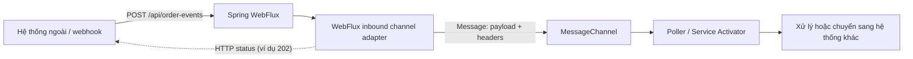
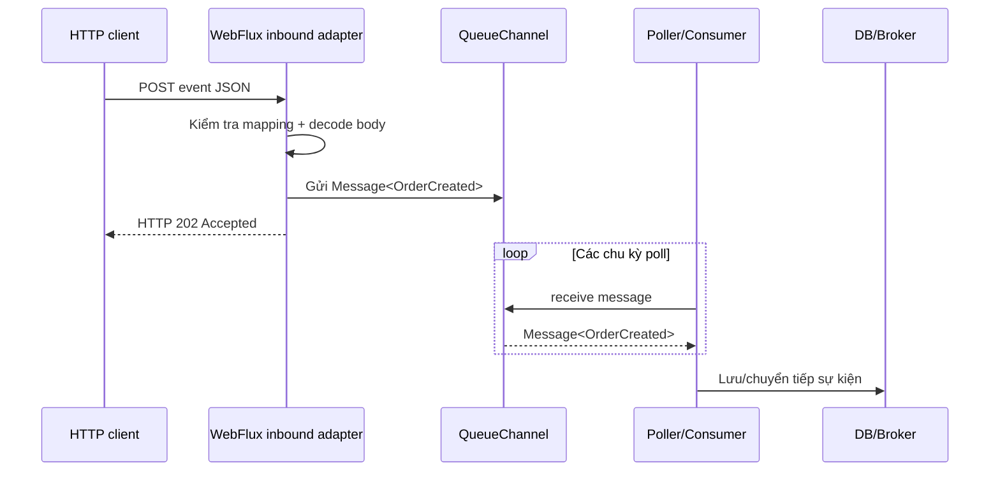

# WebFlux inbound channel adapter trong Spring Integration

## 1. Vai trò của inbound channel adapter

Trong hệ thống tích hợp, một ứng dụng có thể nhận yêu cầu HTTP từ đối tác, webhook hoặc dịch vụ nội bộ rồi chuyển dữ liệu vào luồng xử lý message. **WebFlux inbound channel adapter** là điểm vào thực hiện việc đó: nhận HTTP request thông qua Spring WebFlux, chuyển nội dung phù hợp thành `Message<?>` của Spring Integration và gửi message đến một `MessageChannel`.

Đây là một thành phần thuộc module **SPRING_INTEGRATION_ADAPTERS**, nơi các inbound/outbound adapter, gateway, poller và MessageChannel kết nối hệ thống ngoài với luồng tích hợp. Trong bài này, hệ thống bên ngoài là HTTP client; công việc của adapter là đưa dữ liệu từ HTTP vào luồng, còn việc phân luồng, chuyển đổi và xử lý nghiệp vụ được giao cho các endpoint phía sau.

Ví dụ: một dịch vụ bán hàng gửi sự kiện `order.created` bằng HTTP POST. Adapter nhận sự kiện, tạo message và chuyển đến channel; consumer của channel lưu, định tuyến hoặc đẩy tiếp sự kiện sang Kafka/JMS/AMQP.



**Đặc tính quan trọng:** inbound **channel adapter** phù hợp với giao tiếp một chiều (nhận và chuyển message). HTTP client vẫn nhận một HTTP response theo hợp đồng HTTP, nhưng response này không mang kết quả nghiệp vụ trả về từ luồng xử lý. Nếu cần xử lý yêu cầu rồi trả dữ liệu nghiệp vụ cho client trong cùng request, hãy chọn **WebFlux inbound gateway**.

## 2. Phân biệt adapter, gateway và WebFlux

| Thành phần | Hợp đồng với client | Dòng message | Trường hợp sử dụng |
|---|---|---|---|
| WebFlux inbound **channel adapter** | Client nhận mã trạng thái xác nhận tiếp nhận; không chờ payload kết quả nghiệp vụ | HTTP → `MessageChannel` | Webhook, thu nhận sự kiện, lệnh xử lý nền |
| WebFlux inbound **gateway** | Client chờ reply ứng với request | HTTP → request channel → reply → HTTP | Tra cứu dữ liệu, API trả kết quả tính toán |
| HTTP inbound adapter dựa trên Spring MVC | Hợp đồng một chiều tương tự, dùng hạ tầng web kiểu Servlet/MVC | HTTP → `MessageChannel` | Ứng dụng đang dùng Spring MVC |
| WebFlux outbound gateway/adapter | Chủ động gọi HTTP **ra ngoài** từ luồng tích hợp | `MessageChannel` → HTTP server ngoài | Gọi REST API của hệ thống khác |

WebFlux sử dụng API phản ứng như Reactor `Mono` và `Flux` để xử lý kết nối HTTP theo mô hình không chặn tại tầng web khi được cấu hình phù hợp. Tuy nhiên, **dùng WebFlux không tự động làm cho toàn bộ Spring Integration flow trở thành non-blocking**. Nếu đưa message vào `QueueChannel`, dùng poller hay gọi JDBC đồng bộ, những đoạn đó vẫn mang đặc tính của cơ chế tương ứng.

Spring Integration cung cấp `WebFluxInboundEndpoint` từ dòng 5.0; khi dùng Java DSL, ta thường cấu hình qua factory `WebFlux.inboundChannelAdapter(...)` thay vì trực tiếp khởi tạo endpoint. Đây là điểm nối giữa HTTP request mapping, chuyển đổi payload và channel của Spring Integration.

## 3. Chuẩn bị dự án và hợp đồng nhận dữ liệu

Ví dụ sử dụng Spring Boot, Spring WebFlux và Spring Integration. Khi dự án có BOM/dependency management của Spring Boot, nên để BOM quản lý phiên bản Spring Integration tương thích.

```groovy
// build.gradle (đoạn dependencies)
dependencies {
    implementation 'org.springframework.boot:spring-boot-starter-webflux'
    implementation 'org.springframework.boot:spring-boot-starter-integration'
    implementation 'org.springframework.integration:spring-integration-webflux'
}
```

Trong ứng dụng Spring Boot dùng WebFlux auto-configuration, không bắt buộc thêm `@EnableWebFlux`. Với ứng dụng Spring Framework cấu hình thủ công, cần bật hạ tầng WebFlux (ví dụ `@EnableWebFlux`) và hạ tầng Spring Integration phù hợp. Đừng thêm `spring-boot-starter-web` chỉ để phục vụ endpoint này nếu chủ đích là chạy ứng dụng WebFlux trên reactive server; nếu đồng thời có MVC và WebFlux, cần kiểm tra web application type được chọn.

Giả sử ta công bố endpoint:

| Thành phần | Giá trị |
|---|---|
| URI | `POST /api/order-events` |
| `Content-Type` | `application/json` |
| JSON body | `{"eventId":"evt-001","orderId":"ORD-1001"}` |
| Dữ liệu trong flow | `OrderCreated` (payload) và các message headers |
| HTTP response thành công | `202 Accepted` được cấu hình rõ ràng |
| Kết quả xử lý nghiệp vụ | Được xử lý sau ở consumer; không trả dưới dạng response body |

Trong ví dụ học tập, `202 Accepted` nghĩa là request hợp lệ đã được adapter chuyển vào channel để tiếp tục xử lý. Mã này **không bảo đảm** đã ghi dữ liệu bền vững hoặc đã hoàn tất tác vụ nghiệp vụ.

## 4. Cấu hình một WebFlux inbound channel adapter

Ví dụ hoàn chỉnh ở mức lớp cấu hình:

```java
package com.example.integration;

import org.springframework.context.annotation.Bean;
import org.springframework.context.annotation.Configuration;
import org.springframework.http.HttpMethod;
import org.springframework.http.HttpStatus;
import org.springframework.http.MediaType;
import org.springframework.integration.annotation.Poller;
import org.springframework.integration.annotation.ServiceActivator;
import org.springframework.integration.config.EnableIntegration;
import org.springframework.integration.dsl.IntegrationFlow;
import org.springframework.integration.webflux.dsl.WebFlux;

@Configuration
@EnableIntegration
public class WebFluxOrderEventConfiguration {

    // DTO dùng để ánh xạ JSON request body.
    public record OrderCreated(String eventId, String orderId) {}

    @Bean
    public IntegrationFlow receiveOrderEvents() {
        return IntegrationFlow
            .from(WebFlux.inboundChannelAdapter("/api/order-events")
                .requestMapping(mapping -> mapping
                    .methods(HttpMethod.POST)
                    .consumes(MediaType.APPLICATION_JSON_VALUE))
                .requestPayloadType(OrderCreated.class)
                .statusCodeFunction(message -> HttpStatus.ACCEPTED))
            .channel(channels -> channels.queue("orderEventsQueue"))
            .get();
    }

    @ServiceActivator(
        inputChannel = "orderEventsQueue",
        poller = @Poller(fixedDelay = "500")
    )
    public void consume(OrderCreated event) {
        // Demo: thay bằng gọi service, persist hoặc gửi message sang broker.
        System.out.printf("Order event: %s -> %s%n",
            event.eventId(), event.orderId());
    }
}
```

**Diễn giải cấu hình:**

1. `WebFlux.inboundChannelAdapter("/api/order-events")` tạo đầu vào HTTP cho luồng.
2. `requestMapping(...)` chỉ cho phép `POST` với request body có `Content-Type: application/json`. Những ràng buộc bổ sung như path, headers và media type có thể được cấu hình ở lớp request mapping.
3. `requestPayloadType(OrderCreated.class)` yêu cầu cơ chế HTTP message reader/codec ánh xạ request body sang kiểu `OrderCreated`. Với JSON, dự án phải có codec Jackson phù hợp (thường đi cùng WebFlux starter).
4. `statusCodeFunction(...)` chọn mã `202 Accepted` cho response thành công của adapter. Nó không tạo reply từ service nghiệp vụ.
5. `.channel(channels -> channels.queue("orderEventsQueue"))` nối adapter đến một `QueueChannel`. Hàng đợi này giúp minh họa cách tách thời điểm tiếp nhận HTTP khỏi thời điểm consumer thực thi.
6. `@ServiceActivator` cùng `@Poller(fixedDelay = "500")` lấy message từ queue theo chu kỳ và gọi phương thức `consume`. `fixedDelay` là thời gian giữa các lần poll, không phải cam kết latency hay thông lượng cố định.

Trong ví dụ, `QueueChannel` là **hàng đợi trong bộ nhớ ứng dụng**, không phải hàng đợi bền vững. Nếu tiến trình dừng, các message chưa được chuyển sang nơi lưu trữ khác có thể bị mất. Khi cần nhận webhook đáng tin cậy, hãy thiết kế bước ghi bền vững vào cơ sở dữ liệu/broker trước khi xác nhận theo hợp đồng của hệ thống.

### 4.1. Thử gửi request

Khởi chạy ứng dụng, sau đó dùng `curl` (trên PowerShell có thể gọi `curl.exe`):

```bash
curl -i -X POST http://localhost:8080/api/order-events \
  -H 'Content-Type: application/json' \
  -d '{"eventId":"evt-001","orderId":"ORD-1001"}'
```

Khi endpoint hoạt động bình thường, HTTP response có status `202 Accepted`. Một lần poll tiếp theo có thể in ra:

```text
Order event: evt-001 -> ORD-1001
```

Không nên dùng thứ tự log và HTTP response để suy luận rằng consumer chắc chắn chạy trước hay sau response: chúng có thể diễn ra ở các thời điểm khác nhau tùy cấu hình channel, scheduler và tốc độ thực thi.

### 4.2. Điều gì nằm trong Spring Integration message?

Một request HTTP thường được biểu diễn trong flow bằng:

```text
Message<OrderCreated>
  payload: OrderCreated(eventId="evt-001", orderId="ORD-1001")
  headers:
    ... metadata của Spring Integration ...
    ... thông tin HTTP đã được header mapper ánh xạ ...
```

`payload` là dữ liệu nghiệp vụ được chuyển đổi từ HTTP request. `headers` chứa metadata phục vụ định tuyến, tương quan message và các thông tin HTTP được ánh xạ theo cấu hình. Không nên giả định mọi header HTTP đều tự động xuất hiện hoặc đều đáng tin cậy: cơ chế `HeaderMapper` có thể giới hạn danh sách header được nhập, và header do client gửi có thể bị giả mạo.

Nếu request body rỗng hoặc biểu thức trích xuất payload trả về `null`, inbound endpoint có cơ chế dùng request parameters dạng `MultiValueMap<String, String>` làm payload dự phòng. Vì thế cần kiểm soát rõ request type/validation và không mặc định payload luôn là DTO.

## 5. Luồng xử lý thực tế và hợp đồng bất đồng bộ

Với ví dụ webhook, vòng đời có thể được hiểu như sau:



Sơ đồ phản ánh **một kịch bản minh họa** với queue và poller. Một số điểm cần phân biệt:

- HTTP request chỉ được coi là tiếp nhận thành công khi phần nhận và gửi message vào channel diễn ra theo hợp đồng endpoint; lỗi tại bước mapping, decode hoặc gửi message vẫn có thể khiến request thất bại.
- Adapter không trả kết quả của `consume`. Nếu `consume` lỗi sau khi request đã được xác nhận, HTTP client không nhận được lỗi nghiệp vụ đó qua response ban đầu.
- `202 Accepted` có ý nghĩa chấp nhận để xử lý tiếp; nó không chứng minh được `exactly-once`, commit database, hay delivery thành công đến broker. Mỗi hệ thống phải tự thiết kế giới hạn đảm bảo.
- Nếu chuyển trực tiếp đến channel đồng bộ như `DirectChannel`, phần xử lý downstream có thể thực thi ngay trên chuỗi xử lý message, làm thay đổi thời gian response và tác động đến luồng reactive. Queue trong ví dụ giúp minh họa ranh giới xử lý; một queue nội bộ vẫn cần cơ chế lưu bền vững, giới hạn dung lượng và giám sát khi dùng thực tế.

### 5.1. Nên dùng loại channel nào?

| Channel | Cách tiêu thụ | Ưu điểm | Cần chú ý |
|---|---|---|---|
| `DirectChannel` | Subscriber xử lý đồng bộ trong luồng gửi | Đơn giản, ít lớp trung gian | Handler chặn I/O có thể kéo dài đường đi request |
| `ExecutorChannel` | Dispatch tới `TaskExecutor` | Tách thực thi sang thread khác | Cần giới hạn executor/queue; vẫn chưa có đảm bảo lưu bền vững |
| `QueueChannel` | Polling consumer nhận từ queue | Tách thời điểm tiếp nhận/tiêu thụ | Cần poller, kiểm soát dung lượng và xử lý message tồn |
| Broker ngoài qua outbound adapter | Gửi đến hạ tầng Kafka, AMQP, JMS… | Có thể hỗ trợ xử lý tách dịch vụ và lưu bền vững | Cần xét xác nhận ghi, retry, trùng lặp và giao dịch |

Không có channel nào tự động giải quyết mọi yêu cầu về backpressure và độ tin cậy. Với tải cao, cần định nghĩa cụ thể sức chứa, hành vi khi đầy, thời gian chờ, retry và tiêu chí trả HTTP response.

## 6. Reactive payload, threading và backpressure

WebFlux nhận HTTP bằng cơ chế reactive, nhưng kết quả còn phụ thuộc kiểu payload và downstream flow:

- Với `requestPayloadType(OrderCreated.class)`, body được decode thành **một đối tượng**. Phù hợp API JSON event đơn lẻ như ví dụ.
- Khi nhận dòng phần tử, WebFlux inbound endpoint có thể cấu hình `ResolvableType` cho payload reactive, ví dụ `Flux<Event>`. Khi đó downstream phải hiểu và chủ động tiêu thụ publisher; không được nhầm `Message<Flux<Event>>` với nhiều message `Message<Event>` đã tự động tách sẵn.
- Cơ chế `Publisher` hỗ trợ tín hiệu nhu cầu (demand/backpressure) trong phần reactive được kết nối đúng cách. Một handler JDBC chặn, queue không giới hạn hoặc bước chuyển thread không kiểm soát có thể làm mất lợi ích này.
- Với nghiệp vụ chặn I/O, đưa công việc tới executor/scheduler thích hợp hoặc dùng API bất đồng bộ/reactive thực sự. Tránh chạy thao tác chặn kéo dài trên event-loop của Reactor Netty.

Ví dụ về **khai báo kiểu dữ liệu dòng** (chỉ là mảnh cấu hình; cần consumer xử lý publisher phù hợp):

```java
.requestPayloadType(
    ResolvableType.forClassWithGenerics(Flux.class, String.class)
)
```

Để dùng đoạn trên cần import `org.springframework.core.ResolvableType` và `reactor.core.publisher.Flux`. Lựa chọn DTO đơn lẻ hoặc payload dạng `Flux` phải dựa trên giao thức request thực tế, codec được cấu hình và hợp đồng tiêu thụ của downstream.

## 7. Mapping, validation, bảo mật và lỗi

### Request mapping và chuyển đổi dữ liệu

Tập điều kiện quan trọng của một endpoint gồm **đường dẫn**, **HTTP method**, `Content-Type` mà server tiêu thụ (`consumes`) và có thể cả `headers`/request parameters. Nếu request không khớp mapping, WebFlux xử lý như lỗi HTTP route/media type trước khi message được đưa vào channel. Khi mapping hợp lệ nhưng JSON không giải mã được, request sẽ thất bại trong bước binding/codec.

Với dữ liệu nghiệp vụ, nên xác thực các trường bắt buộc như `eventId` và `orderId` trước khi lưu. Spring Integration WebFlux hỗ trợ cấu hình `Validator` cho `WebFluxInboundEndpoint`; với payload reactive, cần lưu ý vị trí validation diễn ra trên các phần tử của publisher. Cũng có thể đặt validation ở flow phía sau khi cần kiểm tra trạng thái cuối của payload hoặc quy tắc nghiệp vụ.

### Phân loại lỗi theo thời điểm

| Thời điểm | Ví dụ | Hướng xử lý |
|---|---|---|
| Trước khi tạo message | Sai đường dẫn, HTTP method, media type | Kiểm tra mapping; client sửa request |
| Khi đọc request | JSON lỗi cú pháp, DTO không hợp lệ | Trả lỗi client phù hợp và log thông tin an toàn |
| Khi chuyển vào channel | Channel không có consumer, queue đầy, lỗi gửi | Cấu hình timeout, capacity, error channel và giám sát |
| Sau khi đã trả `202` | Poller gọi DB thất bại, broker không nhận, handler ném lỗi | Retry có giới hạn, dead-letter/error flow, cảnh báo và đối soát |

Không mặc định mọi ngoại lệ downstream đều truyền ngược thành một HTTP response: sự khác biệt nằm ở việc lỗi xảy ra **trước hay sau khi request được xác nhận**, và flow có đồng bộ hay không. Cần cấu hình `errorChannel` hoặc cơ chế xử lý lỗi tương ứng với endpoint/channel đang sử dụng.

### Các biện pháp vận hành thiết yếu

1. **Xác thực nguồn gửi:** bảo vệ endpoint bằng Spring Security, API key, HMAC signature hoặc mTLS tùy yêu cầu; giới hạn quyền và chỉ nhận header client thực sự cần.
2. **Chống trùng lặp:** dùng `eventId` làm khóa idempotency vì webhook có thể retry và cùng một event có thể đến nhiều lần.
3. **Lưu bền vững trước ACK nếu cần:** nếu cam kết `202` chỉ sau khi broker hoặc database xác nhận nhận message, cần đặt ranh giới xác nhận đúng chỗ, thay vì tin vào queue trong bộ nhớ.
4. **Giới hạn tải:** giới hạn kích thước request, số kết nối, số phần tử dữ liệu, dung lượng queue, tốc độ poll và thời gian xử lý; xác định hành vi khi quá tải.
5. **Quan sát được:** ghi correlation/event ID trong log, đo số request 2xx/4xx/5xx, tốc độ enqueue/dequeue, tuổi message tồn đọng và số lần retry; tránh log toàn bộ dữ liệu nhạy cảm.

## 8. Khi nào chọn inbound channel adapter?

**Nên chọn** khi hợp đồng HTTP yêu cầu nhận một sự kiện/lệnh, xác nhận việc tiếp nhận và để luồng tích hợp xử lý về sau. Những trường hợp thường gặp là webhook từ hệ thống thanh toán, tín hiệu thay đổi trạng thái đơn hàng, thông báo từ đối tác hoặc API nạp sự kiện.

**Nên cân nhắc inbound gateway** nếu client cần dữ liệu kết quả trong cùng request, ví dụ hỏi trạng thái đơn hàng hoặc nhận phản hồi thành công/thất bại của nghiệp vụ ngay sau khi xử lý. Nếu cần cung cấp tiến độ cho job chạy lâu, có thể dùng adapter nhận lệnh và trả `202` cùng một cơ chế tra cứu trạng thái riêng (nếu hợp đồng API yêu cầu).

### Những nhầm lẫn thường gặp

- **Nhầm adapter với gateway:** adapter không dùng reply channel để tạo response body nghiệp vụ.
- **Cho rằng `202` là “đã xử lý xong”:** đây là mã trạng thái tiếp nhận theo cấu hình, không phải biên nhận commit.
- **Cho rằng WebFlux bảo đảm end-to-end non-blocking:** channel, poller và handler downstream quyết định phần lớn hành vi thực tế.
- **Đưa JSON lớn vào queue trong bộ nhớ mà không kiểm soát:** cần tính giới hạn bộ nhớ và chiến lược quá tải.
- **Bỏ qua idempotency:** client retry sau timeout có thể gửi trùng message ngay cả khi lần trước đã được nhận.
- **Giả định mọi lỗi đều quay về client:** lỗi bất đồng bộ sau ACK cần được xử lý bởi flow vận hành riêng.

## 9. Bài thực hành tự kiểm tra

1. Chạy endpoint `POST /api/order-events` với JSON hợp lệ và kiểm tra HTTP `202` cùng log của consumer.
2. Thử gửi `GET` tới cùng URL, gửi `Content-Type` khác và gửi JSON lỗi để quan sát khác biệt giữa lỗi mapping và lỗi decode.
3. Tạm thời làm consumer xử lý chậm; theo dõi các message tồn trong `QueueChannel` và thời gian xuất hiện log.
4. Thay nội dung `consume` bằng lệnh lưu database hoặc gửi đến broker; giả lập lỗi và xác định nơi log/retry sẽ chạy, đồng thời kiểm tra client đã nhận response hay chưa.
5. Gửi lại cùng `eventId` hai lần; thiết kế cơ chế chống trùng ở lớp xử lý và mô tả điều kiện nào cho phép trả `202`.

**Câu hỏi suy ngẫm:** Nếu yêu cầu hệ thống “chỉ trả `202` sau khi message được ghi bền vững vào broker”, việc chỉ thêm `QueueChannel` và poller như ví dụ đã đáp ứng hay chưa? Vì sao phải xem lại ranh giới xác nhận và đường đi của lỗi?

## 10. Tài liệu tham khảo

- [Spring Integration Reference — WebFlux Support](https://docs.spring.io/spring-integration/reference/webflux.html): API Java DSL, `WebFluxInboundEndpoint`, inbound adapter/gateway và cấu hình codec.
- [Spring Integration Reference — HTTP Namespace Support](https://docs.spring.io/spring-integration/reference/http/namespace.html): ngữ nghĩa adapter/gateway, request mapping và các tùy chọn HTTP dùng chung.
- [Spring Framework Reference — Web on Reactive Stack](https://docs.spring.io/spring-framework/reference/web/webflux.html): mô hình reactive HTTP, codec, request handling và hệ sinh thái Reactor.

> **Ghi nhớ:** WebFlux inbound channel adapter đưa HTTP request thành Spring Integration message để flow tiếp nhận và xử lý. Hãy thiết kế riêng hợp đồng HTTP, channel, poller, tính bền vững và xử lý lỗi; đó là các phần quyết định hệ thống tích hợp hoạt động đúng khi có lỗi hoặc tải lớn.
