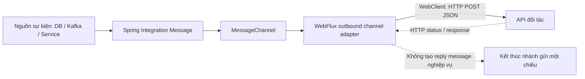
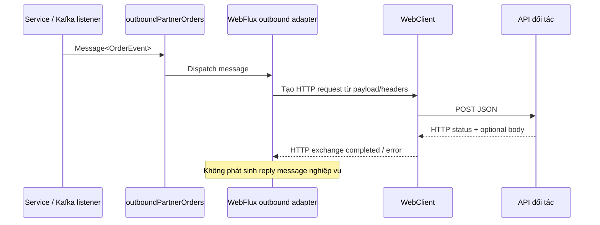

# WebFlux outbound channel adapter trong Spring Integration

## 1. WebFlux outbound channel adapter giải quyết bài toán gì?

**WebFlux outbound channel adapter** là endpoint gửi dữ liệu **từ luồng Spring Integration ra một HTTP server bên ngoài** bằng `WebClient` của Spring WebFlux. Adapter đọc một `Message<?>` từ `MessageChannel`, chọn URL và phương thức HTTP, ánh xạ payload cùng các headers cần thiết rồi thực hiện yêu cầu HTTP. Đây là thành phần tích hợp **một chiều**: phản hồi của HTTP server không trở thành reply message nghiệp vụ trong flow.

Trong module **SPRING_INTEGRATION_ADAPTERS**, ta dùng inbound/outbound adapter, gateway, poller và `MessageChannel` để nối các hệ thống bên ngoài với ứng dụng. WebFlux outbound adapter đảm nhiệm đầu **gửi ra** của hợp đồng HTTP; nó có thể đứng sau luồng nhận dữ liệu từ file, SFTP, database, JMS, AMQP hoặc Kafka, rồi chuyển thông báo đến API đối tác.

**Tình huống:** khi hệ thống ghi nhận đơn hàng, luồng tích hợp tạo sự kiện `order.created`. Đối tác giao vận có HTTP API `POST /api/events`. Ta cần chuyển sự kiện đến API này, trong khi không có nhu cầu đưa response body của đối tác vào các bước nghiệp vụ tiếp theo.



**Phân biệt hai chiều giao tiếp:** outbound mô tả hướng đi **từ ứng dụng đến hệ thống ngoài**; channel adapter mô tả kiểu tích hợp **không tạo reply message**. HTTP vẫn có response ở tầng giao thức, nên adapter và hệ thống vận hành vẫn phải quan tâm đến mã trạng thái, timeout và lỗi mạng. Chúng ta không nên hiểu “một chiều” là “không có phản hồi HTTP” hoặc “chắc chắn gửi thành công”.

## 2. Khi nào dùng outbound adapter, outbound gateway hoặc WebClient trực tiếp?

| Lựa chọn | Dữ liệu đầu vào | Dữ liệu đi tiếp trong flow | Trường hợp phù hợp |
|---|---|---|---|
| **WebFlux outbound channel adapter** | Spring Integration `Message` | Không tạo reply message từ HTTP response | Đẩy webhook, gửi sự kiện, thông báo tới API khác |
| **WebFlux outbound gateway** | Spring Integration `Message` | Reply message từ HTTP response | Gọi API cần trạng thái, body hoặc dữ liệu tra cứu để quyết định bước tiếp |
| **WebFlux inbound adapter** | HTTP request gửi **đến** ứng dụng | Message được đưa vào channel nội bộ | Nhận webhook hay event từ hệ thống ngoài |
| **WebClient trực tiếp** | Lời gọi trong mã Java | `Mono`/`Flux` theo ứng dụng | Chưa có Spring Integration flow, chỉ cần HTTP client |

Hai lựa chọn outbound cùng dựa trên lớp `WebFluxRequestExecutingMessageHandler`, nhưng **`WebFlux.outboundChannelAdapter(...)` cấu hình theo kiểu không mong đợi reply** còn **`WebFlux.outboundGateway(...)` cấu hình theo kiểu request–reply**. Nếu cần đọc `response.statusCode()` để phân nhánh bước kế tiếp, nhận DTO trả về hoặc liên kết kết quả HTTP vào một message khác, hãy dùng gateway hoặc đặt việc kiểm tra kết quả trong thành phần client chuyên trách.

Điểm đáng chú ý: *reactive* phản ánh cách hạ tầng HTTP dùng Reactor/WebClient; nó **không** tự động biến mọi channel, poller, thao tác JDBC hay handler trong toàn bộ flow thành non-blocking.

## 3. Chuẩn bị dependency và hợp đồng HTTP

Ví dụ sử dụng Spring Boot với Spring Integration và WebFlux. Hãy dùng BOM của Spring Boot để quản lý phiên bản phụ thuộc tương thích, tránh tự phối các phiên bản Spring Framework/Spring Integration khác thế hệ.

```groovy
// build.gradle (phần dependencies)
dependencies {
    implementation 'org.springframework.boot:spring-boot-starter-integration'
    implementation 'org.springframework.boot:spring-boot-starter-webflux'
    implementation 'org.springframework.integration:spring-integration-webflux'
}
```

`spring-integration-webflux` cung cấp endpoint và Java DSL. `spring-boot-starter-webflux` cung cấp WebClient cùng hệ sinh thái codec/client; ứng dụng chỉ dùng outbound HTTP **không cần mở một WebFlux inbound server endpoint**. Với ứng dụng không sử dụng Spring Boot starter, phải tự bố trí `WebClient`, HTTP client connector và các codec cần thiết.

Hợp đồng giả lập của API đối tác:

| Thuộc tính | Giá trị minh họa | Ý nghĩa |
|---|---|---|
| Đích HTTP | `http://localhost:9090/api/events` | Dịch vụ giả lập chạy riêng ở cổng 9090 |
| HTTP method | `POST` | Gửi sự kiện |
| Request `Content-Type` | `application/json` | Body được serialize thành JSON |
| Request header | `X-Event-Id: evt-001` | Mã sự kiện giúp nhận diện/khử trùng lặp |
| Request body | `{"eventId":"evt-001","orderId":"ORD-1001","type":"order.created"}` | Payload nghiệp vụ |
| Response ví dụ | `202 Accepted` | API đối tác đã chấp nhận request theo hợp đồng của chính họ |
| Reply message | Không có | Adapter không chuyển HTTP response thành payload của flow |

`202 Accepted` do **server đối tác** trả về, khác với mã trạng thái của một **inbound adapter** do ứng dụng của chúng ta cung cấp. Dù server trả `200`, `201` hay `202`, outbound adapter vẫn là endpoint một chiều; ý nghĩa thành công phải dựa trên hợp đồng HTTP thực tế.

## 4. Cấu hình outbound channel adapter bằng Java DSL

### 4.1. Tạo channel, WebClient và IntegrationFlow

```java
package com.example.integration;

import org.springframework.beans.factory.annotation.Qualifier;
import org.springframework.context.annotation.Bean;
import org.springframework.context.annotation.Configuration;
import org.springframework.http.HttpHeaders;
import org.springframework.http.HttpMethod;
import org.springframework.integration.channel.DirectChannel;
import org.springframework.integration.config.EnableIntegration;
import org.springframework.integration.dsl.IntegrationFlow;
import org.springframework.integration.webflux.dsl.WebFlux;
import org.springframework.messaging.MessageChannel;
import org.springframework.web.reactive.function.client.WebClient;

@Configuration
@EnableIntegration
public class PartnerOutboundConfiguration {

    @Bean
    public MessageChannel outboundPartnerOrders() {
        return new DirectChannel();
    }

    @Bean
    public WebClient partnerWebClient(WebClient.Builder builder) {
        return builder.build();
    }

    @Bean
    public IntegrationFlow sendPartnerOrderEvents(
            @Qualifier("outboundPartnerOrders") MessageChannel channel,
            WebClient partnerWebClient) {

        return IntegrationFlow.from(channel)
            .handle(WebFlux.outboundChannelAdapter(
                    "http://localhost:9090/api/events", partnerWebClient)
                .httpMethod(HttpMethod.POST)
                .mappedRequestHeaders(
                    HttpHeaders.CONTENT_TYPE,
                    "X-Event-Id"))
            .get();
    }
}
```

Giải thích từng thành phần:

1. **`outboundPartnerOrders`** là channel đầu vào của nhánh gửi HTTP. Dùng `DirectChannel` ở đây để làm rõ đường đi của message; có thể chọn channel khác tùy yêu cầu về điều phối, tải và ranh giới xử lý.
2. **`partnerWebClient`** là HTTP client được truyền vào adapter. Có thể cấu hình TLS, proxy, authentication, timeout, `ExchangeFilterFunction` và connection pool tại một chỗ.
3. **`IntegrationFlow.from(channel)`** tiếp nhận message đã đưa vào channel.
4. **`WebFlux.outboundChannelAdapter(url, webClient)`** tạo handler gửi HTTP một chiều đến URL cố định. Đó là API trung tâm của bài.
5. **`.httpMethod(HttpMethod.POST)`** chọn method. Nếu không chỉ định, không nên dựa vào giả định ngầm mà hãy cấu hình rõ để phù hợp hợp đồng đối tác.
6. **`.mappedRequestHeaders(...)`** giới hạn những message headers được ánh xạ sang HTTP request; ví dụ này chỉ cần `Content-Type` và `X-Event-Id`.

Tùy phiên bản Spring Integration, Java DSL còn có `outboundChannelAdapter(URI)`, `outboundChannelAdapter(String)` và các overload nhận hàm/biểu thức tính URI tại runtime. URL cố định là cách dễ hiểu nhất khi mới học.

### 4.2. Đưa message vào channel

Định nghĩa DTO và một publisher gửi message có payload JSON cùng headers:

```java
package com.example.integration;

public record OrderEvent(String eventId, String orderId, String type) { }
```

```java
package com.example.integration;

import org.springframework.beans.factory.annotation.Qualifier;
import org.springframework.http.HttpHeaders;
import org.springframework.http.MediaType;
import org.springframework.messaging.Message;
import org.springframework.messaging.MessageChannel;
import org.springframework.messaging.support.MessageBuilder;
import org.springframework.stereotype.Component;

@Component
public class PartnerEventPublisher {

    private final MessageChannel outboundPartnerOrders;

    public PartnerEventPublisher(
            @Qualifier("outboundPartnerOrders") MessageChannel channel) {
        this.outboundPartnerOrders = channel;
    }

    public boolean publish(OrderEvent event) {
        Message<OrderEvent> message = MessageBuilder.withPayload(event)
            .setHeader(HttpHeaders.CONTENT_TYPE, MediaType.APPLICATION_JSON)
            .setHeader("X-Event-Id", event.eventId())
            .build();

        return outboundPartnerOrders.send(message);
    }
}
```

Một service xử lý đơn hàng hoặc listener Kafka/JMS có thể gọi:

```java
publisher.publish(new OrderEvent("evt-001", "ORD-1001", "order.created"));
```

`MessageChannel.send(...)` trả về `boolean` theo hợp đồng của **channel**. Giá trị `true` **không phải** chứng nhận rằng hệ thống đối tác đã xử lý event, đã commit database hoặc thậm chí HTTP exchange bất đồng bộ đã hoàn tất. Không dùng giá trị này làm cơ sở duy nhất để đánh dấu “đã giao thành công”.

### 4.3. Hình dạng HTTP request

Với JSON codec được cấu hình đúng, request hướng tới đối tác có dạng:

```http
POST /api/events HTTP/1.1
Host: localhost:9090
Content-Type: application/json
X-Event-Id: evt-001

{"eventId":"evt-001","orderId":"ORD-1001","type":"order.created"}
```

Đây là **minh họa hợp đồng**, không phải bản dump byte chính xác của WebClient: HTTP protocol version, `Content-Length`, `Transfer-Encoding` và các transport headers có thể khác tùy client/server. `MessageHeaders` của Spring Integration không được truyền nguyên xi thành HTTP headers; chúng đi qua lớp header mapping.

## 5. Chạy thử với HTTP server giả lập

Để quan sát đầu nhận, có thể khởi chạy một **ứng dụng Spring Boot WebFlux độc lập** ở cổng `9090`, thêm controller đơn giản sau:

```java
import java.util.Map;
import org.springframework.http.MediaType;
import org.springframework.http.ResponseEntity;
import org.springframework.web.bind.annotation.PostMapping;
import org.springframework.web.bind.annotation.RequestBody;
import org.springframework.web.bind.annotation.RequestHeader;
import org.springframework.web.bind.annotation.RestController;
import reactor.core.publisher.Mono;

@RestController
public class PartnerMockController {

    @PostMapping(path = "/api/events",
                 consumes = MediaType.APPLICATION_JSON_VALUE)
    public Mono<ResponseEntity<Void>> receive(
            @RequestBody Mono<Map<String, Object>> payload,
            @RequestHeader("X-Event-Id") String eventId) {

        return payload
            .doOnNext(body -> System.out.println(
                "Received " + eventId + ": " + body))
            .thenReturn(ResponseEntity.accepted().build());
    }
}
```

Cấu hình riêng ứng dụng nhận:

```yaml
# application.yml của ứng dụng giả lập, chỉ để minh họa
server:
  port: 9090
```

Khởi chạy ứng dụng đối tác giả lập và ứng dụng phát sự kiện ở hai tiến trình. Sau khi gọi `publisher.publish(...)` ở ứng dụng phát, kiểm tra log của mock receiver để thấy `eventId` và body. Để thử trực tiếp mock receiver mà không đi qua Spring Integration, có thể dùng:

```bash
curl -i -X POST http://localhost:9090/api/events \
  -H 'Content-Type: application/json' \
  -H 'X-Event-Id: evt-001' \
  -d '{"eventId":"evt-001","orderId":"ORD-1001","type":"order.created"}'
```

Kết quả `202 Accepted` từ mock server xác nhận endpoint đã nhận request. Nó **không** có nghĩa outbound adapter đã tạo reply message cho flow; trong cấu hình trên, nhánh gửi kết thúc tại handler HTTP.

## 6. Vòng đời gửi request và ý nghĩa của xử lý reactive



WebClient dựa trên Reactive Streams nên việc gửi request, đọc body, xử lý status và phát tín hiệu lỗi được mô hình hóa qua publisher. Ở một số cấu hình dùng **reactive output channel**, việc thực thi publisher phụ thuộc vào **subscription** ở phía downstream. Với nhánh outbound one-way bình thường, Spring Integration tự quản lý cách handler kích hoạt/tích hợp công việc bất đồng bộ theo ngữ cảnh endpoint; người học không nên tự `block()` để “ép WebFlux chạy” trong flow.

**Phân biệt bốn mốc quan trọng:**

| Mốc | Điều có thể khẳng định | Điều chưa chắc chắn |
|---|---|---|
| Message được tạo | Có payload và headers trong ứng dụng | Chưa gửi ra mạng |
| Channel chấp nhận message | Message đã qua hợp đồng gửi của channel | Chưa chắc HTTP đã hoàn tất |
| HTTP client nhận response thành công | Remote server trả status phù hợp | Chưa chắc nghiệp vụ remote đã xử lý bền vững |
| Remote xác nhận commit nghiệp vụ | Theo giao thức/biên nhận riêng của đối tác | Cần kiểm chứng theo hợp đồng dịch vụ cụ thể |

Nếu channel là `DirectChannel`, việc dispatch vào handler diễn ra trong ngữ cảnh gọi gửi nhưng HTTP I/O vẫn sử dụng cơ chế của `WebClient`. Nếu channel là `ExecutorChannel` hoặc có queue/poller, đường đi qua scheduler, giới hạn hàng đợi và thời điểm phát request cũng thay đổi. Không được đồng nhất *không chặn ở tầng WebClient* với *toàn bộ hệ thống end-to-end có backpressure và độ bền đảm bảo*.

## 7. Payload, header, URI và HTTP method

### 7.1. Payload được gửi như thế nào?

Mặc định một outbound HTTP handler thường trích payload từ `Message` làm body theo cấu hình `extractPayload`. Với record `OrderEvent`, WebClient và JSON codec có thể chuyển đổi object thành JSON. Với `GET`, body thường không phù hợp; khi đó có thể dùng URL, query params hoặc URI variables, đồng thời xem lại `extractPayload(false)` nếu giao thức đòi hỏi.

Từ Spring Integration 5.2, `WebFluxRequestExecutingMessageHandler` hỗ trợ nhiều kiểu request payload hơn: `Publisher`, `Resource`, `MultiValueMap`... Trường hợp payload là `Publisher<T>`, có thể cần `.publisherElementType(T.class)` để WebClient xác định kiểu phần tử cần encode. Chẳng hạn:

```java
.handle(WebFlux.outboundChannelAdapter(
        "https://partner.example/api/stream")
    .httpMethod(HttpMethod.POST)
    .publisherElementType(OrderEvent.class))
```

Đây là đoạn DSL minh họa cho **message payload dạng `Publisher<OrderEvent>`**; nó không tự biến một DTO thường thành dòng sự kiện, cũng không bảo đảm server đích hỗ trợ streaming media type. Hãy xét codec, content type và cách server đọc stream trước khi áp dụng.

### 7.2. Header mapping

Những headers như `Content-Type`, `Accept`, `Authorization`, `X-Correlation-Id`, `X-Event-Id` có vai trò khác nhau. Hãy truyền đúng tập headers được phép, tránh vô tình đưa `replyChannel`, nội dung xác thực nội bộ hay dữ liệu của message khác ra khỏi biên hệ thống. Với thông tin xác thực tĩnh theo ứng dụng, cấu hình trong `WebClient` hoặc `ExchangeFilterFunction` thường dễ kiểm soát hơn việc sao chép trực tiếp header tùy ý từ nguồn ngoài.

Ví dụ để bổ sung token bằng cấu hình bảo mật được cấp lúc triển khai:

```java
// Minh họa bên trong cấu hình WebClient, token lấy từ secret/config an toàn.
WebClient client = builder
    .defaultHeaders(headers -> headers.setBearerAuth(accessToken))
    .build();
```

Không hardcode token vào source code hoặc ví dụ production. Khi token có vòng đời ngắn, dùng OAuth2 client/filters hoặc cơ chế refresh tương ứng thay cho giá trị cố định.

### 7.3. URI thay đổi theo message

Những overload của `WebFlux.outboundChannelAdapter(...)` cho phép chọn URI từ `Message` thông qua hàm hoặc SpEL. Có thể dùng khi mỗi đối tác có endpoint riêng, nhưng **không đưa URL do client tùy ý chỉ định vào WebClient**. Khi URI động, hãy kiểm tra allowlist host, scheme HTTPS, cổng, chuyển hướng và DNS để giảm nguy cơ SSRF; tốt hơn là tra cứu URL từ cấu hình đã kiểm soát bằng mã định danh đối tác.

## 8. Xử lý response, timeout và lỗi

### 8.1. Khi nào HTTP thất bại?

| Loại lỗi | Ví dụ | Cách quan sát và xử lý |
|---|---|---|
| Tạo request / serialize | DTO không được codec hỗ trợ, URI sai | Log ngữ cảnh message an toàn, sửa hợp đồng payload/config |
| Kết nối | DNS, TLS handshake, connection refused | Giới hạn timeout, retry có điều kiện, cảnh báo network |
| HTTP 4xx | `400`, `401`, `403`, `404`, `429` | Phân biệt request sai, xác thực sai và rate limit; không retry mọi mã 4xx |
| HTTP 5xx | `500`, `502`, `503`, `504` | Retry có giới hạn, circuit breaker và dead-letter tùy chính sách |
| Lỗi sau khi server nhận | Client timeout khi chờ response | Có thể request đã được xử lý; retry phải có idempotency |
| Sự cố vận hành nội bộ | Executor đầy, handler error, queue thiếu capacity | Theo dõi error channel, log/metrics và áp dụng chính sách quá tải |

Đối với adapter một chiều, **HTTP response không được chuyển tiếp thành reply message**. Điều này không làm biến mất lỗi: status không thành công hoặc lỗi kết nối có thể sinh tín hiệu lỗi, ngoại lệ hay error message phụ thuộc đường đi đồng bộ/bất đồng bộ và cấu hình endpoint. Không giả định mọi lỗi sẽ xuất hiện ngay tại dòng `channel.send(...)`, nhất là khi hoạt động trên reactive publisher hoặc executor.

Với ứng dụng thực tế, cấu hình có chủ đích việc xử lý lỗi tại Spring Integration (`errorChannel`, error flow, retry advice hoặc tầng khác tương thích với endpoint), cách xác định thành công từ HTTP status và nơi lưu event chưa gửi được. Hãy kiểm tra hành vi trên **phiên bản Spring Integration cụ thể** bằng thử nghiệm network failure/4xx/5xx.

### 8.2. Thiết lập timeout cho WebClient

Ví dụ cấu hình timeout **ở tầng HTTP client** với Reactor Netty:

```java
import java.time.Duration;
import org.springframework.http.client.reactive.ReactorClientHttpConnector;
import org.springframework.web.reactive.function.client.WebClient;
import reactor.netty.http.client.HttpClient;

HttpClient httpClient = HttpClient.create()
    .responseTimeout(Duration.ofSeconds(5));

WebClient client = WebClient.builder()
    .clientConnector(new ReactorClientHttpConnector(httpClient))
    .build();
```

`responseTimeout` kiểm soát khía cạnh chờ response của Reactor Netty, không đại diện cho mọi deadline của một nghiệp vụ (chẳng hạn hàng đợi trước khi gửi, retry nhiều lần, thời gian downstream xử lý). Nếu dùng TLS, proxy hay connection pool, cấu hình thêm connect timeout, pool bounds và các chính sách tương ứng với môi trường.

### 8.3. Retry và idempotency

Đối tác có thể nhận request, ghi DB thành công nhưng response bị mất. Client nhìn thấy timeout và gửi lại cùng event; nếu server không chống trùng, hệ thống có thể thực hiện nghiệp vụ hai lần. Vì thế nên:

1. Gắn **`eventId`/idempotency key ổn định** trên mỗi sự kiện. Khi retry, sử dụng lại cùng khóa.
2. Quy định mã lỗi nào được retry (ví dụ mất kết nối, `429`, một số `5xx`) và mã nào phải dừng để sửa dữ liệu hoặc thông tin xác thực.
3. Có **exponential backoff + jitter**, giới hạn số lần retry và tổng thời gian; tránh retry vô hạn làm tăng tải.
4. Lưu trạng thái gửi, nhận diện dead-letter và đối soát. Nếu yêu cầu bảo đảm gửi khi ứng dụng restart, dùng persistent outbox hoặc broker bền vững.
5. Xác nhận với đối tác semantics của `2xx`: **accepted**, **processed**, hay **committed** để quyết định thời điểm ghi trạng thái thành công.

Không cấu hình đồng thời nhiều cơ chế retry ở WebClient, IntegrationFlow, Kafka/JMS và scheduler nếu chưa tính được số lần gửi trùng lặp trong trường hợp lỗi.

## 9. Thiết kế message contract và bảo vệ hệ thống

Với các luồng chuyển tiếp từ Kafka/JMS/AMQP/file/SFTP/DB, ngoài body JSON cần xác định:

- **Schema/version:** event type, ID, timestamp, phiên bản payload và khả năng tương thích giữa các đối tác.
- **Correlation:** `X-Correlation-Id` hoặc trace context để ghép request HTTP với message nguồn và log của đối tác.
- **Bảo mật:** HTTPS, xác thực server, token/hmac khi cần; bí mật phải lấy từ cấu hình/secret store và có quy trình xoay vòng.
- **Giới hạn tài nguyên:** timeout, connection pool, tốc độ gửi, độ dài queue, payload size, concurrency, memory và backpressure.
- **Vòng đời kết nối:** WebClient thường được tái sử dụng; không khởi tạo client/connection pool cho từng message. Theo dõi kết nối, DNS/TLS và các sự kiện đóng ứng dụng.
- **Độ tin cậy:** xác định rõ ít nhất một lần (*at-least-once*), khả năng mất message, chống trùng lặp và điều kiện đánh dấu đã gửi.

Một flow chỉ có adapter không tự cung cấp queue bền vững hoặc cơ chế giao dịch xuyên hệ thống. Nếu bắt đầu từ Kafka hoặc JMS, cần xét riêng **thời điểm ACK/commit message nguồn** so với HTTP request thành công. ACK quá sớm có thể làm mất sự kiện; ACK muộn cùng retry có thể gửi trùng. Đây là lựa chọn kiến trúc, không phải thuộc tính mà WebFlux outbound adapter tự đảm bảo.

## 10. Các lỗi tư duy thường gặp

| Nhầm lẫn | Cách hiểu đúng |
|---|---|
| “Outbound adapter có nghĩa chỉ fire-and-forget, không cần quan tâm response” | HTTP vẫn có response và lỗi; adapter chỉ không phát sinh **reply message nghiệp vụ** |
| “`MessageChannel.send()` trả `true` nghĩa là đối tác đã ghi thành công” | Trả về theo hợp đồng channel, không chứng minh commit từ xa |
| “`WebClient` luôn non-blocking nên mọi handler đều an toàn trên event-loop” | Mọi thao tác chặn I/O phía trước/sau adapter vẫn cần scheduler/thiết kế phù hợp |
| “`202` của đối tác bảo đảm đã xử lý xong” | Cần đọc chính xác hợp đồng API, thường chỉ xác nhận chấp nhận xử lý |
| “Gửi lại `POST` khi timeout luôn an toàn” | Timeout không cho biết server đã nhận hay chưa; cần idempotency |
| “Có outbound adapter là tự có delivery đảm bảo” | Cần outbox, broker, retry, quan sát, và xác nhận theo hợp đồng nghiệp vụ |
| “Response body rỗng là lỗi” | Nhiều API thành công trả `204 No Content` hoặc `202` không body; gateway mới cần xử lý reply khi nghiệp vụ yêu cầu |

## 11. Bài thực hành

1. Tạo ứng dụng phát với `PartnerOutboundConfiguration`, `OrderEvent`, `PartnerEventPublisher`; tạo mock receiver riêng ở cổng 9090. Gửi một event và xác nhận body + `X-Event-Id` tại mock receiver.
2. Đổi mock receiver thành trả `204 No Content`; quan sát rằng flow outbound adapter vẫn không có reply message để xử lý.
3. Cố tình dừng mock receiver, sau đó gửi event; kiểm tra đường phát sinh exception/error message và phân biệt kết quả trả về của `MessageChannel.send()` với HTTP delivery.
4. Cho mock receiver trả `429` hoặc `503`; thiết kế chính sách retry có giới hạn và kiểm tra số request thực nhận trước/sau retry.
5. Gửi cùng `eventId` hai lần; hiện thực bảng idempotency hoặc cơ chế de-duplication phía receiver để chứng minh nghiệp vụ chỉ xử lý một lần.
6. Chuyển điểm phát từ phương thức Java thông thường sang consumer Kafka/JMS hoặc poller từ database; xác định thời điểm ACK nguồn và các kịch bản mất/trùng message.

**Câu hỏi kiểm tra:** Nếu nghiệp vụ yêu cầu *chỉ cập nhật trạng thái đơn hàng sau khi đọc được `trackingId` trong response body của đối tác*, có nên giữ outbound channel adapter không? Hãy giải thích vì sao outbound gateway thích hợp hơn cho hợp đồng request–reply đó.

## 12. Tài liệu tham khảo

- [Spring Integration Reference — WebFlux Support](https://docs.spring.io/spring-integration/reference/webflux.html): khái niệm WebFlux outbound, Java DSL, `WebFluxRequestExecutingMessageHandler`, payload `Publisher` và mapping HTTP.
- [Spring Integration API — WebFlux Java DSL](https://docs.spring.io/spring-integration/api/org/springframework/integration/webflux/dsl/WebFlux.html): các overload `outboundChannelAdapter` và `outboundGateway`.
- [Spring Integration API — WebFluxMessageHandlerSpec](https://docs.spring.io/spring-integration/api/org/springframework/integration/webflux/dsl/WebFluxMessageHandlerSpec.html): `publisherElementType`, `replyPayloadToFlux`, các tùy chọn chung của HTTP handler.
- [Spring Integration Reference — HTTP Support](https://docs.spring.io/spring-integration/reference/http.html): semantics của outbound channel adapter/gateway, request/response và header mapping.
- [Spring Framework Reference — WebClient](https://docs.spring.io/spring-framework/reference/web/webflux-webclient.html): cấu hình WebClient, HTTP client, request attributes và xử lý response.

> **Ghi nhớ:** WebFlux outbound channel adapter nối `MessageChannel` với HTTP API ngoài bằng WebClient và không tạo reply message nghiệp vụ. Hãy tách bạch hành vi gửi message của channel, kết quả HTTP exchange và mức độ hoàn thành nghiệp vụ của đối tác khi thiết kế retry, idempotency, timeout và quản lý lỗi.
