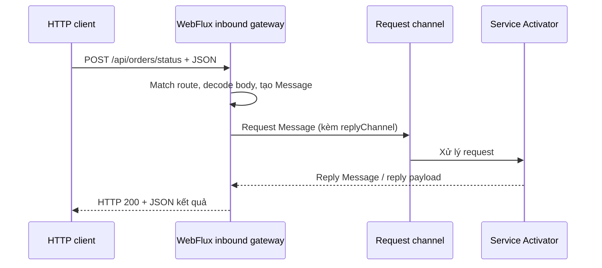
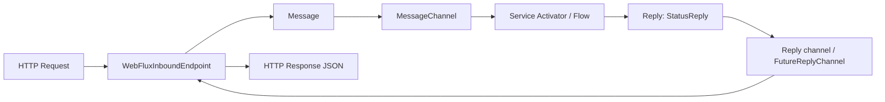

# WebFlux inbound gateway cho request-reply trong Spring Integration

## 1. Vì sao cần WebFlux inbound gateway?

Trong một hệ thống tích hợp, HTTP client đôi khi cần **nhận ngay kết quả nghiệp vụ** sau khi gửi request: tra cứu trạng thái đơn hàng, kiểm tra hạn mức, tính phí vận chuyển hoặc truy vấn dữ liệu từ dịch vụ phía sau. Khi đó, chỉ ghi request vào hàng đợi và trả mã xác nhận tiếp nhận là chưa đủ. Cần một endpoint **request-reply**: tiếp nhận HTTP request, đưa thành Spring Integration `Message`, đợi một reply tương ứng rồi biến reply thành HTTP response.

**WebFlux inbound gateway** là thành phần thực hiện hợp đồng đó trong Spring Integration sử dụng hạ tầng Spring WebFlux. Nó thuộc nhóm adapter/gateway của module **SPRING_INTEGRATION_ADAPTERS**, nơi `MessageChannel`, poller và các endpoint được kết nối với file, SFTP, HTTP, JMS, AMQP, Kafka hay cơ sở dữ liệu. Gateway là cổng giao tiếp HTTP ở rìa ứng dụng; các bước phía sau có thể là xử lý nội bộ hoặc gọi tiếp hệ thống khác.

Ví dụ: ứng dụng thương mại điện tử gửi `POST /api/orders/status` kèm `orderId`. Gateway chuyển body JSON thành `Message<StatusRequest>`; handler tra cứu trạng thái; reply `StatusReply` được serialize thành JSON để trả lại client trong **cùng một HTTP request**.



Sơ đồ mô tả đường đi logic. **WebFlux có thể đợi reply bằng cơ chế bất đồng bộ** (thông qua publisher), vì vậy mũi tên “đợi” không có nghĩa phải giữ một thread servlet bị chặn trong suốt thời gian xử lý. Tuy nhiên, nếu handler downstream dùng JDBC đồng bộ, gọi API chặn hoặc chạy công việc CPU nặng trên event-loop thì các đoạn đó vẫn có chi phí chặn/tính toán thật.

## 2. Phân biệt inbound gateway với inbound channel adapter

| Tiêu chí | WebFlux inbound **gateway** | WebFlux inbound **channel adapter** |
|---|---|---|
| Ý nghĩa | HTTP request **và** HTTP response nghiệp vụ | Tiếp nhận HTTP, chuyển message một chiều |
| Lời gọi Java DSL | `WebFlux.inboundGateway(...)` | `WebFlux.inboundChannelAdapter(...)` |
| Dòng chảy | HTTP → request message → handler → reply message → HTTP | HTTP → message → channel/consumer |
| Kết quả cho client | Có thể là DTO, JSON, text, stream hoặc body trống theo hợp đồng | Thường trả mã xác nhận tiếp nhận, không lấy reply nghiệp vụ |
| Tính phù hợp | Tra cứu, tính toán có kết quả tức thời, API đồng bộ về mặt nghiệp vụ | Webhook, nạp event, tác vụ xử lý nền |
| Khả năng xảy ra timeout | Khi không nhận được reply trong thời gian quy định | Chủ yếu gắn với tiếp nhận, chuyển vào channel và xử lý HTTP |

**Phân biệt thêm:** “inbound” nói về **hướng kết nối** (HTTP client gọi **vào** ứng dụng), còn “gateway” nói về **hợp đồng request-reply**. WebFlux **outbound gateway** làm nhiệm vụ ngược lại: một message trong Spring Integration flow kích hoạt HTTP request **ra ngoài**, sau đó response từ dịch vụ ngoài trở thành reply message nội bộ.

Không nên chọn gateway nếu nghiệp vụ phải chạy hàng chục phút và client không cần kết quả tức thời. Khi đó, mô hình `202 Accepted` + `jobId` + API truy vấn trạng thái hoặc callback thường dễ vận hành hơn.

## 3. Thành phần và hợp đồng message



Các vai trò cụ thể:

1. **Request mapping** đối chiếu đường dẫn, HTTP method và content negotiation (`consumes`, `produces`). Request không khớp sẽ được hạ tầng WebFlux xử lý trước khi vào flow.
2. **HTTP message readers/codecs** giải mã request body theo `Content-Type` và `requestPayloadType`, ví dụ JSON thành Java record. Chỉ những header HTTP được mapper cho phép mới được đưa vào message.
3. **Request message** mang `payload`, các header cần thiết và thông tin phục vụ định tuyến reply, chẳng hạn header `replyChannel` do framework quản lý. Không coi `replyChannel` là dữ liệu nghiệp vụ do client được quyền tự gửi.
4. **MessageChannel và handler** chuyển request đến Service Activator, router, transformer hoặc flow nhiều bước. Handler tạo reply bằng giá trị trả về hoặc bằng cách gửi một message vào channel reply thích hợp.
5. **Reply message** được gateway chuyển thành HTTP response bằng HTTP writers/codecs. Gateway có thể chọn status code, response headers và cách trích payload từ reply.

Trong WebFlux, `WebFluxInboundEndpoint` hỗ trợ `sendAndReceive` với phản hồi bất đồng bộ. Nội bộ sử dụng cơ chế tương đương **`FutureReplyChannel` được ánh xạ thành `Mono`** để phản hồi khi có reply. Điều này cho phép request HTTP không cần giữ một thread chờ reply theo cách chặn thông thường; **không** đồng nghĩa mọi xử lý phía sau tự trở thành reactive.

## 4. Chuẩn bị dự án Spring Boot

Ví dụ dùng Spring Boot, Spring Integration và WebFlux. Để BOM của Spring Boot quản lý phiên bản tương thích với Spring Integration. Dependency Gradle:

```groovy
dependencies {
    implementation 'org.springframework.boot:spring-boot-starter-webflux'
    implementation 'org.springframework.boot:spring-boot-starter-integration'
    implementation 'org.springframework.integration:spring-integration-webflux'
}
```

`spring-integration-webflux` chứa endpoint và DSL; `spring-boot-starter-webflux` bổ sung hạ tầng HTTP reactive và codec JSON thường dùng. Trong Spring Boot đã bật WebFlux auto-configuration, không nhất thiết thêm `@EnableWebFlux` thủ công. Nếu cấu hình Spring Framework thuần, phải bật hạ tầng WebFlux và Spring Integration thích hợp.

Nếu thêm cả `spring-boot-starter-web` và `spring-boot-starter-webflux`, cần kiểm tra chế độ ứng dụng Web MVC/WebFlux được chọn. Đừng mặc định sự hiện diện của `WebClient` chứng minh server đang chạy theo reactive stack.

Hợp đồng API ví dụ:

| Thành phần | Giá trị |
|---|---|
| HTTP | `POST /api/orders/status` |
| `Content-Type` request | `application/json` |
| `Accept` của client | `application/json` |
| Request body | `{"orderId":"ORD-1001"}` |
| Payload nhận bởi flow | `StatusRequest(orderId)` |
| Reply payload | `StatusReply(orderId, status)` |
| Response thành công | `200 OK`, body JSON |

Ở đây ta cố ý làm bài toán tra cứu đơn giản để tập trung vào hợp đồng request-reply. Trong thực tế, trạng thái được lấy từ service hoặc database, kèm phân quyền và validation.

## 5. Cấu hình inbound gateway bằng Java DSL

### 5.1. Một IntegrationFlow tự chứa

```java
package com.example.integration;

import org.springframework.context.annotation.Bean;
import org.springframework.context.annotation.Configuration;
import org.springframework.http.HttpMethod;
import org.springframework.http.MediaType;
import org.springframework.integration.config.EnableIntegration;
import org.springframework.integration.dsl.IntegrationFlow;
import org.springframework.integration.webflux.dsl.WebFlux;

@Configuration
@EnableIntegration
public class OrderStatusGatewayConfiguration {

    // HTTP JSON request -> Spring Integration message payload
    public record StatusRequest(String orderId) { }

    // Spring Integration reply payload -> HTTP JSON response
    public record StatusReply(String orderId, String status) { }

    @Bean
    public IntegrationFlow orderStatusGateway() {
        return IntegrationFlow
            .from(WebFlux.inboundGateway("/api/orders/status")
                .requestMapping(mapping -> mapping
                    .methods(HttpMethod.POST)
                    .consumes(MediaType.APPLICATION_JSON_VALUE)
                    .produces(MediaType.APPLICATION_JSON_VALUE))
                .requestPayloadType(StatusRequest.class)
                .replyTimeout(5_000))
            .handle((payload, headers) -> {
                StatusRequest request = (StatusRequest) payload;

                // Demo: trả dữ liệu giả lập, không gọi DB đồng bộ trên event-loop.
                return new StatusReply(request.orderId(), "PROCESSING");
            })
            .get();
    }
}
```

**Diễn giải theo từng bước:**

1. `WebFlux.inboundGateway("/api/orders/status")` đăng ký HTTP inbound endpoint có hợp đồng request-reply.
2. `requestMapping(...)` yêu cầu `POST`, request JSON và response có thể sản xuất JSON. Client không gửi đúng method/media type có thể bị từ chối trước khi message xuất hiện trong flow.
3. `requestPayloadType(StatusRequest.class)` hướng dẫn HTTP codec chuyển body thành record `StatusRequest`. Cấu hình này **không tự đảm bảo** `orderId` khác `null`, không rỗng hoặc tồn tại trong database; cần validation riêng.
4. `replyTimeout(5_000)` giới hạn thời gian gateway chờ reply theo cơ chế reply timeout của Spring Integration, tính bằng mili giây; đây không phải timeout kết nối TCP hay timeout đọc response của `WebClient` outbound.
5. `.handle((payload, headers) -> ...)` là service activator inline. Giá trị `StatusReply` trả về được Spring Integration xây dựng thành reply message để gateway kết thúc HTTP response.
6. `.get()` hoàn thành bean `IntegrationFlow`. Do đây là endpoint inbound, application cần chạy web server phù hợp để client gọi vào.

**Lưu ý về ví dụ:** handler trả dữ liệu giả lập trong bộ nhớ. Với DB hay API thật, không gọi lệnh chặn I/O kéo dài trực tiếp trên event-loop WebFlux. Có thể dùng client reactive phù hợp hoặc chuyển xử lý chặn sang scheduler/executor được quản lý, đồng thời thiết kế timeout và tải tối đa.

### 5.2. Gửi thử request và xem response

Khi ứng dụng chạy trên `localhost:8080`, thử:

```bash
curl -i -X POST http://localhost:8080/api/orders/status \
  -H 'Content-Type: application/json' \
  -H 'Accept: application/json' \
  -d '{"orderId":"ORD-1001"}'
```

Response minh họa:

```http
HTTP/1.1 200 OK
Content-Type: application/json

{"orderId":"ORD-1001","status":"PROCESSING"}
```

Status `200 OK` là lựa chọn mặc định thích hợp cho truy vấn thành công; code và header thực tế phụ thuộc cấu hình HTTP/codec. Với GET không có body hoặc DELETE, request mapping và cách trích payload cần được điều chỉnh tương ứng. Không giả định mọi phương thức HTTP đều gửi body JSON.

## 6. Reply channel, correlation và flow nhiều bước

Trong flow trên, handler trả kết quả trực tiếp nên không cần khai báo reply channel bằng tay. Spring Integration mang ngữ cảnh reply từ gateway đến handler bằng các message headers và cơ chế message exchange nội bộ. Một handler nhận request, xử lý rồi trả về object hoặc `Message<?>` tương ứng sẽ tạo đường quay về cho kết quả.

Khi chia thành nhiều IntegrationFlow, có thể dùng request channel đặt tên để các bước tách biệt:

```java
@Bean
public IntegrationFlow orderLookupEntry() {
    return IntegrationFlow
        .from(WebFlux.inboundGateway("/api/orders/lookup")
            .requestMapping(m -> m.methods(HttpMethod.POST))
            .requestPayloadType(StatusRequest.class))
        .channel("orderLookupRequests")
        .get();
}

@Bean
public IntegrationFlow orderLookupWorker() {
    return IntegrationFlow.from("orderLookupRequests")
        .handle((payload, headers) -> {
            StatusRequest request = (StatusRequest) payload;
            return new StatusReply(request.orderId(), "DELIVERED");
        })
        .get();
}
```

Đoạn trên là **phương án thay thế** ví dụ trong mục 5: đặt chúng ở một cấu hình thích hợp để tránh đăng ký trùng URL hoặc sử dụng cùng bean mà không chủ đích. Hai flow liên kết qua `orderLookupRequests`; handler ở flow sau vẫn trả reply về ngữ cảnh request ban đầu nếu header reply/correlation được duy trì đúng.

Một số quy tắc thực tế:

- **Giữ ngữ cảnh reply:** đừng tự tạo message hoàn toàn mới rồi làm mất header `replyChannel` và thông tin correlation khi đang còn ở nhánh request-reply. Khi cần tái tạo `Message`, ưu tiên các phép biến đổi giữ headers theo hợp đồng Spring Integration.
- **Không coi `replyChannel` là địa chỉ bền vững:** nó thường gắn với request đang chờ và có vòng đời ngắn. Không serialize nguyên message vào Kafka, JMS hoặc database rồi giả định header đó vẫn có thể gọi ngược HTTP response sau khi ứng dụng restart.
- **Đảm bảo một reply rõ nghĩa:** nếu router chuyển sang nhánh chỉ ghi log hoặc handler một chiều mà không trả dữ liệu, gateway có thể chờ đến timeout. Nếu handler trả nhiều reply không phù hợp hợp đồng, cần xác định cách chọn/tổng hợp reply.
- **Khi luồng vượt quá deadline HTTP:** đổi thành API tạo job bất đồng bộ hoặc sử dụng cơ chế callback/status thay vì giữ request mở vô hạn.

## 7. Reply reactive và Server-Sent Events (SSE)

WebFlux inbound gateway có thể trả về publisher như Reactor `Mono<T>` hoặc `Flux<T>` khi codec và `ReactiveAdapterRegistry` tương thích. Nhờ đó, có thể trả dữ liệu theo dòng thay vì chờ xây dựng một response lớn trước khi gửi.

Ví dụ SSE từ Spring Integration Java DSL:

```java
package com.example.integration;

import java.time.Duration;
import org.springframework.context.annotation.Bean;
import org.springframework.context.annotation.Configuration;
import org.springframework.http.HttpMethod;
import org.springframework.http.MediaType;
import org.springframework.integration.dsl.IntegrationFlow;
import org.springframework.integration.webflux.dsl.WebFlux;
import reactor.core.publisher.Flux;

@Configuration
public class OrderUpdatesSseConfiguration {

    @Bean
    public IntegrationFlow orderUpdatesSse() {
        return IntegrationFlow
            .from(WebFlux.inboundGateway("/api/orders/updates")
                .requestMapping(mapping -> mapping
                    .methods(HttpMethod.GET)
                    .produces(MediaType.TEXT_EVENT_STREAM_VALUE)))
            .handle((payload, headers) -> Flux
                .just("QUEUED", "PROCESSING", "COMPLETED")
                .delayElements(Duration.ofSeconds(1)))
            .get();
    }
}
```

Thử nhận luồng dữ liệu:

```bash
curl -N -H 'Accept: text/event-stream' \
  http://localhost:8080/api/orders/updates
```

Trong ví dụ, handler trả một **`Flux<String>` làm reply payload**, và WebFlux xử lý nó theo media type `text/event-stream`. Các phần tử có thể lần lượt được gửi đến client dưới dạng sự kiện SSE. Đừng nhầm `Flux<String>` trong **một reply** với nhiều request message riêng biệt.

SSE cần các quyết định bổ sung khi đưa vào production: xử lý client ngắt kết nối, giới hạn số subscription, bảo vệ tài nguyên, timeout của proxy/load balancer, heartbeat, xác thực và cơ chế khôi phục sự kiện. Ví dụ chỉ phát ba sự kiện giả lập rồi hoàn tất; nó không bảo đảm lưu lịch sử hay replay sau mất kết nối.

### 7.1. Khi nào sử dụng Mono, Flux và DTO thường?

| Reply | Cách sử dụng | Điều cần lưu ý |
|---|---|---|
| `StatusReply` | Một kết quả JSON duy nhất | Ngắn gọn cho API tra cứu thông thường |
| `Mono<StatusReply>` | Một kết quả có thể hoàn thành bất đồng bộ | Không gọi `block()` trong handler; đảm bảo có subscription và xử lý lỗi theo flow |
| `Flux<StatusUpdate>` | Dòng nhiều phần tử, ví dụ SSE | Codec/media type, backpressure, thời hạn kết nối và tiêu thụ tài nguyên |
| Không có reply | Thường không phù hợp request-reply | Client có thể gặp timeout; cân nhắc channel adapter/job API |

## 8. Kiểm soát HTTP status, response body và headers

Các thành phần HTTP của Spring Integration hỗ trợ cấu hình status code, header mapping và cách trích reply payload. Với gateway:

- **Thành công:** thường nhận `200 OK` và body từ reply. Có thể dùng `statusCodeFunction(...)` hoặc `statusCodeExpression(...)` của inbound spec khi hợp đồng cần status khác như `201 Created`, nhưng phải kiểm tra chính xác ngữ cảnh message được truyền vào biểu thức/hàm trong phiên bản đang sử dụng.
- **Body:** mặc định HTTP response thường lấy **payload** của reply message. Cấu hình `extractReplyPayload` chi phối việc dùng payload hay toàn bộ message khi ghi response; cần biết codec nào có thể serialize kiểu được chọn.
- **Headers:** `mappedResponseHeaders(...)` cho phép giới hạn những reply headers được ánh xạ sang HTTP response. Không phản chiếu toàn bộ message headers ra bên ngoài.
- **Content negotiation:** `Accept` của client và `produces` của route phải phù hợp với codec có thể ghi reply. Với SSE, dùng `text/event-stream`; với JSON thông thường, `application/json`.
- **Kết quả không tìm thấy:** `404 Not Found` là quyết định của hợp đồng API, không tự sinh chỉ vì service trả một DTO có trạng thái “NOT_FOUND”. Hãy thiết kế mapping lỗi hoặc status rõ ràng.

Ví dụ chỉ để minh họa một tùy chọn status cố định cho route tạo tài nguyên:

```java
.from(WebFlux.inboundGateway("/api/orders")
    .requestMapping(m -> m.methods(HttpMethod.POST))
    .statusCodeFunction(message -> org.springframework.http.HttpStatus.CREATED))
```

Đây là **mảnh DSL**, không phải một flow đầy đủ; chỉ nên trả `201 Created` khi nghiệp vụ thực sự tạo tài nguyên, có thể kèm `Location` header theo hợp đồng HTTP. Tránh đặt `201` cố định cho mọi request nếu thao tác có thể thất bại hoặc không tạo được dữ liệu.

## 9. Timeout, validation và xử lý lỗi

### 9.1. Phân loại lỗi theo vị trí

| Giai đoạn | Tình huống | Kết quả/hướng xử lý |
|---|---|---|
| HTTP mapping | Sai path, method, `Content-Type`, `Accept` | WebFlux xử lý lỗi route/media type, thường tương ứng 404/405/415/406 tùy trường hợp |
| Đọc request | JSON không hợp lệ, body thiếu trường | Codec/validation có thể từ chối; khai báo validation trước khi vào nghiệp vụ |
| Gửi request message | Channel không có subscriber, quá tải, lỗi dispatch | Thiết lập `requestTimeout`, capacity/executor và error flow phù hợp |
| Xử lý nghiệp vụ | DB lỗi, service ném exception, không có reply | Xử lý lỗi và ánh xạ HTTP status theo hợp đồng; không mặc định mọi lỗi là `400` |
| Nhận reply | Không có reply trước deadline | `replyTimeout`, xử lý timeout và thông báo cho client |
| Client ngắt kết nối | Trình duyệt/network rời giữa chừng | Theo dõi hủy subscription và cleanup; công việc bên dưới có thể vẫn tiếp tục |

**`requestTimeout`** là giới hạn thao tác gửi message vào request channel trong tình huống channel có thể chặn; **`replyTimeout`** liên quan đến đợi reply. Chúng không tương đương deadline tổng HTTP của proxy/người dùng, cũng không phải timeout của một `WebClient` đang gọi API ngoài. Khi reply không đến, cấu hình mặc định và phiên bản có thể quyết định HTTP status, nhiều cấu hình HTTP gateway dùng `500` cho reply timeout; hãy thiết lập hành vi xử lý và kiểm chứng thực tế thay vì coi đó là `504` mặc định.

`errorOnTimeout(true)` có thể tạo `ErrorMessage` với `MessageTimeoutException` gửi đến error channel theo cấu hình; đây là tín hiệu cho flow quan sát và xử lý lỗi, **không tự động** bảo đảm một HTTP response tùy biến đã được gửi cho client. Nếu cần trả `404`, `409`, `422` hoặc `503`, hãy thiết kế quy tắc ngoại lệ/status và kiểm tra kết quả HTTP bằng integration test.

### 9.2. Validation của WebFlux inbound endpoint

WebFlux inbound endpoint hỗ trợ cấu hình `Validator` từ Spring Integration 5.2. Validation ở tầng này áp dụng cho các phần tử của publisher được HTTP message reader tạo ra **trước một số bước fallback/payload extraction**. Với payload reactive phức tạp, nếu cần kiểm tra chính xác dữ liệu cuối cùng được chuyển vào flow, hãy đặt validation xuống downstream ở vị trí thích hợp.

Ví dụ các điều kiện cần có đối với `StatusRequest`:

1. `orderId` tồn tại, không rỗng và không vượt quá độ dài quy định.
2. Client có quyền xem trạng thái của đơn hàng đó.
3. Nếu không tìm thấy đơn hàng, trả status/response đúng hợp đồng, không tạo reply ngầm cho một request khác.
4. Thông tin nhạy cảm trong lỗi phải được lọc trước khi trả ra HTTP response/log.

`requestPayloadType(StatusRequest.class)` **chỉ định kiểu decode**, không tự chứng minh bốn điều kiện trên. Với lỗi validation được endpoint phát hiện, Spring Integration sử dụng `IntegrationWebExchangeBindException` mang thông tin validation `Errors`; cần ánh xạ thông tin có thể công bố để tránh làm lộ chi tiết nội bộ.

## 10. Reactive threading, backpressure và vòng đời request

WebFlux cung cấp giao thức xử lý reactive, nhưng vẫn cần thiết kế xuyên các thành phần:

- **Event-loop:** tránh chạy JDBC blocking, `Thread.sleep`, `.block()` trên Reactor Netty event-loop. Dùng R2DBC/WebClient reactive hoặc tách tác vụ blocking qua `boundedElastic`/executor theo chính sách phù hợp.
- **Channel:** `DirectChannel` kích hoạt subscriber theo cơ chế đồng bộ; `ExecutorChannel` chuyển dispatch qua executor; `QueueChannel` cần poller. Các lựa chọn này quyết định độ trễ, khả năng tiếp nhận, nguy cơ quá tải và tương tác với request timeout.
- **Backpressure:** áp dụng có ý nghĩa khi publisher/consumer tuân thủ demand. Một queue không giới hạn hoặc consumer blocking sẽ trở thành điểm nghẽn dù đầu vào HTTP sử dụng `Mono`.
- **Cancellation:** khi client đóng kết nối, một số hoạt động reactive có thể bị hủy, nhưng các tác vụ đã đưa vào thread pool, queue hay broker vẫn có thể chạy tiếp. Không gắn “client đã đóng” với “nghiệp vụ chắc chắn chưa thực hiện”.
- **Tính nhất quán:** đừng dùng gateway để chờ một giao dịch phân tán không có deadline. Nếu nghiệp vụ cần hoàn tất lâu hoặc không xác định, đưa về mô hình accepted/job status và kết quả theo thời gian khác.

Trong API request-reply, khả năng tăng thông lượng đến từ việc tránh chặn tài nguyên không cần thiết và quản lý giới hạn đồng thời. Không dùng việc “có WebFlux” làm căn cứ duy nhất để khẳng định ứng dụng chịu được một số lượng request cụ thể.

## 11. Bảo mật và quan sát hoạt động

**Bảo mật:** bảo vệ endpoint bằng Spring Security và chính sách xác thực/phân quyền phù hợp, dùng TLS ở môi trường công khai, giới hạn kích thước JSON, kiểm tra dữ liệu vào, áp dụng rate limiting. Với cookie/session-based API cần quan tâm CSRF theo cách ứng dụng xác thực; với stateless API cần thiết kế riêng. Không tin tưởng header `X-User-Id`, `replyChannel` hoặc correlation do client tự cung cấp để thay thế kiểm tra quyền.

**Quan sát:** ghi request ID/correlation ID, route, latency từng stage, số reply thành công, tỉ lệ 4xx/5xx, số lần timeout, độ dài queue và thời gian truy cập hệ thống ngoài. Nếu tạo log message ở cuối flow, hãy giữ đường reply: một bước logging/handler một chiều có thể khiến request mất reply nếu không được nối tiếp bằng `bridge()` hoặc một endpoint trả dữ liệu. Tránh ghi mật khẩu, token và toàn bộ payload nhạy cảm.

**Vòng đời kết nối:** HTTP client có thể rời khi gateway vẫn chờ service; timeout ở gateway, HTTP server và proxy cần có chính sách nhất quán. Trong trường hợp shutdown, cân nhắc dừng nhận request mới, xả các công việc đang xử lý và giới hạn thời gian chờ trước khi đóng tài nguyên.

## 12. Bài thực hành tự kiểm tra

1. Chạy ví dụ `orderStatusGateway`, gửi JSON hợp lệ và kiểm tra `200 OK` cùng payload `StatusReply`. Gửi `GET` để quan sát việc từ chối method.
2. Gửi `Content-Type: text/plain` hoặc JSON sai cú pháp; phân biệt lỗi request mapping, codec và lỗi nghiệp vụ.
3. Thay handler trả `StatusReply` bằng handler chỉ ghi log không trả reply; đặt `replyTimeout` ngắn ở môi trường thử và quan sát HTTP response cùng error flow.
4. Di chuyển xử lý tra cứu sang `orderLookupRequests` như mục 6; xác nhận response vẫn trở về đúng client, ngay cả khi có nhiều request đồng thời.
5. Thêm validation cho `orderId`, kiểm tra `null`, chuỗi rỗng, ID quá dài và quyền truy cập; công bố lỗi HTTP phù hợp từng tình huống.
6. Chạy ví dụ SSE bằng `curl -N`, theo dõi ba phần tử trả về và thử ngắt kết nối giữa chừng. Giải thích vì sao SSE cần chính sách hủy/cleanup.
7. Cho downstream giả lập xử lý chậm hơn `replyTimeout`. Đối chiếu log gateway, HTTP status, công việc đang chạy và lượng message tồn; đề xuất trường hợp nào nên đổi sang API tạo job.

**Câu hỏi tư duy:** Một POST yêu cầu hệ thống ghi dữ liệu sang database rồi gửi JMS và chỉ xác nhận `200 OK` khi cả hai bước hoàn tất. Nếu JMS chậm hoặc lỗi sau khi DB đã commit, inbound gateway nên trả gì? Hãy xác định transaction boundary, idempotency, cách báo trạng thái chưa hoàn tất và khi nào chuyển sang thiết kế bất đồng bộ.

## 13. Tài liệu tham khảo

- [Spring Integration Reference — WebFlux Support](https://docs.spring.io/spring-integration/reference/webflux.html): `WebFluxInboundEndpoint`, Java DSL, `WebFlux.inboundGateway`, `FutureReplyChannel`, `Flux` và validation.
- [Spring Integration API — WebFluxInboundEndpointSpec](https://docs.spring.io/spring-integration/api/org/springframework/integration/webflux/dsl/WebFluxInboundEndpointSpec.html): API cấu hình gateway, request mapping, status, header mapper và các tùy chọn kế thừa.
- [Spring Integration API — MessagingGatewaySpec](https://docs.spring.io/spring-integration/api/org/springframework/integration/dsl/MessagingGatewaySpec.html): `replyTimeout`, `requestTimeout`, `errorOnTimeout`, `replyChannel`, `errorChannel`.
- [Spring Integration Reference — HTTP Timeout Handling](https://docs.spring.io/spring-integration/reference/http/timeout.html): phân biệt timeout ở channel, inbound gateway và outbound HTTP.
- [Spring Framework Reference — WebFlux](https://docs.spring.io/spring-framework/reference/web/webflux.html): reactive server, HTTP codecs, Reactor và xử lý request/response.

> **Ghi nhớ:** `WebFlux.inboundGateway(...)` nhận HTTP request, gửi message vào Spring Integration flow rồi dùng reply để tạo HTTP response. Hợp đồng request-reply chỉ đúng khi downstream thực sự phát sinh reply, có deadline phù hợp và xử lý rõ lỗi, trạng thái HTTP, validation cùng giới hạn tài nguyên.
