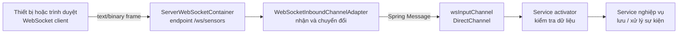
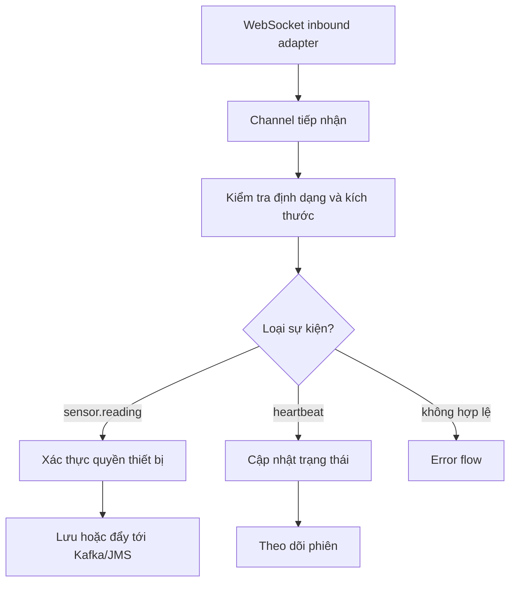

# WebSocket inbound channel adapter

## 1. Mục tiêu bài học

Trong module **SPRING_INTEGRATION_ADAPTERS**, chúng ta kết nối hệ thống bên ngoài với Spring Integration thông qua các **inbound/outbound adapter**, **gateway**, **MessageChannel** và các cơ chế điều phối luồng thông điệp. Bài này thuộc chương **Adapter WebSocket**, tập trung vào **WebSocket inbound channel adapter**: nhận thông điệp từ kết nối WebSocket và đưa chúng vào luồng xử lý nội bộ.

Sau bài học, bạn có thể:

- Giải thích vai trò của `WebSocketInboundChannelAdapter`, `IntegrationWebSocketContainer` và `MessageChannel`.
- Cấu hình một endpoint WebSocket phía server, nhận text frame và xử lý payload JSON bằng Spring Integration.
- Phân biệt dữ liệu inbound, sự kiện vòng đời kết nối và thông điệp trả về phía client.
- Nhận diện các vấn đề liên quan đến sub-protocol, xử lý lỗi, tải lớn, bảo mật và quản lý kết nối.
- Kiểm tra luồng bằng WebSocket client và xác định những gì adapter thực sự cam kết.

## 2. Tại sao cần inbound adapter cho WebSocket?

WebSocket tạo một kết nối tồn tại lâu dài giữa client và server, cho phép **hai phía chủ động gửi dữ liệu** sau bước HTTP Upgrade. Ví dụ: các thiết bị giám sát gửi số đo theo thời gian thực, màn hình vận hành gửi sự kiện thao tác, hoặc một ứng dụng trình duyệt đẩy thông tin tương tác.

Nếu viết trực tiếp `WebSocketHandler`, ứng dụng thường phải tự nhận frame, giải mã, phân nhánh nghiệp vụ và gọi các service. Khi dùng Spring Integration, **inbound channel adapter** đảm nhiệm ranh giới vào: biến dữ liệu đi đến qua WebSocket thành `org.springframework.messaging.Message<?>`, sau đó phát vào `outputChannel`. Các thành phần phía sau dùng lại cơ chế filter, transformer, router, service activator và error channel của Spring Integration.

Một tình huống cụ thể: nhiều thiết bị gửi JSON như sau:

```json
{
  "type": "sensor.reading",
  "deviceId": "sensor-01",
  "temperature": 26.5
}
```

Inbound adapter chịu trách nhiệm tiếp nhận khung dữ liệu WebSocket và chuyển thông điệp vào channel. **Kiểm tra JSON, xác thực thiết bị, ghi dữ liệu và cảnh báo** là việc của flow/service phía sau. Phân chia này giúp phần giao tiếp và phần nghiệp vụ phát triển độc lập.

### Sơ đồ luồng



**Lưu ý:** tên *inbound* nói về chiều dữ liệu **từ WebSocket vào Spring Integration**. Nó không có nghĩa rằng WebSocket chỉ nhận một chiều; một phiên WebSocket về bản chất là hai chiều. Muốn gửi kết quả ngược về WebSocket, cần cấu hình thêm outbound adapter/handler hoặc một giải pháp gửi tương đương.

## 3. Các thành phần và hợp đồng message

| Thành phần | Trách nhiệm | Điểm cần nhớ |
| --- | --- | --- |
| `ServerWebSocketContainer` | Đăng ký URL WebSocket trên server, quản lý danh sách `WebSocketSession` | Chẳng hạn `/ws/sensors`; dùng cho endpoint server |
| `ClientWebSocketContainer` | Thiết lập kết nối ra một WebSocket server và quản lý phiên client | Inbound adapter cũng có thể đọc dữ liệu từ phía client |
| `IntegrationWebSocketContainer` | Lớp trừu tượng chung cho hai loại container | Có thể dùng chung cho inbound/outbound trên cùng phiên |
| `WebSocketInboundChannelAdapter` | Lắng nghe dữ liệu từ container và phát `Message<?>` vào flow | Là một message producer, không phải poller |
| `SubProtocolHandler` / registry | Diễn giải frame theo sub-protocol và chuyển thành Spring `Message` | Mặc định là `PassThruSubProtocolHandler` |
| `MessageChannel` | Ranh giới giữa adapter và bước xử lý kế tiếp | Ví dụ `DirectChannel` hoặc `ExecutorChannel` |
| `ServiceActivator` | Tiêu thụ message để thực hiện xử lý ứng dụng | Nên có kiểm tra đầu vào và xử lý lỗi |

Luồng dữ liệu đi qua các bước sau:

1. Client gửi HTTP Upgrade và thiết lập WebSocket session với endpoint đã đăng ký.
2. Container duy trì session và chuyển frame nhận được tới listener.
3. `WebSocketInboundChannelAdapter` đăng ký làm `WebSocketListener` của container.
4. Sub-protocol handler chuyển `WebSocketMessage` thành Spring `Message`, bao gồm payload và các header phù hợp.
5. Adapter phát message sang `outputChannel`; flow tiếp tục chuyển đổi, kiểm tra hoặc xử lý nghiệp vụ.

Có hai ràng buộc dễ bỏ sót:

- **Mỗi `IntegrationWebSocketContainer` chỉ đăng ký được một `WebSocketListener`.** Không tạo hai inbound adapter cùng cố gắng lắng nghe một container. Có thể chia nhiều nhánh xử lý sau output channel bằng router hoặc publish-subscribe.
- Inbound adapter chỉ đưa vào flow các message có `simpMessageType = MESSAGE` hoặc không có header `simpMessageType`. Những message thuộc loại khác không tự động trở thành sự kiện nghiệp vụ; với sub-protocol như STOMP, chúng có thể được xử lý qua `ApplicationEvent` và cơ chế broker.

### Payload và header

Ví dụ với text frame chứa chuỗi JSON, payload mong muốn là một `String`. Adapter hỗ trợ chuyển đổi payload theo `payloadType` và `MessageConverter`; cấu hình mặc định của inbound adapter dùng `java.lang.String`. Khi ứng dụng cần đối tượng Java, có thể chuyển đổi ở bước tiếp theo của Integration Flow hoặc chọn converter và kiểu đích có chủ đích.

Thông điệp cũng có header phục vụ xử lý hạ tầng như định danh phiên (thường gặp `simpSessionId`, tùy sub-protocol/handler). **Không dùng session ID làm bằng chứng xác thực người dùng**: phiên là thông tin kết nối, còn danh tính và quyền truy cập phải được kiểm tra riêng.

## 4. Ví dụ: nhận số đo cảm biến qua WebSocket

Ví dụ giả định dự án dùng **Java 17+, Spring Boot 3.x và Spring Integration 6.x**, chạy ứng dụng web servlet. Spring Boot quản lý phiên bản phụ thuộc tương thích; không tự gắn phiên bản khác nhau cho từng thư viện Spring.

### 4.1. Thư viện

Trong `pom.xml`, thêm các dependency (bỏ qua nếu dự án đã có):

```xml
<dependencies>
    <dependency>
        <groupId>org.springframework.boot</groupId>
        <artifactId>spring-boot-starter-web</artifactId>
    </dependency>
    <dependency>
        <groupId>org.springframework.boot</groupId>
        <artifactId>spring-boot-starter-integration</artifactId>
    </dependency>
    <dependency>
        <groupId>org.springframework.integration</groupId>
        <artifactId>spring-integration-websocket</artifactId>
    </dependency>
</dependencies>
```

`spring-boot-starter-web` cung cấp Spring MVC và hạ tầng web phía server; `spring-integration-websocket` cung cấp các WebSocket adapter/container. Ví dụ dùng Jackson `ObjectMapper` có trong cấu hình web thông dụng của Spring Boot 3.x.

### 4.2. Khai báo container, adapter, channel và handler

Tạo lớp cấu hình bên dưới trong package được Spring Boot quét. Ví dụ có chủ đích dùng **raw WebSocket** với JSON text; **không dùng STOMP/SockJS**.

```java
package com.example.websocket;

import com.fasterxml.jackson.core.JsonProcessingException;
import com.fasterxml.jackson.databind.JsonNode;
import com.fasterxml.jackson.databind.ObjectMapper;
import org.springframework.beans.factory.annotation.Qualifier;
import org.springframework.context.annotation.Bean;
import org.springframework.context.annotation.Configuration;
import org.springframework.integration.annotation.ServiceActivator;
import org.springframework.integration.channel.DirectChannel;
import org.springframework.integration.config.EnableIntegration;
import org.springframework.integration.websocket.ServerWebSocketContainer;
import org.springframework.integration.websocket.inbound.WebSocketInboundChannelAdapter;
import org.springframework.messaging.MessageChannel;
import org.springframework.messaging.MessageHandler;
import org.springframework.messaging.MessagingException;

@Configuration
@EnableIntegration
public class WsInboundConfiguration {

    @Bean
    public ServerWebSocketContainer serverWebSocketContainer() {
        return new ServerWebSocketContainer("/ws/sensors");
    }

    @Bean
    public MessageChannel wsInputChannel() {
        return new DirectChannel();
    }

    @Bean
    public WebSocketInboundChannelAdapter wsInboundAdapter(
            ServerWebSocketContainer serverWebSocketContainer,
            @Qualifier("wsInputChannel") MessageChannel inputChannel) {

        WebSocketInboundChannelAdapter adapter =
                new WebSocketInboundChannelAdapter(serverWebSocketContainer);
        adapter.setOutputChannel(inputChannel);
        return adapter;
    }

    @Bean
    @ServiceActivator(inputChannel = "wsInputChannel")
    public MessageHandler sensorReadingHandler(ObjectMapper mapper) {
        return message -> {
            if (!(message.getPayload() instanceof String json)) {
                throw new MessagingException(message, "Chỉ nhận payload dạng text");
            }

            JsonNode data;
            try {
                data = mapper.readTree(json);
            } catch (JsonProcessingException exception) {
                throw new MessagingException(message, "Payload không phải JSON hợp lệ",
                        exception);
            }

            String type = data.path("type").asText("");
            String deviceId = data.path("deviceId").asText("");
            JsonNode temperature = data.path("temperature");

            if (!"sensor.reading".equals(type)
                    || deviceId.isBlank()
                    || !temperature.isNumber()) {
                throw new MessagingException(message, "Thiếu hoặc sai trường dữ liệu");
            }

            // Demo: thay bằng service nghiệp vụ / lưu dữ liệu trong dự án thực.
            System.out.printf("Nhận số đo từ %s: %.1f C%n",
                    deviceId, temperature.asDouble());
        };
    }
}
```

Ý nghĩa các bean:

- `ServerWebSocketContainer("/ws/sensors")` tạo điểm kết nối cho WebSocket client. Khi cấu hình Spring Integration được khởi tạo, hạ tầng WebSocket tích hợp đăng ký endpoint đó với ứng dụng web servlet.
- `wsInputChannel()` là `DirectChannel`. Khi adapter gửi message, handler phía sau thường xử lý ngay trên luồng gọi. Ví dụ này phù hợp để hiểu luồng cơ bản.
- `wsInboundAdapter(...)` nhận container và gán **output channel**. Nếu không gán đích nhận message một cách thích hợp, dữ liệu sẽ không đi đến nghiệp vụ mong muốn.
- `sensorReadingHandler` là consumer. Nó kiểm tra payload, parse JSON, xác nhận các trường tối thiểu và thực hiện hành động minh họa.

Với Spring Integration, `@EnableIntegration` cho phép hạ tầng nhận diện và đăng ký các endpoint WebSocket; trong ví dụ này không cần đăng ký thêm một `WebSocketHandler` thủ công cho cùng đường dẫn.

### 4.3. Thử từ trình duyệt

Chạy ứng dụng Spring Boot trên cổng `8080`. Trong Developer Tools Console của trình duyệt, thực hiện:

```javascript
const socket = new WebSocket("ws://localhost:8080/ws/sensors");

socket.addEventListener("open", () => {
  console.log("WebSocket đã kết nối");
  socket.send(JSON.stringify({
    type: "sensor.reading",
    deviceId: "sensor-01",
    temperature: 26.5
  }));
});

socket.addEventListener("error", (event) => console.error("WebSocket lỗi", event));
socket.addEventListener("close", (event) => console.log("Đóng kết nối", event.code));
```

Kết quả mong đợi: trình duyệt mở kết nối thành công; log của ứng dụng hiển thị dòng gần như `Nhận số đo từ sensor-01: 26.5 C`. Đây là dấu hiệu message đã đi qua adapter, channel và handler.

Để thử trường hợp lỗi, sau khi kết nối thành công, gửi tiếp:

```javascript
socket.send("{not-json}");
socket.send(JSON.stringify({
  type: "sensor.reading",
  deviceId: "",
  temperature: "too-hot"
}));
```

Cả hai payload đều vi phạm hợp đồng của handler. Tùy cấu hình error channel và cơ chế xử lý ngoại lệ của ứng dụng, lỗi sẽ được đưa tới kênh lỗi hoặc được ghi nhận trong quá trình xử lý. **Không giả định client tự động nhận thông báo lỗi hay kết nối luôn bị đóng.** Inbound adapter không tự tạo một thông điệp phản hồi nghiệp vụ.

## 5. Raw WebSocket, STOMP và xử lý sự kiện kết nối

WebSocket là **giao thức truyền tải**. STOMP là **sub-protocol** có ngữ nghĩa command như `CONNECT`, `SUBSCRIBE`, `SEND` và đích gửi/nhận. Hai mô hình phải được lựa chọn có chủ đích.

| Trường hợp | Cấu hình phù hợp |
| --- | --- |
| Client gửi text hoặc binary frame theo định dạng riêng | Sử dụng `PassThruSubProtocolHandler` mặc định, xử lý payload trong flow |
| Client gửi STOMP frame | Dùng `SubProtocolHandlerRegistry` và `StompSubProtocolHandler` phù hợp |
| Ứng dụng cần topic, subscription và broker | Xem xét cấu hình Spring WebSocket message broker hoặc broker relay |
| Cần biết lúc session mở/đóng | Xử lý sự kiện vòng đời session; không mong có message nghiệp vụ tương ứng trên output channel |

Khi muốn nhận STOMP, có thể truyền `SubProtocolHandlerRegistry` làm đối số thứ hai của constructor `WebSocketInboundChannelAdapter`. Registry xác định handler theo sub-protocol mà phiên đã chấp nhận. Ví dụ raw WebSocket ở phần trước **không** phải một STOMP endpoint và JavaScript `WebSocket.send(JSON.stringify(...))` không tự tạo STOMP command.

Với `useBroker = false`, khi nhận `SimpMessageType.CONNECT`, adapter có thể gửi `CONNECT_ACK` trực tiếp về WebSocket session mà không phát message này vào output channel. Trường hợp `useBroker = true` chỉ phù hợp ở **server side** khi đã có cấu hình Spring WebSocket message broker và broker relay tương ứng; message không thuộc `MESSAGE` và các broker destination được chuyển cho broker handler theo cấu hình. Không bật cờ này chỉ để “nhận nhiều loại message hơn”.

## 6. Cấu hình cần chú ý

| Thuộc tính / API | Tác dụng | Khi nào quan tâm |
| --- | --- | --- |
| `container` / constructor | Chỉ định `IntegrationWebSocketContainer` bắt buộc | Mọi inbound adapter |
| `outputChannel` / `channel` | Đích nhận Spring `Message` từ adapter | Mọi luồng xử lý nghiệp vụ |
| `errorChannel` / `error-channel` | Kênh tiếp nhận `ErrorMessage` trong những tình huống lỗi được hỗ trợ | Muốn quan sát và xử lý lỗi có hệ thống |
| `payloadType` / `payload-type` | Kiểu Java đích khi chuyển đổi payload; mặc định `String` | Payload là đối tượng, chuỗi hoặc nhị phân |
| `messageConverters` | Danh sách bộ chuyển đổi message | Cần JSON mapping hoặc dữ liệu tùy biến |
| `mergeWithDefaultConverters` | Có ghép converter mặc định sau converter tự khai báo hay không | Tránh vô tình thay đổi các loại payload được hỗ trợ |
| `sendTimeout` / `send-timeout` | Thời gian chờ khi gửi sang channel có thể block | Dùng `QueueChannel` có dung lượng hữu hạn |
| `useBroker` / `use-broker` | Điều phối các message STOMP/broker theo cấu hình broker | Server có broker relay |
| `autoStartup`, `phase` | Quản lý thứ tự và thời điểm khởi động/dừng endpoint | Ứng dụng nhiều kết nối hoặc cần khởi động theo thứ tự |

Trong cấu hình XML, phần tử tương ứng là `<int-websocket:inbound-channel-adapter>`. Cú pháp tên thuộc tính thay đổi theo dạng Java/XML, còn các trách nhiệm chính vẫn giống nhau.

### Error channel khác với thông báo lỗi gửi về WebSocket

Một error channel thuộc **luồng thông điệp nội bộ**. Ví dụ, khi handler không parse được JSON, bạn có thể cấu hình một channel và consumer cho `ErrorMessage`, ghi metrics hoặc chuyển sự kiện lỗi sang hệ thống quan sát. Nếu muốn trả về client một lỗi dạng `{"error":"invalid_payload"}`, phải thiết kế thêm nhánh **outbound** và cơ chế ghép đúng phiên nhận. Không nên coi log lỗi hay `ErrorMessage` là một WebSocket frame tự động.

## 7. Thiết kế luồng xử lý thực tế

Với một endpoint nhận telemetry, thường nên tách các bước:



Luồng này kết nối tự nhiên với các adapter khác của module: dữ liệu **đi vào bằng WebSocket**, sau đó có thể **đi ra qua Kafka, JMS, AMQP, cơ sở dữ liệu hoặc HTTP** tùy nhu cầu tích hợp. Các adapter này có hợp đồng delivery và retry riêng; inbound WebSocket không biến chúng thành một giao dịch end-to-end.

Một số nguyên tắc:

1. **Xác định hợp đồng đầu vào:** kiểu frame, kiểu payload, schema JSON, phiên bản sự kiện, giới hạn kích thước và hành vi khi dữ liệu sai.
2. **Kiểm soát tải:** `DirectChannel` thường thực thi handler trên luồng gọi; thao tác DB chậm có thể kéo dài thời gian xử lý frame. Khi cần tách tải, cân nhắc `ExecutorChannel` cùng bộ thực thi có giới hạn, hàng đợi có dung lượng và chính sách từ chối rõ ràng.
3. **Xác định thứ tự:** xử lý bất đồng bộ có thể đổi thứ tự hoàn thành giữa các message. Nếu thứ tự theo từng thiết bị quan trọng, phải thiết kế khóa phân vùng hoặc cơ chế điều phối phù hợp.
4. **Xác định độ tin cậy:** WebSocket không tự cung cấp lưu bền vững, xác nhận nghiệp vụ, deduplication hay replay khi mất mạng. Cần application-level acknowledgment, event ID, retry và idempotency nếu yêu cầu.
5. **Quản lý vòng đời:** theo dõi kết nối mở/đóng, idle timeout, reconnect phía client và dọn tài nguyên khi ứng dụng dừng.
6. **Bảo mật:** dùng `wss://` khi triển khai qua mạng, kiểm tra xác thực và quyền ngay tại handshake và/hoặc trong nghiệp vụ, áp dụng chính sách origin, giới hạn kích thước/tần suất message. Client tự khai `deviceId` không đủ để chứng minh danh tính.
7. **Quan sát vận hành:** theo dõi số session đang mở, tỷ lệ frame lỗi, độ trễ handler, độ sâu hàng đợi và các lần đóng kết nối bất thường. Tránh log toàn bộ payload nhạy cảm.

### Có cần poller không?

**Không.** WebSocket inbound adapter thuộc kiểu **event-driven**: khi frame đến, listener gọi vào adapter. Poller chỉ xuất hiện nếu bạn cố ý đặt `QueueChannel` hoặc một nguồn cần polling vào giữa các bước. Điều này khác file/FTP inbound adapter thường quét nguồn theo lịch.

### Có tự phản hồi request không?

**Không.** Inbound channel adapter là điểm nhận dữ liệu một chiều trong Integration Flow. Để trả lời client qua cùng session, hãy ghép outbound adapter phù hợp và dùng header phiên hoặc tương quan nghiệp vụ một cách nhất quán. Nếu bài toán là request/reply có timeout và hợp đồng trả lời, cân nhắc gateway hoặc thiết kế flow phản hồi rõ ràng thay vì trông chờ inbound tự gửi kết quả.

## 8. Những lỗi thường gặp và cách xác định nguyên nhân

| Hiện tượng | Nguyên nhân nên kiểm tra | Cách tiếp cận |
| --- | --- | --- |
| WebSocket handshake thất bại (404/400) | URL, port, servlet mapping, đăng ký endpoint, proxy Upgrade | Xác nhận endpoint `/ws/sensors` và cấu hình hạ tầng WebSocket |
| Kết nối được nhưng handler không chạy | Không gắn đúng output channel, sai sub-protocol, thiếu consumer | Kiểm tra tên channel, adapter, các bước transformer/filter |
| Payload JSON parse lỗi | Client gửi raw text không phải JSON hoặc schema khác | Kiểm tra frame thực tế và validator ở consumer |
| Cố tạo nhiều inbound adapter trên một container | Container chỉ có một WebSocket listener | Dùng một inbound adapter rồi phân tuyến sau channel |
| Dùng STOMP client với raw WebSocket handler | Không cấu hình sub-protocol tương ứng | Cấu hình STOMP registry/broker hoặc đổi client sang raw |
| Client không thấy kết quả xử lý | Không có outbound flow | Thiết kế trả lời qua outbound adapter và định danh session |
| Độ trễ tăng khi số client lớn | Handler đồng bộ hoặc downstream block | Đo latency, tách tải có giới hạn, xử lý backpressure |
| Mất sự kiện khi client reconnect | Kết nối gián đoạn; không có lưu bền vững/ack ứng dụng | Thiết kế reconnect, event ID, replay/ack theo yêu cầu |

## 9. Bài thực hành

**Bài tập A — mở rộng hợp đồng message.** Mở rộng ví dụ để nhận thêm trường `timestamp` (ISO-8601), từ chối sự kiện có `timestamp` sai định dạng, và chuyển dữ liệu hợp lệ cho một service chuyên trách. Giải thích tại sao cần kiểm tra cả `deviceId` lẫn danh tính đã xác thực của kết nối.

**Bài tập B — phân tuyến sự kiện.** Giữ nguyên một inbound adapter nhưng thiết kế flow với hai nhánh: `sensor.reading` và `device.heartbeat`. Mô tả router/handler cần bổ sung và cách xử lý loại sự kiện không biết.

**Bài tập C — lỗi và độ tin cậy.** Trả lời: nếu server lưu dữ liệu thành công nhưng client mất kết nối trước khi nhận được ACK, client nên retry thế nào để không lưu trùng? Đề xuất một hợp đồng nhỏ với `eventId`, xác nhận nghiệp vụ và idempotency key.

**Tiêu chí tự kiểm tra:** kết nối và gửi JSON hợp lệ thành công; dữ liệu sai không bị đưa vào xử lý nghiệp vụ; có thể chỉ ra nơi sinh lỗi, nơi quản lý session và nơi cần thêm outbound flow.

## 10. Ghi nhớ

- `WebSocketInboundChannelAdapter` nhận các message từ một `IntegrationWebSocketContainer` và đưa vào Spring Integration qua `MessageChannel`.
- `ServerWebSocketContainer` quản lý endpoint server; cùng mô hình còn có `ClientWebSocketContainer` để nhận ở phía client.
- Mặc định adapter phù hợp với **raw WebSocket** qua `PassThruSubProtocolHandler`. STOMP và broker cần cấu hình sub-protocol riêng.
- Chỉ một listener cho mỗi container; các nhánh nghiệp vụ nên chia sau channel.
- Inbound không tự tạo ACK, tự trả lời client, bảo đảm persistence hay tự polling.
- Cấu hình lỗi, bảo mật, giới hạn tải và vòng đời kết nối là một phần của thiết kế tích hợp trong thực tế.

### Tài liệu tham khảo

- [Spring Integration Reference — WebSockets Support](https://docs.spring.io/spring-integration/reference/web-sockets.html)
- [Spring Integration API — WebSocketInboundChannelAdapter](https://docs.spring.io/spring-integration/api/org/springframework/integration/websocket/inbound/WebSocketInboundChannelAdapter.html)
- [Spring Integration API — IntegrationWebSocketContainer](https://docs.spring.io/spring-integration/api/org/springframework/integration/websocket/IntegrationWebSocketContainer.html)
- [Spring Framework Reference — WebSocket](https://docs.spring.io/spring-framework/reference/web/websocket.html)
