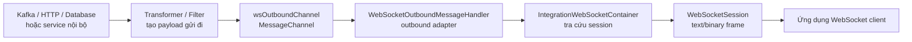
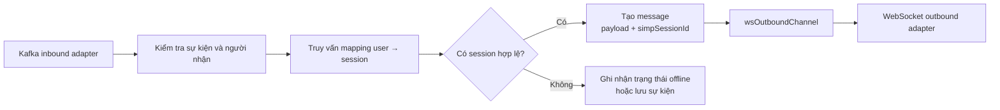
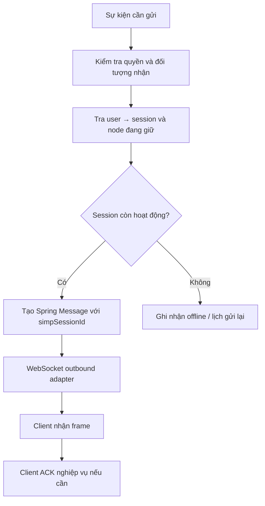

# WebSocket outbound channel adapter

## 1. Mục tiêu và vị trí trong Spring Integration

Trong module **SPRING_INTEGRATION_ADAPTERS**, các adapter, gateway, poller và `MessageChannel` được dùng để kết nối hệ thống ngoài với luồng thông điệp Spring Integration. Dữ liệu có thể đến từ file, SFTP, HTTP, JMS, AMQP, Kafka hoặc cơ sở dữ liệu; sau đó được kiểm tra, chuyển đổi, định tuyến và gửi đến hệ thống đích. Bài này thuộc chương **Adapter WebSocket** và tập trung vào **WebSocket outbound channel adapter**: đưa một `Message<?>` từ ứng dụng ra phiên kết nối WebSocket phù hợp.

Sau bài học, bạn có thể:

- Giải thích sự khác nhau giữa **inbound** (WebSocket → Spring Integration) và **outbound** (Spring Integration → WebSocket).
- Mô tả vai trò của `WebSocketOutboundMessageHandler`, `MessageChannel`, `IntegrationWebSocketContainer`, `WebSocketSession` và `SubProtocolHandler`.
- Cấu hình luồng gửi dữ liệu từ Spring Integration tới đúng phiên WebSocket trên server.
- Phân biệt cách gửi phía **server** cần session ID với cách gửi phía **client** sử dụng một kết nối.
- Chọn hợp đồng payload, sub-protocol và cách xử lý lỗi kết nối, tải lớn, bảo mật.
- Nhận diện giới hạn của WebSocket: không tự có ACK nghiệp vụ, lưu bền vững hay cơ chế gửi lại khi mất kết nối.

> **Tên lớp cần nhớ:** tài liệu gọi thành phần này là *WebSocket outbound channel adapter*, còn lớp Java xử lý đầu ra là `org.springframework.integration.websocket.outbound.WebSocketOutboundMessageHandler`. Đừng tìm một lớp Java tên `WebSocketOutboundChannelAdapter`.

## 2. Outbound adapter giải quyết vấn đề gì?

Giả sử hệ thống nhận một sự kiện trạng thái đơn hàng qua Kafka, lưu kết quả vào cơ sở dữ liệu, rồi phải **đẩy trạng thái mới tới màn hình của đúng người dùng đang mở**. Nếu viết WebSocket thuần, service nghiệp vụ dễ bị gắn chặt vào registry các kết nối và cách gửi frame. Với Spring Integration, có thể ghép một luồng như sau:



Luồng có các bước:

1. Một thành phần nội bộ tạo Spring `Message` gồm **payload** và **headers**.
2. Message được gửi đến `wsOutboundChannel`.
3. `WebSocketOutboundMessageHandler` đọc header để xác định phiên đích (khi cần).
4. Adapter tra phiên trong `IntegrationWebSocketContainer`.
5. `SubProtocolHandler` phù hợp chuyển message thành WebSocket frame và gửi qua session.
6. Client nhận frame qua WebSocket API hoặc client của sub-protocol đã thỏa thuận.

Adapter chỉ đảm nhiệm **đầu ra giao tiếp**; nó không quyết định khách hàng nào được phép nhận sự kiện, nội dung nghiệp vụ có hợp lệ hay yêu cầu gửi nào cần lưu bền vững. Các quyết định này phải được thực hiện trước khi message đi vào outbound channel.

### So sánh inbound và outbound

| Khía cạnh | Inbound channel adapter | Outbound channel adapter |
| --- | --- | --- |
| Hướng dữ liệu | WebSocket → `MessageChannel` | `MessageChannel` → WebSocket |
| Thành phần Java chính | `WebSocketInboundChannelAdapter` | `WebSocketOutboundMessageHandler` |
| Công việc cốt lõi | Nhận frame và phát Spring `Message` | Nhận Spring `Message` và gửi frame |
| Đường ra/vào trong flow | Có `outputChannel` | Tiêu thụ từ `inputChannel` |
| Session | Nhận thông tin từ phiên đã kết nối | Phải tìm được phiên đích |
| Poller | Không cần cho bản thân WebSocket adapter | Không cần cho bản thân WebSocket adapter |
| Request/reply | Không tự phản hồi | Không tự bảo đảm client đã xử lý phản hồi |

Một kết nối WebSocket truyền tin **hai chiều**, nên inbound và outbound có thể dùng **cùng một** `IntegrationWebSocketContainer`. Không cần mở thêm cổng hoặc kết nối WebSocket riêng chỉ để gửi phản hồi.

## 3. Các khái niệm và hợp đồng gửi message

### 3.1. Thành phần tham gia

| Thành phần | Vai trò |
| --- | --- |
| `MessageChannel` | Nơi nhận message mà ứng dụng muốn gửi ra WebSocket; ví dụ `DirectChannel` |
| `WebSocketOutboundMessageHandler` | Consumer của channel; chuyển message sang hoạt động gửi WebSocket |
| `IntegrationWebSocketContainer` | Quản lý các phiên WebSocket đã thiết lập và truy xuất phiên theo ID |
| `ServerWebSocketContainer` | Cấu hình WebSocket endpoint phía server, có thể có nhiều phiên của nhiều client |
| `ClientWebSocketContainer` | Duy trì một kết nối WebSocket outbound từ ứng dụng tới remote server |
| `SubProtocolHandlerRegistry` | Chọn handler theo sub-protocol WebSocket đã thương lượng |
| `PassThruSubProtocolHandler` | Mặc định cho WebSocket raw, chuyển đổi message/frame không yêu cầu STOMP |
| `StompSubProtocolHandler` | Cấu hình bổ sung khi gửi thông điệp theo STOMP |
| `MessageConverter` | Hỗ trợ chuyển đổi payload trước bước encode thành WebSocket frame |

### 3.2. Vì sao session ID quan trọng trên server?

Giả sử ba trình duyệt A, B, C cùng kết nối vào `/ws/updates`. Một sự kiện “đơn hàng của A đã giao” chỉ nên gửi đến phiên có quyền xem đơn hàng đó. Phía server, outbound adapter tra session theo thông tin trong headers của Spring `Message`. Với raw WebSocket trong Spring Integration, header thông dụng là:

```java
SimpMessageHeaderAccessor.SESSION_ID_HEADER
// Tên header thực tế: "simpSessionId"
```

Có thể lấy session ID từ một message inbound:

```java
String sessionId =
    SimpMessageHeaderAccessor.getSessionId(message.getHeaders());
```

Và gắn session ID vào message outbound:

```java
Message<String> reply = MessageBuilder.withPayload("Đã xử lý yêu cầu")
    .setHeader(SimpMessageHeaderAccessor.SESSION_ID_HEADER, sessionId)
    .build();
```

**Phân biệt hai loại ID:**

- `MessageHeaders.ID` là ID của **Spring Message**, không đại diện cho kết nối WebSocket.
- `simpSessionId` là ID phiên WebSocket dùng để định tuyến; phiên có thể đóng hoặc đổi ID sau reconnect.

Nếu message phía server thiếu session ID, adapter không tự suy ra “client hiện tại”. Nó cũng **không tự broadcast** cho tất cả kết nối. Muốn broadcast, phải xây dựng cơ chế chọn tập session hoặc dùng broker/pub-sub phù hợp.

### 3.3. Phía client có khác không?

Có. `ClientWebSocketContainer` quản lý **một** phiên kết nối tới remote server. Tài liệu Spring Integration quy định outbound message phía client **không cần session ID header** để chọn phiên. Dù vậy, ứng dụng vẫn phải đợi kết nối thực sự thiết lập; việc gọi `send` trong lúc chưa kết nối là tình huống lỗi, không phải yêu cầu tự động xếp hàng gửi sau.

## 4. Ví dụ thực hành: gửi ACK tới đúng trình duyệt

Ví dụ này dùng **Spring Boot 3.x, Spring Integration 6.x, Java 17+** và web stack Servlet. Chạy một endpoint raw WebSocket tại `/ws/updates`. Trình duyệt gửi thông điệp thử nghiệm; inbound adapter chỉ đóng vai trò cung cấp message và session ID; **outbound adapter là thành phần gửi ACK về đúng phiên vừa gửi**.

Khi hiểu cấu hình này, bạn có thể thay nguồn vào bằng Kafka, JMS, HTTP hoặc service nghiệp vụ, miễn là message outbound vẫn chứa session ID hợp lệ.

### 4.1. Khai báo dependency

Ví dụ Maven tối thiểu:

```xml
<dependencies>
    <dependency>
        <groupId>org.springframework.boot</groupId>
        <artifactId>spring-boot-starter-web</artifactId>
    </dependency>
    <dependency>
        <groupId>org.springframework.boot</groupId>
        <artifactId>spring-boot-starter-integration</artifactId>
    </dependency>
    <dependency>
        <groupId>org.springframework.integration</groupId>
        <artifactId>spring-integration-websocket</artifactId>
    </dependency>
</dependencies>
```

Spring Boot BOM quản lý các phiên bản tương thích. `spring-boot-starter-web` cung cấp Spring MVC/web server, còn `spring-integration-websocket` cung cấp container và adapter.

### 4.2. Cấu hình WebSocket outbound

Tạo lớp cấu hình sau trong package được Spring Boot quét:

```java
package com.example.websocket;

import org.springframework.beans.factory.annotation.Qualifier;
import org.springframework.context.annotation.Bean;
import org.springframework.context.annotation.Configuration;
import org.springframework.integration.annotation.ServiceActivator;
import org.springframework.integration.channel.DirectChannel;
import org.springframework.integration.config.EnableIntegration;
import org.springframework.integration.websocket.ServerWebSocketContainer;
import org.springframework.integration.websocket.inbound.WebSocketInboundChannelAdapter;
import org.springframework.integration.websocket.outbound.WebSocketOutboundMessageHandler;
import org.springframework.messaging.MessageChannel;
import org.springframework.messaging.MessageHandler;
import org.springframework.messaging.MessagingException;
import org.springframework.messaging.simp.SimpMessageHeaderAccessor;
import org.springframework.messaging.support.MessageBuilder;

@Configuration
@EnableIntegration
public class WebSocketOutboundConfiguration {

    // Một container được dùng chung cho phần nhận và phần gửi.
    @Bean
    public ServerWebSocketContainer serverWebSocketContainer() {
        return new ServerWebSocketContainer("/ws/updates");
    }

    @Bean
    public MessageChannel wsInboundChannel() {
        return new DirectChannel();
    }

    @Bean
    public MessageChannel wsOutboundChannel() {
        return new DirectChannel();
    }

    // Chỉ để tạo đầu vào minh họa và thu được ID của phiên gửi.
    @Bean
    public WebSocketInboundChannelAdapter wsInbound(
            ServerWebSocketContainer serverWebSocketContainer,
            @Qualifier("wsInboundChannel") MessageChannel inboundChannel) {

        WebSocketInboundChannelAdapter adapter =
                new WebSocketInboundChannelAdapter(serverWebSocketContainer);
        adapter.setOutputChannel(inboundChannel);
        return adapter;
    }

    // Xử lý message inbound, tạo message outbound gửi về cùng session.
    @Bean
    @ServiceActivator(inputChannel = "wsInboundChannel")
    public MessageHandler prepareReply(
            @Qualifier("wsOutboundChannel") MessageChannel outboundChannel) {

        return incoming -> {
            String sessionId = SimpMessageHeaderAccessor
                    .getSessionId(incoming.getHeaders());

            if (sessionId == null) {
                throw new MessagingException(
                        incoming, "Không tìm thấy WebSocket session ID");
            }

            String text = "ACK: " + incoming.getPayload();

            boolean accepted = outboundChannel.send(
                    MessageBuilder.withPayload(text)
                            .setHeader(
                                    SimpMessageHeaderAccessor.SESSION_ID_HEADER,
                                    sessionId)
                            .build());

            if (!accepted) {
                throw new MessagingException(
                        incoming, "Outbound channel không nhận message");
            }
        };
    }

    // Đây là outbound adapter thực sự:
    // nhận Spring Message và gửi WebSocket frame.
    @Bean
    @ServiceActivator(inputChannel = "wsOutboundChannel")
    public MessageHandler wsOutbound(
            ServerWebSocketContainer serverWebSocketContainer) {

        return new WebSocketOutboundMessageHandler(serverWebSocketContainer);
    }
}
```

Ở đây:

- `serverWebSocketContainer` đăng ký endpoint `/ws/updates` và giữ các `WebSocketSession`.
- `wsInbound` lắng nghe frame từ trình duyệt rồi đưa message vào `wsInboundChannel`.
- `prepareReply` lấy `simpSessionId` của message inbound và tạo ACK có chính header đó.
- `wsOutbound` là `WebSocketOutboundMessageHandler` gắn với `wsOutboundChannel`; nó sử dụng cùng container để tìm đúng session và gửi frame.
- `@EnableIntegration` kích hoạt hạ tầng Spring Integration, bao gồm cơ chế đăng ký endpoint WebSocket thích hợp.

**Điểm thiết kế:** `@ServiceActivator` có thể nối một `MessageChannel` với `MessageHandler`. Outbound adapter không cần `setOutputChannel` vì vai trò của nó là **consumer** ở cuối nhánh gửi.

### 4.3. Chạy thử trong trình duyệt

Chạy ứng dụng tại `localhost:8080`. Mở Developer Tools → Console và nhập:

```javascript
const ws = new WebSocket("ws://localhost:8080/ws/updates");

ws.addEventListener("open", () => {
  console.log("Đã kết nối");
  ws.send(JSON.stringify({
    eventId: "evt-101",
    type: "order.updated",
    orderId: "ORD-42"
  }));
});

ws.addEventListener("message", (event) => {
  console.log("Server gửi:", event.data);
});

ws.addEventListener("error", (event) => console.error("Lỗi WebSocket:", event));
ws.addEventListener("close", (event) => console.log("Đã đóng:", event.code));
```

Khi kết nối hoạt động bình thường, console nhận text bắt đầu bằng:

```text
ACK: {"eventId":"evt-101","type":"order.updated","orderId":"ORD-42"}
```

Thử tiếp với **hai tab trình duyệt độc lập**. Tab A gửi `A`, tab B gửi `B`. Mỗi tab chỉ thấy ACK của message mà chính tab đó gửi. Đây là cách kiểm tra quan trọng: header session ID được lấy và giữ đúng, không vô tình broadcast sang phiên khác.

Ví dụ chỉ minh họa đường đi của message; ở hệ thống thật, phải kiểm tra schema, quyền truy cập, giới hạn payload và kết quả nghiệp vụ trước khi gửi ACK thành công.

## 5. Gửi message chủ động từ service, Kafka hoặc HTTP

Ứng dụng không bắt buộc phải chờ client gửi inbound message. Một sự kiện từ Kafka, AMQP, database hoặc HTTP controller cũng có thể được chuyển vào `wsOutboundChannel`.

Ví dụ service gửi một JSON string cho **một session đã biết**:

```java
package com.example.websocket;

import org.springframework.beans.factory.annotation.Qualifier;
import org.springframework.messaging.MessageChannel;
import org.springframework.messaging.simp.SimpMessageHeaderAccessor;
import org.springframework.messaging.support.MessageBuilder;
import org.springframework.stereotype.Service;

@Service
public class SessionNotificationService {

    private final MessageChannel outboundChannel;

    public SessionNotificationService(
            @Qualifier("wsOutboundChannel") MessageChannel outboundChannel) {
        this.outboundChannel = outboundChannel;
    }

    public boolean notifySession(String sessionId, String jsonPayload) {
        if (sessionId == null || sessionId.isBlank()) {
            throw new IllegalArgumentException("sessionId không hợp lệ");
        }

        return outboundChannel.send(
                MessageBuilder.withPayload(jsonPayload)
                        .setHeader(
                                SimpMessageHeaderAccessor.SESSION_ID_HEADER,
                                sessionId)
                        .build());
    }
}
```

**Nguồn `sessionId` phải đáng tin cậy.** Hệ thống có thể lưu ánh xạ `userId → tập các sessionId` sau khi handshake được xác thực và loại bỏ session khi đóng. Đừng để người dùng nhập session ID tùy ý để gửi dữ liệu riêng tư cho phiên khác.

Nếu chuyển event Kafka/DB sang WebSocket, một mẫu luồng hợp lý là:



Giá trị trả về `true` từ `MessageChannel.send(...)` cho biết channel **đã chấp nhận lần gửi ở cấp messaging**. Với `DirectChannel`, handler được gọi đồng bộ và có thể ném exception. Giá trị đó **không phải xác nhận từ trình duyệt đã nhận, hiển thị hoặc xử lý thành công**. Muốn có xác nhận nghiệp vụ, phải định nghĩa message ACK từ client, correlation ID, timeout và chiến lược retry/deduplication.

### Một người có nhiều phiên thì sao?

Một user có thể mở nhiều tab, nhiều thiết bị; mỗi tab có một `WebSocketSession` riêng. Outbound adapter với raw WebSocket gửi tới một session được xác định. Nếu muốn gửi cho mọi thiết bị của user, service phải lựa chọn và phát một message riêng cho từng session, hoặc dùng broker có destination/subscribe phù hợp. Cần xác định rõ chính sách: gửi một thiết bị, tất cả thiết bị hay thiết bị đang hoạt động.

## 6. Trường hợp ứng dụng là WebSocket client

Spring Integration không chỉ làm WebSocket server. Với `ClientWebSocketContainer`, ứng dụng của bạn có thể **chủ động kết nối đến WebSocket server của đối tác**, sau đó dùng outbound adapter để gửi message tới kết nối đó.

Ví dụ bean cấu hình độc lập:

```java
import org.springframework.context.annotation.Bean;
import org.springframework.context.annotation.Configuration;
import org.springframework.integration.annotation.ServiceActivator;
import org.springframework.integration.channel.DirectChannel;
import org.springframework.integration.websocket.ClientWebSocketContainer;
import org.springframework.integration.websocket.outbound.WebSocketOutboundMessageHandler;
import org.springframework.messaging.MessageChannel;
import org.springframework.messaging.MessageHandler;
import org.springframework.web.socket.client.standard.StandardWebSocketClient;

@Configuration
public class PartnerWebSocketConfiguration {

    @Bean
    public ClientWebSocketContainer partnerContainer() {
        return new ClientWebSocketContainer(
                new StandardWebSocketClient(),
                "ws://localhost:8090/partner");
    }

    @Bean
    public MessageChannel partnerOutboundChannel() {
        return new DirectChannel();
    }

    @Bean
    @ServiceActivator(inputChannel = "partnerOutboundChannel")
    public MessageHandler partnerOutbound(ClientWebSocketContainer partnerContainer) {
        return new WebSocketOutboundMessageHandler(partnerContainer);
    }
}
```

Sau khi container kết nối thành công (`partnerContainer.isConnected() == true`), service có thể gửi Spring Message dạng text vào `partnerOutboundChannel`, ví dụ:

```java
partnerOutboundChannel.send(
    MessageBuilder.withPayload(
        "{\"type\":\"telemetry\",\"value\":42}"
    ).build()
);
```

Điều kiện thực hành: phải có một WebSocket server đang nghe ở `ws://localhost:8090/partner`; môi trường Java cần Jakarta WebSocket client implementation tương thích. Không nên gửi tại startup trước khi có phiên kết nối. Ở phía client **không cần `simpSessionId`**, vì container chỉ đại diện cho một connection. Khi kết nối bị ngắt, phải thiết kế lại khả năng kết nối, hàng đợi và việc gửi lại dựa trên yêu cầu ứng dụng; đừng giả định adapter tự replay mọi dữ liệu.

## 7. Payload, converter và sub-protocol

### 7.1. Chọn hợp đồng payload

Với raw WebSocket, đơn giản nhất là tạo payload `String` chứa text/JSON đã được serialize:

```java
Message<String> message = MessageBuilder
    .withPayload("{\"type\":\"price.changed\",\"productId\":\"P-7\"}")
    .setHeader(SimpMessageHeaderAccessor.SESSION_ID_HEADER, sessionId)
    .build();
```

Khi payload là POJO, cần quyết định **serialize ở transformer trước outbound** hay cấu hình `MessageConverter`. Cách làm tường minh với `ObjectMapper.writeValueAsString(...)` ở bước trước outbound thường dễ kiểm tra schema, phiên bản và lỗi parse hơn; converter phù hợp khi nhiều flow chia sẻ quy tắc chuyển đổi.

Các converter mặc định được liệt kê trong tài liệu Spring Integration gồm `StringMessageConverter`, `ByteArrayMessageConverter` và `MappingJackson2MessageConverter` (khi Jackson có mặt). Cấu hình `messageConverters` cho handler và `mergeWithDefaultConverters` ảnh hưởng đến cách chọn converter. **Không suy ra kiểu frame nhị phân chỉ từ việc payload là `byte[]`**; hành vi cuối cùng phụ thuộc `SubProtocolHandler` và loại frame mà handler tạo ra. Cần kiểm tra yêu cầu protocol và thử với client thật.

### 7.2. Raw WebSocket và STOMP không thay thế cho nhau

| Raw WebSocket | STOMP qua WebSocket |
| --- | --- |
| Ứng dụng tự định nghĩa format text/JSON/binary | Frame mang command như `SEND`, `SUBSCRIBE`, `MESSAGE` |
| Mặc định có `PassThruSubProtocolHandler` | Cần `StompSubProtocolHandler` |
| Phía server thường chọn đích theo session ID | Có thể dùng destination/subscription của STOMP broker |
| Phù hợp ứng dụng đơn giản, giao thức riêng | Phù hợp hệ thống có khái niệm topic/queue và broker |
| Không có ACK nghiệp vụ mặc định | STOMP có cơ chế frame/ack theo cấu hình, vẫn cần định nghĩa bảo đảm đầu cuối |

Nếu cần STOMP, outbound adapter có thể nhận `SubProtocolHandlerRegistry` trong constructor để chọn `StompSubProtocolHandler`. Các STOMP message được tạo với `StompHeaderAccessor`, ví dụ `StompHeaderAccessor.create(StompCommand.SEND)`, cùng các header destination. Đặc biệt **phía client STOMP** của Spring Integration có `ClientStompEncoder` để bảo đảm command `SEND` được encode đúng; cấu hình raw WebSocket trong ví dụ trên không đủ để trao đổi STOMP với broker.

Một lỗi phổ biến là client gửi JSON text tới endpoint đòi STOMP frame, hoặc ngược lại gửi command STOMP tới endpoint raw WebSocket. Handshake có thể vẫn thành công nhưng nghiệp vụ không nhận được nội dung mong đợi.

### 7.3. Cấu hình XML tương đương

Trong dự án dùng Spring Integration XML namespace, phần tử outbound tương ứng:

```xml
<int-websocket:outbound-channel-adapter
    id="wsOutboundAdapter"
    channel="wsOutboundChannel"
    container="serverWebSocketContainer"/>
```

Đây là một đoạn trong file cấu hình đã khai báo namespace `int-websocket` và các bean liên quan. Các thuộc tính thường gặp gồm `default-protocol-handler`, `protocol-handlers`, `message-converters`, `merge-with-default-converters`, `auto-startup`, `phase`. Dù khai báo bằng Java hay XML, nguyên tắc **channel → outbound handler → container → session** không đổi.

## 8. Xử lý lỗi và vòng đời kết nối

WebSocket là kết nối tồn tại lâu dài; session có thể đóng trong khoảng thời gian **sau khi chọn người nhận nhưng trước khi gửi**. Không nên coi session ID đã lưu là luôn hợp lệ.

| Tình huống | Dấu hiệu | Cách xử lý đề xuất |
| --- | --- | --- |
| Thiếu `simpSessionId` ở phía server | Không tìm được phiên đích để gửi | Xác định message source và bước tạo header |
| Session ID cũ sau reconnect | Gửi không đến client, lỗi session không tồn tại/đã đóng | Loại session cũ khỏi mapping, cập nhật phiên mới |
| Gửi khi `ClientWebSocketContainer` chưa kết nối | Outbound phát sinh lỗi kết nối/session | Chờ `isConnected()` hoặc readiness signal thích hợp |
| Không tìm thấy sub-protocol handler | Lỗi khi chọn handler, handshake vẫn có thể thành công | Đồng bộ sub-protocol client/server và registry |
| Converter không hỗ trợ payload | Không encode được message thành frame | Chuẩn hóa payload/serializer, kiểm tra converter |
| Nhiều message gửi cùng một session | Buffer tăng, sender chậm hoặc chồng lấn thao tác gửi | Áp giới hạn và phối hợp các lần gửi theo phiên |
| Handler downstream ném exception | Luồng gửi báo lỗi | Log/metrics có correlation ID và xử lý lỗi theo channel |

### 8.1. Error channel khác với ACK từ client

Lỗi trong `WebSocketOutboundMessageHandler` thường có thể xuất hiện ở luồng gửi đồng bộ hoặc dưới dạng xử lý lỗi của Spring Integration khi luồng nguồn là bất đồng bộ. Có thể tổ chức error flow với `ErrorMessage`, `errorChannel` và service xử lý ngoại lệ theo thiết kế hệ thống.

Tuy nhiên:

- Việc gửi thành công tại application/server chỉ cho biết **bước gửi** đã hoàn thành theo cơ chế thư viện, không xác thực rằng client đã xử lý sự kiện.
- `errorChannel` là kênh lỗi **nội bộ Spring Integration**, không phải một frame gửi tự động về WebSocket.
- Nếu phía client phải xác nhận nhận và xử lý, hãy gửi một message ACK quay lại qua inbound flow, mang `eventId`/`correlationId`.

### 8.2. Đồng thời, buffer và backpressure

WebSocket session có tài nguyên hữu hạn. Nếu nguồn Kafka/JMS phát hàng nghìn message/giây nhưng client nhận chậm, có thể xuất hiện buffer đầy hoặc gửi bị chậm. Ở server, cần cân nhắc các cấu hình timeout/buffer và chiến lược xử lý overflow của WebSocket container, bao gồm `sendTimeLimit`, `sendBufferSizeLimit`, `ConcurrentWebSocketSessionDecorator.OverflowStrategy` tùy phiên bản API và cách cấu hình.

Điều quan trọng là phải có **chính sách ứng dụng**: gộp các cập nhật trùng, bỏ dữ liệu cũ nếu chỉ quan tâm trạng thái mới, giới hạn hàng đợi, hoặc đưa sự kiện vào kho lưu bền vững nếu không được phép mất. Không đẩy vô hạn dữ liệu vào bộ nhớ chỉ vì WebSocket client chậm.

### 8.3. Delivery semantics

Không đồng nhất các tín hiệu sau:

1. `channel.send(...) == true`: thành phần nhận của Spring Messaging đã chấp nhận message.
2. Outbound handler thực thi không ném lỗi: tầng gửi đã hoàn thành theo thư viện và phiên hiện tại.
3. Client nhận được frame: cần client hỗ trợ xác nhận hoặc quan sát độc lập.
4. Client xử lý nghiệp vụ thành công: cần ACK nghiệp vụ mang correlation ID.

WebSocket **không tự tạo lưu bền vững, retry/replay sau reconnect hay exactly-once business delivery**. Nếu yêu cầu đáng tin cậy, hệ thống có thể dùng event ID, outbox, Kafka/JMS, trạng thái chưa xác nhận, ACK từ client và xử lý idempotent.

## 9. Bảo mật khi gửi qua WebSocket

Outbound adapter giúp truyền dữ liệu qua kết nối, nhưng không thay thế authorization:

1. **Handshake và session:** xác thực người dùng khi mở kết nối; gắn session với danh tính và các quyền có thể kiểm tra lại.
2. **Quyền đọc:** trước khi gửi thông báo, xác nhận người nhận có quyền thấy dữ liệu cụ thể. Một `sessionId` không phải token cho phép truy cập.
3. **Transport:** dùng `wss://` khi triển khai thực tế; không truyền dữ liệu nhạy cảm qua `ws://` trên mạng không đáng tin.
4. **Origin và CSRF-like risks:** cấu hình allowed origins/handshake theo chính sách web; origin header không phải cơ chế xác thực độc lập.
5. **Giới hạn tải:** hạn chế kích thước frame, tốc độ gửi, số session; giám sát client chậm.
6. **Nội dung:** kiểm soát dữ liệu cá nhân/bí mật, tránh ghi payload nhạy cảm đầy đủ vào log.
7. **Đa node:** container giữ các session đang hoạt động **trong tiến trình của node**; nếu event được xử lý ở node khác, cần có routing đến node sở hữu session hoặc broker hỗ trợ.

Sơ đồ gửi thông báo đúng người nhận:



## 10. Câu hỏi thường gặp và lỗi cần tránh

**Outbound adapter có tự broadcast không?** Không. Với raw WebSocket phía server, adapter gửi tới session được chọn theo header. Broadcast là một quyết định nghiệp vụ/định tuyến riêng.

**Có cần poller không?** Không, vì outbound adapter là consumer của message được đẩy vào channel. Nếu dữ liệu nguồn là file hoặc bảng DB cần quét định kỳ, poller thuộc **nguồn** hoặc bước trước adapter, không thuộc outbound WebSocket handler.

**Dùng `QueueChannel` có giúp lưu bền vững không?** Không mặc định. `QueueChannel` trong bộ nhớ chỉ tách thời điểm nhận/tiêu thụ message. Muốn lưu qua restart, cần persistent message store hoặc hệ thống hàng đợi thích hợp, và cần chính sách xử lý lại khi session đích không còn.

**Tại sao giữ `simpSessionId` từ inbound?** Vì outbound phải tìm đúng `WebSocketSession` trong container phía server. Header này thường có trên message nhận qua `PassThruSubProtocolHandler`. Nếu một transformer tạo message mới mà bỏ header, cần gắn lại ID của session đích đã được kiểm tra quyền.

**Dùng STOMP thì có thể dùng raw JavaScript `WebSocket.send(JSON.stringify(...))` không?** Không tương đương: STOMP cần frame/command theo protocol. Dùng client STOMP đúng hoặc cấu hình endpoint raw phù hợp.

**Kết nối đóng trong lúc gửi thì sao?** Gửi có thể lỗi hoặc không mang lại xác nhận nghiệp vụ. Cần dọn session, ghi nhận trạng thái và retry nếu bài toán cho phép.

## 11. Bài tập thực hành

### Bài A — gửi tới đúng session

Chạy ví dụ phần 4 và mở hai tab trình duyệt. Mỗi tab gửi một chuỗi khác nhau; quan sát ACK và giải thích header nào quyết định đích. Thử bỏ `setHeader(SimpMessageHeaderAccessor.SESSION_ID_HEADER, sessionId)` và ghi lại khác biệt.

**Đạt yêu cầu khi:** hiểu rằng một Spring Message ID không thay được WebSocket session ID, và server không tự xác định người nhận.

### Bài B — push từ nguồn bên ngoài

Giả sử Kafka nhận sự kiện:

```json
{
  "eventId": "evt-205",
  "type": "order.status.changed",
  "orderId": "ORD-42",
  "userId": "u-17",
  "status": "SHIPPED"
}
```

Thiết kế một flow đọc event, kiểm tra quyền của `u-17` đối với `ORD-42`, tìm mọi session của người dùng và tạo message có `simpSessionId` cho từng session. Đề xuất hành vi khi không có session nào đang mở.

**Đạt yêu cầu khi:** thể hiện rõ nơi xác thực quyền, nơi tra session, nơi chuyển đổi JSON và nơi gửi bằng outbound adapter.

### Bài C — phân biệt gửi thành công và xử lý thành công

Client mất kết nối ngay sau khi server gửi sự kiện `evt-205`. Hãy mô tả một hợp đồng gồm `eventId`, message ACK client → server, timeout, retry và deduplication. Xác định nguồn lưu dữ liệu chưa được ACK và điều kiện ngừng retry.

**Đạt yêu cầu khi:** không coi kết quả `MessageChannel.send()` là ACK nghiệp vụ hoặc bằng chứng client đã xử lý.

### Bài D — client gửi tới WebSocket server đối tác

Dùng cấu hình `ClientWebSocketContainer` ở phần 6 để gửi một JSON payload đến server test đang chạy trên `localhost:8090`. Chỉ gửi sau khi `isConnected()` trả về `true`; thử dừng server và thiết kế cách ứng dụng phản hồi sự kiện mất kết nối.

**Đạt yêu cầu khi:** giải thích được vì sao phía client không cần session ID header nhưng vẫn cần cơ chế quản lý kết nối.

## 12. Tóm tắt cần ghi nhớ

- **WebSocket outbound channel adapter** là đầu ra Spring Integration, được hiện thực bằng `WebSocketOutboundMessageHandler` và nhận message từ `MessageChannel`.
- Adapter tìm WebSocket session trong `IntegrationWebSocketContainer`, sau đó chuyển đổi và gửi message theo `SubProtocolHandler`.
- **Phía server** cần chọn session bằng header như `simpSessionId`. **Phía client** có một kết nối trong `ClientWebSocketContainer` nên không cần header này.
- Inbound và outbound adapter có thể dùng chung container để trao đổi hai chiều.
- Raw WebSocket dùng `PassThruSubProtocolHandler` theo mặc định; STOMP yêu cầu cấu hình handler và contract STOMP.
- Gửi một Spring Message không đồng nghĩa client đã nhận, xử lý hay xác nhận nghiệp vụ. Thiết kế authorization, error flow, backpressure, ACK và retry theo yêu cầu thực tế.
- WebSocket outbound có thể đặt ở cuối luồng bắt đầu bằng HTTP, Kafka, JMS, AMQP, cơ sở dữ liệu hoặc file; nhờ đó business flow không phụ thuộc trực tiếp vào chi tiết kết nối WebSocket.

## Tài liệu tham khảo

- [Spring Integration Reference — WebSockets Support](https://docs.spring.io/spring-integration/reference/web-sockets.html)
- [Spring Integration API — WebSocketOutboundMessageHandler](https://docs.spring.io/spring-integration/api/org/springframework/integration/websocket/outbound/WebSocketOutboundMessageHandler.html)
- [Spring Integration API — ClientWebSocketContainer](https://docs.spring.io/spring-integration/api/org/springframework/integration/websocket/ClientWebSocketContainer.html)
- [Spring Integration API — ServerWebSocketContainer](https://docs.spring.io/spring-integration/api/org/springframework/integration/websocket/ServerWebSocketContainer.html)
- [Spring Integration API — PassThruSubProtocolHandler](https://docs.spring.io/spring-integration/api/org/springframework/integration/websocket/support/PassThruSubProtocolHandler.html)
- [Spring Framework Reference — WebSocket](https://docs.spring.io/spring-framework/reference/web/websocket.html)
