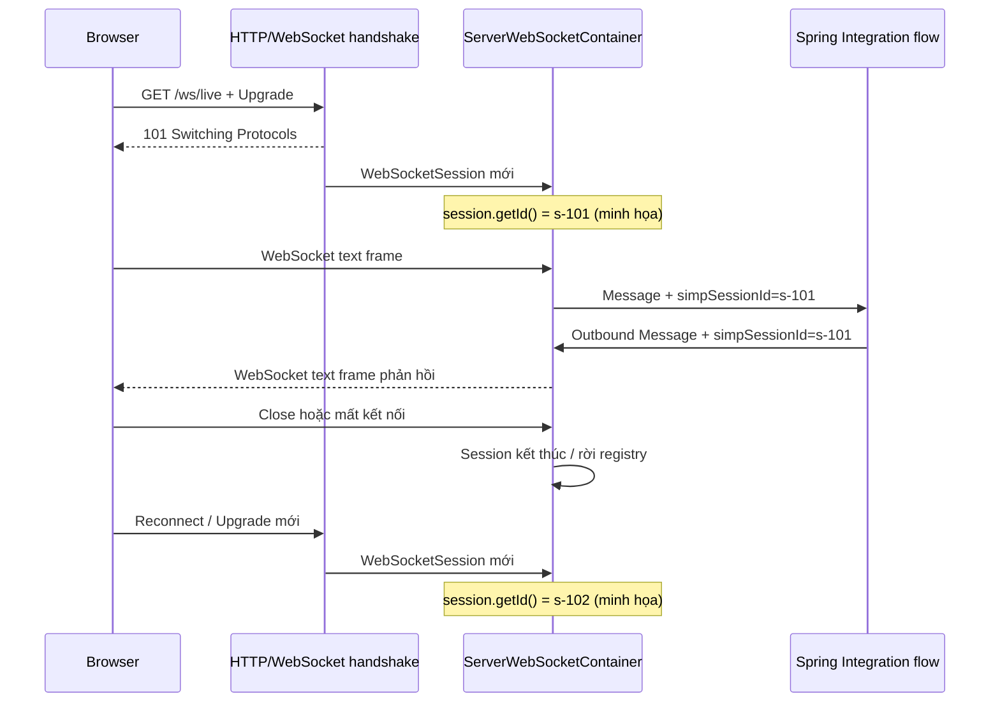
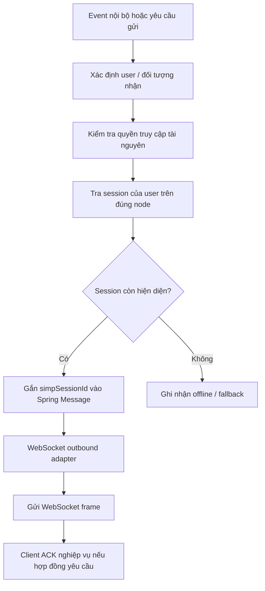

# WebSocket session và connection ID

## 1. Mục tiêu bài học

Trong module **SPRING_INTEGRATION_ADAPTERS**, Spring Integration kết nối hệ thống ngoài với ứng dụng bằng inbound/outbound adapter, gateway, poller và `MessageChannel`. Khi kết hợp WebSocket với các nguồn như HTTP, JMS, AMQP, Kafka, file hoặc cơ sở dữ liệu, ứng dụng thường phải trả thông báo về **đúng kết nối đang mở**. Vì vậy, quản lý **WebSocket session** và **connection ID** là phần quan trọng của hợp đồng message và vòng đời kết nối.

Bài này thuộc chương **Adapter WebSocket** và giải quyết các câu hỏi:

- `WebSocketSession` đại diện cho điều gì, được tạo và kết thúc lúc nào?
- `WebSocketSession.getId()`, header `simpSessionId` và trường `connectionId` do ứng dụng định nghĩa khác nhau ra sao?
- Vì sao user ID, HTTP `JSESSIONID`, message ID và correlation ID không thay thế được WebSocket session ID?
- Inbound adapter chuyển session ID qua `MessageHeaders` như thế nào và outbound adapter dùng nó để chọn người nhận ra sao?
- Khi mở nhiều tab, reconnect hoặc triển khai nhiều node, cần quản lý mapping và dọn tài nguyên thế nào?

Sau bài học, bạn có thể xây dựng một flow kiểm tra session, gửi phản hồi đúng phiên, theo dõi reconnect, và tránh các lỗi định tuyến hoặc rò rỉ dữ liệu giữa các client.

## 2. Bản chất của WebSocket session

WebSocket bắt đầu bằng **HTTP Upgrade handshake**. Khi handshake thành công, một kết nối được mở để hai bên có thể trao đổi text/binary frame trong thời gian dài. Spring Framework biểu diễn kết nối này bằng interface:

```java
org.springframework.web.socket.WebSocketSession
```

Những phương thức thường dùng:

| API | Thông tin / thao tác |
| --- | --- |
| `session.getId()` | ID duy nhất của WebSocket session theo cơ chế của implementation |
| `session.isOpen()` | Trạng thái phiên có còn mở tại thời điểm kiểm tra hay không |
| `session.getPrincipal()` | Danh tính được gắn với phiên, nếu đã thiết lập |
| `session.getAttributes()` | Các thuộc tính gắn với session; có thể được đặt trong handshake |
| `session.getHandshakeHeaders()` | HTTP headers của lần handshake |
| `session.getUri()` | URI dùng để mở WebSocket |
| `session.getAcceptedProtocol()` | Sub-protocol đã được thương lượng, nếu có |
| `session.sendMessage(...)` | Gửi một WebSocket frame trực tiếp |
| `session.close(...)` | Đóng WebSocket session |

**Điểm cốt lõi:** một session là **một kết nối ở hiện tại**, không phải người dùng, thiết bị hay một phiên đăng nhập lâu dài. Client đóng tab, mạng mất, server restart hoặc kết nối được thiết lập lại thì phiên cũ không còn dùng được. Sau reconnect thường xuất hiện `WebSocketSession` mới với ID mới.

Khi nói “connection ID” trong kiến trúc ứng dụng, phải làm rõ đó là:

1. **ID phiên WebSocket của Spring**: `WebSocketSession.getId()`.
2. **ID kết nối do ứng dụng tự gán**: một giá trị như `connectionId` hoặc `clientConnectionId` lưu trong registry.
3. **ID do thư viện/gateway bên ngoài đặt**: chẳng hạn tên thuộc tính connection ID trong reverse proxy hoặc WebSocket service cụ thể.

WebSocket **không bắt buộc** một trường JSON chuẩn tên `connectionId`. Nếu ứng dụng cần gửi ID cho trình duyệt, phải tự định nghĩa hợp đồng và message tương ứng.

### Sơ đồ vòng đời



Các giá trị `s-101` và `s-102` là **ID minh họa**; ứng dụng thực tế không nên suy luận định dạng, độ dài hay thứ tự tăng của ID.

## 3. Phân biệt các loại ID

| Giá trị | Được tạo/giữ ở đâu? | Vòng đời / mục đích |
| --- | --- | --- |
| **WebSocket session ID** | `WebSocketSession.getId()` trên server | Nhận diện một phiên WebSocket đang tồn tại; thay đổi khi reconnect |
| **`simpSessionId`** | Header Spring Messaging, hằng số `SimpMessageHeaderAccessor.SESSION_ID_HEADER` | Chuyển **ID của WebSocket session** qua các message trong flow; cần cho outbound routing phía server |
| **Application `connectionId`** | Ứng dụng tự tạo và quản lý | ID công khai hoặc phục vụ quan sát; có thể ánh xạ đến session hiện hành, không mặc định là ID của Spring |
| **`userId` / principal** | Hệ thống xác thực | Danh tính ổn định hơn kết nối; một user có thể có nhiều session |
| **HTTP `JSESSIONID`** | HTTP session/cookie nếu ứng dụng dùng servlet session | Không bảo đảm ánh xạ 1:1 với WebSocket session; nhiều tab có thể dùng chung HTTP session |
| **`MessageHeaders.ID`** | Spring Messaging tạo cho từng message | Nhận diện Spring Message; không dùng để tìm WebSocketSession |
| **`correlationId` / `eventId`** | Ứng dụng tạo cho yêu cầu hoặc sự kiện | Ghép request–reply, ACK, retry hoặc deduplication giữa nhiều kết nối |
| **STOMP `session` header** | Được sub-protocol/broker cấp trong một số triển khai | Không mặc nhiên đồng nhất với `simpSessionId`; xem hợp đồng sub-protocol cụ thể |
| **TCP socket / IP:port** | Mạng, reverse proxy, hệ điều hành | Không ổn định và không phải định danh người dùng; có thể thay đổi sau proxy/reconnect |

Ví dụ người dùng `user-17` mở cùng dashboard trong hai tab:

```text
user-17
  ├── Tab A ── WebSocket sessionId = A31
  └── Tab B ── WebSocket sessionId = B72

Kafka event:
  eventId = evt-205
  recipient = user-17
```

Nếu chính sách thông báo yêu cầu **tất cả tab** của `user-17`, ứng dụng phải định tuyến đến cả `A31` và `B72`. Nếu chỉ phản hồi yêu cầu từ tab A, chỉ chọn `A31`. Không dùng `user-17` làm `simpSessionId` và mong adapter tự tìm người nhận.

**Trình duyệt không có API WebSocket chuẩn để đọc `WebSocketSession.getId()` của server.** `new WebSocket(url)` tạo đối tượng phía client với `readyState`, `url` và các event; muốn trình duyệt biết một application connection ID thì server phải gửi message theo giao thức ứng dụng.

## 4. Session registry trong Spring Integration

Spring Integration cung cấp `IntegrationWebSocketContainer` để tập trung quản lý phiên WebSocket, với hai loại chính:

- `ServerWebSocketContainer`: đăng ký endpoint phía server, nhận nhiều kết nối của nhiều client.
- `ClientWebSocketContainer`: từ ứng dụng chủ động kết nối tới một remote WebSocket server, giữ một kết nối tương ứng.

Các API của container hữu ích khi làm việc với ID:

```java
WebSocketSession session = container.getSession(sessionId);
Map<String, WebSocketSession> active = container.getSessions();
```

`getSession(sessionId)` lấy đối tượng session ứng với ID **nếu session còn hiện diện**; kết quả có thể `null`. `getSessions()` phù hợp cho thống kê/quan sát, nhưng không nên coi registry nội bộ là nguồn dữ liệu kinh doanh lâu dài.

Ví dụ truy vấn an toàn:

```java
import org.springframework.integration.websocket.ServerWebSocketContainer;
import org.springframework.web.socket.WebSocketSession;

public boolean isSessionCurrentlyOpen(
        ServerWebSocketContainer container, String sessionId) {

    if (sessionId == null || sessionId.isBlank()) {
        return false;
    }

    WebSocketSession session = container.getSession(sessionId);
    return session != null && session.isOpen();
}
```

Hàm này chỉ phản ánh **thời điểm kiểm tra**. Kết nối có thể đóng ngay sau khi `isOpen()` trả về `true`, vì vậy mọi thao tác gửi vẫn cần bắt và xử lý lỗi. Không dùng một lần kiểm tra này như bảo đảm gửi thành công.

Một điểm khác biệt giữa hai loại container: `ClientWebSocketContainer` có một session kết nối ra ngoài và có thể tìm session mà không cần truyền ID; còn `ServerWebSocketContainer` cần định tuyến theo session ID khi có nhiều client.

## 5. Session ID đi qua inbound/outbound adapter ra sao?

Ở phía server, message nhận qua **WebSocket inbound channel adapter** được chuyển thành Spring `Message<?>` để đi trong Integration Flow. Header:

```java
SimpMessageHeaderAccessor.SESSION_ID_HEADER
// Giá trị chuỗi thực tế của hằng số: "simpSessionId"
```

cho phép gắn ID session nhận dữ liệu vào message.

Lấy session ID từ một message inbound:

```java
import org.springframework.messaging.Message;
import org.springframework.messaging.simp.SimpMessageHeaderAccessor;

String sessionId =
    SimpMessageHeaderAccessor.getSessionId(incoming.getHeaders());
```

Hoặc đọc đúng tên header đã biết (nên ưu tiên hằng số/framework accessor):

```java
String sessionId = (String) incoming.getHeaders()
    .get(SimpMessageHeaderAccessor.SESSION_ID_HEADER);
```

Để gửi ngược về đúng session, tạo Spring Message outbound mang chính session ID đó:

```java
import org.springframework.messaging.Message;
import org.springframework.messaging.simp.SimpMessageHeaderAccessor;
import org.springframework.messaging.support.MessageBuilder;

Message<String> reply = MessageBuilder.withPayload("ACK: accepted")
    .setHeader(SimpMessageHeaderAccessor.SESSION_ID_HEADER, sessionId)
    .build();
```

`WebSocketOutboundMessageHandler` đọc session ID từ header rồi tìm `WebSocketSession` trong container. Đây là ý nghĩa của “**header routing**” trong raw WebSocket Spring Integration.

### Khi nào header bị mất?

Nếu một bước transformer tạo **message mới** từ payload và không giữ headers, session ID có thể biến mất. Ví dụ:

```java
// Ví dụ về lỗi: dựng message mới mà bỏ header định tuyến.
Message<String> wrong = MessageBuilder.withPayload("ACK")
    .build();
```

Luồng nên bảo toàn header cần thiết, hoặc lấy lại đúng session ID của người nhận đã được kiểm tra quyền:

```java
Message<String> correct = MessageBuilder.withPayload("ACK")
    .copyHeaders(incoming.getHeaders())
    .build();
```

`copyHeaders(...)` trong ví dụ giữ cả headers khác; ở ứng dụng thật phải **chọn lọc các header được phép mang tiếp**, vì có thể có metadata không nên truyền sang nhánh khác. Nếu chỉ cần định tuyến, `setHeader(SimpMessageHeaderAccessor.SESSION_ID_HEADER, sessionId)` là dễ kiểm soát nhất.

## 6. Ví dụ thực hành: phản hồi đúng WebSocket session

Ví dụ dùng **Java 17+, Spring Boot 3.x, Spring Integration 6.x** và Servlet web stack. Endpoint raw WebSocket: `/ws/live`. Mục tiêu: hai tab cùng gửi message nhưng **mỗi tab chỉ nhận phản hồi của nó**.

### 6.1. Maven dependencies

```xml
<dependencies>
    <dependency>
        <groupId>org.springframework.boot</groupId>
        <artifactId>spring-boot-starter-web</artifactId>
    </dependency>
    <dependency>
        <groupId>org.springframework.boot</groupId>
        <artifactId>spring-boot-starter-integration</artifactId>
    </dependency>
    <dependency>
        <groupId>org.springframework.integration</groupId>
        <artifactId>spring-integration-websocket</artifactId>
    </dependency>
</dependencies>
```

Giả định dự án đã dùng Spring Boot BOM để quản lý phiên bản phụ thuộc tương thích.

### 6.2. Cấu hình Java

```java
package com.example.websocket;

import org.springframework.beans.factory.annotation.Qualifier;
import org.springframework.context.annotation.Bean;
import org.springframework.context.annotation.Configuration;
import org.springframework.integration.annotation.ServiceActivator;
import org.springframework.integration.channel.DirectChannel;
import org.springframework.integration.config.EnableIntegration;
import org.springframework.integration.websocket.ServerWebSocketContainer;
import org.springframework.integration.websocket.inbound.WebSocketInboundChannelAdapter;
import org.springframework.integration.websocket.outbound.WebSocketOutboundMessageHandler;
import org.springframework.messaging.MessageChannel;
import org.springframework.messaging.MessageHandler;
import org.springframework.messaging.MessagingException;
import org.springframework.messaging.simp.SimpMessageHeaderAccessor;
import org.springframework.messaging.support.MessageBuilder;
import org.springframework.web.socket.WebSocketSession;

@Configuration
@EnableIntegration
public class SessionIdDemoConfiguration {

    @Bean
    public ServerWebSocketContainer serverWebSocketContainer() {
        return new ServerWebSocketContainer("/ws/live");
    }

    @Bean
    public MessageChannel incomingWebSocketMessages() {
        return new DirectChannel();
    }

    @Bean
    public MessageChannel outgoingWebSocketMessages() {
        return new DirectChannel();
    }

    @Bean
    public WebSocketInboundChannelAdapter websocketInbound(
            ServerWebSocketContainer serverWebSocketContainer,
            @Qualifier("incomingWebSocketMessages") MessageChannel channel) {

        WebSocketInboundChannelAdapter adapter =
                new WebSocketInboundChannelAdapter(serverWebSocketContainer);
        adapter.setOutputChannel(channel);
        return adapter;
    }

    @Bean
    @ServiceActivator(inputChannel = "incomingWebSocketMessages")
    public MessageHandler receiveAndReply(
            ServerWebSocketContainer serverWebSocketContainer,
            @Qualifier("outgoingWebSocketMessages") MessageChannel replies) {

        return incoming -> {
            String sessionId = SimpMessageHeaderAccessor
                    .getSessionId(incoming.getHeaders());

            if (sessionId == null) {
                throw new MessagingException(
                        incoming, "Message không có simpSessionId");
            }

            WebSocketSession session =
                    serverWebSocketContainer.getSession(sessionId);

            // Có thể session đã bị đóng giữa lúc nhận và phản hồi.
            if (session == null || !session.isOpen()) {
                System.out.println("Session đã kết thúc: " + sessionId);
                return;
            }

            // Demo raw text; ở hệ thống thật hãy kiểm tra schema
            // và quyền của người nhận trước khi gửi.
            String response = "ACK from session " + sessionId
                    + ": " + incoming.getPayload();

            replies.send(
                    MessageBuilder.withPayload(response)
                            .setHeader(
                                    SimpMessageHeaderAccessor.SESSION_ID_HEADER,
                                    sessionId)
                            .build()
            );
        };
    }

    @Bean
    @ServiceActivator(inputChannel = "outgoingWebSocketMessages")
    public MessageHandler websocketOutbound(
            ServerWebSocketContainer serverWebSocketContainer) {

        return new WebSocketOutboundMessageHandler(
                serverWebSocketContainer);
    }
}
```

Giải thích:

1. `ServerWebSocketContainer` quản lý các session của endpoint `/ws/live`.
2. `WebSocketInboundChannelAdapter` nhận frame, chuyển thành Spring Message và giữ thông tin session trong headers thích hợp.
3. `receiveAndReply` lấy `simpSessionId`, tra container và tạo message phản hồi mang ID đó.
4. `WebSocketOutboundMessageHandler` gửi message đến session cụ thể.
5. Cả inbound và outbound **dùng cùng container**. Tránh tạo hai container độc lập với cùng URL nhưng registry khác nhau.

Ví dụ chỉ phản hồi text, vì vậy không triển khai JSON validation/authorization đầy đủ. Tại production, không nên đưa session ID nội bộ vào payload phản hồi hoặc log công khai; chuỗi `ACK from session ...` ở đây phục vụ quan sát trong bài học.

### 6.3. Thử bằng trình duyệt

Chạy ứng dụng trên `localhost:8080` rồi mở Developer Tools Console:

```javascript
const ws = new WebSocket("ws://localhost:8080/ws/live");

ws.addEventListener("open", () => {
  console.log("Connected");
  ws.send("Hello from this tab");
});

ws.addEventListener("message", (event) => {
  console.log("Received:", event.data);
});

ws.addEventListener("close", (event) => {
  console.log("Closed:", event.code);
});
```

Mở thêm một tab khác và chạy cùng script, thay payload thành `Hello from second tab`. Kết quả:

- Hai tab tạo **hai session khác nhau**.
- Mỗi tab nhận ACK ứng với payload mà tab đó gửi.
- Đóng tab A không làm session ở tab B tự động kết thúc.
- Nếu tab A reconnect, server tạo session mới và không nên tiếp tục gửi về ID cũ.

Thử đóng và nối lại có kiểm soát:

```javascript
ws.close(1000, "demo complete");

const ws2 = new WebSocket("ws://localhost:8080/ws/live");
ws2.addEventListener("open", () => ws2.send("after reconnect"));
ws2.addEventListener("message", (event) => console.log(event.data));
```

So sánh chuỗi ID server trả lại trong ACK trước và sau reconnect để quan sát khác biệt. ID mới không có nghĩa người dùng đã thay đổi danh tính.

## 7. Khi ứng dụng tự định nghĩa connection ID

Nhiều sản phẩm cần một ID để hiển thị trên dashboard, ghi log, hỗ trợ debug hoặc ghép nhiều phiên với người dùng. Có thể tạo **application connection ID** độc lập với ID của Spring:

```text
Browser/WebSocket                 Server application
----------------------------------------------------------------
connect -----------------------> WebSocketSession#getId() = "server-123"
                                 create connectionId = "conn-a8f..."
<----------- session.ready ------ { "connectionId": "conn-a8f..." }
```

Một hợp đồng message có thể là:

```json
{
  "type": "session.ready",
  "connectionId": "conn-a8f1"
}
```

Sau đó, server duy trì mapping:

```text
connectionId -> { nodeId, webSocketSessionId, authenticatedUserId }
authenticatedUserId -> tập connectionId đang hoạt động
```

`connectionId` **không phải một chuẩn của WebSocket**; ứng dụng cần quyết định khi reconnect có cấp ID mới hay liên kết lại với client ID đã tồn tại. Nếu ID dùng để quản trị một kết nối *đang mở*, cấp mới sau reconnect thường rõ ràng nhất.

### Ví dụ registry trong bộ nhớ

Đây là mẫu service đơn giản ở mức ứng dụng; khóa quan trọng nhất là **session ID thực tế**:

```java
package com.example.websocket;

import java.util.Map;
import java.util.UUID;
import java.util.concurrent.ConcurrentHashMap;
import java.util.concurrent.ConcurrentMap;
import org.springframework.stereotype.Component;
import org.springframework.web.socket.WebSocketSession;

@Component
public class ActiveConnections {

    public record ConnectionInfo(
            String connectionId, String userId, String sessionId) {}

    private final ConcurrentMap<String, ConnectionInfo> bySession =
            new ConcurrentHashMap<>();

    public void onConnected(WebSocketSession session) {
        // Danh tính phải đến từ cơ chế xác thực của server.
        if (session.getPrincipal() == null) {
            return; // Ví dụ chỉ theo dõi phiên đã xác thực.
        }

        String sessionId = session.getId();
        String userId = session.getPrincipal().getName();
        String connectionId = UUID.randomUUID().toString();

        bySession.put(sessionId,
                new ConnectionInfo(connectionId, userId, sessionId));
    }

    public void onDisconnected(String sessionId) {
        bySession.remove(sessionId);
    }

    public Map<String, ConnectionInfo> snapshot() {
        return Map.copyOf(bySession);
    }
}
```

Ở đây `ConcurrentHashMap` phục vụ truy cập đồng thời từ nhiều kết nối. `UUID` chỉ là ví dụ tạo application connection ID. Hàm `snapshot()` dùng cho quan sát và không bảo đảm các session còn mở tại thời điểm hành động sau đó.

**Cách nối registry với vòng đời:** có thể dùng `WebSocketHandlerDecoratorFactory` của `ServerWebSocketContainer` để trang trí handler nội bộ, bắt `afterConnectionEstablished` và `afterConnectionClosed`. Cơ chế này cho phép giữ adapter inbound mà không giành thêm vị trí `WebSocketListener` trong container. Ví dụ *phần cấu hình bổ sung*, thay cho bean container ở mục 6.2:

```java
@Bean
public ServerWebSocketContainer serverWebSocketContainer(
        ActiveConnections connections) {

    ServerWebSocketContainer container =
            new ServerWebSocketContainer("/ws/live");

    container.setDecoratorFactories(handler ->
            new WebSocketHandlerDecorator(handler) {

                @Override
                public void afterConnectionEstablished(
                        WebSocketSession session) throws Exception {
                    super.afterConnectionEstablished(session);
                    connections.onConnected(session);
                }

                @Override
                public void afterConnectionClosed(
                        WebSocketSession session,
                        CloseStatus closeStatus) throws Exception {
                    try {
                        super.afterConnectionClosed(session, closeStatus);
                    } finally {
                        connections.onDisconnected(session.getId());
                    }
                }
            });

    return container;
}
```

Đoạn bổ sung cần các import:

```java
import org.springframework.web.socket.CloseStatus;
import org.springframework.web.socket.WebSocketSession;
import org.springframework.web.socket.handler.WebSocketHandlerDecorator;
```

Đây là **phương án thay thế bean `serverWebSocketContainer`**, không khai báo song song hai bean cùng tên. Khi ứng dụng thực tế yêu cầu xác thực mọi phiên, cấu hình cơ chế từ chối handshake không hợp lệ riêng; việc `ActiveConnections` bỏ qua session thiếu principal không phải biện pháp ngăn truy cập.

Một số cách khác để quan sát vòng đời: handler/decorator của Spring WebSocket, sự kiện STOMP/Spring Messaging thích hợp, hoặc metrics của container. Phải kiểm tra nguồn sự kiện thực tế: raw WebSocket không tự biến mọi lần mở/đóng thành một business message trên `wsInputChannel`.

## 8. Reconnect, mở nhiều tab và quản lý mapping

### 8.1. Reconnect làm gì với session ID?

Khi client mất mạng và reconnect:

```text
T0: user-17 -> session S1 (OPEN)
T1: kết nối S1 mất
T2: user-17 -> session S2 (OPEN)
T3: hệ thống nhận close event của S1
```

Nếu registry chỉ lưu `userId -> sessionId` và xử lý T3 bằng cách “xóa user-17” thì có thể vô tình xóa cả mapping của **S2**. Cách đúng là xóa theo **phiên cụ thể** hoặc so sánh giá trị đang lưu:

```java
// Minh họa khi thiết kế mapping user -> session:
byUser.remove(userId, oldSessionId); // chỉ xóa nếu vẫn là oldSessionId
```

Với nhiều tab, nên dùng cấu trúc `userId -> Set<sessionId>` và chỉ loại session đã đóng. Không đặt giới hạn “mỗi user một session” nếu nghiệp vụ cần nhiều thiết bị.

### 8.2. Quyết định gửi tới một hay nhiều session

| Yêu cầu | Cách chọn đích |
| --- | --- |
| Phản hồi một thao tác từ một tab | Giữ `simpSessionId` của message inbound |
| Thông báo tới mọi tab của một user | Tra toàn bộ session còn mở và gửi một message cho từng session |
| Thông báo tới đúng một thiết bị | Dùng mapping device ID → tập session được phép nhận |
| Thông báo tới tất cả subscriber một topic | Cân nhắc STOMP subscription/broker hoặc giải pháp pub-sub |
| User offline | Lưu trạng thái chờ theo yêu cầu, không gửi vào session ID cũ |

Nếu có nhiều node server, mapping cần cả **node ID**. `IntegrationWebSocketContainer.getSession(id)` chỉ tra các session của container trong tiến trình đó; nó không phải registry chia sẻ qua các node. Luồng nhận Kafka event ở node B sẽ không thể tự gửi vào `WebSocketSession` đang nằm ở node A chỉ bằng một chuỗi session ID. Cần route sự kiện về node sở hữu kết nối hoặc dùng hạ tầng broker tương ứng.

### 8.3. Không dùng session ID như khóa nghiệp vụ bền vững

Nếu đơn hàng `ORD-42` được gửi vào session `S1` và người dùng reconnect thành `S2`, nghiệp vụ vẫn là đơn hàng `ORD-42` nhưng **đích WebSocket đã thay đổi**. Vì vậy, những thông tin cần tồn tại qua reconnect nên gắn với `userId`, `deviceId`, `orderId` hoặc `eventId` theo ngữ cảnh. `sessionId` dùng cho bước gửi cuối, sau khi đã xác định người nhận.

## 9. Raw WebSocket, STOMP và các header liên quan

Raw WebSocket và STOMP có cùng nền tảng kết nối nhưng hợp đồng message khác nhau:

- **Raw WebSocket:** thường dùng `PassThruSubProtocolHandler` trong Spring Integration. Handler gắn thông tin phiên để adapter inbound phát message và outbound gửi về đúng session.
- **STOMP:** `StompSubProtocolHandler` làm việc với các command `CONNECT`, `SEND`, `SUBSCRIBE`, `DISCONNECT`; Spring Messaging có những header `simpSessionId`, `simpUser`, `simpDestination`, `simpSubscriptionId`. Cần phân biệt **session**, **user**, **destination** và **subscription**.
- **Spring WebSocket broker:** có thể route theo user destination và các subscription; không nên tự xây mapping session cho những chức năng broker đã đảm nhiệm, trừ khi có nhu cầu rõ ràng.
- **HTTP handshake/SockJS:** HTTP session/cookie và SockJS transport session có ngữ nghĩa riêng; không được giả định mọi ID trong chúng trùng với WebSocket session ID do Spring Integration tra cứu.

Một tình huống dễ nhầm:

```text
simpSessionId = "ws-52"
simpSubscriptionId = "sub-9"
simpDestination = "/topic/prices"
userId = "user-17"
```

`ws-52` xác định một kết nối WebSocket trong luồng Spring Messaging; `sub-9` xác định đăng ký nhận thông điệp STOMP; `/topic/prices` là destination; `user-17` là danh tính người dùng. Chúng giải quyết bốn bài toán khác nhau.

**Không tùy tiện thay thế `simpSessionId` bằng STOMP `session` frame header** khi chưa xác minh hợp đồng của broker và handler đang dùng.

## 10. Bảo mật và độ tin cậy

### 10.1. Session ID không phải bằng chứng xác thực

Biết `sessionId` hoặc `connectionId` không có nghĩa client được phép xem dữ liệu của phiên đó. Không tin header `simpSessionId` do client tự khai trong payload JSON để chọn phiên đích. Server phải lấy session ID từ hạ tầng kết nối đã xác thực hoặc mapping được quản lý ở phía server.

Luồng gửi đúng nên là:



Cần dùng `wss://` cho hệ thống triển khai qua mạng; giới hạn origin/handshake, số session, tốc độ gửi và kích thước payload; kiểm soát log để tránh lộ dữ liệu nhạy cảm. Nếu cần revoke quyền đang hoạt động, phải xét việc đóng session hoặc kiểm tra quyền trước từng nhóm thông điệp.

### 10.2. Trạng thái OPEN không đảm bảo delivery

Ngay cả khi `getSession(sessionId) != null` và `isOpen() == true`, kết nối có thể đóng trước khi frame được gửi xong. Cần phân biệt:

1. Message được chấp nhận bởi `MessageChannel`.
2. Outbound handler hoàn thành thao tác gửi theo API.
3. Client nhận frame.
4. Client xử lý nghiệp vụ và gửi ACK.

Các bước trên không tự đồng nghĩa với nhau. Với sự kiện quan trọng, thiết kế `eventId`, ACK/correlation ID, timeout, retry, idempotency và lưu trạng thái chưa xác nhận. Khi reconnect, dùng danh tính và event ID ổn định để gửi lại, không gửi vào session đã đóng.

### 10.3. Tránh rò rỉ tài nguyên

Registry do ứng dụng tạo cần xử lý:

- Đóng bình thường, mất mạng, transport error, server shutdown và reconnect.
- Cleanup mapping theo **session ID cụ thể**, kể cả khi close event tới chậm.
- Kiểm tra timeout/heartbeat nếu ứng dụng cần phát hiện kết nối chết.
- Giới hạn hàng đợi gửi; một client chậm có thể làm buffer tăng.
- Nếu lưu hiện diện người dùng trên Redis/DB, cần TTL/lease và cập nhật trạng thái khi node chết bất ngờ.

Đừng coi mapping `userId → sessionId` trong bộ nhớ là nguồn sự thật phân tán hoặc lưu bền vững. Ngay cả registry có xử lý close event cũng cần chiến lược thu hồi dữ liệu cũ khi tiến trình bị kill trước khi phát sự kiện.

## 11. Lỗi thường gặp và hướng kiểm tra

| Triệu chứng | Nguyên nhân có thể | Hướng kiểm tra |
| --- | --- | --- |
| Gửi qua outbound nhưng client không nhận | Thiếu/sai `simpSessionId`, phiên đã đóng | Log session ID có kiểm soát, kiểm tra `getSession(id)` và lỗi gửi |
| Client reconnect mà notification đi vào phiên cũ | Mapping còn `S1` sau khi tạo `S2` | Cập nhật mapping theo phiên, dọn phiên cũ |
| Hai tab bị nhận nhầm dữ liệu | Sử dụng user ID như session ID hoặc chia sẻ nhầm biến global | Kiểm tra set session theo user và quyền người nhận |
| HTTP `JSESSIONID` có nhưng `getSession(id)` trả `null` | Lẫn ID HTTP và WebSocket | Đọc `WebSocketSession.getId()` hoặc `simpSessionId` |
| `MessageHeaders.ID` thay đổi mỗi message | Đó là ID message, không phải ID kết nối | Tách rõ `eventId`, `messageId` và `sessionId` |
| Không thấy sự kiện mở/đóng trên inbound channel | Session lifecycle khác dữ liệu nghiệp vụ | Dùng lifecycle hook/decorator hoặc sự kiện phù hợp |
| Gửi từ Kafka consumer trên node B tới session ở node A thất bại | Registry chỉ cục bộ theo node | Route đến đúng node/broker |
| Client biết một connection ID nhưng vẫn không gửi được tới server | ID ứng dụng chưa được ánh xạ hoặc sai vòng đời | Kiểm tra connection registry, quyền và trạng thái |
| `isOpen()` đúng nhưng send vẫn lỗi | Đóng kết nối xảy ra sau lần kiểm tra | Bắt lỗi gửi, áp dụng retry/fallback phù hợp |

### Checklist chẩn đoán nhanh

1. WebSocket handshake có thành công và `afterConnectionEstablished` đã xảy ra chưa?
2. Inbound message có `simpSessionId` không, và header có bị transformer làm mất không?
3. Container đang được outbound sử dụng có **phải cùng registry** quản lý session đó không?
4. Session còn mở ở **đúng node**, tại **thời điểm gửi**, không?
5. Hệ thống đang cần trả lời một tab, mọi tab của user, hay một STOMP subscription?
6. Khi reconnect hoặc đóng kết nối, mapping có được thu hồi đúng session không?
7. Việc gửi có cần ACK nghiệp vụ và replay không?

## 12. Bài thực hành

### Bài A — phân biệt ID

Với một người dùng mở ba tab, hãy liệt kê số lượng tối thiểu của `userId`, `HTTP session ID`, `WebSocket session ID` và `eventId` khi mỗi tab gửi hai sự kiện. Giải thích yếu tố nào có thể làm HTTP session ID khác nhau, và vì sao không thể suy ra WebSocket session ID từ user ID.

### Bài B — bảo toàn session header

Thêm một transformer vào ví dụ mục 6 để đổi payload thành chữ hoa. Dùng `MessageBuilder.withPayload(...).setHeader(...)` hoặc giữ headers hợp lệ bằng cách phù hợp, rồi kiểm tra hai tab vẫn nhận ACK của chính tab mình.

### Bài C — xử lý reconnect

Giả sử:

```text
09:00:00  user-17 mở S1
09:00:05  user-17 reconnect thành S2
09:00:06  service nhận event E7 của user-17
09:00:07  close callback của S1 chạy
```

Hãy thiết kế mapping và quy tắc xóa sao cho E7 được gửi tới S2 và close callback của S1 không xóa S2. Nêu cách xử lý nếu service đang ở node khác nơi S2 tồn tại.

### Bài D — ACK và correlation ID

Thiết kế event:

```json
{
  "eventId": "evt-205",
  "type": "order.status.changed",
  "orderId": "ORD-42",
  "status": "SHIPPED"
}
```

Client phản hồi một ACK mang `eventId`. Giải thích vì sao khi client mất kết nối rồi reconnect, việc retry phải dùng `evt-205` thay vì session ID cũ; đề xuất cách loại duplicate event.

### Tiêu chí tự đánh giá

Bạn đạt mục tiêu nếu có thể mô tả rõ **session được sinh ở đâu, header nào dùng để chọn session, mapping được dọn lúc nào, và vì sao connection ID không phải danh tính người dùng hay xác nhận đã xử lý nghiệp vụ**.

## 13. Ghi nhớ

- `WebSocketSession` gắn với **một kết nối**, còn `WebSocketSession.getId()` là ID của phiên đó.
- `simpSessionId` là header Spring Messaging mang session ID qua Integration Flow; outbound phía server dùng nó để tìm đúng session.
- `IntegrationWebSocketContainer.getSession(id)` và `getSessions()` cung cấp truy cập registry **cục bộ** của container, không phải kho lưu bền vững.
- `ClientWebSocketContainer` chỉ quản lý một session nên outbound phía client không bắt buộc truyền session ID.
- `connectionId` là tên gọi phụ thuộc ứng dụng/hạ tầng; không có nghĩa chuẩn duy nhất trong WebSocket. Phải tài liệu hóa mapping nếu tự thiết kế.
- `JSESSIONID`, `userId`, `MessageHeaders.ID` và `eventId` có mục đích riêng, không thay cho session ID.
- Reconnect tạo session mới; nhiều tab tạo nhiều session; hệ thống nhiều node phải route đến node sở hữu session.
- Bảo mật, quyền nhận dữ liệu, lifecycle cleanup, xác nhận nghiệp vụ và retry phải được thiết kế ở các lớp phù hợp.

## Tài liệu tham khảo

- [Spring Integration Reference — WebSockets Support](https://docs.spring.io/spring-integration/reference/web-sockets.html)
- [Spring Integration API — IntegrationWebSocketContainer](https://docs.spring.io/spring-integration/api/org/springframework/integration/websocket/IntegrationWebSocketContainer.html)
- [Spring Integration API — WebSocketListener](https://docs.spring.io/spring-integration/api/org/springframework/integration/websocket/WebSocketListener.html)
- [Spring Framework API — WebSocketSession](https://docs.spring.io/spring-framework/docs/current/javadoc-api/org/springframework/web/socket/WebSocketSession.html)
- [Spring Framework API — SimpMessageHeaderAccessor](https://docs.spring.io/spring-framework/docs/current/javadoc-api/org/springframework/messaging/simp/SimpMessageHeaderAccessor.html)
- [Spring Framework Reference — WebSocket](https://docs.spring.io/spring-framework/reference/web/websocket.html)
