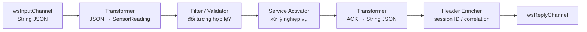
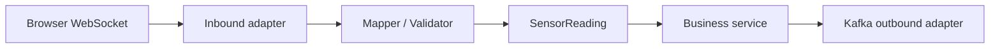
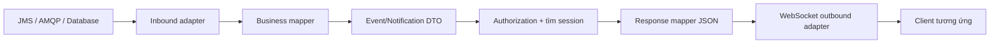

# WebSocket message mapper

## 1. Bối cảnh và mục tiêu

Trong module **SPRING_INTEGRATION_ADAPTERS**, các hệ thống bên ngoài được nối vào Spring Integration qua inbound/outbound adapter, gateway, poller và `MessageChannel`. Khi dữ liệu từ WebSocket đi vào một luồng tích hợp, ứng dụng phải biến frame của giao thức mạng thành thông điệp có thể xử lý. Ở chiều ngược lại, dữ liệu nghiệp vụ phải được ánh xạ thành nội dung mà WebSocket client hiểu được.

Bài **WebSocket message mapper**, thuộc chương **Adapter WebSocket**, giải thích các bước chuyển đổi đó. Một ví dụ điển hình là trình duyệt gửi JSON chứa số đo cảm biến; Spring Integration nhận frame, đọc JSON thành đối tượng nghiệp vụ, xử lý và gửi một JSON ACK về đúng WebSocket session.

Sau bài học, bạn có thể:

- Phân biệt **WebSocket frame**, Spring `Message<?>` và **đối tượng nghiệp vụ**.
- Giải thích vai trò của `SubProtocolHandler`, `PassThruSubProtocolHandler` và Spring `MessageConverter` trong quá trình chuyển đổi.
- Ánh xạ payload JSON hợp lệ, kiểm tra kiểu dữ liệu và xây dựng thông điệp phản hồi.
- Giữ những header có ý nghĩa như `simpSessionId` khi chuyển đổi qua nhiều bước của Integration Flow.
- Phân biệt raw WebSocket với STOMP, text frame với binary frame và lỗi mapping với lỗi truyền tải.
- Thiết kế kiểm thử, xử lý lỗi, giới hạn kích thước và tương thích phiên bản của hợp đồng message.

**Phạm vi:** Spring Integration không yêu cầu một lớp có tên cố định `WebSocketMessageMapper` để làm toàn bộ công việc. Trong thực tế, “message mapper” là **trách nhiệm chuyển đổi** được phân bổ giữa sub-protocol handler, message converter và transformer/service nghiệp vụ do bạn xây dựng.

## 2. Ba lớp dữ liệu cần phân biệt

### 2.1. WebSocket frame ở tầng giao tiếp

Ở Spring WebSocket, dữ liệu đi trên kết nối có thể được thể hiện bằng:

- `TextMessage`: nội dung text, thường là chuỗi JSON hoặc text giao thức.
- `BinaryMessage`: nội dung dạng nhị phân; cần biết encoding/schema để diễn giải.
- `PingMessage` và `PongMessage`: frame điều khiển kết nối, không phải hợp đồng sự kiện nghiệp vụ.
- Close frame: tín hiệu kết thúc kết nối; thuộc vòng đời session.

Client có thể gửi JSON như:

```json
{
  "type": "sensor.reading",
  "eventId": "evt-104",
  "deviceId": "sensor-07",
  "temperature": 27.4
}
```

Tại tầng WebSocket, đây chỉ là **text frame**; Java/Spring chưa tự biết `type` có ý nghĩa gì, `eventId` có bắt buộc không hoặc `temperature` phải là số.

### 2.2. Spring Message ở tầng tích hợp

Sau khi adapter nhận frame, message được đưa vào hệ thống Spring Messaging:

```java
org.springframework.messaging.Message<?>
```

Một Spring Message gồm hai phần:

| Phần | Ý nghĩa | Ví dụ |
| --- | --- | --- |
| `payload` | Dữ liệu do message mang | Chuỗi JSON, `byte[]` hoặc đối tượng Java |
| `headers` | Metadata phục vụ định tuyến/xử lý | `simpSessionId`, `contentType`, các header theo sub-protocol |
| `MessageHeaders.ID` | ID của **Spring Message** | Dùng để theo dõi message; không phải WebSocket connection ID |
| Header ứng dụng | Metadata do flow tự tạo | `eventId`, `schemaVersion`, `tenantId`, correlation ID |

Đừng nhầm **WebSocket session ID** với **Spring Message ID**. Với raw WebSocket phía server, header `simpSessionId` cho phép outbound adapter tìm đúng `WebSocketSession` nhận phản hồi.

Không phải mọi header của Spring Message đều nằm trên wire. Chẳng hạn, gắn `contentType=application/json` vào Spring Message **không có nghĩa** raw WebSocket client sẽ nhận một HTTP `Content-Type` header mới. Sau HTTP Upgrade, hai phía trao đổi WebSocket frame theo giao thức đã thống nhất.

### 2.3. Đối tượng nghiệp vụ ở tầng ứng dụng

Sau bước parse/validate, ứng dụng có thể dùng kiểu dữ liệu rõ ràng:

```java
public record SensorReading(
        String type,
        String eventId,
        String deviceId,
        double temperature) {
}
```

Đây là **domain object**, không phải frame mạng hay một message của Spring. Nó giúp phần lưu DB, tính cảnh báo, gọi HTTP gateway hoặc đẩy Kafka/JMS tránh phụ thuộc vào định dạng JSON ban đầu.

### Sơ đồ ánh xạ hai chiều

```mermaid
flowchart LR
    A["WebSocket TextMessage<br/>chuỗi JSON"] --> B["SubProtocolHandler<br/>đưa vào Spring Message"]
    B --> C["Inbound Channel Adapter<br/>MessageChannel"]
    C --> D["Payload mapper<br/>parse + validate JSON"]
    D --> E["SensorReading<br/>đối tượng nghiệp vụ"]
    E --> F["Service nghiệp vụ<br/>xử lý / lưu / phát sự kiện"]
    F --> G["Response mapper<br/>tạo JSON"]
    G --> H["Spring Message<br/>payload + simpSessionId"]
    H --> I["Outbound Channel Adapter<br/>SubProtocolHandler"]
    I --> J["WebSocket TextMessage<br/>gửi về client"]
```



Điểm phân chia trách nhiệm rất quan trọng: **adapter và sub-protocol handler** xử lý giao tiếp; **mapper/validator nghiệp vụ** kiểm tra hợp đồng dữ liệu; **service** quyết định tác động nghiệp vụ.

## 3. Ai thực hiện việc mapping trong Spring Integration?

### 3.1. SubProtocolHandler: từ frame thành message và ngược lại

`WebSocketInboundChannelAdapter` nhận `WebSocketMessage<?>` qua `WebSocketListener` rồi nhờ `SubProtocolHandlerRegistry` chọn `SubProtocolHandler` tương ứng với sub-protocol đã thương lượng.

Ở chiều outbound, `WebSocketOutboundMessageHandler` nhận Spring Message từ channel, xác định WebSocket session cần gửi và cũng ủy quyền cho `SubProtocolHandler` thích hợp.

| Thành phần | Trách nhiệm |
| --- | --- |
| `WebSocketInboundChannelAdapter` | Tiếp nhận frame và đưa Spring Message vào flow |
| `WebSocketOutboundMessageHandler` | Tiêu thụ Spring Message và gửi ra WebSocket |
| `SubProtocolHandlerRegistry` | Tra/chọn sub-protocol handler cho session |
| `PassThruSubProtocolHandler` | Chuyển đổi cơ bản giữa WebSocket Message và Spring Message khi không dùng sub-protocol riêng |
| `StompSubProtocolHandler` | Diễn giải các frame/command STOMP và header STOMP |
| `MessageConverter` | Hỗ trợ chuyển đổi payload khi các handler cần kiểu Java/format khác |
| `Transformer` / service ứng dụng | Thực hiện mapping nghiệp vụ, validation, enrichment và xử lý dữ liệu |

Với **raw WebSocket**, Spring Integration mặc định dùng `PassThruSubProtocolHandler`. Khi làm việc với **STOMP**, cần cấu hình handler cho STOMP; chuỗi JSON gửi qua `WebSocket.send(...)` không tự động biến thành STOMP `SEND` frame.

### 3.2. MessageConverter: chuyển kiểu payload

Tùy phiên bản Spring Integration và cấu hình, các converter mặc định liên quan gồm:

| Converter | Dữ liệu thường xử lý | Lưu ý |
| --- | --- | --- |
| `StringMessageConverter` | Chuỗi ký tự | Phù hợp payload text |
| `ByteArrayMessageConverter` | Mảng byte | Không tự biết schema nhị phân |
| `MappingJackson2MessageConverter` | JSON ↔ đối tượng Java | Hoạt động khi Jackson có trên classpath và điều kiện chuyển đổi phù hợp |

Thứ tự converter có thể ảnh hưởng việc chọn cách xử lý dữ liệu. Trong cấu hình WebSocket adapter, bạn có thể dùng các API:

```java
adapter.setPayloadType(String.class); // Ví dụ inbound: kiểu payload đích
adapter.setMessageConverters(customConverters);
adapter.setMergeWithDefaultConverters(true);
```

Các dòng trên mô tả **những lựa chọn cấu hình**, không phải một đoạn code độc lập: `customConverters` phải là `List<MessageConverter>` đã được khai báo. `setPayloadType(...)` thuộc inbound adapter, còn `setMessageConverters(...)` và `setMergeWithDefaultConverters(...)` cũng được outbound handler hỗ trợ.

**Phân biệt hai cờ:**

- `payloadType` yêu cầu kiểu payload đầu ra của quá trình chuyển đổi **inbound**, mặc định là `String` trong cấu hình thường gặp.
- `mergeWithDefaultConverters` chỉ có ý nghĩa khi bạn đăng ký converter tùy chỉnh. Nếu `false`, danh sách tùy chỉnh thay thế danh sách mặc định; nếu `true`, các converter mặc định được bổ sung theo quy tắc của adapter.

Chỉ gọi `setPayloadType(SensorReading.class)` chưa đủ để bảo đảm mọi text frame sẽ được parse thành record. Kết quả còn phụ thuộc message converter, kiểu payload nguồn, content-type và sub-protocol. Vì vậy, trong ví dụ thực hành bên dưới ta **nhận String rồi parse bằng Jackson trong mapper do ứng dụng kiểm soát**; cách này tường minh và dễ kiểm thử.

### 3.3. Mapping không đồng nghĩa với serialization

- **Serialization:** biến đối tượng thành chuỗi/byte, ví dụ `SensorReading → JSON`.
- **Deserialization:** biến chuỗi/byte thành đối tượng, ví dụ `JSON → JsonNode`.
- **Validation:** xác định dữ liệu có đúng hợp đồng, kiểu trường, giới hạn và quyền hay không.
- **Header mapping/enrichment:** giữ/thêm `simpSessionId`, `eventId`, `contentType` hoặc correlation ID theo nhu cầu.
- **Routing:** đưa message đến consumer/đích nhận tương ứng.

Một mapper đủ tốt cần xác định **đâu là dữ liệu đáng tin cậy, đầu ra có cấu trúc gì và thông tin nào được phép mang sang bước sau**.

## 4. Thiết kế hợp đồng JSON trước khi viết mã

Đầu vào của ví dụ:

```json
{
  "type": "sensor.reading",
  "eventId": "evt-104",
  "deviceId": "sensor-07",
  "temperature": 27.4
}
```

Đầu ra phản hồi:

```json
{
  "type": "sensor.ack",
  "eventId": "evt-104",
  "status": "ACCEPTED"
}
```

Bảng quy tắc:

| Trường | Kiểu | Quy tắc |
| --- | --- | --- |
| `type` | String | Bắt buộc đúng `sensor.reading` |
| `eventId` | String | Không rỗng; dùng để liên hệ ACK, kiểm soát trùng lặp |
| `deviceId` | String | Không rỗng; chỉ là thông tin do client khai báo |
| `temperature` | JSON number | Bắt buộc là số; có thể thêm giới hạn miền giá trị theo nghiệp vụ |
| `schemaVersion` | String (tùy chọn) | Nên có khi nhiều client dùng các phiên bản hợp đồng khác nhau |

**Không coi `deviceId` là danh tính đã xác thực.** Client có thể sửa JSON gửi đi. Việc kiểm tra người gửi được phép khai báo `deviceId` nào phải dựa vào principal/token/metadata xác thực của session.

Nên quyết định thêm chính sách đối với trường dư, unknown `type`, dữ liệu quá lớn, ký tự Unicode, ngày giờ/timezone, đơn vị đo và duplicate `eventId`. Không để quy tắc quan trọng chỉ tồn tại ngầm trong code.

## 5. Ví dụ hoàn chỉnh: text frame → record → JSON ACK

Ví dụ sử dụng **Java 17+, Spring Boot 3.x, Spring Integration 6.x** trên Servlet WebSocket server. Phần nhận dùng raw WebSocket; không cần broker STOMP.

### 5.1. Dependency Maven

```xml
<dependencies>
    <dependency>
        <groupId>org.springframework.boot</groupId>
        <artifactId>spring-boot-starter-web</artifactId>
    </dependency>
    <dependency>
        <groupId>org.springframework.boot</groupId>
        <artifactId>spring-boot-starter-integration</artifactId>
    </dependency>
    <dependency>
        <groupId>org.springframework.integration</groupId>
        <artifactId>spring-integration-websocket</artifactId>
    </dependency>
</dependencies>
```

Spring Boot quản lý phiên bản phụ thuộc thông qua BOM tương thích. `spring-boot-starter-web` cung cấp nền tảng Spring MVC/WebSocket phía server; `spring-integration-websocket` cung cấp adapter và container.

### 5.2. Định nghĩa DTO

File `SensorReading.java`:

```java
package com.example.websocket;

public record SensorReading(
        String type,
        String eventId,
        String deviceId,
        double temperature) {
}
```

DTO không phụ thuộc Spring Integration. Điều này giúp viết test cho logic mapping và sử dụng lại record trong các bước gửi Kafka, JMS hoặc lưu cơ sở dữ liệu.

### 5.3. Viết mapper tường minh

File `TelemetryPayloadMapper.java`:

```java
package com.example.websocket;

import com.fasterxml.jackson.core.JsonProcessingException;
import com.fasterxml.jackson.databind.JsonNode;
import com.fasterxml.jackson.databind.ObjectMapper;
import com.fasterxml.jackson.databind.node.ObjectNode;
import org.springframework.stereotype.Component;

@Component
public class TelemetryPayloadMapper {

    private final ObjectMapper objectMapper;

    public TelemetryPayloadMapper(ObjectMapper objectMapper) {
        this.objectMapper = objectMapper;
    }

    public SensorReading fromText(String text) {
        final JsonNode root;
        try {
            root = objectMapper.readTree(text);
        } catch (JsonProcessingException exception) {
            throw new IllegalArgumentException(
                    "WebSocket payload không phải JSON hợp lệ", exception);
        }

        if (root == null || !root.isObject()) {
            throw new IllegalArgumentException(
                    "Payload phải là một JSON object");
        }

        String type = requiredText(root, "type");
        String eventId = requiredText(root, "eventId");
        String deviceId = requiredText(root, "deviceId");
        JsonNode temperature = root.get("temperature");

        if (!"sensor.reading".equals(type)) {
            throw new IllegalArgumentException("Loại sự kiện không hỗ trợ");
        }

        if (temperature == null || !temperature.isNumber()) {
            throw new IllegalArgumentException(
                    "temperature phải là JSON number");
        }

        double numericValue = temperature.doubleValue();
        if (!Double.isFinite(numericValue)) {
            throw new IllegalArgumentException(
                    "temperature không được vô hạn hoặc NaN");
        }

        return new SensorReading(
                type, eventId, deviceId, numericValue);
    }

    public String toAcceptedAck(SensorReading event) {
        ObjectNode reply = objectMapper.createObjectNode();
        reply.put("type", "sensor.ack");
        reply.put("eventId", event.eventId());
        reply.put("status", "ACCEPTED");
        return reply.toString();
    }

    private static String requiredText(JsonNode root, String name) {
        JsonNode node = root.get(name);
        if (node == null || !node.isTextual()) {
            throw new IllegalArgumentException(
                    name + " phải là chuỗi");
        }

        String value = node.textValue();
        if (value.isBlank()) {
            throw new IllegalArgumentException(
                    name + " không được rỗng");
        }

        return value;
    }
}
```

Mapper trên cố ý dùng `JsonNode` để **kiểm tra chính xác kiểu JSON** trước khi dựng record. Nếu gọi trực tiếp `ObjectMapper.readValue(text, SensorReading.class)` mà không cấu hình chặt, Jackson có thể áp dụng một số quy tắc chuyển kiểu tự động. Với hợp đồng nghiêm ngặt, cần kiểm soát quy tắc coercion, trường thiếu, giá trị `null` và trường không biết.

Mapper nên báo lỗi bằng exception rõ nghĩa hoặc mô hình kết quả có cấu trúc; business flow sẽ quyết định ghi log, đưa vào error channel hay gửi lỗi hợp lệ cho client. **Không trả ACK `ACCEPTED` khi validation thất bại.**

### 5.4. Cấu hình adapter và channel

File `WebSocketMappingConfiguration.java`:

```java
package com.example.websocket;

import org.springframework.beans.factory.annotation.Qualifier;
import org.springframework.context.annotation.Bean;
import org.springframework.context.annotation.Configuration;
import org.springframework.integration.annotation.ServiceActivator;
import org.springframework.integration.channel.DirectChannel;
import org.springframework.integration.config.EnableIntegration;
import org.springframework.integration.websocket.ServerWebSocketContainer;
import org.springframework.integration.websocket.inbound.WebSocketInboundChannelAdapter;
import org.springframework.integration.websocket.outbound.WebSocketOutboundMessageHandler;
import org.springframework.messaging.MessageChannel;
import org.springframework.messaging.MessageHandler;
import org.springframework.messaging.MessagingException;
import org.springframework.messaging.simp.SimpMessageHeaderAccessor;
import org.springframework.messaging.support.MessageBuilder;

@Configuration
@EnableIntegration
public class WebSocketMappingConfiguration {

    @Bean
    public ServerWebSocketContainer wsServerContainer() {
        return new ServerWebSocketContainer("/ws/telemetry");
    }

    @Bean
    public MessageChannel wsInputChannel() {
        return new DirectChannel();
    }

    @Bean
    public MessageChannel wsReplyChannel() {
        return new DirectChannel();
    }

    @Bean
    public WebSocketInboundChannelAdapter inboundWebSocket(
            ServerWebSocketContainer wsServerContainer,
            @Qualifier("wsInputChannel") MessageChannel channel) {

        WebSocketInboundChannelAdapter adapter =
                new WebSocketInboundChannelAdapter(wsServerContainer);

        adapter.setPayloadType(String.class);
        adapter.setOutputChannel(channel);
        return adapter;
    }

    @Bean
    @ServiceActivator(inputChannel = "wsInputChannel")
    public MessageHandler mapValidateAndReply(
            TelemetryPayloadMapper payloadMapper,
            @Qualifier("wsReplyChannel") MessageChannel replies) {

        return incoming -> {
            if (!(incoming.getPayload() instanceof String rawText)) {
                throw new MessagingException(
                        incoming, "Yêu cầu text frame");
            }

            String sessionId = SimpMessageHeaderAccessor
                    .getSessionId(incoming.getHeaders());

            if (sessionId == null || sessionId.isBlank()) {
                throw new MessagingException(
                        incoming, "Không tìm thấy WebSocket session");
            }

            final SensorReading event;
            try {
                event = payloadMapper.fromText(rawText);
            } catch (IllegalArgumentException exception) {
                throw new MessagingException(
                        incoming, "Dữ liệu telemetry không hợp lệ", exception);
            }

            // Demo: đây là nơi gọi service nghiệp vụ,
            // kiểm tra quyền và/hoặc lưu dữ liệu.
            System.out.printf(
                    "eventId=%s deviceId=%s temp=%.1f%n",
                    event.eventId(), event.deviceId(), event.temperature());

            String ackJson = payloadMapper.toAcceptedAck(event);

            boolean accepted = replies.send(
                    MessageBuilder.withPayload(ackJson)
                            .setHeader(
                                    SimpMessageHeaderAccessor.SESSION_ID_HEADER,
                                    sessionId)
                            .build());

            if (!accepted) {
                throw new MessagingException(
                        incoming, "Reply channel không chấp nhận ACK");
            }
        };
    }

    @Bean
    @ServiceActivator(inputChannel = "wsReplyChannel")
    public MessageHandler outboundWebSocket(
            ServerWebSocketContainer wsServerContainer) {

        return new WebSocketOutboundMessageHandler(wsServerContainer);
    }
}
```

**Giải thích flow:**

1. `ServerWebSocketContainer("/ws/telemetry")` đăng ký WebSocket endpoint và quản lý session.
2. `WebSocketInboundChannelAdapter` tiếp nhận frame; `PassThruSubProtocolHandler` được dùng mặc định cho raw WebSocket.
3. Adapter phát Spring Message vào `wsInputChannel` với payload kiểu `String`.
4. Handler gọi `TelemetryPayloadMapper.fromText(...)` để parse/validate và tạo `SensorReading`.
5. Handler tạo JSON ACK, **giữ `simpSessionId`** và gửi vào `wsReplyChannel`.
6. `WebSocketOutboundMessageHandler` dùng cùng container để gửi frame về đúng session.

ACK trong ví dụ thể hiện **message đã qua bước kiểm tra và handler minh họa**. Nếu muốn `ACCEPTED` có nghĩa “đã lưu DB/đẩy Kafka thành công”, phải hoàn thành việc nghiệp vụ tương ứng trước khi tạo ACK và định nghĩa rõ transaction/error semantics.

**Vì sao không dùng poller?** WebSocket inbound nhận frame theo sự kiện; outbound tiêu thụ message được đẩy vào channel. Poller chỉ thuộc nguồn khác nếu flow lấy dữ liệu từ một nguồn phải quét theo lịch, ví dụ file hoặc bảng DB.

### 5.5. Thử với WebSocket client trong trình duyệt

Chạy Spring Boot ở cổng `8080`. Mở trang cùng origin với ứng dụng (hoặc môi trường được server cho phép origin WebSocket) và chạy JavaScript:

```javascript
const socket = new WebSocket("ws://localhost:8080/ws/telemetry");

socket.addEventListener("open", () => {
  socket.send(JSON.stringify({
    type: "sensor.reading",
    eventId: "evt-104",
    deviceId: "sensor-07",
    temperature: 27.4
  }));
});

socket.addEventListener("message", (event) => {
  const response = JSON.parse(event.data);
  console.log("ACK:", response);
});

socket.addEventListener("error", (event) => {
  console.error("WebSocket error:", event);
});

socket.addEventListener("close", (event) => {
  console.log("Closed:", event.code);
});
```

Kết quả kỳ vọng khi thành công:

```text
ACK: {type: 'sensor.ack', eventId: 'evt-104', status: 'ACCEPTED'}
```

Bây giờ gửi dữ liệu sai sau khi socket đã mở:

```javascript
socket.send("{invalid-json}");
socket.send(JSON.stringify({
  type: "sensor.reading",
  eventId: "evt-bad",
  deviceId: "sensor-07",
  temperature: "27.4"
}));
```

Trường hợp thứ nhất sai cú pháp JSON; trường hợp thứ hai dùng **chuỗi** cho `temperature` thay vì JSON number. Mapper phải từ chối cả hai. Kết quả lỗi sẽ phụ thuộc cấu hình Spring Integration error handling; **đừng mặc định có JSON error frame hoặc kết nối sẽ bị đóng** khi handler ném exception.

### 5.6. Kiểm tra bảo toàn session ID

Mở hai tab trình duyệt. Tab A gửi `evt-A`, tab B gửi `evt-B`. Cả hai đều nhận ACK có `eventId` tương ứng. Nếu bạn bỏ:

```java
.setHeader(SimpMessageHeaderAccessor.SESSION_ID_HEADER, sessionId)
```

ở bước tạo Spring Message outbound, server có thể không xác định được session đích, làm phản hồi thất bại. Đây là lỗi **header mapping/định tuyến**, tách biệt với lỗi parse JSON.

Khi một transformer tạo message mới, hãy bảo đảm giữ lại đúng những header cần thiết. `MessageBuilder.fromMessage(incoming)` có thể là cách khởi đầu để bảo toàn headers; tuy nhiên trong luồng bảo mật nhạy cảm nên **chọn lọc** header được phép mang sang outbound để tránh lan truyền metadata không mong muốn.

## 6. Message mapper trong các cách cấu hình khác nhau

### 6.1. Mapping tường minh bằng transformer

Thay vì đặt mapper bên trong một `MessageHandler`, bạn có thể thiết kế các bước rõ ràng:



Cách này phù hợp khi logic ánh xạ cần dùng lại giữa các adapter: file JSON inbound, HTTP JSON payload, JMS text message hoặc Kafka event cũng có thể đưa về `SensorReading` và xử lý bằng cùng service. Chú ý rằng một số transformer của Spring Integration giữ headers, nhưng **không được giả định mọi kiểu biến đổi hoặc tự dựng Message đều giữ toàn bộ header**; hãy kiểm tra bằng test.

### 6.2. Tự cấu hình MessageConverter

Khi phần lớn flow cần một kiểu Java cố định và converter hoạt động ổn định với sub-protocol đã chọn, bạn có thể cân nhắc cấu hình inbound adapter như sau:

```java
// Đoạn cấu hình minh họa, đặt trong bean factory thích hợp.
WebSocketInboundChannelAdapter adapter =
        new WebSocketInboundChannelAdapter(serverContainer);

adapter.setPayloadType(SensorReading.class);
adapter.setMessageConverters(
        java.util.List.of(
                new org.springframework.messaging.converter.MappingJackson2MessageConverter()
        ));
adapter.setMergeWithDefaultConverters(true);
adapter.setOutputChannel(inputChannel);
```

Cần bảo đảm `serverContainer`, `inputChannel` đã tồn tại. Ví dụ là **một lựa chọn API**, không có nghĩa mọi ứng dụng raw WebSocket tự chuyển JSON text thành record trong mọi điều kiện. Hãy kiểm tra content type, source payload và khả năng converter hỗ trợ theo đúng phiên bản Spring đang chạy. Nếu mục tiêu là validation chi tiết cùng thông báo lỗi có mã, mapper tường minh thường dễ kiểm soát hơn.

Ở XML namespace, có thể khai báo các thuộc tính `payload-type`, `message-converters` và `merge-with-default-converters` cho inbound adapter tương ứng, cùng các cấu hình sub-protocol và channel cần thiết. Phần outbound cũng hỗ trợ danh sách converter nhưng không có cùng ý nghĩa `payloadType` của inbound.

### 6.3. STOMP: mapping có thêm tầng command và destination

STOMP hoạt động trên WebSocket nhưng có định dạng khác:

```text
SEND
destination:/app/sensors
content-type:application/json

{"type":"sensor.reading","eventId":"evt-104","deviceId":"sensor-07","temperature":27.4}\0
```

*Lưu ý:* ký hiệu `\0` trong ví dụ biểu diễn byte NUL kết thúc STOMP frame; đây không phải hai ký tự `\` và `0` được gửi theo chuỗi.

Với STOMP, `StompSubProtocolHandler` giải mã command/header STOMP thành cấu trúc Spring Messaging, rồi mới đến phần mapper nghiệp vụ. Các header như `simpMessageType`, `simpDestination`, `simpSessionId` và `simpSubscriptionId` có ngữ nghĩa của tầng STOMP/Spring Messaging.

`WebSocketInboundChannelAdapter` chỉ đẩy vào integration flow các Spring Message có `simpMessageType = MESSAGE` hoặc header kiểu này không có giá trị. Những message STOMP thuộc loại khác có thể được xử lý qua application events/broker tùy cấu hình. Chỉ thêm Jackson converter không đủ để biến raw endpoint thành một STOMP broker.

### 6.4. Text và binary không tương đương

Với text frame, mapper phải biết charset và schema. Với JSON, hai phía thường thống nhất UTF-8 theo giao thức JSON. Với binary frame, payload có thể là protobuf, Avro hoặc định dạng nhị phân riêng; khi đó cần decoder tương ứng.

Ví dụ một hợp đồng nhị phân có thể quy định:

```text
Bytes 0..1  : schema version (uint16)
Bytes 2..5  : device ID (uint32)
Bytes 6..13 : timestamp (int64)
Bytes 14..  : payload đã mã hóa theo schema
```

Đây là **hợp đồng ứng dụng minh họa**, không phải một cấu trúc chuẩn do Spring WebSocket cung cấp. Không đọc tùy ý `byte[]` bằng `new String(bytes)` nếu protocol thực tế không định nghĩa chúng là text.

## 7. Header mapping, session, correlation và versioning

### 7.1. Session header là thông tin giao tiếp đáng tin cậy hơn trường JSON

Khi phản hồi từ **server WebSocket**, outbound cần biết phiên đích. Raw WebSocket thường dùng:

```java
SimpMessageHeaderAccessor.SESSION_ID_HEADER // "simpSessionId"
```

Bản thân client có thể gửi một JSON với trường `"sessionId":"victim-session"`. Không bao giờ dùng trường đó trực tiếp làm đích gửi thông tin riêng tư. Hãy lấy ID từ message headers do hạ tầng WebSocket/adapter gắn vào, kết hợp kiểm tra quyền với principal/registry phiên ở server.

Ở **client-side outbound adapter**, `ClientWebSocketContainer` chỉ có một connection, nên header session ID không bắt buộc để định tuyến.

### 7.2. Correlation ID khác session ID

| ID | Ý nghĩa |
| --- | --- |
| `simpSessionId` | Định danh một kết nối WebSocket hiện tại |
| `eventId` | Định danh một sự kiện nghiệp vụ, có thể tồn tại qua reconnect |
| `correlationId` | Liên kết request và response/ACK |
| `MessageHeaders.ID` | Định danh mỗi Spring Message |
| `userId` | Danh tính nghiệp vụ/xác thực; một user có thể có nhiều session |

Trong ví dụ, `eventId` xuất hiện trong JSON đầu vào và ACK, giúp client biết ACK thuộc sự kiện nào. Nếu yêu cầu **không xử lý trùng**, hệ thống cần lưu hoặc kiểm tra `eventId`, không chỉ tin ACK có cùng giá trị.

### 7.3. Versioning cho message mapper

Khi có nhiều client, schema cần tiến hóa có kiểm soát. Ví dụ phiên bản mới thêm `unit`:

```json
{
  "schemaVersion": "2",
  "type": "sensor.reading",
  "eventId": "evt-200",
  "deviceId": "sensor-07",
  "temperature": 27.4,
  "unit": "C"
}
```

Một số cách:

1. Gắn `schemaVersion` trong payload và chọn mapper theo phiên bản.
2. Chỉ thêm field tùy chọn, giữ khả năng tương thích theo chiều đã cam kết.
3. Với breaking change, dùng version mới hoặc endpoint/sub-protocol riêng.
4. Dùng contract tests giữa server và client để phát hiện sai khác trước khi triển khai.

Không để Java DTO tự thay đổi ý nghĩa của một field mà không cập nhật hợp đồng; ví dụ `temperature=27.4` từ độ C sang độ F là **breaking change về ngữ nghĩa** dù JSON vẫn parse thành công.

## 8. Xử lý lỗi mapping và lỗi truyền tải

### 8.1. Nhóm lỗi và nơi xử lý

| Loại lỗi | Ví dụ | Nơi xử lý nên có |
| --- | --- | --- |
| Sai frame/encoding | Gửi binary nhưng flow chỉ nhận text | Tầng giao tiếp / kiểm tra kiểu payload |
| JSON sai cú pháp | `{invalid-json}` | Mapper, error channel hoặc handler lỗi |
| Sai kiểu / thiếu trường | `temperature: "27.4"`, thiếu `eventId` | Validator/mapper nghiệp vụ |
| Không hỗ trợ event type | `type: "unknown.event"` | Router/filter/mapper theo hợp đồng |
| Vi phạm quyền | Client giả `deviceId` không thuộc quyền | Authorization ở server |
| Thiếu header phiên | Outbound message không có `simpSessionId` | Header enricher/routing |
| Session đã đóng | Reconnect tạo session mới | Session lifecycle/retry/fallback |
| Không encode được outbound | POJO không converter phù hợp | Response mapper / converter |
| Downstream lỗi | DB/Kafka/JMS không sẵn sàng | Flow nghiệp vụ, retry/DLQ theo adapter |

**Hai nguyên tắc:**

- **Error channel** là cơ chế xử lý lỗi *bên trong Spring Integration*, không tự gửi JSON error về trình duyệt.
- Nếu muốn phản hồi một lỗi nghiệp vụ cho client, hãy thiết kế rõ **error code, correlation ID, session ID đích và outbound flow**, đồng thời tránh trả về exception detail/stack trace nhạy cảm.

### 8.2. Hợp đồng JSON lỗi

Một ví dụ dễ dùng:

```json
{
  "type": "sensor.error",
  "eventId": "evt-104",
  "code": "INVALID_PAYLOAD",
  "message": "temperature must be a number"
}
```

Với lỗi JSON sai cú pháp, có thể **không trích xuất được `eventId`**. Khi đó lựa chọn phổ biến là trả `eventId: null` hoặc một server-generated request ID và ghi nhận trace tương ứng, tùy hợp đồng. Không tự bịa eventId từ session ID.

Nếu muốn dùng retry, hãy phân biệt **lỗi dữ liệu không thể sửa chỉ bằng retry** với **lỗi tạm thời của downstream**. Retry vô hạn một JSON sai schema chỉ làm tăng tải và gây lặp log.

### 8.3. Giới hạn tài nguyên

Một message mapper có thể bị tấn công bằng JSON rất lớn, JSON lồng sâu, payload có số lượng field bất thường hoặc dữ liệu tạo ra nhiều đối tượng Java. Vì vậy:

- Giới hạn kích thước WebSocket frame/message ở transport/container.
- Giới hạn độ sâu parse và kích thước các trường trong JSON parser nếu có thể.
- Cấu hình timeout, số lượng connection và tốc độ gửi/nhận phù hợp.
- Kiểm tra số lượng event và tần suất từ từng principal/session.
- Tránh log toàn bộ payload, token hoặc thông tin nhạy cảm.
- Quan sát lỗi parse/validation, thời gian mapper, tỉ lệ ACK và số session lỗi.

Mapper cần có tài nguyên hợp lý; với dữ liệu lớn hoặc cần giải mã nặng, cân nhắc tách việc xử lý khỏi luồng nhận frame và giới hạn concurrency để tránh quá tải.

## 9. Kiểm thử message mapper có ý nghĩa

### 9.1. Unit test: kiểm tra hợp đồng trước

`TelemetryPayloadMapper` được thiết kế không phụ thuộc WebSocketSession nên có thể kiểm thử trực tiếp:

```java
package com.example.websocket;

import com.fasterxml.jackson.databind.ObjectMapper;
import org.junit.jupiter.api.Test;

import static org.junit.jupiter.api.Assertions.*;

class TelemetryPayloadMapperTest {

    private final TelemetryPayloadMapper mapper =
            new TelemetryPayloadMapper(new ObjectMapper());

    @Test
    void shouldMapValidReading() {
        SensorReading event = mapper.fromText("""
                {
                  "type": "sensor.reading",
                  "eventId": "evt-104",
                  "deviceId": "sensor-07",
                  "temperature": 27.4
                }
                """);

        assertEquals("evt-104", event.eventId());
        assertEquals("sensor-07", event.deviceId());
        assertEquals(27.4, event.temperature(), 0.001);
    }

    @Test
    void shouldRejectWrongTemperatureType() {
        String json = """
                {
                  "type": "sensor.reading",
                  "eventId": "evt-105",
                  "deviceId": "sensor-07",
                  "temperature": "27.4"
                }
                """;

        assertThrows(IllegalArgumentException.class,
                () -> mapper.fromText(json));
    }

    @Test
    void shouldCreateCorrelatedAck() throws Exception {
        SensorReading event = new SensorReading(
                "sensor.reading", "evt-104", "sensor-07", 27.4);

        var ack = new ObjectMapper().readTree(
                mapper.toAcceptedAck(event));

        assertEquals("sensor.ack", ack.path("type").asText());
        assertEquals("evt-104", ack.path("eventId").asText());
        assertEquals("ACCEPTED", ack.path("status").asText());
    }
}
```

Đoạn test cần JUnit 5, thường đã có qua `spring-boot-starter-test` trong dự án Boot. Nếu chưa có, bổ sung dependency kiểm thử tương ứng trước khi chạy.

### 9.2. Integration test: kiểm tra transport và headers

Unit test mapper không bảo đảm cấu hình adapter đúng. Cần thử riêng luồng WebSocket từ client thực:

1. Kết nối vào `ws://localhost:8080/ws/telemetry`, gửi JSON hợp lệ, nhận ACK có `eventId` tương ứng.
2. Gửi malformed JSON, missing field và sai kiểu dữ liệu; xác nhận chúng **không** đi đến service nghiệp vụ.
3. Mở hai tab/client, gửi hai `eventId` khác nhau; mỗi tab chỉ nhận ACK của chính mình.
4. Đóng và reconnect một session; không gửi nhầm vào ID cũ.
5. Gửi text/binary không khớp hợp đồng; đo lỗi converter/validation và chính sách đóng kết nối.
6. Thử payload vượt giới hạn, session thiếu quyền và downstream đang lỗi.
7. Kiểm tra `contentType`/headers thực sự cần thiết theo cấu hình sub-protocol đang chạy.

Đặc biệt, với custom `MessageConverter`, cần một test từ **frame thực → inbound payload type → outbound frame thực**. Việc code compile chỉ cho biết API hợp lệ, không chứng minh converter đã được chọn đúng.

## 10. Tình huống tích hợp thực tế

### 10.1. WebSocket → domain event → Kafka



Trách nhiệm của mapper là biến JSON thành đối tượng ổn định. Thông tin `simpSessionId` chỉ có ý nghĩa nếu cần ACK về kết nối hiện tại; nó không nên là khóa Kafka, khóa lưu DB hay danh tính nghiệp vụ mặc định. Nên dùng `eventId`, `deviceId` và khóa phân vùng có chủ đích.

### 10.2. JMS/AMQP/DB → domain event → WebSocket



Ở chiều này, message không xuất phát từ WebSocket nên **không có `simpSessionId` sẵn**. Ứng dụng phải xác định user nhận, quyền truy cập và session còn sống, sau đó tạo Spring Message outbound có header phiên phù hợp. Trong hệ thống nhiều node, phải route thông báo đến node sở hữu WebSocket session hoặc dùng broker.

### 10.3. Các quyết định về delivery

WebSocket **không tự cung cấp** business ACK, retry/replay qua reconnect hay exactly-once delivery. Một ACK JSON do server tự tạo chỉ chứng minh điều mà hợp đồng đã quy định (ví dụ “đã parse”, “đã chấp nhận”, “đã lưu”). Nếu client cần xác nhận đã **nhận và xử lý** notification, phải có chiều thông điệp ACK ngược và correlation ID; nếu hệ thống cần replay, nên lưu trạng thái sự kiện chưa xác nhận ngoài WebSocket session.

## 11. Bài tập thực hành

**Bài A — nhận JSON nghiêm ngặt.** Mở rộng `TelemetryPayloadMapper` để kiểm tra `schemaVersion` và `timestamp` ở định dạng ISO-8601. Định nghĩa cách từ chối trường không biết hoặc kiểu dữ liệu sai, và viết unit test cho mỗi tình huống.

**Bài B — header mapping.** Chèn thêm một transformer tạo message mới giữa `mapValidateAndReply` và `wsReplyChannel`. Thử giữ và bỏ `simpSessionId`. Quan sát kết quả với hai tab trình duyệt và giải thích vì sao header session không nên lấy từ payload client.

**Bài C — error reply.** Thiết kế `sensor.error` có `code`, `message` và `eventId` khi có thể trích xuất an toàn. Xác định lỗi nào trả về client, lỗi nào cần metrics/log và lỗi nào phải đóng kết nối.

**Bài D — binary protocol.** Giả sử thiết bị gửi `BinaryMessage` chứa protobuf. Thiết kế điểm chèn decoder, kiểu DTO, schema version và cách xử lý khi decoder nhận payload sai phiên bản. Giải thích tại sao `MappingJackson2MessageConverter` không tự giải quyết được protobuf.

**Bài E — tích hợp với Kafka.** Sau khi parse thành công `SensorReading`, đẩy sự kiện sang Kafka; sau khi ghi nhận thành công theo hợp đồng đã chọn, tạo ACK về session ban đầu. Chỉ ra những rủi ro về đồng thời, reconnect, retry và idempotency.

**Tiêu chí hoàn thành:** có thể phân biệt rõ **frame mapping**, **payload/domain mapping**, **header mapping**, **routing**, và **delivery semantics**, đồng thời chứng minh bằng test rằng dữ liệu hợp lệ đi đúng luồng và dữ liệu không hợp lệ không vượt qua validation.

## 12. Tổng kết

- **WebSocket message mapper** là trách nhiệm chuyển đổi giữa dữ liệu WebSocket, Spring `Message<?>` và đối tượng nghiệp vụ. Không có yêu cầu bắt buộc về một lớp mapper duy nhất.
- `SubProtocolHandler` chịu trách nhiệm tương tác theo raw WebSocket hoặc STOMP; `MessageConverter` hỗ trợ chuyển kiểu payload; transformer/service nghiệp vụ kiểm soát schema và validation.
- Với raw WebSocket, việc nhận `String` rồi parse/validate JSON trong mapper riêng là một thiết kế rõ ràng và dễ kiểm thử.
- Header `simpSessionId` định tuyến ACK về đúng phiên WebSocket ở phía server; `eventId`/`correlationId` phục vụ tương quan nghiệp vụ và retry.
- `contentType` trong Spring Message không mặc nhiên là metadata hiện hữu trên wire raw WebSocket.
- STOMP, binary payload và custom converter cần hợp đồng riêng và kiểm tra end-to-end.
- Mapping đúng phải đi cùng kiểm tra quyền, giới hạn tài nguyên, quản lý lỗi và vòng đời kết nối.

## Tài liệu tham khảo

- [Spring Integration 6.2 Reference — WebSockets Support](https://docs.spring.io/spring-integration/reference/6.2/web-sockets.html)
- [Spring Integration Reference — WebSockets Support](https://docs.spring.io/spring-integration/reference/web-sockets.html)
- [Spring Integration API — WebSocketInboundChannelAdapter](https://docs.spring.io/spring-integration/docs/6.1.x/api/org/springframework/integration/websocket/inbound/WebSocketInboundChannelAdapter.html)
- [Spring Integration API — WebSocketOutboundMessageHandler](https://docs.spring.io/spring-integration/docs/6.5.0/api/org/springframework/integration/websocket/outbound/WebSocketOutboundMessageHandler.html)
- [Spring Integration API — PassThruSubProtocolHandler](https://docs.spring.io/spring-integration/docs/6.1.x/api/org/springframework/integration/websocket/support/PassThruSubProtocolHandler.html)
- [Spring Framework Reference — WebSocket](https://docs.spring.io/spring-framework/reference/web/websocket.html)
- [Spring Framework Reference — STOMP Message Flow](https://docs.spring.io/spring-framework/reference/web/websocket/stomp/message-flow.html)
