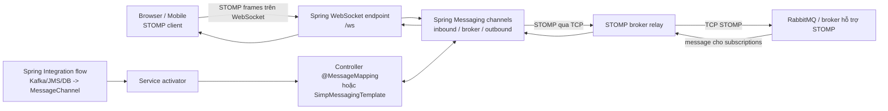
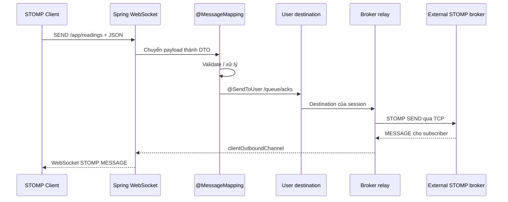
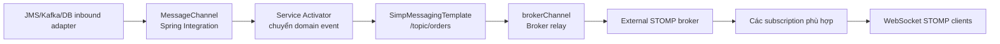
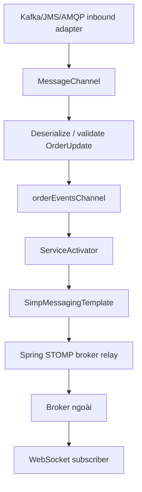
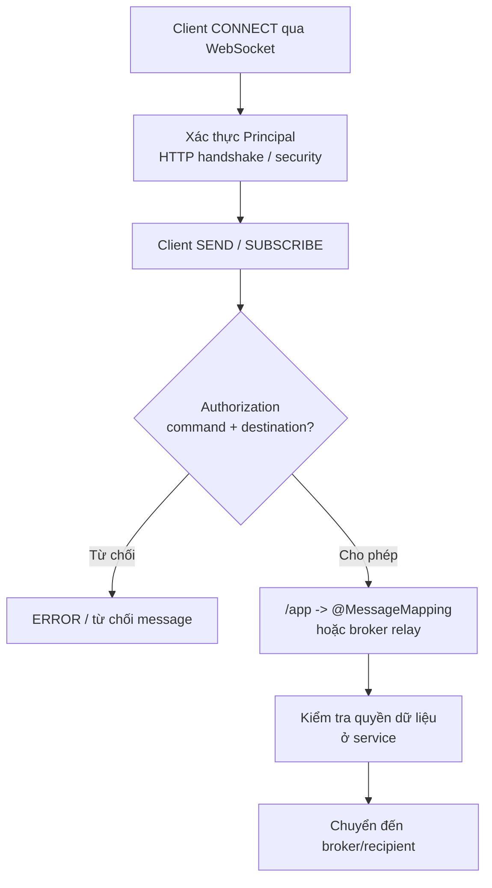

# STOMP over WebSocket và broker relay

## 1. Mục tiêu và vị trí trong module

Trong module **SPRING_INTEGRATION_ADAPTERS**, chúng ta đưa dữ liệu từ hệ thống ngoài vào Spring Integration bằng inbound adapter, gateway, poller và `MessageChannel`, rồi xử lý và gửi tiếp qua outbound adapter đến HTTP, JMS, AMQP, Kafka, cơ sở dữ liệu hoặc kênh thời gian thực. Bài thuộc chương **Adapter WebSocket** này tập trung vào **STOMP over WebSocket và broker relay**: cơ chế bổ sung message command, destination, subscription và broker vào kết nối WebSocket.

Bạn sẽ có thể:

- Phân biệt **WebSocket transport**, **STOMP protocol** và **message broker**.
- Đọc được STOMP frame `CONNECT`, `SUBSCRIBE`, `SEND`, `MESSAGE`, `ACK`, `RECEIPT` và hiểu destination.
- So sánh Spring **simple broker** với **STOMP broker relay** tới broker bên ngoài như RabbitMQ.
- Cấu hình `@EnableWebSocketMessageBroker`, `WebSocketMessageBrokerConfigurer` và `enableStompBrokerRelay(...)`.
- Thiết kế flow `/app` → `@MessageMapping` → `/user/queue` và gửi sự kiện lên `/topic`.
- Kết nối Spring Integration `MessageChannel` với `SimpMessagingTemplate` để phát thông báo từ Kafka/JMS/DB ra các STOMP subscriber.
- Nhận diện ranh giới giữa **STOMP broker relay** và **WebSocket inbound/outbound channel adapter** của Spring Integration.
- Thiết kế xác thực, phân quyền theo destination, ACK, receipt, heartbeat, reconnect và xử lý khi broker ngắt kết nối.

> **Phạm vi của thuật ngữ:** STOMP là viết tắt của *Simple (or Streaming) Text Oriented Messaging Protocol*. WebSocket chuyên chở frame; STOMP định nghĩa ngữ nghĩa message bên trong kết nối. Broker relay là một thành phần của **Spring Framework WebSocket Messaging** kết nối đến một **STOMP broker bên ngoài**, không phải một loại inbound adapter mới của Spring Integration.

## 2. Vì sao chỉ dùng raw WebSocket chưa đủ?

Một server raw WebSocket có thể đọc text JSON và gửi frame tới từng `WebSocketSession`. Cách này phù hợp khi một client trò chuyện trực tiếp với ứng dụng theo hợp đồng riêng. Tuy nhiên, nếu nhiều màn hình cần theo dõi các chủ đề như `order.updated`, `inventory.changed` hoặc `sensor.alert`, hệ thống phải tự xây:

- Danh sách subscription (người dùng nào đang theo dõi chủ đề nào).
- Cơ chế route message theo topic và quyền truy cập.
- Quản lý nhiều connection, reconnect và phân phối giữa các node.
- Quy tắc acknowledgment, lỗi truyền tải và xử lý downstream.

STOMP bổ sung **command và destination** giúp client khai báo quan tâm tới một đích nhận. Một message broker có thể đảm nhiệm phần phân phối đến các subscription; ứng dụng tập trung vào nghiệp vụ và phân quyền.

Hãy phân biệt:

| Lớp | Cung cấp | Không tự cung cấp |
| --- | --- | --- |
| **WebSocket** | Kết nối hai chiều lâu dài, truyền text/binary frame | Topic, subscription, hàng đợi nghiệp vụ |
| **STOMP** | Command, headers, destination, subscription, receipt/ack theo protocol | Một broker thực thi hoặc lưu bền vững mặc định |
| **Spring WebSocket Messaging** | Controller `@MessageMapping`, routing message và cấu hình broker | Bảo đảm exactly-once nghiệp vụ |
| **Simple broker** của Spring | Broker nhẹ trong bộ nhớ, phân phối subscription cơ bản | Đầy đủ tính năng/độ bền/cluster của external broker |
| **STOMP broker relay** | Chuyển STOMP message giữa Spring và broker bên ngoài | Tự biến mọi message thành persistent hay bảo đảm client đã xử lý |
| **Spring Integration** | Flow adapter/channel/transformer/gateway để nối hệ thống | Tự động sinh STOMP destination hoặc broker khi chưa cấu hình |

### Hai loại kết nối song song



Ở đây có **hai giao thức ở hai chặng**: client dùng **WebSocket** để đến Spring; Spring dùng **TCP STOMP** để đến broker. Việc chọn broker cụ thể quyết định hỗ trợ queue, durability, receipt, ACK mode và clustering ra sao.

## 3. Cấu trúc STOMP frame

Một STOMP frame điển hình có dạng:

```text
COMMAND
header-name:header-value
another-header:another-value

body<NUL>
```

Dòng đầu chứa command; sau các header là dòng trống, phần body, rồi byte **NUL (0x00)** kết thúc frame. `<NUL>` trong ví dụ là ký hiệu giải thích; client STOMP gửi byte điều khiển thực. STOMP có quy tắc phiên bản, escaping header, `content-length` và heartbeat; không nên tự nối chuỗi frame thủ công trong ứng dụng thực tế.

### 3.1. CONNECT và CONNECTED

Client mở WebSocket trước; sau đó client STOMP gửi frame kết nối:

```text
CONNECT
accept-version:1.2
host:example.org
heart-beat:10000,10000

<NUL>
```

Broker/relay phản hồi với thông tin thỏa thuận phiên bản, heartbeat hoặc lỗi theo protocol:

```text
CONNECTED
version:1.2
heart-beat:10000,10000

<NUL>
```

**HTTP 101 Switching Protocols** chứng minh WebSocket handshake thành công; nó **khác** việc hoàn thành STOMP `CONNECT`/`CONNECTED`. Có thể WebSocket đã mở nhưng STOMP chưa kết nối vì broker chưa sẵn sàng hoặc cấu hình sai.

### 3.2. SUBSCRIBE, SEND và MESSAGE

Client đăng ký nhận tin:

```text
SUBSCRIBE
id:sub-orders
destination:/topic/orders
ack:auto

<NUL>
```

Client gửi một message nghiệp vụ:

```text
SEND
destination:/app/readings
content-type:application/json

{"eventId":"evt-101","deviceId":"sensor-7","temperature":27.5}<NUL>
```

Sau khi subscription được xử lý, broker có thể gửi:

```text
MESSAGE
subscription:sub-orders
message-id:broker-msg-101
destination:/topic/orders
content-type:application/json

{"orderId":"ORD-42","status":"SHIPPED"}<NUL>
```

`id` trong `SUBSCRIBE` là **subscription ID**, không phải `WebSocketSession.getId()`. `message-id` là định danh của message ở tầng broker/STOMP; `eventId` bên trong JSON là định danh nghiệp vụ của ứng dụng.

### 3.3. Các command khác

| Command | Dùng để làm gì? | Ranh giới cần nhớ |
| --- | --- | --- |
| `CONNECT` / `STOMP` | Khởi tạo phiên STOMP trên transport | Không thay HTTP/WebSocket handshake |
| `CONNECTED` | Broker xác nhận thiết lập STOMP session | Không có nghĩa đã subscribe topic |
| `SEND` | Gửi body tới một destination | Destination do server/broker phân xử |
| `SUBSCRIBE` / `UNSUBSCRIBE` | Bắt đầu/dừng đăng ký nhận | Subscription có ID riêng |
| `MESSAGE` | Broker gửi thông điệp tới subscription | Không đồng nghĩa client đã xử lý nghiệp vụ |
| `ACK` / `NACK` | Xác nhận/từ chối broker message theo ACK mode | Phụ thuộc broker; không phải ACK domain tùy ý |
| `RECEIPT` | Xác nhận broker/server đã xử lý frame có `receipt` | Không chứng minh giao diện người dùng đã hiển thị |
| `ERROR` | Thông báo lỗi STOMP | Có thể kéo theo việc đóng connection |
| `DISCONNECT` | Chủ động kết thúc phiên STOMP | Có thể gửi với `receipt` để biết server đã xử lý |

Với `ack:auto`, broker không đợi client gửi explicit `ACK` cho từng `MESSAGE`. Với `ack:client` hoặc `ack:client-individual`, client phải gửi `ACK` theo semantics của broker. **ACK ở broker** và **ACK nghiệp vụ** nên được coi là hai hợp đồng khác nhau.

## 4. Destination: /app, /topic, /queue và /user

Trong Spring WebSocket Message Broker, destination thường được chia theo tiền tố:

| Destination | Ví dụ | Ai xử lý? |
| --- | --- | --- |
| `/app/...` | `/app/readings` | Spring gọi phương thức `@MessageMapping` tương ứng, sau khi bỏ prefix |
| `/topic/...` | `/topic/orders` | Broker xử lý subscription/publish qua broker relay |
| `/queue/...` | `/queue/notifications` | Broker xử lý theo quy tắc destination của chính broker |
| `/user/...` | `/user/queue/acks` | Spring user-destination resolver ánh xạ sang destination riêng của session/user |
| `/ws` | `ws://localhost:8080/ws` | URL **WebSocket handshake**, không phải STOMP message destination |

Các tên `/topic`, `/queue` là quy ước cấu hình; **STOMP không bắt buộc các prefix này có cùng ngữ nghĩa trên mọi broker**. RabbitMQ, ActiveMQ và broker khác có thể định nghĩa cách ánh xạ destination, độ bền hoặc auto-delete khác nhau. Kiểm tra tài liệu broker trước khi đưa yêu cầu delivery vào production.

Ví dụ: client `SUBSCRIBE` `/topic/orders` và sau đó server gửi sự kiện tới `/topic/orders`. Broker phân phối message theo tập subscriber hợp lệ. Nếu message chứa dữ liệu riêng tư, phát ra topic chung sẽ có nguy cơ rò rỉ thông tin; nên dùng user destination hoặc topic được phân quyền.

### User destination là gì?

Client thường đăng ký:

```text
/user/queue/acks
```

Ở server, controller có thể trả kết quả bằng `@SendToUser("/queue/acks")`. Spring ánh xạ destination này thành một địa chỉ thực tế gắn với phiên/user phù hợp và gửi tiếp qua broker. Vì vậy client **không cần biết tên queue nội bộ đã được biến đổi**.

Với `@SendToUser(broadcast = false)`, phản hồi được giới hạn vào **session phát sinh request**; mặc định trong một số tình huống có thể phát tới nhiều session của cùng một user. Nếu ứng dụng cần tất cả thiết bị của user, dùng định tuyến theo user rõ ràng, ví dụ `SimpMessagingTemplate.convertAndSendToUser(...)`, kèm quy tắc phân quyền.

## 5. Simple broker và STOMP broker relay

### 5.1. Simple broker: phù hợp học tập và hệ thống nhỏ

Trong Spring:

```java
@Override
public void configureMessageBroker(MessageBrokerRegistry registry) {
    registry.enableSimpleBroker("/topic", "/queue");
    registry.setApplicationDestinationPrefixes("/app");
}
```

Simple broker nằm trong tiến trình ứng dụng, theo dõi subscription và phát message cho WebSocket client đang kết nối. Nó phù hợp để:

- Học cách hoạt động của `@MessageMapping`, `@SendTo`, `@SendToUser`.
- Xây bản demo hoặc hệ thống đơn giản, số node ít.
- Phát message không yêu cầu queue bền vững hay các tính năng broker nâng cao.

Nó **không phải** full-featured broker và không cung cấp tất cả cơ chế ACK/receipt, độ bền hay clustering mà một broker ngoài có thể hỗ trợ.

### 5.2. STOMP broker relay: nối tới broker ngoài

Cấu hình:

```java
registry.enableStompBrokerRelay("/topic", "/queue")
        .setRelayHost("localhost")
        .setRelayPort(61613);
```

Spring dùng relay handler để chuyển STOMP frame giữa các WebSocket client và **broker ngoài qua TCP STOMP**. Broker có thể duy trì subscription và áp dụng cơ chế queue/topic riêng. Relay giúp nhiều instance ứng dụng cùng sử dụng broker, nhưng **không tự giải quyết mọi vấn đề liên quan đến user registry đa node, xác thực hay exactly-once**.

| Tiêu chí | Simple broker | Broker relay |
| --- | --- | --- |
| Cần broker ngoài | Không | Có |
| Đường mạng đến broker | Nội bộ tiến trình | TCP STOMP từ mỗi instance Spring |
| Subscription | Tối giản trong bộ nhớ | Do broker ngoài quản lý |
| Khả năng durable queue | Rất hạn chế/không phải mục tiêu | Tùy broker, destination và chính sách |
| Multi-node | Cần thêm thiết kế ngoài simple broker | Có thể phân phối qua broker; user destination vẫn cần xem xét |
| Vận hành | Ít cấu phần | Cần health, credentials, reconnect, broker monitoring |
| Phù hợp | Demo, app đơn giản | Hệ thống cần broker ngoài và tính năng messaging của broker |

Một nhầm lẫn phổ biến: dùng `enableStompBrokerRelay(...)` **không có nghĩa là ứng dụng Spring tự khởi động RabbitMQ hoặc ActiveMQ**. Broker thực phải chạy, bật hỗ trợ STOMP và chấp nhận kết nối từ máy chủ Spring.

## 6. Luồng thông điệp trong Spring

Cấu hình `@EnableWebSocketMessageBroker` kích hoạt hạ tầng Spring Messaging. Các thành phần điển hình:

- **`clientInboundChannel`**: nhận Spring Message chuyển đổi từ STOMP frame do WebSocket client gửi.
- **`clientOutboundChannel`**: chuyển message từ ứng dụng/broker về WebSocket client.
- **`brokerChannel`**: nhận message do server phát ra hướng đến broker.
- **`SimpAnnotationMethodMessageHandler`**: ánh xạ `/app/...` tới `@MessageMapping`.
- **`UserDestinationMessageHandler`**: xử lý prefix `/user`.
- **`StompBrokerRelayMessageHandler`**: relay STOMP message qua TCP đến broker ngoài.
- **`SimpMessagingTemplate`**: API để service của ứng dụng chủ động gửi message tới destination.

### Hai hành trình khác nhau

**Hành trình A — client gọi nghiệp vụ trên server**



**Hành trình B — server hoặc hệ thống ngoài phát sự kiện**



Luồng B đặc biệt quan trọng với module này: **Spring Integration quản lý nguồn và xử lý event**, còn **Spring Messaging broker relay quản lý phát event đến STOMP subscriber**. Một adapter Kafka/JMS không tự trở thành STOMP broker; cần bước nối hợp đồng rõ ràng.

## 7. Ví dụ: Spring Boot + RabbitMQ STOMP broker relay

Ví dụ dùng **Java 17+, Spring Boot 3.x, Spring Framework 6.x** và WebSocket messaging trên Servlet stack. RabbitMQ hỗ trợ STOMP qua plugin. Bạn cần có broker bên ngoài đang chạy, endpoint TCP STOMP khả dụng và tài khoản có quyền phù hợp.

### 7.1. Chuẩn bị dependency

Với Maven, các dependency chính:

```xml
<dependencies>
    <dependency>
        <groupId>org.springframework.boot</groupId>
        <artifactId>spring-boot-starter-websocket</artifactId>
    </dependency>
    <dependency>
        <groupId>org.springframework.boot</groupId>
        <artifactId>spring-boot-starter-integration</artifactId>
    </dependency>
    <dependency>
        <groupId>io.projectreactor.netty</groupId>
        <artifactId>reactor-netty</artifactId>
    </dependency>
</dependencies>
```

- `spring-boot-starter-websocket` cung cấp Spring WebSocket và Spring Messaging.
- `spring-boot-starter-integration` phục vụ phần bridge từ `MessageChannel` ở mục 9; có thể bỏ nếu chỉ làm STOMP messaging.
- `reactor-netty` cung cấp hạ tầng TCP client mà broker relay sử dụng trong Spring Framework. Tùy bộ dependency của dự án, thư viện này có thể đã được kéo vào; nên xác nhận dependency tree.
- Nếu muốn dùng **trực tiếp** `WebSocketInboundChannelAdapter` và `WebSocketOutboundMessageHandler` của Spring Integration, cần thêm `spring-integration-websocket`. Ví dụ broker relay hiện tại dùng Spring WebSocket Messaging và **không cần** adapter đó.

Spring Boot BOM quản lý phiên bản tương thích. Không gắn các phiên bản Spring Framework, Spring Integration và Reactor Netty tùy tiện.

### 7.2. Cấu hình RabbitMQ cho môi trường thử nghiệm

Broker RabbitMQ cần plugin STOMP được bật, chẳng hạn khi đã cài RabbitMQ:

```bash
rabbitmq-plugins enable rabbitmq_stomp
```

Cổng STOMP TCP mặc định thường là `61613`; bảo đảm broker thực sự listen trên cổng này. Tài khoản `guest` mặc định của RabbitMQ thường chỉ được phép truy cập loopback. Ví dụ dưới dùng `localhost` và `guest` để minh họa trên máy phát triển; môi trường thật cần **tài khoản riêng, quyền giới hạn, TLS, bí mật từ cấu hình an toàn và kiểm soát kết nối mạng**.

Broker đang chạy và mở cổng AMQP `5672` **không có nghĩa** TCP STOMP `61613` đã hoạt động. Relay sử dụng giao thức STOMP, không kết nối bằng AMQP.

### 7.3. Khai báo endpoint và broker relay

Tạo `StompWebSocketConfiguration.java`:

```java
package com.example.stomp;

import org.springframework.context.annotation.Configuration;
import org.springframework.messaging.simp.config.MessageBrokerRegistry;
import org.springframework.web.socket.config.annotation.EnableWebSocketMessageBroker;
import org.springframework.web.socket.config.annotation.StompEndpointRegistry;
import org.springframework.web.socket.config.annotation.WebSocketMessageBrokerConfigurer;

@Configuration
@EnableWebSocketMessageBroker
public class StompWebSocketConfiguration
        implements WebSocketMessageBrokerConfigurer {

    @Override
    public void registerStompEndpoints(StompEndpointRegistry registry) {
        registry.addEndpoint("/ws");
    }

    @Override
    public void configureMessageBroker(MessageBrokerRegistry registry) {
        registry.setApplicationDestinationPrefixes("/app");
        registry.setUserDestinationPrefix("/user");

        registry.enableStompBrokerRelay("/topic", "/queue")
                .setRelayHost("localhost")
                .setRelayPort(61613)
                .setClientLogin("guest")
                .setClientPasscode("guest")
                .setSystemLogin("guest")
                .setSystemPasscode("guest");
    }
}
```

Các thành phần cấu hình cần phân biệt:

| Cấu hình | Ý nghĩa |
| --- | --- |
| `registry.addEndpoint("/ws")` | URL WebSocket handshake: `ws://localhost:8080/ws` |
| `setApplicationDestinationPrefixes("/app")` | Message gửi `/app/...` đến `@MessageMapping` |
| `setUserDestinationPrefix("/user")` | Bật quy ước destination dành riêng user/session |
| `enableStompBrokerRelay("/topic", "/queue")` | Các destination dành cho broker ngoài |
| `setRelayHost` / `setRelayPort` | Host/port **TCP STOMP của broker**, không phải cổng WebSocket của Spring |
| `setClientLogin` / `setClientPasscode` | Credentials relay dùng cho các kết nối broker thay mặt WebSocket client |
| `setSystemLogin` / `setSystemPasscode` | Credentials dùng cho kết nối hệ thống từ Spring đến broker |

Hạ tầng relay có kết nối STOMP riêng phục vụ **system messages** do ứng dụng gửi và các kết nối STOMP relay thay mặt WebSocket client. Vì vậy, việc cấp credential và giới hạn connection trên broker là vấn đề vận hành thật.

**Quan trọng về bảo mật:** Spring relay dùng credentials đã cấu hình cho kết nối broker; không nên coi `login` / `passcode` từ STOMP `CONNECT` của trình duyệt là cơ chế xác thực người dùng vào ứng dụng. Authentication thường được quyết định từ HTTP handshake/Principal và Spring Security, sau đó authorization kiểm tra destination và message. Thông tin `guest` chỉ dùng trong demo cục bộ.

### 7.4. DTO và controller xử lý /app/readings

Tạo `SensorReading.java`:

```java
package com.example.stomp;

public record SensorReading(
        String eventId,
        String deviceId,
        Double temperature) {
}
```

Tạo `SensorAck.java`:

```java
package com.example.stomp;

public record SensorAck(
        String type,
        String eventId,
        String status) {
}
```

Tạo controller:

```java
package com.example.stomp;

import org.springframework.messaging.handler.annotation.MessageMapping;
import org.springframework.messaging.simp.annotation.SendToUser;
import org.springframework.stereotype.Controller;

@Controller
public class SensorStompController {

    @MessageMapping("/readings")
    @SendToUser(value = "/queue/acks", broadcast = false)
    public SensorAck receive(SensorReading reading) {
        if (reading == null
                || reading.eventId() == null
                || reading.eventId().isBlank()
                || reading.deviceId() == null
                || reading.deviceId().isBlank()
                || reading.temperature() == null
                || !Double.isFinite(reading.temperature())) {
            throw new IllegalArgumentException("Đọc cảm biến không hợp lệ");
        }

        // Demo: ở đây có thể xác thực quyền thiết bị,
        // lưu dữ liệu và/hoặc phát sự kiện sang Kafka/JMS.
        System.out.printf("Reading %s from %s: %.1f%n",
                reading.eventId(),
                reading.deviceId(),
                reading.temperature());

        return new SensorAck(
                "sensor.ack", reading.eventId(), "ACCEPTED");
    }
}
```

Cách ánh xạ trong ví dụ:

1. Client gửi STOMP `SEND` đến `/app/readings`.
2. Spring bỏ prefix `/app` và gọi `@MessageMapping("/readings")`.
3. JSON body được chuyển thành `SensorReading` nếu converter phù hợp.
4. Controller kiểm tra hợp đồng tối thiểu, xử lý và trả `SensorAck`.
5. `@SendToUser(value = "/queue/acks", broadcast = false)` giới hạn phản hồi vào session đã gửi message.
6. Spring chuyển đổi DTO thành message và gửi qua relay tới broker, rồi đến subscription `/user/queue/acks` của client.

Kiểm tra dữ liệu demo còn đơn giản: nó chưa xác thực principal, liên hệ device ID với quyền người gửi, giới hạn miền nhiệt độ hoặc xử lý lỗi có mã. Ở production, nên đưa các kiểm tra này vào service/validator riêng và định nghĩa cách trả lỗi cho client.

**Phân biệt ACK:** `SensorAck` là **ACK nghiệp vụ do ứng dụng tự định nghĩa**, khác STOMP `ACK` frame mà broker dùng khi subscription yêu cầu manual acknowledgment.

### 7.5. Gửi sự kiện chủ động tới /topic

Tạo DTO:

```java
package com.example.stomp;

public record OrderUpdate(
        String eventId, String orderId, String status) {
}
```

Và service:

```java
package com.example.stomp;

import org.springframework.messaging.simp.SimpMessagingTemplate;
import org.springframework.stereotype.Service;

@Service
public class OrderNotificationPublisher {

    private final SimpMessagingTemplate template;

    public OrderNotificationPublisher(SimpMessagingTemplate template) {
        this.template = template;
    }

    // Chỉ nên phát dữ liệu mà tất cả subscriber được phép xem.
    public void publishPublicUpdate(OrderUpdate update) {
        template.convertAndSend("/topic/orders", update);
    }

    // Gửi đến các session hợp lệ thuộc một username.
    public void publishPrivateUpdate(
            String username, OrderUpdate update) {

        template.convertAndSendToUser(
                username, "/queue/order-updates", update);
    }
}
```

`convertAndSend(...)` gửi Spring Message tới hạ tầng messaging/broker; lời gọi hoàn thành **không đồng nghĩa** mọi client đã nhận, lưu hoặc hiển thị thông báo. Nếu truyền dữ liệu riêng của một đơn hàng cho `/topic/orders` chung, có thể làm lộ thông tin; trong thực tế cần phân quyền destination, user notification hoặc topic có ACL thích hợp.

### 7.6. Client STOMP từ JavaScript

Dùng thư viện `@stomp/stompjs`, ví dụ trong dự án frontend đã cài package:

```bash
npm install @stomp/stompjs
```

Ví dụ module JavaScript:

```javascript
import { Client } from "@stomp/stompjs";

const client = new Client({
  brokerURL: "ws://localhost:8080/ws",
  reconnectDelay: 5000,
  heartbeatIncoming: 10000,
  heartbeatOutgoing: 10000,

  onConnect: () => {
    console.log("STOMP connected");

    client.subscribe("/user/queue/acks", (message) => {
      console.log("ACK:", JSON.parse(message.body));
    });

    client.subscribe("/topic/orders", (message) => {
      console.log("Order update:", JSON.parse(message.body));
    });

    client.publish({
      destination: "/app/readings",
      headers: { "content-type": "application/json" },
      body: JSON.stringify({
        eventId: "evt-101",
        deviceId: "sensor-7",
        temperature: 27.5
      })
    });
  },

  onStompError: (frame) => {
    console.error("Broker STOMP ERROR:", frame.headers.message);
  },

  onWebSocketClose: (event) => {
    console.warn("WebSocket closed:", event.code);
  }
});

client.activate();

// Khi component bị hủy: await client.deactivate();
```

Khi server, broker và subscription hoạt động bình thường, ứng dụng nhận một message body như:

```json
{
  "type": "sensor.ack",
  "eventId": "evt-101",
  "status": "ACCEPTED"
}
```

Để test topic, gọi `publishPublicUpdate(...)` từ một service hoặc luồng backend đã kết nối. Client đã `SUBSCRIBE` `/topic/orders` sẽ nhận message nếu broker cho phép.

**Lưu ý về thời điểm:** trong ví dụ ngắn, `SUBSCRIBE` và `SEND` diễn ra liên tiếp. Với hệ thống cần chắc chắn subscription đã được broker thiết lập trước khi server gửi phản hồi, hãy dùng `receipt`/`RECEIPT` hoặc quy trình “ready” ứng dụng. Chỉ nhìn thứ tự hai lời gọi JavaScript không phải là bảo đảm end-to-end.

## 8. Kết nối Spring Integration MessageChannel với STOMP broker relay

Đây là phần kết nối trực tiếp với module **SPRING_INTEGRATION_ADAPTERS**.

Giả sử message được lấy từ Kafka qua `KafkaMessageDrivenChannelAdapter` hoặc từ JMS/AMQP qua inbound adapter tương ứng. Bước xử lý nghiệp vụ biến message thành `OrderUpdate`, rồi gửi vào `MessageChannel` chung. Một `ServiceActivator` tiêu thụ message và phát ra destination STOMP bằng `SimpMessagingTemplate`.

### 8.1. Cấu hình bridge

```java
package com.example.stomp;

import org.springframework.context.annotation.Bean;
import org.springframework.context.annotation.Configuration;
import org.springframework.integration.annotation.ServiceActivator;
import org.springframework.integration.channel.DirectChannel;
import org.springframework.integration.config.EnableIntegration;
import org.springframework.messaging.MessageChannel;
import org.springframework.messaging.MessageHandler;
import org.springframework.messaging.MessagingException;
import org.springframework.messaging.simp.SimpMessagingTemplate;

@Configuration
@EnableIntegration
public class IntegrationToStompBridge {

    @Bean
    public MessageChannel orderEventsChannel() {
        return new DirectChannel();
    }

    @Bean
    @ServiceActivator(inputChannel = "orderEventsChannel")
    public MessageHandler publishOrdersToStomp(
            SimpMessagingTemplate template) {

        return message -> {
            if (!(message.getPayload() instanceof OrderUpdate update)) {
                throw new MessagingException(
                        message, "Payload phải là OrderUpdate");
            }

            // Nếu update nhạy cảm, thay bằng user destination
            // và kiểm tra quyền đối tượng nhận.
            template.convertAndSend("/topic/orders", update);
        };
    }
}
```

Ở phía producer có thể gửi:

```java
boolean accepted = orderEventsChannel.send(
        MessageBuilder.withPayload(
                new OrderUpdate("evt-201", "ORD-42", "SHIPPED"))
            .build());
```

Đoạn gọi giả định `orderEventsChannel` đã được inject vào service và `MessageBuilder` được import từ `org.springframework.messaging.support.MessageBuilder`.

Khi nguồn là Kafka/JMS:



Có ba loại hợp đồng delivery khác nhau: **nguồn Kafka/JMS**, **Spring Messaging → broker relay**, và **broker → STOMP client**. Không suy luận rằng transaction/ACK của Kafka hoặc JMS kéo dài xuyên qua WebSocket. Nếu phải tránh mất sự kiện giữa lưu DB và gửi STOMP, có thể dùng outbox/event log và retry có idempotency key.

### 8.2. Có dùng WebSocketOutboundMessageHandler thay SimpMessagingTemplate không?

Spring Integration có `WebSocketInboundChannelAdapter` và `WebSocketOutboundMessageHandler` dùng `IntegrationWebSocketContainer`. Các adapter này có thể được cấu hình sub-protocol handler, bao gồm STOMP, để ánh xạ frame với Spring Message trong một luồng tích hợp.

Tuy nhiên, một **STOMP broker relay với `@EnableWebSocketMessageBroker`** đi qua bộ dispatcher, broker channels và `SimpMessagingTemplate` của **Spring WebSocket Messaging**. Hai hướng không tự hoán đổi cho nhau:

| Mục tiêu | Cách thường chọn |
| --- | --- |
| Client gửi frame raw WebSocket vào Integration Flow | `WebSocketInboundChannelAdapter` + `ServerWebSocketContainer` |
| Flow gửi frame raw về một WebSocket session đã biết | `WebSocketOutboundMessageHandler` + `simpSessionId` |
| Client STOMP `SUBSCRIBE` tới topic/queue, dùng broker ngoài | `@EnableWebSocketMessageBroker` + `enableStompBrokerRelay(...)` |
| Service Spring Integration muốn phát tới subscriber STOMP | `MessageChannel` → `ServiceActivator` → `SimpMessagingTemplate` |
| Spring Integration kết nối như STOMP client tới remote STOMP server | Cấu hình client container/sub-protocol STOMP theo hợp đồng từ xa; xem khả năng `StompSubProtocolHandler` và encoder |
| Cần broker dùng AMQP/JMS/Kafka thay vì STOMP | Adapter/binder chuyên cho giao thức tương ứng; không giả định broker relay TCP STOMP là AMQP/JMS/Kafka |

**Không đăng ký `ServerWebSocketContainer` của Spring Integration và `StompEndpointRegistry` cùng giành URL `/ws`** cho một ứng dụng nếu chưa chủ động thiết kế cách phân phối handler. Ví dụ mục 7 dùng một endpoint STOMP broker messaging; nó không cần thêm inbound WebSocket adapter ở cùng đường dẫn.

## 9. Broker relay: kết nối hệ thống, credential và heartbeat

### 9.1. System connection và client connections

Relay có những kết nối TCP STOMP tới broker:

- **System connection:** phục vụ message từ phía server, ví dụ `SimpMessagingTemplate.convertAndSend(...)`; ứng dụng có thể kiểm tra broker availability.
- **Client connections:** broker relay quản lý kết nối tới broker thay cho các WebSocket client, sử dụng credential `clientLogin`/`clientPasscode` đã cấu hình.

Việc client xác thực vào **ứng dụng Spring** nên dựa vào security context/Principal và chính sách WebSocket handshake. Đừng để credential broker trên frontend để rồi coi đó là quyền đọc mọi topic.

### 9.2. Heartbeat và xử lý broker outage

STOMP có `heart-beat` để hai phía thương lượng tần suất tín hiệu kết nối. Trong client JavaScript, `heartbeatIncoming` và `heartbeatOutgoing` hỗ trợ phát hiện kết nối im lặng và duy trì STOMP session; chúng không thay cho ứng dụng health check hay timeout nghiệp vụ.

Broker relay có các tùy chọn cho heartbeat của **system connection**, chẳng hạn `setSystemHeartbeatSendInterval(...)` và `setSystemHeartbeatReceiveInterval(...)`. Giá trị cụ thể phải phù hợp broker/network và các phiên bản thư viện. Cần theo dõi trạng thái broker thay vì giả định lúc nào cũng có thể gửi.

Spring có thể công bố `BrokerAvailabilityEvent` khi khả năng kết nối broker thay đổi. Một consumer có thể lắng nghe:

```java
package com.example.stomp;

import org.springframework.context.event.EventListener;
import org.springframework.messaging.simp.broker.BrokerAvailabilityEvent;
import org.springframework.stereotype.Component;

@Component
public class BrokerAvailabilityLogger {

    @EventListener
    public void onBrokerAvailability(BrokerAvailabilityEvent event) {
        System.out.println("STOMP broker available = "
                + event.isBrokerAvailable());
    }
}
```

Sự kiện này hữu ích cho readiness, metrics và việc trì hoãn những lần gửi không thiết yếu khi broker đang ngắt. Tuy nhiên, trạng thái “available” chỉ là một quan sát tại thời điểm đó; kết nối có thể mất ngay sau khi kiểm tra.

### 9.3. Hành vi khi mất broker

Nếu RabbitMQ dừng trong lúc các client còn kết nối WebSocket:

1. Các kết nối STOMP relay tới broker bị gián đoạn.
2. Việc `SEND`, `SUBSCRIBE` hoặc phát message server-side có thể lỗi hoặc không hoàn thành như mong đợi.
3. Client có thể nhận `ERROR` hoặc đóng WebSocket tùy tình huống và cấu hình.
4. Khi broker trở lại, client cần kết nối STOMP lại và **đăng ký subscription lại**.
5. Các sự kiện xảy ra trong lúc gián đoạn chỉ được gửi lại nếu ứng dụng/broker có cơ chế lưu và retry phù hợp.

`reconnectDelay` của STOMP.js giúp client thử nối lại **transport/session**. Nó không tự tái tạo toàn bộ trạng thái nghiệp vụ hay replay những sự kiện đã mất khi offline. Subscription cần được đăng ký trong mỗi lần `onConnect`.

## 10. ACK, RECEIPT và delivery semantics

Một lỗi thiết kế thường gặp là coi STOMP `ACK` hoặc `RECEIPT` bằng xác nhận “người dùng đã xử lý xong sự kiện”.

### 10.1. Các lớp xác nhận

| Tín hiệu | Điều đã xảy ra | Chưa chứng minh |
| --- | --- | --- |
| `MessageChannel.send(...)` trả `true` | Channel đã chấp nhận lần gửi ở tầng Spring Messaging | Broker nhận bền vững hoặc client đã đọc |
| `SimpMessagingTemplate.convertAndSend(...)` hoàn thành | Lời gọi gửi vào hạ tầng messaging của Spring hoàn thành | Tất cả subscriber nhận dữ liệu |
| STOMP `RECEIPT` | Broker/server xác nhận đã xử lý frame gắn `receipt` theo protocol | Message chắc chắn đã hiển thị hoặc xử lý nghiệp vụ |
| STOMP `ACK` trong `client` mode | Client xác nhận với broker theo semantics subscription | Transaction nghiệp vụ bên client thành công |
| Application ACK mang `eventId` | Client thông báo đã hoàn thành hành động được hợp đồng quy định | Đạt exactly-once nếu chưa có deduplication |

Ví dụ broker message có header `ack`/`message-id` và subscription dùng manual ACK: client STOMP gửi `ACK` hợp lệ theo chuẩn phiên bản/broker. Nhưng nếu yêu cầu “người dùng đã đọc thông báo”, ứng dụng vẫn cần event riêng, ví dụ:

```json
{
  "type": "notification.read",
  "eventId": "evt-201",
  "readAt": "2026-11-23T01:00:00Z"
}
```

Server kiểm tra quyền và lưu trạng thái “đã đọc”. Không suy diễn trạng thái này từ STOMP `ACK`.

### 10.2. Cần lưu bền vững thì phải làm gì?

Tùy mức bảo đảm:

- **Thông báo trạng thái mới nhất:** có thể chấp nhận mất một số intermediate updates, rồi client tải lại trạng thái hiện tại qua HTTP.
- **Sự kiện phải được xử lý ít nhất một lần:** lưu event ở DB/outbox/queue, có event ID và retry.
- **Tránh xử lý trùng:** idempotency key và bảng/điều kiện deduplication ở service nhận.
- **Cần thứ tự:** chọn khóa phân vùng, thứ tự per aggregate và chiến lược xử lý sự kiện đến muộn.
- **Broker durability:** cấu hình destination, subscription, persistence, expiry và ACK theo tài liệu broker cụ thể.

Không gắn nhãn “exactly once” cho hệ thống chỉ vì dùng STOMP broker relay hoặc một queue persistent. Mỗi bước giao tiếp đều có các điểm lỗi và thời điểm commit khác nhau.

## 11. Bảo mật STOMP destination

Khi dùng broker relay, server có thêm “bề mặt” quyền truy cập: STOMP client có thể cố tình `SEND` hoặc `SUBSCRIBE` đến destination mà ứng dụng không dự tính.

### 11.1. Những chốt kiểm tra cần có

1. **Handshake authentication:** quyết định người dùng là ai khi WebSocket kết nối; có thể dùng session/cookie hoặc cơ chế token được hỗ trợ an toàn.
2. **Message authorization:** giới hạn destination nào được `SEND`, destination nào được `SUBSCRIBE`. Ví dụ client được `SEND /app/readings`, nhưng không được trực tiếp `SEND /topic/admin-alerts`.
3. **User destinations:** dùng `/user/queue/...` cho dữ liệu cá nhân và kiểm tra quyền theo tài nguyên ở service.
4. **Principal và payload:** không tin `userId`, `deviceId` hoặc `tenantId` từ JSON để thay danh tính đã được xác thực.
5. **Broker credential:** giữ `clientLogin`/`systemLogin` ở cấu hình server, dùng quyền tối thiểu; không expose mật khẩu qua frontend hay log.
6. **Origin/CSRF và transport:** cấu hình policy phù hợp cho WebSocket handshake; dùng `wss://` và TLS cho kết nối broker khi có yêu cầu.
7. **Kích thước và tần suất:** giới hạn frame/message, subscription, queue growth và tốc độ gửi để tránh chiếm tài nguyên.

**Ví dụ rủi ro:** nếu client có thể `SUBSCRIBE /topic/all-orders` nhưng topic chứa đơn hàng của nhiều người dùng, relay không tự hiểu ACL nghiệp vụ. Cần chặn subscription trái phép hoặc đổi kiến trúc thành user destinations/authorized destinations.

### 11.2. Phân quyền theo tầng



Không thay bước kiểm tra dữ liệu ở service chỉ bằng việc client đã đăng nhập thành công.

## 12. Vận hành, hiệu năng và nhiều node

### 12.1. Giới hạn WebSocket transport

Spring WebSocket Message Broker có các tùy chọn cấu hình transport, ví dụ:

```java
@Override
public void configureWebSocketTransport(
        WebSocketTransportRegistration registration) {

    registration.setMessageSizeLimit(64 * 1024);
    registration.setSendBufferSizeLimit(512 * 1024);
    registration.setSendTimeLimit(10_000);
}
```

Đoạn code thuộc lớp `WebSocketMessageBrokerConfigurer` và cần import `org.springframework.web.socket.config.annotation.WebSocketTransportRegistration`. Các giá trị chỉ minh họa; hãy đo message thực tế và thiết lập phù hợp. Giới hạn này không thay cho quota ở broker, ingress hoặc validation kích thước JSON trong controller.

### 12.2. Nhiều instance Spring

Khi có nhiều node Spring nối vào cùng một broker, subscription dữ liệu thông thường có thể phân phối qua broker. Tuy nhiên, **user registry**, ánh xạ destination `/user`, trạng thái kết nối và user đồng thời mở nhiều tab ở nhiều node cần được thiết kế cẩn thận.

Spring hỗ trợ cơ chế broadcast user registry hoặc unresolved user destination trong cấu hình phù hợp; khi triển khai cluster, cần kiểm tra cách cấu hình `userRegistryBroadcast` và `userDestinationBroadcast`, broker destination/ACL và việc xóa session cũ. Chỉ bật broker relay chưa bảo đảm mọi message `convertAndSendToUser(...)` luôn tìm được user ở bất kỳ node nào.

### 12.3. Các chỉ số cần đo

| Chỉ số | Giá trị vận hành |
| --- | --- |
| WebSocket connections đang mở | Phát hiện tăng bất thường hoặc rò rỉ |
| STOMP CONNECT/SUBSCRIBE thành công, thất bại | Phân biệt lỗi client/protocol/broker |
| Broker availability và số lần reconnect | Theo dõi outage, network flapping |
| Latency từ event đến nhận `MESSAGE` | Đánh giá trải nghiệm thời gian thực |
| Kích thước frame/message và outbound buffer | Phát hiện client chậm hoặc payload bất thường |
| Broker queue depth, consumer lag, unacked messages | Đánh giá backlog/semantics của broker |
| Tỷ lệ duplicate và business ACK timeout | Đo chất lượng delivery end-to-end |
| Số lượng subscription theo user/destination | Phát hiện abuse và vấn đề phân quyền |

Khi log STOMP frame, tránh log mật khẩu, token, thông điệp riêng tư hoặc header nhạy cảm. Dùng `eventId` và trace ID để liên kết log giữa Kafka/JMS, Spring Integration, broker và client.

## 13. Chẩn đoán sự cố thường gặp

| Hiện tượng | Nguyên nhân có thể | Cách kiểm tra |
| --- | --- | --- |
| WebSocket handshake trả 404 | Sai URL `/ws`, mapping hoặc proxy Upgrade | Xác minh endpoint và đường dẫn thực |
| WebSocket mở nhưng không có STOMP `CONNECTED` | Broker relay unavailable, login/port sai, client chưa `CONNECT` | Kiểm tra TCP STOMP `61613`, plugin và log relay |
| Broker AMQP hoạt động nhưng STOMP thất bại | Chỉ mở port AMQP `5672`, chưa bật STOMP | Kiểm tra STOMP listener/plugin riêng |
| `@MessageMapping` không chạy | Client `SEND` sai prefix hoặc destination | `/app/readings` → `@MessageMapping("/readings")` |
| Controller chạy nhưng ACK không về | Client chưa subscribe `/user/queue/acks`, broker không sẵn sàng, sai user destination | Kiểm tra subscription, mapping session và relay |
| Client không nhận `/topic/orders` | Chưa SUBSCRIBE, broker ACL/destination sai | Xem STOMP frame, broker route và `convertAndSend` |
| Thông tin người dùng bị lộ | Phát dữ liệu riêng tư lên topic chung | Chặn quyền subscribe hoặc dùng user destination |
| Reconnect nhưng không còn nhận tin | Client chưa resubscribe | Đăng ký trong mỗi `onConnect` |
| Các message bị mất khi broker dừng | Không có lưu bền vững/replay hợp đồng | Thiết kế outbox, durable queue/ack theo broker |
| Gửi từ Spring Integration báo lỗi | Bridge nhận sai DTO hoặc broker unavailable | Kiểm tra payload mapper, `MessageHandler` và availability |
| Cluster gửi sai người nhận | User registry/destination không đồng bộ giữa node | Kiểm tra cấu hình user broadcast và quyền |
| STOMP `RECEIPT` có nhưng UI không cập nhật | RECEIPT khác business ACK/rendering | Thêm app ACK/trace, kiểm tra client handler |

### Trình tự debug nên áp dụng

1. Xác minh **WebSocket URL** và HTTP Upgrade trả thành công.
2. Xác minh STOMP client đã gửi `CONNECT` và nhận `CONNECTED`.
3. Kiểm tra `SUBSCRIBE` destination, subscription ID và (nếu cần) `RECEIPT`.
4. Kiểm tra `SEND` destination, body, content-type, converter và controller.
5. Kiểm tra `BrokerAvailabilityEvent`, broker logs và khả năng TCP STOMP từ Spring tới broker.
6. Kiểm tra message được route qua `/app`, `/topic`, `/queue` hay `/user` theo kỳ vọng.
7. Kiểm tra phân quyền, user/session mapping và thời điểm reconnect.
8. Đối chiếu `eventId` để phân biệt gửi, nhận, ACK nghiệp vụ và retry.

## 14. Bài tập thực hành

### Bài A — đọc và phân loại STOMP frame

Với các frame `CONNECT`, `SUBSCRIBE /topic/orders`, `SEND /app/readings` và `MESSAGE /topic/orders`, hãy chỉ ra **ai gửi**, **destination/headers**, **ai xử lý** và **khi nào cần broker**. Giải thích vì sao WebSocket `readyState = OPEN` chưa chứng minh STOMP `CONNECTED`.

### Bài B — chuyển simple broker sang broker relay

Bắt đầu với:

```java
registry.enableSimpleBroker("/topic", "/queue");
```

Thay bằng `enableStompBrokerRelay(...)` và cấu hình broker STOMP thật. Ghi lại các thay đổi về dependency, credentials, network, readiness và lỗi khi broker dừng. Xác nhận `/app/readings` vẫn chạy controller và `/topic/orders` được broker chuyển tới subscriber.

### Bài C — tích hợp Kafka/JMS với STOMP

Thiết kế Integration Flow:

```text
Kafka/JMS inbound -> deserialize OrderUpdate -> validate/authorize
-> MessageChannel -> ServiceActivator -> SimpMessagingTemplate
-> broker relay -> /user/queue/order-updates
```

Bổ sung cách xác định recipient, retry khi broker offline, outbox khi cần bền vững và deduplication bằng `eventId`. Trả lời vì sao `MessageChannel.send()` không đủ làm ACK từ client.

### Bài D — thử broker bị ngắt

Mở hai client STOMP, subscribe `/topic/orders` và gửi một số event. Tạm dừng broker ngoài; quan sát WebSocket close, STOMP error, `BrokerAvailabilityEvent` và queue/flow lỗi. Khôi phục broker, xác minh client tự reconnect rồi resubscribe. Kiểm tra event nào bị mất và vì sao.

### Bài E — phân quyền destination

Giả sử user chỉ được đọc đơn hàng thuộc tenant của họ. Đề xuất cách chặn `SUBSCRIBE` tới topic của tenant khác, kiểm tra quyền trong `@MessageMapping` và gửi notification theo user destination. Nêu rủi ro khi dùng `/topic/orders` chung cho dữ liệu riêng tư.

### Bài F — so sánh ba loại xác nhận

Tạo một bảng so sánh `channel.send == true`, STOMP `RECEIPT`, STOMP `ACK` và ứng dụng gửi `{"type":"event.processed","eventId":"..."}`. Với từng tín hiệu, giải thích hệ thống **đã biết điều gì** và **chưa biết điều gì**; từ đó thiết kế retry không xử lý trùng.

**Tiêu chí hoàn thành:** bạn có thể vẽ đúng hai chặng WebSocket → Spring và Spring → TCP STOMP broker; xác định message nào tới `@MessageMapping`, message nào tới broker; cấu hình topic/user destination; vận hành khi broker offline; và không nhầm broker acknowledgment với xác nhận nghiệp vụ.

## 15. Ghi nhớ

- **WebSocket** vận chuyển frame; **STOMP** bổ sung command/destination/subscription; **broker** xử lý phân phối và semantics cụ thể.
- `@EnableWebSocketMessageBroker` cùng `enableStompBrokerRelay(...)` cấu hình một **broker relay**, không tự tạo broker ngoài.
- `/ws` là WebSocket handshake endpoint; `/app` thường dành cho `@MessageMapping`; `/topic` và `/queue` được relay tới broker; `/user` được Spring ánh xạ cho user/session.
- `SimpMessagingTemplate` là điểm nối đơn giản để Spring Integration `MessageChannel` phát sự kiện tới các STOMP subscriber.
- `WebSocketInboundChannelAdapter` / `WebSocketOutboundMessageHandler` là hướng tích hợp WebSocket trực tiếp khác; không đồng nhất chúng với broker relay của Spring Messaging.
- `RECEIPT`, `ACK` ở STOMP và application ACK có ý nghĩa khác nhau. Không có exactly-once tự động.
- Khi broker hoặc client mất kết nối, cần quan sát availability, reconnect, resubscribe, retry và idempotency theo yêu cầu dữ liệu.
- Cần xác thực, phân quyền cả `SEND`/`SUBSCRIBE`, bảo vệ user destination, giữ bí mật credentials broker và giới hạn tài nguyên.

## Tài liệu tham khảo

- [Spring Framework Reference — STOMP](https://docs.spring.io/spring-framework/reference/web/websocket/stomp.html)
- [Spring Framework Reference — STOMP Broker Relay](https://docs.spring.io/spring-framework/reference/web/websocket/stomp/handle-broker-relay.html)
- [Spring Framework Reference — User Destinations](https://docs.spring.io/spring-framework/reference/web/websocket/stomp/user-destination.html)
- [Spring Framework Reference — Authentication](https://docs.spring.io/spring-framework/reference/web/websocket/stomp/authentication.html)
- [Spring Integration Reference — WebSockets Support](https://docs.spring.io/spring-integration/reference/web-sockets.html)
- [STOMP Protocol 1.2 Specification](https://stomp.github.io/stomp-specification-1.2.html)
- [RabbitMQ Documentation — STOMP Plugin](https://www.rabbitmq.com/docs/stomp)
- [STOMP.js Documentation](https://stomp-js.github.io/guide/stompjs/using-stompjs-v5.html)
