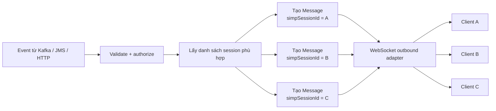
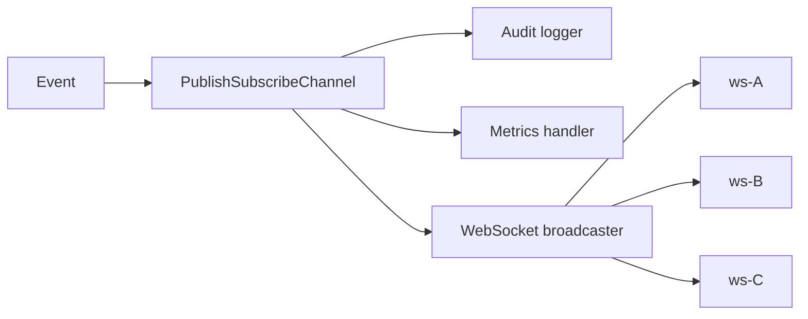
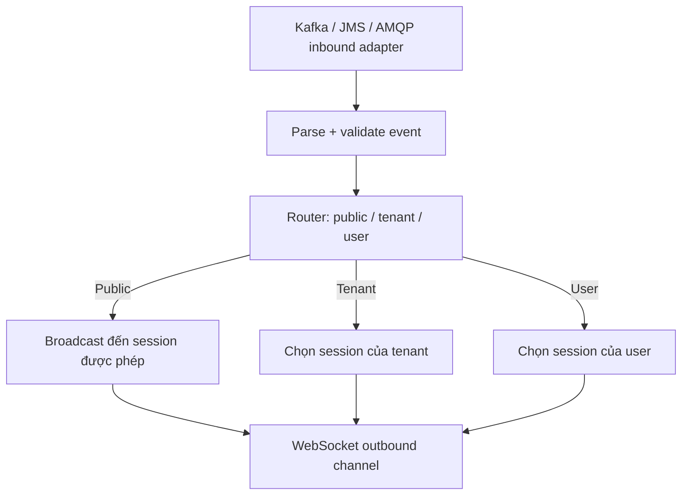
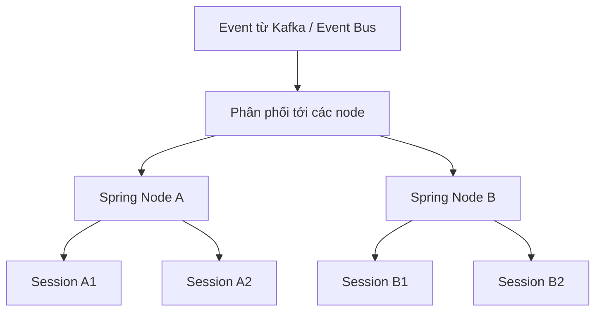

# Broadcast message đến nhiều session

## 1. Mục tiêu bài học

Trong module **SPRING_INTEGRATION_ADAPTERS**, dữ liệu từ file, SFTP, HTTP, JMS, AMQP, Kafka hoặc cơ sở dữ liệu có thể đi qua adapter, gateway, poller và `MessageChannel` trước khi được chuyển tới hệ thống đích. Với giao diện thời gian thực, một sự kiện thường phải được gửi đến **nhiều kết nối WebSocket đang mở**: tất cả dashboard đang xem trạng thái vận hành, mọi tab của một người dùng hoặc toàn bộ thiết bị được phép theo dõi một khu vực.

Bài **Broadcast message đến nhiều session**, thuộc chương **Adapter WebSocket**, tập trung vào cách phân phối một sự kiện cho nhiều WebSocket session theo đúng hợp đồng, bảo mật và khả năng chịu tải.

Sau khi học, bạn có thể:

- Phân biệt **broadcast tới mọi session**, **multicast tới một nhóm session**, **gửi theo user** và **publish tới một topic**.
- Giải thích vì sao một `WebSocketOutboundMessageHandler` với header `simpSessionId` phù hợp cho thao tác gửi tới **một session đã chọn**.
- Xây một dịch vụ fan-out để tạo **một Spring Message riêng cho từng session** trên cùng `ServerWebSocketContainer`.
- Hiểu khác biệt giữa fan-out raw WebSocket, `PublishSubscribeChannel` và broker STOMP `/topic/...`.
- Xử lý session biến mất khi đang phát, client nhận chậm, reconnect và triển khai nhiều node.
- Thiết kế phân quyền, backpressure, đo lường, ACK và kiểm thử broadcast một cách có ý nghĩa.

**Phạm vi:** “broadcast” mô tả **chính sách chọn nhiều người nhận của ứng dụng**. WebSocket là giao thức hai chiều, nhưng không tự quy định “gửi cho tất cả session” như một lệnh chuẩn. Spring Integration có thể đưa thông điệp tới mỗi session bằng outbound handler; khi cần subscription theo topic hoặc broker phân tán, Spring WebSocket Messaging/STOMP thường phù hợp hơn.

## 2. Broadcast khác gửi một session như thế nào?

Giả sử ba trình duyệt kết nối đến endpoint `/ws/dashboard`:

```text
Client A ── WebSocket session = ws-A
Client B ── WebSocket session = ws-B
Client C ── WebSocket session = ws-C

Sự kiện: dashboard.status.changed (eventId = evt-501)
```

Khi chỉ cần ACK cho thao tác của A, server tạo message outbound với header `simpSessionId = ws-A`. Khi cần broadcast cho tất cả ba phiên, server phải chọn `ws-A`, `ws-B`, `ws-C` và tổ chức quá trình gửi tương ứng.

| Kiểu phát | Tập người nhận | Ví dụ |
| --- | --- | --- |
| **Unicast** | Một session cụ thể | ACK cho tab vừa gửi lệnh |
| **Broadcast toàn bộ** | Tất cả session trong phạm vi đã xác định | Thông báo bảo trì công khai |
| **Multicast theo nhóm** | Các session đủ điều kiện | Dashboard thuộc tenant/khu vực |
| **Fan-out theo user** | Nhiều session của cùng một principal | Thông báo đến mọi tab/thiết bị |
| **Topic publish** | Những client đã đăng ký topic và có quyền | `/topic/telemetry` qua STOMP broker |

Đừng đồng nhất **broadcast tới mọi kết nối** với **broadcast tới mọi người dùng**. Một user mở ba tab có ba WebSocket session; cùng một sự kiện có thể xuất hiện ba lần trên các tab đó. Nếu ứng dụng yêu cầu chỉ một thông báo cho mỗi người dùng, phải định nghĩa quy tắc chọn thiết bị hoặc gộp thông báo ở tầng ứng dụng.

### Sơ đồ một sự kiện, nhiều phiên



Các nhánh trong sơ đồ có ý nghĩa **logic**. Trong ví dụ Java bên dưới, một service duyệt danh sách session và gọi `MessageChannel.send(...)` cho từng đích; mỗi message chỉ có một `simpSessionId`.

## 3. Những thành phần cần hiểu

| Thành phần | Trách nhiệm khi broadcast |
| --- | --- |
| `ServerWebSocketContainer` | Quản lý các `WebSocketSession` thuộc endpoint server trong ứng dụng hiện tại |
| `WebSocketSession` | Đại diện cho một kết nối; cung cấp `getId()` và `isOpen()` |
| `IntegrationWebSocketContainer.getSessions()` | Cho phép quan sát/tra các session đã được container quản lý |
| `WebSocketOutboundMessageHandler` | Nhận Spring Message từ channel và gửi qua WebSocket session được chọn |
| `SimpMessageHeaderAccessor.SESSION_ID_HEADER` | Hằng số tên header `simpSessionId` để chuyển ID session trong Spring Messaging |
| `MessageChannel` | Tiếp nhận message từ service nghiệp vụ sang outbound handler |
| `WebSocketInboundChannelAdapter` | Nhận frame từ client; hữu ích nếu cùng endpoint còn cần luồng nhận |
| `SimpMessagingTemplate` | Phát message tới destination khi dùng Spring WebSocket Messaging với STOMP |
| `SubProtocolHandler` | Diễn giải hoặc tạo frame theo raw WebSocket/STOMP tùy cấu hình |

Điểm dễ nhầm là `PublishSubscribeChannel`. Channel này phát một Spring Message đến **nhiều subscriber handler bên trong ứng dụng**, không tự duyệt mọi WebSocket session. Ví dụ, một `PublishSubscribeChannel` có thể gửi cùng event tới logger, metrics consumer và broadcaster; chỉ **broadcaster** mới quyết định phải gửi tới những session nào.

### Header nào chọn đích?

Với mô hình raw WebSocket phía server, mẫu thông dụng:

```java
Message<String> outbound = MessageBuilder
        .withPayload("{\"type\":\"dashboard.update\"}")
        .setHeader(
                SimpMessageHeaderAccessor.SESSION_ID_HEADER,
                sessionId)
        .build();
```

`sessionId` ở đây phải là ID của `WebSocketSession` mà container đang quản lý. Những giá trị khác có mục đích riêng:

- `userId` / `Principal`: xác định người dùng đã xác thực, có thể có nhiều session.
- `eventId` / `correlationId`: theo dõi sự kiện, ACK hoặc retry qua các lần reconnect.
- `MessageHeaders.ID`: ID của Spring Message, không dùng để chọn WebSocket session.
- HTTP `JSESSIONID`: ID của HTTP session (nếu có), không thay cho WebSocket session ID.
- `connectionId` do ứng dụng tạo: chỉ dùng được sau khi ánh xạ tin cậy tới WebSocket session thực.

## 4. Chọn chiến lược fan-out

Có hai cách phổ biến, với ưu/nhược điểm khác nhau:

| Tiêu chí | Raw WebSocket, gửi từng session | STOMP, publish tới topic |
| --- | --- | --- |
| Cách chọn người nhận | Ứng dụng duyệt session và gắn `simpSessionId` | Client `SUBSCRIBE` destination; broker chọn subscriber |
| Thành phần gửi | `WebSocketOutboundMessageHandler` | `SimpMessagingTemplate.convertAndSend(...)` |
| Phạm vi mặc định | Các session của container/node hiện tại | Simple broker: phạm vi tiến trình; relay: phạm vi broker theo cấu hình |
| Phân nhóm | Logic filter session của ứng dụng | Topic/queue/user destination + quyền subscription |
| Số lượng thao tác ứng dụng | Thường một lần gửi cho từng session | Một lần publish tới destination, broker phân phối |
| Trạng thái subscription | Ứng dụng tự quản lý nếu cần | Broker theo dõi subscription |
| Nhiều instance | Cần route sự kiện tới node có session | Có thể dùng broker relay ngoài để phân phối |
| Độ bền/ACK | Tự thiết kế nếu cần | Tùy broker, destination, ACK mode và hợp đồng nghiệp vụ |

**Quy tắc lựa chọn:** nếu một sự kiện chỉ cần tới vài session xác định rõ, raw WebSocket fan-out dễ kiểm soát. Nếu nhiều client liên tục đăng ký/bỏ theo dõi các chủ đề và ứng dụng chạy nhiều node, nên đánh giá STOMP broker và tính năng phân phối phù hợp.

Không có chiến lược nào tự bảo đảm client đã nhận, hiển thị hoặc xử lý thành công mọi event.

## 5. Ví dụ: broadcast JSON qua raw WebSocket

Ví dụ sử dụng **Java 17+, Spring Boot 3.x, Spring Integration 6.x** trên web stack Servlet. Giả định server chạy tại `localhost:8080`. Endpoint `/ws/dashboard` chấp nhận nhiều client; một HTTP endpoint demo kích hoạt phát JSON đến các phiên đang mở.

### 5.1. Phụ thuộc Maven

```xml
<dependencies>
    <dependency>
        <groupId>org.springframework.boot</groupId>
        <artifactId>spring-boot-starter-web</artifactId>
    </dependency>
    <dependency>
        <groupId>org.springframework.boot</groupId>
        <artifactId>spring-boot-starter-integration</artifactId>
    </dependency>
    <dependency>
        <groupId>org.springframework.integration</groupId>
        <artifactId>spring-integration-websocket</artifactId>
    </dependency>
</dependencies>
```

Spring Boot BOM quản lý các phiên bản phụ thuộc tương thích. Trong ví dụ, không cần STOMP broker hoặc poller để phát sự kiện tới các kết nối raw WebSocket.

### 5.2. Cấu hình server container, inbound và outbound

Tạo `BroadcastWebSocketConfiguration.java`:

```java
package com.example.broadcast;

import org.springframework.beans.factory.annotation.Qualifier;
import org.springframework.context.annotation.Bean;
import org.springframework.context.annotation.Configuration;
import org.springframework.integration.annotation.ServiceActivator;
import org.springframework.integration.channel.DirectChannel;
import org.springframework.integration.config.EnableIntegration;
import org.springframework.integration.websocket.ServerWebSocketContainer;
import org.springframework.integration.websocket.inbound.WebSocketInboundChannelAdapter;
import org.springframework.integration.websocket.outbound.WebSocketOutboundMessageHandler;
import org.springframework.messaging.MessageChannel;
import org.springframework.messaging.MessageHandler;

@Configuration
@EnableIntegration
public class BroadcastWebSocketConfiguration {

    @Bean
    public ServerWebSocketContainer dashboardContainer() {
        return new ServerWebSocketContainer("/ws/dashboard");
    }

    @Bean
    public MessageChannel dashboardInboundChannel() {
        return new DirectChannel();
    }

    @Bean
    public MessageChannel dashboardOutboundChannel() {
        return new DirectChannel();
    }

    // Một listener inbound để tiếp nhận frame nếu client gửi dữ liệu.
    @Bean
    public WebSocketInboundChannelAdapter dashboardInbound(
            ServerWebSocketContainer dashboardContainer,
            @Qualifier("dashboardInboundChannel") MessageChannel inbound) {

        WebSocketInboundChannelAdapter adapter =
                new WebSocketInboundChannelAdapter(dashboardContainer);
        adapter.setOutputChannel(inbound);
        return adapter;
    }

    // Consumer demo: không xử lý yêu cầu nghiệp vụ từ client.
    @Bean
    @ServiceActivator(inputChannel = "dashboardInboundChannel")
    public MessageHandler ignoreDemoClientMessages() {
        return message -> {
            // Thay bằng validator/handler nếu client được phép gửi.
        };
    }

    @Bean
    @ServiceActivator(inputChannel = "dashboardOutboundChannel")
    public MessageHandler dashboardOutbound(
            ServerWebSocketContainer dashboardContainer) {

        return new WebSocketOutboundMessageHandler(dashboardContainer);
    }
}
```

**Vì sao dùng một container?** `dashboardContainer` quản lý registry các session của `/ws/dashboard`. Inbound và outbound adapter dùng **cùng container**. Nếu vô tình tạo thêm một container độc lập, outbound có thể không tìm thấy session đang tồn tại trong container nhận kết nối.

Trong bài này, `dashboardInboundChannel` chỉ hoàn thiện đường nhận của ví dụ. Broadcast được kích hoạt từ phía server; client chỉ cần kết nối và lắng nghe frame. Khi production, nên từ chối hoặc xác thực các message inbound không thuộc hợp đồng.

### 5.3. Dịch vụ fan-out đến nhiều session

Tạo `DashboardBroadcaster.java`:

```java
package com.example.broadcast;

import java.util.ArrayList;
import java.util.List;
import org.springframework.beans.factory.annotation.Qualifier;
import org.springframework.integration.websocket.ServerWebSocketContainer;
import org.springframework.messaging.MessageChannel;
import org.springframework.messaging.simp.SimpMessageHeaderAccessor;
import org.springframework.messaging.support.MessageBuilder;
import org.springframework.stereotype.Service;
import org.springframework.web.socket.WebSocketSession;

@Service
public class DashboardBroadcaster {

    public record BroadcastAttempt(
            int selected,
            int acceptedByChannel,
            int skippedClosed,
            int sendFailures) {
    }

    private final ServerWebSocketContainer container;
    private final MessageChannel outboundChannel;

    public DashboardBroadcaster(
            ServerWebSocketContainer dashboardContainer,
            @Qualifier("dashboardOutboundChannel") MessageChannel channel) {
        this.container = dashboardContainer;
        this.outboundChannel = channel;
    }

    public BroadcastAttempt publishJson(String json) {

        // Snapshot tại thời điểm bắt đầu duyệt; session vẫn có thể đóng.
        List<WebSocketSession> sessions =
                new ArrayList<>(container.getSessions().values());

        int selected = 0;
        int accepted = 0;
        int skippedClosed = 0;
        int failed = 0;

        for (WebSocketSession session : sessions) {
            if (!session.isOpen()) {
                skippedClosed++;
                continue;
            }

            selected++;

            try {
                boolean ok = outboundChannel.send(
                        MessageBuilder.withPayload(json)
                                .setHeader(
                                        SimpMessageHeaderAccessor
                                                .SESSION_ID_HEADER,
                                        session.getId())
                                .build());

                if (ok) {
                    accepted++;
                } else {
                    failed++;
                }
            } catch (RuntimeException exception) {
                // Một session lỗi không làm dừng cả vòng fan-out.
                failed++;
                // Production: log/metrics có kiểm soát; xử lý retry theo SLA.
            }
        }

        return new BroadcastAttempt(
                selected, accepted, skippedClosed, failed);
    }
}
```

Các bước đáng chú ý:

1. `container.getSessions()` cung cấp các session được quản lý trong container **của tiến trình hiện tại**. Tạo danh sách snapshot để danh sách dùng trong một lượt fan-out ổn định hơn khi connection thay đổi.
2. `session.isOpen()` giúp bỏ bớt các phiên đã biết là đóng; đây chỉ là **kiểm tra tại thời điểm đọc**, không bảo đảm phiên vẫn mở khi gửi.
3. Mỗi lượt lặp tạo **một Spring Message riêng** với `simpSessionId` của session đích.
4. `dashboardOutboundChannel` chuyển message tới `WebSocketOutboundMessageHandler`, handler tra session trong container và gửi frame.
5. Kết quả `acceptedByChannel` chỉ cho biết lần `send` được channel chấp nhận theo semantics của Spring Messaging. Nó **không phải số client đã nhận hay xử lý thành công**.

Ví dụ bắt `RuntimeException` cho từng session để tiếp tục gửi các session khác. Với hệ thống thật, cần phân loại lỗi mapping/session/transport, ghi metrics theo mã lỗi, và xác định nên retry hay loại bỏ session. Không nên nuốt lỗi mà không có giám sát.

Vì `DirectChannel` thường kích hoạt handler đồng bộ, client chậm hoặc xử lý gửi bị block có thể kéo dài **toàn bộ vòng lặp**. Phần 8 bàn về cách giới hạn tải và tách công việc.

### 5.4. HTTP endpoint demo kích hoạt broadcast

Tạo `BroadcastDemoController.java`:

```java
package com.example.broadcast;

import com.fasterxml.jackson.databind.JsonNode;
import org.springframework.http.MediaType;
import org.springframework.web.bind.annotation.PostMapping;
import org.springframework.web.bind.annotation.RequestBody;
import org.springframework.web.bind.annotation.RestController;

@RestController
public class BroadcastDemoController {

    private final DashboardBroadcaster broadcaster;

    public BroadcastDemoController(DashboardBroadcaster broadcaster) {
        this.broadcaster = broadcaster;
    }

    @PostMapping(
            path = "/demo/broadcast",
            consumes = MediaType.APPLICATION_JSON_VALUE)
    public DashboardBroadcaster.BroadcastAttempt broadcast(
            @RequestBody JsonNode payload) {

        return broadcaster.publishJson(payload.toString());
    }
}
```

Đây là endpoint **minh họa để học**. Trong ứng dụng thật, route kích hoạt broadcast cần xác thực, phân quyền và giới hạn tốc độ; không để người dùng bất kỳ phát nội dung tùy ý cho toàn bộ kết nối. `JsonNode` ở đây chỉ bảo đảm cú pháp JSON hợp lệ theo bộ chuyển đổi của Spring MVC, chưa kiểm tra schema nghiệp vụ.

### 5.5. Chạy thử với nhiều trình duyệt

Khởi chạy ứng dụng, mở trang cùng origin với server (hoặc client được server cho phép origin). Trong Console của **ba tab độc lập**, chạy:

```javascript
const ws = new WebSocket("ws://localhost:8080/ws/dashboard");

ws.addEventListener("open", () => {
  console.log("Đã kết nối WebSocket");
});

ws.addEventListener("message", (event) => {
  console.log("Broadcast nhận:", JSON.parse(event.data));
});

ws.addEventListener("close", (event) => {
  console.log("Session đã đóng:", event.code);
});
```

Khi các tab đã mở kết nối, kích hoạt broadcast từ một trang cùng origin:

```javascript
fetch("/demo/broadcast", {
  method: "POST",
  headers: { "Content-Type": "application/json" },
  body: JSON.stringify({
    type: "dashboard.status.changed",
    eventId: "evt-501",
    status: "HEALTHY"
  })
}).then(response => response.json())
  .then(result => console.log("Lần gửi trên server:", result));
```

Kết quả kỳ vọng: ba tab đều nhận JSON có `eventId = evt-501`, **mỗi tab một frame**. Kết quả HTTP có các bộ đếm như `selected` và `acceptedByChannel`; các bộ đếm chỉ phản ánh việc chọn session và lần gửi ở server.

Đóng tab B rồi phát `evt-502`; các tab A và C vẫn nhận thông điệp, còn B không còn session hoạt động. Nếu phát đúng lúc tab đóng, có thể xuất hiện `skippedClosed` hoặc `sendFailures` vì race condition; đó là hiện tượng bình thường cần xử lý.

### 5.6. Điều gì xảy ra khi chưa có client?

Khi `container.getSessions()` không có session hợp lệ, vòng lặp không gửi message nào và kết quả trả về các bộ đếm bằng 0. **Broadcast không tự lưu event để đợi người dùng kết nối sau.** Nếu yêu cầu nhận lại khi offline, phải xây cơ chế lưu và replay dựa trên `eventId`, trạng thái subscriber hoặc kho dữ liệu nghiệp vụ.

## 6. Broadcast theo quyền, tenant, user và nhóm

Phát cho mọi kết nối thường chỉ thích hợp với thông tin công khai. Nếu event chứa dữ liệu của tenant hoặc người dùng cụ thể, phải **lọc người nhận ở server trước khi gửi**.

### 6.1. Lọc theo principal đã xác thực

Ví dụ minh họa ý tưởng:

```java
List<WebSocketSession> selectedSessions = container.getSessions()
        .values()
        .stream()
        .filter(WebSocketSession::isOpen)
        .filter(session -> session.getPrincipal() != null)
        .filter(session -> authorizedRecipients.contains(
                session.getPrincipal().getName()))
        .toList();
```

Đoạn này giả định `authorizedRecipients` là tập username **đã được service nghiệp vụ xác định** và `container` là một `ServerWebSocketContainer` có các session đã xác thực. Nó chỉ thể hiện bước **chọn người nhận**; để gửi, service vẫn tạo Spring Message có `simpSessionId` cho từng session như mục 5.3.

**Không tin** các giá trị `userId`, `tenantId` hoặc `sessionId` được client tự khai trong JSON hoặc query parameter để quyết định quyền nhận. Quyền phải được xác lập từ principal, kết quả handshake/security và dữ liệu quyền do server kiểm soát.

### 6.2. Một user có nhiều session

Giả sử người dùng `u-17` mở:

```text
u-17
 ├── Tab dashboard 1 → session ws-101
 ├── Tab dashboard 2 → session ws-102
 └── Điện thoại     → session ws-103
```

Nếu nghiệp vụ là **phát tới mọi thiết bị của u-17**, chọn ba session. Nếu chỉ muốn thông báo tới thiết bị hoạt động gần nhất, phải có chính sách chọn riêng; WebSocket session ID không mang sẵn thông tin “thiết bị ưu tiên”.

Một registry ứng dụng có thể quản lý:

```text
userId → Set<sessionId>
tenantId → Set<sessionId>
sessionId → { nodeId, principal, tenantId, subscriptions }
```

Mapping phải được cập nhật khi kết nối mở/đóng và khi quyền truy cập thay đổi. Với reconnect, ID session cũ không được tự tái sử dụng. Khi close callback đến muộn, hãy xóa **đúng session ID đã đóng**, tránh xóa toàn bộ mapping của user nếu user đã có session mới.

### 6.3. Chọn snapshot hay tập người nhận động?

Ở thời điểm `T0`, service lấy danh sách 100 session. Trong lúc gửi, một session đóng và một session mới kết nối. Cần xác định chính sách:

- **Snapshot broadcast:** gửi tới các session được chọn tại `T0`, chấp nhận session mới không nằm trong đợt.
- **Current-state notification:** client mới tự tải trạng thái mới nhất qua HTTP hoặc nhận snapshot sau handshake.
- **Durable event delivery:** sự kiện có ID và trạng thái, dùng ACK/replay cho người nhận đủ điều kiện.

Cố gắng “duyệt đến khi không còn session mới” có thể làm vòng phát không có điểm kết thúc dưới tải cao. Thường nên giới hạn rõ một lượt broadcast và có cơ chế đồng bộ trạng thái cho kết nối mới.

## 7. Phân biệt PublishSubscribeChannel và WebSocket broadcast

Giả sử Spring Integration có:



`PublishSubscribeChannel` phục vụ **fan-out nội bộ đến handler**. Một handler có thể lưu audit, một handler đo metrics và một handler phát tới nhiều WebSocket session. Số lượng subscriber handler của channel và số lượng WebSocket session là **hai con số độc lập**.

Nếu tạo một `WebSocketOutboundMessageHandler` làm subscriber cho `PublishSubscribeChannel`, một Spring Message thiếu đích phiên cụ thể vẫn không tự trở thành một lần gửi tới mọi kết nối. Bạn cần làm rõ thông điệp đã có header session hoặc dùng một broadcaster tạo các message theo danh sách session.

### Chuyển sự kiện từ Kafka/JMS/AMQP sang WebSocket

Một flow hợp lý trong module này:



Nếu nguồn là database/file polling, **poller thuộc nguồn dữ liệu**, không thuộc WebSocket outbound adapter. WebSocket gửi frame theo sự kiện khi `MessageChannel` nhận thông điệp cần phát.

Ví dụ sự kiện cần truyền:

```json
{
  "eventId": "evt-501",
  "type": "dashboard.status.changed",
  "tenantId": "tenant-7",
  "status": "HEALTHY"
}
```

Hợp đồng này phải xác định `tenantId` dùng để **lọc người nhận ở server**, `eventId` dùng cho idempotency/ACK, và payload nào được phép hiển thị tới client. Không phát nguyên record chứa thông tin riêng tư hoặc token chỉ vì nhiều tab cần cập nhật trạng thái.

## 8. Đồng thời, thứ tự và backpressure

Broadcast gây áp lực lớn hơn unicast: một sự kiện có thể tạo **N lần gửi** cho N session. Khi N tăng hoặc có client chậm, việc sử dụng CPU, memory, buffer và số lần truy cập network cũng tăng.

### 8.1. Độ phức tạp fan-out

Nếu một sự kiện có payload kích thước `P` byte và ứng dụng chọn `N` session, lượng dữ liệu tối thiểu cần được đẩy ra các kết nối có bậc `O(N × P)`, chưa tính overhead của frame/TLS. Ví dụ 1.000 client nhận thông báo 2 KiB sẽ tạo gần 2 MiB payload ở tầng ứng dụng cho **một lần broadcast**. Dữ liệu truyền thực tế thường lớn hơn do protocol và metadata.

`DirectChannel` có thể xử lý các lần gửi nối tiếp trên luồng gọi. Với client nhận chậm, một lần phát kéo dài đáng kể dù phần lớn session bình thường.

### 8.2. Chọn mô hình thực thi theo yêu cầu

| Cách xử lý | Phù hợp | Rủi ro cần kiểm soát |
| --- | --- | --- |
| Gửi nối tiếp bằng `DirectChannel` | Ít session, tần suất thấp, demo | Client chậm kéo dài cả vòng |
| Gửi qua executor có giới hạn | Tải vừa và cần tách luồng nguồn | Thread pool/queue đầy; thứ tự có thể thay đổi |
| Hàng đợi hữu hạn per-session | Cần cô lập client chậm | Bộ nhớ, overflow và cleanup session |
| Gộp cập nhật/trạng thái mới nhất | Dashboard, số đo thay đổi nhanh | Có thể bỏ intermediate events |
| STOMP broker relay | Nhiều subscriber/topic, nhiều node | Broker capacity, connection và subscription overhead |

Không dùng executor không giới hạn hoặc tạo một thread mới cho mỗi session mỗi sự kiện. Nếu cần bảo toàn thứ tự **theo session**, nên xây một hàng đợi/serial executor cho từng kết nối, hoặc chọn cấu hình gửi đảm bảo thứ tự theo hợp đồng. Song song hóa fan-out có thể khiến event đến đích khác thứ tự ban đầu.

### 8.3. Một lần gửi thất bại có làm hỏng toàn bộ broadcast?

Chính sách trong ví dụ `DashboardBroadcaster` là **best effort per session**: mỗi session được thử một lần; lỗi của session A không ngăn việc thử session B, C. Nhưng kết quả chỉ phản ánh thao tác server, không khẳng định mọi client đều đã nhận.

Nếu sự kiện là dữ liệu quan trọng (chẳng hạn yêu cầu xác nhận giao dịch), cần một mô hình riêng:

1. Gắn `eventId` duy nhất cho sự kiện nghiệp vụ.
2. Xác định tập người nhận hoặc chính sách nhận.
3. Lưu event và trạng thái chờ nếu cần.
4. Client gửi ACK ứng dụng chứa `eventId` sau khi hoàn tất xử lý.
5. Retry theo chính sách, deduplicate bằng `eventId`.
6. Tại reconnect, xác định session mới từ danh tính đã xác thực; không retry vào session cũ.

Không thể kết luận **exactly-once delivery** chỉ từ `MessageChannel.send()` hoặc việc WebSocket đã mở thành công.

## 9. STOMP: broadcast một lần tới topic

Khi nhiều client có thể đăng ký theo topic, `SimpMessagingTemplate` và STOMP broker cho phép một lần publish logic đến destination. Broker đảm nhiệm việc phân phối tới những client đã `SUBSCRIBE` hợp lệ.

### 9.1. Cấu hình Spring WebSocket Messaging

Ví dụ minh họa **riêng biệt với endpoint raw WebSocket** ở mục 5:

```java
package com.example.stomp;

import org.springframework.context.annotation.Configuration;
import org.springframework.messaging.simp.config.MessageBrokerRegistry;
import org.springframework.web.socket.config.annotation.EnableWebSocketMessageBroker;
import org.springframework.web.socket.config.annotation.StompEndpointRegistry;
import org.springframework.web.socket.config.annotation.WebSocketMessageBrokerConfigurer;

@Configuration
@EnableWebSocketMessageBroker
public class StompBroadcastConfiguration
        implements WebSocketMessageBrokerConfigurer {

    @Override
    public void registerStompEndpoints(StompEndpointRegistry registry) {
        registry.addEndpoint("/ws-stomp");
    }

    @Override
    public void configureMessageBroker(MessageBrokerRegistry registry) {
        registry.enableSimpleBroker("/topic");
        registry.setApplicationDestinationPrefixes("/app");
    }
}
```

Ở đây `/ws-stomp` là URL WebSocket handshake, còn `/topic/dashboard` là **STOMP destination**. `enableSimpleBroker(...)` tạo broker nhẹ trong bộ nhớ của ứng dụng; nó không phải distributed broker hay queue bền vững.

### 9.2. Dịch vụ publish tới topic

```java
package com.example.stomp;

import org.springframework.messaging.simp.SimpMessagingTemplate;
import org.springframework.stereotype.Service;

@Service
public class DashboardTopicPublisher {

    private final SimpMessagingTemplate template;

    public DashboardTopicPublisher(SimpMessagingTemplate template) {
        this.template = template;
    }

    public void publish(DashboardUpdate event) {
        template.convertAndSend("/topic/dashboard", event);
    }

    public record DashboardUpdate(
            String eventId, String status) {
    }
}
```

Phía Spring Integration, một `@ServiceActivator` có thể lấy event từ Kafka/JMS/HTTP `MessageChannel` rồi gọi `DashboardTopicPublisher.publish(...)`. Service không phải duyệt từng `WebSocketSession`; Spring Messaging và broker làm việc đó theo subscription.

### 9.3. Client STOMP đăng ký nhận

Ví dụ sử dụng package `@stomp/stompjs`:

```javascript
import { Client } from "@stomp/stompjs";

const client = new Client({
  brokerURL: "ws://localhost:8080/ws-stomp",
  reconnectDelay: 3000,

  onConnect: () => {
    client.subscribe("/topic/dashboard", message => {
      console.log("Topic update:", JSON.parse(message.body));
    });
  },

  onStompError: frame => console.error(frame.headers.message)
});

client.activate();

// Khi không dùng nữa: await client.deactivate();
```

Chỉ client đã subscribe `/topic/dashboard` (và được phép truy cập) mới nên nhận thông điệp topic. **Publish tới topic không đồng nghĩa gửi cho mọi kết nối WebSocket**. Một client có thể kết nối STOMP nhưng chưa subscribe; client đó không tự nhận message của topic.

### 9.4. Khi nào dùng broker relay?

Nếu có nhiều node Spring, nhiều topic, cần broker ngoài hoặc các semantics phân phối do broker cung cấp, thay simple broker bằng STOMP broker relay:

```java
registry.enableStompBrokerRelay("/topic", "/queue")
        .setRelayHost("broker.internal")
        .setRelayPort(61613);
```

Đoạn này chỉ minh họa ý tưởng và cần broker có TCP STOMP, cấu hình credentials/TLS và health thực tế. `enableStompBrokerRelay(...)` **không khởi tạo broker**, cũng không tự bảo đảm persistent delivery, user destination xuyên node hay exactly-once. Broker có thể là RabbitMQ với plugin STOMP hoặc hệ thống hỗ trợ STOMP khác.

**Tránh xung đột endpoint:** không khai báo `ServerWebSocketContainer` raw và `StompEndpointRegistry` cùng giành URL `/ws-stomp` hoặc `/ws/dashboard`, trừ khi chủ động thiết kế cơ chế phân phối handler.

## 10. Cluster: broadcast trên nhiều node

Một `ServerWebSocketContainer` chỉ biết **các session do tiến trình của nó quản lý**. Trong hệ thống có load balancer:



Nếu event chỉ được gửi tới node A, `DashboardBroadcaster` ở node A chỉ thấy A1/A2. Node B sẽ không tự nhận event dù B1/B2 vẫn đang kết nối. Có thể chọn:

- Phát **cùng một event** đến mọi node qua pub/sub, rồi mỗi node fan-out tới các session nội bộ đã được lọc quyền.
- Dùng routing `sessionId → nodeId` khi cần gửi đến session cụ thể.
- Dùng broker STOMP ngoài, phân phối theo subscription/destination, và cấu hình user registry/user destination nhiều node khi sử dụng `/user`.
- Dùng một dịch vụ realtime chuyên trách thay vì để mỗi ứng dụng tự giữ connection.

### Tránh phát trùng giữa các node

Khi dùng Kafka, cần hiểu khác biệt giữa **consumer group cạnh tranh** và **pub/sub tới mọi node**: các consumer trong cùng group thường chia partition, nên **một event chỉ đến một consumer trong group**, không tự phát cho mọi node đang giữ WebSocket session. Nếu muốn node A và node B đều fan-out event, cần thiết kế fan-out ở bus hoặc broker tương ứng.

Nếu event có thể đến lại do retry/rebalance, thêm `eventId` để phân biệt bản lặp. Nếu hiển thị chỉ trạng thái mới nhất, client có thể kiểm tra version/timestamp; nếu cần đủ mọi sự kiện, phải có hợp đồng ACK/replay nghiêm ngặt hơn.

## 11. Bảo mật broadcast

Broadcast làm tăng phạm vi tác động của một lỗi phân quyền. Gửi nhầm tới một session có thể làm lộ dữ liệu giữa user/tenant dù transport có TLS.

Những nguyên tắc bắt buộc:

1. **Xác thực handshake:** xác định principal đúng khi client mở WebSocket, dùng `wss://` trong triển khai qua mạng.
2. **Phân quyền sự kiện:** quyết định ai được xem `eventId` hoặc tài nguyên liên quan **trước** khi lấy tập session.
3. **Lọc theo thông tin server tin cậy:** dùng principal, quyền trong DB/cache hoặc session attributes do server gắn; không tin `tenantId` do client gửi.
4. **Giới hạn endpoint phát:** route như `/demo/broadcast` chỉ dành cho thử nghiệm; production phải yêu cầu quyền publish và quota rõ ràng.
5. **Chính sách origin:** hạn chế origin theo ứng dụng và thiết lập auth/CSRF tương ứng; origin không thay thế xác thực.
6. **Hạn chế nội dung:** không broadcast token, credential, dữ liệu cá nhân hoặc payload thô nhạy cảm.
7. **Quyền STOMP SUBSCRIBE:** nếu dùng topic, chặn các destination người dùng không được phép subscribe; cấu hình broker credential, permission và routing cẩn thận.
8. **Thu hồi quyền:** nếu quyền thay đổi trong lúc session còn mở, phải cập nhật quyền nhận, loại subscription hoặc đóng session theo chính sách.

Ví dụ: sự kiện `tenant-7.invoice.updated` không được gửi đến mọi session đã kết nối với `/ws/dashboard`. Chọn riêng principal có quyền trên hóa đơn, hoặc topic/user destination được bảo vệ tương ứng.

## 12. Theo dõi và xử lý lỗi khi broadcast

### 12.1. Các số liệu nên có

| Chỉ số | Giúp trả lời |
| --- | --- |
| Số session đang mở theo node | Có bao nhiêu người nhận tiềm năng? |
| Số session được chọn theo broadcast | Bộ lọc recipient có đúng không? |
| Số lần `MessageChannel.send(...)` thành công/thất bại | Handler có chấp nhận lần gửi không? |
| Số session lỗi hoặc đóng giữa chừng | Connection churn có ảnh hưởng không? |
| Độ trễ từ sự kiện đến khi thử gửi xong | Vòng fan-out có bị client chậm kéo dài không? |
| Kích thước payload, buffer và hàng đợi | Có nguy cơ quá tải RAM/băng thông không? |
| Application ACK timeout | Có bao nhiêu người nhận chưa xác nhận xử lý? |
| Số sự kiện retry/trùng | Delivery semantics có đang tạo duplicate không? |

Đo metrics bằng các tag có cardinality vừa phải (loại sự kiện, node, trạng thái). Không dùng mọi `sessionId` hoặc `eventId` làm tag của một metric vì số lượng nhãn có thể tăng không giới hạn; những ID này phù hợp log/trace có kiểm soát hơn.

### 12.2. Bảng sự cố thường gặp

| Hiện tượng | Nguyên nhân đáng kiểm tra | Hướng xử lý |
| --- | --- | --- |
| Chỉ một tab nhận message | Luồng gửi chỉ có một `simpSessionId` | Duyệt tập session đúng hoặc dùng STOMP topic |
| `PublishSubscribeChannel` có nhiều handler nhưng client không nhận | Pub/sub nội bộ không phải session broadcast | Thêm fan-out service hoặc broker destination |
| Vừa gửi thì session biến mất | Client đóng/reconnect; race sau `isOpen()` | Bắt lỗi per session, dọn mapping |
| Tất cả client đều nhận dữ liệu của tenant khác | Chọn toàn bộ session mà không lọc quyền | Authorization trước fan-out, test tenant isolation |
| Một client chậm làm delay mọi client | `DirectChannel` và gửi đồng bộ | Giới hạn buffering, tách tải và xử lý client chậm |
| Broadcast chỉ đến một số client trong cluster | Session registry cục bộ theo node | Route event tới mọi node hoặc dùng broker |
| Nhận lại cùng `eventId` | Retry hoặc bus giao sự kiện lặp | Idempotency/deduplication theo hợp đồng |
| Client STOMP kết nối nhưng không thấy topic | Chưa `SUBSCRIBE` hoặc subscription sai destination | Kiểm tra STOMP `SUBSCRIBE` và broker |
| `MessageChannel.send() == true` nhưng UI không cập nhật | Chấp nhận ở tầng server không bảo đảm client đã xử lý | App ACK, trace theo event ID, kiểm tra client |
| Không có client nào khi phát | Tập session rỗng | Không gửi hoặc lưu event/offline state theo yêu cầu |

### 12.3. Giới hạn của trạng thái “đã gửi”

Nên dùng tên trường metrics/response chính xác: `attempted`, `acceptedByChannel`, `failed`, `acknowledgedByClient` thay vì một biến mơ hồ `delivered`. Dù `MessageChannel.send(...)` trả `true`, dữ liệu có thể mất trước khi client xử lý. Nếu business SLA cần “đã thấy thông báo”, nên định nghĩa rõ client ACK và trạng thái đọc trong hệ thống lưu bền vững.

## 13. Kiểm thử broadcast

### 13.1. Kiểm thử nhiều session

Kịch bản cần có:

1. Mở ba WebSocket client độc lập; ghi nhận ba connection được mở.
2. Phát một event với `eventId = evt-501`; kiểm tra cả ba client nhận body đúng định dạng.
3. Đóng client B; phát `evt-502`, xác nhận A và C vẫn nhận.
4. Reconnect client B thành session mới; phát `evt-503`, xác nhận kết nối mới nhận, kết nối cũ không nhận.
5. Gửi hai event liên tiếp và kiểm tra thứ tự khi hợp đồng yêu cầu.
6. Thử một client có kết nối chậm; đo latency tổng và cách ứng dụng xử lý overflow.

Nếu thử raw WebSocket, dùng WebSocket API hoặc client test tương đương. Nếu thử STOMP, cần thực hiện đầy đủ STOMP `CONNECT` và `SUBSCRIBE` trước khi assert message topic.

### 13.2. Kiểm thử phân quyền

Tạo hai người dùng `user-A` và `user-B` thuộc hai tenant khác nhau; mỗi người có hai tab. Phát event chỉ dành cho tenant A. Kết quả đúng: cả hai tab của user-A được nhận **nếu chính sách là mọi tab**, và không tab nào của user-B nhận. Thử thêm trường `tenantId` giả trong payload từ client; nó không được đổi quyền nhận.

### 13.3. Kiểm thử lỗi một phiên

Trong một lần broadcast, giả lập/quan sát một session đóng trước khi gửi. Xác minh:

- Service vẫn cố gửi cho các session đủ điều kiện khác.
- Kết quả báo rõ có session bị bỏ qua hoặc lỗi gửi.
- Không ghi dấu “client đã nhận” nếu chưa có xác nhận từ client.
- Mapping stale session được dọn theo lifecycle.
- Không phát lại dữ liệu nhạy cảm cho session mới nếu chưa xác minh quyền.

### 13.4. Kiểm thử cluster

Chạy hai node Spring A/B sau load balancer; kết nối ít nhất một WebSocket client tới mỗi node. Phát event từ Kafka hoặc từ service nghiệp vụ. Xác minh đúng cơ chế phân phối đã chọn: nếu dùng fan-out cục bộ, **cả hai node** phải nhận event; nếu dùng STOMP broker relay, topic delivery và subscription phải hoạt động xuyên node. Đừng chỉ kiểm tra một node rồi kết luận hệ thống cluster đã broadcast đầy đủ.

## 14. Bài tập thực hành

### Bài A — raw WebSocket broadcast

Mở rộng `DashboardBroadcaster` để trả thêm `eventId` trong `BroadcastAttempt`, đo thời gian một lần phát và log tổng hợp. Phát 10 sự kiện liên tiếp đến ba tab. Giải thích vì sao số `acceptedByChannel` không tương đương số client đã xử lý.

### Bài B — broadcast theo tenant

Giả sử event có `tenantId` và mỗi WebSocket session đã được gắn tenant xác thực tại handshake. Hãy thêm điều kiện lọc session theo tenant. Thiết kế một phép thử chứng minh người dùng của tenant khác không nhận event dù họ gửi query parameter giả mạo `tenantId`.

### Bài C — chuyển sang STOMP topic

Thay cấu hình raw WebSocket bằng `@EnableWebSocketMessageBroker` và `enableSimpleBroker("/topic")`. Cho ba STOMP client subscribe `/topic/dashboard`, một client không subscribe. Phát sự kiện bằng `SimpMessagingTemplate.convertAndSend(...)` và giải thích vì sao client không subscribe không nhận message.

### Bài D — sự kiện Kafka trong cluster

Có hai node, mỗi node giữ 500 session. Một Kafka topic có một consumer group gồm hai consumer, mỗi node chạy một consumer. Hãy giải thích vì sao một event chỉ được một consumer trong group xử lý, và thiết kế cách để event công khai đến đủ 1.000 session (pub/sub trên bus, broker STOMP hoặc kiến trúc riêng). Đưa `eventId` vào luồng để kiểm tra trùng lặp.

### Bài E — client chậm và backpressure

Giả sử có 3.000 session, trong đó 50 client có kết nối rất chậm. Đề xuất giới hạn per-session queue, timeout gửi, cơ chế coalesce “giữ giá trị mới nhất”, và chính sách xử lý overflow. Phân biệt dữ liệu dashboard được phép bỏ cập nhật trung gian với sự kiện nghiệp vụ bắt buộc phải lưu/replay.

### Bài F — ACK và reconnect

Server phát `evt-501`, client nhận frame nhưng bị mất mạng trước khi ACK. Thiết kế hợp đồng ACK chứa `eventId`, cách lưu pending delivery, idempotency phía client/server, và cơ chế nối lại với session mới mà không phụ thuộc ID của phiên cũ.

**Tiêu chí hoàn thành:** bạn nêu được tập người nhận cho từng kiểu phát; cấu hình được một nhánh fan-out raw WebSocket hoặc STOMP topic; biết số lần gửi tăng theo session; giải thích được session lifecycle, quyền truy cập, backpressure và sự khác biệt giữa gửi ở server với ACK của client.

## 15. Ghi nhớ

- Broadcast là quyết định **chọn nhiều người nhận**; raw WebSocket không tự cung cấp một lệnh gửi tới mọi session.
- Với Spring Integration raw WebSocket, mẫu fan-out rõ ràng là lấy tập session, tạo **một Spring Message có `simpSessionId` cho mỗi session** và gửi qua `WebSocketOutboundMessageHandler`.
- `PublishSubscribeChannel` phát tới các handler nội bộ; nó không tự biến một message thành nhiều frame gửi tới các kết nối.
- Một user có thể có nhiều session, và một session có thể đóng/reconnect bất kỳ lúc nào.
- `IntegrationWebSocketContainer` quản lý session **cục bộ theo node**. Hệ thống nhiều node cần bus/broker hoặc routing tới node sở hữu session.
- Với STOMP, `SimpMessagingTemplate.convertAndSend("/topic/...")` phát message logic tới **subscriber hợp lệ**, không phải mọi kết nối WebSocket.
- Số client tăng làm chi phí gửi tăng; cần giới hạn concurrency, buffer, backpressure và quản lý client chậm.
- `MessageChannel.send()` thành công không chứng minh client đã nhận hay xử lý; dùng `eventId`, ACK và retry/idempotency nếu hợp đồng yêu cầu.
- Bộ lọc người nhận và phân quyền là phần bắt buộc đối với nội dung riêng tư, tenant/user hay các nguồn sự kiện nhạy cảm.

## Tài liệu tham khảo

- [Spring Integration Reference — WebSockets Support](https://docs.spring.io/spring-integration/reference/web-sockets.html)
- [Spring Integration API — WebSocketOutboundMessageHandler](https://docs.spring.io/spring-integration/api/org/springframework/integration/websocket/outbound/WebSocketOutboundMessageHandler.html)
- [Spring Integration API — IntegrationWebSocketContainer](https://docs.spring.io/spring-integration/api/org/springframework/integration/websocket/IntegrationWebSocketContainer.html)
- [Spring Framework API — WebSocketSession](https://docs.spring.io/spring-framework/docs/current/javadoc-api/org/springframework/web/socket/WebSocketSession.html)
- [Spring Framework Reference — STOMP Message Broker](https://docs.spring.io/spring-framework/reference/web/websocket/stomp.html)
- [Spring Framework Reference — STOMP Broker Relay](https://docs.spring.io/spring-framework/reference/web/websocket/stomp/handle-broker-relay.html)
- [Spring Framework Reference — User Destinations](https://docs.spring.io/spring-framework/reference/web/websocket/stomp/user-destination.html)
