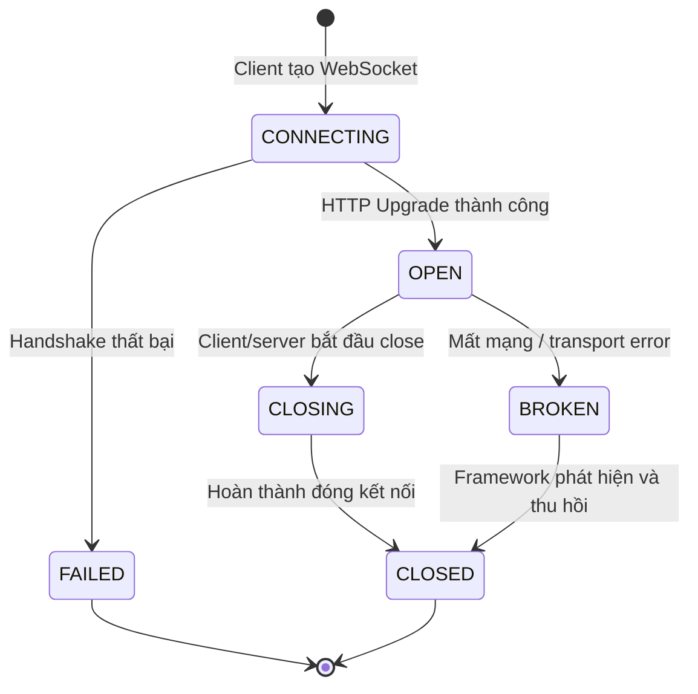
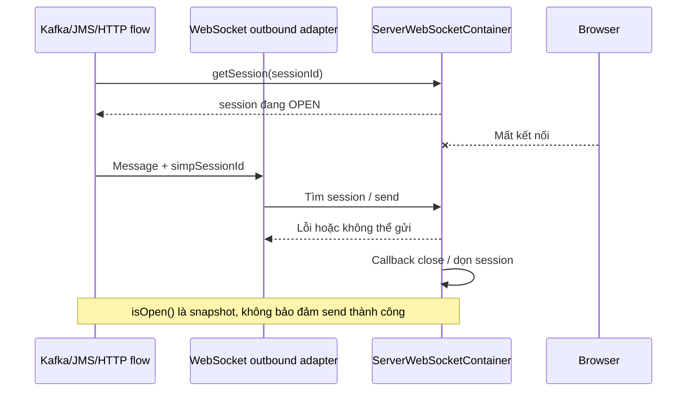

# Đóng session và xử lý disconnect

## 1. Bối cảnh và mục tiêu

Trong module **SPRING_INTEGRATION_ADAPTERS**, ứng dụng kết nối các hệ thống ngoài bằng inbound/outbound adapter, gateway, poller và `MessageChannel`; dữ liệu có thể đi qua file, SFTP, HTTP, JMS, AMQP, Kafka và cơ sở dữ liệu. Với **WebSocket**, một phần quan trọng của hợp đồng tích hợp là **vòng đời kết nối**: phiên nào còn hoạt động, phiên nào đã đóng, và phải xử lý những công việc nào khi client biến mất.

Bài **Đóng session và xử lý disconnect**, thuộc chương **Adapter WebSocket**, giúp bạn:

- Hiểu vòng đời `WebSocketSession` từ handshake, trao đổi dữ liệu đến closing/closed.
- Phân biệt client chủ động đóng, server chủ động đóng, transport error, mất mạng và timeout.
- Đọc `CloseStatus`/close code và biết mã nào có thể gửi, mã nào chỉ là tín hiệu quan sát.
- Dùng `ServerWebSocketContainer`, `WebSocketHandlerDecorator` và callback `afterConnectionClosed` để dọn session registry.
- Xử lý đúng các tình huống **disconnect đến muộn**, **close callback trùng**, **reconnect tạo session mới**, nhiều tab và nhiều node.
- Biết sự khác nhau giữa raw WebSocket lifecycle và STOMP `SessionDisconnectEvent`.
- Thiết kế gửi thông điệp, error handling, ACK, retry và kiểm thử mà không nhầm “đã đóng” với “đã xử lý xong nghiệp vụ”.

**Ví dụ xuyên suốt:** một dashboard kết nối đến `/ws/lifecycle`; ứng dụng ghi nhận các phiên đang mở. Client có thể gửi `bye` để yêu cầu đóng bình thường. Khi đóng, server dọn mapping và ngừng xem session đó là đích gửi thông báo. Mục tiêu chính của ví dụ là **vòng đời và cleanup**, không phải kiểm soát truy cập của một hệ thống production.

## 2. WebSocket session kết thúc như thế nào?

WebSocket bắt đầu bằng HTTP Upgrade; sau handshake thành công, kết nối hai chiều tồn tại cho tới khi một phía đóng hoặc transport không còn sử dụng được.



Sơ đồ là **mô hình trạng thái giải thích**, không phải một enum chung được Spring Integration cung cấp. Trên trình duyệt có `WebSocket.readyState` với `CONNECTING`, `OPEN`, `CLOSING` và `CLOSED`; phía Java có `WebSocketSession.isOpen()` để xem trạng thái tại thời điểm kiểm tra.

### Ba cách kết nối kết thúc phổ biến

| Tình huống | Hành vi có thể thấy | Ứng dụng cần xử lý |
| --- | --- | --- |
| **Client chủ động đóng** | Trình duyệt gọi `socket.close(1000, "...")`; server nhận close handshake | Thu hồi mapping, dừng gửi tới session, cập nhật hiện diện |
| **Server chủ động đóng** | Server gọi `session.close(CloseStatus.NORMAL)` hoặc status phù hợp | Thu hồi mapping, thông báo trạng thái qua callback, xác định có cần reconnect |
| **Mất mạng / crash / timeout** | Có thể không có close frame; server chỉ phát hiện sau I/O error hoặc heartbeat/timeout | Không chờ close frame mãi; cleanup khi callback đến, dùng lease/TTL nếu có trạng thái phân tán |

Khi server đã thấy phiên đóng, **không nên gửi thêm message** tới phiên đó. Một callback đóng có thể đến sau callback lỗi transport; thứ tự nhận biết sự cố không đồng nhất giữa mọi container/network.

## 3. Đóng bình thường và đóng bất thường

### 3.1. Close handshake

Thông thường một phía gửi **WebSocket Close control frame**, phía kia phản hồi close frame và transport được kết thúc. `CloseStatus` trong Spring Framework chứa mã trạng thái và reason. Với Spring WebSocket:

```java
import org.springframework.web.socket.CloseStatus;
import org.springframework.web.socket.WebSocketSession;

session.close(CloseStatus.NORMAL);
```

`WebSocketSession.close(CloseStatus)` có thể ném `IOException`. Gọi close **khởi đầu thủ tục đóng**; nó không phải ACK ứng dụng cho những message đã gửi trước đó. Trong một kết nối bị hỏng sẵn, thao tác close có thể thất bại hoặc không mang lại close frame phía client.

### 3.2. Ý nghĩa các close code thường gặp

| Mã | Tên/ý nghĩa thường gặp | Cách diễn giải |
| --- | --- | --- |
| **1000** | Normal Closure | Hai phía kết thúc phiên như dự kiến |
| **1001** | Going Away | Một phía rời đi, ví dụ đóng trang hoặc server shutdown |
| **1002** | Protocol Error | Phát hiện vi phạm giao thức |
| **1003** | Unsupported Data | Endpoint không chấp nhận kiểu dữ liệu nhận được |
| **1006** | Abnormal Closure | **Mã dành riêng cho báo cáo** khi không nhận được Close frame; không gửi mã này trên wire |
| **1008** | Policy Violation | Vi phạm chính sách, có thể dùng khi server từ chối tiếp tục phiên |
| **1009** | Message Too Big | Message quá lớn so với giới hạn cho phép |
| **1011** | Internal Error | Server gặp lỗi bất ngờ |
| **1012** | Service Restart | Dịch vụ đang khởi động lại, nếu phù hợp protocol/container |
| **4000–4999** | Private-use | Các bên có thể thống nhất mã ứng dụng riêng |

`CloseStatus.NORMAL`, `CloseStatus.POLICY_VIOLATION`, `CloseStatus.TOO_BIG_TO_PROCESS` và `CloseStatus.SERVER_ERROR` là các hằng số tiện dụng trong Spring. Không dùng một mã chỉ vì tên nghe phù hợp; phải xác định **nguồn sự cố** và hợp đồng reconnect.

**Đặc biệt:** `1005`, `1006` và `1015` là các giá trị dành riêng cho quan sát; không tự gửi chúng trong Close frame. `1006` xuất hiện trong JavaScript `CloseEvent` thường có nghĩa trình duyệt không nhận được close handshake bình thường, **không chứng minh phía server chủ động gửi status 1006**.

### 3.3. Close reason chứa bao nhiêu thông tin?

Một Close frame có giới hạn kích thước; phần reason UTF-8 sau mã close cũng bị giới hạn (thường tối đa 123 byte). Reason không phải nơi truyền stack trace, token, dữ liệu người dùng hoặc nội dung nghiệp vụ dài. Nên dùng chuỗi ngắn, an toàn như `"session expired"` hoặc `"server restart"`, và ghi chi tiết ở log có kiểm soát.

Nếu ứng dụng cần client hiểu *tại sao* phải xử lý một giao dịch trước khi ngắt, có thể gửi **message nghiệp vụ** có cấu trúc trước khi close; tuy nhiên gửi message rồi gọi close ngay **không bảo đảm** client đã nhận và xử lý message đó. Muốn chắc chắn cần ACK và quy trình riêng.

## 4. Vai trò của container, inbound và outbound adapter

Spring Integration dùng `IntegrationWebSocketContainer` để quản lý các `WebSocketSession`:

- `ServerWebSocketContainer` đăng ký endpoint trên server và giữ nhiều session kết nối đến endpoint đó.
- `ClientWebSocketContainer` đại diện cho một kết nối từ ứng dụng tới server bên ngoài.
- `WebSocketInboundChannelAdapter` nhận dữ liệu từ container và đưa Spring `Message<?>` vào flow.
- `WebSocketOutboundMessageHandler` dùng session thích hợp trong container để gửi frame.

Một số API quan trọng:

```java
WebSocketSession session = serverContainer.getSession(sessionId);
Map<String, WebSocketSession> active = serverContainer.getSessions();

if (session != null && session.isOpen()) {
    // Đây chỉ là kiểm tra tức thời; session vẫn có thể đóng trước khi send.
}
```

`getSession(sessionId)` có thể trả `null`. `getSessions()` là tập session **cục bộ của container ở node đang chạy**, không phải một nguồn dữ liệu tồn tại qua restart.

Với raw WebSocket, outbound message gửi về đúng session thường mang header:

```java
SimpMessageHeaderAccessor.SESSION_ID_HEADER // "simpSessionId"
```

Nếu lưu `sessionId` rồi client reconnect, header mang ID cũ sẽ không tự chuyển đến phiên mới. Cần tra registry hiện tại và xác định lại đích nhận theo danh tính đã xác thực.

### Callback vòng đời không phải message nghiệp vụ

`WebSocketListener` của Spring Integration có các callback nhận message và theo dõi session, trong đó có `afterSessionEnded(WebSocketSession, CloseStatus)`. Tuy nhiên **mỗi `IntegrationWebSocketContainer` chỉ hỗ trợ đăng ký một `WebSocketListener`**; thông thường inbound adapter đã sử dụng vị trí đó.

Để theo dõi lifecycle mà vẫn giữ inbound adapter, server container có thể cấu hình `WebSocketHandlerDecoratorFactory` và một `WebSocketHandlerDecorator`. Đây là điểm mở rộng của hạ tầng Spring WebSocket để quan sát `afterConnectionEstablished`, `handleTransportError` và `afterConnectionClosed`.

**Không giả định** đóng session sẽ tạo một JSON message trên `wsInputChannel`. Close frame, transport error và STOMP disconnect có cơ chế callback/event riêng.

## 5. Ví dụ Java: theo dõi session và dọn mapping khi disconnect

Ví dụ dùng **Java 17+, Spring Boot 3.x, Spring Integration 6.x**, WebSocket server theo Servlet stack. Client kết nối đến `/ws/lifecycle` và gửi các text frame đơn giản. Mục tiêu là nhìn rõ lifecycle, nên không yêu cầu STOMP broker.

### 5.1. Dependency

```xml
<dependencies>
    <dependency>
        <groupId>org.springframework.boot</groupId>
        <artifactId>spring-boot-starter-web</artifactId>
    </dependency>
    <dependency>
        <groupId>org.springframework.boot</groupId>
        <artifactId>spring-boot-starter-integration</artifactId>
    </dependency>
    <dependency>
        <groupId>org.springframework.integration</groupId>
        <artifactId>spring-integration-websocket</artifactId>
    </dependency>
</dependencies>
```

Giả định Spring Boot BOM quản lý các phiên bản tương thích. `spring-integration-websocket` chứa container và inbound/outbound adapter; `spring-boot-starter-web` cung cấp hạ tầng servlet/WebSocket thông dụng.

### 5.2. Registry theo session ID

Tạo `ActiveSessionRegistry.java`:

```java
package com.example.websocket;

import java.time.Instant;
import java.util.Map;
import java.util.concurrent.ConcurrentHashMap;
import java.util.concurrent.ConcurrentMap;
import org.springframework.stereotype.Component;
import org.springframework.web.socket.CloseStatus;
import org.springframework.web.socket.WebSocketSession;

@Component
public class ActiveSessionRegistry {

    public record SessionInfo(
            String sessionId, String username, Instant openedAt) {
    }

    private final ConcurrentMap<String, SessionInfo> active =
            new ConcurrentHashMap<>();

    public void connected(WebSocketSession session) {
        String username = session.getPrincipal() == null
                ? "anonymous" : session.getPrincipal().getName();

        active.put(session.getId(),
                new SessionInfo(session.getId(), username, Instant.now()));
    }

    public void disconnected(String sessionId, CloseStatus status) {
        SessionInfo removed = active.remove(sessionId);
        if (removed != null) {
            System.out.printf(
                    "Session ended: %s, code=%d, active=%d%n",
                    sessionId, status.getCode(), active.size());
        }
    }

    public Map<String, SessionInfo> snapshot() {
        return Map.copyOf(active);
    }

    public int count() {
        return active.size();
    }
}
```

Các lựa chọn trong ví dụ:

- Registry dùng `ConcurrentHashMap` vì các callback của nhiều WebSocket session có thể được gọi đồng thời.
- Khóa chính là **session ID**, nên một user mở nhiều tab không làm ghi đè session của tab khác.
- `remove(sessionId)` là **idempotent**: nếu callback đóng chạy lặp, lần thứ hai không gây lỗi hoặc xóa nhầm session mới.
- Giá trị `"anonymous"` chỉ để quan sát trong bài demo. **Registry này không xác thực người dùng**; production phải xác thực ở handshake và không gửi dữ liệu riêng tư chỉ dựa vào chuỗi username do bất kỳ client nào tự cung cấp.

`snapshot()` có thể dùng cho thống kê/debug, nhưng đó chỉ là ảnh chụp thông tin ứng dụng. Không dùng nó làm bằng chứng session chắc chắn còn mở lúc gửi frame.

### 5.3. Cấu hình lifecycle decorator

Tạo `WebSocketLifecycleConfiguration.java`:

```java
package com.example.websocket;

import org.springframework.beans.factory.annotation.Qualifier;
import org.springframework.context.annotation.Bean;
import org.springframework.context.annotation.Configuration;
import org.springframework.integration.annotation.ServiceActivator;
import org.springframework.integration.channel.DirectChannel;
import org.springframework.integration.config.EnableIntegration;
import org.springframework.integration.websocket.ServerWebSocketContainer;
import org.springframework.integration.websocket.inbound.WebSocketInboundChannelAdapter;
import org.springframework.messaging.MessageChannel;
import org.springframework.messaging.MessageHandler;
import org.springframework.messaging.MessagingException;
import org.springframework.messaging.simp.SimpMessageHeaderAccessor;
import org.springframework.web.socket.CloseStatus;
import org.springframework.web.socket.WebSocketSession;
import org.springframework.web.socket.handler.WebSocketHandlerDecorator;

@Configuration
@EnableIntegration
public class WebSocketLifecycleConfiguration {

    @Bean
    public ServerWebSocketContainer lifecycleContainer(
            ActiveSessionRegistry registry) {

        ServerWebSocketContainer container =
                new ServerWebSocketContainer("/ws/lifecycle");

        container.setDecoratorFactories(delegate ->
                new WebSocketHandlerDecorator(delegate) {

                    @Override
                    public void afterConnectionEstablished(
                            WebSocketSession session) throws Exception {

                        super.afterConnectionEstablished(session);
                        registry.connected(session);
                    }

                    @Override
                    public void handleTransportError(
                            WebSocketSession session,
                            Throwable exception) throws Exception {

                        // Đây là tín hiệu lỗi; session có thể chưa kết thúc.
                        System.out.printf(
                                "Transport error, session=%s, error=%s%n",
                                session.getId(),
                                exception.getClass().getSimpleName());

                        super.handleTransportError(session, exception);
                    }

                    @Override
                    public void afterConnectionClosed(
                            WebSocketSession session,
                            CloseStatus closeStatus) throws Exception {

                        try {
                            super.afterConnectionClosed(session, closeStatus);
                        } finally {
                            // Dọn đúng session ngay cả khi delegate ném lỗi.
                            registry.disconnected(session.getId(), closeStatus);
                        }
                    }
                });

        return container;
    }

    @Bean
    public MessageChannel wsInputChannel() {
        return new DirectChannel();
    }

    @Bean
    public WebSocketInboundChannelAdapter lifecycleInbound(
            ServerWebSocketContainer lifecycleContainer,
            @Qualifier("wsInputChannel") MessageChannel channel) {

        WebSocketInboundChannelAdapter adapter =
                new WebSocketInboundChannelAdapter(lifecycleContainer);
        adapter.setOutputChannel(channel);
        return adapter;
    }

    @Bean
    @ServiceActivator(inputChannel = "wsInputChannel")
    public MessageHandler handleClientText(
            ServerWebSocketContainer lifecycleContainer) {

        return incoming -> {
            String sessionId = SimpMessageHeaderAccessor
                    .getSessionId(incoming.getHeaders());

            if (sessionId == null) {
                throw new MessagingException(
                        incoming, "Missing simpSessionId");
            }

            if (!(incoming.getPayload() instanceof String text)) {
                throw new MessagingException(
                        incoming, "Only text payload is supported");
            }

            if ("bye".equalsIgnoreCase(text.strip())) {
                WebSocketSession session =
                        lifecycleContainer.getSession(sessionId);

                if (session == null || !session.isOpen()) {
                    return;
                }

                try {
                    session.close(CloseStatus.NORMAL);
                } catch (java.io.IOException exception) {
                    throw new MessagingException(
                            incoming, "Cannot close WebSocket session",
                            exception);
                }
            }
        };
    }
}
```

Ý nghĩa:

1. `ServerWebSocketContainer` giữ các session tại `/ws/lifecycle`.
2. `setDecoratorFactories(...)` bọc `WebSocketHandler` nội bộ nhưng vẫn gọi `super`, giữ hành vi tiếp nhận và đóng kết nối của framework.
3. `afterConnectionEstablished` đăng ký session khi kết nối mở thành công.
4. `handleTransportError` ghi nhận lỗi; **không giả định callback này đồng nghĩa session đã đóng**.
5. `afterConnectionClosed` luôn gọi `registry.disconnected(sessionId, status)` trong `finally`.
6. `WebSocketInboundChannelAdapter` vẫn là listener nhận data frame duy nhất của container.
7. Khi flow nhận text `bye`, service thử đóng session của chính message đang đến.

Ví dụ `bye` cho phép client chủ động đề nghị server đóng kết nối để thấy callback; nó **không phải cơ chế logout hay revoke phiên**. Ở ứng dụng thật, một hành động đóng session vì bảo mật cần kiểm tra quyền và phân biệt client yêu cầu thoát với server cưỡng chế đóng.

> **Ranh giới vận hành:** trong thực tế, một session có thể đóng ngay sau khi `isOpen()` trả về `true`; xử lý ngoại lệ từ `close(...)` là cần thiết. Đừng dùng `afterConnectionClosed` để gửi thêm WebSocket frame tới session đã kết thúc.

### 5.4. Chủ động đóng session từ service

Khi người dùng logout, hết quyền truy cập hoặc hệ thống cần giới hạn phiên, một service có thể nhận session ID đã được xác định **ở phía server**:

```java
package com.example.websocket;

import java.io.IOException;
import org.springframework.integration.websocket.ServerWebSocketContainer;
import org.springframework.stereotype.Service;
import org.springframework.web.socket.CloseStatus;
import org.springframework.web.socket.WebSocketSession;

@Service
public class SessionTerminationService {

    private final ServerWebSocketContainer container;

    public SessionTerminationService(
            ServerWebSocketContainer lifecycleContainer) {
        this.container = lifecycleContainer;
    }

    public boolean close(String sessionId, CloseStatus status)
            throws IOException {

        WebSocketSession session = container.getSession(sessionId);

        if (session == null || !session.isOpen()) {
            return false;
        }

        session.close(status);
        return true;
    }

    public boolean closeForPolicy(String sessionId) throws IOException {
        return close(sessionId, CloseStatus.POLICY_VIOLATION);
    }
}
```

`close(...)` trả `true` chỉ khi lời gọi close đã được thực hiện mà không ném lỗi; điều đó **không chứng minh client đã nhận Close frame**. Cleanup cuối cùng vẫn dựa vào callback lifecycle hoặc cơ chế thu hồi phù hợp. Nếu phải thu hồi quyền ngay, dịch vụ nên chặn truy cập nghiệp vụ và gửi tiếp **trước hoặc đồng thời với** việc đóng session, không đặt toàn bộ tính đúng đắn vào một close handshake qua mạng.

Không xây một HTTP endpoint công khai nhận session ID bất kỳ rồi gọi `closeForPolicy(...)`. Chỉ một service quản trị hoặc luồng logout được xác thực/ủy quyền mới được phép chọn session cần đóng.

## 6. Kiểm thử bằng trình duyệt

### 6.1. Client chủ động đóng

Chạy Spring Boot trên cổng `8080`. Từ Console của một trang được phép truy cập origin tương ứng:

```javascript
const ws = new WebSocket("ws://localhost:8080/ws/lifecycle");

ws.addEventListener("open", () => {
  console.log("open");
});

ws.addEventListener("close", event => {
  console.log({
    type: "close",
    code: event.code,
    reason: event.reason,
    wasClean: event.wasClean
  });
});

ws.addEventListener("error", () => {
  console.log("transport error");
});

// Sau khi event open đã xuất hiện:
ws.close(1000, "user finished");
```

Kết quả kỳ vọng: trình duyệt nhận `close` và server chạy `afterConnectionClosed` rồi xóa entry có session ID tương ứng. `event.wasClean` có thể phản ánh close handshake; không nên dùng nó như bằng chứng server đã xử lý xong nghiệp vụ trước khi đóng.

### 6.2. Server chủ động đóng theo message

Kết nối mới:

```javascript
const ws2 = new WebSocket("ws://localhost:8080/ws/lifecycle");

ws2.addEventListener("open", () => {
  ws2.send("bye");
});

ws2.addEventListener("close", event => {
  console.log("Server closed:", event.code, event.reason);
});
```

Flow nhận `bye`, tìm `simpSessionId` của message và gọi `session.close(CloseStatus.NORMAL)`. Callback đóng xóa session khỏi registry. Với mạng hoạt động bình thường, close code quan sát được thường là `1000`.

### 6.3. Thử hai tab và reconnect

1. Mở hai tab A và B đến cùng URL; registry có hai session khác nhau.
2. Đóng A; chỉ entry của A bị xóa, B vẫn còn.
3. Kết nối A lại; framework tạo session mới, với ID khác session cũ.
4. Đóng lần lượt các tab; registry trở về rỗng nếu mọi callback đã được xử lý.

Không lưu user → một session đơn lẻ nếu ứng dụng cho phép nhiều tab. Với một user có hai session, thao tác close của A không được xóa mapping của B.

### 6.4. Giả lập mất kết nối

Mất mạng, kill trình duyệt hoặc ngắt proxy có thể làm server **không nhận được Close frame ngay lập tức**. Tùy transport và timeout:

- Client có thể thấy `CloseEvent.code == 1006`.
- Server có thể gọi `handleTransportError` trước `afterConnectionClosed`.
- Có độ trễ trước khi server biết phiên đã mất.
- Nếu tiến trình server bị kill, callback cleanup trong tiến trình **không thể chạy**.

Vì vậy, nên kết hợp callback với **timeout/heartbeat**, và nếu có dữ liệu hiện diện phân tán thì dùng **TTL/lease**. Đừng viết test đòi server luôn phát hiện mất điện/ngắt Wi-Fi tức thì.

## 7. Xử lý disconnect một cách idempotent

Callback đóng có thể tới nhiều hơn một lần ở một số tầng/sub-protocol, hoặc các tín hiệu transport error và close cùng dẫn tới cleanup. Thiết kế các tác vụ thu hồi cần an toàn khi chạy lặp.

### 7.1. Dọn theo session ID, không xóa theo user ID một cách mù quáng

Giả sử:

```text
T0: user-17 có session S1.
T1: kết nối S1 bị gián đoạn.
T2: user-17 reconnect và được cấp session S2.
T3: callback đóng S1 mới được xử lý.
```

Đây là một race condition rất thường gặp. Nếu T3 gọi `byUser.remove("user-17")`, hệ thống có thể xóa nhầm S2.

Nếu business chỉ cho phép **một session mới nhất**, dùng thao tác so sánh:

```java
// Chỉ xóa nếu mapping hiện vẫn trỏ tới phiên cũ.
byUser.remove(userId, oldSessionId);
```

Nếu cho phép **nhiều session đồng thời**, mô hình phù hợp hơn là `userId -> Set<sessionId>` và xóa đúng `oldSessionId`.

Ví dụ idempotent với một map session-centric:

```java
SessionInfo removed = active.remove(oldSessionId);
if (removed != null) {
    // Giải phóng tài nguyên gắn với phiên cũ.
}
```

Nên lưu các nguồn tài nguyên cần thu hồi theo session ID: subscription riêng, hàng đợi per-session, timer, trạng thái “đang online”, client-specific rate limiter và các tác vụ dự kiến chỉ còn ý nghĩa khi session mở.

### 7.2. Cleanup không nên gây lỗi dây chuyền

Nếu việc dọn một subscription trong hệ thống ngoài gặp lỗi, đừng để nó làm hỏng toàn bộ callback hoặc khiến các callback khác không chạy. Có thể:

1. Xóa mapping cục bộ nhanh và an toàn.
2. Ghi nhận sự kiện `SessionEnded(sessionId, userId, occurredAt)` với correlation ID nếu cần.
3. Đưa các thao tác tốn thời gian (cập nhật DB, hủy subscription ngoài) sang một consumer có timeout và retry.
4. Đảm bảo thao tác dọn lặp không gây mất dữ liệu mới hoặc xóa mapping của session khác.
5. Giám sát backlog, số retry, stale mapping và độ trễ cleanup.

Không đặt HTTP call chậm, query lớn hoặc retry vô hạn trực tiếp trong callback đóng, vì nó có thể chiếm thread liên quan đến I/O và làm giảm khả năng phục vụ các kết nối khác.

### 7.3. Chỉ phát offline khi tất cả session của user đã đóng

Nếu người dùng mở hai tab, đóng một tab **không có nghĩa người dùng offline**. Trạng thái hiện diện nên được suy ra từ tập session đã xác thực của user:

```text
user-17 -> {S1, S2}

close(S1) -> user-17 vẫn online vì còn S2
close(S2) -> user-17 có thể offline, nếu không còn session trên node khác
```

Trong cluster, cần xem xét session trên mọi node và độ trễ đồng bộ dữ liệu. Không dùng một `ConcurrentHashMap` cục bộ để kết luận sự hiện diện toàn cục của user khi ứng dụng chạy nhiều instance.

## 8. Disconnect và sending message cùng lúc

Tình huống thực tế:



Một lần `MessageChannel.send(...)` trả `true` chỉ có nghĩa message được channel tiếp nhận theo semantics của Spring Messaging. Nó không chứng minh client đã nhận hay xử lý; với `DirectChannel`, handler thường chạy đồng bộ nhưng vẫn có race với việc đóng transport.

### Chiến lược phù hợp theo mục tiêu

| Loại dữ liệu | Có thể làm gì khi session đóng? |
| --- | --- |
| **Trạng thái dashboard mới nhất** | Bỏ cập nhật cho session đã đóng; client reconnect sẽ tải snapshot mới nhất |
| **Thông báo quan trọng cho user** | Lưu event theo user/event ID; gửi cho session mới khi kết nối lại |
| **Yêu cầu cần ACK** | Ghi pending state, timeout, retry và deduplication |
| **Lệnh điều khiển thời gian thực** | Từ chối khi session mất; yêu cầu client khởi tạo thao tác mới nếu cần |
| **File/Kafka/JMS downstream** | Tách rõ ACK nguồn và ACK WebSocket; không suy luận giao dịch xuyên các adapter |

Nếu cần bảo đảm delivery, định danh bền vững nên là `eventId`/`correlationId` và user/device đã xác thực. `sessionId` chỉ dùng để định tuyến một lần gửi tới kết nối **hiện hành**.

## 9. Heartbeat, idle timeout và phát hiện kết nối chết

### 9.1. WebSocket Ping/Pong và heartbeat ứng dụng

WebSocket có control frame Ping/Pong. STOMP có cơ chế heartbeat riêng ở lớp STOMP; một chuỗi JSON như `{"type":"ping"}` do ứng dụng tự gửi là **application heartbeat**, không đồng nghĩa với WebSocket Ping frame.

| Cơ chế | Mục đích | Lưu ý |
| --- | --- | --- |
| WebSocket Ping/Pong | Kiểm tra hoạt động transport | Được hạ tầng/framework hỗ trợ tùy stack |
| STOMP heartbeat | Phát hiện phiên STOMP không còn đáp ứng | Cần hai phía thỏa thuận/định cấu hình |
| Application heartbeat | Phục vụ logic nghiệp vụ/presence của ứng dụng | Tự định nghĩa timeout, schema và response |
| TCP keepalive | Phát hiện lỗi transport ở tầng hệ điều hành | Có thể phát hiện chậm nếu không cấu hình |
| Idle timeout | Đóng phiên không hoạt động quá giới hạn | Tùy container/proxy; không mặc định cùng giá trị |

Không nên chỉ dựa vào close callback để tính online/offline thời gian thực. Mạng có thể rơi vào trạng thái *half-open* mà một phía chưa nhận ra.

### 9.2. Gợi ý cấu hình và vận hành

- Thiết lập idle timeout/heartbeat theo yêu cầu của WebSocket container, client và reverse proxy.
- Kiểm tra proxy/load balancer có hỗ trợ HTTP Upgrade và timeout cho kết nối lâu dài.
- Đặt giới hạn số connection, kích thước frame, send time và buffer để ngăn client chậm làm cạn tài nguyên.
- Dùng metrics cho `openConnections`, `closeCodes`, `transportErrors`, `abnormalCloses` và `cleanupLag`.
- Với session registry trên Redis/DB, dùng TTL hoặc lease để dọn phiên còn sót sau khi một node bị kill.
- Client reconnect nên có backoff và jitter để tránh hàng loạt kết nối lại khi server khôi phục.

**Đánh đổi:** timeout quá ngắn khiến kết nối di động bị đóng giả; timeout quá dài giữ mapping stale và làm người dùng chờ lâu trước khi biết mất kết nối. Nên đo mạng thực tế rồi chọn giá trị, thay vì tin một timeout mặc định áp dụng cho mọi ứng dụng.

## 10. STOMP disconnect khác raw WebSocket close

STOMP chạy **trên** WebSocket và có command `DISCONNECT` riêng. Một client STOMP thường gửi `DISCONNECT` trước khi kết thúc kết nối, nhưng WebSocket cũng có thể đóng bất thường mà không kịp gửi command đó.

Spring WebSocket Messaging cung cấp:

- `SessionConnectEvent`: nhận yêu cầu STOMP `CONNECT`.
- `SessionConnectedEvent`: broker đã gửi `CONNECTED` và STOMP session được xác lập.
- `SessionSubscribeEvent` / `SessionUnsubscribeEvent`: client thay đổi subscription.
- `SessionDisconnectEvent`: STOMP session kết thúc; có thể bắt nguồn từ lệnh `DISCONNECT` hoặc WebSocket đóng.

**Quan trọng:** `SessionDisconnectEvent` có thể được công bố **nhiều lần cho cùng session**, vì vậy listener phải idempotent. Event này thuộc cấu hình STOMP/Spring WebSocket Messaging; **không tự xuất hiện cho mọi endpoint raw WebSocket**.

Ví dụ dùng sự kiện STOMP:

```java
package com.example.stomp;

import org.springframework.context.event.EventListener;
import org.springframework.stereotype.Component;
import org.springframework.web.socket.messaging.SessionDisconnectEvent;

@Component
public class StompDisconnectListener {

    @EventListener
    public void onDisconnect(SessionDisconnectEvent event) {
        String sessionId = event.getSessionId();

        // Thao tác remove theo session ID phải chịu được gọi lặp.
        System.out.println("STOMP disconnected: " + sessionId
                + ", code=" + event.getCloseStatus().getCode());
    }
}
```

Trong production, thay `System.out` bằng metrics/log có kiểm soát và gọi service cleanup đúng **session ID**. Listener STOMP không thay thế callback hạ tầng của raw WebSocket nếu cùng ứng dụng đang dùng cả hai mô hình.

### Broker relay và reconnect

Khi dùng `enableStompBrokerRelay(...)`, broker relay có thể thiết lập lại **system connection** sau một lần broker outage, nhưng các **STOMP client connections** không tự được khôi phục hoàn toàn chỉ vì system connection đã trở lại. Client thường phải reconnect và subscribe lại. App cũng cần tái xác thực quyền, đồng bộ trạng thái và xử lý event chưa ACK nếu hợp đồng yêu cầu.

## 11. Server shutdown và graceful disconnect

Ứng dụng có thể đóng hàng nghìn kết nối khi triển khai phiên bản mới. Muốn giảm gián đoạn, nên:

1. **Ngừng nhận connection mới** hoặc rút node khỏi load balancer/readiness.
2. **Ngừng tạo thông báo mới cho session đang thoát**, hoặc chuyển event sang nguồn có thể retry.
3. Nếu cần, gửi một message ứng dụng ngắn như `server.restarting` cho client đang mở và chờ ACK trong một giới hạn thời gian; không giả định mọi client đều nhận.
4. Đóng session bằng status phù hợp, ví dụ `CloseStatus.SERVICE_RESTARTED` nếu stack và ứng dụng hỗ trợ.
5. Dọn queue, timer, registry và những tài nguyên gắn với session.
6. Cho phép client reconnect có backoff tới node còn hoạt động.

`ServerWebSocketContainer` thực hiện vòng đời của `SmartLifecycle`; thứ tự `phase`/startup/shutdown có thể quan trọng khi một service downstream hoặc broker bắt buộc phải còn sống trong lúc dọn kết nối.

**Không bảo đảm** mọi close callback được gọi khi tiến trình bị `kill -9`, mất điện hoặc container bị buộc dừng. Vì vậy, khi hiện diện người dùng được lưu ngoài tiến trình, cần cơ chế thu hồi độc lập như TTL, lease hoặc quy trình reconciliation.

### Điều gì nên giữ qua restart?

| Dữ liệu | Có nên giữ qua restart? |
| --- | --- |
| `WebSocketSession` Java object | Không; gắn với kết nối và tiến trình hiện tại |
| `sessionId` cũ để gửi frame | Không; không còn đại diện cho kết nối hiện tại |
| User/tenant identity | Có, theo cơ chế xác thực và dữ liệu nghiệp vụ |
| `eventId`, pending notification | Có nếu yêu cầu retry/replay |
| Connection metrics lịch sử | Có thể lưu trong hệ thống giám sát |
| Subscription của raw WebSocket tự thiết kế | Cần quy trình resubscribe/recover theo hợp đồng |

## 12. Bảo mật khi chủ động đóng kết nối

Quyền **đóng một session** cũng là một quyền quản trị:

- Xác thực user tại handshake, không tin `userId`/`sessionId` do client gửi để quyết định đóng phiên của người khác.
- Nếu server cho phép thao tác `logout all devices`, tra các session thuộc user đã xác thực và đóng **từng session được phép**.
- Khi revoke token/quyền, từ chối các nghiệp vụ tiếp theo **ngay cả nếu close handshake chậm**.
- Không để HTTP endpoint kiểu `/sessions/{id}/close` mở công khai cho client bất kỳ.
- Không đưa access token, stack trace hoặc dữ liệu cá nhân vào `CloseStatus.reason`.
- Dùng `wss://` cho kết nối qua mạng và cấu hình origin/CSRF theo chính sách ứng dụng.
- Một request close lặp hoặc session đã đóng phải được xử lý an toàn, không trở thành lỗi hệ thống lan rộng.

Đóng kết nối chỉ dừng transport; nếu cần logout, ứng dụng cũng phải hủy hoặc vô hiệu hóa **các credential/token/session xác thực** theo chính sách. Chỉ đóng WebSocket mà giữ một token còn hợp lệ sẽ cho phép client mở WebSocket mới.

## 13. Lỗi thường gặp và cách tìm nguyên nhân

| Triệu chứng | Nguyên nhân có thể | Cách xác minh/xử lý |
| --- | --- | --- |
| Client đóng tab nhưng registry vẫn có session | Callback chưa đến, cleanup bị lỗi hoặc lưu stale state | Kiểm tra `afterConnectionClosed`, thêm TTL/reconciliation |
| Client thấy `1006` | Mất Close frame, proxy/network lỗi, browser mất transport | Kiểm tra WebSocket CloseEvent, proxy, I/O error; không coi 1006 là mã server gửi |
| `getSession(id)` trả `null` khi muốn đóng | ID đã cũ, session ở node khác hoặc đã bị thu hồi | Tra node/session hiện tại; xử lý như already closed |
| Một tab đóng làm mất trạng thái online của cả user | Registry dùng user → một session rồi xóa mù quáng | Chuyển sang tập session và xóa theo ID |
| Reconnect thành công nhưng không nhận notification | Service vẫn dùng session ID cũ | Xác thực lại, cập nhật mapping và subscription |
| `isOpen()` đúng nhưng send/close vẫn lỗi | Session đóng giữa lần kiểm tra và thao tác | Catch exception, cập nhật metrics, retry/fallback theo hợp đồng |
| Không có `SessionDisconnectEvent` ở raw WebSocket | Event thuộc STOMP messaging lifecycle | Dùng WebSocket handler decorator/callback |
| Disconnect event chạy hai lần | STOMP event hoặc callback xử lý lặp | Cleanup idempotent; kiểm tra đúng ID |
| Cả hệ thống chậm khi nhiều session rời đi | Cleanup gọi DB/HTTP đồng bộ quá lâu | Tách việc nặng ra hàng đợi có giới hạn |
| Node crash làm người dùng mãi “online” | Không chạy callback đóng trong tiến trình đã chết | Lease/TTL + reconciliation trong store phân tán |
| Client nhận thông báo ngay trước close nhưng không xử lý | Không có ACK nghiệp vụ | Thiết kế correlation ID, ACK, lưu và replay |
| Server trả close status không phù hợp | Dùng mã dành riêng, reason quá dài hoặc thiếu phân loại lỗi | Tuân thủ WebSocket RFC, dùng `CloseStatus` hợp lệ |

### Hướng debug theo thứ tự

1. Handshake có hoàn thành, callback `afterConnectionEstablished` có được gọi?
2. ID mà ứng dụng định đóng có đúng `WebSocketSession.getId()`/`simpSessionId`?
3. Callback `handleTransportError` và `afterConnectionClosed` có được quan sát riêng?
4. Close code/reason phía browser và server có phù hợp không? Có phải `1006` do mất transport?
5. Registry có xóa **đúng session ID**, không làm mất những session mới/cùng user?
6. Message mới còn bị gửi đến session đã đóng không? Nếu có, nơi nào lưu ID cũ?
7. Ở multi-node, phiên có nằm trên node hiện tại hay một node khác?
8. Có sự kiện nào cần ACK/replay/đồng bộ trạng thái khi reconnect?

## 14. Kiểm thử thực tế

### 14.1. Ma trận kiểm thử vòng đời

| Kịch bản | Điều cần quan sát |
| --- | --- |
| Client mở rồi đóng bình thường bằng `close(1000)` | Callback close, registry giảm đúng một entry |
| Client gửi `bye`, server gọi `close(NORMAL)` | Trình duyệt nhận close nếu transport hoạt động; server cleanup |
| Mở hai tab rồi đóng một tab | Tab còn lại không bị ảnh hưởng |
| Reconnect sau khi close | Session ID mới, mapping cũ không được dùng |
| Đóng cùng session nhiều lần | Cleanup an toàn, không xóa session khác |
| Ngắt mạng/proxy bất thường | Phát hiện có thể trễ; log/metrics phân biệt với close thường |
| Server đang gửi thì session đóng | Lỗi gửi được xử lý, không coi là đã giao thành công |
| Khởi động lại server | Session cũ không còn; client reconnect/đồng bộ trạng thái |
| STOMP client disconnect | `SessionDisconnectEvent` có thể lặp, listener idempotent |
| Kill node đang giữ session | Dữ liệu phân tán stale được thu hồi bằng lease/TTL |

### 14.2. Kiểm tra mapping không bị xóa nhầm khi reconnect

Với cấu trúc `userId -> sessionId` và chỉ cho phép một session, có thể kiểm tra bằng kịch bản:

```java
// Pseudocode cho registry user -> một session hiện hành.
byUser.put("user-17", "S1");
byUser.put("user-17", "S2");  // reconnect

byUser.remove("user-17", "S1"); // close cũ đến muộn

assert "S2".equals(byUser.get("user-17"));
```

Trong hệ thống cho phép nhiều tab, test với `Set<String>` thay vì một giá trị session duy nhất. Đây là phép kiểm tra tính đúng đắn của mapping, không cần kết nối WebSocket thật để phát hiện lỗi race ở bước cleanup.

### 14.3. Quan sát lỗi và giới hạn kiểm thử

Khi kiểm thử lỗi transport, kết quả phụ thuộc hệ điều hành, trình duyệt, WebSocket container, reverse proxy và timeout. Không viết assertion cứng rằng mọi lần mất Wi-Fi đều phải phát mã `1006` hoặc callback đóng sau một số mili giây cố định.

Nên bổ sung metrics:

- `websocket_sessions_open` theo node/endpoint;
- số callback close phân loại theo close code;
- transport error count;
- thời gian từ lỗi đầu tiên đến cleanup;
- số session stale phát hiện bởi lease/reconciliation;
- số lần gửi tới session đã đóng;
- reconnect attempts và tỷ lệ reconnect thành công.

Giữ số lượng nhãn metrics hữu hạn: endpoint, node và close code là các nhãn phù hợp; `sessionId`/`eventId` nên ở log/trace có kiểm soát thay vì làm nhãn metric có cardinality cao.

## 15. Bài tập thực hành

### Bài A — phân biệt close code

Giải thích ý nghĩa của `1000`, `1001`, `1008`, `1009`, `1011` và `1006`. Chỉ ra mã nào là trạng thái **không được gửi** trong Close frame. Thiết kế một close reason an toàn, đủ ngắn cho tình huống hết hạn phiên.

### Bài B — cleanup nhiều tab

Mở ba tab của cùng người dùng, cho phép registry quản lý ba session. Đóng tab A và mở lại A thành session mới trong lúc callback đóng A cũ bị trì hoãn. Chứng minh việc xử lý callback cũ không xóa session của A mới hoặc hai tab còn lại.

### Bài C — timeout và stale presence

Một client bị mất mạng nhưng server không nhận Close frame. Đề xuất heartbeat/timeout, TTL cho registry Redis và cơ chế reconciliation. Giải thích các đánh đổi khi timeout quá ngắn hoặc quá dài.

### Bài D — phối hợp với outbound adapter

Giả sử event `evt-701` từ Kafka đang được gửi bằng `WebSocketOutboundMessageHandler` tới `simpSessionId=S1` thì S1 đóng. Thiết kế chính sách cho hai loại event: dashboard có thể tải snapshot mới và thông báo nghiệp vụ cần client ACK. Khi client reconnect thành S2, xác định event nào cần gửi lại và bằng khóa nào.

### Bài E — STOMP SessionDisconnectEvent

Viết listener STOMP xóa subscription và mapping theo `event.getSessionId()`; bảo đảm gọi handler hai lần vẫn đúng. Phân biệt sự kiện này với callback `afterConnectionClosed` của raw WebSocket và với `BrokerAvailabilityEvent` khi broker relay ngắt kết nối.

### Bài F — graceful shutdown

Thiết kế quy trình cập nhật phiên bản một node có 2.000 kết nối: ngừng nhận connection mới, cho phép in-flight work có hạn, đóng session đúng status, lưu pending event và cho client reconnect. Nêu điều gì thay đổi khi node bị kill bất ngờ.

**Tiêu chí tự đánh giá:** bạn biết **ai đóng kết nối, callback nào được gọi, dữ liệu nào phải xóa, ID nào cần giữ qua reconnect và khi nào phải dùng ACK/replay**, đồng thời không dùng session ID để thay thế danh tính người dùng hoặc transaction nghiệp vụ.

## 16. Ghi nhớ

- `WebSocketSession` là **một kết nối hiện hành**; reconnect tạo session mới, thường có ID mới.
- `WebSocketSession.close(CloseStatus)` khởi đầu đóng kết nối; mất mạng có thể xảy ra mà không có Close frame.
- `CloseStatus` giúp phân biệt nguyên nhân; mã **1006** được dùng cho quan sát bất thường và **không gửi** trên wire.
- `ServerWebSocketContainer` quản lý session cục bộ. `getSession(id)` có thể trả `null`, và `isOpen()` không bảo đảm thao tác gửi tiếp theo sẽ thành công.
- Với Spring Integration, `WebSocketInboundChannelAdapter` dùng một `WebSocketListener` của container; dùng `WebSocketHandlerDecorator` để quan sát lifecycle bổ sung mà không giành listener thứ hai.
- `afterConnectionClosed` là điểm cleanup phù hợp; `handleTransportError` là tín hiệu sự cố cần quan sát nhưng không nhất thiết đã đóng session.
- Cleanup phải **idempotent và session-centric** để không xóa nhầm kết nối mới hoặc tab khác.
- STOMP có `SessionDisconnectEvent`; event này có thể lặp và không được coi là business message.
- Với cluster hoặc server crash, phải có TTL/lease/reconciliation vì callback cục bộ không luôn chạy.
- Đóng kết nối không bảo đảm event trước đó đã được client xử lý; dữ liệu quan trọng cần `eventId`, ACK, retry và idempotency theo hợp đồng.

## Tài liệu tham khảo

- [Spring Integration Reference — WebSockets Support](https://docs.spring.io/spring-integration/reference/web-sockets.html)
- [Spring Integration API — IntegrationWebSocketContainer](https://docs.spring.io/spring-integration/docs/6.1.x/api/org/springframework/integration/websocket/IntegrationWebSocketContainer.html)
- [Spring Integration API — ServerWebSocketContainer](https://docs.spring.io/spring-integration/docs/6.1.x/api/org/springframework/integration/websocket/ServerWebSocketContainer.html)
- [Spring Integration API — WebSocketListener](https://docs.spring.io/spring-integration/docs/6.1.x/api/org/springframework/integration/websocket/WebSocketListener.html)
- [Spring Framework API — WebSocketSession](https://docs.spring.io/spring-framework/docs/6.1.x/javadoc-api/org/springframework/web/socket/WebSocketSession.html)
- [Spring Framework API — CloseStatus](https://docs.spring.io/spring-framework/docs/6.1.x/javadoc-api/org/springframework/web/socket/CloseStatus.html)
- [Spring Framework Reference — STOMP Events](https://docs.spring.io/spring-framework/reference/web/websocket/stomp/application-context-events.html)
- [RFC 6455 — The WebSocket Protocol, Section 7](https://www.rfc-editor.org/rfc/rfc6455#section-7)
