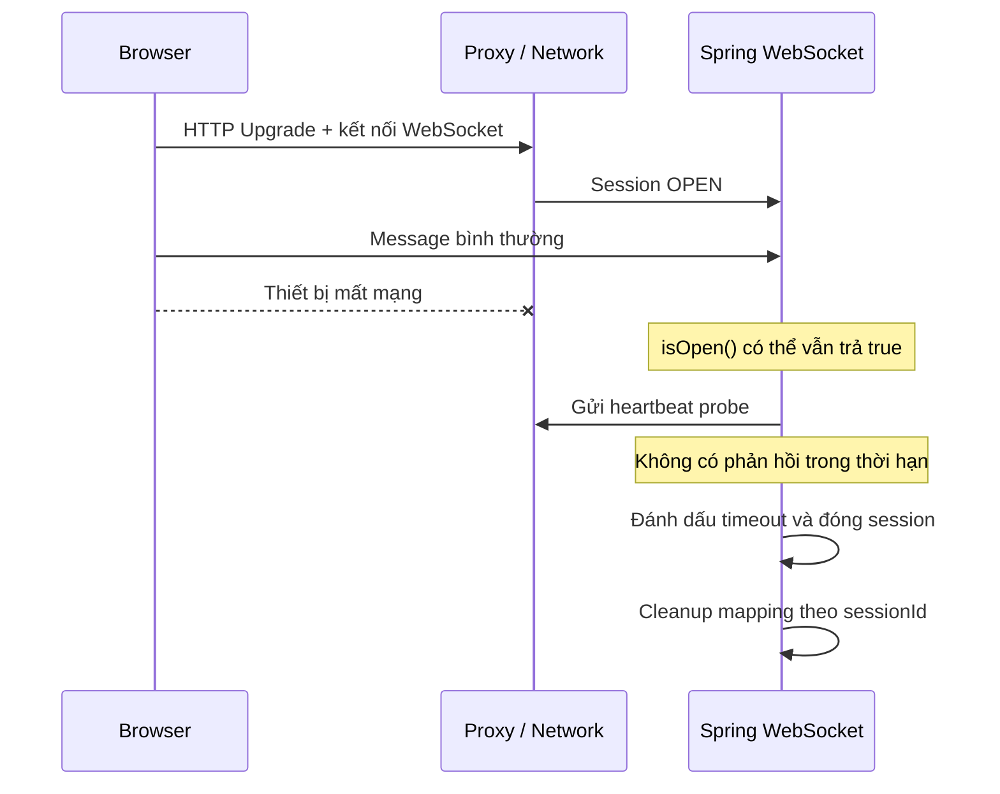
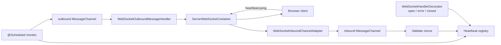
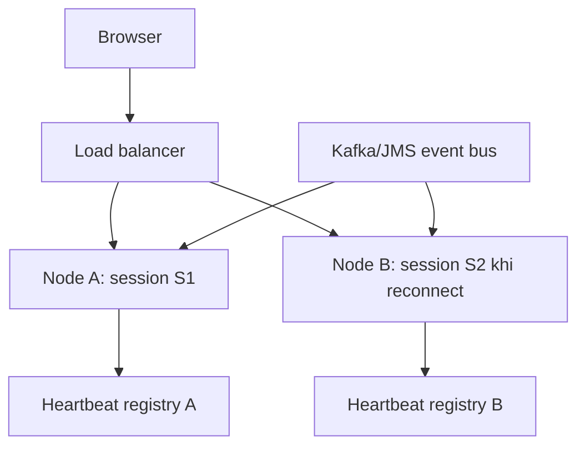
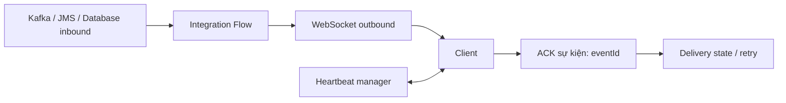

# Heartbeat và phát hiện kết nối hỏng

## 1. Mục tiêu và bối cảnh

Trong module **SPRING_INTEGRATION_ADAPTERS**, ứng dụng sử dụng inbound/outbound adapter, gateway, poller và `MessageChannel` để tích hợp hệ thống ngoài qua file, SFTP, HTTP, JMS, AMQP, Kafka và cơ sở dữ liệu. Khi đầu ra là WebSocket, ứng dụng phải quản lý những kết nối có thể tồn tại nhiều giờ nhưng bất ngờ mất khả năng trao đổi dữ liệu.

Bài **Heartbeat và phát hiện kết nối hỏng**, thuộc chương **Adapter WebSocket**, giải quyết câu hỏi: *làm sao biết một WebSocket session vẫn còn phản hồi, phát hiện kết nối đã hỏng khi chưa có Close frame, và thu hồi tài nguyên đúng cách?*

Sau bài học, bạn có thể:

- Phân biệt **WebSocket Ping/Pong**, **STOMP heartbeat**, **application heartbeat** và **TCP keepalive**.
- Giải thích vì sao `WebSocketSession.isOpen()` không bảo đảm client còn kết nối thực sự.
- Thiết kế chu kỳ gửi ping, timeout, nonce, state và cách hạn chế false positive.
- Triển khai ví dụ Spring Integration với `ServerWebSocketContainer`, inbound/outbound adapter, `MessageChannel` và scheduler riêng.
- Xử lý pong đúng session, đóng session không phản hồi và dọn state khi disconnect.
- Phân biệt heartbeat với ACK nghiệp vụ, bảo đảm delivery và trạng thái broker relay.
- Kiểm tra các tình huống client treo, mất mạng, reconnect, nhiều tab và triển khai nhiều node.

Heartbeat là **tín hiệu liveness**, không phải bằng chứng một message nghiệp vụ đã được lưu vào database hoặc đã được người dùng đọc.

## 2. Vì sao WebSocket còn OPEN dù đường truyền đã hỏng?

Kết nối WebSocket bắt đầu bằng HTTP Upgrade và tiếp tục trao đổi frame qua TCP. Khi client đóng bình thường, hai phía có thể hoàn thành close handshake. Nhưng nếu thiết bị tắt đột ngột, Wi-Fi rớt, NAT xóa mapping, proxy cắt idle connection hoặc browser bị treo, server có thể **không nhận Close frame**.



Trạng thái `session.isOpen()` chỉ phản ánh điều **WebSocket implementation tại thời điểm đó biết**. Nếu không có hoạt động I/O, ping, heartbeat hoặc timeout, một kết nối *half-open* có thể bị giữ lại lâu hơn mong đợi.

Ngay cả khi heartbeat timeout, server vẫn chỉ biết client **không đáp ứng theo chính sách đã đặt**. Không thể kết luận duy nhất rằng người dùng đóng tab: nguyên nhân có thể là mạng chậm, browser throttling, CPU quá tải hoặc mất điện.

## 3. Bốn cơ chế kiểm tra liveness

| Cơ chế | Tầng hoạt động | Cách phản hồi | Ghi chú |
| --- | --- | --- | --- |
| **WebSocket Ping/Pong** | WebSocket control frame, RFC 6455 | Đầu nhận Ping trả Pong | Browser JavaScript không có API trực tiếp để tự gửi/nhận control Ping/Pong |
| **STOMP heartbeat** | STOMP 1.1/1.2 qua WebSocket hoặc TCP | Hai phía thương lượng khoảng gửi/nhận, dùng newline khi nhàn rỗi | STOMP client library thường tự quản lý |
| **Application heartbeat** | Dữ liệu ứng dụng, ví dụ JSON | Server gửi `heartbeat.ping`, client trả `heartbeat.pong` | Có thể kiểm tra cả việc client JavaScript xử lý message |
| **TCP keepalive** | Hệ điều hành/TCP stack | Probe ở tầng socket | Có thể phát hiện chậm tùy cấu hình OS/proxy |

### 3.1. WebSocket Ping/Pong control frame

Spring Framework cung cấp các lớp `PingMessage` và `PongMessage`. Server có thể gửi một control Ping frame:

```java
import java.io.IOException;
import org.springframework.web.socket.PingMessage;
import org.springframework.web.socket.WebSocketSession;

public void sendPing(WebSocketSession session) throws IOException {
    session.sendMessage(new PingMessage());
}
```

Một Pong frame là tín hiệu ở tầng WebSocket. Nếu cần đo Ping/Pong, ứng dụng phải sử dụng cơ chế callback hoặc decorator của Spring WebSocket phù hợp. Khi có nhiều thread gửi dữ liệu trên cùng phiên, cần kiểm soát gửi đồng thời; không nên tự tạo nhiều task cùng gọi `session.sendMessage(...)` thiếu đồng bộ.

Browser tự xử lý control Ping/Pong ở tầng WebSocket, nhưng **không cung cấp event JavaScript để đọc một control Ping**. Gọi `socket.send("ping")` chỉ gửi một **text frame**; đó là một quy ước ứng dụng, không phải Ping control frame.

### 3.2. STOMP heartbeat

STOMP hỗ trợ header khi kết nối:

```text
CONNECT
accept-version:1.2
heart-beat:10000,10000

<NUL>
```

Hai giá trị trong `heart-beat` biểu diễn khả năng gửi và mong muốn nhận heartbeat, đơn vị **milliseconds**. Khi cả hai phía thỏa thuận heartbeat, thư viện có thể gửi byte newline khi không có frame STOMP khác. Thời gian thực tế phải dựa trên hai phía, không thể chỉ đọc một header rồi suy ra đầy đủ lịch chạy.

STOMP heartbeat không phải command `MESSAGE` nghiệp vụ, và không phải một JSON event mà Spring Integration inbound adapter phải chuyển xuống domain service. Khi dùng STOMP broker relay, còn có **system heartbeat** của kết nối Spring → external STOMP broker.

### 3.3. Application heartbeat bằng JSON

Ứng dụng có thể tự định nghĩa hợp đồng:

```json
{
  "type": "heartbeat.ping",
  "nonce": "c9ef1ad2-8ecb-4bc2-aee9-e1159d42b330"
}
```

Client trả:

```json
{
  "type": "heartbeat.pong",
  "nonce": "c9ef1ad2-8ecb-4bc2-aee9-e1159d42b330"
}
```

`nonce` giúp liên kết pong với **probe đang chờ của chính WebSocket session đó**. Server phải lấy session ID từ hạ tầng WebSocket, ví dụ header `simpSessionId`, rồi so sánh nonce. Không cho client tự chỉ định session khác để gửi pong thay.

Heartbeat JSON đi qua cả event loop/handler của client nên kiểm tra được một phần khả năng xử lý ứng dụng. Điểm đánh đổi: client chạy nền hoặc quá tải cũng có thể trả chậm dù TCP chưa hỏng.

### 3.4. TCP keepalive và proxy idle timeout

TCP keepalive hoạt động dưới ứng dụng và có thể dùng để phát hiện connection đứt. Tuy nhiên thời gian OS mặc định có thể dài hơn mức realtime mong muốn. Proxy/load balancer có thể áp một **idle timeout** riêng và loại bỏ kết nối dù phía Spring chưa phát hiện lỗi.

Vì vậy phải kiểm tra thực tế: thời gian timeout của proxy, bộ đếm idle của WebSocket container, yêu cầu network keepalive và việc heartbeat có thực sự tạo lưu lượng trên chặng mạng liên quan hay không.

## 4. Thiết kế chính sách heartbeat

| Thành phần | Ý nghĩa | Ví dụ học tập |
| --- | --- | --- |
| `interval` | Khoảng chờ giữa hai probe dự định gửi | 15 giây |
| `timeout` | Thời gian tối đa chờ pong sau khi phát một ping | 45 giây |
| `scanInterval` | Chu kỳ kiểm tra pending probe | 5 giây |
| `nonce` | ID ngẫu nhiên liên kết ping và pong | UUID |
| `sentAtNanos` | Mốc đo thời gian gửi | `System.nanoTime()` |
| `pending` | Probe đang chờ, tối đa một probe/session | `AtomicReference` |
| `closing` | Tránh nhiều lần cùng đóng một phiên | `AtomicBoolean` |
| `sessionId` | Định danh kết nối hiện tại | `WebSocketSession.getId()` |

Một lịch minh họa:

```text
t=00s: session được tạo
t=15s: gửi heartbeat.ping #1
t=16s: nhận heartbeat.pong #1, bỏ pending #1
t=30s: gửi heartbeat.ping #2
t=45s: vẫn chưa có pong #2
t=75s: probe #2 đã quá timeout 45s
       scheduler đánh dấu timeout tại lần quét kế tiếp
```

Trong thực tế còn có sai số do scheduler, thread pool, network và GC. Không nên đưa ra bảo đảm deadline tuyệt đối chỉ dựa trên một `@Scheduled`.

**Thời gian để đo khoảng chờ:** `System.nanoTime()` là nguồn đơn điệu thích hợp trong cùng tiến trình, còn `Instant.now()` phù hợp log và đối chiếu thời gian. Đồng hồ của browser có thể bị lệch; không dùng timestamp từ client làm quyết định timeout server.

### Vì sao chỉ có một pending probe?

Nếu cứ quét mỗi 5 giây lại gửi một ping dù chưa có pong, server sẽ tạo nhiều probe chưa được trả lời. Khi pong đến muộn, rất khó phân biệt probe nào còn hợp lệ nếu hợp đồng không quản lý đầy đủ chúng.

Mẫu đơn giản của bài:

1. Tại mỗi session chỉ giữ **một** pending probe.
2. Khi đủ interval, tạo nonce, ghi pending rồi mới gửi.
3. Khi nhận pong đúng nonce, xóa pending.
4. Nếu pending quá timeout, đánh dấu closing và đóng session.
5. Nếu send thất bại, ghi nhận lỗi và cho phép thử lại theo chính sách.
6. Khi session đóng, xóa state của **session ID đó**, không xóa tất cả phiên của user.

## 5. Kiến trúc Spring Integration cho raw WebSocket heartbeat



- `ServerWebSocketContainer` quản lý session cho endpoint, được dùng chung bởi inbound và outbound.
- `WebSocketInboundChannelAdapter` tiếp nhận text frame và đưa vào channel.
- `WebSocketOutboundMessageHandler` tiêu thụ Spring Message có `simpSessionId` để gửi đến phiên cụ thể.
- `WebSocketHandlerDecorator` theo dõi việc mở/đóng kết nối; cách này không cần đăng ký một `WebSocketListener` thứ hai vào cùng container.
- `HeartbeatRegistry` giữ nonce pending và trạng thái closing riêng cho mỗi phiên.
- `HeartbeatScheduler` là scheduler ứng dụng; **WebSocket adapter vốn là event-driven**, không yêu cầu poller định kỳ.

Ví dụ bên dưới dùng raw WebSocket để thấy rõ logic heartbeat. Với STOMP, phần lớn công việc heartbeat đã có thể được xử lý bởi thư viện STOMP và broker.

## 6. Ví dụ Java 17+, Spring Boot 3.x và Spring Integration 6.x

Ví dụ chạy trên Servlet web stack với endpoint `/ws/health` và client JavaScript ở trình duyệt. Các lớp Java được đặt trong package `com.example.heartbeat`.

### 6.1. Maven dependencies

```xml
<dependencies>
    <dependency>
        <groupId>org.springframework.boot</groupId>
        <artifactId>spring-boot-starter-web</artifactId>
    </dependency>
    <dependency>
        <groupId>org.springframework.boot</groupId>
        <artifactId>spring-boot-starter-integration</artifactId>
    </dependency>
    <dependency>
        <groupId>org.springframework.integration</groupId>
        <artifactId>spring-integration-websocket</artifactId>
    </dependency>
</dependencies>
```

Spring Boot BOM nên quản lý phiên bản tương thích. `ObjectMapper` đến từ Jackson trong cấu hình Spring Boot web thông dụng. Ứng dụng bật scheduling bằng `@EnableScheduling` ở cấu hình bên dưới.

### 6.2. Registry theo session ID

File `HeartbeatRegistry.java`:

```java
package com.example.heartbeat;

import java.util.concurrent.ConcurrentHashMap;
import java.util.concurrent.ConcurrentMap;
import java.util.concurrent.atomic.AtomicBoolean;
import java.util.concurrent.atomic.AtomicLong;
import java.util.concurrent.atomic.AtomicReference;
import org.springframework.stereotype.Component;

@Component
public class HeartbeatRegistry {

    public record PendingProbe(String nonce, long sentAtNanos) {
    }

    public static final class SessionState {
        final AtomicReference<PendingProbe> pending =
                new AtomicReference<>();
        final AtomicLong lastProbeNanos =
                new AtomicLong(System.nanoTime());
        final AtomicBoolean closing =
                new AtomicBoolean(false);
    }

    private final ConcurrentMap<String, SessionState> states =
            new ConcurrentHashMap<>();

    public void opened(String sessionId) {
        states.put(sessionId, new SessionState());
    }

    public void closed(String sessionId) {
        states.remove(sessionId);
    }

    public SessionState get(String sessionId) {
        return states.get(sessionId);
    }

    public boolean acknowledge(String sessionId, String nonce) {
        SessionState state = states.get(sessionId);
        if (state == null || state.closing.get()) {
            return false;
        }

        PendingProbe pending = state.pending.get();
        if (pending == null || !pending.nonce().equals(nonce)) {
            return false;
        }

        return state.pending.compareAndSet(pending, null);
    }

    public int sessionCount() {
        return states.size();
    }
}
```

Registry này dùng `ConcurrentHashMap` và các biến atomic vì nhận pong và quét timeout xảy ra trên các luồng khác nhau. `opened` tạo state mới cho session, `closed` loại đúng state của session đã đóng, còn `acknowledge` từ chối nonce sai hoặc pong đến khi phiên đang đóng.

Đây là registry **trong bộ nhớ của node**: không phải nơi lưu subscription hoặc pending event nghiệp vụ, cũng không thay thế cơ chế xác thực người dùng.

### 6.3. Container, inbound và outbound adapter

File `HeartbeatWebSocketConfiguration.java`:

```java
package com.example.heartbeat;

import com.fasterxml.jackson.core.JsonProcessingException;
import com.fasterxml.jackson.databind.JsonNode;
import com.fasterxml.jackson.databind.ObjectMapper;
import org.springframework.beans.factory.annotation.Qualifier;
import org.springframework.context.annotation.Bean;
import org.springframework.context.annotation.Configuration;
import org.springframework.integration.annotation.ServiceActivator;
import org.springframework.integration.channel.DirectChannel;
import org.springframework.integration.config.EnableIntegration;
import org.springframework.integration.websocket.ServerWebSocketContainer;
import org.springframework.integration.websocket.inbound.WebSocketInboundChannelAdapter;
import org.springframework.integration.websocket.outbound.WebSocketOutboundMessageHandler;
import org.springframework.messaging.MessageChannel;
import org.springframework.messaging.MessageHandler;
import org.springframework.messaging.MessagingException;
import org.springframework.messaging.simp.SimpMessageHeaderAccessor;
import org.springframework.scheduling.annotation.EnableScheduling;
import org.springframework.web.socket.CloseStatus;
import org.springframework.web.socket.WebSocketSession;
import org.springframework.web.socket.handler.WebSocketHandlerDecorator;

@Configuration
@EnableIntegration
@EnableScheduling
public class HeartbeatWebSocketConfiguration {

    @Bean
    public ServerWebSocketContainer heartbeatContainer(
            HeartbeatRegistry registry) {
        ServerWebSocketContainer container =
                new ServerWebSocketContainer("/ws/health");

        container.setDecoratorFactories(delegate ->
                new WebSocketHandlerDecorator(delegate) {
                    @Override
                    public void afterConnectionEstablished(
                            WebSocketSession session) throws Exception {
                        super.afterConnectionEstablished(session);
                        registry.opened(session.getId());
                    }

                    @Override
                    public void handleTransportError(
                            WebSocketSession session,
                            Throwable exception) throws Exception {
                        System.out.println(
                                "Transport error: " + session.getId());
                        super.handleTransportError(session, exception);
                    }

                    @Override
                    public void afterConnectionClosed(
                            WebSocketSession session,
                            CloseStatus status) throws Exception {
                        try {
                            super.afterConnectionClosed(session, status);
                        } finally {
                            registry.closed(session.getId());
                        }
                    }
                });

        return container;
    }

    @Bean
    public MessageChannel heartbeatInboundChannel() {
        return new DirectChannel();
    }

    @Bean
    public MessageChannel heartbeatOutboundChannel() {
        return new DirectChannel();
    }

    @Bean
    public WebSocketInboundChannelAdapter heartbeatInbound(
            ServerWebSocketContainer heartbeatContainer,
            @Qualifier("heartbeatInboundChannel") MessageChannel channel) {
        WebSocketInboundChannelAdapter adapter =
                new WebSocketInboundChannelAdapter(heartbeatContainer);
        adapter.setOutputChannel(channel);
        return adapter;
    }

    @Bean
    @ServiceActivator(inputChannel = "heartbeatInboundChannel")
    public MessageHandler heartbeatPongHandler(
            HeartbeatRegistry registry,
            ObjectMapper mapper) {

        return incoming -> {
            String sessionId = SimpMessageHeaderAccessor
                    .getSessionId(incoming.getHeaders());

            if (sessionId == null) {
                throw new MessagingException(
                        incoming, "Thiếu WebSocket session ID");
            }

            if (!(incoming.getPayload() instanceof String json)) {
                throw new MessagingException(
                        incoming, "Chỉ chấp nhận raw text JSON");
            }

            final JsonNode data;
            try {
                data = mapper.readTree(json);
            } catch (JsonProcessingException exception) {
                throw new MessagingException(
                        incoming, "JSON không hợp lệ", exception);
            }

            if (data == null || !data.isObject()) {
                throw new MessagingException(
                        incoming, "Heartbeat phải là JSON object");
            }

            if ("heartbeat.pong".equals(data.path("type").asText())) {
                String nonce = data.path("nonce").asText("");
                boolean acknowledged =
                        registry.acknowledge(sessionId, nonce);
                if (!acknowledged) {
                    System.out.println(
                            "Pong trùng hoặc sai nonce: " + sessionId);
                }
                return;
            }

            // Demo chỉ xử lý heartbeat.
            // Production: route loại message khác sang nghiệp vụ.
        };
    }

    @Bean
    @ServiceActivator(inputChannel = "heartbeatOutboundChannel")
    public MessageHandler heartbeatOutbound(
            ServerWebSocketContainer heartbeatContainer) {
        return new WebSocketOutboundMessageHandler(heartbeatContainer);
    }
}
```

**Vì sao chỉ một container?** Phía outbound phải dùng đúng registry session của endpoint inbound. Mỗi `IntegrationWebSocketContainer` chỉ đăng ký một `WebSocketListener`; decorator được dùng để theo dõi lifecycle trong khi inbound adapter vẫn giữ vai trò listener dữ liệu.

Khi ứng dụng có message nghiệp vụ khác, cần thêm router/filter sau inbound channel. Ví dụ này chủ ý chỉ xử lý JSON `heartbeat.pong`; không chuyển các loại message khác vào business service.

### 6.4. Scheduler gửi ping và đóng kết nối không phản hồi

File `HeartbeatScheduler.java`:

```java
package com.example.heartbeat;

import com.fasterxml.jackson.databind.ObjectMapper;
import java.io.IOException;
import java.util.UUID;
import java.util.concurrent.TimeUnit;
import org.springframework.beans.factory.annotation.Qualifier;
import org.springframework.integration.websocket.ServerWebSocketContainer;
import org.springframework.messaging.MessageChannel;
import org.springframework.messaging.simp.SimpMessageHeaderAccessor;
import org.springframework.messaging.support.MessageBuilder;
import org.springframework.scheduling.annotation.Scheduled;
import org.springframework.stereotype.Component;
import org.springframework.web.socket.CloseStatus;
import org.springframework.web.socket.WebSocketSession;

@Component
public class HeartbeatScheduler {

    private static final long INTERVAL_NANOS =
            TimeUnit.SECONDS.toNanos(15);
    private static final long TIMEOUT_NANOS =
            TimeUnit.SECONDS.toNanos(45);

    private final ServerWebSocketContainer container;
    private final HeartbeatRegistry registry;
    private final MessageChannel outbound;
    private final ObjectMapper mapper;

    public HeartbeatScheduler(
            ServerWebSocketContainer heartbeatContainer,
            HeartbeatRegistry registry,
            @Qualifier("heartbeatOutboundChannel") MessageChannel outbound,
            ObjectMapper mapper) {
        this.container = heartbeatContainer;
        this.registry = registry;
        this.outbound = outbound;
        this.mapper = mapper;
    }

    @Scheduled(fixedDelay = 5000)
    public void scan() {
        long now = System.nanoTime();

        for (WebSocketSession session : container.getSessions().values()) {
            if (!session.isOpen()) {
                continue;
            }

            HeartbeatRegistry.SessionState state =
                    registry.get(session.getId());
            if (state == null || state.closing.get()) {
                continue;
            }

            HeartbeatRegistry.PendingProbe pending =
                    state.pending.get();

            if (pending != null) {
                if (now - pending.sentAtNanos() >= TIMEOUT_NANOS
                        && state.closing.compareAndSet(false, true)) {
                    closeTimedOut(session);
                }
                continue;
            }

            if (now - state.lastProbeNanos.get() >= INTERVAL_NANOS) {
                sendPing(session, state);
            }
        }
    }

    private void sendPing(
            WebSocketSession session,
            HeartbeatRegistry.SessionState state) {

        var probe = new HeartbeatRegistry.PendingProbe(
                UUID.randomUUID().toString(), System.nanoTime());

        // Ghi pending trước khi gửi, tránh bỏ lỡ pong rất nhanh.
        if (!state.pending.compareAndSet(null, probe)) {
            return;
        }

        state.lastProbeNanos.set(probe.sentAtNanos());

        String payload = mapper.createObjectNode()
                .put("type", "heartbeat.ping")
                .put("nonce", probe.nonce())
                .toString();

        try {
            boolean accepted = outbound.send(
                    MessageBuilder.withPayload(payload)
                            .setHeader(
                                    SimpMessageHeaderAccessor
                                            .SESSION_ID_HEADER,
                                    session.getId())
                            .build());

            if (!accepted) {
                state.pending.compareAndSet(probe, null);
                System.out.println(
                        "Ping không được channel nhận: " + session.getId());
            }
        } catch (RuntimeException exception) {
            state.pending.compareAndSet(probe, null);
            System.out.println(
                    "Ping gửi lỗi: " + session.getId());
        }
    }

    private void closeTimedOut(WebSocketSession session) {
        try {
            // 4001: private-use close code do ứng dụng này quy định.
            session.close(new CloseStatus(4001, "heartbeat timeout"));
        } catch (IOException exception) {
            System.out.println(
                    "Không thể đóng session: " + session.getId());
        }
        // afterConnectionClosed sẽ xóa state.
        // Production cần TTL/reconciliation khi callback không đến.
    }
}
```

Phân tích luồng:

1. `@Scheduled` quét mỗi 5 giây; interval gửi ping là 15 giây.
2. Mỗi session được quản lý bởi registry riêng, nên client không phản hồi chỉ ảnh hưởng **session của nó**.
3. `PendingProbe` được đặt vào state **trước khi outbound.send(...)` để tránh pong trả rất nhanh đến trước khi server ghi pending.
4. Khi nhận pong đúng nonce, `pending` trở về `null`, mở đường cho probe tiếp theo.
5. Nếu probe chưa được ACK trong 45 giây, `closing.compareAndSet(false, true)` giúp hạn chế xử lý đóng lặp.
6. Close code `4001` nằm trong vùng **private-use** của RFC 6455; đây là quy ước minh họa, không phải status chuẩn “heartbeat timeout” của Spring.
7. Callback `afterConnectionClosed` xóa state theo session ID. Nếu tiến trình chết hoặc callback không chạy, cần cơ chế thu hồi độc lập.

**Không hiểu nhầm `outbound.send(...) == true`:** đây là tín hiệu chấp nhận message trong Spring Messaging, chưa phải xác nhận browser đã nhận. Trong ví dụ, chỉ một `heartbeat.pong` có nonce hợp lệ mới đánh dấu probe hoàn thành.

**Vấn đề hiệu năng cần lưu ý:** `DirectChannel` thường xử lý handler đồng bộ. Một client gửi chậm có thể làm scheduler kéo dài; production cần bounded executor/queue, giới hạn buffer và quản lý gửi nối tiếp trên cùng session. Code này là mô hình học tập cho số connection nhỏ, chưa là một heartbeat service tối ưu cho hàng chục nghìn client.

### 6.5. Client JavaScript trả pong

Trong trình duyệt, từ trang được phép kết nối tới server:

```javascript
const ws = new WebSocket("ws://localhost:8080/ws/health");
let respondToHeartbeat = true;

ws.addEventListener("open", () => {
  console.log("WebSocket OPEN");
});

ws.addEventListener("message", event => {
  const message = JSON.parse(event.data);

  if (message.type === "heartbeat.ping") {
    console.log("Ping received:", message.nonce);

    if (respondToHeartbeat && ws.readyState === WebSocket.OPEN) {
      ws.send(JSON.stringify({
        type: "heartbeat.pong",
        nonce: message.nonce
      }));
    }
  }
});

ws.addEventListener("close", event => {
  console.log("Closed:", {
    code: event.code,
    reason: event.reason,
    wasClean: event.wasClean
  });
});

ws.addEventListener("error", () => {
  console.log("Transport error");
});
```

Khi `respondToHeartbeat` là `true`, browser sẽ gửi text JSON pong cho các probe của server. Để thử mất phản hồi:

```javascript
respondToHeartbeat = false;
```

Sau lần ping tiếp theo, state còn pending. Khi timeout, server thử đóng session bằng close code `4001`. Nếu close frame đến browser bình thường, handler có thể hiển thị code đó. Nếu mạng thực sự mất, browser có thể hiển thị `1006` hoặc không có callback ngay.

Đừng nhầm việc JavaScript xử lý JSON pong với WebSocket control Pong. Để test control frame, phải kiểm tra ở tầng WebSocket của server/client library hỗ trợ API đó.

### 6.6. Thử hai tab và reconnect

Mở hai tab A và B với script trên. Để cả hai phản hồi heartbeat; sau đó ở tab A đặt `respondToHeartbeat = false`, trong tab B vẫn giữ `true`. Khi server timeout A, B phải tiếp tục hoạt động. Kết nối A lại sẽ tạo một `WebSocketSession` mới với state và nonce mới.

Nếu frontend cần reconnect:

- Chỉ reconnect sau `close` hoặc phát hiện session đã mất theo chính sách.
- Dùng exponential backoff và jitter để tránh các client reconnect cùng lúc.
- Tạo lại listener, subscription và state cho WebSocket mới.
- Không dùng session ID hay nonce của kết nối cũ.
- Tải trạng thái nghiệp vụ mới nhất hoặc replay những `eventId` chưa ACK nếu ứng dụng yêu cầu.

## 7. Liveness, transport error và đóng session

Tín hiệu được hạ tầng Spring cung cấp không hoàn toàn tương đương nhau:

| Tín hiệu | Ý nghĩa |
| --- | --- |
| `afterConnectionEstablished` | Session đã được mở, tạo state theo session ID |
| `isOpen()` | Session được xem là mở tại thời điểm gọi |
| `handleTransportError` | Có lỗi transport được phát hiện; chưa chắc callback close đã chạy |
| `afterConnectionClosed` | Đã có callback đóng; thu hồi registry/tài nguyên |
| Application pong đúng nonce | Client xử lý và phản hồi probe đang chờ |
| Heartbeat timeout | Probe không được trả lời trong khoảng chờ theo chính sách |
| `CloseEvent.code == 1006` | Browser quan sát đóng bất thường; mã 1006 **không được gửi trong Close frame** |

Một timeout có thể đến đúng lúc client trả pong. Đây là race condition: scheduler đã đánh dấu `closing` thì pong muộn sẽ bị từ chối, client có thể reconnect. Hệ thống cần đo timeout thực tế để tránh false positive thay vì cố gắng loại bỏ hoàn toàn mọi race trên mạng.

### Cleanup idempotent

Một người dùng có thể mở nhiều WebSocket session:

```text
user-17
  ├─ Tab A: session S1
  └─ Tab B: session S2
Reconnect Tab A: session S3
Close callback S1 đến muộn
```

Callback của S1 chỉ xóa state của S1; không xóa S2 hay S3. Nếu có registry `userId → Set<sessionId>`, hãy loại đúng `sessionId`. Nếu chỉ cho phép một session hiện hành, dùng compare-and-remove như `byUser.remove(userId, oldSessionId)`.

Đừng đặt thao tác DB/HTTP chậm hoặc retry vô hạn trực tiếp trong callback close. Có thể xóa trạng thái cục bộ nhanh rồi đưa việc cleanup từ xa sang một flow khác có timeout, retry và idempotency.

## 8. Heartbeat STOMP và broker relay

Nếu ứng dụng dùng STOMP trên WebSocket, thư viện STOMP có thể quản lý heartbeat ở tầng giao thức mà không cần app JSON ping/pong.

### 8.1. Simple broker có scheduler

Ví dụ phần cấu hình trong `WebSocketMessageBrokerConfigurer`:

```java
@Override
public void configureMessageBroker(MessageBrokerRegistry registry) {
    registry.setApplicationDestinationPrefixes("/app");
    registry.enableSimpleBroker("/topic", "/queue")
            .setHeartbeatValue(new long[] {10_000, 20_000})
            .setTaskScheduler(messageBrokerTaskScheduler);
}
```

Biến `messageBrokerTaskScheduler` đại diện cho một `TaskScheduler` đã được inject/cấu hình. Với cấu hình Spring WebSocket, có thể dùng scheduler có sẵn nhưng cần chú ý `@Lazy` để tránh dependency cycle, hoặc khai báo scheduler riêng. Ví dụ trên là **đoạn trong class đã bật `@EnableWebSocketMessageBroker`**, không phải file Java độc lập.

Ở hướng server, một giá trị biểu thị khoảng gửi heartbeat và một giá trị biểu thị khoảng nhận; thời gian có hiệu lực do STOMP client và broker thương lượng. Nếu có lưu lượng message bình thường, không nhất thiết xuất hiện một heartbeat newline riêng vào mọi thời điểm.

### 8.2. Broker relay có system heartbeat riêng

Ví dụ cấu hình đến broker ngoài:

```java
@Override
public void configureMessageBroker(MessageBrokerRegistry registry) {
    registry.setApplicationDestinationPrefixes("/app");

    registry.enableStompBrokerRelay("/topic", "/queue")
            .setRelayHost("broker.internal")
            .setRelayPort(61613)
            .setSystemHeartbeatSendInterval(10_000)
            .setSystemHeartbeatReceiveInterval(10_000);
}
```

Đoạn minh họa cần external STOMP broker thật, credentials/TLS và mạng thích hợp khi triển khai. Các thuộc tính system heartbeat giám sát **kết nối hệ thống Spring → broker**. Một broker còn hoạt động không chứng minh mọi browser session còn sống.

Spring có `BrokerAvailabilityEvent` cho phép quan sát broker relay:

```java
import org.springframework.context.event.EventListener;
import org.springframework.messaging.simp.broker.BrokerAvailabilityEvent;
import org.springframework.stereotype.Component;

@Component
public class BrokerHealthListener {

    @EventListener
    public void brokerChanged(BrokerAvailabilityEvent event) {
        System.out.println("Broker available = "
                + event.isBrokerAvailable());
    }
}
```

`BrokerAvailabilityEvent` không thay thế `SessionDisconnectEvent` hoặc trạng thái WebSocket client. Với cluster cần giám sát **cả broker lẫn connection frontend**.

### 8.3. Client STOMP.js

Ví dụ với package `@stomp/stompjs`:

```javascript
import { Client } from "@stomp/stompjs";

const client = new Client({
  brokerURL: "ws://localhost:8080/ws-stomp",
  heartbeatIncoming: 10000,
  heartbeatOutgoing: 10000,
  reconnectDelay: 5000,

  onConnect: () => {
    // Đăng ký subscription lại sau mỗi lần kết nối.
    client.subscribe("/topic/updates", message => {
      console.log("Update:", JSON.parse(message.body));
    });
  },
  onWebSocketClose: event => {
    console.log("Closed:", event.code);
  },
  onStompError: frame => {
    console.error("STOMP error:", frame.headers.message);
  }
});

client.activate();
```

Giả định endpoint `/ws-stomp` đã được Spring WebSocket Message Broker đăng ký. Reconnect giúp tạo kết nối mới; nó không tự replay những sự kiện nghiệp vụ đã bị bỏ lỡ khi offline.

## 9. Heartbeat trong hệ thống nhiều node và có proxy



`ServerWebSocketContainer.getSessions()` chỉ liệt kê những session mà container **trên node hiện tại** biết. Nếu node A chết, callback đóng của A không còn cơ hội cập nhật store ngoài tiến trình. Nếu client reconnect vào B, session S2 phải được đăng ký mới và những pending notification quan trọng phải tìm theo **user/device và event ID**, không dựa vào S1.

Các nguyên tắc vận hành:

- Theo dõi `nodeId` cùng `sessionId` khi cần route message trong cluster.
- Dùng TTL/lease và reconciliation cho presence registry ngoài tiến trình, để thu hồi S1 nếu node A bị kill.
- Không để close callback S1 đến muộn xóa mapping của S2.
- Xác thực lại client khi kết nối mới mở, ngay cả nếu session cũ từng hợp lệ.
- Đặt WebSocket/server/proxy timeout phù hợp; đo thực tế ở browser, mobile và mạng doanh nghiệp.
- Rải lịch heartbeat có jitter; hàng nghìn session ping cùng thời điểm có thể tạo đỉnh tải.

Với hệ thống lớn, một scheduler quét tất cả session có độ phức tạp `O(N)` theo số connection. Có thể cần phân lô, giới hạn số probe mỗi chu kỳ và dùng executor bounded. Đồng thời phải quản lý việc gửi song song qua cùng `WebSocketSession`; trong Spring WebSocket, `ConcurrentWebSocketSessionDecorator` hoặc một serial sender per-session là những hướng có thể xem xét cùng các giới hạn bộ đệm.

## 10. Heartbeat không phải ACK nghiệp vụ

Giả sử một event được lấy từ Kafka, JMS hoặc cơ sở dữ liệu rồi đẩy tới WebSocket:



Các tín hiệu khác nhau:

| Tín hiệu | Điều đã biết | Chưa chứng minh |
| --- | --- | --- |
| `session.isOpen()` | Server đang xem session là mở | Network/client thực sự còn đáp ứng |
| Pong đúng nonce | Client xử lý được probe heartbeat | Client đã xử lý một event nghiệp vụ khác |
| `MessageChannel.send(...) == true` | Channel đã tiếp nhận message | Client nhận, hiển thị hoặc xác nhận |
| `BrokerAvailabilityEvent` available | System connection broker đang sẵn sàng | Từng WebSocket client còn online |
| ACK ứng dụng có `eventId` | Client xác nhận hành động được hợp đồng định nghĩa | Exactly-once nếu chưa có idempotency |

Nếu cần đảm bảo một notification được client xử lý, hãy tạo `eventId`, ACK ứng dụng, timeout, retry và xử lý trùng. Sau reconnect, tra phiên hiện tại của recipient rồi gửi lại event cần thiết; đừng tái sử dụng `simpSessionId` đã hết hiệu lực.

Một heartbeat timeout cũng không tự quyết định phải hoàn tác một transaction DB hay Kafka. Lỗi transport và nghiệp vụ phải có hợp đồng bù/truy xuất trạng thái phù hợp.

## 11. Bảo mật và giới hạn tài nguyên

Heartbeat cũng phải tuân thủ ranh giới bảo mật:

1. Xác thực client tại WebSocket handshake; dùng `wss://` khi triển khai qua mạng.
2. Lấy session ID từ hạ tầng Spring; không cho JSON client tự chọn phiên nhận hoặc phiên cần đóng.
3. Chỉ chấp nhận pong đúng nonce, giới hạn độ dài nonce, kích thước frame và số message bất thường.
4. Giới hạn số WebSocket session trên mỗi principal/IP theo nhu cầu và cấu hình mạng.
5. Tránh log token, credential và payload nhạy cảm trong heartbeat error.
6. Giới hạn outbound buffer, thời gian gửi, scheduler queue và số probe đồng thời.
7. Nếu quyền người dùng bị revoke, chặn nghiệp vụ ngay; session trả heartbeat thành công không có nghĩa session còn quyền truy cập.
8. Với STOMP broker relay, bảo vệ broker credentials tại server; không đặt system login/passcode trong JavaScript.

**Ứng dụng heartbeat của ví dụ chỉ phục vụ học tập.** Production cần authentication, authorization, session limits, metrics, bounded execution và kiểm thử thực tế với proxy/điều kiện mạng.

## 12. Kiểm thử và chẩn đoán

### 12.1. Ma trận kiểm thử

| Kịch bản | Kết quả kỳ vọng |
| --- | --- |
| Client trả đúng nonce | Pending probe bị xóa, session tiếp tục sống |
| Pong sai nonce | Không được xem là ACK của pending probe |
| Pong bị lặp | Chỉ lần hợp lệ đầu tiên hoàn tất probe |
| Client không trả pong | Sau timeout server thử đóng đúng session |
| Client đóng bình thường | Close callback xóa registry state |
| Hai tab, chỉ A ngừng phản hồi | A timeout, B không bị đóng nhầm |
| A reconnect thành session mới | Registry/nonce mới, không dùng state cũ |
| Mất Wi-Fi hoặc proxy ngắt | Có thể không có Close frame; timeout là tín hiệu dự phòng |
| Scheduler bị trễ do tải | Đo trễ quét, tránh timeout quá ngắn |
| Broker relay ngắt | Broker availability và STOMP reconnect được xử lý riêng |
| Node crash | TTL/lease thu hồi mapping stale |
| Event nghiệp vụ chưa có ACK | Không xóa pending event chỉ vì nhận pong |

### 12.2. Chẩn đoán theo thứ tự

1. Handshake và `afterConnectionEstablished` có xảy ra không?
2. Server và outbound adapter có cùng `ServerWebSocketContainer` không?
3. `@EnableScheduling` có bật, scheduler có chạy đúng interval không?
4. Spring Message outbound có `simpSessionId` đúng với session mở không?
5. Ping đã qua outbound channel, client có nhận frame JSON đúng định dạng không?
6. Client có gửi lại `heartbeat.pong` với nonce đúng không?
7. Inbound adapter có chuyển message vào `heartbeatInboundChannel` không?
8. Có exception parse JSON, header session thiếu hoặc ping đến muộn không?
9. Có race giữa `isOpen()` và `send`/`close` không?
10. Nếu dùng STOMP, client có nhận `CONNECTED`, broker có heartbeat/scheduler phù hợp không?
11. Timeout proxy, NAT hoặc browser background throttle có làm kết nối bị ngắt sớm không?
12. Registry có được dọn theo session ID khi disconnect, reconnect hoặc node crash không?

### 12.3. Các lỗi thường gặp

| Triệu chứng | Nguyên nhân có thể | Hướng xử lý |
| --- | --- | --- |
| `isOpen()` vẫn true sau khi client mất mạng | Chưa phát hiện transport half-open | Heartbeat, timeout, cleanup |
| JavaScript không nhận WebSocket control Pong event | Browser không expose control frames | Dùng app heartbeat nếu muốn kiểm tra callback JS |
| Client gửi `"pong"` nhưng không được công nhận | Server yêu cầu JSON + nonce | Đồng bộ hợp đồng payload |
| Timeout nhầm trên tab nền | Event loop bị throttling | Điều chỉnh timeout và chọn cơ chế heartbeat phù hợp |
| Nhiều probe chồng nhau | Không quản lý pending state | Giữ tối đa một probe/session |
| Reconnect rồi vẫn gửi tới session cũ | Mapping stale | Route theo session mới và user ID đáng tin |
| Cả user bị offline khi một tab đóng | Cleanup xóa theo user | Xóa đúng session ID |
| STOMP heartbeat không xuất hiện trên Integration Flow | Nó không phải business `MESSAGE` | Theo dõi tại tầng STOMP |
| Broker available nhưng client không nhận event | Broker health khác session health | Theo dõi cả hai |
| Quá nhiều client làm scheduler chậm | Không giới hạn fan-out và gửi đồng loạt | Jitter, bounded queue/executor |
| Pong đúng nhưng event bị mất | Heartbeat khác delivery ACK | Thêm event ID, ACK và retry |

### 12.4. Metrics vận hành

Các chỉ số hữu ích gồm `websocket_sessions_open`, `heartbeat_probes_sent_total`, `heartbeat_pongs_accepted_total`, `heartbeat_timeouts_total`, `heartbeat_pending_probes`, `heartbeat_round_trip_seconds`, `websocket_transport_errors_total`, `websocket_close_codes_total`, `heartbeat_scan_delay_seconds` và trạng thái STOMP broker.

Chỉ nên dùng các tag có cardinality hữu hạn như endpoint, node, close code hoặc loại kết nối. `sessionId`, `nonce` và `eventId` có cardinality lớn, nên phù hợp log/trace có kiểm soát hơn là metric tag.

## 13. Bài tập thực hành

### Bài A — so sánh các cơ chế heartbeat

So sánh WebSocket Ping/Pong, STOMP heartbeat, application heartbeat và TCP keepalive về tầng hoạt động, tác nhân gửi/nhận, mức độ nhìn thấy trong JavaScript và lỗi có thể phát hiện.

### Bài B — kiểm thử nonce

Chạy ví dụ Java/JavaScript. Gửi đúng nonce, sai nonce, pong lặp và tắt `respondToHeartbeat`. Giải thích vì sao nonce sai hoặc pong cũ không được kéo dài deadline.

### Bài C — thiết kế thời gian

Chuyển interval/timeout thành cấu hình theo môi trường, bổ sung validation và jitter theo session. Đề xuất thời gian thử nghiệm khi có proxy idle timeout, mạng di động và browser tab nền. Giải thích rủi ro khi timeout quá ngắn.

### Bài D — nguồn Kafka/JMS

Một sự kiện `evt-901` đi từ Kafka/JMS inbound adapter qua `MessageChannel` tới WebSocket outbound. Client mất heartbeat rồi reconnect. Thiết kế cách xử lý cập nhật dashboard có thể tải snapshot mới và sự kiện bắt buộc ACK. Tại sao Kafka offset/JMS ack không đồng nghĩa browser đã xử lý frame?

### Bài E — STOMP và broker relay

Cấu hình STOMP heartbeat cho simple broker và system heartbeat của broker relay. Ngắt broker ngoài rồi theo dõi `BrokerAvailabilityEvent`, client reconnect/resubscribe. Phân biệt lỗi broker với lỗi của một WebSocket session cụ thể.

### Bài F — nhiều node

User mở tab A trên node 1 và tab B trên node 2. Node 1 bị kill; tab A reconnect vào node 2. Thiết kế TTL/lease và cleanup theo session để không xóa tab B hoặc phiên mới. Đề xuất cách hạn chế 10.000 session cùng gửi heartbeat vào một thời điểm.

**Tiêu chí hoàn thành:** bạn biết loại heartbeat nào đang được sử dụng, ai gửi/nhận, timeout tính từ mốc nào, cách dọn state an toàn và vì sao pong không thay được ACK nghiệp vụ.

## 14. Ghi nhớ

- Một WebSocket session có thể *half-open*; `isOpen()` không bảo đảm mạng/client còn đáp ứng.
- WebSocket control Ping/Pong, STOMP heartbeat, application heartbeat và TCP keepalive có cơ chế và phạm vi riêng.
- Browser không expose WebSocket Ping/Pong control frame cho JavaScript; muốn kiểm tra JavaScript event loop có thể dùng JSON ping/pong.
- Application heartbeat nên có nonce, một pending probe/session, interval, timeout, scheduler và cleanup idempotent.
- Với Spring Integration, inbound adapter nhận pong, outbound handler gửi ping và `simpSessionId` định tuyến đến đúng session.
- STOMP heartbeat và broker relay system heartbeat không tương đương business message hoặc health của từng browser.
- Timeout cần cân bằng tốc độ phát hiện và false positive, đặc biệt khi browser chạy nền hoặc mạng di động.
- Cluster cần TTL/lease và routing tới node sở hữu kết nối; session ID cũ không thể dùng sau reconnect.
- Dữ liệu nghiệp vụ quan trọng vẫn cần `eventId`, ACK, retry và idempotency riêng.

## Tài liệu tham khảo

- [Spring Integration Reference — WebSockets Support](https://docs.spring.io/spring-integration/reference/web-sockets.html)
- [Spring Integration API — ServerWebSocketContainer](https://docs.spring.io/spring-integration/docs/6.1.x/api/org/springframework/integration/websocket/ServerWebSocketContainer.html)
- [Spring Integration API — WebSocketInboundChannelAdapter](https://docs.spring.io/spring-integration/docs/6.1.x/api/org/springframework/integration/websocket/inbound/WebSocketInboundChannelAdapter.html)
- [Spring Integration API — WebSocketOutboundMessageHandler](https://docs.spring.io/spring-integration/docs/6.1.x/api/org/springframework/integration/websocket/outbound/WebSocketOutboundMessageHandler.html)
- [Spring Framework Reference — WebSocket](https://docs.spring.io/spring-framework/reference/web/websocket.html)
- [Spring Framework Reference — Simple Broker](https://docs.spring.io/spring-framework/reference/web/websocket/stomp/handle-simple-broker.html)
- [Spring Framework Reference — STOMP Broker Relay](https://docs.spring.io/spring-framework/reference/web/websocket/stomp/handle-broker-relay.html)
- [Spring Framework API — PingMessage](https://docs.spring.io/spring-framework/docs/current/javadoc-api/org/springframework/web/socket/PingMessage.html)
- [Spring Framework API — PongMessage](https://docs.spring.io/spring-framework/docs/current/javadoc-api/org/springframework/web/socket/PongMessage.html)
- [RFC 6455 — WebSocket Control Frames](https://www.rfc-editor.org/rfc/rfc6455#section-5.5)
- [STOMP Protocol 1.2 — Heart-beating](https://stomp.github.io/stomp-specification-1.2.html#Heart-beating)
