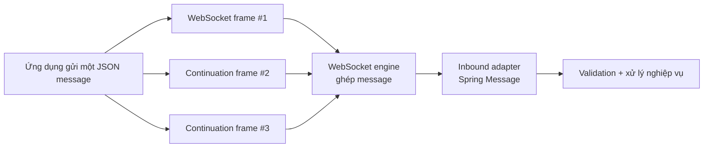
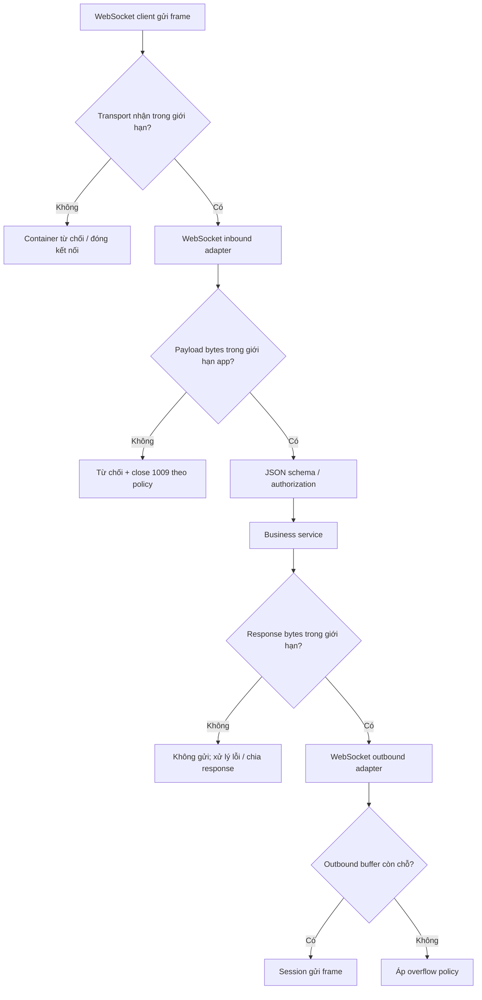
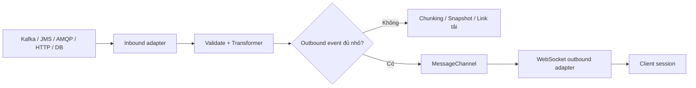

# Kiểm soát kích thước payload

## 1. Bối cảnh và mục tiêu

Trong module **SPRING_INTEGRATION_ADAPTERS**, inbound/outbound adapter, gateway, poller và `MessageChannel` giúp luồng Spring Integration trao đổi dữ liệu với file, SFTP, HTTP, JMS, AMQP, Kafka, cơ sở dữ liệu và WebSocket. Khi dữ liệu được đẩy tới một kết nối WebSocket dài hạn, ứng dụng phải bảo vệ cả **chiều nhận** lẫn **chiều gửi** trước payload quá lớn.

Bài **Kiểm soát kích thước payload** thuộc chương **Adapter WebSocket**. Chủ đề không chỉ là “giới hạn JSON bao nhiêu ký tự” mà còn là cách đặt giới hạn ở đúng tầng để tránh cạn bộ nhớ, quá tải CPU, nghẽn outbound buffer và mất khả năng phục vụ các session khác.

Sau bài học, bạn có thể:

- Phân biệt kích thước **frame**, **WebSocket message**, **STOMP message**, **payload nghiệp vụ** và **outbound send buffer**.
- Tính kích thước theo **byte UTF-8** thay vì dựa vào độ dài chuỗi Java/JavaScript.
- Cấu hình giới hạn nhận text/binary tại WebSocket engine với `ServletServerContainerFactoryBean`.
- Đặt giới hạn nghiệp vụ trong Spring Integration inbound flow, trước bước parse/transform tốn tài nguyên.
- Cấu hình `setSendBufferSizeLimit`, `setSendTimeLimit` và `OverflowStrategy` cho outbound session.
- Phân biệt `setMessageSizeLimit` của STOMP với giới hạn của raw WebSocket.
- Xử lý payload vượt giới hạn bằng cơ chế phản hồi/đóng kết nối thích hợp, thường liên quan đến WebSocket close code **1009**.
- Kiểm thử Unicode, fragmentation, binary, client chậm, tải đồng thời và sự cố mạng.

> **Phạm vi:** giới hạn kích thước ở một tầng không tự động áp dụng cho mọi tầng khác. Để bảo vệ hệ thống, nên có nhiều lớp kiểm soát với các mục đích khác nhau.

## 2. “Payload size” thực sự là kích thước nào?

### 2.1. Frame khác message

Một WebSocket **message** có thể nằm trong một frame hoặc được chia thành nhiều frame. Receiver phải xử lý fragmentation theo RFC 6455, trong khi API ứng dụng thường trả về một đối tượng message đã được ghép lại.



Giới hạn từng frame **không thay thế** giới hạn kích thước message đã ghép: kẻ gửi có thể chia một message rất lớn thành nhiều frame nhỏ hơn giới hạn của từng frame. Ngược lại, transport/container có thể từ chối message ngay trước khi nó đến `WebSocketInboundChannelAdapter`.

### 2.2. Text và binary khác cách tính

| Loại dữ liệu | Cách biểu diễn | Cách tính kích thước cần kiểm tra |
| --- | --- | --- |
| Text JSON | `String` hoặc `TextMessage` | Số byte khi mã hóa UTF-8 của text thực tế |
| Binary | `byte[]`, `ByteBuffer` hoặc `BinaryMessage` | Số byte còn lại/được gửi của buffer |
| STOMP frame | Command + headers + body | Kích thước message ở tầng STOMP, bao gồm overhead theo cách parser giới hạn |
| Đối tượng Java | POJO/record | Kích thước serialized payload, không phải kích thước heap của object |
| Outbound queue | Nhiều message chờ gửi | Tổng byte đang buffer **trên mỗi session**, khác kích thước của một message |

Với Java:

```java
import java.nio.charset.StandardCharsets;

String text = "{\"message\":\"Xin chào 🌏\"}";
int characters = text.length(); // số UTF-16 code units
int utf8Bytes = text.getBytes(StandardCharsets.UTF_8).length;

System.out.println("String.length(): " + characters);
System.out.println("UTF-8 bytes: " + utf8Bytes);
```

`String.length()` không phải byte count. Một số ký tự có dấu có thể chiếm nhiều byte UTF-8; emoji có thể chiếm nhiều code units trong Java và nhiều byte trên đường truyền.

Ví dụ ngắn:

```text
"A"       → 1 byte UTF-8
"é"       → 2 byte UTF-8
"🌏"      → 4 byte UTF-8

100 ký tự hiển thị không nhất thiết là 100 byte.
```

Ở browser, dùng `TextEncoder` để đo kích thước text gửi qua `WebSocket.send(...)`:

```javascript
const json = JSON.stringify({
  type: "note",
  content: "Xin chào 🌏"
});

const bytes = new TextEncoder().encode(json).byteLength;
console.log("Payload bytes:", bytes);
```

Lưu ý overhead của WebSocket frame, masking của client và TLS không nằm trong `TextEncoder`. Phép đo ở đây nhằm kiểm soát **nội dung ứng dụng**, không phải số byte thực sự chạy trên mạng.

### 2.3. Compression và payload đã giải nén

Nếu dùng WebSocket extension như `permessage-deflate`, dữ liệu qua mạng có thể nhỏ nhưng sau giải nén lại rất lớn. Không đặt chính sách bảo vệ chỉ dựa trên kích thước nén hoặc `Content-Length` của HTTP handshake.

Một cấu trúc JSON nhỏ cũng có thể gây tốn CPU/bộ nhớ nếu lồng quá sâu, nhiều field hoặc chứa chuỗi vô cùng lớn. Vì vậy kích thước byte là **một điều kiện cần**, không phải toàn bộ chính sách validation. Cần xem xét độ sâu parse, số phần tử, độ dài trường, số lượng kết nối và tốc độ gửi.

## 3. Bốn lớp giới hạn nên có

Một chính sách minh họa cho ứng dụng nhận JSON cảm biến:

| Lớp | Mục tiêu | Giá trị ví dụ |
| --- | --- | --- |
| **Transport inbound** | Không để WebSocket engine ghép/giữ message quá lớn | Text/Binary buffer: 64 KiB |
| **Ứng dụng inbound** | Chỉ chấp nhận payload hợp đồng nhỏ và hợp lệ | JSON text: tối đa 16 KiB UTF-8 |
| **Ứng dụng outbound** | Không serialize/phát event quá lớn cho browser | JSON response: tối đa 16 KiB UTF-8 |
| **Outbound send buffer** | Giới hạn dữ liệu bị dồn khi client nhận chậm | 256 KiB/session, send time 10 giây |

Giá trị ở bảng là **để thực hành**, không phải mặc định hoặc khuyến nghị cố định cho mọi hệ thống.

Đây là các câu hỏi khác nhau:

- `maxTextMessageBufferSize` và `maxBinaryMessageBufferSize` bảo vệ phần nhận tại WebSocket engine.
- `MAX_APP_PAYLOAD_BYTES` kiểm tra payload sau khi inbound adapter phát message; nó cần nhỏ hơn hoặc bằng giới hạn transport nếu muốn business flow chủ động xử lý dữ liệu đã nhận.
- `maxOutboundPayloadBytes` kiểm soát kích thước một response/event được gửi từ server.
- `sendBufferSizeLimit` kiểm soát dữ liệu **tích lũy khi đang gửi**, không giới hạn một inbound JSON message.
- `sendTimeLimit` giới hạn thời gian gửi chậm, không phải giới hạn kích thước payload.

### Luồng bảo vệ nhiều tầng



**Quy tắc quan trọng:** validation trong service **không thay thế** transport limit. Nếu đặt transport 100 MiB nhưng mapper từ chối ở 16 KiB, server vẫn có thể đã phải nhận/ghép một lượng dữ liệu đáng kể trước khi mapper chạy.

## 4. Xử lý payload vượt kích thước: đóng kết nối hay phản hồi lỗi?

### 4.1. WebSocket close code 1009

RFC 6455 định nghĩa mã **1009 — Message Too Big**, biểu thị endpoint đóng kết nối vì message nhận được quá lớn để xử lý. Spring Framework có hằng số:

```java
org.springframework.web.socket.CloseStatus.TOO_BIG_TO_PROCESS
```

Ví dụ khi ứng dụng đã xác định text message quá giới hạn:

```java
WebSocketSession session = container.getSession(sessionId);
if (session != null && session.isOpen()) {
    session.close(CloseStatus.TOO_BIG_TO_PROCESS);
}
```

Đoạn minh họa cần xử lý `IOException` và các race condition của session. Một WebSocket container cũng có thể tự từ chối/đóng kết nối **trước khi message đi vào Spring Integration**. Khi đó code validation ở service không được gọi.

**Đừng mặc định** browser luôn nhận được `CloseEvent.code == 1009`. Khi kết nối bị reset, proxy can thiệp hoặc close handshake không hoàn tất, phía browser có thể nhận mã khác, thậm chí 1006 (mã báo đóng bất thường, **không được gửi trên wire**).

### 4.2. Có thể gửi JSON error thay vì close không?

Với payload hợp lệ về transport nhưng vi phạm một giới hạn **nghiệp vụ** nhẹ, ứng dụng có thể giữ kết nối và gửi error message:

```json
{
  "type": "error",
  "code": "PAYLOAD_TOO_LARGE",
  "maxBytes": 16384
}
```

Nhưng nếu payload đã vượt giới hạn của **WebSocket engine**, server có thể chưa từng tạo Spring Message để phản hồi. Ngoài ra, gửi error rồi gọi close ngay không bảo đảm client đã nhận error. Vì vậy:

- **Transport quá tải/nguy hiểm:** từ chối/đóng, ưu tiên bảo vệ tài nguyên.
- **Lỗi schema hoặc business limit nhỏ, còn an toàn:** có thể trả error theo hợp đồng.
- **Cần client nhận chắc chắn nguyên nhân:** thiết kế acknowledgment/luồng retry riêng, không phụ thuộc vào một frame error gửi sát lúc đóng.
- **Lỗi thường xuyên hoặc có dấu hiệu lạm dụng:** rate limit hoặc đóng session theo chính sách bảo mật.

Khác với HTTP, sau khi kết nối đã Upgrade, bạn không thể tùy ý trả `HTTP 413 Payload Too Large` cho một WebSocket data frame bình thường. HTTP 413 áp dụng cho HTTP request; WebSocket xử lý size violation theo transport/protocol hoặc hợp đồng thông điệp.

## 5. Ví dụ thực hành: Spring Boot + Spring Integration raw WebSocket

Mục tiêu: endpoint `/ws/limited` nhận một JSON sự kiện cảm biến. WebSocket engine cho phép tối đa **64 KiB** text/binary; nghiệp vụ chỉ nhận **16 KiB UTF-8**. Payload hợp lệ được parse và trả ACK về đúng session; payload text vượt giới hạn nghiệp vụ khiến server thử đóng session với mã 1009.

Ví dụ dùng **Java 17+, Spring Boot 3.x, Spring Integration 6.x**, web stack Servlet trên container hỗ trợ Jakarta WebSocket (ví dụ Tomcat). Với Jetty hoặc container khác cần kiểm tra API cấu hình tương đương.

### 5.1. Dependency Maven

```xml
<dependencies>
    <dependency>
        <groupId>org.springframework.boot</groupId>
        <artifactId>spring-boot-starter-web</artifactId>
    </dependency>
    <dependency>
        <groupId>org.springframework.boot</groupId>
        <artifactId>spring-boot-starter-integration</artifactId>
    </dependency>
    <dependency>
        <groupId>org.springframework.integration</groupId>
        <artifactId>spring-integration-websocket</artifactId>
    </dependency>
</dependencies>
```

Spring Boot BOM quản lý phiên bản phụ thuộc tương thích. `spring-integration-websocket` chứa các class WebSocket adapter/container. `spring-boot-starter-web` thường cung cấp Spring MVC và Jackson.

### 5.2. Cấu hình đầy đủ

Tạo `LimitedWebSocketConfiguration.java`:

```java
package com.example.limited;

import java.io.IOException;
import java.nio.charset.StandardCharsets;

import com.fasterxml.jackson.core.JsonProcessingException;
import com.fasterxml.jackson.databind.JsonNode;
import com.fasterxml.jackson.databind.ObjectMapper;

import org.springframework.beans.factory.annotation.Qualifier;
import org.springframework.context.annotation.Bean;
import org.springframework.context.annotation.Configuration;
import org.springframework.integration.annotation.ServiceActivator;
import org.springframework.integration.channel.DirectChannel;
import org.springframework.integration.config.EnableIntegration;
import org.springframework.integration.websocket.ServerWebSocketContainer;
import org.springframework.integration.websocket.inbound.WebSocketInboundChannelAdapter;
import org.springframework.integration.websocket.outbound.WebSocketOutboundMessageHandler;
import org.springframework.messaging.MessageChannel;
import org.springframework.messaging.MessageHandler;
import org.springframework.messaging.MessagingException;
import org.springframework.messaging.simp.SimpMessageHeaderAccessor;
import org.springframework.messaging.support.MessageBuilder;
import org.springframework.web.socket.CloseStatus;
import org.springframework.web.socket.WebSocketSession;
import org.springframework.web.socket.handler.ConcurrentWebSocketSessionDecorator;
import org.springframework.web.socket.server.standard.ServletServerContainerFactoryBean;

@Configuration
@EnableIntegration
public class LimitedWebSocketConfiguration {

    // Giới hạn tầng transport và business khác nhau có chủ đích.
    private static final int TRANSPORT_MAX_BYTES = 64 * 1024;
    private static final int APP_MAX_TEXT_BYTES = 16 * 1024;
    private static final int OUTBOUND_MAX_TEXT_BYTES = 16 * 1024;

    // Cấu hình WebSocket engine cho Servlet/Jakarta WebSocket.
    @Bean
    public ServletServerContainerFactoryBean websocketEngineLimits() {
        var factory = new ServletServerContainerFactoryBean();
        factory.setMaxTextMessageBufferSize(TRANSPORT_MAX_BYTES);
        factory.setMaxBinaryMessageBufferSize(TRANSPORT_MAX_BYTES);
        return factory;
    }

    @Bean
    public ServerWebSocketContainer limitedWsContainer() {
        var container = new ServerWebSocketContainer("/ws/limited");

        // Đây là giới hạn BUFFER GỬI, không phải inbound size limit.
        container.setSendBufferSizeLimit(256 * 1024);
        container.setSendTimeLimit(10_000);
        container.setSendBufferOverflowStrategy(
                ConcurrentWebSocketSessionDecorator
                        .OverflowStrategy.TERMINATE);
        return container;
    }

    @Bean
    public MessageChannel wsInputChannel() {
        return new DirectChannel();
    }

    @Bean
    public MessageChannel wsOutputChannel() {
        return new DirectChannel();
    }

    @Bean
    public WebSocketInboundChannelAdapter wsInbound(
            ServerWebSocketContainer limitedWsContainer,
            @Qualifier("wsInputChannel") MessageChannel input) {

        var inbound = new WebSocketInboundChannelAdapter(
                limitedWsContainer);
        inbound.setPayloadType(String.class);
        inbound.setOutputChannel(input);
        return inbound;
    }

    @Bean
    @ServiceActivator(inputChannel = "wsInputChannel")
    public MessageHandler validateAndReply(
            ServerWebSocketContainer limitedWsContainer,
            ObjectMapper mapper,
            @Qualifier("wsOutputChannel") MessageChannel output) {

        return incoming -> {
            String sessionId = SimpMessageHeaderAccessor
                    .getSessionId(incoming.getHeaders());

            if (sessionId == null || sessionId.isBlank()) {
                throw new MessagingException(
                        incoming, "Không có WebSocket session ID");
            }

            if (!(incoming.getPayload() instanceof String text)) {
                throw new MessagingException(
                        incoming, "Ví dụ chỉ chấp nhận text JSON");
            }

            // Đếm bytes UTF-8, không dùng String.length().
            int bytes = text.getBytes(StandardCharsets.UTF_8).length;

            if (bytes > APP_MAX_TEXT_BYTES) {
                closeTooLarge(limitedWsContainer, sessionId);
                return; // Không parse hoặc chuyển vào business service.
            }

            final JsonNode root;
            try {
                root = mapper.readTree(text);
            } catch (JsonProcessingException exception) {
                throw new MessagingException(
                        incoming, "JSON không hợp lệ", exception);
            }

            if (root == null || !root.isObject()) {
                throw new MessagingException(
                        incoming, "Payload phải là JSON object");
            }

            String type = root.path("type").asText("");
            String eventId = root.path("eventId").asText("");
            JsonNode value = root.path("value");

            if (!"sensor.reading".equals(type)
                    || eventId.isBlank()
                    || eventId.length() > 64
                    || !value.isNumber()) {
                throw new MessagingException(
                        incoming, "Hợp đồng sensor.reading không hợp lệ");
            }

            // Demo: gọi service nghiệp vụ đã xác thực/ủy quyền
            // và lưu dữ liệu trước khi phản hồi ACCEPTED nếu cần.
            String ack = mapper.createObjectNode()
                    .put("type", "sensor.ack")
                    .put("eventId", eventId)
                    .put("status", "ACCEPTED")
                    .toString();

            int responseBytes =
                    ack.getBytes(StandardCharsets.UTF_8).length;
            if (responseBytes > OUTBOUND_MAX_TEXT_BYTES) {
                throw new MessagingException(
                        incoming, "ACK vượt outbound size policy");
            }

            boolean accepted = output.send(
                    MessageBuilder.withPayload(ack)
                            .setHeader(
                                    SimpMessageHeaderAccessor
                                            .SESSION_ID_HEADER,
                                    sessionId)
                            .build());

            if (!accepted) {
                throw new MessagingException(
                        incoming, "Outbound channel không nhận ACK");
            }
        };
    }

    @Bean
    @ServiceActivator(inputChannel = "wsOutputChannel")
    public MessageHandler wsOutbound(
            ServerWebSocketContainer limitedWsContainer) {
        return new WebSocketOutboundMessageHandler(limitedWsContainer);
    }

    private static void closeTooLarge(
            ServerWebSocketContainer container,
            String sessionId) {

        WebSocketSession session = container.getSession(sessionId);
        if (session == null || !session.isOpen()) {
            return;
        }

        try {
            session.close(CloseStatus.TOO_BIG_TO_PROCESS); // 1009
        } catch (IOException exception) {
            // Production: ghi metrics/log có kiểm soát,
            // không giả định close handshake đã hoàn thành.
            System.out.println(
                    "Không đóng được session: " + sessionId);
        }
    }
}
```

### 5.3. Điểm cần hiểu trong cấu hình

1. `ServletServerContainerFactoryBean` cấu hình **Jakarta WebSocket server container** phía Servlet. `setMaxTextMessageBufferSize` và `setMaxBinaryMessageBufferSize` điều chỉnh buffer/limit nhận của engine; hành vi chi tiết còn tùy container. Không nhầm hai thuộc tính này với outbound send buffer.
2. `ServerWebSocketContainer("/ws/limited")` quản lý các session của Spring Integration; inbound và outbound **dùng chung container** để tìm đúng phiên.
3. `WebSocketInboundChannelAdapter` phát Spring Message vào `wsInputChannel`. Dữ liệu quá lớn có thể bị engine chặn trước bước này.
4. `validateAndReply` kiểm tra số **byte UTF-8** trước khi gọi Jackson. Ở đây nó còn cần validate type, eventId, value và sau đó mới tiếp tục nghiệp vụ.
5. Nếu JSON vượt `16 KiB` nhưng vẫn qua được transport limit, service gọi `closeTooLarge` với `CloseStatus.TOO_BIG_TO_PROCESS`.
6. ACK JSON được kiểm tra kích thước **sau serialization**, rồi gửi ra `wsOutputChannel` với header `simpSessionId`.
7. `WebSocketOutboundMessageHandler` tra session phù hợp để gửi frame. `setSendBufferSizeLimit` chỉ kiểm soát **buffer bị dồn** khi gửi chậm.
8. Code demo không triển khai transaction/authorization thực tế. Nếu `ACCEPTED` có nghĩa “đã lưu DB/Kafka”, phải hoàn thành nghiệp vụ tương ứng trước khi tạo ACK.

Đây là một ví dụ rõ ràng cho **raw WebSocket**. Khi dùng STOMP broker, cơ chế dispatch, message limits và acknowledgment khác; xem mục 7.

### 5.4. Kiểm tra bằng JavaScript

Mở trang cùng origin hoặc trang được server cho phép origin và chạy:

```javascript
const ws = new WebSocket("ws://localhost:8080/ws/limited");
const encoder = new TextEncoder();

function sendJson(value) {
  const json = JSON.stringify(value);
  console.log("UTF-8 bytes:", encoder.encode(json).byteLength);
  ws.send(json);
}

ws.addEventListener("open", () => {
  sendJson({
    type: "sensor.reading",
    eventId: "evt-100",
    value: 27.5
  });
});

ws.addEventListener("message", event => {
  console.log("Response:", JSON.parse(event.data));
});

ws.addEventListener("close", event => {
  console.log("Closed:", event.code, event.reason);
});

ws.addEventListener("error", event => {
  console.log("Transport error:", event);
});
```

Khi hợp lệ, client thường nhận:

```json
{
  "type": "sensor.ack",
  "eventId": "evt-100",
  "status": "ACCEPTED"
}
```

Để thử payload vượt ngưỡng ứng dụng **16 KiB nhưng dưới 64 KiB**, mở một kết nối mới và gửi:

```javascript
const wsTooLarge = new WebSocket("ws://localhost:8080/ws/limited");

wsTooLarge.addEventListener("open", () => {
  const payload = JSON.stringify({
    type: "sensor.reading",
    eventId: "evt-over",
    value: 10,
    note: "🌏".repeat(5000)
  });

  console.log("Size:", new TextEncoder().encode(payload).byteLength);
  wsTooLarge.send(payload);
});

wsTooLarge.addEventListener("close", event => {
  console.log("Oversized close:", event.code);
});
```

Chuỗi emoji này tạo khoảng **20 KiB** chỉ riêng trường `note`, đủ để vượt giới hạn 16 KiB. Trong điều kiện lý tưởng, server sẽ thử đóng với `1009`. Nếu container hoặc proxy áp giới hạn khác, bạn có thể quan sát close trước handler hoặc close code khác.

Để thử giới hạn transport, dùng payload lớn hơn `64 KiB`, chẳng hạn thêm `"x".repeat(80000)` vào trường `note`. Khi đó mong đợi message có thể **không xuất hiện trong flow** vì WebSocket engine từ chối trước; kết quả chính xác cần được xác minh trên server/container đang dùng.

### 5.5. Những giới hạn của ví dụ

- Kiểm tra `text.getBytes(UTF_8).length` cấp phát một mảng byte tương ứng với payload; phù hợp payload nhỏ đã được chặn bởi transport, nhưng với dữ liệu rất lớn nên giới hạn ở tầng thấp và dùng cơ chế tính/parse có giới hạn để tránh cấp phát dư.
- Việc Jackson parse thành `JsonNode` cũng tiêu thụ bộ nhớ. Với JSON lồng sâu/nhiều field, cần thêm constraint cho parser và schema validation.
- Một frame binary không nằm trong hợp đồng JSON của ví dụ. Nó không nên được cố ép thành `String` không kiểm soát.
- Close status từ server chỉ là một nỗ lực; browser không chắc nhận đúng `1009` khi mạng đang lỗi.
- `MessageChannel.send(...)` trả `true` không đồng nghĩa client đã hiển thị ACK.
- Cấu hình `ServletServerContainerFactoryBean` dành cho WebSocket engine theo Servlet/Jakarta; nếu stack là WebFlux/Reactor Netty hoặc engine khác, phải dùng cách cấu hình tương ứng.

## 6. Binary payload và luồng streaming

Nếu client gửi `BinaryMessage`, kích thước cần kiểm tra theo số byte thực:

```java
import java.nio.ByteBuffer;

ByteBuffer payload = /* buffer chứa dữ liệu nhận được */;
int bytesAvailable = payload.remaining();

if (bytesAvailable > 64 * 1024) {
    // Từ chối hoặc đóng session theo hợp đồng.
}
```

Đoạn trên chỉ minh họa phép đo từ một `ByteBuffer` đã nhận, **không** là cấu hình transport limit. Một serializer có thể tạo `byte[]`, `ByteBuffer` hoặc định dạng nhị phân riêng; không gọi `new String(bytes)` nếu không có contract encoding.

### 6.1. Không cộng frame length sai cách

Nếu một message bị chia thành nhiều continuation frames, tổng message size **không bằng kích thước chỉ frame đầu tiên**. Các cấu hình WebSocket engine và assembler cần áp giới hạn lên phần dữ liệu được ghép.

Ngoài ra, nếu bật compression, cần xét kích thước **sau giải nén**. Nếu endpoint nhận chunked/partial messages, phải kiểm soát tổng byte tích lũy trong suốt vòng đời message, không chỉ `chunk.length` của từng callback.

### 6.2. Khi cần dữ liệu lớn thật sự

WebSocket phù hợp cho sự kiện nhỏ, cập nhật trạng thái và thông điệp realtime. Nếu ứng dụng cần tải file 200 MiB hoặc một bản export lớn, thường nên:

1. Tạo file hoặc object trong một kho dữ liệu thích hợp.
2. Phát thông báo WebSocket nhỏ chứa `jobId`, metadata đã kiểm soát và trạng thái hoàn thành.
3. Client tải file qua HTTP/URL đã xác thực, nơi có hỗ trợ streaming, resume/range và kiểm soát tải.
4. Dùng checksum hoặc ID để kiểm tra tính toàn vẹn nếu nghiệp vụ yêu cầu.

Ví dụ thông điệp WebSocket nhỏ:

```json
{
  "type": "report.ready",
  "jobId": "job-842",
  "downloadPath": "/api/reports/job-842"
}
```

`downloadPath` phải được server bảo vệ bằng xác thực/authorization. Không xem một đường dẫn hoặc job ID ngẫu nhiên là quyền tải file.

## 7. STOMP over WebSocket: giới hạn message và transport khác nhau

STOMP bổ sung command, headers, destination và có thể ghép một STOMP message từ nhiều WebSocket messages. Trong Spring WebSocket Messaging, `WebSocketTransportRegistration.setMessageSizeLimit(...)` áp giới hạn cho **inbound sub-protocol message**, không tương đương với giới hạn của một WebSocket frame/message ở engine.

### 7.1. Ví dụ cấu hình STOMP

Ví dụ **tách biệt** với endpoint raw WebSocket `/ws/limited`:

```java
package com.example.stomp;

import org.springframework.context.annotation.Configuration;
import org.springframework.messaging.simp.config.MessageBrokerRegistry;
import org.springframework.web.socket.config.annotation.EnableWebSocketMessageBroker;
import org.springframework.web.socket.config.annotation.StompEndpointRegistry;
import org.springframework.web.socket.config.annotation.WebSocketMessageBrokerConfigurer;
import org.springframework.web.socket.config.annotation.WebSocketTransportRegistration;

@Configuration
@EnableWebSocketMessageBroker
public class StompSizeConfiguration
        implements WebSocketMessageBrokerConfigurer {

    @Override
    public void registerStompEndpoints(StompEndpointRegistry registry) {
        registry.addEndpoint("/ws-stomp-limited");
    }

    @Override
    public void configureMessageBroker(MessageBrokerRegistry registry) {
        registry.setApplicationDestinationPrefixes("/app");
        registry.enableSimpleBroker("/topic", "/queue");
    }

    @Override
    public void configureWebSocketTransport(
            WebSocketTransportRegistration registration) {

        // Inbound STOMP message, có thể được ghép từ nhiều WS frames.
        registration.setMessageSizeLimit(32 * 1024);

        // Outbound send buffer/time, không phải inbound STOMP limit.
        registration.setSendBufferSizeLimit(256 * 1024);
        registration.setSendTimeLimit(10_000);
    }
}
```

Các giới hạn trên được đặt tại tầng **Spring WebSocket Messaging**. Nếu ứng dụng còn sử dụng `ServletServerContainerFactoryBean`, giới hạn WebSocket engine sẽ tiếp tục tồn tại ở tầng thấp hơn. Muốn hiểu chính xác hành vi khi STOMP frame bị chia nhỏ, hãy kiểm thử với WebSocket container và STOMP client library đang dùng.

### 7.2. Những lỗi thường gặp với STOMP

- Giảm `setMessageSizeLimit` xuống 32 KiB nhưng nghĩ mọi raw WebSocket message ở endpoint khác đều bị chặn: **sai**.
- Chỉ tăng giới hạn engine mà quên STOMP aggregator: STOMP message vẫn có thể bị từ chối.
- Chỉ thay `setSendBufferSizeLimit` rồi nghĩ broker chấp nhận input lớn hơn: **sai chiều**.
- Dùng `/topic/...` mà không giới hạn authorization, subscription hoặc payload serialized: tăng khả năng quá tải và rò rỉ dữ liệu.
- Giả định STOMP broker relay sẽ giữ mọi message lâu dài: độ bền phụ thuộc broker, queue/topic, ACK và cấu hình.

Simple broker và external STOMP broker có các chính sách kích thước riêng. Với broker relay, cần xét **cả client → Spring**, **Spring → broker**, **broker → Spring** và **Spring → WebSocket client**. Việc một message đi qua chặng đầu không chứng minh nó sẽ đi qua những chặng sau.

## 8. Outbound buffer: giới hạn tổng byte khi client nhận chậm

Đây là phần đặc biệt quan trọng khi tích hợp WebSocket với nguồn phát nhanh như Kafka, JMS hoặc AMQP.

Giả sử Kafka cung cấp 1.000 sự kiện/giây, mỗi event có payload 4 KiB. Nếu một browser đang nhận chậm, dữ liệu gửi tới riêng browser đó có thể chất đống trong buffer; tăng inbound max size **không xử lý** vấn đề này.

### 8.1. Cấu hình trong Spring Integration

`ServerWebSocketContainer` kế thừa các thuộc tính từ `IntegrationWebSocketContainer`:

```java
ServerWebSocketContainer container =
        new ServerWebSocketContainer("/ws/live");

container.setSendTimeLimit(10_000);         // milliseconds
container.setSendBufferSizeLimit(256 * 1024); // bytes
container.setSendBufferOverflowStrategy(
        ConcurrentWebSocketSessionDecorator
                .OverflowStrategy.TERMINATE);
```

Các giá trị này phục vụ **đường gửi outbound**. Dữ liệu được buffer khi việc gửi tới session bị chậm; nếu vượt giới hạn, framework áp dụng chiến lược overflow tương ứng.

### 8.2. TERMINATE và DROP không cùng ngữ nghĩa

| Chiến lược | Hành vi | Phù hợp khi |
| --- | --- | --- |
| `OverflowStrategy.TERMINATE` | Vượt ngưỡng sẽ báo lỗi/đưa session vào quá trình chấm dứt | Không chấp nhận gửi im lặng bị mất mà không xử lý |
| `OverflowStrategy.DROP` | Bỏ các message cũ trong buffer theo triển khai | Dashboard chỉ cần trạng thái mới; **không phù hợp sự kiện bắt buộc giao đủ** |

Nếu cần delivery đáng tin cậy, **TERMINATE cũng không tự lưu hoặc replay sự kiện**. Nó giúp giới hạn tài nguyên và phơi bày sự cố để application flow xử lý. Với `DROP`, cần thiết kế UI/event contract có thể chịu mất cập nhật trung gian, ví dụ gửi snapshot định kỳ và dùng `version` để client bỏ event cũ.

Ví dụ, nếu có 2.000 client, mỗi client được phép tích lũy tối đa 256 KiB send buffer, riêng tổng **mức buffer tiềm năng** đã có thể ở mức hàng trăm MiB, chưa tính đối tượng Java, TLS, OS và phần khác của ứng dụng. Không nhân số client với một hạn mức rồi kết luận đó là heap memory chính xác, nhưng nó giúp ước lượng nguy cơ.

### 8.3. Backpressure và isolation

Một client chậm không nên làm chậm toàn bộ Kafka consumer hoặc hàng nghìn client còn khỏe. Các kỹ thuật:

- Bounded executor/queue, không tạo vô hạn task gửi.
- Cô lập tải gửi theo session hoặc nhóm nhỏ session.
- Coalesce: với trạng thái mới nhất, thay nhiều event cũ bằng một snapshot mới.
- Rate limit tần suất update trên mỗi user/session.
- Tạm ngừng phát tới session quá chậm hoặc đóng session theo chính sách.
- Ghi lại sự kiện quan trọng bên ngoài WebSocket (outbox/event store) để retry sau reconnect.
- Giám sát send buffer, thời gian gửi và số session bị terminate/drop.

Spring WebSocket `ConcurrentWebSocketSessionDecorator` giúp kiểm soát gửi đồng thời và buffer, nhưng không thay kiến trúc backpressure cho toàn bộ pipeline.

## 9. Kết hợp với Kafka, JMS, AMQP, HTTP, SFTP và database

Một hệ thống thường có nhiều giới hạn ở các chặng:



### 9.1. Không bê nguyên payload lớn từ nguồn sang WebSocket

Ví dụ consumer Kafka nhận một object với ảnh nhị phân, metadata và log. Không nên serialize nguyên object thành JSON rồi push cho mọi tab. Nên chọn thông tin thật sự cần hiển thị:

```json
{
  "eventId": "evt-901",
  "type": "asset.processed",
  "assetId": "asset-17",
  "status": "READY"
}
```

Nếu người dùng cần file, gửi một reference và để client tải qua HTTP endpoint chuyên xử lý file. Cách này giúp kiểm soát tốc độ và tài nguyên hợp lý hơn.

### 9.2. Nếu phải chia dữ liệu thành nhiều message

Chunking ở tầng ứng dụng chỉ phù hợp khi protocol hai phía định nghĩa rõ:

- `transferId` và `chunkIndex`/`chunkCount`.
- Kích thước tối đa **mỗi chunk**.
- Giới hạn tổng byte, tổng số chunk và thời gian tập hợp.
- Checksum/integrity, timeout, cleanup và chính sách retry.
- Quyền nhận/khóa dữ liệu giữa các session/reconnect.
- Giới hạn buffer phía client và cơ chế chống trùng.

Đừng chỉ chia message 5 MiB thành 100 chunk 50 KiB mà quên giới hạn tổng dữ liệu; receiver có thể bị tấn công bằng việc yêu cầu ghép hàng triệu chunk.

### 9.3. MessageChannel.send() không phải ACK từ client

Khi một Kafka event được đưa vào `wsOutputChannel` và `MessageChannel.send(...)` trả `true`, điều đó phản ánh **lần gửi vào Spring Messaging**. Nó không chứng minh WebSocket client đã nhận hoặc xử lý. Nếu sự kiện cần giao ít nhất một lần, hãy dùng `eventId`, client ACK, timeout, retry và deduplication. Khi reconnect, tìm **session hiện hành** thay vì gửi lại vào `simpSessionId` đã đóng.

## 10. Kiểm thử giới hạn theo byte và fragmentation

### 10.1. Ma trận kiểm thử

| Ca kiểm thử | Đầu vào | Điều cần xác nhận |
| --- | --- | --- |
| Payload nhỏ | JSON vài trăm byte | Qua cả transport, validation và nhận ACK |
| Đúng ranh giới app | Payload **chính xác 16 KiB** UTF-8 theo hợp đồng | Chính sách `<=` được áp dụng nhất quán |
| Vượt app 1 byte | 16 KiB + 1 byte | Không chạy business flow; close/error theo policy |
| Text Unicode | Chuỗi nhiều dấu/emoji | Đếm byte UTF-8, không đếm ký tự |
| Vượt transport | Message lớn hơn 64 KiB | Tầng container từ chối trước hoặc khi giao message |
| Message phân mảnh | Một message lớn chia nhiều frames | Giới hạn tổng message, không từng frame đơn lẻ |
| Binary | Payload binary lớn | Bị kiểm tra theo byte và encoding contract |
| JSON lồng sâu | JSON nhỏ nhưng nesting lớn | Parser/schema có giới hạn độ sâu |
| Outbound response lớn | Service tạo JSON rất lớn | Bị chặn trước gửi hoặc được chuyển thành download reference |
| Client nhận chậm | Nhiều event nhỏ, buffer tích lũy | Overflow policy hoạt động và được quan sát |
| Nhiều session | Một nhóm client quá tải, nhóm khác bình thường | Không để toàn bộ flow bị kéo chậm |
| STOMP frame ghép | STOMP SEND vượt `setMessageSizeLimit` | Bị chặn ở STOMP dù WebSocket frame riêng còn nhỏ |

### 10.2. Unit test giới hạn byte UTF-8

Tách logic đếm byte khỏi handler để kiểm thử độc lập:

```java
import java.nio.charset.StandardCharsets;

public final class PayloadSizePolicy {

    private PayloadSizePolicy() {
    }

    public static boolean isAllowedUtf8(
            String payload, int maxBytes) {
        return payload != null
                && payload.getBytes(StandardCharsets.UTF_8).length
                        <= maxBytes;
    }
}
```

Test JUnit 5 minh họa:

```java
import static org.junit.jupiter.api.Assertions.*;
import org.junit.jupiter.api.Test;

class PayloadSizePolicyTest {

    @Test
    void asciiBoundary() {
        assertTrue(PayloadSizePolicy.isAllowedUtf8(
                "a".repeat(16), 16));

        assertFalse(PayloadSizePolicy.isAllowedUtf8(
                "a".repeat(17), 16));
    }

    @Test
    void emojiIsNotOneByte() {
        assertTrue(PayloadSizePolicy.isAllowedUtf8("🌏", 4));
        assertFalse(PayloadSizePolicy.isAllowedUtf8("🌏", 3));
    }

    @Test
    void nullIsRejected() {
        assertFalse(PayloadSizePolicy.isAllowedUtf8(null, 1024));
    }
}
```

Nếu dự án chưa có JUnit 5, bổ sung `spring-boot-starter-test` trong cấu hình test. Khi production hóa, tránh tạo mảng byte không cần thiết với payload lớn; test này nhằm chứng minh sự khác biệt giữa **UTF-8 byte** và `String.length()`.

### 10.3. Integration test với client thật

Unit test policy không kiểm chứng cấu hình transport thực tế. Hãy chạy integration test:

1. Khởi động server WebSocket Servlet thực.
2. Gửi JSON đủ nhỏ và nhận ACK.
3. Gửi JSON >16 KiB nhưng <64 KiB; xem handler có đóng với 1009 không.
4. Gửi JSON >64 KiB; xác minh nó không vượt qua transport đến business handler.
5. Thử message fragmentation theo khả năng client library.
6. Đổi nội dung từ ASCII sang Unicode mà giữ số ký tự gần bằng nhau.
7. Gửi binary không hợp đồng và dữ liệu JSON lồng sâu.
8. Test nhiều session và một client chậm để quan sát send buffer.
9. Kiểm tra cleanup sau close, reconnect và sự kiện còn phải replay.
10. Nếu dùng STOMP, test `CONNECT`, `SEND`, `SUBSCRIBE` cùng limit của STOMP transport.

**Không hard-code một close code duy nhất** cho mọi hoàn cảnh mạng và container. Nếu Spring/container đóng kết nối do transport limit, client có thể thấy `1009` hoặc mã khác khi close frame không đến. Hãy kiểm chứng rằng payload **không được xử lý**, session/tài nguyên được thu hồi và metrics ghi đúng nguyên nhân.

## 11. Bảo mật, vận hành và quan sát

### 11.1. Chống payload abuse

Một kẻ gửi có thể không chỉ gửi một frame lớn mà còn tạo nhiều session, spam vô số message sát ngưỡng, gửi JSON gây tốn parse hoặc khiến server broadcast nhiều bản sao.

Nên có nhiều lớp bảo vệ:

1. **Giới hạn kết nối và tốc độ gửi** theo principal/session/IP ở tầng phù hợp.
2. **Giới hạn WebSocket engine** cho text/binary.
3. **Giới hạn JSON parser**: độ sâu, chiều dài chuỗi/số, số phần tử và thời gian xử lý.
4. **Schema validation**: field bắt buộc, kiểu, giá trị, whitelist event type.
5. **Authorization**: kiểm tra user/device/tenant trước khi ghi DB hoặc phát sự kiện.
6. **Outbound cap**: kiểm tra kích thước serialized payload.
7. **Send buffer cap và timeout**: bảo vệ trước client chậm.
8. **Kiểm soát compression**: đánh giá nguy cơ tăng kích thước dữ liệu sau giải nén.
9. **Giám sát và quota**: quan sát số message bị từ chối, reconnect và buffer overflow.
10. **Lưu dữ liệu lớn ở nơi thích hợp**: dùng HTTP upload/download/streaming thay vì đẩy không giới hạn qua WebSocket.

Không log toàn bộ payload quá lớn hoặc chứa thông tin nhạy cảm chỉ để debug, vì log cũng có thể trở thành nguồn gây quá tải và rò rỉ.

### 11.2. Metrics nên có

| Metric | Ý nghĩa |
| --- | --- |
| `websocket_inbound_payload_bytes` | Phân phối kích thước message được ứng dụng nhận |
| `websocket_payload_rejected_total` | Lần từ chối theo lý do: app limit, schema, transport |
| `websocket_close_codes_total` | Đếm close code theo endpoint/node |
| `websocket_outbound_payload_bytes` | Phân phối kích thước response/event đã serialize |
| `websocket_send_buffer_overflows_total` | Số session gặp overflow |
| `websocket_send_duration_seconds` | Thời gian một lần gửi |
| `websocket_sessions_open` | Số session đang mở |
| `ws_event_ack_timeout_total` | Số event nghiệp vụ chưa được client ACK |

Không dùng `sessionId`, `eventId` hoặc raw payload làm metric tag vì cardinality cao. Chúng có thể xuất hiện trong trace/log đã được bảo vệ và có chính sách retention phù hợp.

### 11.3. Bảng lỗi thường gặp

| Triệu chứng | Nguyên nhân đáng kiểm tra | Cách khắc phục |
| --- | --- | --- |
| JSON chỉ vài nghìn ký tự nhưng bị từ chối | Nhiều ký tự UTF-8 đa byte | Đếm byte, không dùng `String.length()` |
| Có app validation nhưng server vẫn cạn RAM | Transport cho phép nhận/ghép payload rất lớn | Hạ giới hạn WebSocket engine |
| STOMP frame nhỏ được chấp nhận nhưng message lớn bị từ chối | `setMessageSizeLimit` áp vào STOMP message đã ghép | Kiểm tra tầng STOMP và WebSocket riêng |
| `setSendBufferSizeLimit` không chặn inbound JSON lớn | Đây là outbound send buffer limit | Dùng transport inbound + app validation |
| Browser thấy close 1009 | Message quá lớn theo policy/container | Giảm payload hoặc đổi thiết kế truyền dữ liệu |
| Browser thấy 1006 | Close handshake không đến hoặc transport hỏng | Xem log, proxy, container; 1006 không phải mã gửi |
| Kafka bắn event liên tục làm một session backlog | Client chậm, fan-out không có backpressure | Giới hạn buffer/concurrency; coalesce/retry |
| Chia frame nhỏ vẫn bị từ chối | Tổng message vượt giới hạn | Giảm tổng payload hoặc dùng streaming protocol |
| Dữ liệu nén nhỏ nhưng server tốn RAM | Expanded payload rất lớn | Giới hạn sau giải nén, kiểm tra extension |
| WebSocket close nhưng client không nhận JSON error | Transport đã đóng trước khi error frame đi tới | Dùng code 1009/metrics; không dựa vào error frame |
| Session mới không nhận event cũ | Event bị gửi vào session ID đã đóng | Route theo user/session hiện hành, replay theo eventId |
| Upload file lớn qua WebSocket thường lỗi | Giao thức/limit không phù hợp | Dùng HTTP/object storage và thông báo nhỏ |

## 12. Bài tập thực hành

### Bài A — tính byte UTF-8

Hãy giải thích vì sao `"🌏".repeat(5000)` vượt 16 KiB dù `String.length()` không bằng số byte UTF-8. Viết unit test cho payload chính xác bằng ngưỡng, vượt một byte, chuỗi tiếng Việt và emoji.

### Bài B — thay đổi giới hạn ở ba lớp

Chạy ví dụ với app limit 16 KiB, engine 64 KiB và send buffer 256 KiB. Lần lượt tăng/giảm một giá trị, quan sát hành vi và giải thích vì sao thay đổi `setSendBufferSizeLimit` không cho phép nhận một text JSON lớn hơn.

### Bài C — thử STOMP message bị phân mảnh

Cấu hình `setMessageSizeLimit(32 * 1024)` và WebSocket engine limit 64 KiB. Dùng STOMP client gửi message vượt 32 KiB nhưng không vượt engine limit. Xác nhận tầng STOMP từ chối; giải thích sự khác nhau giữa WebSocket frame, STOMP frame và application payload.

### Bài D — client chậm và overflow

Giả sử 2.000 client đang online, 50 client nhận rất chậm. Thiết kế backpressure với `TERMINATE` hoặc `DROP`, giới hạn buffer, thời gian gửi và chỉ số theo dõi. Phân biệt dashboard có thể bỏ bản cập nhật cũ với sự kiện tài chính cần lưu/replay.

### Bài E — tích hợp Kafka/JMS

Một event từ Kafka chứa file đính kèm 10 MiB. Hãy đề xuất pipeline chỉ gửi metadata và `downloadPath` qua WebSocket, file được lưu ở kho phù hợp. Bổ sung `eventId`, quyền truy cập, ACK client và retry khi session reconnect.

### Bài F — chống payload abuse

Thiết kế test gửi 1.000 message/s sát 16 KiB từ nhiều kết nối, JSON lồng sâu, string rất dài và dữ liệu nén có expanded size lớn. Liệt kê limit cần đặt tại proxy, engine, parser, business service và outbound channel.

**Tiêu chí hoàn thành:** bạn chỉ ra chính xác tầng nào áp mỗi giới hạn, phân biệt kích thước byte và ký tự, hiểu hành vi close **1009**, và biết bảo vệ cả inbound payload lẫn outbound send buffer.

## 13. Ghi nhớ

- **Frame**, **WebSocket message**, **STOMP message**, **payload nghiệp vụ** và **outbound send buffer** là các khái niệm khác nhau.
- Đếm payload text theo **UTF-8 bytes**, không theo `String.length()`.
- `ServletServerContainerFactoryBean` là cách cấu hình buffer/giới hạn WebSocket engine trên Servlet/Jakarta stack; các engine/stack khác có API khác.
- Với Spring Integration, raw WebSocket inbound qua `WebSocketInboundChannelAdapter` nên được kiểm tra payload trước parser/service, nhưng **transport limit phải chặn trước đó**.
- Với STOMP, `WebSocketTransportRegistration.setMessageSizeLimit` giới hạn inbound sub-protocol message, không tương đương raw WebSocket engine limit.
- `setSendBufferSizeLimit`, `setSendTimeLimit` và `OverflowStrategy` bảo vệ **đường gửi khi client chậm**, không thay inbound limit.
- WebSocket close code **1009** dùng cho message quá lớn; không phải lúc nào browser cũng nhìn thấy đúng code do lỗi mạng/close handshake.
- Dữ liệu lớn phù hợp hơn với HTTP streaming/object storage; WebSocket chỉ gửi thông báo nhỏ.
- Cần xác thực, authorization, rate limiting, parser constraints, metrics và xử lý lỗi theo từng tầng.
- `MessageChannel.send(...)` thành công không chứng minh client đã xử lý; event quan trọng vẫn cần ACK/retry/idempotency riêng.

## Tài liệu tham khảo

- [Spring Integration Reference — WebSockets Support](https://docs.spring.io/spring-integration/reference/web-sockets.html)
- [Spring Integration API — IntegrationWebSocketContainer](https://docs.spring.io/spring-integration/docs/6.2.2/api/org/springframework/integration/websocket/IntegrationWebSocketContainer.html)
- [Spring Integration API — ServerWebSocketContainer](https://docs.spring.io/spring-integration/docs/6.2.0-M2/api/org/springframework/integration/websocket/ServerWebSocketContainer.html)
- [Spring Framework Reference — WebSocket Server Configuration](https://docs.spring.io/spring-framework/reference/web/websocket/server.html)
- [Spring Framework API — ServletServerContainerFactoryBean](https://docs.spring.io/spring-framework/docs/6.2.15/javadoc-api/org/springframework/web/socket/server/standard/ServletServerContainerFactoryBean.html)
- [Spring Framework API — WebSocketSession](https://docs.spring.io/spring-framework/docs/6.2.15/javadoc-api/org/springframework/web/socket/WebSocketSession.html)
- [Spring Framework Reference — STOMP WebSocket Transport](https://docs.spring.io/spring-framework/reference/web/websocket/stomp/server-config.html)
- [Spring Framework API — WebSocketTransportRegistration](https://docs.spring.io/spring-framework/docs/6.2.15/javadoc-api/org/springframework/web/socket/config/annotation/WebSocketTransportRegistration.html)
- [Spring Framework API — ConcurrentWebSocketSessionDecorator](https://docs.spring.io/spring-framework/docs/6.2.15/javadoc-api/org/springframework/web/socket/handler/ConcurrentWebSocketSessionDecorator.html)
- [RFC 6455 — The WebSocket Protocol](https://www.rfc-editor.org/rfc/rfc6455.html)
