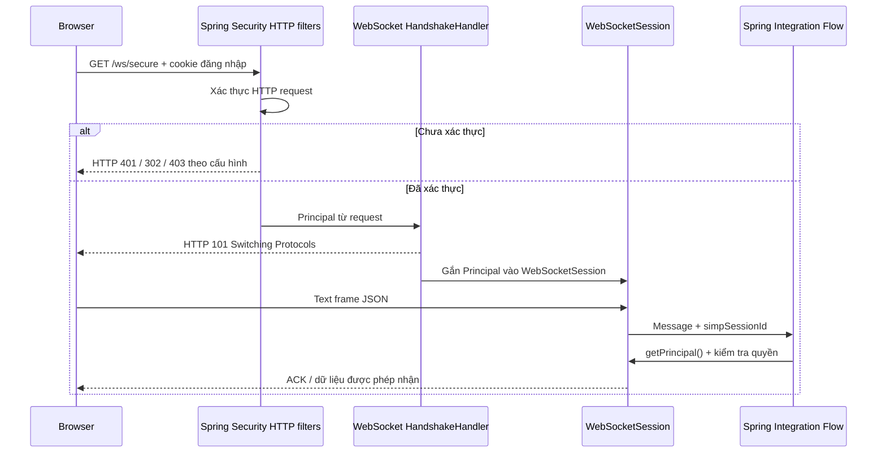
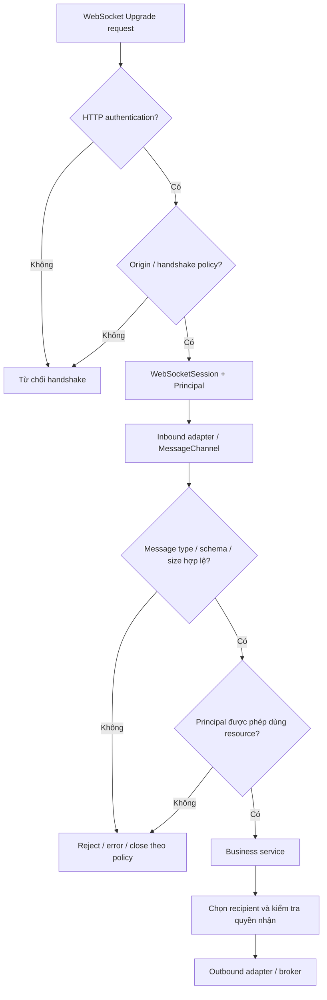
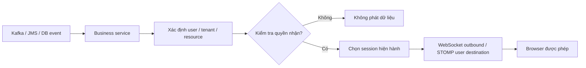

# Xác thực người dùng trên WebSocket

## 1. Mục tiêu và bối cảnh

Trong module **SPRING_INTEGRATION_ADAPTERS**, các hệ thống bên ngoài được kết nối vào Spring Integration bằng inbound/outbound adapter, gateway, poller và `MessageChannel`. Luồng dữ liệu có thể đến từ file, SFTP, HTTP, JMS, AMQP, Kafka hoặc cơ sở dữ liệu rồi được gửi tới trình duyệt qua WebSocket. Khi dữ liệu liên quan tới người dùng, đơn hàng, tenant hay thiết bị, câu hỏi quan trọng không chỉ là *message có đến đúng session không*, mà còn là **session đó thuộc về ai và có được phép nhận/xử lý message không**.

Bài **Xác thực người dùng trên WebSocket** thuộc chương **Adapter WebSocket**. Bạn sẽ học cách xác định danh tính khi mở kết nối, duy trì ngữ cảnh bảo mật trong quá trình trao đổi frame, kiểm tra quyền ở từng nghiệp vụ và thu hồi kết nối khi trạng thái đăng nhập hoặc quyền truy cập thay đổi.

Sau khi học, bạn có thể:

- Phân biệt **authentication (xác thực)**, **authorization (phân quyền)**, kiểm tra `Origin` và xác nhận phiên WebSocket còn hoạt động.
- Giải thích cách Spring Security xác thực **HTTP Upgrade handshake** và chuyển `Principal` sang `WebSocketSession`.
- Cấu hình `SecurityFilterChain` bảo vệ WebSocket endpoint, giới hạn allowed origins và giữ nguyên CSRF protection phù hợp.
- Viết một flow **Spring Integration raw WebSocket** sử dụng `WebSocketInboundChannelAdapter`, `MessageChannel` và `WebSocketOutboundMessageHandler` để trả lời đúng phiên đã xác thực.
- Lấy `Principal` từ **server-side session**, không tin `userId`/`sessionId` do client tự khai trong JSON.
- Hiểu những hạn chế của browser WebSocket API với HTTP Authorization header và cân nhắc cookie/session, STOMP `CONNECT`, JWT hoặc short-lived ticket.
- Dùng `@EnableWebSocketSecurity` và `AuthorizationManager<Message<?>>` để kiểm soát STOMP `SEND`/`SUBSCRIBE`.
- Thiết kế xử lý logout, token hết hạn, reconnect, nhiều tab, nhiều node, phòng ngừa Cross-Site WebSocket Hijacking và kiểm thử bảo mật.

**Điểm cốt lõi:** xác thực trả lời “**ai đang kết nối?**”; phân quyền trả lời “**người đó được làm gì, với tài nguyên nào?**”. Một WebSocket session đã xác thực không mặc nhiên được phép gửi mọi command hoặc subscribe mọi destination.

## 2. WebSocket sử dụng HTTP handshake như thế nào?

WebSocket ban đầu là một HTTP request yêu cầu nâng cấp kết nối:

```http
GET /ws/secure HTTP/1.1
Host: localhost:8080
Upgrade: websocket
Connection: Upgrade
Sec-WebSocket-Key: ...
Sec-WebSocket-Version: 13
Origin: http://localhost:8080
Cookie: JSESSIONID=...
```

Các dấu `...` chỉ minh họa thông tin do browser tạo. Nếu handshake được chấp nhận, server trả HTTP `101 Switching Protocols` rồi hai phía trao đổi WebSocket frames thay vì những HTTP request/response thông thường.

Trong **Spring WebSocket trên Servlet stack**, các thông tin xác thực có sẵn trong HTTP request handshake có thể được kế thừa sang WebSocket. Khi Spring Security xử lý HTTP request:

1. HTTP security filter chain xác thực cookie/session hoặc credential theo cấu hình.
2. Spring Security cung cấp `Principal` đáng tin cậy qua request đã xác thực.
3. Spring WebSocket handshake sử dụng `Principal` của request để gắn cho `WebSocketSession`.
4. Trong quá trình nhận frame, service có thể truy cập `session.getPrincipal()`.



**Không hiểu nhầm HTTP 101:** handshake thành công chỉ chứng tỏ kết nối đã nâng cấp; việc **ủy quyền từng yêu cầu** trong luồng WebSocket vẫn do application/service quyết định.

## 3. Những loại định danh không được đánh đồng

| Giá trị | Nguồn | Dùng làm gì? |
| --- | --- | --- |
| `Principal` / `Authentication` | Hệ thống xác thực ở server | Danh tính đã được xác thực, có thể kèm authorities/roles |
| `WebSocketSession.getId()` | WebSocket session phía server | Định danh **một kết nối hiện tại** |
| `simpSessionId` | Header Spring Messaging do WebSocket/sub-protocol handler gắn | Định tuyến Spring Message về đúng session |
| HTTP `JSESSIONID` | HTTP session/cookie nếu ứng dụng sử dụng | Hỗ trợ trạng thái đăng nhập HTTP; **không phải WebSocket session ID** |
| `userId` trong JSON | Client tự gửi, chưa được tin cậy | Thông tin nghiệp vụ cần đối chiếu với Principal |
| `tenantId` / `resourceId` | Payload hoặc nghiệp vụ | Đối tượng cần kiểm tra quyền truy cập |
| `eventId` / `correlationId` | Hợp đồng nghiệp vụ | Liên hệ request–reply, ACK, retry, deduplication |
| `MessageHeaders.ID` | Spring Messaging | Định danh Spring Message, không xác thực người dùng |

Ví dụ user `alice` đăng nhập rồi mở hai tab:

```text
Principal = alice
  ├── Tab A -> WebSocket session S1
  └── Tab B -> WebSocket session S2

Client gửi JSON: {"userId":"admin","action":"read-private-order"}
```

Hệ thống **không được** coi người gửi là `admin` vì một trường JSON nói như vậy. Người gửi vẫn là `alice` theo `WebSocketSession.getPrincipal()`; tài nguyên và hành động phải được kiểm tra quyền với danh tính đó.

Một client có thể khai sai `simpSessionId` trong JSON hoặc header tùy chỉnh. Định tuyến reply phải dựa trên **session ID do hạ tầng server đưa vào message**, không dựa trên chuỗi nhận từ payload.

## 4. Nhiều lớp bảo mật cần phối hợp



Các lớp có trách nhiệm riêng:

- **HTTP authentication:** chặn client chưa đăng nhập trước HTTP Upgrade.
- **Origin policy:** hạn chế trang web nào có thể tạo kết nối WebSocket từ browser; không thay thế authentication.
- **Message validation:** giới hạn loại event, kích thước, schema và tốc độ gửi.
- **Message authorization:** kiểm tra quyền trên `resourceId`, tenant, subscription và thao tác.
- **Outbound recipient authorization:** chỉ phát dữ liệu cho đúng user/tenant/session được phép nhận.
- **Lifecycle/revocation:** chấm dứt hoặc hạn chế session khi quyền bị thu hồi, token hết hạn hoặc logout.

Không chỉ khóa handshake rồi tin mọi message về sau. WebSocket có thể tồn tại lâu hơn phiên HTTP hoặc dữ liệu quyền tại thời điểm mở kết nối.

## 5. Chọn cơ chế xác thực phù hợp

| Phương án | Cách danh tính đi vào kết nối | Khi nào phù hợp? | Lưu ý bảo mật |
| --- | --- | --- | --- |
| **HTTP session/cookie** | Browser gửi cookie của ứng dụng ở HTTP Upgrade | Web app đã đăng nhập qua Spring Security | SameSite, Secure, Origin và CSRF phù hợp; không mặc định đóng WebSocket khi HTTP session hết hạn |
| **HTTP Bearer Authorization** | Non-browser client gửi Authorization header khi handshake | Java client, mobile/native client có quyền đặt headers | Xác thực JWT/token ở HTTP security filter; dùng TLS |
| **STOMP CONNECT token** | WebSocket mở, client gửi token trong STOMP native header `CONNECT` | Frontend cần token-based STOMP, không dùng cookie HTTP | Phải validate token trong inbound `ChannelInterceptor` và set authenticated user, trước message authorization |
| **Short-lived handshake ticket** | HTTP endpoint đã xác thực cấp ticket dùng một lần, client đưa vào handshake | Browser raw WebSocket không dùng cookie hoặc cần ủy quyền kết nối đặc biệt | Ticket ngắn hạn, một lần, bind ngữ cảnh, không log và không thay access token dài hạn |
| **Token dài hạn ở URL query** | `ws://.../?token=...` | Thường **không nên chọn** | Query string có thể bị log/copy/lưu trong lịch sử hệ thống/proxy |
| **Trust `Origin` hoặc `userId` JSON** | Dựa trên thông tin client có thể kiểm soát | **Không phải phương án xác thực** | Non-browser client có thể giả Origin; payload không chứng minh danh tính |

**Giới hạn của browser:** đối tượng chuẩn `new WebSocket(url)` không có tham số để đặt tùy ý một HTTP `Authorization: Bearer ...` header. Trình duyệt có thể gửi cookie hợp lệ cho URL theo chính sách của browser. Với STOMP, `connectHeaders` là **header của STOMP CONNECT frame**, không phải HTTP header của handshake.

Trong phần thực hành chính, ta chọn **Spring Security form login + cookie phiên** để có một luồng hoàn chỉnh trên Spring Boot Servlet. Các lựa chọn token/STOMP được trình bày ở phần sau.

## 6. Thực hành: xác thực HTTP Upgrade với Spring Security

Mục tiêu của ví dụ:

1. Client chưa đăng nhập **không mở được** `/ws/secure`.
2. Client đăng nhập thành công có `Principal` ở `WebSocketSession`.
3. Integration Flow đọc message `status.query` và kiểm tra quyền trên `resourceId`.
4. Flow chỉ trả reply cho **session đã gửi yêu cầu**, không gửi theo user ID tự khai.
5. Thử truy cập tài nguyên không được phép phải bị từ chối bởi application, không trả dữ liệu riêng tư.

Ví dụ dùng **Java 17+, Spring Boot 3.x, Spring Integration 6.x, Spring Security 6.x** và Servlet WebSocket. Hãy dùng phiên bản Spring Boot BOM tương thích.

### 6.1. Maven dependencies

```xml
<dependencies>
    <dependency>
        <groupId>org.springframework.boot</groupId>
        <artifactId>spring-boot-starter-web</artifactId>
    </dependency>
    <dependency>
        <groupId>org.springframework.boot</groupId>
        <artifactId>spring-boot-starter-security</artifactId>
    </dependency>
    <dependency>
        <groupId>org.springframework.boot</groupId>
        <artifactId>spring-boot-starter-integration</artifactId>
    </dependency>
    <dependency>
        <groupId>org.springframework.integration</groupId>
        <artifactId>spring-integration-websocket</artifactId>
    </dependency>
</dependencies>
```

Trong ứng dụng mẫu không tự khai báo `UserDetailsService`, Spring Boot có thể dùng **development user tự động tạo** nếu chưa có hệ thống xác thực khác; đăng nhập với username `user` và mật khẩu được in vào log lúc startup. Trong ứng dụng thật phải thay bằng identity provider/user store và chính sách mật khẩu an toàn. Không cố định một mật khẩu demo trong source code production.

### 6.2. SecurityFilterChain bảo vệ endpoint

Tạo `HttpWebSocketSecurityConfiguration.java`:

```java
package com.example.securews;

import org.springframework.context.annotation.Bean;
import org.springframework.context.annotation.Configuration;
import org.springframework.security.config.Customizer;
import org.springframework.security.config.annotation.web.builders.HttpSecurity;
import org.springframework.security.config.annotation.web.configuration.EnableWebSecurity;
import org.springframework.security.web.SecurityFilterChain;

@Configuration
@EnableWebSecurity
public class HttpWebSocketSecurityConfiguration {

    @Bean
    SecurityFilterChain securityFilterChain(
            HttpSecurity http) throws Exception {

        http
            .authorizeHttpRequests(auth -> auth
                .requestMatchers("/login", "/error").permitAll()
                .requestMatchers("/ws/secure").authenticated()
                .anyRequest().authenticated())
            .formLogin(Customizer.withDefaults());

        // Không tắt CSRF toàn cục. Spring Security mặc định
        // bảo vệ các HTTP method gây thay đổi trạng thái.
        return http.build();
    }
}
```

Ý nghĩa:

- `/ws/secure` được bảo vệ bởi **HTTP filter chain** trước khi nâng cấp kết nối.
- `/login` công khai để người dùng có thể đăng nhập.
- `anyRequest().authenticated()` tránh vô tình mở những HTTP API chưa liệt kê; ứng dụng thật nên thiết kế matcher cụ thể hơn.
- `formLogin` tạo đăng nhập dùng cookie/session trong ví dụ.
- CSRF cho HTTP requests vẫn được bật mặc định; không cần và không nên gọi `csrf.disable()` chỉ vì đang dùng WebSocket.

Một client chưa đăng nhập có thể nhận redirect HTTP `302` tới trang login hoặc phản hồi từ chối khác tùy cấu hình. **Browser WebSocket API không hiển thị HTTP status code một cách tin cậy qua `onerror`**; hãy kiểm tra server/security logs hoặc network inspector khi chẩn đoán.

### 6.3. Quy tắc quyền đọc tài nguyên

Ví dụ đơn giản có đúng một loại tài nguyên có thể xem: tài nguyên công khai bắt đầu bằng `public-`. Dù đã đăng nhập, client không được đọc tài nguyên khác.

Tạo `ReadAccessPolicy.java`:

```java
package com.example.securews;

import java.security.Principal;
import org.springframework.stereotype.Component;

@Component
public class ReadAccessPolicy {

    public boolean canRead(
            Principal principal, String resourceId) {

        // Chỉ là policy DEMO: authenticated user được
        // đọc public-*; tài nguyên khác bị từ chối.
        return principal != null
                && resourceId != null
                && resourceId.startsWith("public-");
    }
}
```

Đây là **một rule minh họa**, không phải hệ thống phân quyền theo tenant/order. Ở production, `canRead(...)` phải dựa trên **danh tính server xác thực** và permission từ DB/ACL/tenant membership, bao gồm trạng thái revoke mới nhất khi cần.

### 6.4. Cấu hình Spring Integration WebSocket adapter

Tạo `SecureWebSocketIntegrationConfiguration.java`:

```java
package com.example.securews;

import java.security.Principal;
import com.fasterxml.jackson.core.JsonProcessingException;
import com.fasterxml.jackson.databind.JsonNode;
import com.fasterxml.jackson.databind.ObjectMapper;
import org.springframework.beans.factory.annotation.Qualifier;
import org.springframework.context.annotation.Bean;
import org.springframework.context.annotation.Configuration;
import org.springframework.integration.annotation.ServiceActivator;
import org.springframework.integration.channel.DirectChannel;
import org.springframework.integration.config.EnableIntegration;
import org.springframework.integration.websocket.ServerWebSocketContainer;
import org.springframework.integration.websocket.inbound.WebSocketInboundChannelAdapter;
import org.springframework.integration.websocket.outbound.WebSocketOutboundMessageHandler;
import org.springframework.messaging.MessageChannel;
import org.springframework.messaging.MessageHandler;
import org.springframework.messaging.MessagingException;
import org.springframework.messaging.simp.SimpMessageHeaderAccessor;
import org.springframework.messaging.support.MessageBuilder;
import org.springframework.web.socket.WebSocketSession;

@Configuration
@EnableIntegration
public class SecureWebSocketIntegrationConfiguration {

    @Bean
    public ServerWebSocketContainer secureWebSocketContainer() {
        ServerWebSocketContainer container =
                new ServerWebSocketContainer("/ws/secure");

        // Chỉ cho phép browser từ origin của ứng dụng demo.
        // Production: thay bằng chính xác HTTPS origin được phép.
        container.setAllowedOrigins("http://localhost:8080");
        return container;
    }

    @Bean
    public MessageChannel secureInboundChannel() {
        return new DirectChannel();
    }

    @Bean
    public MessageChannel secureOutboundChannel() {
        return new DirectChannel();
    }

    @Bean
    public WebSocketInboundChannelAdapter secureInbound(
            ServerWebSocketContainer secureWebSocketContainer,
            @Qualifier("secureInboundChannel") MessageChannel input) {

        WebSocketInboundChannelAdapter inbound =
                new WebSocketInboundChannelAdapter(
                        secureWebSocketContainer);

        inbound.setPayloadType(String.class);
        inbound.setOutputChannel(input);
        return inbound;
    }

    @Bean
    @ServiceActivator(inputChannel = "secureInboundChannel")
    public MessageHandler authenticatedQueryHandler(
            ServerWebSocketContainer secureWebSocketContainer,
            @Qualifier("secureOutboundChannel") MessageChannel replies,
            ReadAccessPolicy accessPolicy,
            ObjectMapper mapper) {

        return incoming -> {

            // Lấy session ID do hạ tầng Spring gắn.
            String sessionId = SimpMessageHeaderAccessor
                    .getSessionId(incoming.getHeaders());

            if (sessionId == null) {
                throw new MessagingException(
                        incoming, "Thiếu WebSocket session ID");
            }

            WebSocketSession session =
                    secureWebSocketContainer.getSession(sessionId);

            if (session == null || !session.isOpen()) {
                throw new MessagingException(
                        incoming, "WebSocket session không còn mở");
            }

            // Principal xuất phát từ HTTP handshake đã xác thực.
            // Không đọc userId từ JSON để quyết định danh tính.
            Principal principal = session.getPrincipal();

            if (principal == null) {
                throw new MessagingException(
                        incoming, "WebSocket session chưa xác thực");
            }

            if (!(incoming.getPayload() instanceof String json)) {
                throw new MessagingException(
                        incoming, "Chỉ hỗ trợ raw text JSON");
            }

            final JsonNode request;
            try {
                request = mapper.readTree(json);
            } catch (JsonProcessingException ex) {
                throw new MessagingException(
                        incoming, "JSON không hợp lệ", ex);
            }

            if (request == null || !request.isObject()) {
                throw new MessagingException(
                        incoming, "Payload phải là JSON object");
            }

            String type = request.path("type").asText("");
            String requestId = request.path("requestId").asText("");
            String resourceId = request.path("resourceId").asText("");

            if (!"status.query".equals(type)
                    || requestId.isBlank()
                    || requestId.length() > 80
                    || resourceId.isBlank()
                    || resourceId.length() > 100) {
                throw new MessagingException(
                        incoming, "Hợp đồng request không hợp lệ");
            }

            if (!accessPolicy.canRead(principal, resourceId)) {
                // Thật sự từ chối trước khi đọc tài nguyên bí mật.
                throw new MessagingException(
                        incoming, "Không có quyền đọc tài nguyên");
            }

            // Demo giả định resource public-* có trạng thái READY.
            // Production: đọc từ service nghiệp vụ đã kiểm tra quyền.
            String replyJson = mapper.createObjectNode()
                    .put("type", "status.reply")
                    .put("requestId", requestId)
                    .put("resourceId", resourceId)
                    .put("status", "READY")
                    .toString();

            boolean accepted = replies.send(
                    MessageBuilder.withPayload(replyJson)
                            .setHeader(
                                    SimpMessageHeaderAccessor
                                            .SESSION_ID_HEADER,
                                    sessionId)
                            .build());

            if (!accepted) {
                throw new MessagingException(
                        incoming, "Reply channel không chấp nhận message");
            }
        };
    }

    @Bean
    @ServiceActivator(inputChannel = "secureOutboundChannel")
    public MessageHandler secureOutbound(
            ServerWebSocketContainer secureWebSocketContainer) {
        return new WebSocketOutboundMessageHandler(
                secureWebSocketContainer);
    }
}
```

### 6.5. Giải thích hợp đồng bảo mật của flow

**Điểm 1 — chỉ một registry:** inbound và outbound sử dụng **cùng** `ServerWebSocketContainer`. Nếu tạo container khác, outbound có thể không tìm được `sessionId` đang tồn tại.

**Điểm 2 — nguồn danh tính:** `Principal` lấy từ `session.getPrincipal()` sau HTTP handshake. Không dùng `{"userId":"admin"}` do client tự khai.

**Điểm 3 — header định tuyến:** `SimpMessageHeaderAccessor.SESSION_ID_HEADER` (thường mang tên `simpSessionId`) chọn đúng phiên của request. Nó **không phải quyền truy cập**; một message có session ID đúng vẫn cần xác thực/phân quyền dữ liệu.

**Điểm 4 — resource authorization:** `ReadAccessPolicy.canRead(...)` chạy **trước** khi đọc thông tin để trả. Đừng chỉ kiểm tra user đã login rồi cho phép truy vấn mọi `resourceId`.

**Điểm 5 — error semantics:** exception trong `ServiceActivator` được Spring Integration xử lý theo cơ chế message flow/error channel; nó **không tự động** biến thành JSON error frame phía client. Một ứng dụng thật phải thiết kế error response an toàn, timeout và xử lý transport error riêng.

**Điểm 6 — concurrency:** session có thể đóng ngay sau khi `isOpen()` trả `true`; cần bắt và quan sát lỗi outbound. `MessageChannel.send(...)` được chấp nhận không bảo đảm browser đã nhận và xử lý.

**Điểm 7 — hardening:** cần thêm rate limiting, giới hạn payload JSON, schema validation nghiêm ngặt, monitoring và chính sách đóng session nếu client gửi các request trái phép lặp lại.

### 6.6. Thử từ trình duyệt đã đăng nhập

Khởi động ứng dụng trên `localhost:8080`. Truy cập `http://localhost:8080/login`, đăng nhập bằng tài khoản development được Spring Boot khởi tạo (nếu chưa cấu hình identity provider). Sau khi đăng nhập, ở một trang thuộc **cùng origin** chạy:

```javascript
const scheme = location.protocol === "https:" ? "wss:" : "ws:";
const socket = new WebSocket(
  scheme + "//" + location.host + "/ws/secure"
);

socket.addEventListener("open", () => {
  socket.send(JSON.stringify({
    type: "status.query",
    requestId: "rq-101",
    resourceId: "public-42",
    userId: "admin" // Trường giả: server không dùng để xác thực!
  }));
});

socket.addEventListener("message", (event) => {
  console.log("Server reply:", JSON.parse(event.data));
});

socket.addEventListener("close", (event) => {
  console.log("Closed:", event.code, event.reason);
});

socket.addEventListener("error", () => {
  console.log("Handshake hoặc transport lỗi");
});
```

Với session đã xác thực, response mẫu:

```json
{
  "type": "status.reply",
  "requestId": "rq-101",
  "resourceId": "public-42",
  "status": "READY"
}
```

Trường `userId:"admin"` chỉ để thử khả năng chống giả mạo: service **bỏ qua** nó và vẫn sử dụng `Principal` của phiên đã login.

Để thử phân quyền thất bại, gửi khi socket đã mở:

```javascript
socket.send(JSON.stringify({
  type: "status.query",
  requestId: "rq-102",
  resourceId: "private-42"
}));
```

`ReadAccessPolicy` từ chối request. Đừng mặc định client luôn nhận một JSON error hoặc kết nối tự đóng khi code ném `MessagingException`; kết quả phụ thuộc error handling của Integration Flow. Trong môi trường thử nghiệm, kiểm tra log/metrics và bảo đảm không có `status.reply` chứa thông tin riêng tư.

Để thử **unauthenticated handshake**, dùng cửa sổ private/incognito chưa login cùng origin. Kết nối vào `/ws/secure` phải thất bại ở HTTP security layer. Để thử **Origin**, mở một trang từ origin khác và yêu cầu WebSocket tới server; allowlist của container phải từ chối browser origin không nằm trong cấu hình.

## 7. Cookie, Origin và Cross-Site WebSocket Hijacking

### 7.1. Browser WebSocket khác fetch/XHR

Browser thường áp dụng Same-Origin Policy cho `fetch`/XHR, nhưng **không tự động cấm mọi kết nối WebSocket cross-origin**. Khi có cookie phiên đăng nhập, một trang do kẻ tấn công kiểm soát có thể cố mở WebSocket tới ứng dụng khác. Nếu server không kiểm tra Origin và không yêu cầu xác thực/CSRF đúng cách, ứng dụng có nguy cơ **Cross-Site WebSocket Hijacking (CSWSH)**.

Vì vậy:

- Sử dụng `ServerWebSocketContainer.setAllowedOrigins(...)` với **origin chính xác**, hoặc giữ chính sách same-origin mặc định khi phù hợp.
- Không cấu hình `setAllowedOrigins("*")` cho endpoint dùng cookie chứa dữ liệu riêng tư, trừ khi thiết kế cơ chế bảo vệ thay thế đã được đánh giá kỹ.
- Cấu hình cookie `Secure`, `HttpOnly`, `SameSite` theo kiến trúc đăng nhập và cross-site thực tế.
- Bảo đảm TLS `wss://` trên môi trường ngoài localhost.
- Có authentication và authorization trên cả handshake lẫn message, không chỉ Origin.

**Origin không phải chứng minh danh tính:** client không phải browser có thể tự đặt header `Origin`. Allowlist giúp ngăn hành vi không được phép từ **browser**, còn identity vẫn phải dựa trên Spring Security/credential hợp lệ.

### 7.2. CSRF khi dùng raw WebSocket và STOMP

Với raw WebSocket:

- HTTP Upgrade thường là request `GET`; CSRF filter chuẩn cho HTTP unsafe methods không phải cơ chế duy nhất bảo vệ WebSocket.
- Origin allowlist và cookie policy có vai trò quan trọng.
- **Không tắt CSRF toàn cục** chỉ để handshake đi qua.
- Từng command trong WebSocket vẫn cần authorization server-side, giới hạn rate và payload.

Với STOMP qua WebSocket:

- Spring Security messaging có thể yêu cầu **CSRF token trong STOMP `CONNECT`** để bảo vệ same-origin.
- Token nằm trong **STOMP native headers**, không phải tự biến thành HTTP Authorization header.
- Chỉ cấu hình ngoại lệ CSRF của HTTP layer cho các transport SockJS cụ thể khi thật sự cần và có cơ chế bảo vệ tương ứng; không blanket disable.

### 7.3. CORS không đồng nghĩa với bảo vệ message

CORS cho HTTP, allowed origins cho WebSocket handshake và authorization cho message là những lớp khác nhau. Một cấu hình CORS đúng không tự chặn việc client đã kết nối gửi lệnh `delete-account`; service vẫn phải kiểm tra command/action và quyền trên tài nguyên.

## 8. STOMP over WebSocket: phân quyền SEND và SUBSCRIBE

Spring Integration có thể sử dụng raw WebSocket adapter. Khi ứng dụng dùng **STOMP over WebSocket** với `@EnableWebSocketMessageBroker`, bảo mật còn phải áp dụng cho **Spring Messaging inbound channel**.

| Giai đoạn | Kiểm tra cần có |
| --- | --- |
| HTTP handshake | Client có được mở `/ws-stomp` không? |
| STOMP `CONNECT` | CSRF hợp lệ? Nếu dùng token-based CONNECT, token có được xác thực? |
| `SEND /app/...` | User có role phù hợp và có quyền thực hiện nghiệp vụ? |
| `SUBSCRIBE /user/...` | User có được subscribe destination riêng? |
| `SUBSCRIBE /topic/...` | User có được xem dữ liệu topic đó, đúng tenant/resource không? |
| `MESSAGE` server outbound | Chỉ phát dữ liệu mà tập subscriber được phép nhận; Spring Security chủ yếu bảo vệ inbound channel |

**Chú ý:** `@EnableWebSocketSecurity` bảo vệ **Spring Messaging/STOMP inbound**, không phải một phép thay thế trực tiếp cho authorization trong raw `WebSocketInboundChannelAdapter`. Đừng thêm annotation đó rồi giả định toàn bộ payload raw WebSocket tự động có rule `/app`/`/topic`.

### 8.1. Cấu hình STOMP endpoint và broker

Đây là **một phương án khác** với raw endpoint `/ws/secure` ở mục 6:

```java
package com.example.securestomp;

import org.springframework.context.annotation.Configuration;
import org.springframework.messaging.simp.config.MessageBrokerRegistry;
import org.springframework.web.socket.config.annotation.EnableWebSocketMessageBroker;
import org.springframework.web.socket.config.annotation.StompEndpointRegistry;
import org.springframework.web.socket.config.annotation.WebSocketMessageBrokerConfigurer;

@Configuration
@EnableWebSocketMessageBroker
public class StompEndpointConfiguration
        implements WebSocketMessageBrokerConfigurer {

    @Override
    public void registerStompEndpoints(StompEndpointRegistry registry) {
        registry.addEndpoint("/ws-stomp");
    }

    @Override
    public void configureMessageBroker(MessageBrokerRegistry registry) {
        registry.setApplicationDestinationPrefixes("/app");
        registry.enableSimpleBroker("/topic", "/queue");
        registry.setUserDestinationPrefix("/user");
    }
}
```

`/ws-stomp` là **handshake URL**; `/app/...` và `/topic/...` là STOMP destinations. Khi có external STOMP broker, có thể cấu hình `enableStompBrokerRelay(...)`; broker relay không loại bỏ nhu cầu authentication/authorization của ứng dụng.

### 8.2. Rule Spring Security cho inbound STOMP

Phần này cần dependency `spring-security-messaging` (cùng phiên bản do Spring Boot BOM quản lý), bên cạnh `spring-boot-starter-security`:

```xml
<dependency>
    <groupId>org.springframework.security</groupId>
    <artifactId>spring-security-messaging</artifactId>
</dependency>
```

Tạo `StompAuthorizationConfiguration.java`:

```java
package com.example.securestomp;

import static org.springframework.messaging.simp.SimpMessageType.MESSAGE;
import static org.springframework.messaging.simp.SimpMessageType.SUBSCRIBE;

import org.springframework.context.annotation.Bean;
import org.springframework.context.annotation.Configuration;
import org.springframework.messaging.Message;
import org.springframework.security.authorization.AuthorizationManager;
import org.springframework.security.config.annotation.web.socket.EnableWebSocketSecurity;
import org.springframework.security.messaging.access.intercept.MessageMatcherDelegatingAuthorizationManager;

@Configuration
@EnableWebSocketSecurity
public class StompAuthorizationConfiguration {

    @Bean
    AuthorizationManager<Message<?>> messageAuthorizationManager(
            MessageMatcherDelegatingAuthorizationManager.Builder messages) {

        messages
            .nullDestMatcher().authenticated()
            .simpDestMatchers("/app/**").hasRole("USER")
            .simpSubscribeDestMatchers("/user/queue/**").hasRole("USER")
            .simpSubscribeDestMatchers("/topic/public/**").hasRole("USER")
            .simpTypeMatchers(MESSAGE, SUBSCRIBE).denyAll()
            .anyMessage().denyAll();

        return messages.build();
    }
}
```

Ý nghĩa:

1. Message inbound không có destination (ví dụ `CONNECT`) yêu cầu authenticated principal.
2. Chỉ cho phép user có role `USER` gửi tới `/app/**`.
3. Chỉ cho phép subscribe những user/public destinations đã liệt kê.
4. `MESSAGE` hoặc `SUBSCRIBE` còn lại bị từ chối theo nguyên tắc **deny by default**.
5. Spring Security WebSocket message configuration còn có chính sách CSRF cho STOMP `CONNECT`; client phải cung cấp token phù hợp khi dùng cấu hình đó.

**Không coi role là phân quyền theo tài nguyên:** `hasRole("USER")` không biết một `orderId` hay `tenantId` cụ thể có thuộc về user không. Controller/service xử lý `@MessageMapping` vẫn phải kiểm tra quyền sở hữu dữ liệu. Với topic riêng theo tenant, cần rule authorization chi tiết hơn trước `SUBSCRIBE` hoặc thiết kế user destination để tránh rò rỉ cross-tenant.

### 8.3. Client STOMP gửi CSRF token trong CONNECT

Nếu ứng dụng dùng HTTP session và Spring Security WebSocket message security, có thể cung cấp một endpoint REST same-origin để lấy CSRF token. Ví dụ minh họa:

```java
import org.springframework.security.web.csrf.CsrfToken;
import org.springframework.web.bind.annotation.GetMapping;
import org.springframework.web.bind.annotation.RestController;

@RestController
public class CsrfTokenController {

    @GetMapping("/csrf")
    public CsrfToken csrf(CsrfToken token) {
        return token;
    }
}
```

Endpoint `/csrf` trong ứng dụng cần được giới hạn theo chính sách security; với `anyRequest().authenticated()` ở ví dụ trước, chỉ user đã đăng nhập mới truy cập được. Không mở CORS tùy tiện cho endpoint này.

STOMP.js phía frontend có thể gửi token bằng `connectHeaders`:

```javascript
import { Client } from "@stomp/stompjs";

const response = await fetch("/csrf", {
  credentials: "same-origin"
});
if (!response.ok) {
  throw new Error("Cannot obtain CSRF token");
}

const csrf = await response.json();

const client = new Client({
  brokerURL: "ws://localhost:8080/ws-stomp",
  connectHeaders: {
    [csrf.headerName]: csrf.token
  },
  reconnectDelay: 3000,

  onConnect: () => {
    client.subscribe("/user/queue/acks", msg => {
      console.log("ACK:", JSON.parse(msg.body));
    });
  }
});

client.activate();
```

Ở đây CSRF header được gửi trong **STOMP CONNECT frame**. Nếu hệ thống cần refresh CSRF token sau login/logout/reconnect, phải thiết kế lại việc lấy token phù hợp và không tự giả định một token còn hiệu lực mãi.

## 9. Token/JWT khi browser không gửi được HTTP Authorization header tùy ý

Spring Framework không áp đặt một phương pháp xác thực duy nhất khi WebSocket handshake. Với **native Java/mobile clients**, bạn thường có thể gửi Bearer header trong HTTP handshake và để Spring Security Resource Server xác thực như HTTP API.

Với **browser native WebSocket**, có một số lựa chọn:

### 9.1. Cookie/session thông qua HTTP handshake

Đây là cách thường thuận lợi khi frontend và backend cùng site, đã có cơ chế đăng nhập qua Spring Security. Cookie được browser gửi theo quy tắc của nó; `Principal` được gắn với WebSocket session. Cần bảo vệ CSWSH bằng Origin và cookie policy phù hợp.

### 9.2. STOMP CONNECT mang Bearer token

STOMP.js có thể đặt token ở native header:

```javascript
const client = new Client({
  brokerURL: "wss://app.example.com/ws-stomp",
  connectHeaders: {
    Authorization: "Bearer " + accessToken
  }
});
```

**Header này không tự xác thực người dùng.** Server phải có `ChannelInterceptor` trên `clientInboundChannel`, đọc token ở `CONNECT`, xác minh chữ ký/issuer/audience/expiration/permission và gọi `StompHeaderAccessor.setUser(authenticatedAuthentication)`. Spring Messaging sẽ liên kết user đó với session tương ứng cho những STOMP message tiếp theo. Khi kết hợp với Spring Security message authorization, authentication interceptor phải được đăng ký **trước** interceptor bảo mật; Spring Framework hướng dẫn sử dụng một `WebSocketMessageBrokerConfigurer` riêng với `@Order(Ordered.HIGHEST_PRECEDENCE + 99)` khi cần.

Một phác thảo cho phần xử lý `CONNECT`, **không phải trình xác minh JWT hoàn chỉnh**:

```java
StompHeaderAccessor accessor =
        MessageHeaderAccessor.getAccessor(
                message, StompHeaderAccessor.class);

if (accessor != null
        && StompCommand.CONNECT.equals(accessor.getCommand())) {

    String header = accessor.getFirstNativeHeader("Authorization");

    // tokenVerifier là service của ứng dụng phải xác minh đầy đủ JWT.
    // Nếu header không hợp lệ: từ chối CONNECT, không set anonymous user.
    Authentication authenticated =
            tokenVerifier.authenticateBearer(header);

    accessor.setUser(authenticated);
}
```

Đoạn minh họa giả định các import Spring Messaging/Spring Security và `tokenVerifier` đã được khai báo. Chỉ đưa ra pattern vì **một JWT validator giả hoặc bỏ kiểm tra chữ ký** sẽ tạo lỗ hổng nghiêm trọng. Không lấy username/roles bằng cách decode JWT payload mà không verify token.

Cần quyết định rõ nếu hệ thống đồng thời có cookie-based authentication và STOMP token authentication: cách kết hợp principal, CSRF, precedence, token rotation và kiểm tra quyền phải nhất quán, không để một phương án âm thầm ghi đè phương án khác.

### 9.3. Short-lived one-time handshake ticket

Khi raw browser WebSocket không dùng cookie, có thể thiết kế:

1. Frontend gửi HTTPS request đã xác thực tới endpoint cấp **ticket sử dụng một lần**, ngắn hạn.
2. Server gắn ticket với user, intended endpoint, thời gian hết hạn và nonce; lưu trạng thái để chống tái sử dụng.
3. Browser mở WebSocket với ticket, ví dụ query parameter.
4. `HandshakeInterceptor` xác minh ticket **trước khi chấp nhận Upgrade**, bảo đảm consume-once.
5. `HandshakeHandler` hoặc cơ chế nhận dạng phù hợp thiết lập Principal đáng tin cậy cho session; interceptor chỉ đặt attributes thì **không tự biến thành Principal**.
6. Application không log ticket trong URL, và thu hồi ticket ngay khi dùng/timeout.

**Không truyền access token dài hạn trong query string**. Một ticket xuất hiện trong URL vẫn có nguy cơ bị log; hệ thống phải giảm khả năng lộ bằng TTL ngắn, sử dụng một lần, không cache và lọc log.

## 10. Giữ và thu hồi quyền trong một kết nối sống lâu

### 10.1. Principal ở handshake không tự refresh

Giả sử người dùng `alice` mở WebSocket lúc 10:00. Đến 10:10 tài khoản bị khóa hoặc quyền trên một đơn hàng bị thu hồi, nhưng connection vẫn còn mở. `session.getPrincipal()` có thể vẫn đại diện cho danh tính của handshake ban đầu. Do đó:

- Với dữ liệu nhạy cảm, **kiểm tra quyền ở thời điểm xử lý từng command** hoặc theo phiên bản/quy tắc cache thích hợp.
- Nếu roles/token có thể thay đổi, xác định chiến lược refresh/revalidate hay đóng session khi quyền bị thu hồi.
- Không coi `isOpen() == true` hoặc heartbeat pong hợp lệ là bằng chứng user vẫn được phép truy cập.
- Nếu user logout, xử lý cả logout credential/session **và** những WebSocket sessions cần chấm dứt.

### 10.2. Logout HTTP không luôn đóng WebSocket

HTTP session hết hạn hoặc logout không mặc định bảo đảm mọi WebSocket session gắn với user đã tự động đóng ngay trong mọi cấu hình. Có thể cần:

- Đăng ký session binding/lifecycle phù hợp với HTTP session và WebSocket handshake.
- Lưu ánh xạ `authenticatedUserId → Set<webSocketSessionId>` ở server.
- Khi logout/revoke, đóng các WebSocket session thuộc phạm vi chính sách.
- Cập nhật authorization backend để từ chối message mới **ngay cả trước khi close handshake hoàn thành**.
- Với cluster, gửi thông báo revoke tới node đang sở hữu session hoặc dùng cơ chế phân tán đáng tin cậy.

Ví dụ service đóng một session đã được chọn bởi hệ thống đáng tin cậy:

```java
import java.io.IOException;
import org.springframework.integration.websocket.ServerWebSocketContainer;
import org.springframework.web.socket.CloseStatus;
import org.springframework.web.socket.WebSocketSession;

public void revokeSession(
        ServerWebSocketContainer container, String sessionId)
        throws IOException {

    WebSocketSession session = container.getSession(sessionId);
    if (session != null && session.isOpen()) {
        session.close(CloseStatus.POLICY_VIOLATION);
    }
}
```

`CloseStatus.POLICY_VIOLATION` (1008) có thể được dùng khi server đóng kết nối do vi phạm chính sách, nhưng **close code không phải một biện pháp ủy quyền**. Trước hoặc đồng thời với close, service phải ngừng cho phép đọc/gửi dữ liệu trái phép.

### 10.3. Reconnect và nhiều tab

Một user có thể có nhiều session:

```text
alice
  ├── Chrome tab A: session A1
  ├── Chrome tab B: session B1
  └── Mobile app:   session M1
```

Nếu chỉ đóng A1, các phiên B1/M1 có thể vẫn tồn tại theo chính sách. Nếu logout khỏi **mọi thiết bị**, cần xác định và thu hồi tất cả phiên/tokens liên quan, không chỉ một WebSocket ID.

Khi reconnect, WebSocket tạo **session ID mới**. Không dùng session ID cũ, không tự gán lại identity từ payload client, và không chuyển tiếp message pending của user trước khi xác thực lại quyền.

## 11. Xử lý user destination, subscribe và dữ liệu nhiều tenant

Khi phát sự kiện từ Kafka/JMS/AMQP/DB đến WebSocket, incoming event thường không mang `simpSessionId` vì nó **không xuất phát từ một WebSocket client**. Server phải tìm **recipient hợp lệ** rồi định tuyến tới session đang mở.



Ví dụ dữ liệu đơn hàng `ORD-42` có thể thuộc tenant `T-7`. Không được phát nguyên payload lên một topic chung `/topic/all-orders` nếu những user không thuộc T-7 có thể subscribe.

Hai hướng thường dùng:

- **Raw WebSocket:** ứng dụng duy trì ánh xạ user → tập session có Principal xác thực, lọc quyền, rồi gửi từng message có `simpSessionId`.
- **STOMP:** sử dụng `/user/queue/...` hoặc các destination được giới hạn quyền, kiểm soát `SUBSCRIBE` và quyền tài nguyên.

**Spring Security WebSocket message authorization chủ yếu kiểm tra `clientInboundChannel`; không tự lọc mọi outbound message.** Vì vậy permission của publisher/service và subscription authorization là phần thiết yếu của thiết kế.

## 12. Lưu ý khi triển khai nhiều node và phía proxy

| Vấn đề | Rủi ro | Nguyên tắc xử lý |
| --- | --- | --- |
| TLS termination ở reverse proxy | Sai scheme/Origin, gửi cookie không `Secure` | Cấu hình proxy headers an toàn, HTTPS/WSS và allowed origins chính xác |
| Load balancer chuyển reconnect sang node khác | Session mới không thuộc registry node cũ | Đăng ký Principal/session mới, route đúng node |
| HTTP session store phân tán | Login được dùng chung nhưng WebSocket session vẫn cục bộ | Tách identity store khỏi WebSocket session registry |
| Revoke token/role trên nhiều node | Node khác còn session và tiếp tục gửi | Phát revoke event, kiểm tra quyền ở service, đóng phiên phù hợp |
| Một user nhiều tab | Xóa nhầm user khi một tab disconnect | Xóa đúng session ID, dùng `Set<sessionId>` |
| STOMP broker relay | Broker subscription rộng, topic nhạy cảm bị lộ | Chặn `SUBSCRIBE`/`SEND` phù hợp, không tin broker tự hiểu tenant |
| Cross-origin | Browser trang lạ thử mở WebSocket với cookie | Origin allowlist + auth/CSRF/cookie policy |

**Không đồng nhất cluster session:** `ServerWebSocketContainer.getSession(sessionId)` chỉ tra session cục bộ của container. Một user đã xác thực trên node B không làm message được gửi vào WebSocket session còn nằm trên node A nếu không có routing/broker phù hợp.

## 13. Kiểm thử xác thực và phân quyền

### 13.1. Ma trận kiểm thử

| Kịch bản | Kết quả mong đợi |
| --- | --- |
| Browser chưa đăng nhập mở `/ws/secure` | HTTP handshake bị từ chối/redirect theo cấu hình |
| Browser đã đăng nhập mở `/ws/secure` | Kết nối được nâng cấp, session có Principal đáng tin cậy |
| Browser từ origin không được phép | Bị từ chối tại Origin/handshake policy |
| Request có `userId:"admin"` giả | Không ảnh hưởng danh tính server sử dụng |
| User đã login đọc `public-42` | Qua demo policy, nhận status.reply |
| User đã login đọc `private-42` | Bị từ chối, không rò rỉ dữ liệu |
| Hai tab của một user | Hai WebSocket session riêng; reply tới đúng session gửi |
| Session đã đóng rồi gửi thêm message | Không được coi là giao thành công; xử lý cleanup |
| HTTP logout/revoke khi WebSocket còn mở | Không tiếp tục truy cập dữ liệu trái phép; đóng session theo chính sách |
| Token hết hạn khi connection còn mở | Theo chiến lược revalidate/close; không tự mặc định còn quyền |
| STOMP CONNECT thiếu CSRF | Bị từ chối khi áp dụng Spring Security WebSocket message security |
| STOMP subscribe topic ngoài quyền | Bị từ chối; không nhận message của topic đó |
| STOMP client giả username trong payload | Principal/authorization không thay đổi |
| Node crash và reconnect sang node khác | Session mới được xác thực lại; stale mapping được thu hồi |

### 13.2. Unit test rule nghiệp vụ

`ReadAccessPolicy` tách biệt khỏi WebSocket nên có thể kiểm thử:

```java
import static org.junit.jupiter.api.Assertions.*;
import org.junit.jupiter.api.Test;

class ReadAccessPolicyTest {

    private final ReadAccessPolicy policy = new ReadAccessPolicy();

    @Test
    void loggedInUserCanReadPublicResource() {
        assertTrue(policy.canRead(
                () -> "alice", "public-42"));
    }

    @Test
    void cannotReadPrivateResource() {
        assertFalse(policy.canRead(
                () -> "alice", "private-42"));
    }

    @Test
    void noPrincipalCannotRead() {
        assertFalse(policy.canRead(null, "public-42"));
    }
}
```

Đây là unit test của **demo policy**, không chứng minh hệ thống thật đã xác thực handshake đúng. Với Spring Security cần bổ sung integration tests cho HTTP handshake, principal propagation, authorization từng message, session revocation và Spring Messaging/STOMP rules.

### 13.3. Integration tests cần chạy

1. Dùng WebSocket client thực có và không có HTTP cookie đăng nhập.
2. Kiểm tra HTTP security filter chain từ chối handshake của anonymous user.
3. Kiểm tra server-side `WebSocketSession.getPrincipal()` không rỗng với user đã login.
4. Gửi JSON giả `userId`, `tenantId` và `sessionId`; xác nhận không vượt được quyền server.
5. Mở hai session; kiểm tra response chỉ về session đã tạo request.
6. Gửi command không hợp lệ, payload quá lớn và request tần suất cao.
7. Thử Origin khác; kiểm tra chính sách browser và một non-browser client chủ động đặt Origin.
8. Nếu dùng STOMP, thử `CONNECT` thiếu CSRF và `SUBSCRIBE` vào destination bị cấm.
9. Logout hoặc revoke giữa lúc đang gửi; kiểm tra không tiếp tục lộ dữ liệu.
10. Thử nhiều node, reconnect và việc dọn stale mapping.

**Đặc biệt:** một lời gọi `MessageChannel.send(...)` thành công không chứng minh client đã nhận hoặc xử lý một message. Bài toán delivery cần `eventId`, ACK, retry và idempotency nếu nghiệp vụ yêu cầu; đừng nhầm với authentication.

## 14. Sự cố thường gặp và hướng xử lý

| Triệu chứng | Nguyên nhân đáng kiểm tra | Cách khắc phục |
| --- | --- | --- |
| WebSocket handshake bị từ chối dù đã login | Cookie không được gửi, path/domain/SameSite sai | Kiểm tra request cookie, HTTP session và security filter |
| Handshake trả redirect `/login` | Anonymous user bị chặn | Đăng nhập trước, kiểm tra auth configuration |
| Browser mở từ domain khác thất bại | Origin không trong allowlist | Chỉ thêm origin đáng tin, không bật `*` vô điều kiện |
| Browser gặp error nhưng không thấy HTTP 401/403 | WebSocket JS không lộ chi tiết handshake HTTP | Kiểm tra Network/security logs, không dựa vào `onerror` |
| `session.getPrincipal() == null` | Handshake không xác thực hoặc principal không được gắn | Kiểm tra HTTP security và handshake handler |
| Giả `userId` trong JSON lại có quyền | Service tin payload thay Principal | Dùng server Principal + authorization per resource |
| Một user đọc được đơn hàng tenant khác | Chỉ kiểm tra `authenticated()`, không kiểm tra ACL | Bổ sung rule quyền trên order/tenant |
| STOMP `CONNECT` bị từ chối | Thiếu CSRF, token sai hoặc interceptor thứ tự không đúng | Kiểm tra CSRF connect headers, token validation và precedence |
| STOMP subscribe không nhận event | Rule `SUBSCRIBE`, user destination hoặc broker route sai | Kiểm tra authorization và subscription path |
| STOMP bearer header không có tác dụng | Header nằm ở STOMP CONNECT, không phải HTTP handshake | Validate trong `ChannelInterceptor`; gắn Principal |
| Logout xong WebSocket vẫn OPEN | HTTP logout không tự đóng mọi WebSocket session | Revoke quyền và đóng phiên có kiểm soát |
| User bị nhận nhầm ACK ở tab khác | Gửi sai `simpSessionId` hoặc tự dùng user ID làm session ID | Dùng ID từ hạ tầng và registry cục bộ đúng |
| Cluster vẫn gửi đến phiên cũ | Reconnect ở node khác, mapping stale | Route theo node/session mới; dùng TTL/reconciliation |
| Cấu hình CORS xong vẫn bị khai thác | CORS/Origin không thay thế auth và message ACL | Áp nhiều lớp xác thực, phân quyền và rate limit |

### Checklist chẩn đoán

1. HTTP Upgrade có đi qua `SecurityFilterChain` đúng matcher không?
2. Browser gửi cookie/credential nào, và HTTP security coi user đã authenticated chưa?
3. `Origin` có nằm trong allowlist, proxy có làm sai scheme/host không?
4. `WebSocketSession.getPrincipal()` là gì, được tạo từ nguồn tin cậy nào?
5. Trong Spring Message có `simpSessionId` do hạ tầng gắn hay lấy từ JSON?
6. Application có kiểm tra `resourceId`/`tenantId`/action với Principal không?
7. Nếu dùng STOMP, `CONNECT` có CSRF token hoặc cơ chế token auth đúng cách không?
8. `SEND`/`SUBSCRIBE` có được phép theo rule cụ thể, fallback `denyAll` không?
9. Khi logout/revoke/reconnect, session và permission cache có được cập nhật không?
10. Outbound publisher có kiểm tra **quyền người nhận** trước khi phát dữ liệu không?

## 15. Bài tập thực hành

### Bài A — principal không đến từ payload

Mở một WebSocket đã đăng nhập bằng tài khoản `alice`, gửi JSON với `userId:"admin"` hoặc `role:"ADMIN"`. Chứng minh backend vẫn dùng `session.getPrincipal()` và không cấp quyền vượt ACL.

### Bài B — thử HTTP handshake và origin

Cấu hình `SecurityFilterChain` chỉ cho anonymous truy cập `/login`. Kiểm tra WebSocket từ browser chưa login, đã login và một trang cross-origin. Giải thích khác biệt giữa `401`, `302`, `403`, Origin và CSRF.

### Bài C — quyền của từng resource

Thay `ReadAccessPolicy` demo bằng policy nhận `Principal` và `resourceId` từ service DB/ACL; cho phép `alice` đọc `ORD-42` nhưng không đọc `ORD-43`. Viết unit test và integration test chứng minh user không được phép không bao giờ nhận chi tiết đơn hàng.

### Bài D — STOMP SEND/SUBSCRIBE

Tạo STOMP endpoint với `@EnableWebSocketSecurity`. Chỉ cho phép `SEND /app/orders/**` khi có role phù hợp, và `SUBSCRIBE /user/queue/**` cho user đã xác thực. Chặn `SUBSCRIBE /topic/admin/**`. Chứng minh Spring Security message rules không tự thay quyền ở service.

### Bài E — JWT và browser WebSocket

So sánh cookie handshake, STOMP `CONNECT` Bearer header và one-time handshake ticket. Chỉ ra phương án nào cho phép browser native `WebSocket` đặt custom HTTP header (không có), phương án nào cần `ChannelInterceptor` và biện pháp giảm rủi ro khi token xuất hiện trong URL.

### Bài F — logout, reconnect và cluster

User mở hai tab trên node A và một thiết bị trên node B. Khi quyền bị revoke, thiết kế quy trình chặn request mới, phát revoke event, đóng các session được chọn, dọn mapping và xác thực lại khi reconnect. Giải thích cách tránh xóa nhầm session mới nếu close callback cũ đến muộn.

**Tiêu chí hoàn thành:** bạn phân biệt được xác thực ở handshake, phân quyền từng message, origin/CSRF và quyền phát outbound; có thể chứng minh không tin payload client làm danh tính, và xử lý được quyền thay đổi khi WebSocket còn mở.

## 16. Ghi nhớ

- WebSocket bắt đầu bằng **HTTP Upgrade**, vì vậy HTTP authentication có thể cung cấp `Principal` cho WebSocket session trên Spring Servlet stack.
- `Principal`/`Authentication` xác định danh tính; `simpSessionId` xác định **kết nối hiện hành**, không phải quyền truy cập.
- Browser native WebSocket không cho đặt HTTP Authorization header tùy ý. Cookie/session, STOMP token CONNECT và one-time ticket là các lựa chọn có các đánh đổi khác nhau.
- **Không tin** `userId`, `role`, `tenantId` hoặc `sessionId` do client khai để tự cấp quyền.
- Spring Integration raw WebSocket cần authorization trong service/flow; `@EnableWebSocketSecurity` chủ yếu phục vụ **Spring Messaging/STOMP inbound**.
- STOMP `SEND` và `SUBSCRIBE` phải được bảo vệ; role-only rules không thay kiểm tra quyền trên từng tài nguyên.
- **Origin allowlist, SameSite/cookie policy và CSRF** bảo vệ các bề mặt khác nhau; chúng bổ sung, không thay thế authentication/authorization.
- Logout hoặc token hết hạn không bảo đảm WebSocket đã đóng ngay; phải có chiến lược revalidation, revoke và session cleanup.
- Server nhiều node cần phân biệt identity store, WebSocket session registry cục bộ và recipient routing.
- Việc gửi Spring Message thành công không phải ACK nghiệp vụ; vẫn cần `eventId` và hợp đồng delivery riêng khi cần.

## Tài liệu tham khảo

- [Spring Security Reference — WebSocket Security](https://docs.spring.io/spring-security/reference/6.5/servlet/integrations/websocket.html)
- [Spring Framework Reference — WebSocket Token Authentication](https://docs.spring.io/spring-framework/reference/web/websocket/stomp/authentication-token-based.html)
- [Spring Framework Reference — STOMP Authentication](https://docs.spring.io/spring-framework/reference/web/websocket/stomp/authentication.html)
- [Spring Framework Reference — WebSocket Allowed Origins](https://docs.spring.io/spring-framework/reference/web/websocket/server.html)
- [Spring Integration Reference — WebSockets Support](https://docs.spring.io/spring-integration/reference/6.2/web-sockets.html)
- [Spring Integration API — ServerWebSocketContainer](https://docs.spring.io/spring-integration/docs/6.2.2/api/org/springframework/integration/websocket/ServerWebSocketContainer.html)
- [Spring Framework API — WebSocketSession](https://docs.spring.io/spring-framework/docs/current/javadoc-api/org/springframework/web/socket/WebSocketSession.html)
- [Spring Security Reference — Authorization Architecture](https://docs.spring.io/spring-security/reference/6.5/servlet/authorization/authorize-http-requests.html)
- [OWASP WebSocket Security Cheat Sheet](https://cheatsheetseries.owasp.org/cheatsheets/WebSocket_Security_Cheat_Sheet.html)
