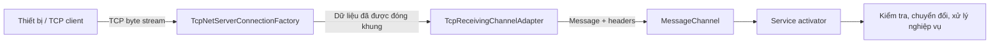

# TCP inbound channel adapter

> **Chương:** Adapter TCP  
> **Module:** SPRING_INTEGRATION_ADAPTERS — Kết nối các hệ thống ngoài vào Spring Integration bằng inbound/outbound adapter, gateway, poller và MessageChannel. Thực hành luồng trao đổi qua file, SFTP, HTTP, JMS, AMQP, Kafka và cơ sở dữ liệu; xử lý hợp đồng message, lỗi và vòng đời kết nối.

## 1. Mục tiêu học tập

Sau bài này, bạn có thể:

- Giải thích vai trò của **TCP inbound channel adapter** trong một luồng Spring Integration.
- Phân biệt dữ liệu đi **vào ứng dụng** qua inbound adapter với dữ liệu đi ra qua outbound adapter và giao tiếp yêu cầu–phản hồi qua gateway.
- Cấu hình một TCP server nhận bản tin, chuyển chúng thành Spring `Message` rồi đẩy vào `MessageChannel`.
- Lựa chọn cách **đóng khung bản tin (message framing)** vì TCP chỉ cung cấp luồng byte, không giữ ranh giới giữa các lần gửi.
- Kiểm tra đường đi của bản tin, xác định nguyên nhân lỗi và vận hành kết nối TCP an toàn.

## 2. TCP inbound channel adapter là gì?

Trong Spring Integration, **inbound channel adapter** là điểm bắt đầu của một luồng xử lý: nó nhận dữ liệu từ hệ thống bên ngoài và **phát một Spring Message vào một kênh nội bộ**.

Đối với giao thức TCP, thành phần này được triển khai bởi `TcpReceivingChannelAdapter`. Adapter nhận dữ liệu đã được đọc và giải mã từ kết nối TCP thông qua một **connection factory**, tạo thông điệp và gửi thông điệp đến `outputChannel`. Các bộ xử lý phía sau chỉ cần quan tâm đến payload và headers, thay vì tự mở socket và lặp đọc byte.

Ví dụ: một thiết bị IoT gửi nhiệt độ về cổng TCP của ứng dụng. Adapter nhận khung dữ liệu `TEMP|sensor-01|23.5`, đưa nó vào `MessageChannel`, rồi service kiểm tra định dạng và ghi dữ liệu.



**Đặc điểm quan trọng:** `TcpReceivingChannelAdapter` là một **adapter một chiều, hướng nhận**. Việc handler xử lý xong một message **không tự động tạo phản hồi trên socket**. Nếu mỗi yêu cầu TCP cần một phản hồi TCP trên cùng phiên trao đổi, thường nên dùng **TCP inbound gateway** (`TcpInboundGateway`). Nếu chỉ cần tiếp nhận telemetry, sự kiện hoặc log từ thiết bị thì inbound adapter phù hợp.

TCP inbound adapter cũng **không dùng poller để chờ lịch đọc** như các nguồn file hoặc cơ sở dữ liệu được polling. Việc nhận dữ liệu diễn ra khi connection factory phát hiện bản tin trên socket.

## 3. Các thành phần trong luồng

| Thành phần | Vai trò |
| --- | --- |
| `TcpNetServerConnectionFactory` | Mở cổng TCP của ứng dụng, chấp nhận kết nối từ client và quản lý các kết nối đó. |
| `TcpNioServerConnectionFactory` | Lựa chọn connection factory dựa trên NIO khi phù hợp với yêu cầu về kết nối và luồng xử lý. |
| `TcpReceivingChannelAdapter` | Nhận các bản tin từ connection factory, biến thành Spring `Message<?>` và phát đến kênh đầu ra. |
| `MessageChannel` | Ranh giới tách phần kết nối mạng khỏi phần xử lý nghiệp vụ. |
| `ServiceActivator` hoặc handler trong `IntegrationFlow` | Đọc payload, xác thực cấu trúc, chuyển đổi và xử lý thông tin. |
| `Deserializer` | Xác định một bản tin TCP kết thúc ở đâu và trả dữ liệu đã giải mã. |

Trong ví dụ dưới đây, ứng dụng đóng vai trò **TCP server**. Đây là lựa chọn thông dụng khi thiết bị bên ngoài chủ động kết nối vào ứng dụng. Spring Integration cũng hỗ trợ connection factory phía client, nhưng việc **inbound/outbound** mô tả hướng di chuyển của Spring Message, không đồng nghĩa trực tiếp với việc socket nào là client hay server.

### 3.1. Vì sao phải định nghĩa ranh giới bản tin?

TCP là **luồng byte liên tục**. Hai lần `write()` của client không đảm bảo tương ứng hai lần `read()` ở server:

- Một bản tin có thể đến thành nhiều đoạn byte.
- Nhiều bản tin có thể cùng xuất hiện trong một lần nhận.
- Kết thúc kết nối không phải là dấu phân cách hợp lý nếu muốn giữ kết nối lâu dài.

Vì vậy, hai bên phải thống nhất **hợp đồng đóng khung (framing contract)**. Một số lựa chọn:

| Cách đóng khung | Ví dụ | Khi sử dụng |
| --- | --- | --- |
| Dấu kết thúc CRLF | `TEMP|01|23.5\r\n` | Giao thức văn bản quy định mỗi dòng kết thúc bằng CRLF. |
| Dấu kết thúc LF | `TEMP|01|23.5\n` | Giao thức văn bản phân tách bằng LF. |
| Tiền tố chiều dài | `[length][payload]` | Giao thức nhị phân hoặc payload có thể chứa ký tự xuống dòng. |
| Đọc đến khi đóng kết nối | `[payload][EOF]` | Giao thức thật sự dùng một kết nối cho mỗi bản tin. |

Spring Integration cung cấp những serializer/deserializer như `ByteArrayCrLfSerializer`, `ByteArrayLfSerializer` và `ByteArrayLengthHeaderSerializer`. Phải **chọn cùng quy ước với bên gửi**. Bài này dùng CRLF: mỗi bản tin kết thúc bởi hai byte `0D 0A`; ký tự CRLF dùng để phân tách, không nằm trong nội dung nghiệp vụ sau giải mã.

## 4. Ví dụ thực hành: TCP server nhận sự kiện cảm biến

### 4.1. Bối cảnh và hợp đồng message

Giả sử mỗi cảm biến gửi một dòng UTF-8 có dạng:

```text
TEMP|sensor-01|23.5\r\n
TEMP|sensor-02|27.1\r\n
```

Hợp đồng được thống nhất:

1. Client kết nối tới TCP port `9000` của ứng dụng.
2. Một bản tin là các byte UTF-8, kết thúc bằng `\r\n`.
3. Nội dung gồm `loại_sự_kiện|mã_thiết_bị|giá_trị`; độ dài và giá trị phải được hệ thống nghiệp vụ kiểm tra.
4. Server **chỉ tiếp nhận**, không trả ACK trên kết nối TCP ở ví dụ này.
5. Mỗi khung hợp lệ ở tầng framing sinh ra **một Spring Message** cho tầng xử lý.

Với ứng dụng Spring Boot đang quản lý phiên bản dependency qua BOM, cần các module tương ứng (ví dụ Maven):

```xml
<dependencies>
    <dependency>
        <groupId>org.springframework.boot</groupId>
        <artifactId>spring-boot-starter-integration</artifactId>
    </dependency>
    <dependency>
        <groupId>org.springframework.integration</groupId>
        <artifactId>spring-integration-ip</artifactId>
    </dependency>
</dependencies>
```

`spring-integration-ip` cung cấp các TCP/IP adapter, gateway, connection factory và serializer liên quan. Ví dụ sau dùng kiểu cấu hình quen thuộc với Spring Integration 6 và Java 17 trở lên.

### 4.2. Cấu hình Java DSL đầy đủ

```java
import java.nio.charset.StandardCharsets;

import org.springframework.beans.factory.annotation.Qualifier;
import org.springframework.context.annotation.Bean;
import org.springframework.context.annotation.Configuration;
import org.springframework.integration.annotation.ServiceActivator;
import org.springframework.integration.channel.DirectChannel;
import org.springframework.integration.config.EnableIntegration;
import org.springframework.integration.dsl.IntegrationFlow;
import org.springframework.integration.ip.IpHeaders;
import org.springframework.integration.ip.dsl.Tcp;
import org.springframework.integration.ip.tcp.connection.TcpNetServerConnectionFactory;
import org.springframework.integration.ip.tcp.serializer.ByteArrayCrLfSerializer;
import org.springframework.messaging.MessageChannel;
import org.springframework.messaging.MessageHandler;

@Configuration
@EnableIntegration
public class TcpInboundConfiguration {

    @Bean
    TcpNetServerConnectionFactory tcpServerConnectionFactory() {
        var connectionFactory = new TcpNetServerConnectionFactory(9000);

        // Client kết thúc mỗi bản tin bằng CRLF.
        connectionFactory.setDeserializer(new ByteArrayCrLfSerializer());

        // Giữ cùng hợp đồng nếu sau này dùng factory để gửi dữ liệu.
        connectionFactory.setSerializer(new ByteArrayCrLfSerializer());

        return connectionFactory;
    }

    @Bean
    MessageChannel tcpInboundMessages() {
        return new DirectChannel();
    }

    @Bean
    IntegrationFlow tcpInboundFlow(
            TcpNetServerConnectionFactory tcpServerConnectionFactory,
            @Qualifier("tcpInboundMessages") MessageChannel tcpInboundMessages) {

        return IntegrationFlow
                .from(Tcp.inboundAdapter(tcpServerConnectionFactory))
                .channel(tcpInboundMessages)
                .get();
    }

    @Bean
    @ServiceActivator(inputChannel = "tcpInboundMessages")
    MessageHandler tcpMessageHandler() {
        return message -> {
            // ByteArrayCrLfSerializer giải mã ra byte[].
            byte[] bytes = (byte[]) message.getPayload();
            String record = new String(bytes, StandardCharsets.UTF_8);

            // Id này xác định kết nối TCP, không phải danh tính thiết bị.
            Object connectionId =
                    message.getHeaders().get(IpHeaders.CONNECTION_ID);

            System.out.printf(
                    "TCP connection=%s, record=%s%n",
                    connectionId, record
            );

            // Thực tế: chuyển record sang parser/validator/service nghiệp vụ.
        };
    }
}
```

**Cách đọc cấu hình:**

1. `tcpServerConnectionFactory()` quản lý socket lắng nghe tại cổng `9000`. Khi một TCP client gửi đủ khung CRLF, deserializer tách bản tin thành mảng byte.
2. `Tcp.inboundAdapter(...)` xây dựng TCP inbound adapter và đăng ký nó làm điểm bắt đầu của `IntegrationFlow`.
3. `.channel(tcpInboundMessages)` gửi message đến `DirectChannel`. Handler được gắn bằng `@ServiceActivator` nhận message đó.
4. `message.getPayload()` là dữ liệu do deserializer tạo ra; trong ví dụ là `byte[]`. Header `IpHeaders.CONNECTION_ID` giúp quan sát mỗi kết nối. Đây không phải giá trị định danh đã xác thực của người gửi.
5. Handler đổi byte sang UTF-8 và chuyển dữ liệu đến tầng nghiệp vụ. Adapter không cần biết record là nhiệt độ, đơn hàng hay lệnh điều khiển.

`DirectChannel` gọi subscriber trên luồng thực thi gửi message, vì vậy handler **không nên chạy nghiệp vụ dài hoặc chờ dịch vụ chậm** ngay tại đây. Với tải lớn, có thể chuyển tiếp sang `ExecutorChannel` được cấu hình hàng đợi/giới hạn tài nguyên phù hợp, rồi xử lý bất đồng bộ. Điều này thay đổi cách xử lý lỗi và backpressure; phải kiểm thử theo nhu cầu thực tế.

### 4.3. Thử gửi hai bản tin qua một kết nối

Sau khi khởi động ứng dụng với cổng `9000` còn trống, sử dụng đoạn Java sau trong một chương trình thử nghiệm độc lập:

```java
import java.net.Socket;
import java.nio.charset.StandardCharsets;

public class TcpClientDemo {
    public static void main(String[] args) throws Exception {
        try (Socket socket = new Socket("127.0.0.1", 9000)) {
            String frames =
                    "TEMP|sensor-01|23.5\r\n"
                  + "TEMP|sensor-01|23.6\r\n";

            socket.getOutputStream().write(
                    frames.getBytes(StandardCharsets.UTF_8)
            );
            socket.getOutputStream().flush();
        }
    }
}
```

Kết quả kỳ vọng: handler xử lý **hai message riêng biệt**, dù client thực hiện chỉ **một lần `write()`**. Mỗi message có nội dung tương ứng:

```text
TCP connection=<id-ket-noi>, record=TEMP|sensor-01|23.5
TCP connection=<id-ket-noi>, record=TEMP|sensor-01|23.6
```

`<id-ket-noi>` chỉ là ký hiệu cho ID thực tế được Spring Integration cấp cho kết nối. Hai message được gửi trên cùng một socket nên cùng thuộc một kết nối; thứ tự các khung trên kết nối đó được giữ theo TCP. Nếu server không nhận đủ dấu `\r\n`, deserializer có thể tiếp tục chờ phần còn thiếu cho đến khi có thêm dữ liệu, hết thời gian chờ hoặc kết nối kết thúc.

### 4.4. Xử lý hợp đồng message tại tầng nghiệp vụ

Framing chỉ đảm bảo adapter tách được **ranh giới message**, chưa đảm bảo nội dung đúng nghiệp vụ. Ví dụ một record `TEMP|sensor-01|abc` có CRLF hợp lệ nhưng giá trị nhiệt độ không hợp lệ.

Có thể tách parser thành thành phần riêng:

```java
public record TemperatureEvent(String sensorId, double value) {}

public static TemperatureEvent parseTemperature(String record) {
    String[] parts = record.split("\\|", -1);

    if (parts.length != 3 || !"TEMP".equals(parts[0])) {
        throw new IllegalArgumentException("Invalid TEMP message");
    }

    if (parts[1].isBlank()) {
        throw new IllegalArgumentException("Missing sensor ID");
    }

    return new TemperatureEvent(parts[1], Double.parseDouble(parts[2]));
}
```

Trong ứng dụng thật, cần bổ sung kiểm tra phạm vi giá trị, kích thước bản tin, định dạng ID, xác thực nguồn gửi và chính sách xử lý dữ liệu trùng. Parser không nên phụ thuộc trực tiếp vào socket hay connection factory để có thể kiểm thử độc lập.

## 5. Adapter TCP inbound so với gateway và adapter outbound

| Thành phần | Dòng dữ liệu chính | Dùng khi nào? |
| --- | --- | --- |
| **TCP inbound channel adapter** | TCP → Spring `MessageChannel` | Nhận sự kiện/telemetry một chiều, không cần trả lời từng message. |
| **TCP outbound channel adapter** | Spring `MessageChannel` → TCP | Ứng dụng gửi message ra kết nối TCP, không chờ reply đồng bộ theo hợp đồng gateway. |
| **TCP inbound gateway** | TCP request → flow → TCP response | Client gọi vào và cần phản hồi cho từng request theo giao thức. |
| **TCP outbound gateway** | Flow → TCP request → TCP reply | Ứng dụng chủ động gửi yêu cầu và chờ phản hồi tương ứng. |

**Ví dụ chọn thành phần:** nếu thiết bị bắn dữ liệu đo liên tục, inbound adapter là lựa chọn tự nhiên. Nếu máy POS gửi lệnh `CHECK_BALANCE` và phải nhận kết quả trên cùng trao đổi request/reply, nên xem xét inbound gateway.

Một hệ thống có thể phối hợp inbound adapter và outbound adapter nếu giao thức là trao đổi **bất đồng bộ hai chiều**, nhưng khi phản hồi qua một kết nối đã có phải giữ đúng thông tin định tuyến kết nối (chẳng hạn header `IpHeaders.CONNECTION_ID`). Không được giả định rằng inbound adapter tự động gửi nội dung trả về từ handler ngược tới client.

## 6. Connection factory, vòng đời kết nối và channel

### Connection factory

Connection factory chịu trách nhiệm socket và trạng thái kết nối; adapter chịu trách nhiệm **chuyển bản tin vào flow**. Tách hai chức năng này giúp cấu hình framing, TLS, timeout và các sự kiện kết nối ở vị trí phù hợp. Khi ứng dụng khởi động/dừng, các thành phần Spring Integration quản lý vòng đời của adapter và connection factory; nên dừng ứng dụng có kiểm soát để giải phóng cổng và kết nối.

TCP server có thể nhận nhiều client, nhưng mỗi client vẫn gửi một luồng byte cần được đóng khung riêng. Không nên dùng địa chỉ IP hoặc `connectionId` thay cho danh tính thiết bị đã xác thực: một thiết bị có thể mở lại kết nối và nhận ID khác.

### Chọn MessageChannel

- **`DirectChannel`:** đơn giản, đồng bộ và dễ quan sát; phù hợp ví dụ hoặc xử lý nhanh. Nếu handler chậm, luồng nhận cũng bị ảnh hưởng.
- **`ExecutorChannel`:** tách luồng nhận khỏi công việc nặng; cần quy định kích thước hàng đợi, khả năng từ chối tác vụ và cách giám sát tải.
- **`QueueChannel`:** giữ message trong hàng đợi để consumer đọc bằng poller. Khi chọn mô hình này, **poller thuộc phía tiêu thụ QueueChannel**, không phải cách adapter đọc socket TCP.

Lựa chọn channel quyết định nơi lỗi được quan sát và cách hệ thống phản ứng khi quá tải. Không nên thêm async chỉ vì TCP là giao thức mạng; hãy dựa vào chi phí xử lý và yêu cầu thứ tự.

### Headers và theo dõi

Ngoài payload, adapter có thể gắn thông tin kết nối vào message headers; `IpHeaders.CONNECTION_ID` là header thường dùng để liên hệ log với một phiên TCP. Khi ghi log sản xuất, nên lưu connection ID, thời điểm, số byte, kết quả parse và mã lỗi, đồng thời hạn chế ghi raw payload có dữ liệu nhạy cảm.

## 7. Lỗi thường gặp và cách xử lý

| Hiện tượng | Nguyên nhân cần kiểm tra | Hướng xử lý |
| --- | --- | --- |
| Client gửi rồi nhưng handler không chạy | Thiếu ký tự kết thúc CRLF hoặc client/server dùng cách framing khác nhau. | Chốt hợp đồng framing và gửi đủ `\r\n`; kiểm tra log kết nối. |
| Payload có vẻ bị gộp hoặc cắt | Tự đọc TCP như từng packet thay vì dùng deserializer đúng giao thức. | Dùng serializer/deserializer có dấu phân cách hoặc length header. |
| Không khởi động được server | Port đã bị chiếm, không có quyền bind hoặc cấu hình mạng sai. | Kiểm tra port `9000`, bind address và firewall. |
| `ClassCastException` khi ép payload thành `byte[]` | Deserializer đã được thay bằng loại trả về kiểu khác. | Đảm bảo kiểu payload khớp hợp đồng; chuyển đổi bằng transformer nếu cần. |
| Client đợi mãi phản hồi | Inbound adapter chỉ chuyển dữ liệu vào ứng dụng; không tự viết TCP reply. | Dùng inbound gateway nếu cần request/reply, hoặc thiết kế outbound flow riêng cho giao tiếp hai chiều bất đồng bộ. |
| Ứng dụng chậm khi nhiều client gửi dữ liệu | Handler đồng bộ thực hiện I/O hoặc công việc nặng, hàng đợi xử lý quá tải. | Đo thời gian xử lý, giới hạn tải, chuyển việc nặng sang flow xử lý phù hợp. |
| Dữ liệu sai định dạng làm luồng thất bại | Chưa có bước validate và chính sách phân loại lỗi. | Tách lỗi framing, lỗi parse và lỗi nghiệp vụ; ghi nhận/đưa vào nơi xử lý lỗi theo hợp đồng hệ thống. |
| Mất hoặc trùng sự kiện sau reconnect | TCP đảm bảo thứ tự byte trong **một kết nối**, không đảm bảo giao nhận đúng một lần ở cấp nghiệp vụ. | Gắn ID bản tin, thiết kế ACK/retry khi cần và xử lý idempotent phía ứng dụng. |

### Các lớp lỗi nên phân biệt

1. **Lỗi kết nối:** không bind được cổng, socket bị ngắt, timeout hoặc lỗi mạng. Quan sát log và sự kiện vòng đời kết nối do Spring Integration phát ra.
2. **Lỗi framing:** deserializer không tìm thấy dấu kết thúc hoặc bản tin vi phạm giới hạn kích thước. Lỗi này xảy ra trước khi nội dung trở thành message hợp lệ.
3. **Lỗi xử lý message:** payload không đạt schema, parser ném exception, hoặc hệ thống downstream không khả dụng. Lỗi có thể lan truyền khác nhau tùy channel đồng bộ hay bất đồng bộ.

Đừng xem `errorChannel` như cơ chế tự động gửi lỗi về TCP client. Với adapter một chiều, phản hồi lỗi trên socket phải được **thiết kế riêng theo giao thức** nếu bên gửi cần biết kết quả.

## 8. Lưu ý khi vận hành thực tế

- **Giới hạn độ lớn khung:** cấu hình kích thước tối đa phù hợp cho serializer/deserializer và đặt giới hạn tài nguyên, tránh bản tin quá dài làm cạn bộ nhớ.
- **Giới hạn kết nối và thời gian chờ:** thiết lập timeout, số kết nối và chính sách backpressure phù hợp thiết bị/ứng dụng; thử tình huống client kết nối rồi không gửi đủ frame.
- **Bảo mật:** TCP thuần không mã hóa payload. Dùng TLS khi cần bảo mật đường truyền, kiểm soát mạng và xác thực người gửi ở mức thích hợp với hệ thống.
- **Khả năng phục hồi:** TCP chỉ đảm bảo vận chuyển byte trên kết nối đang hoạt động. Nếu cần đảm bảo giao nhận sau khi rớt mạng, định nghĩa ID sự kiện, xác nhận đã xử lý, retry và chống trùng ở tầng ứng dụng.
- **Quan sát:** theo dõi số kết nối, tốc độ message, số lần lỗi parse, thời gian xử lý, queue backlog và thời gian khôi phục sau reconnect.
- **Kiểm thử giao thức:** kiểm tra một frame chia nhiều lần `write()`, nhiều frame trong một lần `write()`, frame không hoàn chỉnh, khung quá dài, ký tự UTF-8 nhiều byte và client đóng kết nối đột ngột.

## 9. Tự kiểm tra kiến thức

1. Vì sao không thể dựa vào số lần `Socket.read()` để xác định số bản tin TCP?
2. Trong ví dụ, thành phần nào nhận socket và thành phần nào đẩy Spring Message vào `MessageChannel`?
3. Nếu hệ thống yêu cầu server trả một response cho mỗi request TCP, nên đổi sang thành phần nào?
4. Nếu thay `DirectChannel` bằng `ExecutorChannel`, việc xử lý chậm và lỗi phía consumer sẽ có những điểm gì cần xem lại?
5. Một khung có CRLF hợp lệ nhưng chứa `TEMP|sensor-01|abc` là lỗi framing hay lỗi hợp đồng nghiệp vụ?

**Gợi ý trả lời:** (1) TCP là byte stream; phải đóng khung. (2) Connection factory nhận kết nối và giải mã khung, inbound adapter phát message. (3) TCP inbound gateway. (4) Bất đồng bộ, hàng đợi, backpressure và nơi bắt lỗi. (5) Lỗi parse/validation ở tầng nghiệp vụ.

**Điểm cần nhớ:** TCP inbound channel adapter là cầu nối từ bản tin TCP đã được đóng khung vào hệ thống `MessageChannel` của Spring Integration. Thiết kế tốt bắt đầu từ hợp đồng framing và payload, sau đó mới chọn channel, cách xử lý lỗi, bảo mật và vòng đời kết nối.
