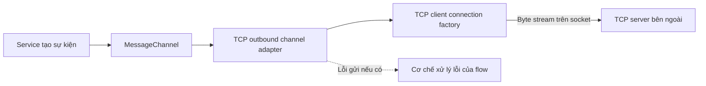
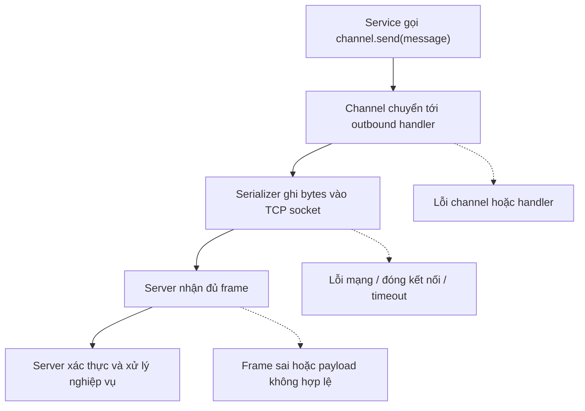

# TCP outbound channel adapter

> **Chương:** Adapter TCP  
> **Module:** SPRING_INTEGRATION_ADAPTERS  
> **Phạm vi:** Kết nối các hệ thống ngoài vào Spring Integration bằng inbound/outbound adapter, gateway, poller và MessageChannel. Thực hành luồng trao đổi qua file, SFTP, HTTP, JMS, AMQP, Kafka và cơ sở dữ liệu; xử lý hợp đồng message, lỗi và vòng đời kết nối.

## 1. Mục tiêu học tập

Hoàn thành bài này, bạn có thể:

- Giải thích **TCP outbound channel adapter** làm gì và vị trí của nó trong luồng Spring Integration.
- Cấu hình một ứng dụng gửi dữ liệu từ `MessageChannel` ra TCP server bằng `TcpNetClientConnectionFactory`.
- Định nghĩa hợp đồng payload và **serializer/framing** để bên nhận tách được từng bản tin từ luồng byte TCP.
- Phân biệt outbound adapter một chiều với TCP outbound gateway có phản hồi.
- Nhận biết sự khác nhau giữa **gửi thành công vào channel**, **ghi dữ liệu ra socket** và **được hệ thống đích xử lý**.
- Thiết kế cách xử lý kết nối, timeout, lỗi, retry, bảo mật và giám sát khi vận hành.

## 2. TCP outbound channel adapter là gì?

**TCP outbound channel adapter** lấy một Spring `Message<?>` từ một `MessageChannel`, chuyển payload thành dữ liệu theo hợp đồng truyền tải và gửi qua kết nối TCP. Trong Spring Integration, thành phần lõi đảm nhận việc này là `TcpSendingMessageHandler`, thường được cấu hình qua Java DSL `Tcp.outboundAdapter(...)`.

Hình dung một dịch vụ nhận kết quả đo từ phần xử lý nội bộ. Sau khi kiểm tra và chuẩn hóa, ứng dụng cần chuyển mỗi kết quả đo tới một hệ thống thu thập cũ chỉ hỗ trợ TCP. Phần nghiệp vụ chỉ phát Spring Message; outbound adapter lo việc ghi dữ liệu vào kết nối mạng.



**Cần ghi nhớ:** inbound/outbound ở đây là **hướng di chuyển của Spring Message**. Outbound nghĩa là Spring Message rời ứng dụng qua endpoint tích hợp; nó không bắt buộc đồng nghĩa với socket TCP ở vai trò client. Ví dụ chính của bài sử dụng **client connection factory**, vì ứng dụng chủ động kết nối đến TCP server. Với giao thức bất đồng bộ hai chiều, một outbound adapter còn có thể ghi dữ liệu lên một kết nối server đã được một thành phần inbound tiếp nhận, với cấu hình và header định tuyến phù hợp.

Outbound adapter là một **endpoint một chiều**. Nó không chờ phản hồi tương quan cho từng bản tin. Nếu ứng dụng cần gửi một request rồi đợi response theo hợp đồng TCP, hãy xem xét **TCP outbound gateway**.

## 3. Các thành phần và hợp đồng truyền dữ liệu

| Thành phần | Trách nhiệm |
| --- | --- |
| `MessageChannel` | Nhận Spring Message từ luồng nghiệp vụ và chuyển tới endpoint gửi. |
| `TcpSendingMessageHandler` | Lấy payload của message và gửi bằng connection factory. |
| `TcpNetClientConnectionFactory` | Quản lý socket TCP client đến host và port đích. |
| `TcpNioClientConnectionFactory` | Cách triển khai connection factory dựa trên NIO khi có yêu cầu vận hành phù hợp. |
| `Serializer` | Biểu diễn payload thành byte và ghi dấu phân tách/độ dài khung theo giao thức. |
| TCP server đích | Đọc byte, khôi phục từng frame và thực hiện xử lý ở phía nhận. |

### 3.1. TCP không có ranh giới message

TCP vận chuyển một **luồng byte có thứ tự trong cùng kết nối**, không vận chuyển các đối tượng Spring Message. Một lần gọi `write()` của bên gửi không tương ứng chắc chắn với một lần `read()` của bên nhận. Vì vậy **cả hai phía phải thỏa thuận cách phân tách khung**.

Một số hợp đồng thường gặp:

| Framing | Dạng gửi | Phù hợp |
| --- | --- | --- |
| CRLF | `TEMP|sensor-01|23.5\r\n` | Bản tin văn bản, mỗi dòng kết thúc bởi CRLF (`0D 0A`). |
| LF | `TEMP|sensor-01|23.5\n` | Hệ thống dùng ký tự xuống dòng LF làm dấu kết thúc. |
| Length header | `[length][payload]` | Bản tin nhị phân, nội dung có thể chứa CR/LF hoặc cần xác định kích thước tường minh. |
| Kết thúc kết nối | `[payload][socket close]` | Giao thức quy định mỗi kết nối chứa đúng một bản tin. |

Trong ví dụ, chúng ta sử dụng `ByteArrayCrLfSerializer`. Serializer **tự thêm CRLF** vào cuối mảng byte được gửi. Vì vậy mã nghiệp vụ chỉ tạo nội dung `TEMP|sensor-01|23.5`, **không tự nối** `\r\n` vào payload; nếu thêm cả hai, phía nhận có thể quan sát một frame trống ngoài ý muốn.

Spring Integration có các serializer tương ứng như `ByteArrayCrLfSerializer`, `ByteArrayLfSerializer` và `ByteArrayLengthHeaderSerializer`. Lựa chọn phải dựa vào giao thức thật của hệ thống đích, không chọn theo thói quen.

### 3.2. Hợp đồng payload và message header

Ví dụ định nghĩa mỗi bản tin là một chuỗi **UTF-8**:

```text
TEMP|sensor-01|23.5
```

Đây là **nội dung logic trước khi serializer đóng khung**. Trong luồng này, tầng nghiệp vụ tạo `byte[]` từ chuỗi UTF-8 và gửi dưới dạng Spring `Message<byte[]>`. Khi serialize, adapter bổ sung CRLF vào bản tin trên wire.

Quy tắc hai bên cần thống nhất:

1. Địa chỉ và cổng TCP của server, ví dụ `127.0.0.1:9000` cho môi trường local.
2. Bảng mã UTF-8, định dạng `TYPE|DEVICE_ID|VALUE` và quy tắc escape ký tự `|`, CR, LF.
3. Framing dùng CRLF; một frame phải có giới hạn kích thước.
4. Server có yêu cầu gửi ACK hay không. Ví dụ hiện tại **không có ACK nghiệp vụ**.
5. Cơ chế xác thực, xử lý sự kiện trùng, replay và lỗi parse ở bên nhận nếu áp dụng.

Spring Message có thể mang headers để phục vụ xử lý hoặc định tuyến nội bộ. **Không nên giả định mọi header đều được truyền qua TCP**: với serializer CRLF của ví dụ, dữ liệu trên wire chính là payload được mã hóa và dấu phân cách. Nếu hệ thống đích cần ID giao dịch, thời gian hoặc phiên bản schema, hãy đưa chúng vào **hợp đồng payload**.

## 4. Ví dụ thực hành: gửi sự kiện nhiệt độ tới TCP server

Ứng dụng Spring Boot chủ động kết nối tới TCP server ở `127.0.0.1:9000`, gửi một sự kiện nhiệt độ và không đợi server trả lời. Ví dụ dùng Spring Integration 6.x và Java 17 trở lên.

### 4.1. Khai báo dependency

Nếu dùng Spring Boot quản lý phiên bản qua BOM, thêm các dependency tương ứng vào `pom.xml`:

```xml
<dependencies>
    <dependency>
        <groupId>org.springframework.boot</groupId>
        <artifactId>spring-boot-starter-integration</artifactId>
    </dependency>

    <dependency>
        <groupId>org.springframework.integration</groupId>
        <artifactId>spring-integration-ip</artifactId>
    </dependency>
</dependencies>
```

`spring-integration-ip` cung cấp TCP adapter, gateway, connection factory và serializer. Không cần thêm thư viện socket riêng để triển khai flow này.

### 4.2. Cấu hình TCP outbound flow bằng Java DSL

```java
import org.springframework.context.annotation.Bean;
import org.springframework.context.annotation.Configuration;
import org.springframework.integration.channel.DirectChannel;
import org.springframework.integration.config.EnableIntegration;
import org.springframework.integration.dsl.IntegrationFlow;
import org.springframework.integration.ip.dsl.Tcp;
import org.springframework.integration.ip.tcp.connection.TcpNetClientConnectionFactory;
import org.springframework.integration.ip.tcp.serializer.ByteArrayCrLfSerializer;
import org.springframework.messaging.MessageChannel;

@Configuration
@EnableIntegration
public class TcpOutboundConfiguration {

    @Bean
    TcpNetClientConnectionFactory tcpClientConnectionFactory() {
        var factory = new TcpNetClientConnectionFactory("127.0.0.1", 9000);

        // Giữ kết nối để gửi nhiều bản tin theo cùng một phiên.
        factory.setSingleUse(false);

        // Gửi byte[] và tự chèn hai byte CRLF vào cuối frame.
        factory.setSerializer(new ByteArrayCrLfSerializer());

        return factory;
    }

    @Bean
    MessageChannel tcpOutboundRequests() {
        return new DirectChannel();
    }

    @Bean
    IntegrationFlow tcpOutboundFlow(
            TcpNetClientConnectionFactory tcpClientConnectionFactory) {

        return IntegrationFlow
                .from("tcpOutboundRequests")
                .handle(Tcp.outboundAdapter(tcpClientConnectionFactory))
                .get();
    }
}
```

**Giải thích thứ tự xử lý:**

1. `tcpOutboundRequests` là kênh đầu vào của outbound adapter: service nghiệp vụ gửi Spring Message vào đây.
2. `IntegrationFlow.from("tcpOutboundRequests")` đăng ký consumer nhận các message từ channel.
3. `Tcp.outboundAdapter(tcpClientConnectionFactory)` tạo handler gửi payload qua TCP.
4. `TcpNetClientConnectionFactory` xác định host/port và vòng đời kết nối; với `singleUse=false`, connection factory có thể tái sử dụng kết nối cho các lần gửi tiếp theo nếu kết nối còn dùng được.
5. `ByteArrayCrLfSerializer` chuyển từng payload byte thành frame có dấu CRLF.

`DirectChannel` chuyển message đồng bộ tới handler. Nếu server chưa chạy, kết nối bị lỗi hoặc adapter không gửi được, caller thường thấy lỗi trong luồng gọi gửi, thay vì nhận một giá trị thành công giả. Một kết nối được thiết lập và một lệnh gửi thành công **chưa phải xác nhận xử lý thành công ở ứng dụng nhận**.

### 4.3. Service tạo và gửi bản tin

```java
import java.math.BigDecimal;
import java.nio.charset.StandardCharsets;

import org.springframework.beans.factory.annotation.Qualifier;
import org.springframework.messaging.MessageChannel;
import org.springframework.messaging.support.MessageBuilder;
import org.springframework.stereotype.Service;

@Service
public class TemperaturePublisher {

    private final MessageChannel tcpOutboundRequests;

    public TemperaturePublisher(
            @Qualifier("tcpOutboundRequests")
            MessageChannel tcpOutboundRequests) {
        this.tcpOutboundRequests = tcpOutboundRequests;
    }

    public void publish(String sensorId, double celsius) {
        // Tránh các ký tự có thể phá cấu trúc record/framing.
        if (sensorId == null
                || !sensorId.matches("[A-Za-z0-9_-]{1,32}")
                || !Double.isFinite(celsius)) {
            throw new IllegalArgumentException("Invalid temperature event");
        }

        String record = "TEMP|" + sensorId + "|"
                + BigDecimal.valueOf(celsius).toPlainString();

        byte[] payload = record.getBytes(StandardCharsets.UTF_8);

        boolean accepted = tcpOutboundRequests.send(
                MessageBuilder.withPayload(payload).build()
        );

        if (!accepted) {
            throw new IllegalStateException(
                    "TCP outbound channel did not accept message"
            );
        }
    }
}
```

Service chỉ biết contract `TEMP|...` và một `MessageChannel`. Nó không mở socket, tự lặp ghi byte hoặc phụ thuộc vào TCP server cụ thể. Với thiết kế này, khi hệ thống cần gửi cùng sự kiện ra Kafka/JMS/HTTP trong một flow khác, tầng tạo sự kiện vẫn có thể sử dụng mô hình message của Spring Integration.

**Lưu ý về `send(...)`:** giá trị `true` nói rằng channel đã chấp nhận message theo cơ chế của nó. Với `DirectChannel` và handler đồng bộ, lỗi gửi có thể ném exception ngay trong lời gọi. Cả hai tín hiệu này **không chứng minh** TCP server đã parse, ghi cơ sở dữ liệu hay cam kết xử lý bản tin. Muốn biết kết quả nghiệp vụ, cần thiết kế phản hồi/ACK riêng, thường dưới dạng gateway hoặc giao thức bất đồng bộ có correlation ID.

### 4.4. TCP server nhỏ để quan sát frame

Trước khi chạy ứng dụng, có thể mở một TCP server thử nghiệm bằng chương trình Java sau. Server chỉ in những dòng nó nhận được:

```java
import java.io.BufferedReader;
import java.io.InputStreamReader;
import java.net.ServerSocket;
import java.net.Socket;
import java.nio.charset.StandardCharsets;

public class TcpProbeServer {
    public static void main(String[] args) throws Exception {
        try (ServerSocket listener = new ServerSocket(9000)) {
            System.out.println("Listening on port 9000");

            try (Socket client = listener.accept();
                 BufferedReader reader = new BufferedReader(
                         new InputStreamReader(
                                 client.getInputStream(),
                                 StandardCharsets.UTF_8))) {

                String line;
                while ((line = reader.readLine()) != null) {
                    System.out.println("Received: " + line);
                }
            }
        }
    }
}
```

`BufferedReader.readLine()` loại bỏ dấu kết thúc dòng. Vì ứng dụng gửi dùng CRLF, mỗi frame trở thành một dòng và server có thể nhận liên tiếp nhiều bản tin trên cùng một kết nối.

Để thử gửi một message sau khi Spring Boot khởi động, có thể thêm cấu hình **chỉ dùng cho demo**:

```java
import org.springframework.boot.ApplicationRunner;
import org.springframework.context.annotation.Bean;
import org.springframework.context.annotation.Configuration;

@Configuration
class DemoTemperatureSender {

    @Bean
    ApplicationRunner sendDemo(TemperaturePublisher publisher) {
        return args -> publisher.publish("sensor-01", 23.5);
    }
}
```

Trình tự chạy:

1. Chạy `TcpProbeServer` trước, đảm bảo cổng `9000` chưa bị chiếm.
2. Khởi động ứng dụng Spring Boot có các bean `TcpOutboundConfiguration`, `TemperaturePublisher` và `DemoTemperatureSender`.
3. Quan sát TCP server in một dòng `Received: TEMP|sensor-01|23.5`.
4. Gọi `publish(...)` thêm lần nữa từ luồng nghiệp vụ để thấy nhiều frame có thể đi qua cùng kết nối còn hoạt động.

Không đưa `DemoTemperatureSender` vào cấu hình vận hành thật: mã gửi lúc startup chỉ nhằm đơn giản hóa bài thực hành. Nếu server chưa sẵn sàng, lần gửi thử có thể thất bại; hãy khởi động server trước khi chạy ứng dụng.

### 4.5. Nhìn từ góc độ byte trên đường truyền

Payload đưa vào `MessageChannel`:

```text
54 45 4D 50 7C 73 65 6E 73 6F 72 2D 30 31 7C 32 33 2E 35
 T  E  M  P  |  s  e  n  s  o  r  -  0  1  |  2  3  .  5
```

Serializer ghi ra socket:

```text
54 45 4D 50 7C 73 65 6E 73 6F 72 2D 30 31 7C 32 33 2E 35 0D 0A
                                                               CR LF
```

Ví dụ dùng ASCII nằm trong UTF-8 nên một ký tự tương ứng một byte. Với dữ liệu Unicode nhiều byte, không được giới hạn kích thước frame bằng số ký tự Java; hãy kiểm tra **số byte sau khi mã hóa**.

## 5. Outbound adapter so với outbound gateway và luồng hai chiều

| Endpoint | Hướng chính | Phản hồi theo request? | Tình huống sử dụng |
| --- | --- | --- | --- |
| **TCP outbound channel adapter** | Spring Message → TCP | Không tự đợi reply | Đẩy telemetry, sự kiện hoặc thông báo một chiều. |
| **TCP outbound gateway** | Spring request → TCP → Spring reply | Có | Tra cứu, lệnh cần trả kết quả trong cùng trao đổi request/reply. |
| **TCP inbound channel adapter** | TCP → Spring Message | Không tự phản hồi | Nhận sự kiện từ client bên ngoài. |
| **TCP inbound gateway** | TCP request → flow → TCP response | Có | Ứng dụng đóng vai server xử lý yêu cầu và trả lời client. |

Ví dụ, khi ứng dụng chỉ thông báo `TEMP|...` cho bộ thu thập sự kiện, outbound adapter phù hợp. Khi ứng dụng gửi `GET_BALANCE|account-01` và phải nhận số dư trước khi tiếp tục nghiệp vụ, outbound gateway phù hợp hơn.

Với giao thức **bất đồng bộ hai chiều**, có thể phối hợp inbound và outbound adapter. Nếu gửi lại qua **kết nối TCP do client bên ngoài mở tới server**, message outbound cần định tuyến về đúng kết nối, thường thông qua `IpHeaders.CONNECTION_ID` và **cùng connection factory thích hợp**. Connection ID là thông tin định tuyến phiên, không phải mã xác thực người dùng; phải bảo vệ luồng cấp/giữ header này. Ví dụ gửi một chiều ở trên chủ động tạo kết nối TCP client và không cần định tuyến tới phiên inbound.

Không nên biến mọi phản hồi thành việc dùng một outbound adapter thứ hai nếu hệ thống có hợp đồng request/reply chặt chẽ; gateway cung cấp mô hình trao đổi phù hợp hơn và giảm công sức tự quản lý correlation.

## 6. Vòng đời kết nối và lựa chọn MessageChannel

### 6.1. Kết nối dùng một lần và kết nối tái sử dụng

Trong TCP client connection factory, tùy chọn `singleUse` ảnh hưởng đến vòng đời socket:

- `singleUse=false`: các lần gửi có thể sử dụng lại một kết nối đang hoạt động. Điều này giảm chi phí kết nối lại, phù hợp luồng nhiều sự kiện liên tiếp và giao thức cho phép giữ socket lâu dài.
- `singleUse=true`: mỗi lần gửi sử dụng một kết nối riêng rồi đóng theo chính sách của connection factory. Phù hợp khi hệ thống đích quy định mỗi kết nối có một bản tin, đổi lại nhiều lần handshake hơn.

**Không được nhầm `singleUse=false` với đảm bảo kết nối luôn sẵn sàng.** Mạng có thể mất, server có thể chủ động đóng socket hoặc connection factory phải kết nối lại. Nếu sản lượng lớn hoặc cần nhiều kết nối đồng thời, hãy đánh giá connection factory, giới hạn kết nối, mô hình chia tải và thứ tự message theo hợp đồng cụ thể.

### 6.2. Tác động của channel tới việc gửi

| Channel | Tác động đến người phát message | Điều cần quan tâm |
| --- | --- | --- |
| `DirectChannel` | Handler gửi TCP thường chạy đồng bộ trong đường gọi `send()`. | Caller bị ảnh hưởng bởi độ trễ mạng/kết nối; exception dễ phát hiện trực tiếp. |
| `ExecutorChannel` | Công việc gửi được giao cho executor. | Phải giới hạn queue, số thread; lỗi có thể xuất hiện trên thread khác; cần chính sách xử lý lỗi rõ ràng. |
| `QueueChannel` | Message chờ một consumer được kích hoạt bởi poller. | Cần poller ở consumer, kích thước queue và quy định tồn đọng; bản thân TCP outbound adapter không phải nguồn poller. |

Không thêm hàng đợi chỉ để che đi lỗi mạng. Hàng đợi bộ nhớ có thể mất khi ứng dụng dừng; hàng đợi có sức chứa vô hạn có thể làm cạn bộ nhớ. Nếu phải giữ sự kiện khi server đích không khả dụng, cân nhắc kho lưu bền vững hoặc broker có xác nhận và chính sách retry rõ ràng.

### 6.3. Header và tính thứ tự

Trong ví dụ, chỉ payload được đưa qua serializer ra mạng. Header nội bộ như ID message hoặc thông tin trace không tự trở thành byte ở phía server. Muốn server truy vết từng bản tin, bổ sung message ID và version vào **schema payload**.

TCP bảo đảm thứ tự **byte trên một kết nối**, nhưng không bảo đảm thứ tự toàn cục giữa nhiều kết nối, nhiều producer hoặc các nhánh gửi bất đồng bộ. Nếu thứ tự nghiệp vụ quan trọng, cần quy tắc sequence number và chính sách xử lý sự kiện đến muộn.

## 7. Xử lý lỗi, retry và tính tin cậy

Có ba cấp kết quả khác nhau:



Một lời gọi `send()` không thay thế được xác nhận ở các bước D và E. Với TCP, truyền thành công không đồng nghĩa với giao nhận **exactly once** ở cấp ứng dụng.

### 7.1. Các lỗi điển hình

| Triệu chứng | Nguyên nhân có thể | Cách kiểm tra và hướng xử lý |
| --- | --- | --- |
| `Connection refused` | TCP server chưa chạy hoặc sai host/port. | Kiểm tra cổng đích, lộ trình mạng, địa chỉ và firewall; thử bằng server local. |
| Kết nối thành công nhưng server không thấy bản tin đầy đủ | Client và server dùng framing khác nhau hoặc thiếu dấu kết thúc. | Đối chiếu serializer của client với deserializer/parser của server. |
| Server nhận thêm một frame rỗng | Code tự thêm `\r\n` và serializer cũng thêm CRLF. | Chỉ để serializer đảm nhận dấu phân cách. |
| `ClassCastException` hoặc lỗi serialize | Payload không có kiểu tương thích với serializer. | Chuẩn hóa payload về `byte[]` theo hợp đồng trước khi gửi. |
| `Broken pipe`, `Connection reset` | Server đóng kết nối, mạng bị ngắt hoặc socket cũ không còn hợp lệ. | Theo dõi sự kiện kết nối, ghi log lỗi, khởi tạo lại và retry theo chính sách. |
| Sự kiện bị gửi lại sau timeout | Không biết server đã nhận/xử lý trước khi client bị lỗi hay chưa. | Gắn ID sự kiện, xử lý idempotent hoặc ACK/correlation ở tầng ứng dụng. |
| Caller bị chậm bất thường | `DirectChannel` xử lý đồng bộ và đang chờ TCP I/O/kết nối. | Đo latency; cấu hình timeout phù hợp, tách luồng gửi nếu cần. |
| Tăng bộ nhớ khi server ngừng hoạt động | Producer nhanh hơn khả năng gửi, queue không có giới hạn. | Thiết lập giới hạn queue, cơ chế từ chối và giám sát backlog. |

### 7.2. Retry phải đi cùng chống trùng

Giả sử outbound adapter đã ghi đủ frame lên socket nhưng kết nối ngắt trước khi phía gửi biết kết quả. Gửi lại có thể làm server xử lý sự kiện **hai lần**. Đây là trạng thái không thể giải quyết chỉ bằng TCP.

Với hệ thống cần độ tin cậy cao, hãy xác định một số yếu tố ngay trong hợp đồng:

1. **Event ID duy nhất** và nơi phát hành ID.
2. **ACK nghiệp vụ** thể hiện phía nhận đã hoàn thành bước xử lý nào.
3. Quy tắc **timeout, retry, số lần thử và backoff**.
4. **Idempotency** để phía nhận bỏ qua xử lý lặp cho cùng event ID.
5. Nơi lưu bền vững các bản tin chờ gửi nếu không được phép mất dữ liệu.

Nếu giao thức bên nhận không có ACK, phía gửi chỉ biết trạng thái truyền mà nó quan sát được; không thể suy ra chắc chắn kết quả nghiệp vụ. Khi cần phản hồi đồng bộ, cân nhắc TCP outbound gateway. Khi vẫn cần một chiều nhưng có ACK đến sau, thiết kế thêm inbound flow và correlation ID.

### 7.3. Error channel không tự tạo TCP response

Lỗi được ném ra đâu phụ thuộc mô hình channel. Trên `DirectChannel`, lỗi gửi đồng bộ có thể quay lại caller qua exception. Với executor hoặc poller, lỗi thường phải được giám sát và xử lý trong cơ chế lỗi của endpoint/flow tương ứng. Cấu hình `errorChannel` có thể hỗ trợ luồng lỗi bất đồng bộ, nhưng **nó không tự gửi ACK/NAK đến TCP server**. Bên gửi và bên nhận phải thống nhất giao thức này riêng.

## 8. Vận hành an toàn và theo dõi

### 8.1. Bảo mật

TCP thuần truyền dữ liệu không mã hóa. Trong môi trường thực, dùng **TLS** khi cần bảo vệ kết nối, kết hợp kiểm soát mạng và xác thực ứng dụng theo mức độ tin cậy của hệ thống. Đừng coi thành công khi mở socket hay biết `connectionId` là bằng chứng đã xác thực bên đích. Không ghi payload chứa dữ liệu nhạy cảm vào log vận hành.

### 8.2. Tài nguyên và giới hạn

- Cấu hình timeout kết nối và I/O phù hợp môi trường, tránh producer bị treo quá lâu.
- Quy định kích thước frame tối đa và kiểm tra **byte length**, đặc biệt với chuỗi UTF-8 nhiều byte.
- Nếu gửi nhiều message qua một socket, kiểm thử trường hợp server đóng kết nối giữa hai lần gửi.
- Đặt giới hạn số kết nối, hàng đợi, thread và tốc độ retry; áp dụng backpressure hoặc từ chối có kiểm soát khi quá tải.
- Dừng kết nối có kiểm soát khi ứng dụng shutdown; cần nhớ dữ liệu chưa được xác nhận có thể phải phục hồi theo chính sách nghiệp vụ.

### 8.3. Quan sát

Các chỉ số và trường log hữu ích gồm số lần gửi, số lỗi serializer, số lần kết nối và reconnect, độ trễ ghi, kích thước payload, queue backlog, event ID và mã hệ thống đích. Không đánh đồng chỉ số "gửi thành công" với "được server xử lý thành công" nếu giao thức chưa có ACK nghiệp vụ.

### 8.4. Kịch bản kiểm thử nên có

1. Gửi một message, rồi nhiều message liên tiếp trên cùng kết nối.
2. Gửi payload có dấu `|`, CR, LF hoặc ký tự Unicode để kiểm tra validation và framing.
3. Bật server sau client: kiểm tra lỗi và chính sách retry.
4. Tắt server ngay sau lần gửi đầu tiên, quan sát hành vi lần gửi tiếp theo.
5. Tạo lỗi payload không phải `byte[]` để xác minh luồng phân loại lỗi serialize.
6. Gây tải lớn để kiểm tra giới hạn kênh và độ trễ, nhất là khi dùng executor/queue.

## 9. Bài tập mở rộng

**Bài tập 1 — Chuyển sang length header.** Giả sử server nhận frame có header biểu diễn chiều dài, payload có thể chứa CRLF. Điều chỉnh serializer phía gửi và parser phía server để dùng cùng hợp đồng. Giải thích vì sao không thể chỉ sửa một phía.

**Bài tập 2 — Retry và trùng sự kiện.** Bổ sung event ID vào payload, mô phỏng server nhận xong nhưng client bị timeout, rồi gửi lại. Thiết kế cách server phát hiện ID đã xử lý và bỏ qua ghi dữ liệu lặp.

**Bài tập 3 — Giao thức request/reply.** Đổi yêu cầu từ "bắn nhiệt độ" thành "gửi lệnh và nhận `OK/ERROR`". Chọn TCP outbound gateway, xây dựng hợp đồng response và xác định timeout; so sánh với outbound adapter.

## 10. Tự kiểm tra kiến thức

1. Tại sao `TCP outbound channel adapter` là endpoint một chiều, dù TCP về bản chất là kết nối hai chiều?
2. Đâu là vai trò khác nhau của `TcpSendingMessageHandler` và `TcpNetClientConnectionFactory`?
3. Với `ByteArrayCrLfSerializer`, bạn có nên tự nối `\r\n` vào payload `byte[]` không? Vì sao?
4. `channel.send(...)` trả về `true` có đảm bảo server đã ghi sự kiện vào cơ sở dữ liệu không?
5. Nếu ứng dụng cần nhận phản hồi cho mỗi yêu cầu TCP, thành phần nào thích hợp hơn?
6. Vì sao `singleUse=false` không loại bỏ được nhu cầu xử lý reconnect và retry?
7. Vì sao retry sau lỗi mạng có thể tạo ra sự kiện trùng lặp?

**Gợi ý:** (1) Outbound adapter không có hợp đồng đợi/match reply. (2) Handler là endpoint ghi message, factory quản lý kết nối. (3) Không, serializer tự thêm CRLF. (4) Không, cần ACK nghiệp vụ. (5) Outbound gateway. (6) Socket vẫn có thể đứt hoặc bị server đóng. (7) Server có thể đã xử lý dù bên gửi chưa biết kết quả.

**Tổng kết:** TCP outbound channel adapter đưa Spring Message từ `MessageChannel` ra hệ thống TCP bên ngoài. Khi triển khai, ba quyết định cốt lõi là **framing/payload**, **vòng đời kết nối** và **mức bảo đảm giao nhận thực sự cần có**. Nếu nghiệp vụ cần phản hồi, xác nhận đã xử lý hoặc chống trùng, hãy biểu diễn chúng thành hợp đồng rõ ràng thay vì kỳ vọng TCP tự cung cấp.
