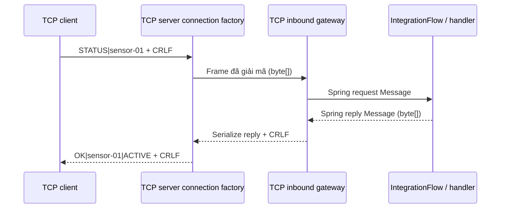
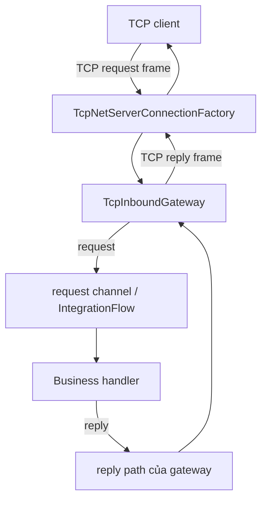
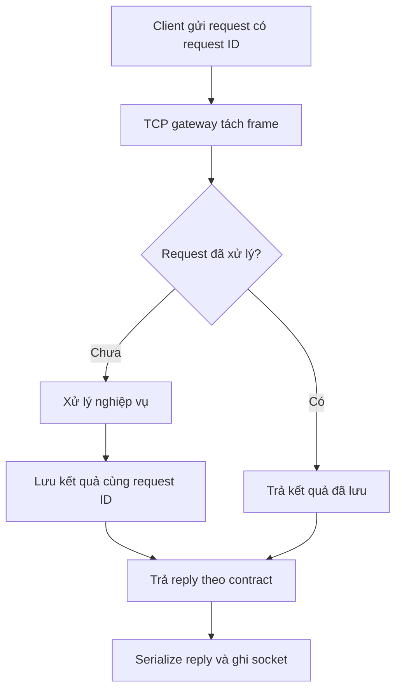

# TCP inbound gateway request-reply

> **Chương:** Adapter TCP  
> **Module:** SPRING_INTEGRATION_ADAPTERS  
> **Phạm vi:** Kết nối các hệ thống ngoài vào Spring Integration bằng inbound/outbound adapter, gateway, poller và MessageChannel. Thực hành luồng trao đổi qua file, SFTP, HTTP, JMS, AMQP, Kafka và cơ sở dữ liệu; xử lý hợp đồng message, lỗi và vòng đời kết nối.

## 1. Mục tiêu học tập

Sau bài này, bạn có thể:

- Giải thích vì sao **TCP inbound gateway** thực hiện mô hình **request-reply**, dù tên endpoint là *inbound*.
- Mô tả toàn bộ đường đi từ byte trên TCP socket thành Spring `Message`, qua `MessageChannel`, rồi trở lại socket dưới dạng reply.
- Cấu hình `TcpInboundGateway` bằng Spring Integration Java DSL và `TcpNetServerConnectionFactory`.
- Thiết kế **hợp đồng framing**, định dạng request/response, thời gian chờ và hành vi khi lỗi.
- Xây dựng TCP client gửi request, chờ response và tái sử dụng kết nối theo thứ tự.
- Phân biệt **TCP inbound gateway** với **TCP inbound channel adapter**, **TCP outbound gateway** và **TCP outbound channel adapter**.
- Đánh giá các vấn đề xử lý song song, idempotency, kết nối bị ngắt, bảo mật và giám sát trong hệ thống thực.

## 2. TCP inbound gateway là gì?

`TcpInboundGateway` là endpoint của Spring Integration nhận **một yêu cầu từ hệ thống bên ngoài qua TCP**, đưa yêu cầu vào luồng message nội bộ và **gửi phản hồi trở lại kết nối TCP tương ứng**. Với góc nhìn của TCP client, đây là một server có thể nhận lệnh và trả kết quả. Với góc nhìn Spring Integration, nó là điểm vào của một luồng có **hợp đồng trả lời**.

Ví dụ: máy giám sát gửi `STATUS|sensor-01` tới hệ thống. Spring Integration chuyển nội dung này đến service kiểm tra trạng thái thiết bị. Service trả `OK|sensor-01|ACTIVE`, gateway viết kết quả về đúng socket mà client đã dùng để gửi yêu cầu.



Điểm mấu chốt: **inbound** xác định hướng *request đầu tiên đi vào Spring Integration*. Gateway xử lý **cả request và reply**. Khi handler trả kết quả, gateway chịu trách nhiệm gửi reply qua TCP; code nghiệp vụ không cần trực tiếp viết vào `Socket`.

### 2.1. Vì sao không dùng TCP inbound channel adapter?

`TcpReceivingChannelAdapter` nhận sự kiện một chiều và đưa vào `MessageChannel`. Nó **không tự động trả response** khi handler xử lý xong. Khi client yêu cầu kiểu "gửi lệnh rồi chờ kết quả", dùng inbound adapter đơn lẻ dễ khiến phía gửi chờ mãi.

`TcpInboundGateway` phù hợp hơn vì một request được gắn với một đường phản hồi. Trong flow, service có thể trả về một payload hoặc một reply message; gateway chuyển kết quả đó thành phản hồi TCP.

### 2.2. Một request-reply cần hợp đồng rõ ràng

TCP chỉ là **luồng byte có thứ tự**, không giữ ranh giới của từng lần ghi. Do đó **TCP gateway không tự đoán** được một request đã kết thúc ở đâu hoặc reply có độ dài bao nhiêu.

Trong bài, hai bên thỏa thuận:

| Thuộc tính | Giá trị minh họa |
| --- | --- |
| Server | `127.0.0.1:9001` |
| Mã hóa | UTF-8 |
| Request | `STATUS|<device-id>` |
| Reply thành công | `OK|<device-id>|ACTIVE` |
| Reply khi request sai | `ERR|BAD_REQUEST` |
| Framing | Mỗi request và reply kết thúc bằng CRLF (`\r\n`, hex `0D 0A`) |
| Chế độ trao đổi | Client gửi một request, **đọc xong reply**, rồi mới gửi request tiếp theo |
| Timeout client | 3 giây khi kết nối; 5 giây khi đợi đọc reply trong demo |
| ACK nghiệp vụ | Reply `OK` nghĩa là handler đã tạo câu trả lời; mức cam kết nghiệp vụ thực tế phải do ứng dụng định nghĩa |

Ví dụ lấy trạng thái thiết bị là thao tác đọc. Nếu thay bằng lệnh có tác dụng phụ như `CHARGE|order-42` hoặc `OPEN_DOOR|device-01`, cần thêm **request ID, quyền truy cập, idempotency** và xác nhận chính xác kết quả trước khi trả lời.

## 3. Các thành phần trong luồng inbound gateway

| Thành phần | Vai trò |
| --- | --- |
| `TcpNetServerConnectionFactory` | Mở cổng TCP server, nhận kết nối, quản lý vòng đời socket và đọc/ghi dữ liệu theo serializer/deserializer. |
| `TcpNioServerConnectionFactory` | Lựa chọn connection factory sử dụng NIO khi yêu cầu số kết nối và mô hình I/O phù hợp. |
| `ByteArrayCrLfSerializer` | Đọc đến CRLF để lấy một request; ghi payload reply kèm CRLF. |
| `TcpInboundGateway` | Chuyển request từ TCP sang Spring Message, chờ reply và chuyển reply ra kết nối phù hợp. |
| `IntegrationFlow` | Tập hợp các bước chuyển đổi, xác thực, định tuyến và xử lý request. |
| `MessageChannel` | Nơi các endpoint gửi/nhận message trong luồng nội bộ. |
| `Service activator` hoặc `GenericHandler` | Xử lý nội dung request, tạo payload reply. |

Ở phía server, **connection factory** quản lý kết nối vật lý; **gateway** quản lý kiểu trao đổi request/reply; **handler** chỉ xử lý logic nghiệp vụ. Ba trách nhiệm được tách ra để dễ thay đổi cách đóng khung và cách xử lý mà không phải tự quản lý socket trong service.

### 3.1. Request channel và reply channel

Khi request đi vào gateway, Spring Integration tạo một message chứa **payload** và **headers**. Gateway gửi message đó đến request channel của luồng. Sau khi xử lý, gateway nhận reply thông qua cơ chế reply tương ứng rồi viết nó ra socket.



Trong ví dụ Java DSL bên dưới, Spring Integration tự cấu hình đường reply cần thiết cho request-reply flow. Không phải tạo một `TcpSendingMessageHandler` thứ hai để gửi reply theo từng request. Header `IpHeaders.CONNECTION_ID` có thể giúp log/truy vết kết nối; không dùng nó như danh tính thiết bị đã xác thực.

### 3.2. Framing: điểm dễ sai nhất

Giả sử TCP client gọi `write()` hai lần để gửi:

```text
STATUS|sensor-01\r\n
STATUS|sensor-02\r\n
```

TCP có thể chuyển hai bản tin thành nhiều phân đoạn hoặc ghép chúng trong một lần đọc. **Deserializer** phải xác định CRLF làm ranh giới:

```text
Bytes trên kết nối
    ├── STATUS|sensor-01 0D 0A  → request 1
    └── STATUS|sensor-02 0D 0A  → request 2
```

Với `ByteArrayCrLfSerializer`:

- Khi **nhận**, deserializer đọc tới CRLF và trả về `byte[]` của một frame, không bao gồm dấu CRLF ở cuối.
- Khi **gửi**, serializer viết payload reply và **tự thêm CRLF**.
- Handler tạo `OK|sensor-01|ACTIVE` **không tự nối** `\r\n`, tránh thêm dấu phân tách hai lần.

Nếu giao thức đích quy định length header, ký tự LF đơn hoặc định dạng nhị phân, phải thay serializer/deserializer **đồng bộ ở cả hai phía**. Đừng dùng CRLF cho payload có thể chứa CRLF không được escape; khi đó length header thường dễ kiểm soát hơn.

## 4. Ví dụ: tạo TCP inbound gateway với Java DSL

Ứng dụng Spring Boot đóng vai server tại cổng `9001`. Client gửi lệnh `STATUS|sensor-01`. Handler kiểm tra cấu trúc request và trả lại trạng thái minh họa `ACTIVE`. Đây là ví dụ học tập, chưa truy vấn một kho dữ liệu thiết bị thực.

### 4.1. Phụ thuộc Maven

Với Spring Boot quản lý phiên bản thư viện qua BOM, thêm Spring Integration và TCP/IP module:

```xml
<dependencies>
    <dependency>
        <groupId>org.springframework.boot</groupId>
        <artifactId>spring-boot-starter-integration</artifactId>
    </dependency>
    <dependency>
        <groupId>org.springframework.integration</groupId>
        <artifactId>spring-integration-ip</artifactId>
    </dependency>
</dependencies>
```

Các ví dụ Java DSL dưới đây hướng tới **Spring Integration 6.x và Java 17+**.

### 4.2. Cấu hình gateway

```java
import java.nio.charset.StandardCharsets;

import org.springframework.context.annotation.Bean;
import org.springframework.context.annotation.Configuration;
import org.springframework.integration.config.EnableIntegration;
import org.springframework.integration.dsl.IntegrationFlow;
import org.springframework.integration.ip.IpHeaders;
import org.springframework.integration.ip.dsl.Tcp;
import org.springframework.integration.ip.tcp.connection.TcpNetServerConnectionFactory;
import org.springframework.integration.ip.tcp.serializer.ByteArrayCrLfSerializer;

@Configuration
@EnableIntegration
public class TcpInboundGatewayConfiguration {

    @Bean
    TcpNetServerConnectionFactory tcpGatewayServerFactory() {
        var factory = new TcpNetServerConnectionFactory(9001);

        // Đọc từng request kết thúc bởi CRLF.
        factory.setDeserializer(new ByteArrayCrLfSerializer());

        // Mỗi reply cũng được kết thúc bằng CRLF.
        factory.setSerializer(new ByteArrayCrLfSerializer());

        return factory;
    }

    @Bean
    IntegrationFlow tcpRequestReplyFlow(
            TcpNetServerConnectionFactory tcpGatewayServerFactory) {

        return IntegrationFlow
                .from(Tcp.inboundGateway(tcpGatewayServerFactory))
                .handle((payload, headers) -> {
                    Object connectionId =
                            headers.get(IpHeaders.CONNECTION_ID);

                    byte[] requestBytes = (byte[]) payload;
                    String request = new String(
                            requestBytes, StandardCharsets.UTF_8
                    );

                    System.out.printf(
                            "Request from connection=%s: %s%n",
                            connectionId, request
                    );

                    String response = processRequest(request);

                    // Trả byte[] để TCP serializer đóng khung reply.
                    return response.getBytes(StandardCharsets.UTF_8);
                })
                .get();
    }

    private static String processRequest(String request) {
        String[] parts = request.split("\\|", -1);

        if (parts.length != 2
                || !"STATUS".equals(parts[0])
                || !parts[1].matches("[A-Za-z0-9_-]{1,32}")) {
            return "ERR|BAD_REQUEST";
        }

        // Ví dụ cố định; hệ thống thật gọi service nghiệp vụ ở đây.
        return "OK|" + parts[1] + "|ACTIVE";
    }
}
```

**Ý nghĩa của từng bước:**

1. `TcpNetServerConnectionFactory(9001)` tạo TCP server tại cổng `9001`.
2. `setDeserializer(...)` tách khung request; `setSerializer(...)` đóng khung reply. Cả hai phía sử dụng chung CRLF.
3. `Tcp.inboundGateway(...)` tạo endpoint nhận request và quản lý phản hồi trên kết nối.
4. `.handle((payload, headers) -> ...)` nhận dữ liệu đã tách khung, giải mã UTF-8 và gọi logic nghiệp vụ.
5. Handler **trả về `byte[]`**, tạo reply message cho gateway. Gateway sẽ gửi reply tương ứng qua TCP.
6. `processRequest(...)` trả `ERR|BAD_REQUEST` cho request sai cú pháp, tức là lỗi nghiệp vụ được **biến thành response hợp lệ theo giao thức**.

Lưu ý `IpHeaders.CONNECTION_ID` chỉ dùng để đối chiếu log của phiên. Không được dùng nó thay cho cơ chế authentication, không đưa thông tin header tùy ý từ client vào quyền quyết định truy cập.

### 4.3. Vì sao trả `byte[]` thay vì tự ghi socket?

Handler làm việc với Spring Message thay vì `Socket`, nên không phụ thuộc vào thread I/O và có thể được kiểm thử độc lập. Trả `byte[]` cũng giúp thấy rõ hai lớp:

- **Nội dung nghiệp vụ:** `OK|sensor-01|ACTIVE`, do service tạo ra.
- **Lớp vận chuyển:** TCP serializer thêm CRLF khi ghi reply.

Cấu hình này có cùng cơ chế với gateway dùng file hoặc HTTP ở góc nhìn message flow, nhưng TCP đòi hỏi quản lý framing, kết nối dài hạn và trường hợp client đã ngắt kết nối trong lúc handler đang xử lý.

## 5. Viết TCP client để kiểm thử request-reply

Client dưới đây dùng socket TCP thông thường, gửi hai yêu cầu **tuần tự trên cùng một kết nối**. Mỗi lần gửi một request, client chờ reply rồi mới gửi request tiếp theo.

```java
import java.io.BufferedReader;
import java.io.InputStreamReader;
import java.net.InetSocketAddress;
import java.net.Socket;
import java.nio.charset.StandardCharsets;

public class TcpGatewayClientDemo {

    public static void main(String[] args) throws Exception {
        try (Socket socket = new Socket()) {
            // Thời gian tối đa chờ tạo kết nối TCP.
            socket.connect(new InetSocketAddress("127.0.0.1", 9001), 3000);

            // Thời gian tối đa chờ đọc một reply.
            socket.setSoTimeout(5000);

            var input = new BufferedReader(new InputStreamReader(
                    socket.getInputStream(), StandardCharsets.UTF_8
            ));

            exchange(socket, input, "STATUS|sensor-01");
            exchange(socket, input, "UNKNOWN|sensor-01");
        }
    }

    private static void exchange(
            Socket socket, BufferedReader input, String request
    ) throws Exception {
        byte[] wire = (request + "\r\n")
                .getBytes(StandardCharsets.UTF_8);

        socket.getOutputStream().write(wire);
        socket.getOutputStream().flush();

        // readLine() loại bỏ CRLF; null nghĩa là socket đã đóng.
        String response = input.readLine();

        if (response == null) {
            throw new IllegalStateException("Server closed before reply");
        }

        System.out.println("request=" + request);
        System.out.println("reply  =" + response);
    }
}
```

Chạy ứng dụng Spring Boot chứa cấu hình gateway trước, sau đó chạy `TcpGatewayClientDemo`. Kết quả client kỳ vọng:

```text
request=STATUS|sensor-01
reply  =OK|sensor-01|ACTIVE
request=UNKNOWN|sensor-01
reply  =ERR|BAD_REQUEST
```

Ví dụ `UNKNOWN|sensor-01` vẫn có CRLF hợp lệ ở lớp TCP, nhưng không hợp lệ theo hợp đồng nghiệp vụ. Handler tạo một response lỗi cụ thể nên client không cần đoán thông qua việc socket đóng.

Nếu client gửi request **không có `\r\n`**, deserializer chưa xác định được điểm kết thúc frame; phía client sẽ chờ reply và có thể hết thời gian `setSoTimeout(5000)`. Đây là **lỗi framing**, không phải một request hợp lệ có thể trả `ERR|BAD_REQUEST`.

### 5.1. Vì sao client phải gửi rồi đợi?

Request-reply qua cùng một socket cần chính sách tương quan. Với framing chỉ có CRLF, response không tự mang thông tin để khớp với nhiều request đang cùng chờ. Cách đơn giản và rõ ràng là **mỗi kết nối chỉ có một request đang chờ reply tại một thời điểm**. Sau khi đọc reply, client mới gửi request tiếp theo.

Nếu hệ thống yêu cầu **pipelining** hoặc nhiều request đồng thời trên một kết nối, cần đánh giá kỹ khả năng gateway và giao thức tương quan. Thường phải có **request ID** trong payload, matching response, timeout riêng và quy định khi response đến không đúng thứ tự. Không nên giả định gateway tự cung cấp mọi đảm bảo tương quan ở cấp giao thức tùy biến.

## 6. So sánh các endpoint TCP trong Spring Integration

| Endpoint | Hướng Spring Message chính | Có request-reply? | Ví dụ |
| --- | --- | --- | --- |
| **TCP inbound channel adapter** | Socket → flow | Không tự trả lời | Thiết bị đẩy telemetry, log. |
| **TCP outbound channel adapter** | Flow → socket | Không chờ reply | Ứng dụng chủ động gửi sự kiện. |
| **TCP inbound gateway** | Socket request → flow → socket reply | **Có** | Client bên ngoài gọi kiểm tra trạng thái. |
| **TCP outbound gateway** | Flow request → socket → flow reply | **Có** | Ứng dụng gọi TCP server khác và đợi kết quả. |

**Cách chọn nhanh:**

- Bên ngoài **chủ động gọi vào ứng dụng** và cần câu trả lời: inbound gateway.
- Ứng dụng **chủ động gọi ra server khác** và đợi câu trả lời: outbound gateway.
- Chỉ nhận hoặc chỉ phát sự kiện, không có reply tương ứng cho từng request: inbound/outbound adapter.

Một yêu cầu nghiệp vụ có thể dài hoặc bất đồng bộ. Nếu client không cần đợi kết quả mà chỉ cần gửi sự kiện, inbound adapter có thể phù hợp hơn. Nếu client phải nhận xác nhận đã tiếp nhận để quyết định retry, thiết kế một loại response xác nhận rõ ràng; gateway tạo được phản hồi, nhưng ý nghĩa `ACCEPTED` hay `COMPLETED` phải do nghiệp vụ định nghĩa.

## 7. Timeout, lỗi và vòng đời kết nối

### 7.1. Phân biệt các loại timeout

| Loại | Vị trí | Biểu hiện | Hướng xử lý |
| --- | --- | --- | --- |
| **Connect timeout** | TCP client | Không mở được socket tới server trong thời hạn. | Kiểm tra địa chỉ, firewall, availability và retry có giới hạn. |
| **Read timeout** | TCP client | Đã gửi request nhưng chưa đọc đủ reply trong thời hạn. | Log request ID, ghi nhận kết quả chưa rõ, retry theo chính sách và chống trùng. |
| **Framing / socket timeout** | Connection factory | Chờ frame chưa hoàn chỉnh hoặc I/O bị ngắt quá lâu. | Chốt framing, đặt giới hạn thời gian và kích thước. |
| **Reply timeout** | Gateway | Flow không trả reply trong thời hạn chờ. | Xác định handler nào chậm, cấu hình thời hạn và hành vi khi không có reply. |
| **Business timeout** | Service downstream | Gọi DB/API/thiết bị mất quá lâu. | Đặt timeout ở tầng phụ thuộc, trả lỗi theo contract khi có thể. |

Timeout ở TCP client **không có nghĩa** server chưa xử lý request. Client có thể mất reply sau khi server đã commit tác vụ. Nếu tự động retry, cần request ID và idempotency đối với lệnh có tác dụng phụ.

### 7.2. Các lỗi phổ biến

| Hiện tượng | Nguyên nhân | Cách xử lý |
| --- | --- | --- |
| Client kết nối thất bại | Server chưa chạy, cổng sai, firewall hoặc cấu hình bind. | Kiểm tra cổng `9001`, IP, log khởi động và mạng. |
| Client gửi dữ liệu nhưng đợi mãi | Thiếu CRLF, serializer và deserializer không đồng bộ. | Kiểm tra byte `0D 0A` ở request và response, không tự thêm CRLF hai lần. |
| Có request trong log nhưng không có reply | Handler trả `null`, exception, timeout hoặc lỗi ghi socket. | Bảo đảm mọi nhánh hợp lệ đều trả response; giám sát exceptions và timeout. |
| Client nhận reply sai định dạng | Reply không phải `byte[]` phù hợp serializer, hoặc bên nhận đọc framing khác. | Chuẩn hóa reply và thống nhất schema/framing hai phía. |
| Kết nối bị `reset` hoặc `broken pipe` | Client đóng socket trước khi server kịp trả, mạng gián đoạn. | Phân biệt lỗi ghi reply với lỗi nghiệp vụ; quyết định chính sách retry. |
| Dư một dòng trống sau reply | Handler đã nối `\r\n` và serializer tiếp tục nối CRLF. | Chỉ tạo payload reply thuần, để serializer đóng khung. |
| Reply tới chậm khi nhiều client đồng thời | Handler bị chặn do DB/API chậm, thread hoặc tài nguyên bão hòa. | Đo độ trễ, giới hạn tải, tách xử lý có kiểm soát và cấu hình timeout. |

### 7.3. Trả lỗi giao thức hay để exception?

Với **request sai nhưng đọc được** (ví dụ `STATUS` thiếu ID), handler có thể trả `ERR|BAD_REQUEST` ngay. Đây là response hợp lệ theo giao thức, giúp client biết lý do không thành công.

Với **lỗi hệ thống** (DB không khả dụng, gọi dịch vụ khác timeout), cần chính sách rõ ràng:

- Nếu hệ thống vẫn có thể tạo reply trong thời hạn, trả mã lỗi có ý nghĩa như `ERR|TEMPORARY_FAILURE`; tránh lộ stack trace hoặc chi tiết hạ tầng.
- Nếu handler ném exception hoặc không tạo reply, client có thể chờ hết timeout hoặc gặp đóng kết nối. Không được giả định Spring Integration tự chuyển mọi exception thành một chuỗi TCP `ERR` hợp lệ.
- Nếu xử lý lỗi qua `errorChannel`, phải thiết kế cách chuyển kết quả lỗi thành **reply gắn với request**. Chỉ cấu hình error channel mà không định nghĩa payload/đường phản hồi không bảo đảm TCP client nhận được thông báo.

Trong flow đồng bộ, lỗi handler thường xuất hiện ngay tại nhánh xử lý gateway. Khi dùng executor/queue, sự khác nhau về luồng thực thi và thời gian phản hồi làm việc xử lý lỗi phức tạp hơn; cần kiểm tra request-reply contract sau mỗi thay đổi channel.

### 7.4. Đóng kết nối và gửi nhiều request

Kết nối TCP dài hạn giúp giảm chi phí kết nối lại. Tuy nhiên, các trường hợp sau cần được kiểm thử:

1. Client kết nối, gửi một request, nhận reply, gửi request tiếp theo.
2. Client đóng kết nối **ngay sau khi gửi**, server vẫn đang xử lý.
3. Client dừng giữa chừng khi mới gửi một phần frame.
4. Server restart trong lúc client chờ reply.
5. Handler trả reply lớn hoặc chậm, client timeout/đóng socket.
6. Hai client gửi request đồng thời, kiểm tra chúng không lẫn reply của nhau.

Gateway định tuyến reply về kết nối của request, nhưng **không thay thế việc thiết kế concurrency và resource limits**. TCP giữ thứ tự byte trong từng kết nối; không bảo đảm thứ tự toàn cục giữa nhiều socket.

## 8. Tính tin cậy: xử lý trùng và ý nghĩa của reply

### 8.1. Reply không luôn đồng nghĩa với cam kết bền vững

Giả sử client gửi:

```text
CREATE_ORDER|request-971|order-42
```

Server lưu đơn hàng rồi trả:

```text
OK|request-971|CREATED
```

Nếu reply bị mất trên mạng, client có thể retry request. TCP không tự biết rằng server đã tạo đơn trước đó; nếu nghiệp vụ thiếu xử lý trùng, kết quả có thể là **hai đơn hàng**.

Giao thức cần quy định:

- **Request ID:** định danh duy nhất cho một hành động nghiệp vụ.
- **Correlation:** response mang lại request ID để client biết reply thuộc request nào.
- **Idempotency:** server ghi nhận request đã xử lý và trả cùng kết quả hoặc trạng thái thích hợp khi request ID lặp.
- **Cam kết reply:** `ACCEPTED` có nghĩa đã nhận vào hàng đợi, `COMPLETED` có nghĩa đã xử lý xong, hay một trạng thái khác?
- **Retry:** trường hợp nào được retry, tối đa bao nhiêu lần và backoff ra sao.

Không có reply trước timeout **không chứng minh** server không hoàn thành thao tác. Với command có tác dụng phụ, áp dụng retry mù có thể gây hậu quả nghiêm trọng.

### 8.2. Vẽ ranh giới xử lý



Đây là **mô hình nghiệp vụ gợi ý** cho các lệnh quan trọng, không phải tính năng "exactly once" mặc định của TCP gateway. Việc lưu request ID và kết quả phải đặt trong cơ chế nhất quán phù hợp với hệ thống lưu trữ và xử lý song song.

## 9. Bảo mật và quan sát vận hành

### 9.1. Bảo mật

- **TCP thuần không mã hóa:** sử dụng TLS nếu cần bảo vệ tính bí mật và toàn vẹn dữ liệu trên đường truyền; cấu hình SSL/TLS tại tầng connection factory/phần mạng theo môi trường.
- **Xác thực client:** biết địa chỉ IP hoặc `IpHeaders.CONNECTION_ID` chưa chứng minh danh tính thiết bị. Dùng xác thực phù hợp giao thức, mạng riêng, mTLS hay token với kiểm tra hợp lệ khi cần.
- **Giới hạn đầu vào:** giới hạn kích thước frame, kiểm tra chuỗi UTF-8, ký tự phân cách, độ dài ID và toàn bộ schema trước khi gọi nghiệp vụ.
- **Phân quyền:** lệnh đọc trạng thái và lệnh điều khiển có tác dụng phụ có mức rủi ro khác nhau; kiểm tra quyền trước khi thực hiện.
- **Không lộ dữ liệu:** chỉ trả mã lỗi và trường thông tin cần thiết; tránh in credentials, payload nhạy cảm hoặc stack trace vào reply/log.

### 9.2. Quan sát

Những số liệu hữu ích:

| Chỉ số | Ý nghĩa |
| --- | --- |
| Số kết nối đang mở | Phát hiện thiếu tài nguyên hoặc hành vi client bất thường. |
| Request/giây và reply/giây | Theo dõi thông lượng ở hai chiều của gateway. |
| Độ trễ request → reply | Đo thời gian xử lý thực tế và phát hiện phụ thuộc chậm. |
| Số request lỗi schema và lỗi framing | Phân biệt client gửi sai định dạng với lỗi mạng. |
| Số timeout, reconnect và socket bị reset | Đánh giá độ ổn định của môi trường TCP. |
| Số request ID bị trùng | Quan sát retry và hoạt động của cơ chế idempotency. |

Log nên có **connection ID**, **request ID**, loại lệnh, thời gian, kết quả và mã lỗi. Không dùng connection ID làm khóa idempotency: socket có thể bị ngắt rồi mở lại với ID mới.

### 9.3. Kiểm thử các ranh giới khó

Ngoài happy path, cần kiểm tra:

- Một request được chia thành nhiều lần ghi byte; gateway vẫn chỉ phát **một** Spring Message sau khi nhận đủ CRLF.
- Hai request liên tiếp trên một kết nối, mỗi lần có reply đúng thứ tự theo giao thức demo.
- Ký tự `\r\n` trong payload không được escape: xác định chính sách từ chối hoặc đổi framing.
- Request quá dài, byte UTF-8 không hợp lệ và ID chứa ký tự phân cách.
- Handler trả `null` hoặc ném exception; client phải có timeout và trạng thái lỗi được quan sát.
- Client timeout đúng lúc server đã hoàn tất nghiệp vụ: retry phải xử lý idempotent.
- Server đầy kết nối hoặc handler chậm: kiểm tra số thread, queue và giới hạn tài nguyên.

## 10. Bài tập thực hành

**Bài 1 — Trả kết quả trạng thái thật.** Thay `processRequest(...)` bằng một service giả lập trả `ACTIVE` hoặc `INACTIVE` theo device ID. Bổ sung response `ERR|NOT_FOUND`. Viết các test độc lập cho parser và service, không cần mở socket để kiểm tra logic nghiệp vụ.

**Bài 2 — Bổ sung request ID.** Đổi request thành `STATUS|req-1001|sensor-01` và response thành `OK|req-1001|sensor-01|ACTIVE`. Giải thích lợi ích của request ID khi client retry hoặc nhiều request được theo dõi trong log.

**Bài 3 — Thử timeout.** Cho handler cố tình xử lý chậm hơn `socket.setSoTimeout(5000)`, quan sát client nhận `SocketTimeoutException`. Giải thích vì sao exception này không chứng minh server đã hủy công việc và vì sao phải dùng idempotency khi retry lệnh có tác dụng phụ.

**Bài 4 — Đổi framing.** Nếu payload chứa xuống dòng, chọn length header thay CRLF. Liệt kê những thay đổi bắt buộc ở serializer/deserializer của cả client lẫn server và các kiểm thử cần bổ sung.

## 11. Tự kiểm tra kiến thức

1. Vì sao `TCP inbound gateway` có thể trả reply dù tên là *inbound*?
2. `TcpNetServerConnectionFactory` và `TcpInboundGateway` khác nhau về trách nhiệm như thế nào?
3. Khi dùng `ByteArrayCrLfSerializer`, handler có nên tự nối `\r\n` vào reply không?
4. Vì sao request `UNKNOWN|sensor-01` có thể nhận `ERR|BAD_REQUEST` trong khi request thiếu CRLF có thể timeout?
5. Vì sao ví dụ client gửi một request rồi đọc reply trước khi gửi request tiếp theo?
6. Client hết thời gian chờ đọc response có thể kết luận server chưa thực hiện lệnh không?
7. Khi client yêu cầu trả lời trên cùng một TCP connection, vì sao inbound adapter đơn lẻ không phải lựa chọn thích hợp?
8. Những dữ liệu nào cần bổ sung vào giao thức để retry các lệnh có tác dụng phụ an toàn?

**Gợi ý trả lời:** (1) Inbound mô tả chiều request đi vào flow; gateway quản lý cả reply. (2) Factory quản lý socket/framing; gateway điều phối request-reply. (3) Không, serializer tự thêm CRLF. (4) Request đầu có frame hợp lệ nhưng sai nghiệp vụ; request sau chưa hình thành frame. (5) Giữ hợp đồng tương quan tuần tự rõ ràng. (6) Không; server có thể đã xử lý và reply bị mất/chậm. (7) Inbound adapter chỉ phát message vào flow, không tự trả reply. (8) Request ID, correlation, idempotency, quy tắc ACK và retry.

**Ghi nhớ:** TCP inbound gateway kết nối thế giới **request-reply trên TCP** với mô hình `MessageChannel` và handler của Spring Integration. Để vận hành ổn định, cần quyết định rõ **ranh giới frame**, **hợp đồng request/response**, **timeout**, **mức xác nhận nghiệp vụ**, **idempotency** và **vòng đời kết nối**.
