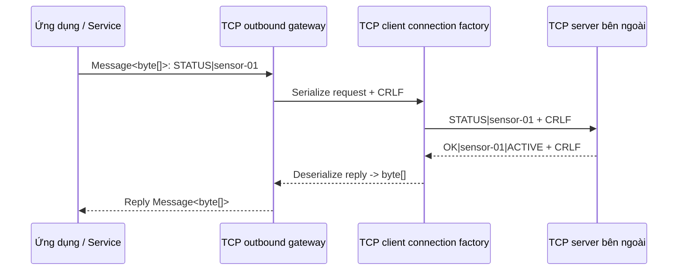
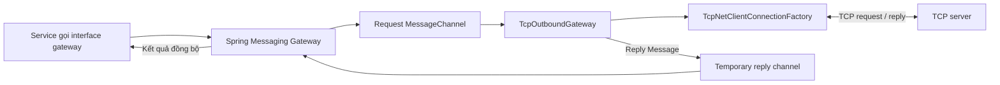
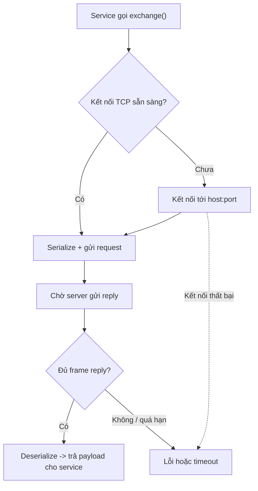

# TCP outbound gateway request-reply

> **Chương:** Adapter TCP  
> **Module:** SPRING_INTEGRATION_ADAPTERS  
> **Phạm vi:** Kết nối các hệ thống ngoài vào Spring Integration bằng inbound/outbound adapter, gateway, poller và MessageChannel. Thực hành luồng trao đổi qua file, SFTP, HTTP, JMS, AMQP, Kafka và cơ sở dữ liệu; xử lý hợp đồng message, lỗi và vòng đời kết nối.

## 1. Mục tiêu học tập

Sau bài học, bạn có thể:

- Mô tả **TCP outbound gateway** và lý do endpoint này thực hiện trao đổi **request-reply**.
- Cấu hình `TcpOutboundGateway` kết hợp `TcpNetClientConnectionFactory` bằng Spring Integration Java DSL.
- Gửi yêu cầu từ service qua `MessageChannel`, nhận reply về service mà không tự thao tác `Socket`.
- Chọn serializer/deserializer và quy ước **framing** để hai phía tách đúng request và reply từ luồng byte TCP.
- Phân biệt timeout kết nối, timeout chờ reply, lỗi giao thức và lỗi nghiệp vụ.
- Giải thích ảnh hưởng của việc **tái sử dụng kết nối**, số request đồng thời và khả năng tương quan reply.
- Thiết kế retry, request ID, idempotency, bảo mật và giám sát cho một hệ thống TCP thật.

## 2. TCP outbound gateway là gì?

`TcpOutboundGateway` là một endpoint của Spring Integration nhận **Spring Message từ ứng dụng**, gửi nội dung của message đến hệ thống bên ngoài qua **TCP**, sau đó **chờ một phản hồi trên kết nối TCP** và đưa phản hồi trở lại luồng Spring Integration.

Ví dụ: ứng dụng quản lý thiết bị cần hỏi máy chủ TCP chuyên dụng xem cảm biến `sensor-01` đang hoạt động hay không:

1. Service tạo request `STATUS|sensor-01`.
2. TCP outbound gateway ghi request lên socket theo giao thức.
3. TCP server đọc request, kiểm tra trạng thái và gửi `OK|sensor-01|ACTIVE`.
4. Gateway đọc trọn frame reply và trả kết quả cho lời gọi phía service.



Tên **outbound** nói về **hướng của request khởi phát từ Spring Integration đi ra ngoài**. Gateway vẫn có cả chiều nhận reply. TCP về mặt vận chuyển vốn hai chiều, nhưng chính gateway mới tạo ra **hợp đồng trao đổi một request → một reply** ở cấp Spring Message.

Khác với `TcpSendingMessageHandler` trong TCP outbound channel adapter, outbound gateway **không kết thúc ngay sau thao tác gửi**. Nó cần nhận reply, hoặc kết thúc bằng lỗi/timeout theo cấu hình và tình trạng kết nối.

### 2.1. Khi nào nên dùng outbound gateway?

Dùng khi ứng dụng **chủ động gọi một TCP server khác** và cần câu trả lời để tiếp tục:

- Tra cứu trạng thái thiết bị hoặc tồn kho từ hệ thống chỉ cung cấp TCP.
- Gửi lệnh tới một máy chủ xử lý chuyên dụng và đợi `OK` hoặc mã lỗi.
- Tương tác với hệ thống legacy theo quy ước một request có một response.
- Trao đổi thông điệp nhị phân theo framing có độ dài, mã trạng thái và request ID.

Nếu ứng dụng chỉ cần đẩy log, telemetry hoặc sự kiện mà **không chờ response của từng message**, TCP outbound **channel adapter** là lựa chọn phù hợp hơn. Nếu phía ngoài chủ động kết nối vào ứng dụng để gửi request và chờ response, hãy xem **TCP inbound gateway**.

## 3. Kiến trúc và vai trò từng thành phần



| Thành phần | Trách nhiệm |
| --- | --- |
| `@MessagingGateway` | Cho code Java gọi method như API thông thường, tự tạo Spring Message và đợi reply. |
| `MessageChannel` | Đưa request từ service tới outbound endpoint; tách logic nghiệp vụ khỏi transport. |
| `TcpOutboundGateway` | Quản lý request-reply ở Spring Integration: ghi request, nhận reply, chuyển kết quả về đúng luồng gọi. |
| `TcpNetClientConnectionFactory` | Tạo và quản lý kết nối TCP tới host/port đích; cung cấp serializer/deserializer. |
| `TcpNioClientConnectionFactory` | Biến thể dùng NIO khi yêu cầu tải và mô hình I/O phù hợp. |
| `Serializer` | Chuyển payload của request thành byte theo định dạng và framing. |
| `Deserializer` | Đọc byte từ socket đến khi đủ frame reply rồi trả payload cho gateway. |

Một điểm dễ nhầm: **Messaging Gateway** (`@MessagingGateway`) và **TCP outbound gateway** là hai lớp khác nhau. `@MessagingGateway` chỉ cung cấp giao diện gọi Java cho message flow. `TcpOutboundGateway` mới thực hiện request-reply với TCP server.

Ứng dụng cũng có thể phát message qua `MessageChannel` mà không dùng interface `@MessagingGateway`, nhưng khi cần một giá trị trả về đồng bộ, interface gateway thường thuận tiện và rõ ràng.

### 3.1. Hợp đồng message ở hai biên

Ở **biên Spring Integration**, request và reply là Spring `Message` với payload và headers. Ở **biên TCP**, server chỉ nhìn thấy byte được ghi lên socket.

Trong ví dụ:

| Thành phần | Dữ liệu |
| --- | --- |
| Request payload trước serialize | `STATUS|sensor-01` dưới dạng `byte[]` UTF-8 |
| Byte thực tế trên socket | `STATUS|sensor-01\r\n` |
| Reply thực tế trên socket | `OK|sensor-01|ACTIVE\r\n` |
| Reply payload sau deserialize | `OK|sensor-01|ACTIVE` dưới dạng `byte[]` UTF-8 |

Các Spring Message headers như `replyChannel`, `errorChannel` hoặc correlation ID nội bộ **không tự động xuất hiện trong dữ liệu TCP**. Nếu TCP server cần request ID, phiên bản hợp đồng hoặc quyền truy cập, các thông tin đó phải được biểu diễn rõ trong **payload giao thức**, hoặc có cơ chế thương lượng/xác thực riêng.

## 4. Framing: TCP không truyền từng message riêng lẻ

TCP là một **byte stream**. Một lời gọi `Socket.write()` không bảo đảm bên nhận sẽ đọc được toàn bộ message trong một lần `read()`; nhiều lần ghi cũng có thể được gom vào cùng đợt đọc.

Vì vậy, một hệ thống request-reply phải định nghĩa cách tách **cả request lẫn reply**.

| Kiểu framing | Ví dụ | Khi phù hợp |
| --- | --- | --- |
| CRLF | `STATUS|sensor-01\r\n` | Giao thức văn bản phân tách bằng hai byte `0D 0A`. |
| LF | `STATUS|sensor-01\n` | Giao thức dùng một byte LF cuối khung. |
| Length header | `[payload length][payload]` | Giao thức nhị phân, payload có ký tự xuống dòng hoặc byte tùy ý. |
| Đóng kết nối | `[payload][EOF]` | Hệ thống quy định một kết nối chỉ mang một message. |

Bài dùng `ByteArrayCrLfSerializer` cho **cả serializer và deserializer**:

- Khi gửi request, serializer ghi `byte[]` request và **tự thêm** `\r\n`.
- Khi đọc reply, deserializer lấy dữ liệu tới CRLF rồi trả `byte[]` **không bao gồm** CRLF.
- Code nghiệp vụ **không nối sẵn** CRLF vào payload. Nếu tự nối, bên kia có thể nhận thêm một frame trống.

Nếu phía server sử dụng length header, cần chọn serializer/deserializer tương ứng ở client; chỉ đổi một phía sẽ khiến giao thức bị kẹt chờ, mất đồng bộ hoặc giải mã sai.

Một hợp đồng đủ rõ phải quy định **byte order**, bảng mã, độ dài khung tối đa, ký tự escape, mã lỗi, giới hạn thời gian xử lý và ý nghĩa của từng reply. Đối với payload nhị phân, nên ưu tiên framing không phụ thuộc ký tự văn bản.

## 5. Ví dụ thực hành: truy vấn trạng thái thiết bị qua TCP

Ứng dụng Spring Boot gọi đến TCP server chạy tại `127.0.0.1:9002`. Client gửi lệnh `STATUS|sensor-01` và chờ server trả `OK|sensor-01|ACTIVE`. Các phần sau minh họa một chương trình hoàn chỉnh ở mức cấu hình, service và server thử nghiệm.

### 5.1. Dependency Maven

Giả sử phiên bản dependency được Spring Boot BOM quản lý:

```xml
<dependencies>
    <dependency>
        <groupId>org.springframework.boot</groupId>
        <artifactId>spring-boot-starter-integration</artifactId>
    </dependency>
    <dependency>
        <groupId>org.springframework.integration</groupId>
        <artifactId>spring-integration-ip</artifactId>
    </dependency>
</dependencies>
```

`spring-integration-ip` cung cấp TCP gateways, adapters, connection factories và serializers. Ví dụ sử dụng **Java 17+** và kiểu Java DSL phổ biến trong **Spring Integration 6.x**.

### 5.2. Cấu hình TCP connection factory và outbound gateway

Tạo `TcpOutboundGatewayConfiguration.java`:

```java
import org.springframework.context.annotation.Bean;
import org.springframework.context.annotation.Configuration;
import org.springframework.integration.annotation.IntegrationComponentScan;
import org.springframework.integration.config.EnableIntegration;
import org.springframework.integration.dsl.IntegrationFlow;
import org.springframework.integration.ip.dsl.Tcp;
import org.springframework.integration.ip.tcp.connection.TcpNetClientConnectionFactory;
import org.springframework.integration.ip.tcp.serializer.ByteArrayCrLfSerializer;

@Configuration
@EnableIntegration
@IntegrationComponentScan
public class TcpOutboundGatewayConfiguration {

    @Bean
    TcpNetClientConnectionFactory tcpStatusClientFactory() {
        var factory =
                new TcpNetClientConnectionFactory("127.0.0.1", 9002);

        // Ví dụ dùng một kết nối TCP còn sống cho nhiều request tuần tự.
        factory.setSingleUse(false);

        // Request gửi ra và response gửi về đều kết thúc bằng CRLF.
        factory.setSerializer(new ByteArrayCrLfSerializer());
        factory.setDeserializer(new ByteArrayCrLfSerializer());

        return factory;
    }

    @Bean
    IntegrationFlow statusRequestReplyFlow(
            TcpNetClientConnectionFactory tcpStatusClientFactory) {

        return IntegrationFlow
                .from("tcpStatusRequests")
                .handle(Tcp.outboundGateway(tcpStatusClientFactory))
                .get();
    }
}
```

**Đường đi trong cấu hình:**

1. Service phát request vào `tcpStatusRequests`.
2. Flow chuyển message cho `Tcp.outboundGateway(...)`, tức TCP outbound gateway endpoint.
3. Gateway sử dụng `tcpStatusClientFactory` để kết nối TCP đến `127.0.0.1:9002` và ghi request có dấu CRLF.
4. Gateway đợi response, deserializer đọc đủ frame reply rồi tạo một Spring reply Message.
5. Reply được đưa về cơ chế phản hồi của request flow, nhờ vậy caller có thể nhận kết quả.

Ở ví dụ này, `singleUse=false` cho phép connection factory tái sử dụng socket khi còn hoạt động. **Không có nghĩa một socket hỗ trợ vô hạn request đang chờ song song.** TCP outbound gateway phải bảo toàn tương quan request/reply; phần về concurrency giải thích chi tiết.

**Đừng đưa host/port hard-code của demo vào production.** Nên đọc từ cấu hình môi trường, có chính sách giới hạn kết nối, timeout và TLS tương ứng.

### 5.3. Tạo interface giao tiếp cho tầng nghiệp vụ

Tạo interface `RemoteStatusGateway.java` trong package được `@IntegrationComponentScan` quét:

```java
import org.springframework.integration.annotation.MessagingGateway;

@MessagingGateway(defaultRequestChannel = "tcpStatusRequests")
public interface RemoteStatusGateway {

    byte[] exchange(byte[] request);
}
```

Khi gọi `exchange(...)`, Spring Integration tạo Spring request Message từ `byte[]` và gửi đến kênh `tcpStatusRequests`. Lời gọi chờ reply từ outbound gateway rồi trả payload `byte[]`.

Trong hệ thống thực, nên định nghĩa timeout có giới hạn ở gateway và tầng socket để tránh lời gọi chờ quá lâu khi server không phản hồi. Cách cấu hình cụ thể phụ thuộc phiên bản Spring Integration và chính sách timeout của ứng dụng.

### 5.4. Service nghiệp vụ gửi request và kiểm tra reply

Tạo `RemoteDeviceStatusClient.java`:

```java
import java.nio.charset.StandardCharsets;

import org.springframework.stereotype.Service;

@Service
public class RemoteDeviceStatusClient {

    private final RemoteStatusGateway remoteStatusGateway;

    public RemoteDeviceStatusClient(RemoteStatusGateway remoteStatusGateway) {
        this.remoteStatusGateway = remoteStatusGateway;
    }

    public String getStatus(String deviceId) {
        if (deviceId == null
                || !deviceId.matches("[A-Za-z0-9_-]{1,32}")) {
            throw new IllegalArgumentException("Invalid device ID");
        }

        String request = "STATUS|" + deviceId;
        byte[] requestBytes = request.getBytes(StandardCharsets.UTF_8);

        // Đồng bộ: đợi reply từ TCP outbound gateway.
        byte[] replyBytes = remoteStatusGateway.exchange(requestBytes);

        if (replyBytes == null) {
            throw new IllegalStateException("Missing TCP reply");
        }

        String response = new String(
                replyBytes, StandardCharsets.UTF_8
        );

        if (response.startsWith("ERR|")) {
            throw new IllegalStateException(
                    "Remote server rejected request: " + response
            );
        }

        String[] parts = response.split("\\|", -1);

        if (parts.length != 3
                || !"OK".equals(parts[0])
                || !deviceId.equals(parts[1])) {
            throw new IllegalStateException(
                    "Unexpected TCP reply: " + response
            );
        }

        return parts[2]; // ACTIVE hoặc INACTIVE trong ví dụ.
    }
}
```

Đoạn code cho thấy **service không phụ thuộc vào API Socket**. Service chỉ biết request/reply contract và interface gateway. Nếu server trả `ERR|...`, đó là **reply nghiệp vụ** và cần được xử lý như dữ liệu, không được mặc định xem là lỗi mạng.

Đoạn parser hiện minh họa ba trường cố định. Khi thiết kế protocol thực tế, nên bổ sung mã phiên bản, ID request, định dạng số, quy tắc escape, tối đa kích thước và tập mã lỗi được chấp nhận.

### 5.5. Server TCP thử nghiệm

Tạo chương trình Java độc lập `StatusTcpServerDemo.java`. Đây là server mô phỏng, không sử dụng Spring Integration:

```java
import java.io.BufferedReader;
import java.io.BufferedWriter;
import java.io.InputStreamReader;
import java.io.OutputStreamWriter;
import java.net.ServerSocket;
import java.net.Socket;
import java.nio.charset.StandardCharsets;

public class StatusTcpServerDemo {

    public static void main(String[] args) throws Exception {
        try (ServerSocket listener = new ServerSocket(9002)) {
            System.out.println("TCP status server listening on port 9002");

            while (true) {
                // Demo đơn giản phục vụ lần lượt từng kết nối.
                try (Socket client = listener.accept();
                     BufferedReader reader = new BufferedReader(
                             new InputStreamReader(
                                     client.getInputStream(),
                                     StandardCharsets.UTF_8));
                     BufferedWriter writer = new BufferedWriter(
                             new OutputStreamWriter(
                                     client.getOutputStream(),
                                     StandardCharsets.UTF_8))) {

                    String request;
                    while ((request = reader.readLine()) != null) {
                        System.out.println("Received: " + request);

                        String reply = switch (request) {
                            case "STATUS|sensor-01" ->
                                    "OK|sensor-01|ACTIVE";
                            case "STATUS|sensor-02" ->
                                    "OK|sensor-02|INACTIVE";
                            default -> "ERR|BAD_REQUEST";
                        };

                        writer.write(reply);
                        writer.write("\r\n");
                        writer.flush();
                    }
                }
            }
        }
    }
}
```

`BufferedReader.readLine()` tách request theo dòng; `BufferedWriter` gửi reply có CRLF. Mỗi yêu cầu hợp lệ sinh ra **một reply**. Server này phục vụ **một kết nối tại một thời điểm** để dễ quan sát, không phải mẫu để triển khai server tải lớn. Nhờ vòng `while` bên trong, một client giữ kết nối có thể gửi nhiều request **tuần tự**.

### 5.6. Chạy thử end-to-end

Có thể thêm một `ApplicationRunner` để gọi thử sau khi Spring Boot khởi động:

```java
import org.springframework.boot.ApplicationRunner;
import org.springframework.context.annotation.Bean;
import org.springframework.context.annotation.Configuration;

@Configuration
public class TcpStatusDemoRunner {

    @Bean
    ApplicationRunner callTcpServer(RemoteDeviceStatusClient client) {
        return args -> {
            System.out.println(
                    "sensor-01 status = " + client.getStatus("sensor-01"));
            System.out.println(
                    "sensor-02 status = " + client.getStatus("sensor-02"));
        };
    }
}
```

Thứ tự thực hiện:

1. Khởi động `StatusTcpServerDemo` để lắng nghe cổng `9002`.
2. Khởi động ứng dụng Spring Boot có `TcpOutboundGatewayConfiguration`, `RemoteStatusGateway`, `RemoteDeviceStatusClient` và `TcpStatusDemoRunner`.
3. Quan sát service in hai trạng thái và server in hai request tương ứng.
4. Thử tắt server rồi gọi lại `getStatus(...)` để xem cách lỗi kết nối hoặc timeout xuất hiện.
5. Bỏ `TcpStatusDemoRunner` khi kết thúc bài thử; trong production, request được tạo từ luồng nghiệp vụ thật.

Kết quả mong đợi từ ứng dụng:

```text
sensor-01 status = ACTIVE
sensor-02 status = INACTIVE
```

Kết quả mong đợi từ server:

```text
Received: STATUS|sensor-01
Received: STATUS|sensor-02
```

Đây là kết quả **kỳ vọng theo chương trình minh họa**, không phải kết quả chạy thử thực tế trong bài viết. Hai lệnh gửi và hai response sử dụng cùng hợp đồng CRLF.

## 6. Cơ chế request-reply và tương quan message

### 6.1. Tại sao cần chờ một reply?

Trong outbound adapter, endpoint chỉ có trách nhiệm gửi. Outbound gateway cần đưa **reply tương ứng với request** trở lại đúng caller. Nếu có nhiều request đồng thời trên một kết nối mà giao thức không mang request ID, client có thể khó phân biệt reply nào thuộc request nào.

Với TCP outbound gateway và **kết nối dùng chung**, cơ chế trao đổi request-reply thường **tuần tự hóa request trên từng connection** để duy trì mối quan hệ một request → một reply. Điều này có thể làm các caller chờ nhau khi server chậm.

Ví dụ thứ tự trên một kết nối:

```text
Client -> Server: STATUS|sensor-01\r\n
Client <- Server: OK|sensor-01|ACTIVE\r\n

Client -> Server: STATUS|sensor-02\r\n
Client <- Server: OK|sensor-02|INACTIVE\r\n
```

Đừng nhầm thứ tự byte TCP với một **correlation protocol** hoàn chỉnh. Nếu ứng dụng cần gửi nhiều request độc lập song song, cần xem xét thiết kế connection factory, pool/kết nối riêng và quy tắc tương quan ở mức nghiệp vụ.

### 6.2. Kết nối tái sử dụng và kết nối dùng một lần

| Cấu hình | Hành vi thường gặp | Đánh đổi |
| --- | --- | --- |
| `singleUse=false` | Tái sử dụng kết nối đang hoạt động cho nhiều lượt request/reply. | Giảm chi phí mở socket nhưng có thể khiến request trên cùng kết nối phải chờ nhau. |
| `singleUse=true` | Mỗi lượt giao tiếp dùng một kết nối riêng rồi đóng theo chính sách factory. | Cô lập lượt request tốt hơn nhưng tốn công mở/đóng socket, cần kiểm soát số kết nối. |
| Connection factory có cache/pool phù hợp | Phân phối request qua nhiều kết nối theo giới hạn được cấu hình. | Cần quản lý tối đa kết nối, queue, timeout và khi server từ chối tải. |

**Không giả định `singleUse=false` giữ socket mãi mãi.** Server có thể đóng kết nối, mạng có thể gián đoạn và lần gọi tiếp theo có thể phải kết nối lại. Nếu server đang xử lý request tại thời điểm mất mạng, client cũng không biết chắc kết quả đã được thực hiện hay chưa.

### 6.3. Cần reply cho mỗi request

Gateway đang chờ **một reply đúng framing**. Nếu TCP server chỉ ghi một phần response, không kết thúc bằng CRLF, trả nhiều reply hoặc không trả gì, caller có thể timeout, gặp lỗi giao thức hoặc khiến lần trao đổi tiếp theo bị ảnh hưởng.

Các lỗi có thể khó phát hiện khi dùng kết nối dài hạn:

- Reply của request trước đến sau khi phía client đã timeout.
- Server ghi hai frame cho một request, để lại dữ liệu dư trên connection.
- Server gửi unsolicited event trên socket dùng cho request-reply.
- Reply có CRLF bên trong nội dung mà hai phía chưa có cơ chế escape.

Để giảm nguy cơ nhầm reply, hãy thống nhất nghiêm ngặt **một request → một response**, thiết kế timeout/reset connection hợp lý và bổ sung request ID trong giao thức nếu cần kiểm tra tương quan ngoài tầng kết nối.

## 7. Timeout: kết nối, chờ reply và nghiệp vụ

Một request có thể bị chậm tại nhiều điểm:



| Thời hạn | Tác động | Gợi ý thiết kế |
| --- | --- | --- |
| **Connect timeout** | Không thể mở socket TCP tới server đúng hạn. | Giới hạn thời gian connect; kiểm tra host, port, firewall, DNS và trạng thái server. |
| **Request timeout** | Không có khả năng nhận lượt gửi/connection trong thời gian quy định, tùy cấu hình gateway. | Giới hạn thời gian chờ tài nguyên; không để vô hạn caller bị chặn bởi một request chậm. |
| **Remote/reply timeout** | Đã gửi request nhưng chưa nhận reply hoàn chỉnh đúng hạn. | Xác định SLA của server và hành động sau timeout. |
| **Read/socket timeout** | Thao tác đọc trên kết nối quá hạn. | Kiểm thử tương tác với framing và chính sách hủy/đóng kết nối. |
| **Business timeout** | Server mất quá lâu ở DB hoặc API downstream. | Dùng timeout riêng cho dependency, định nghĩa response lỗi nếu có thể. |

Tên thuộc tính và hành vi timeout có thể khác nhau theo phiên bản và cách cấu hình gateway/connection factory. Khi triển khai, hãy kiểm tra các tùy chọn như **request timeout**, **remote timeout** và **socket timeout** trong phiên bản Spring Integration thực tế, sau đó thử bằng server giả lập bị treo để xác minh độ trễ tối đa mong muốn.

### 7.1. Timeout có nghĩa là server đã thất bại?

**Không.** Giả sử client gửi:

```text
CHARGE|req-9042|order-17|1500
```

Server đã ghi giao dịch thành công nhưng kết nối ngắt trước khi client đọc được `OK|req-9042|COMPLETED`. Caller nhìn thấy timeout và có thể retry. Nếu server không kiểm tra `req-9042`, giao dịch có thể bị thực hiện hai lần.

Đây là khác biệt giữa:

- **Lệnh ghi lên socket thành công:** bên gửi đã bàn giao byte cho tầng truyền tải theo quan sát của nó.
- **Server nhận đúng frame:** bộ đọc TCP server đã xác định đầy đủ một request.
- **Server xử lý nghiệp vụ thành công:** logic nghiệp vụ đã hoàn thành theo cam kết.
- **Client nhận ACK/response:** caller đã quan sát được kết quả, nhưng cũng cần xác định ý nghĩa ACK.

Gateway giúp trao đổi request/reply; nó **không cung cấp exactly-once delivery hay exactly-once processing** cho các thay đổi nghiệp vụ.

## 8. Xử lý lỗi và độ tin cậy

### 8.1. Phân biệt ba nhóm lỗi

| Nhóm | Ví dụ | Cách ứng xử |
| --- | --- | --- |
| **Lỗi vận chuyển** | `Connection refused`, `Connection reset`, `Broken pipe`, lỗi kết nối lại. | Ghi log host/port/correlation ID; retry có giới hạn theo tính chất yêu cầu. |
| **Lỗi framing/giao thức** | Reply thiếu CRLF, payload quá dài, schema không hợp lệ, response thừa. | Kiểm tra serializer/deserializer; từ chối dữ liệu sai và xử lý connection có thể đã mất đồng bộ. |
| **Reply lỗi nghiệp vụ** | `ERR|NOT_FOUND` hoặc `ERR|BAD_REQUEST`. | Parser tiếp nhận reply hợp lệ rồi ánh xạ thành kết quả hoặc exception nghiệp vụ. |

Trên flow đồng bộ, lỗi gateway có thể xuất hiện như exception đối với caller thông qua `@MessagingGateway`. Với channel bất đồng bộ, nơi phát hiện lỗi và thời điểm caller nhận được kết quả thay đổi. Không nên thêm `ExecutorChannel` hoặc `QueueChannel` vào request-reply flow mà chưa thiết kế cơ chế reply, timeout và xử lý lỗi đi kèm.

**`errorChannel` không tự chuyển mọi lỗi thành response TCP.** Với outbound gateway, lỗi gửi hoặc timeout cần được xử lý ở phía gọi, còn mã `ERR|...` do server gửi là **reply bình thường về mặt giao thức** và do parser nghiệp vụ diễn giải.

### 8.2. Retry có điều kiện

| Request | Có thể retry tự động? | Lý do |
| --- | --- | --- |
| `STATUS|sensor-01` | Thường có thể nếu truy vấn là phép đọc thuần. | Gọi lại có thể trả trạng thái mới nhưng không làm thay đổi dữ liệu. |
| `SET_LEVEL|req-1|sensor-01|5` | Chỉ khi xác định rõ tính idempotent. | Phụ thuộc lệnh là "gán bằng 5" hay "tăng thêm 5". |
| `CHARGE|req-2|order-17|1500` | Không retry mù. | Nếu server đã xử lý trước timeout, gửi lại có thể tạo giao dịch trùng. |

Đối với lệnh thay đổi trạng thái quan trọng, nên có:

1. **Request ID duy nhất** được sinh trước lần gửi đầu tiên.
2. Server **lưu request ID và kết quả** theo cơ chế nhất quán, rồi trả cùng kết quả cho yêu cầu lặp.
3. **Correlation ID trong response** để client xác định reply thuộc lệnh nào.
4. Quy tắc timeout, retry có **backoff và giới hạn lần thử**.
5. Chính sách tiếp tục xử lý khi connection đứt nhưng phía server có thể đã cam kết.
6. Mã response định nghĩa rõ `ACCEPTED`, `COMPLETED`, `REJECTED` và trạng thái chưa rõ.

Nếu hệ thống legacy không hỗ trợ request ID, hãy giới hạn retry phù hợp và cân nhắc giải pháp đối soát kết quả thay vì tuyên bố gửi lại là an toàn.

### 8.3. Ví dụ hợp đồng có request ID

Có thể mở rộng giao thức:

```text
Request: STATUS|req-20261123-001|sensor-01
Reply:   OK|req-20261123-001|sensor-01|ACTIVE
Error:   ERR|req-20261123-001|NOT_FOUND
```

Parser phía client cần kiểm tra **request ID trong reply**, không chỉ dựa vào thời gian hoặc thứ tự socket. Đối với tác vụ có tác dụng phụ, việc lưu kết quả theo request ID tại server mới là cơ chế chính để chống xử lý lặp.

## 9. So sánh bốn TCP endpoint trong Spring Integration

| Thành phần | Hướng dữ liệu | Request-reply? | Khi sử dụng |
| --- | --- | --- | --- |
| **TCP inbound channel adapter** | TCP → Spring Message | Không tự phản hồi | Thiết bị gửi telemetry hoặc event vào ứng dụng. |
| **TCP outbound channel adapter** | Spring Message → TCP | Không đợi response | Ứng dụng đẩy sự kiện tới TCP server. |
| **TCP inbound gateway** | TCP request → flow → TCP reply | Có | Bên ngoài kết nối vào ứng dụng và chờ kết quả. |
| **TCP outbound gateway** | Flow request → TCP → flow reply | **Có** | Ứng dụng chủ động gọi TCP server và chờ kết quả. |

Một cách hình dung: nếu **hệ thống khác gọi đến ứng dụng** và cần kết quả thì dùng **inbound gateway**. Nếu **ứng dụng gọi đến hệ thống khác** và cần kết quả thì dùng **outbound gateway**.

Không nên dùng outbound channel adapter rồi tự chờ một message từ inbound adapter khác cho mỗi request thông thường, trừ khi giao thức thực sự là bất đồng bộ hai chiều và có correlation ID riêng. Với hợp đồng đồng bộ request-reply, outbound gateway xử lý đường trả reply trực tiếp hơn.

## 10. Bảo mật, tài nguyên và vận hành

### 10.1. Bảo mật đường truyền

TCP thuần **không mã hóa** dữ liệu. Trong hệ thống thật, hãy cân nhắc:

- TLS cho kết nối client-server, cấu hình tại tầng connection factory hoặc hạ tầng kết nối phù hợp.
- Kiểm tra certificate/server identity để tránh kết nối nhầm hệ thống đích.
- Xác thực và phân quyền ở cấp nghiệp vụ cho các lệnh điều khiển.
- Không ghi raw payload hoặc thông tin xác thực vào log, metrics và error response.
- Giới hạn host/port được phép kết nối và quản lý bí mật/certificate theo quy trình triển khai.

Việc socket kết nối thành công không đồng nghĩa server đó đáng tin cậy, và một mã reply `OK` chỉ có giá trị khi nguồn gửi và hợp đồng response được kiểm chứng.

### 10.2. Quản lý tài nguyên

- **Giới hạn connection:** tránh mở quá nhiều socket khi server đích bị chậm.
- **Giới hạn request đang chờ:** bảo vệ thread pool và caller khỏi bị giữ vô thời hạn.
- **Giới hạn frame:** kiểm tra kích thước byte trước khi serialize và giới hạn trong deserializer.
- **Giới hạn retry:** có backoff, jitter và chính sách dừng khi server không khả dụng.
- **Quản lý hàng đợi:** nếu đặt hàng đợi trước gateway, cần giải quyết việc reply về đúng caller và khi backlog vượt ngưỡng.
- **Shutdown:** đóng kết nối có kiểm soát; các request đã gửi nhưng chưa có reply cần được xem là **chưa rõ kết quả** nếu giao thức không có xác nhận bền vững.

### 10.3. Quan sát hoạt động

| Chỉ số / log | Lợi ích |
| --- | --- |
| Tần suất request, reply thành công và reply `ERR` | Phân biệt lưu lượng với lỗi nghiệp vụ. |
| Request latency (p50, p95, p99) | Tìm server hoặc phụ thuộc làm chậm hệ thống. |
| Số connect failure, reset, timeout, reconnect | Theo dõi độ ổn định của TCP. |
| Thời gian chờ lấy connection hoặc chờ request trước | Phát hiện nghẽn do số kết nối hạn chế. |
| Kích thước request/reply, số frame lỗi | Phát hiện payload bất thường và sai framing. |
| Request ID và loại lệnh | Truy vết từng trao đổi mà không cần ghi toàn bộ nội dung nhạy cảm. |

Phân biệt **latency có reply**, **timeout không biết kết quả** và **reply báo lỗi nghiệp vụ**. Ba loại này không nên gộp thành một chỉ số `TCP failed` duy nhất.

## 11. Các tình huống kiểm thử quan trọng

Ngoài happy path, cần kiểm tra có chủ đích:

1. **Một request → một reply:** trả chính xác một frame CRLF và xác nhận parser diễn giải đúng.
2. **Phân đoạn byte:** server gửi reply thành hai lần `write()`, gateway vẫn phải đợi đủ CRLF.
3. **Reply thiếu CRLF:** caller bị timeout hoặc gặp lỗi phù hợp chính sách, không nhận dữ liệu chưa hoàn chỉnh như reply hợp lệ.
4. **Reply thừa:** server gửi hai frame cho một request; xác định xử lý kết nối sau reply dư.
5. **Kết nối bị đóng trước reply:** retry có an toàn không, và làm sao phân loại kết quả chưa rõ?
6. **Server xử lý chậm:** đo mức độ request của nhiều caller bị chặn khi dùng shared connection.
7. **Payload chứa CR/LF:** phải escape đúng protocol hoặc đổi framing sang length header.
8. **Response sai request ID:** client không được nhận nhầm một kết quả của request khác.
9. **Dữ liệu rất dài và Unicode:** kiểm soát byte length và giới hạn bộ nhớ của deserializer.
10. **Khôi phục server:** client phát hiện kết nối cũ không còn dùng được và phục hồi theo cấu hình; không tự động tuyên bố request trước đó thất bại nghiệp vụ.

## 12. Bài tập mở rộng

**Bài 1 — Phản hồi lỗi nghiệp vụ.** Sửa `StatusTcpServerDemo` để trả `ERR|NOT_FOUND` cho ID hợp lệ nhưng không có dữ liệu và `ERR|BAD_REQUEST` cho request không đúng schema. Sửa `RemoteDeviceStatusClient` phân biệt hai trường hợp.

**Bài 2 — Thử timeout.** Cho TCP server nhận request nhưng không gửi response trong một khoảng thời gian dài. Cấu hình timeout ở client theo phiên bản đang dùng, quan sát exception và xác định request có thể đã được xử lý hay chưa.

**Bài 3 — Kiểm tra concurrency.** Tạo 20 caller đồng thời gọi `getStatus(...)` trong khi server giả lập xử lý mỗi request 500 ms. So sánh với một cấu hình có nhiều kết nối được giới hạn bằng connection factory/pool phù hợp. Đo p95 latency, số connection và thứ tự response.

**Bài 4 — Chống xử lý trùng.** Mở rộng giao thức với `requestId` và command có tác dụng phụ; lưu kết quả theo request ID tại server. Mô phỏng server xử lý xong rồi ngắt socket trước khi reply tới client, sau đó kiểm tra gửi lại không thực hiện command lần thứ hai.

**Bài 5 — Đổi framing.** Chuyển sang length header cho payload chứa CR/LF. Xác định các thay đổi đồng bộ tại serializer request, deserializer reply và implementation server.

## 13. Tự kiểm tra kiến thức

1. Vì sao TCP outbound gateway vẫn nhận dữ liệu từ TCP dù tên của nó là *outbound*?
2. `TcpNetClientConnectionFactory` và `TcpOutboundGateway` chịu trách nhiệm khác nhau như thế nào?
3. Vai trò của `@MessagingGateway` trong ví dụ là gì?
4. Nếu client đang dùng `ByteArrayCrLfSerializer`, có nên thêm `\r\n` thủ công vào payload request không?
5. Vì sao request từ nhiều caller có thể phải chờ nhau khi cùng dùng một TCP connection?
6. Khi gateway timeout, có thể khẳng định server chưa thực hiện command hay không?
7. Vì sao một reply `ERR|NOT_FOUND` không giống lỗi socket `Connection reset`?
8. Vì sao `MessageHeaders` của Spring không đủ để TCP server ngoài hiểu request ID?
9. Khi nào nên dùng outbound channel adapter thay cho outbound gateway?
10. Những điều gì cần bổ sung để retry command thay đổi trạng thái an toàn?

**Gợi ý:** (1) Outbound mô tả hướng request khởi phát; gateway trao đổi cả reply. (2) Factory quản lý kết nối/framing, gateway quản lý request-reply. (3) Tạo giao diện Java gọi message flow và nhận reply. (4) Không, serializer tự thêm CRLF. (5) Gateway phải giữ tương quan reply theo mỗi request trên socket dùng chung. (6) Không, reply có thể thất lạc sau khi server xử lý. (7) Trường hợp đầu là reply nghiệp vụ có framing hợp lệ, trường hợp sau là lỗi truyền tải. (8) Headers không tự được serialize ra TCP. (9) Khi chỉ phát sự kiện và không cần response tương ứng. (10) Request ID, correlation, idempotency, retry có giới hạn và xác nhận nghiệp vụ.

**Điểm cần nhớ:** TCP outbound gateway là cầu nối **Spring Message → TCP request → TCP reply → Spring Message**. Thành công ở lớp truyền tải chưa đồng nghĩa với thành công nghiệp vụ; một giải pháp tin cậy phải định nghĩa rõ **framing, payload, tương quan request-reply, timeout, lỗi, kết nối, retry và idempotency**.
