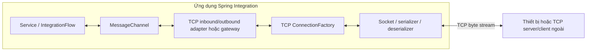
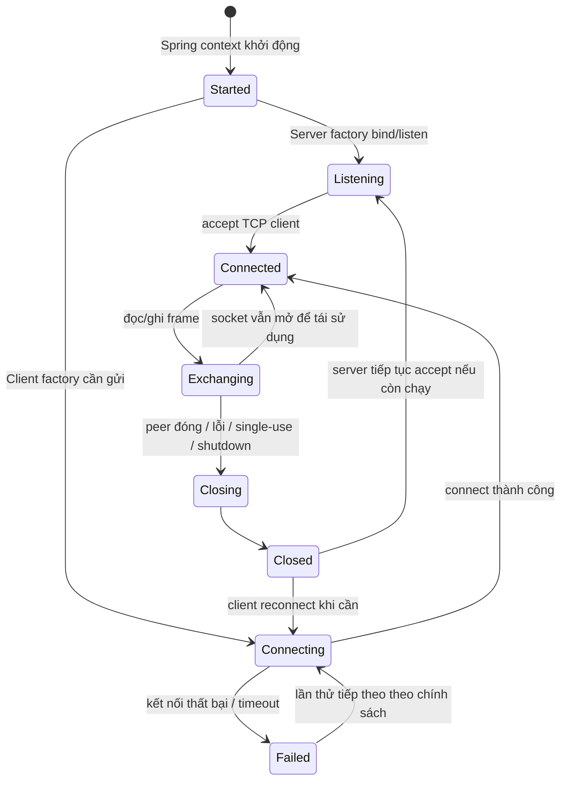
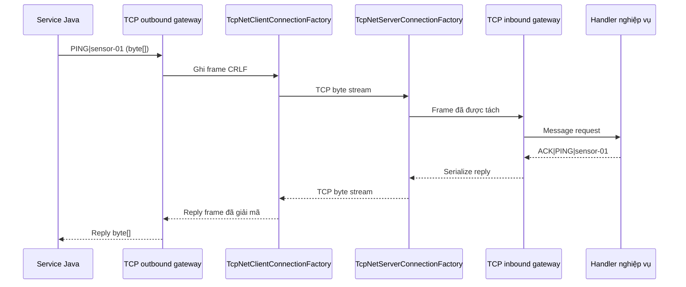

# ConnectionFactory và quản lý socket

> **Chương:** Adapter TCP  
> **Module:** SPRING_INTEGRATION_ADAPTERS  
> **Phạm vi module:** Kết nối các hệ thống ngoài vào Spring Integration bằng inbound/outbound adapter, gateway, poller và MessageChannel. Thực hành luồng trao đổi qua file, SFTP, HTTP, JMS, AMQP, Kafka và cơ sở dữ liệu; xử lý hợp đồng message, lỗi và vòng đời kết nối.

## 1. Mục tiêu học tập

Sau bài này, bạn có thể:

- Giải thích trách nhiệm của **TCP ConnectionFactory** so với adapter, gateway và `MessageChannel` trong Spring Integration.
- Chọn connection factory phù hợp giữa **server/client** và **Java IO/NIO**.
- Cấu hình serializer/deserializer để xác định ranh giới bản tin trên TCP byte stream.
- Hiểu vòng đời socket: **listen/accept hoặc connect → trao đổi byte → tái sử dụng hoặc đóng → reconnect**.
- Phân biệt kết nối dùng chung, kết nối dùng một lần và kết nối trong **pool/cache**.
- Nhận diện tác dụng của socket timeout, giới hạn tài nguyên, keepalive, sự kiện kết nối và TLS.
- Kiểm thử các tình huống như thiếu dấu kết thúc frame, server ngắt giữa chừng và request bị timeout nhưng phía nhận vẫn có thể đã xử lý.

## 2. ConnectionFactory đứng ở đâu trong kiến trúc?

Spring Integration cho phép lập trình theo **message** thay vì tự viết mã tạo socket, đọc byte, điều phối luồng và quản lý kết nối. Trong mô hình này, **TCP connection factory** là thành phần tạo và quản lý kết nối vận chuyển; còn **TCP adapter hoặc gateway** là endpoint kết nối mạng TCP với `MessageChannel`.



| Thành phần | Trách nhiệm | Không chịu trách nhiệm |
| --- | --- | --- |
| `MessageChannel` | Chuyển `Message<?>` giữa các endpoint nội bộ. | Mở TCP socket hoặc giải mã frame. |
| TCP inbound/outbound **adapter** | Đưa dữ liệu vào hoặc ra ứng dụng theo mô hình một chiều. | Tự đảm bảo phản hồi nghiệp vụ cho mỗi request. |
| TCP inbound/outbound **gateway** | Điều phối request/reply tương ứng trong message flow. | Tự định nghĩa ngữ nghĩa nghiệp vụ của `OK`, `ACK` hoặc retry. |
| **ConnectionFactory** | Tạo hoặc chấp nhận kết nối, cấu hình giao thức byte, quản lý lifecycle. | Phân tích lệnh `STATUS`, `ORDER` hay ghi dữ liệu nghiệp vụ. |
| **Serializer/Deserializer** | Đóng khung khi gửi và xác định một frame đã hoàn chỉnh khi nhận. | Xác thực schema, phân quyền và bảo đảm exactly-once processing. |

Một TCP socket có thể mang **nhiều bản tin**; một bản tin có thể bị tách thành **nhiều lần đọc**. Connection factory phối hợp với serializer/deserializer và endpoint, giúp handler thấy từng payload hoàn chỉnh. Chức năng này là nền tảng cho cả inbound/outbound adapter và gateway.

**Phân biệt hai từ dễ nhầm:** *inbound/outbound* mô tả hướng Spring Message, còn *client/server* mô tả vai trò thiết lập TCP socket. Một hệ thống có thể có inbound adapter dùng **server factory** để nhận dữ liệu bên ngoài, hoặc outbound gateway dùng **client factory** để chủ động gọi ra. Hai chiều phân loại này không đồng nghĩa với nhau.

## 3. Bốn lựa chọn ConnectionFactory chính

| Connection factory | Vai trò socket | Kiểu IO | Tình huống thường gặp |
| --- | --- | --- | --- |
| `TcpNetServerConnectionFactory` | TCP **server** lắng nghe một cổng, chấp nhận client kết nối. | Java IO truyền thống (blocking IO). | Thiết bị ngoài chủ động kết nối để gửi event hoặc gọi request/reply. |
| `TcpNetClientConnectionFactory` | TCP **client** chủ động kết nối tới host/port của server. | Java IO truyền thống. | Ứng dụng đẩy dữ liệu hoặc gọi dịch vụ TCP legacy. |
| `TcpNioServerConnectionFactory` | TCP **server** lắng nghe một cổng. | Java NIO. | Cân nhắc khi có nhiều kết nối và cần tối ưu mô hình xử lý IO. |
| `TcpNioClientConnectionFactory` | TCP **client** chủ động tạo kết nối. | Java NIO. | Cân nhắc theo đặc điểm tải, số socket và chi phí IO. |

### 3.1. Server factory và client factory

**Server connection factory** lắng nghe ở một cổng local. Khi client kết nối, nó nhận một socket được chấp nhận (accepted socket), đọc các byte gửi đến và quản lý phiên tương ứng. Ví dụ một bộ thu thập telemetry mở cổng `9100` để hàng trăm thiết bị kết nối tới.

**Client connection factory** biết host/port đích và tạo kết nối khi phía ứng dụng cần gửi request/message. Ví dụ một dịch vụ gửi lệnh điều khiển tới `192.0.2.10:9100` qua TCP. Nó cần xử lý kết nối thất bại, server đóng socket, timeout và kết nối lại.

Server hay client factory có thể phục vụ **adapter** hoặc **gateway** tùy cách tích hợp. Chọn loại factory trước tiên dựa vào **bên nào chủ động mở TCP connection**.

### 3.2. Java IO và NIO

- **Net factory** sử dụng mô hình socket IO truyền thống; thường dễ triển khai và phù hợp phần lớn bài thực hành hoặc khối lượng kết nối vừa phải.
- **NIO factory** dùng cơ chế IO không chặn ở tầng socket; có thể giảm chi phí thread cho số lượng lớn kết nối, nhưng yêu cầu kiểm tra đặc tính thực tế của giao thức và luồng xử lý.
- **NIO không tự biến handler nghiệp vụ thành bất đồng bộ**. Nếu handler vẫn gọi database hoặc API chậm, bottleneck vẫn tồn tại.
- Không có một factory luôn nhanh nhất. Hãy đo số kết nối đồng thời, độ trễ request/reply, CPU, bộ nhớ và hành vi khi tải cao trước khi chọn.

Trong ví dụ chính, ta dùng `TcpNetServerConnectionFactory` và `TcpNetClientConnectionFactory` để việc quản lý socket dễ quan sát.

## 4. Vòng đời một TCP socket qua ConnectionFactory

Vòng đời cơ bản có thể hình dung như sau:



Sơ đồ thể hiện hai vai trò client/server chung một bức tranh; nhánh `Listening` chỉ có ở server factory, nhánh `Connecting` thuộc client factory. Ứng dụng khởi động một server factory sẽ **bind port** để chờ kết nối. Client factory không nhất thiết mở socket ngay khi Spring tạo bean; kết nối có thể được tạo khi có nhu cầu trao đổi.

Các bước cần hiểu:

1. **Khởi tạo và quản lý bean:** Spring sở hữu factory và các endpoint khi khai báo `@Bean`. Container quản lý start/stop thích hợp; không cần tự tạo `ServerSocket` bên trong service.
2. **Thiết lập:** Server bind cổng rồi `accept`; client giải quyết host/port và `connect`. Có thể gặp lỗi port bị chiếm, firewall, DNS hoặc timeout.
3. **Nhận frame:** Connection đọc byte theo deserializer. Nếu còn thiếu dấu kết thúc/length header, dữ liệu chưa thành một Spring Message hoàn chỉnh.
4. **Gửi frame:** Serializer ghi payload cùng thông tin đóng khung đã thống nhất.
5. **Tái sử dụng hoặc đóng:** Một connection có thể phục vụ nhiều lượt trao đổi, hoặc đóng sau một lần gửi/giao tiếp theo `singleUse` và hợp đồng giao thức.
6. **Khôi phục:** Khi socket hỏng, lần trao đổi tiếp theo có thể cần tạo connection mới. Không nên coi reconnect là bảo đảm tự động gửi lại mọi message trước đó.
7. **Shutdown:** Khi ứng dụng dừng, các endpoint/factory phải được dừng có kiểm soát; vẫn cần có chính sách nghiệp vụ cho request chưa nhận được ACK.

### 4.1. Connection ID không phải định danh thiết bị

Spring Integration có thể cung cấp thông tin kết nối trong message header, điển hình `IpHeaders.CONNECTION_ID`. Header này hữu ích để log và **định tuyến reply theo socket** ở các luồng cần thiết.

Nhưng `connectionId` có thể thay đổi sau reconnect, nhiều message có thể cùng một connection ID và một thiết bị có thể mở nhiều kết nối. **Không dùng connection ID hoặc IP nguồn thay cho danh tính đã xác thực, request ID hoặc khóa idempotency.**

## 5. Serializer và deserializer là hợp đồng giữa hai đầu kết nối

TCP đảm bảo thứ tự các **byte** trên một kết nối đang hoạt động, không giữ ranh giới `Message`. Một lần `write()` ở phía gửi có thể trở thành nhiều lần `read()` ở phía nhận; nhiều lần `write()` cũng có thể xuất hiện trong cùng một lần đọc.

Hai đầu giao thức phải thống nhất **framing**:

| Kiểu | Ví dụ byte trên wire | Lưu ý |
| --- | --- | --- |
| CRLF | `PING\r\n` | Dùng ký tự kết thúc `0D 0A`; không được để CRLF không escape trong payload. |
| LF | `PING\n` | Chỉ một byte `0A` làm dấu phân cách. |
| Length header | `[số byte][payload]` | Thích hợp payload nhị phân, nhưng phải thống nhất định dạng độ dài và giới hạn frame. |
| Kết thúc connection | `[payload] + close` | Chỉ đúng nếu giao thức cho phép kết thúc mỗi message bằng đóng socket. |

Spring Integration có các serializer/deserializer như `ByteArrayCrLfSerializer`, `ByteArrayLfSerializer` và `ByteArrayLengthHeaderSerializer`. Tên cùng một class có thể được dùng ở cả hai hướng, nhưng **phải đặt đúng cấu hình**:

```java
var factory = new TcpNetClientConnectionFactory("127.0.0.1", 9100);

factory.setSerializer(new ByteArrayCrLfSerializer());   // Khi ghi.
factory.setDeserializer(new ByteArrayCrLfSerializer()); // Khi đọc.
```

Nếu payload nghiệp vụ là `PING`, `ByteArrayCrLfSerializer` sẽ **tự nối CRLF khi ghi socket**. Code gửi không thêm `\r\n` vào payload trước đó. Phía nhận đọc đến CRLF rồi trả về nội dung frame. Với UTF-8 nhiều byte, kiểm tra kích thước bằng **số byte sau mã hóa**, không chỉ đếm ký tự.

Việc nhận đủ frame không đồng nghĩa payload **hợp lệ về nghiệp vụ**. Ví dụ `TEMP|sensor-01|abc\r\n` là frame CRLF hợp lệ nhưng nhiệt độ không thể parse thành số. Cần bước validation sau khi deserialize.

### 5.1. Giới hạn kích thước frame

Trong hệ thống sản xuất, một client có thể gửi chuỗi không bao giờ kết thúc CRLF. Nếu deserializer liên tục tích lũy dữ liệu, tài nguyên có thể bị cạn. Cần cấu hình **max message size phù hợp với serializer** và giới hạn thời gian chờ frame. Khi gặp frame vượt giới hạn hoặc malformed, phân loại đây là **lỗi framing**, không nên gửi tiếp vào parser nghiệp vụ như một message bình thường.

## 6. Ví dụ tự chứa: cả server factory và client factory

Để nhìn rõ sự khác nhau giữa hai vai trò, thử chạy **một ứng dụng Spring Boot chứa cả server TCP và client TCP** trên máy local:

- **Server factory** lắng nghe cổng `9100` trên máy local; ví dụ không giới hạn địa chỉ bind, còn client truy cập qua `127.0.0.1`.
- **Client factory** chủ động kết nối đến `127.0.0.1:9100`.
- **Inbound gateway** phía server đọc request và tạo reply `ACK|...`.
- **Outbound gateway** phía client gửi request và chờ reply.
- Cả hai dùng CRLF framing và cùng giữ một socket khi còn hoạt động.

Triển khai thực tế, client và server thường nằm trong **hai ứng dụng khác nhau**; đặt cùng ứng dụng ở đây chỉ nhằm minh họa cách ConnectionFactory làm việc.



### 6.1. Dependency

Với Spring Boot quản lý phiên bản qua BOM:

```xml
<dependencies>
    <dependency>
        <groupId>org.springframework.boot</groupId>
        <artifactId>spring-boot-starter-integration</artifactId>
    </dependency>
    <dependency>
        <groupId>org.springframework.integration</groupId>
        <artifactId>spring-integration-ip</artifactId>
    </dependency>
</dependencies>
```

Các đoạn code hướng tới Spring Integration 6.x và Java 17+. Cần một ứng dụng Spring Boot thông thường với component scan bao phủ package chứa các class bên dưới.

### 6.2. Khai báo hai connection factory và hai gateway

Tạo `TcpConnectionsDemoConfiguration.java`:

```java
import java.nio.charset.StandardCharsets;

import org.springframework.context.annotation.Bean;
import org.springframework.context.annotation.Configuration;
import org.springframework.integration.annotation.IntegrationComponentScan;
import org.springframework.integration.config.EnableIntegration;
import org.springframework.integration.dsl.IntegrationFlow;
import org.springframework.integration.ip.dsl.Tcp;
import org.springframework.integration.ip.tcp.connection.TcpNetClientConnectionFactory;
import org.springframework.integration.ip.tcp.connection.TcpNetServerConnectionFactory;
import org.springframework.integration.ip.tcp.serializer.ByteArrayCrLfSerializer;

@Configuration
@EnableIntegration
@IntegrationComponentScan
public class TcpConnectionsDemoConfiguration {

    @Bean
    TcpNetServerConnectionFactory localTcpServerFactory() {
        var factory = new TcpNetServerConnectionFactory(9100);
        factory.setSerializer(new ByteArrayCrLfSerializer());
        factory.setDeserializer(new ByteArrayCrLfSerializer());

        // Cho phép nhiều request tuần tự trên một socket.
        factory.setSingleUse(false);

        return factory;
    }

    @Bean
    TcpNetClientConnectionFactory localTcpClientFactory() {
        var factory =
                new TcpNetClientConnectionFactory("127.0.0.1", 9100);
        factory.setSerializer(new ByteArrayCrLfSerializer());
        factory.setDeserializer(new ByteArrayCrLfSerializer());
        factory.setSingleUse(false);

        return factory;
    }

    // Server: nhận request TCP, trả lời trên chính kết nối đó.
    @Bean
    IntegrationFlow localTcpServerFlow(
            TcpNetServerConnectionFactory localTcpServerFactory) {

        return IntegrationFlow
                .from(Tcp.inboundGateway(localTcpServerFactory))
                .handle((payload, headers) -> {
                    String request = new String(
                            (byte[]) payload, StandardCharsets.UTF_8);

                    String reply = "ACK|" + request;
                    return reply.getBytes(StandardCharsets.UTF_8);
                })
                .get();
    }

    // Client: gửi Spring Message ra TCP rồi đợi reply.
    @Bean
    IntegrationFlow localTcpClientFlow(
            TcpNetClientConnectionFactory localTcpClientFactory) {

        return IntegrationFlow
                .from("localTcpRequests")
                .handle(Tcp.outboundGateway(localTcpClientFactory))
                .get();
    }
}
```

**Giải thích:**

1. `localTcpServerFactory()` lắng nghe TCP port `9100` và cung cấp socket nhận/gửi cho **inbound gateway**.
2. `localTcpClientFactory()` tạo socket client kết nối đến server ở `127.0.0.1:9100`, dùng bởi **outbound gateway**.
3. Cả hai factory cài đặt serializer/deserializer CRLF để từng phía có thể giải mã dữ liệu phía kia.
4. `singleUse=false` cho phép socket còn hoạt động được dùng cho nhiều lượt request-reply; nếu server ngắt socket, lần tiếp theo vẫn phải xử lý lỗi/reconnect.
5. `IntegrationFlow.from(Tcp.inboundGateway(...))` tạo phía TCP server và handler trả payload reply.
6. `IntegrationFlow.from("localTcpRequests").handle(Tcp.outboundGateway(...))` nối một message channel với phía TCP client request-reply.

Ở đây factory client và server **không chia sẻ cùng một socket object**: mỗi phía nắm đầu socket riêng của một TCP connection. Chúng chỉ kết nối với nhau qua địa chỉ/port TCP.

### 6.3. Tạo Java interface để gọi qua MessageChannel

Tạo `LocalTcpEchoClient.java`:

```java
import org.springframework.integration.annotation.MessagingGateway;

@MessagingGateway(defaultRequestChannel = "localTcpRequests")
public interface LocalTcpEchoClient {
    byte[] exchange(byte[] request);
}
```

`@MessagingGateway` ở đây là **Messaging Gateway nội bộ**, biến lời gọi Java thành Spring Message và trả reply cho caller. Nó không phải connection factory và cũng không trực tiếp viết TCP socket.

### 6.4. Gửi thử hai request

Tạo `LocalTcpDemoRunner.java`:

```java
import java.nio.charset.StandardCharsets;

import org.springframework.boot.ApplicationRunner;
import org.springframework.context.annotation.Bean;
import org.springframework.context.annotation.Configuration;

@Configuration
public class LocalTcpDemoRunner {

    @Bean
    ApplicationRunner runTcpDemo(LocalTcpEchoClient client) {
        return args -> {
            sendAndPrint(client, "PING|sensor-01");
            sendAndPrint(client, "PING|sensor-02");
        };
    }

    private static void sendAndPrint(
            LocalTcpEchoClient client, String text) {

        byte[] request = text.getBytes(StandardCharsets.UTF_8);
        byte[] reply = client.exchange(request);

        System.out.printf(
                "request=%s, reply=%s%n",
                text, new String(reply, StandardCharsets.UTF_8)
        );
    }
}
```

Khi chạy ứng dụng và cổng `9100` trống, kết quả kỳ vọng:

```text
request=PING|sensor-01, reply=ACK|PING|sensor-01
request=PING|sensor-02, reply=ACK|PING|sensor-02
```

Mỗi request và reply được serializer tự thêm CRLF trên socket, nhưng phần payload service nhận lại không chứa CRLF. Với `singleUse=false`, các trao đổi tuần tự **có thể** dùng cùng TCP connection. Kết quả trên là **kỳ vọng của ví dụ**, không phải kết quả đã chạy thực tế trong tài liệu.

**Cần nhớ:** Demo ở cùng một JVM giúp xem rõ hai chiều. Đừng dùng việc tự gọi localhost như kiến trúc thật. Khi triển khai hai ứng dụng, server mở cổng phù hợp với cấu hình mạng; client đổi host/port sang địa chỉ thực và cấu hình TLS/timeout/quyền truy cập.

### 6.5. Nếu chỉ cần gửi/nhận một chiều

Không bắt buộc phải dùng gateway. Cùng những connection factory này, có thể dùng:

```java
// Từ TCP server vào message flow, không tự trả response:
IntegrationFlow inboundEvents(
        TcpNetServerConnectionFactory serverFactory) {
    return IntegrationFlow.from(Tcp.inboundAdapter(serverFactory))
            .channel("receivedEvents")
            .get();
}

// Từ message flow ra TCP, không tự đợi response:
IntegrationFlow outboundEvents(
        TcpNetClientConnectionFactory clientFactory) {
    return IntegrationFlow.from("eventsToSend")
            .handle(Tcp.outboundAdapter(clientFactory))
            .get();
}
```

Hai method trên chỉ **minh họa lựa chọn endpoint**; nếu dùng trong ứng dụng thật, thêm `@Bean`, handler/consumer cho `receivedEvents` và cấu hình channel gửi `eventsToSend`. Không dùng cùng một factory đang được gateway sử dụng để tự ý thiết lập một flow giao thức có quy tắc trao đổi mâu thuẫn.

## 7. singleUse, shared connection và caching/pooling

`singleUse` là một quyết định quan trọng trong quản lý vòng đời kết nối.

### 7.1. singleUse=false: ưu tiên tái sử dụng

Khi cấu hình:

```java
factory.setSingleUse(false);
```

Connection factory cho phép dùng socket còn hoạt động cho nhiều message hoặc nhiều vòng request-reply. Trên client factory dùng chung, điều này giúp tránh chi phí kết nối lại giữa các lượt nhỏ.

Tuy nhiên, tái sử dụng một kết nối đặt ra các giới hạn:

- Gateway có thể cần **tuần tự hóa** request trên một kết nối để reply khớp đúng request.
- Server có thể đóng socket khi idle, mất mạng hoặc restart. Lần gửi tiếp theo có thể lỗi hoặc cần kết nối lại.
- Các reply đến muộn hoặc frame thừa có thể làm kết nối mất đồng bộ với giao thức request-reply.
- Thứ tự byte được bảo đảm trong **một** TCP connection, không phải giữa nhiều connection.

### 7.2. singleUse=true: một lượt, một kết nối

Khi cấu hình:

```java
factory.setSingleUse(true);
```

Kết nối được tạo riêng theo lượt trao đổi rồi đóng theo chính sách endpoint/factory. Cách này có thể phù hợp giao thức kiểu "một request trên một TCP connection"; đổi lại phát sinh chi phí kết nối và có thể tạo nhiều socket ngắn hạn khi tải cao.

**Không kết luận rằng `singleUse=true` an toàn hơn về nghiệp vụ.** Nếu client timeout sau khi server xử lý, retry vẫn có nguy cơ tạo tác dụng phụ hai lần.

### 7.3. CachingClientConnectionFactory và connection pool

Khi một outbound gateway có nhiều caller cùng lúc, chỉ một shared connection có thể khiến các lượt request phải đợi nhau. Trong các phiên bản Spring Integration hỗ trợ, `CachingClientConnectionFactory` có thể quản lý một **cache/pool các kết nối client** phía dưới một client connection factory.

Tư duy cấu hình:

```text
Nhiều request từ ứng dụng
           |
           v
CachingClientConnectionFactory (cache có giới hạn)
      /        |         \
 connection1 connection2 connection3
      \        |         /
             TCP server
```

Điều cần thiết kế khi dùng cache:

1. Factory con cần được cấu hình theo **single-use** phù hợp với cách cache mượn và trả kết nối; xem ràng buộc cụ thể của phiên bản Spring Integration.
2. **Giới hạn kích thước cache/pool** và thời gian đợi mượn kết nối để tránh số socket tăng vô kiểm soát.
3. Đảm bảo một kết nối không bị **nhiều request không tương quan** dùng đồng thời theo cách phá giao thức.
4. Xử lý connection hỏng/đóng ở phía server; không đưa một socket đã lỗi trở lại pool như kết nối đang hoạt động.
5. Đo throughput và latency bằng tải thật. Tạo thêm kết nối có thể làm server quá tải dù phía client nhanh hơn.

**Phân biệt:** cache TCP connection không phải bộ nhớ đệm **kết quả nghiệp vụ**; nó không loại trừ xử lý trùng và không lưu bền vững các message chưa gửi.

## 8. Socket timeout, keepalive và kết nối bị ngắt

### 8.1. Các mốc thời gian khác nhau

| Thời gian chờ | Diễn ra ở đâu? | Khi quá hạn |
| --- | --- | --- |
| **Connect timeout** | Client tạo socket đến host/port. | Không thiết lập được TCP connection. |
| **Read/socket timeout** | Đọc byte từ socket trong một khoảng chờ. | Có thể chưa đủ frame theo deserializer; tùy triển khai sẽ phát sinh lỗi I/O/timeout. |
| **Gateway reply timeout** | Endpoint request-reply đợi reply tương ứng. | Caller không nhận được response hợp lệ trong thời hạn; không biết chắc phía server đã xử lý chưa. |
| **Channel send timeout** | Bên phát message bị chặn bởi channel có giới hạn. | Chưa chắc message đã tới TCP endpoint. |
| **Business timeout** | Handler gọi database/API/phần cứng. | Có thể cần trả mã lỗi nghiệp vụ hoặc hủy công việc theo chính sách. |

Một ví dụ cấu hình **socket read timeout** cho client factory:

```java
TcpNetClientConnectionFactory factory =
        new TcpNetClientConnectionFactory("127.0.0.1", 9100);

factory.setSoTimeout(10_000);
```

Ví dụ trên chỉ minh họa timeout ở socket. Với gateway request-reply, cần kiểm tra thêm các thuộc tính timeout của **gateway**, **kênh**, và **phần nghiệp vụ** trong phiên bản đang dùng. Không suy diễn `setSoTimeout(10_000)` nghĩa là mọi lời gọi Java sẽ kết thúc đúng 10 giây, vì còn có thời gian chờ kết nối, hàng đợi và xử lý bên ngoài.

### 8.2. Keepalive không thay thế heartbeat nghiệp vụ

TCP keepalive (nếu được hỗ trợ và cấu hình) giúp phát hiện một số kết nối chết lâu ngày theo cơ chế của hệ điều hành, nhưng:

- Thời gian phát hiện có thể dài và do hệ điều hành quyết định.
- Không nói gì về việc ứng dụng phía server còn **xử lý lệnh** hay không.
- Không chứng minh request đã commit thành công.
- Không thay thế heartbeat/ping và timeout **ở giao thức nghiệp vụ** nếu ứng dụng cần phát hiện trạng thái nhanh.

Với kết nối lâu dài, cân nhắc heartbeat hoặc ping có định dạng hợp lệ với protocol, idle timeout, reconnect và cơ chế kiểm tra health.

### 8.3. Server đóng socket giữa hai request

Kịch bản:

1. Client gửi `PING|sensor-01`, server nhận và trả `ACK|PING|sensor-01`.
2. Server đóng socket do idle timeout hoặc restart.
3. Client gửi `PING|sensor-02` trên connection từng còn hoạt động.
4. Tầng TCP có thể phát hiện socket đã đóng, lần gửi/đọc lỗi; factory cần phục hồi connection cho trao đổi tiếp theo.

Ứng dụng không nên **âm thầm bỏ message lỗi**. Hãy phân loại trạng thái "chưa gửi", "đã ghi socket nhưng chưa có reply", "đã nhận reply" và "đã xác nhận nghiệp vụ" để quyết định retry hay đối soát.

## 9. Sự kiện kết nối và quan sát hệ thống

Spring Integration TCP phát sinh các **sự kiện vòng đời kết nối**, ví dụ nhóm sự kiện mở kết nối, đóng kết nối hoặc exception, có thể được quan sát qua cơ chế application events. Cách đăng ký listener và class sự kiện cụ thể cần khớp với phiên bản thư viện.

### 9.1. Những gì nên ghi log

| Thông tin | Lợi ích |
| --- | --- |
| Connection ID | Ghép các sự kiện mở/đóng và message theo một phiên socket. |
| Remote address/port | Hỗ trợ chẩn đoán kết nối; không dùng như bằng chứng xác thực. |
| Thời điểm mở, đóng và thời gian tồn tại | Phát hiện reconnect liên tục hoặc socket bị đóng quá nhanh. |
| Kích thước frame và thời gian đọc/ghi | Phân tích tải và vấn đề hiệu năng. |
| Lỗi deserializer/serializer | Xác định hai phía đang không đồng bộ framing hay vượt giới hạn frame. |
| Số kết nối, số request đang chờ reply | Phát hiện quá tải hoặc nghẽn ở shared connection. |
| Request ID, mã lỗi nghiệp vụ | Phân biệt lỗi TCP với lỗi server xử lý request. |

Không log trực tiếp toàn bộ payload chứa thông tin nhạy cảm. Trong môi trường nhiều kết nối, nên đặt giới hạn mức log và số lượng message trace để không phát sinh thêm bottleneck.

### 9.2. Các chỉ số gợi ý

- Số socket đang mở, mới tạo và bị đóng mỗi phút.
- Tỷ lệ connect failure, reset và read timeout.
- Throughput message/giây, byte/giây và kích thước frame phân vị.
- P50/P95/P99 của thời gian request-reply.
- Số request đợi mượn connection, thời gian chờ và tỷ lệ pool cạn.
- Số lần retry và request ID trùng.

Giám sát cả **hệ thống đích** khi có thể. Độ trễ cao có thể do việc xử lý nghiệp vụ bên ngoài, dù connection factory vẫn mở socket thành công.

## 10. Kết nối, tính tin cậy và bảo mật

### 10.1. TCP không bảo đảm exactly-once processing

Giả sử outbound gateway gửi:

```text
CHARGE|request-172|order-42|1000\r\n
```

Server xử lý xong giao dịch nhưng socket ngắt trước khi reply tới client. Connection factory nhận biết lỗi kết nối, nhưng **không biết chắc nghiệp vụ đã hoàn thành**. Retry có thể làm giao dịch thực hiện hai lần.

Để quản lý trạng thái ở tầng nghiệp vụ:

1. Cấp **request ID** ổn định qua các lần retry.
2. Server lưu request ID và kết quả xử lý; lệnh trùng phải được xử lý idempotent.
3. Reply chứa request ID và trạng thái có ngữ nghĩa rõ (`ACCEPTED`, `COMPLETED`, `REJECTED`).
4. Đặt timeout, retry có backoff và số lần tối đa.
5. Khi kết quả chưa rõ, đối soát với hệ thống đích nếu giao thức cho phép.

Connection factory quản lý socket; nó **không cấp đảm bảo exactly once** cho database hoặc hệ thống thanh toán phía bên kia.

### 10.2. TLS và xác thực

TCP thuần không mã hóa byte trên đường truyền. Khi có dữ liệu cần bảo vệ:

- Dùng TLS ở tầng kết nối phù hợp với mô hình Spring Integration hoặc hệ thống mạng triển khai.
- Kiểm tra certificate/server identity phía client; cân nhắc mTLS khi cần xác thực hai chiều.
- Không dùng `IpHeaders.CONNECTION_ID` hay IP nguồn làm xác thực nghiệp vụ.
- Xác thực và phân quyền các lệnh trước khi xử lý.
- Quản lý certificate/secret riêng với mã nguồn; đặt chính sách xoay vòng và cập nhật.

**Một TCP connection mở thành công chỉ xác nhận có kênh vận chuyển**, không chứng minh server là hệ thống đích tin cậy nếu chưa xác thực.

### 10.3. Giới hạn tài nguyên

Đặt các giới hạn phù hợp với môi trường:

- Số kết nối đồng thời ở server và số connection trong cache/pool ở client.
- Kích thước frame tối đa; số byte đang chờ đủ delimiter/length.
- Timeout đọc, timeout reply, timeout mượn connection.
- Số thread xử lý, độ dài queue và tốc độ retry.
- Chính sách đóng idle connection và xử lý graceful shutdown.

Đừng sử dụng `ExecutorChannel` hay `QueueChannel` chỉ để che đi network latency: chúng thay đổi cách exception/reply quay về caller và có thể gây tồn đọng nếu không có backpressure rõ ràng.

## 11. Troubleshooting: nhìn lỗi ở đúng lớp

| Triệu chứng | Lớp cần kiểm tra | Hướng chẩn đoán |
| --- | --- | --- |
| `BindException: Address already in use` | Server factory / socket bind | Kiểm tra cổng `9100` bị chiếm, chỉ cho một process bind port, xem cấu hình địa chỉ lắng nghe. |
| `Connection refused` | Client factory / TCP connect | Xác nhận server đã chạy, host/port, firewall và network route. |
| Có kết nối nhưng handler không nhận message | Framing / deserializer | Kiểm tra client có gửi đủ CRLF hoặc length header theo contract không. |
| Hai message bị dính hoặc có frame rỗng | Serializer/deserializer | Kiểm tra dấu phân cách, tránh tự nối CRLF rồi để serializer nối thêm. |
| Lần gửi thứ hai lỗi sau idle | Vòng đời socket | Server có thể đã đóng connection; xem reconnect và chính sách retry. |
| Gateway chờ quá lâu | Reply timeout / handler | Kiểm tra server có gửi **đúng một reply hoàn chỉnh** cho request hay không. |
| Tốc độ giảm khi nhiều caller | Shared connection / pool | Đo request đang chờ, số socket, thời gian mượn connection và server throughput. |
| Lỗi ép kiểu payload | Message contract / serializer | Đảm bảo payload đúng `byte[]` cho serializer ví dụ, thêm transformer nếu cần. |
| Dữ liệu sai encoding | Parser / serializer | Hai phía phải cùng UTF-8 và thống nhất dấu phân cách, ký tự escape. |
| Dữ liệu trùng sau timeout | Nghiệp vụ / retry | Kiểm tra request ID và idempotency; socket mới không loại trừ lệnh đã chạy. |

**Một cách điều tra có thứ tự:** xác định (1) đã bind/connect thành công chưa; (2) có đủ frame chưa; (3) đã phát Spring Message chưa; (4) handler trả reply chưa; (5) serializer đã ghi reply chưa; (6) client đã nhận đủ reply và xác nhận kết quả nghiệp vụ chưa. Mỗi bước có một lớp trách nhiệm riêng.

## 12. Bài tập thực hành

**Bài 1 — Thử tái sử dụng kết nối.** Chạy demo gửi hai request. Quan sát connection open/close events hoặc log của Spring Integration để xác định hai lượt dùng socket nào. Đổi `singleUse` phù hợp cho một phép thử và so sánh số kết nối được mở. Giải thích ảnh hưởng tới latency.

**Bài 2 — Đổi framing.** Thay CRLF bằng length header ở cả hai factory trong demo. Đề xuất cách đo giới hạn frame và thử payload chứa ký tự `\r\n`. Giải thích vì sao không thể chỉ sửa serializer client mà giữ deserializer server cũ.

**Bài 3 — Mô phỏng timeout.** Cho handler server ngủ lâu hơn thời hạn chờ reply được cấu hình. Quan sát caller xử lý lỗi. Vì sao timeout không chứng minh handler đã dừng? Cần thông tin gì để retry một command có tác dụng phụ?

**Bài 4 — Đứt kết nối.** Cho server đóng socket sau reply đầu tiên. Xác minh lần gọi tiếp theo và cách client reconnect. Viết ra các trường hợp có thể biết chắc chưa gửi request và các trường hợp kết quả nghiệp vụ chưa rõ.

**Bài 5 — Shared connection và pool.** Tạo 20 caller gọi đồng thời tới server giả lập chậm, đo p95 latency khi dùng một connection và khi dùng cache/pool có giới hạn theo phiên bản đang sử dụng. Quan sát số socket và tải của server. Giải thích đánh đổi.

**Bài 6 — Phân loại sự kiện.** Thiết kế log cho connection open, close, exception, framing failure và business error. Ghi nhận event ID/request ID riêng với connection ID; bảo đảm không log nội dung nhạy cảm.

## 13. Câu hỏi tự kiểm tra

1. Vì sao ConnectionFactory là thành phần riêng với TCP inbound/outbound adapter và gateway?
2. Nếu một thiết bị bên ngoài chủ động mở socket vào ứng dụng, nên chọn client hay server connection factory?
3. Java IO và NIO khác nhau ở tầng kết nối như thế nào? NIO có tự làm handler nghiệp vụ bất đồng bộ không?
4. Vì sao hai lần gọi `write()` của client không tương ứng hai Spring Message nếu thiếu framing?
5. Khi dùng `ByteArrayCrLfSerializer`, vì sao không tự thêm `\r\n` vào payload?
6. `singleUse=false` có bảo đảm socket không bao giờ mất kết nối không?
7. Khi nào dùng shared connection, khi nào cần cân nhắc cache/pool?
8. Socket timeout và business timeout khác nhau thế nào?
9. Vì sao `IpHeaders.CONNECTION_ID` không phù hợp làm ID của thiết bị hoặc khóa idempotency?
10. Khi server đã xử lý lệnh nhưng reply bị mất, ConnectionFactory có thể quyết định retry là an toàn không?

**Gợi ý trả lời:** (1) Factory quản lý socket/framing, endpoint quản lý message flow và request/reply. (2) Server factory. (3) NIO thay đổi cách xử lý I/O ở tầng socket, không tự đổi tính chất handler. (4) TCP là byte stream, phải dùng delimiter/length. (5) Serializer tự bổ sung CRLF. (6) Không, server/mạng có thể ngắt socket. (7) Shared connection đơn giản; pool phù hợp concurrency cao khi server chịu được nhiều connection. (8) Timeout socket phản ánh I/O, business timeout liên quan việc thực thi logic. (9) Connection ID thay đổi theo phiên và không được xác thực. (10) Không; cần request ID, idempotency và giao thức xác nhận.

**Điểm cần nhớ:** TCP ConnectionFactory quản lý **kết nối vật lý, byte stream và vòng đời socket** cho các adapter/gateway của Spring Integration. Việc ứng dụng xử lý đúng message còn phụ thuộc vào **framing**, **hợp đồng request-reply**, **MessageChannel**, chính sách **timeout/retry**, bảo mật và giới hạn tài nguyên. Thiết kế ConnectionFactory phù hợp giúp code nghiệp vụ chỉ quan tâm đến Spring Message và giữ rõ ranh giới giữa lỗi mạng với kết quả nghiệp vụ.
