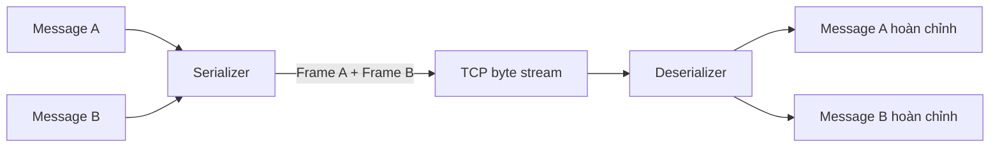
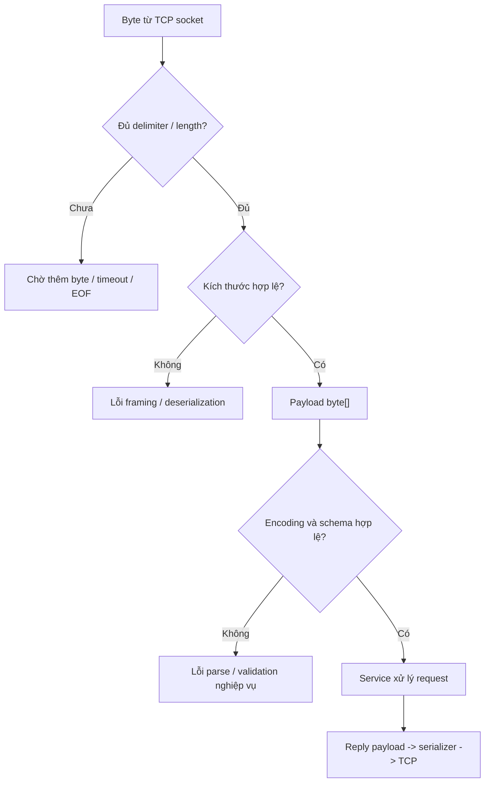

# Serializer và deserializer khung dữ liệu

> **Chương:** Adapter TCP  
> **Module:** SPRING_INTEGRATION_ADAPTERS  
> **Phạm vi:** Kết nối các hệ thống ngoài vào Spring Integration bằng inbound/outbound adapter, gateway, poller và MessageChannel. Thực hành luồng trao đổi qua file, SFTP, HTTP, JMS, AMQP, Kafka và cơ sở dữ liệu; xử lý hợp đồng message, lỗi và vòng đời kết nối.

## 1. Mục tiêu học tập

Sau bài này, bạn có thể:

- Giải thích vì sao TCP cần **đóng khung dữ liệu (framing)**, dù socket đã chuyển byte thành công.
- Phân biệt **serializer** (ghi một bản tin ra byte stream) với **deserializer** (đọc đủ byte để khôi phục một bản tin).
- Chọn hợp đồng framing phù hợp: CRLF, LF, tiền tố chiều dài (*length header*) hoặc đóng kết nối.
- Cấu hình serializer/deserializer trên TCP `ConnectionFactory` của Spring Integration.
- Xây dựng ví dụ TCP inbound gateway nhận `byte[]` và trả response có framing nhất quán.
- Viết client kiểm thử với Java `Socket`, quan sát hai frame trên một kết nối và các tình huống thiếu delimiter.
- Thiết kế giới hạn kích thước, encoding, validation, timeout, quan sát lỗi và các kiểm thử biên.

## 2. Từ byte stream đến Spring Message

TCP cung cấp một **luồng byte có thứ tự trong từng kết nối**. Giao thức này không có khái niệm "một lần `write()` bằng một message" hay "một lần `read()` trả đúng một message".

Giả sử client muốn gửi hai lệnh:

```text
PING|sensor-01
PING|sensor-02
```

Nếu không định nghĩa framing, bên nhận không thể chắc chắn chỗ nào kết thúc lệnh thứ nhất. Các lần đọc có thể mang những byte như:

```text
read #1:  PING|sen
read #2:  sor-01PING|sensor-
read #3:  02
```

Hoặc tất cả byte có thể tới trong một lần đọc. Đây là hành vi bình thường của TCP, không phải socket "làm hỏng" message.

**Framing** là quy tắc bổ sung ở tầng ứng dụng để biết *ranh giới một bản tin*:



Với Spring Integration, serializer/deserializer thường được đặt trên **TCP connection factory**. Connection factory xử lý socket, adapter/gateway làm cầu nối với `MessageChannel`, còn handler nghiệp vụ xử lý nội dung đã được tách thành message.

### 2.1. Khác nhau giữa serializer và deserializer

| Thành phần | Đầu vào | Đầu ra | Nhiệm vụ |
| --- | --- | --- | --- |
| **Serializer** | Payload, ví dụ `byte[]` chứa `PING|sensor-01` | Byte ghi ra `OutputStream` | Viết payload và cấu trúc framing theo hợp đồng. |
| **Deserializer** | Byte liên tiếp đọc từ `InputStream` | Một payload, ví dụ `byte[]` | Đọc cho tới khi đủ **một** frame và bỏ phần framing theo quy định. |
| **Parser/validator nghiệp vụ** | Payload đã deserialize | Đối tượng/lệnh hợp lệ hoặc lỗi | Kiểm tra mã lệnh, số trường, định dạng, quyền và dữ liệu đầu vào. |
| **TCP adapter/gateway** | Spring Message hoặc frame từ connection factory | Spring Message hoặc dữ liệu TCP | Điều phối hướng message, request/reply và chuyển kết quả vào flow. |

Ví dụ `ByteArrayCrLfSerializer` vừa có thể dùng để **serialize** request/reply, vừa **deserialize** request/reply theo dấu `\r\n`. Tuy nhiên, tách được một frame **không có nghĩa** frame đó là lệnh đúng schema; parser nghiệp vụ vẫn phải xử lý.

### 2.2. Framing không đồng nghĩa encoding hay schema

Ba lớp sau nên được quyết định riêng:

1. **Framing:** xác định một frame kết thúc ở đâu; ví dụ CRLF hoặc 4 byte chiều dài.
2. **Encoding:** biến chuỗi thành byte và ngược lại; ví dụ UTF-8.
3. **Schema:** quyết định payload có ý nghĩa gì; ví dụ `TEMP|sensor-01|23.5` gồm loại sự kiện, ID và giá trị.

TCP không tự biết UTF-8, JSON, CRLF, protobuf hay dấu `|`. Nếu client và server không thỏa thuận cả ba lớp, chúng có thể kết nối thành công nhưng vẫn không trao đổi được dữ liệu hợp lệ.

## 3. Bốn cách đóng khung thường gặp

| Framing | Dữ liệu trên wire (minh họa) | Ưu điểm | Giới hạn chính |
| --- | --- | --- | --- |
| **CRLF** | `PING\r\n` | Dễ kiểm tra qua terminal và giao thức text line-based. | Payload chứa CRLF phải được escape hoặc bị cấm. |
| **LF** | `PING\n` | Đơn giản với text protocol. | Payload chứa LF làm rối ranh giới. |
| **Length header** | `[length=4][PING]` | Phù hợp payload nhị phân và byte xuống dòng. | Cần định nghĩa kích thước header, byte order, đơn vị chiều dài và giới hạn. |
| **Kết thúc kết nối / EOF** | `PING` rồi đóng phía gửi | Đơn giản với giao thức một bản tin/một kết nối. | Không phù hợp kết nối dài hạn nhiều frame; EOF là sự kiện vòng đời socket. |

Các serializer thường gặp của Spring Integration TCP gồm:

- `ByteArrayCrLfSerializer`: dùng CRLF làm dấu kết thúc.
- `ByteArrayLfSerializer`: dùng LF làm dấu kết thúc.
- `ByteArrayLengthHeaderSerializer`: sử dụng phần đầu chứa độ dài payload.
- `ByteArrayRawSerializer`: dùng mô hình đọc đến cuối luồng/kết nối; chỉ phù hợp khi hợp đồng thực sự dựa vào EOF.

Chỉ dùng class có tên phù hợp là **chưa đủ**: hai phía phải thống nhất chính xác cách tạo và đọc frame. Ví dụ một bên dùng CRLF, bên kia dùng LF có thể biểu hiện như payload còn sót CR; một bên dùng length header, bên kia chờ CRLF có thể chờ mãi hoặc parse sai.

### 3.1. CRLF: phù hợp text nhưng cần kiểm soát ký tự xuống dòng

Một message logic:

```text
TEMP|sensor-01|23.5
```

Được serializer CRLF ghi lên wire như sau:

```text
TEMP|sensor-01|23.5\r\n
```

Hai ký tự `\r\n` trong phần minh họa là **hai byte kết thúc**: carriage return `0D` và line feed `0A`. Deserializer dùng chúng để trả đúng một `byte[]` gồm nội dung `TEMP|sensor-01|23.5`.

Nếu ứng dụng tự nối `\r\n` vào payload **và** serializer tiếp tục thêm `\r\n`, phía nhận có thể nhìn thấy:

```text
TEMP|sensor-01|23.5\r\n\r\n
```

Điều này tương đương một frame dữ liệu, sau đó là một frame rỗng. Quy tắc an toàn là **payload không mang delimiter cuối frame; serializer chịu trách nhiệm thêm delimiter**.

Nếu dữ liệu có ký tự CR hoặc LF hợp lệ trong nội dung, hãy định nghĩa cơ chế escape/quote được cả hai phía hiểu, hoặc chọn length header thay cho delimiter.

### 3.2. LF: không thể thay tương đương CRLF nếu giao thức khác

LF là một byte `0A`, CRLF là hai byte `0D 0A`. Đổi serializer mà không đổi parser/server có thể dẫn tới:

- Server chờ dấu CRLF nhưng client chỉ gửi LF, khiến request không hoàn chỉnh.
- Parser phía nhận giữ lại ký tự CR ở cuối nội dung nếu xử lý LF theo cách riêng.
- Các frame lỗi xuất hiện khó tái hiện nếu một nhánh dùng CRLF, nhánh khác dùng LF.

Do vậy, không chuyển CRLF ↔ LF theo sở thích. Hãy lấy lựa chọn từ **giao thức của hệ thống ngoài**.

### 3.3. Length header: xác định số byte của payload

Một giao thức length header tự thiết kế có thể quy định:

```text
4 byte đầu: chiều dài payload, số nguyên không dấu, big-endian
N byte tiếp: nội dung payload, N lấy từ header
```

Ví dụ gửi chuỗi ASCII `PING` có 4 byte:

```text
Hex: 00 00 00 04 50 49 4E 47
     | length=4 | P  I  N  G |
```

Với UTF-8, **độ dài phải tính theo số byte sau mã hóa**, không theo `String.length()`. Chuỗi `Hà Nội` có các ký tự nhiều byte: chỉ dùng số ký tự làm chiều dài có thể khiến deserializer thiếu dữ liệu hoặc cắt giữa một ký tự UTF-8.

Length header không có nghĩa mặc định mọi giao thức đều dùng 4 byte big-endian. Một hệ thống có thể dùng 1/2/4 byte, little-endian, varint, bao gồm header trong độ dài hoặc không. **Phải đọc và thực hiện đúng giao thức đã thống nhất**; ví dụ 4 byte big-endian ở trên là một hợp đồng minh họa.

Spring Integration có `ByteArrayLengthHeaderSerializer` cho kiểu framing tương ứng. Khi tích hợp với hệ thống ngoài, cần kiểm tra cấu hình header size và cách mã hóa độ dài ở đúng phiên bản thư viện.

### 3.4. EOF/raw: phân biệt ranh giới bản tin và vòng đời socket

Một giao thức có thể quy định: "gửi một message rồi đóng hướng gửi để báo hết nội dung". Khi đó việc đọc đến EOF giúp biết frame kết thúc. Nhưng đây là một **giới hạn của giao thức**, không phải khả năng mặc định của TCP.

Với kết nối cần giữ lâu để gửi nhiều bản tin, mô hình raw/EOF thường không phù hợp: nếu client không đóng connection, deserializer không có ranh giới xác định để trả message. Đồng thời việc đóng hoàn toàn socket có thể khiến chiều response không còn dùng được theo cách mong muốn.

**Không dùng raw serializer để giải quyết nhanh vấn đề thiếu delimiter** nếu giao thức thực tế cho phép nhiều bản tin trên cùng một kết nối.

## 4. Cấu hình serializer/deserializer ở ConnectionFactory

Trong Spring Integration, `TcpNetServerConnectionFactory` lắng nghe socket TCP server, còn `TcpNetClientConnectionFactory` chủ động kết nối tới host/port bên ngoài. Cả hai đều có thể cấu hình serializer và deserializer.

Ví dụ cho TCP server:

```java
import org.springframework.integration.ip.tcp.connection.TcpNetServerConnectionFactory;
import org.springframework.integration.ip.tcp.serializer.ByteArrayCrLfSerializer;

TcpNetServerConnectionFactory factory =
        new TcpNetServerConnectionFactory(9200);

ByteArrayCrLfSerializer deserializer = new ByteArrayCrLfSerializer();
deserializer.setMaxMessageSize(4096); // Giới hạn kích thước frame nhận.

ByteArrayCrLfSerializer serializer = new ByteArrayCrLfSerializer();

factory.setDeserializer(deserializer); // Byte TCP -> payload byte[]
factory.setSerializer(serializer);     // Payload byte[] -> byte TCP + CRLF
```

Ví dụ cho TCP client:

```java
import org.springframework.integration.ip.tcp.connection.TcpNetClientConnectionFactory;
import org.springframework.integration.ip.tcp.serializer.ByteArrayCrLfSerializer;

TcpNetClientConnectionFactory factory =
        new TcpNetClientConnectionFactory("127.0.0.1", 9200);

factory.setSerializer(new ByteArrayCrLfSerializer());
factory.setDeserializer(new ByteArrayCrLfSerializer());
```

Chọn serializer hay deserializer dựa vào **chiều chuyển byte**, không dựa trực tiếp vào tên inbound/outbound:

| Endpoint | Đọc từ socket qua deserializer | Ghi ra socket qua serializer |
| --- | --- | --- |
| **TCP inbound channel adapter** | Nhận frame từ bên ngoài. | Thường không có reply trực tiếp. |
| **TCP outbound channel adapter** | Thường không cần reply. | Gửi frame ra hệ thống ngoài. |
| **TCP inbound gateway** | Đọc **request**. | Ghi **reply**. |
| **TCP outbound gateway** | Đọc **reply**. | Ghi **request**. |

Với gateway request-reply, việc cấu hình **đồng bộ cả hai hướng** đặc biệt quan trọng: server có thể nhận request hoàn hảo nhưng client vẫn timeout vì reply dùng framing khác.

## 5. Ví dụ Java DSL: TCP server tách CRLF và trả response

Giả sử ứng dụng Spring Boot đóng vai TCP server tại cổng `9200`. Client gửi một dòng:

```text
STATUS|sensor-01\r\n
```

Handler trả lại:

```text
OK|sensor-01|ACTIVE\r\n
```

Tại tầng Java, handler chỉ nhận `byte[]` không có CRLF và trả `byte[]` không có CRLF. Connection factory lo đóng khung hai chiều.

### 5.1. Dependency

Với Spring Boot quản lý phiên bản qua BOM, thêm:

```xml
<dependencies>
    <dependency>
        <groupId>org.springframework.boot</groupId>
        <artifactId>spring-boot-starter-integration</artifactId>
    </dependency>
    <dependency>
        <groupId>org.springframework.integration</groupId>
        <artifactId>spring-integration-ip</artifactId>
    </dependency>
</dependencies>
```

Ví dụ hướng tới Java 17+ và kiểu Java DSL trong Spring Integration 6.x.

### 5.2. Cấu hình đầy đủ

```java
import java.nio.charset.StandardCharsets;

import org.springframework.context.annotation.Bean;
import org.springframework.context.annotation.Configuration;
import org.springframework.integration.config.EnableIntegration;
import org.springframework.integration.dsl.IntegrationFlow;
import org.springframework.integration.ip.dsl.Tcp;
import org.springframework.integration.ip.tcp.connection.TcpNetServerConnectionFactory;
import org.springframework.integration.ip.tcp.serializer.ByteArrayCrLfSerializer;

@Configuration
@EnableIntegration
public class TcpFramingConfiguration {

    @Bean
    TcpNetServerConnectionFactory tcpFramingServer() {
        var factory = new TcpNetServerConnectionFactory(9200);

        // Giới hạn dữ liệu đọc để tránh client gửi frame vô hạn.
        var inputFraming = new ByteArrayCrLfSerializer();
        inputFraming.setMaxMessageSize(4096);
        factory.setDeserializer(inputFraming);

        // Ghi reply ra TCP, serializer tự thêm CRLF.
        factory.setSerializer(new ByteArrayCrLfSerializer());

        return factory;
    }

    @Bean
    IntegrationFlow tcpFramingFlow(
            TcpNetServerConnectionFactory tcpFramingServer) {

        return IntegrationFlow
                .from(Tcp.inboundGateway(tcpFramingServer))
                .handle((payload, headers) -> {
                    byte[] input = (byte[]) payload;
                    String request = new String(
                            input, StandardCharsets.UTF_8
                    );

                    String reply = handleCommand(request);

                    return reply.getBytes(StandardCharsets.UTF_8);
                })
                .get();
    }

    private static String handleCommand(String request) {
        String[] fields = request.split("\\|", -1);

        if (fields.length != 2
                || !"STATUS".equals(fields[0])
                || !fields[1].matches("[A-Za-z0-9_-]{1,32}")) {
            return "ERR|BAD_REQUEST";
        }

        // Mô phỏng một kết quả nghiệp vụ.
        return "OK|" + fields[1] + "|ACTIVE";
    }
}
```

**Luồng xử lý:**

1. `TcpNetServerConnectionFactory` bind cổng `9200` và nhận các kết nối TCP client.
2. `ByteArrayCrLfSerializer` dùng như **deserializer**: chờ đủ CRLF, tách một frame, trả mảng byte chứa request.
3. `Tcp.inboundGateway(...)` đưa request vào Spring Integration và chờ handler tạo reply.
4. Handler giải mã UTF-8, kiểm tra schema `STATUS|<id>` và tạo chuỗi response.
5. Handler trả `byte[]` **không mang CRLF**. Serializer trên connection factory thêm CRLF khi gửi reply.
6. Client đọc một frame response; Spring gateway liên hệ reply với kết nối của request.

`setMaxMessageSize(4096)` là một giới hạn ở tầng framing cho dữ liệu **nhận** trong ví dụ. Phải kết hợp với kiểm tra độ dài và cấu trúc nghiệp vụ; nếu frame vượt giới hạn, đường nhận có thể phát sinh lỗi deserialization thay vì một request hợp lệ để handler trả `ERR|BAD_REQUEST`.

### 5.3. Client Java kiểm thử hai request trên một socket

Tạo một chương trình Java độc lập. Bắt đầu Spring Boot trước, rồi chạy client:

```java
import java.io.BufferedReader;
import java.io.BufferedWriter;
import java.io.InputStreamReader;
import java.io.OutputStreamWriter;
import java.net.InetSocketAddress;
import java.net.Socket;
import java.nio.charset.StandardCharsets;

public class TcpFramingClientDemo {

    public static void main(String[] args) throws Exception {
        try (Socket socket = new Socket()) {
            socket.connect(
                    new InetSocketAddress("127.0.0.1", 9200),
                    3000
            );
            socket.setSoTimeout(5000);

            BufferedWriter writer = new BufferedWriter(
                    new OutputStreamWriter(
                            socket.getOutputStream(),
                            StandardCharsets.UTF_8
                    )
            );
            BufferedReader reader = new BufferedReader(
                    new InputStreamReader(
                            socket.getInputStream(),
                            StandardCharsets.UTF_8
                    )
            );

            exchange(writer, reader, "STATUS|sensor-01");
            exchange(writer, reader, "UNKNOWN|sensor-01");
        }
    }

    private static void exchange(
            BufferedWriter writer,
            BufferedReader reader,
            String request
    ) throws Exception {

        // Client Java tự đóng khung bằng CRLF.
        // Không phải Spring serializer đang chạy ở đây.
        writer.write(request);
        writer.write("\r\n");
        writer.flush();

        // readLine() trả nội dung bỏ dấu xuống dòng cuối frame.
        String reply = reader.readLine();
        if (reply == null) {
            throw new IllegalStateException("TCP peer closed before reply");
        }

        System.out.println("request=" + request);
        System.out.println("reply=" + reply);
    }
}
```

Kết quả **kỳ vọng**:

```text
request=STATUS|sensor-01
reply=OK|sensor-01|ACTIVE
request=UNKNOWN|sensor-01
reply=ERR|BAD_REQUEST
```

Trong client này không có Spring Integration; vì vậy chính `BufferedWriter` thêm CRLF thủ công. Điều này **khác** với code sử dụng `ByteArrayCrLfSerializer`: khi serializer đã được cấu hình, không thêm delimiter lần nữa trong payload.

`BufferedReader.readLine()` phù hợp cho **thử nghiệm line protocol** này. Với giao thức nhị phân hoặc yêu cầu xác thực byte không được biến đổi, nên dùng `InputStream` và parser khung byte tương ứng, tránh xử lý văn bản làm mất thông tin.

### 5.4. Test dữ liệu chia thành nhiều lần ghi

Với TCP, có thể chia một request thành ba lần ghi (vẫn trên cùng socket):

```java
var output = socket.getOutputStream();

output.write("STATUS|".getBytes(StandardCharsets.UTF_8));
output.flush();

output.write("sensor-01\r".getBytes(StandardCharsets.UTF_8));
output.flush();

output.write("\n".getBytes(StandardCharsets.UTF_8));
output.flush();
```

Đây là đoạn mã thử nghiệm đặt **bên trong phạm vi có biến `socket`**. Deserializer không nên phát message khi mới nhận `STATUS|` hay dấu `\r`. Chỉ khi đã nhận đủ `\r\n`, nó mới giao một request hoàn chỉnh cho gateway.

Nếu không bao giờ gửi byte `\n` cuối, client có thể timeout khi chờ reply. Khi đó lỗi thuộc **framing chưa hoàn chỉnh**, không nhất thiết là request đã được handler nhận và từ chối.

## 6. Ví dụ khác: length header cho payload nhị phân

CRLF không phù hợp khi payload có thể chứa mọi byte, bao gồm `0D 0A`. Với length header, frame có thể chứa delimiter tùy ý vì số byte cần đọc đã được xác định bởi header.

Giả sử hợp đồng riêng của hai hệ thống là:

- Header **4 byte**, big-endian, chứa số byte của payload.
- Header **không tính** vào chiều dài payload.
- Payload là byte tùy ý, tối đa **64 KiB** trong ví dụ.
- Một TCP connection có thể chứa nhiều frame nối tiếp.
- Server sẽ trả một frame với cùng loại header nếu dùng request-reply.

### 6.1. Bật serializer length header trong ConnectionFactory

```java
import org.springframework.integration.ip.tcp.serializer.ByteArrayLengthHeaderSerializer;
import org.springframework.integration.ip.tcp.connection.TcpNetClientConnectionFactory;

TcpNetClientConnectionFactory factory =
        new TcpNetClientConnectionFactory("127.0.0.1", 9201);

// Hai chiều phải cùng framing trong giao thức request-reply.
factory.setSerializer(new ByteArrayLengthHeaderSerializer());
factory.setDeserializer(new ByteArrayLengthHeaderSerializer());
```

`ByteArrayLengthHeaderSerializer` có thể được cấu hình theo kích thước header do giao thức sử dụng; dạng no-arg minh họa cách đóng khung theo chiều dài trong thư viện. **Không dùng đoạn này để kết nối với một server khác chuẩn** khi chưa xác minh header size/byte order/giới hạn của giao thức đích.

Nếu hệ thống thật cần giới hạn cụ thể, hãy cấu hình giới hạn frame trên serializer/deserializer và kiểm tra chặt ở tầng nhận. Đừng cấp phát mảng byte chỉ dựa vào một chiều dài chưa được kiểm tra.

### 6.2. Tự đọc một frame 4-byte big-endian bằng Java

Để hình dung chính xác ý tưởng length header, phía Java socket thuần có thể đọc như sau:

```java
import java.io.DataInputStream;
import java.io.IOException;
import java.io.InputStream;

public final class FourByteFrameReader {

    private static final int MAX_FRAME_BYTES = 64 * 1024;

    public static byte[] readFrame(InputStream stream)
            throws IOException {

        DataInputStream input = new DataInputStream(stream);

        // DataInputStream.readInt() đọc số nguyên 4 byte big-endian.
        int length = input.readInt();

        if (length < 0 || length > MAX_FRAME_BYTES) {
            throw new IOException("Invalid frame length: " + length);
        }

        byte[] payload = new byte[length];
        input.readFully(payload);  // Đọc đủ, có thể qua nhiều TCP reads.
        return payload;
    }
}
```

Đoạn mã này dùng để **đọc một frame sau khi phía gửi đã bắt đầu frame**; nếu socket đóng giữa header hoặc giữa payload, `readInt()/readFully()` ném `EOFException`. Trong parser vận hành dài hạn, cần phân biệt EOF sạch giữa các frame với EOF giữa frame và áp dụng giới hạn/timeout.

### 6.3. Tự ghi một frame tương ứng

```java
import java.io.DataOutputStream;
import java.io.IOException;
import java.io.OutputStream;

public final class FourByteFrameWriter {

    private static final int MAX_FRAME_BYTES = 64 * 1024;

    public static void writeFrame(
            OutputStream stream, byte[] payload) throws IOException {

        if (payload.length > MAX_FRAME_BYTES) {
            throw new IOException("Frame too large");
        }

        DataOutputStream output = new DataOutputStream(stream);
        output.writeInt(payload.length); // 4-byte big-endian.
        output.write(payload);
        output.flush();
    }
}
```

Đây là minh họa **hợp đồng 4-byte big-endian do ta đặt ra**. Khi dùng Spring serializer ở phía còn lại, hai phía phải xác minh cách biểu diễn header thực sự trùng khớp. Đặc biệt, nếu giao thức có checksum, magic bytes hoặc version field trước length, cần triển khai toàn bộ định dạng đó; chỉ ghi length sẽ chưa đủ.

### 6.4. Vì sao không dùng String.length() làm độ dài?

```java
String value = "Hà Nội";

int characters = value.length();
int bytes = value.getBytes(StandardCharsets.UTF_8).length;

System.out.println("chars=" + characters);
System.out.println("bytes=" + bytes);
```

Hai số có thể khác nhau do UTF-8 dùng nhiều byte cho một số ký tự. Với framing theo độ dài, header phải mô tả **số byte thực tế được serialize**; nếu không, bên nhận có thể đọc thiếu hoặc dư và frame kế tiếp sẽ mất đồng bộ.

## 7. Lỗi framing khác lỗi nội dung nghiệp vụ

Một frame cần đi qua nhiều lớp:



| Hiện tượng | Loại lỗi | Hướng xử lý |
| --- | --- | --- |
| Gửi dữ liệu nhưng server chưa gọi handler. | Thiếu delimiter, header length sai hoặc frame chưa đủ byte. | Kiểm tra framing, log socket, thử chia/ghép frame. |
| Một request thành hai message. | Delimiter xuất hiện trong payload hoặc bị thêm hai lần. | Escape chính xác hoặc chuyển length header. |
| Frame quá dài bị từ chối trước handler. | Lỗi kích thước tại deserializer. | Chọn giới hạn hợp lý, ghi sự kiện và xử lý kết nối theo chính sách. |
| Byte frame đầy đủ nhưng UTF-8 lỗi. | Lỗi encoding/schema. | Dùng UTF-8 decoder có chính sách báo lỗi, từ chối payload. |
| `TEMP|sensor-01|abc` với framing CRLF đúng. | Lỗi nghiệp vụ (giá trị không phải số). | Trả mã lỗi nghiệp vụ qua gateway nếu contract cho phép. |
| TCP client chờ mãi dù handler đã tạo reply. | Serializer reply khác framing mà client mong đợi. | Kiểm tra cấu hình ghi reply và parser client. |
| Server đóng socket khi client còn chờ frame. | Lỗi kết nối hoặc kết thúc frame chưa hoàn chỉnh. | Kiểm tra EOF/timeout, reconnect và idempotency nếu gửi lại. |

### 7.1. Đọc UTF-8 nghiêm ngặt khi cần

`new String(bytes, StandardCharsets.UTF_8)` thuận tiện để demo nhưng Java có thể **thay thế byte UTF-8 không hợp lệ bằng ký tự thay thế** thay vì báo lỗi rõ. Nếu giao thức yêu cầu kiểm tra byte chính xác, dùng decoder với `CodingErrorAction.REPORT`:

```java
import java.nio.ByteBuffer;
import java.nio.charset.CodingErrorAction;
import java.nio.charset.StandardCharsets;

String decodeStrictUtf8(byte[] bytes) throws Exception {
    var decoder = StandardCharsets.UTF_8.newDecoder()
            .onMalformedInput(CodingErrorAction.REPORT)
            .onUnmappableCharacter(CodingErrorAction.REPORT);

    return decoder.decode(ByteBuffer.wrap(bytes)).toString();
}
```

Lớp **framing** vẫn làm việc với byte; decoder này nằm ở lớp chuyển byte sang text. Không dùng giải mã UTF-8 để tìm delimiter của giao thức nhị phân trước khi xác định đủ frame.

### 7.2. Error channel không tự sửa frame lỗi

Một frame **chưa hoàn chỉnh** có thể không bao giờ trở thành Spring Message. Lỗi deserializer xảy ra ở tầng connection, khác với exception khi handler xử lý message. Vì thế không nên giả định chỉ cần cấu hình `errorChannel` là mọi lỗi wire-level sẽ đi qua cùng nhánh lỗi nghiệp vụ.

Cần quan sát **sự kiện/lỗi kết nối**, timeout, deserialization exception và lỗi ở message flow theo đúng cơ chế của phiên bản Spring Integration. Nếu TCP client cần một response lỗi cho request đã nhận đầy đủ, handler hoặc gateway phải tạo response hợp lệ. Với frame hỏng đến mức không đọc được request, chính sách xử lý có thể là ghi log và đóng/reset kết nối.

## 8. Kích thước, timeout và an toàn tài nguyên

### 8.1. Tại sao frame không giới hạn là nguy hiểm?

Client ác ý hoặc bị lỗi có thể:

- Gửi liên tục hàng chục MB nhưng không bao giờ gửi CRLF.
- Gửi length header tuyên bố payload cực lớn, khiến server cố cấp phát mảng quá mức.
- Gửi chỉ vài byte header rồi dừng, giữ socket ở trạng thái chờ.
- Gửi nhiều frame liên tục nhanh hơn khả năng handler xử lý.

Các lớp bảo vệ nên phối hợp:

1. **Giới hạn frame** trong serializer/deserializer và trước khi cấp phát bộ nhớ.
2. **Timeout đọc**/hạn chờ hoàn thành frame, phù hợp hành vi client thực tế.
3. **Giới hạn số kết nối** và thread/queue xử lý, nhất là với hệ thống có nhiều client.
4. **Validation schema**: loại lệnh, số trường, độ dài ID, giá trị số và quyền truy cập.
5. **Backpressure**/rate limit ở nơi phù hợp khi upstream nhanh hơn downstream.
6. **Metrics và log có kiểm soát** cho frame bị từ chối hoặc socket không hoàn chỉnh.

Một giới hạn byte không tự đảm bảo mọi request hợp lệ. Frame kích thước nhỏ vẫn có thể chứa lệnh không được phép hoặc dữ liệu gây lỗi nghiệp vụ.

### 8.2. Timeout là triệu chứng, không phải bằng chứng thất bại nghiệp vụ

Với inbound/outbound **gateway**, một request có thể đã tới server, được xử lý, nhưng reply bị mất khi kết nối ngắt. Nếu caller timeout và retry, server có thể nhận request lần nữa.

Đối với lệnh có tác dụng phụ (ví dụ tạo đơn, ghi tiền, điều khiển thiết bị), phải dùng:

- Request ID ổn định qua các lần retry.
- Correlation trong reply nếu giao thức cần.
- Idempotency ở server, lưu kết quả đã xử lý.
- Quy tắc retry có giới hạn/backoff và đối soát trường hợp kết quả chưa rõ.

**Framing đúng không cung cấp exactly-once processing.** Serializer bảo đảm cấu trúc byte theo hợp đồng; việc nghiệp vụ có được thực hiện một hay nhiều lần phải được thiết kế ở tầng cao hơn.

### 8.3. TLS và framing

TLS mã hóa và bảo vệ luồng byte TCP, nhưng **không thay thế framing ứng dụng**. Sau khi giải mã TLS, ứng dụng vẫn cần CRLF/length header hoặc quy tắc tương đương để nhận biết request/reply.

Vì vậy với kết nối cần bảo mật: cấu hình TLS/xác thực phía kết nối, đồng thời giữ đúng serializer/deserializer và kiểm tra schema ở tầng message.

## 9. Checklist kiểm thử serializer/deserializer

Một bài kiểm thử framing tốt phải kiểm tra **ranh giới byte**, không chỉ một request đẹp:

| Trường hợp | Điều phải chứng minh |
| --- | --- |
| Một frame hợp lệ | Deserializer phát đúng một message với payload chính xác. |
| Hai frame trong **một lần** client ghi | Hai message được tách riêng; không dính payload. |
| Một frame chia thành nhiều lần client ghi | Chỉ phát message khi đủ delimiter hoặc đủ length. |
| Delimiter CRLF bị chia (`\r` và `\n` tới riêng) | Vẫn nhận ra đúng ranh giới. |
| CRLF xuất hiện trong payload | Giao thức có escape rõ ràng hoặc từ chối; không vô tình cắt message. |
| Payload UTF-8 đa byte | Không cắt giữa byte của ký tự; length dùng số byte. |
| Length = 0, âm hoặc lớn hơn max | Quy tắc chấp nhận/từ chối tường minh và an toàn tài nguyên. |
| Frame thiếu phần cuối rồi client đóng kết nối | Lỗi EOF/timeout được quan sát, không coi là request hợp lệ. |
| Reply của gateway thiếu delimiter | Client xử lý timeout hoặc protocol error theo hợp đồng. |
| Client reconnect sau frame hỏng | Kết nối mới bắt đầu đúng trạng thái, không trộn byte cũ. |

Thử nghiệm thêm trong môi trường gần thực tế: nhiều client đồng thời, server tải cao, kết nối chập chờn, idle timeout, payload lớn và số frame gửi liên tiếp tăng nhanh.

### 9.1. Cách tự kiểm tra wire format

Khi cần chẩn đoán một frame, hãy ghi nhận **kích thước byte**, phần prefix/suffix dạng hex và thời gian gửi/nhận. Ví dụ request `PING` có CRLF phải kết thúc bằng:

```text
50 49 4E 47 0D 0A
P  I  N  G  CR LF
```

Không in toàn bộ dữ liệu nhạy cảm lên log; chỉ ghi đủ dấu hiệu để xác định thiếu delimiter, sai encoding hoặc sai chiều dài. Nếu server dùng length header, quan sát chính xác số byte header và đối chiếu với số byte payload.

## 10. Những lỗi thiết kế thường gặp

| Sai lầm | Hậu quả | Cách sửa |
| --- | --- | --- |
| Nghĩ rằng một lần `write()` tương đương một message. | Message bị ghép, thiếu hoặc cắt. | Định nghĩa và dùng framing. |
| Trộn CRLF và LF tùy endpoint. | Reply timeout, CR dư trong payload. | Dùng cùng contract ở cả hai phía. |
| Tự thêm CRLF khi đã dùng `ByteArrayCrLfSerializer`. | Frame rỗng hoặc extra delimiter. | Chỉ serialize nội dung logic. |
| Chọn length header nhưng tính `String.length()`. | Sai ranh giới khi UTF-8 nhiều byte. | Đếm `byte[].length` sau encoding. |
| Tin length trong header mà không giới hạn. | OOM hoặc bị giữ socket bởi frame lớn. | Kiểm tra length trước khi allocate/read. |
| Dùng raw/EOF trên kết nối dài hạn nhiều message. | Deserializer không biết khi nào một frame kết thúc. | Dùng delimiter hoặc length header. |
| Cho parser nghiệp vụ xử lý byte chưa đủ frame. | Dữ liệu lỗi và logic phụ thuộc socket. | Phân tách framing với validation. |
| Chỉ cấu hình serializer request, bỏ quên deserializer reply. | Gateway gửi được nhưng không nhận reply hợp lệ. | Cấu hình/kiểm thử hai chiều. |
| Coi timeout là request chưa được xử lý. | Retry tạo nghiệp vụ trùng lặp. | Request ID, idempotency, ACK và đối soát. |
| Dùng cùng một factory cho nhiều luồng có framing mâu thuẫn. | Byte của các luồng vi phạm hợp đồng kết nối. | Tách connection factory hoặc thống nhất giao thức. |

## 11. Bài tập thực hành

**Bài 1 — Thử phân đoạn TCP.** Dùng client gửi `STATUS|sensor-01\r\n` thành ba lần ghi. Ghi lại lúc nào handler chạy. Đổi thứ tự chia ở các điểm khác nhau, kể cả giữa `\r` và `\n`.

**Bài 2 — Gửi hai request trong một lần ghi.** Dùng `OutputStream.write()` gửi `STATUS|sensor-01\r\nSTATUS|sensor-02\r\n` trên một kết nối. Với mỗi request, kiểm tra gateway tạo đúng một reply tương ứng. Nếu dùng gateway request-reply, điều chỉnh client theo hợp đồng xử lý tuần tự hoặc kiểm soát tương quan response.

**Bài 3 — Lỗi frame và lỗi nghiệp vụ.** So sánh `STATUS|sensor-01` **không có CRLF** với `STATUS||\r\n` và `UNKNOWN|sensor-01\r\n`. Dự đoán request nào được deserializer phát thành message, request nào bị handler từ chối và vì sao.

**Bài 4 — Chuyển sang length header.** Thiết kế protocol dùng 4-byte big-endian, payload có thể chứa `\r\n` và Unicode. Viết client Java tương ứng, kiểm thử frame chứa `0D 0A` trong payload và frame vượt 64 KiB. Nêu rõ length có bao gồm header hay không.

**Bài 5 — Từ chối UTF-8 lỗi.** Tạo payload chứa một chuỗi byte không hợp lệ theo UTF-8. Kiểm tra sự khác nhau giữa `new String(...)` và `CharsetDecoder` dùng `CodingErrorAction.REPORT`.

**Bài 6 — Lỗi reply.** Dùng TCP server giả lập chỉ gửi một nửa frame reply rồi giữ socket mở. Đặt timeout và ghi nhận exception phía client. Giải thích vì sao không được suy ra lệnh phía server chắc chắn chưa được xử lý.

## 12. Tự kiểm tra kiến thức

1. Vì sao TCP cần framing dù đã bảo đảm byte không bị đảo thứ tự trong cùng kết nối?
2. Serializer và deserializer khác nhau ở chiều dữ liệu và công việc gì?
3. Có thể dùng `ByteArrayCrLfSerializer` cho payload chứa `\r\n` tự do không? Điều kiện nào phải có?
4. Nếu dùng TCP inbound gateway, thành phần nào phân tách request và thành phần nào đóng khung reply?
5. Vì sao code dùng Spring serializer không tự nối `\r\n`, còn Java `BufferedWriter` trong ví dụ phải nối?
6. Length header nên chứa số ký tự Java hay số byte sau encoding?
7. Khi length header tuyên bố kích thước lớn bất thường, vì sao phải kiểm tra trước khi cấp phát mảng?
8. Một frame hoàn chỉnh `TEMP|sensor-01|abc\r\n` là lỗi deserializer hay lỗi validation nghiệp vụ?
9. Khi client không nhận được reply, có thể kết luận server chưa xử lý yêu cầu không?
10. TLS có tự tạo ranh giới message cho Spring Integration TCP hay không?

**Gợi ý:** (1) TCP là byte stream, không có message boundary. (2) Serializer viết payload và framing; deserializer đọc đủ frame để trả payload. (3) Không, trừ khi có escape/encoding thống nhất hoặc dùng framing khác. (4) Deserializer ở connection factory đọc request, serializer ghi reply. (5) Spring serializer tự thêm CRLF; Java client thuần phải tuân thủ contract. (6) Số byte. (7) Để tránh cạn bộ nhớ và từ chối frame sai. (8) Lỗi validation nghiệp vụ. (9) Không; reply có thể bị mất sau khi server đã xử lý. (10) Không, TLS bảo vệ byte stream chứ không thay framing ứng dụng.

**Điểm cần nhớ:** Trong Spring Integration TCP, **serializer và deserializer là hai đầu của hợp đồng framing**, giúp chuyển byte stream của socket thành từng Spring Message có ranh giới rõ ràng. Hãy thiết kế **framing, encoding, schema, kích thước tối đa, timeout và xử lý lỗi** cùng nhau. Adapter/gateway chỉ hoạt động ổn định khi mọi phía tuân thủ đúng quy ước byte trên kết nối.
