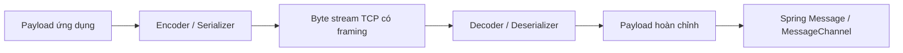
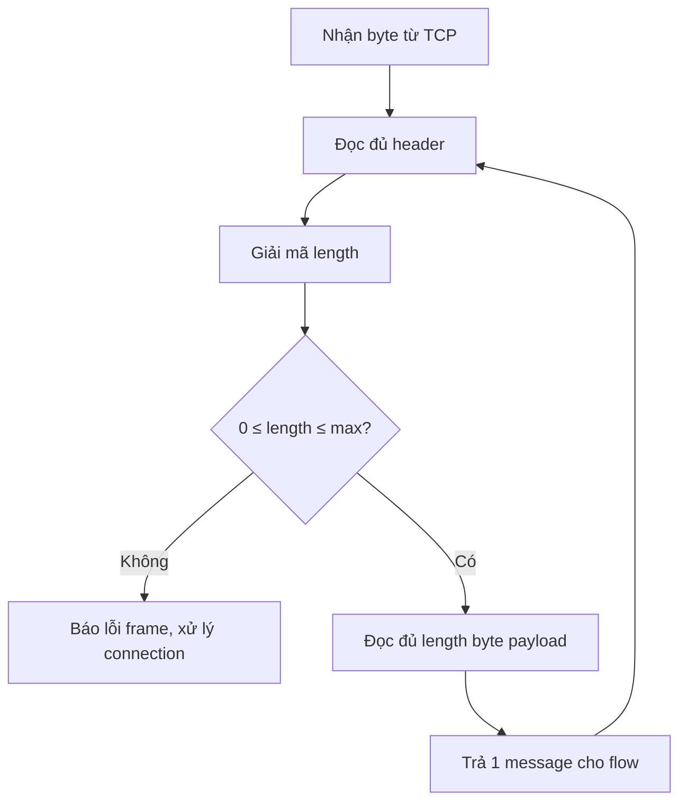

# Length header và delimiter codec

> **Chương:** Adapter TCP  
> **Module:** SPRING_INTEGRATION_ADAPTERS  
> **Phạm vi:** Kết nối các hệ thống ngoài vào Spring Integration bằng inbound/outbound adapter, gateway, poller và MessageChannel. Thực hành luồng trao đổi qua file, SFTP, HTTP, JMS, AMQP, Kafka và cơ sở dữ liệu; xử lý hợp đồng message, lỗi và vòng đời kết nối.

## 1. Mục tiêu học tập

Sau bài này, bạn có thể:

- Giải thích vì sao **TCP byte stream** phải có quy ước phân tách bản tin và vai trò của **codec** trong Spring Integration.
- Mô tả chính xác định dạng **length header** 1, 2, 4 byte; tính **độ dài theo byte**, phân biệt header tính/không tính vào length.
- Mô tả các cách **delimiter framing**: CRLF, LF, ký tự kết thúc tùy chọn và cặp STX/ETX.
- Chọn length header hoặc delimiter dựa trên **hợp đồng wire format**, khả năng chứa byte nhị phân, chi phí đọc và tương thích hệ thống ngoài.
- Cấu hình `ByteArrayLengthHeaderSerializer`, `ByteArrayCrLfSerializer` hoặc `TcpCodecs` tại `TcpNetServerConnectionFactory` và `TcpNetClientConnectionFactory`.
- Chạy thử **request-reply** với một frame nhị phân chứa byte CRLF và kiểm chứng rằng payload không bị cắt.
- Thiết kế giới hạn frame, timeout, xử lý EOF, kiểm tra protocol và các trường hợp kiểm thử phân đoạn dữ liệu.

## 2. Vấn đề cốt lõi: TCP không có khái niệm "một message"

TCP truyền một chuỗi byte có thứ tự trên từng kết nối. Hai lời gọi `write()` của client **không** tương ứng chắc chắn với hai lần `read()` của server. Một thông điệp có thể bị chia thành nhiều đoạn; nhiều thông điệp cũng có thể đi chung một lần đọc.

Giả sử ứng dụng muốn gửi hai payload:

```text
PAYLOAD A: PING
PAYLOAD B: PONG
```

Nếu đặt sát nhau trên socket, byte stream là:

```text
50 49 4E 47 50 4F 4E 47
 P  I  N  G  P  O  N  G
```

Không có thông tin nào trong dãy byte trên để server tự biết ranh giới `PING` và `PONG`. Ta cần thêm một **quy tắc đóng khung (framing)**.

Hai nhóm quy tắc phổ biến:

1. **Length header / length prefix:** gửi số byte của payload ở đầu frame; bộ nhận đọc header trước rồi đọc đúng số byte tương ứng.
2. **Delimiter / terminator:** đặt byte hoặc chuỗi byte đánh dấu kết thúc (đôi khi cả bắt đầu) frame; bộ nhận tìm dấu phân cách và tách nội dung.



Trong Spring Integration TCP, **serializer** và **deserializer** được cấu hình trên connection factory. Adapter hoặc gateway dùng connection factory để gửi/nhận byte; phần handler xử lý payload nghiệp vụ sau khi khung đã hợp lệ.

> **Phạm vi từ "codec":** Trong bài này, codec là bộ quy tắc và mã **encode/decode frame**. Spring Integration cung cấp các class serializer/deserializer cùng tiện ích `TcpCodecs`. Khái niệm codec cũng xuất hiện ở thư viện mạng khác, nhưng tên class và cách cấu hình có thể khác; không sử dụng API codec của framework khác thay trực tiếp cho Spring Integration TCP.

## 3. Cấu trúc frame: header và delimiter

### 3.1. So sánh cùng một payload

Payload `PING` có bốn byte ASCII:

```text
50 49 4E 47
```

Nếu dùng **length header 4 byte**, header là độ dài 4 ở network byte order:

```text
00 00 00 04 | 50 49 4E 47
  length=4  |  P  I  N  G
```

Nếu dùng **CRLF delimiter**, frame là:

```text
50 49 4E 47 | 0D 0A
 P  I  N  G | CR LF
```

Cả hai cách cho phép nối tiếp nhiều frame trên cùng kết nối:

```text
Length header:
[00 00 00 04][PING][00 00 00 04][PONG]

CRLF delimiter:
[PING][0D 0A][PONG][0D 0A]
```

**Ranh giới frame nằm ở byte trên wire**, không nằm ở cách TCP chia packet. Dù kernel chia frame thành bao nhiêu đoạn khi truyền, decoder vẫn phải khôi phục đúng từng payload.

### 3.2. Ba lớp cần tách biệt

| Lớp | Câu hỏi | Ví dụ |
| --- | --- | --- |
| **Framing** | Một frame bắt đầu và kết thúc ở đâu? | Header `00 00 00 04` hoặc CRLF `0D 0A`. |
| **Encoding** | Đối tượng/chuỗi được đổi ra byte thế nào? | UTF-8, nhị phân tùy ý. |
| **Schema** | Payload có ý nghĩa gì và có hợp lệ không? | `STATUS|sensor-01` hoặc JSON/Protobuf. |

Frame có độ dài hợp lệ vẫn có thể chứa JSON lỗi, mã lệnh không hỗ trợ hoặc người dùng không đủ quyền. **Deserializer không thay thế parser/validator nghiệp vụ.**

## 4. Length header: đọc chính xác số byte

### 4.1. Thuật toán

Giao thức length header gồm:

```text
+---------------------+-----------------------------+
| Header chứa length  | Payload gồm length byte     |
+---------------------+-----------------------------+
      1 / 2 / 4 B              N byte
```

Bộ ghi (*serializer*) thực hiện:

1. Chuyển nội dung thành `byte[]`.
2. Kiểm tra kích thước payload hợp lệ.
3. Ghi header chứa số byte theo hợp đồng.
4. Ghi đúng payload.

Bộ đọc (*deserializer*) thực hiện:

1. Đọc **đủ** số byte header; nếu chưa đủ thì tiếp tục chờ, không đoán length.
2. Giải mã length theo byte order và kích thước header.
3. Từ chối length không hợp lệ hoặc vượt giới hạn.
4. Đọc **đủ** `length` byte payload, dù phải qua nhiều lần đọc socket.
5. Trả đúng một `byte[]` cho adapter/gateway; lặp lại với frame kế tiếp.



Ở một giao thức cho phép frame rỗng, length bằng 0 có thể hợp lệ. Nếu không cho phép, ứng dụng phải quy định từ chối ở tầng protocol. Giới hạn `max` là giới hạn nghiệp vụ/vận hành đặt thấp hơn sức chứa tối đa của kiểu header.

### 4.2. Header 1, 2 và 4 byte

Spring Integration hỗ trợ `ByteArrayLengthHeaderSerializer` với ba kích thước header:

| Kích thước | Cách hiểu | Phạm vi tối đa của trường length* | Phù hợp |
| --- | --- | --- | --- |
| **1 byte** | Số nguyên không dấu, `0x00` đến `0xFF` | `0..255` | Thông điệp rất nhỏ, giao thức legacy. |
| **2 byte** | Số nguyên không dấu, big-endian | `0..65.535` | Frame cỡ vài chục KiB. |
| **4 byte (mặc định)** | Số nguyên có dấu `int`, big-endian | `0..2.147.483.647` | Frame lớn và tích hợp TCP tổng quát. |

\* Đây là **khả năng biểu diễn của header**, không phải mức giới hạn an toàn để cấp phát bộ nhớ. Luôn đặt `maxMessageSize` thấp hơn nhiều theo yêu cầu thực tế. Với length **inclusive** (bao gồm header), giới hạn payload còn giảm theo số byte header.

**Big-endian / network byte order** nghĩa là byte có trọng số lớn đứng trước. Ví dụ độ dài `258` (hex `0x0102`):

```text
Header 2 byte: 01 02
Header 4 byte: 00 00 01 02
```

Nếu bên gửi viết little-endian trong khi bên nhận đọc big-endian, length sẽ sai; decoder có thể chờ quá nhiều byte hoặc từ chối frame lớn bất thường.

### 4.3. Byte length và UTF-8

Một lỗi phổ biến là dùng `String.length()` để ghi length header. Java đếm đơn vị UTF-16; TCP serializer cần **số byte thực tế**.

```java
import java.nio.charset.StandardCharsets;

String text = "cà phê";

int javaUnits = text.length();  // 6 đơn vị UTF-16.
byte[] bytes = text.getBytes(StandardCharsets.UTF_8);
int wireLength = bytes.length;   // 8 byte UTF-8.

System.out.println("units=" + javaUnits);
System.out.println("bytes=" + wireLength);
```

Với length header, hãy ghi `bytes.length`. Nếu ghi `javaUnits`, decoder có thể cắt giữa ký tự UTF-8 và đọc lệch frame tiếp theo.

Với payload nhị phân, hãy giữ nguyên `byte[]`; không vòng qua `String` nếu protocol không quy định bảng mã văn bản.

### 4.4. Inclusive hay exclusive length?

Mặc định `ByteArrayLengthHeaderSerializer` ghi length bằng **số byte payload**, **không** tính header. Spring Integration cũng hỗ trợ cấu hình `inclusive` để length bao gồm cả phần header.

Payload `PING` có 4 byte; header 4 byte:

| Quy tắc | Giá trị trong header | Frame trên wire |
| --- | --- | --- |
| **Exclusive** (mặc định) | `4` | `00 00 00 04 50 49 4E 47` |
| **Inclusive** | `8 = 4 + 4` | `00 00 00 08 50 49 4E 47` |

Ví dụ cấu hình inclusive:

```java
import org.springframework.integration.ip.tcp.serializer.ByteArrayLengthHeaderSerializer;

var encoder = new ByteArrayLengthHeaderSerializer();
encoder.setInclusive(true);

var decoder = new ByteArrayLengthHeaderSerializer();
decoder.setInclusive(true);

// Gắn encoder/decoder tương ứng vào connection factory.
```

**Bên gửi và bên nhận phải thống nhất inclusive/exclusive**. Nếu không, decoder có thể đọc thiếu, đọc quá vào frame sau hoặc chờ vô hạn. Đừng giả định giao thức có từ "length" thì tự động áp dụng cùng quy ước.

### 4.5. Hai frame nhị phân dính sát nhau

Payload thứ nhất: `41 0D 0A 42` (ký tự `A`, CR, LF, `B`). Payload thứ hai: `00 FF`.

```text
00 00 00 04 | 41 0D 0A 42 | 00 00 00 02 | 00 FF
  length=4   |  payload 1  |   length=2   | payload 2
```

Deserializer đọc đúng 4 byte đầu, trả `41 0D 0A 42`, sau đó đọc header `00 00 00 02` và trả `00 FF`. Các byte `0D 0A` trong payload **không được xem là kết thúc frame**, vì giao thức dùng length.

Đây là ưu điểm rất lớn khi chuyển dữ liệu nhị phân, nén, mã hóa hoặc text có xuống dòng tùy ý.

## 5. Delimiter codec: tìm điểm kết thúc

### 5.1. Các delimiter hỗ trợ trong Spring Integration

| Serializer/codec | Dấu phân cách | Dùng khi nào |
| --- | --- | --- |
| `ByteArrayCrLfSerializer` / `TcpCodecs.crlf()` | `0D 0A` ở cuối frame | Text protocol dùng CRLF. |
| `ByteArrayLfSerializer` / `TcpCodecs.lf()` | `0A` ở cuối frame | Text protocol line-based dùng LF. |
| `ByteArraySingleTerminatorSerializer` / `TcpCodecs.singleTerminator(byte)` | Một byte tùy chọn (mặc định của class là `0x00`) | Giao thức dùng NUL/byte terminator. |
| `ByteArrayStxEtxSerializer` / `TcpCodecs.stxetx()` | `STX=0x02` đầu frame, `ETX=0x03` cuối frame | Giao thức text có ký hiệu mở/đóng frame. |

Khi cấu hình delimiter, encoder thường ghi payload cùng dấu kết thúc; decoder đọc tới dấu kết thúc và trả nội dung **không gồm byte delimiter**. Với STX/ETX, protocol có thêm marker bắt đầu frame. Những biến thể này phục vụ **wire protocol cụ thể**, không thể hoán đổi tùy ý.

Lưu ý: `TcpCodecs` là **factory tiện ích tạo serializer/deserializer**, không phải một TCP endpoint độc lập. Codec thực tế vẫn phải được gắn vào `TcpNetServerConnectionFactory` hoặc `TcpNetClientConnectionFactory`.

### 5.2. CRLF khác LF ở byte

`PING` dưới hai hợp đồng:

```text
CRLF: 50 49 4E 47 0D 0A
LF:   50 49 4E 47 0A
```

Khi client chỉ gửi LF mà server chờ CRLF, server có thể không bao giờ hoàn thành frame. Ngược lại, decoder kiểu LF có thể cho ra payload với byte CR còn sót, tùy codec/phía nhận.

**Quy ước phải trùng chính xác đến từng byte**, kể cả thứ tự và số byte delimiter. Chỉ nhìn chuỗi in ra terminal là chưa đủ, vì nhiều terminal tự chuyển đổi kiểu xuống dòng.

### 5.3. Rủi ro delimiter nằm trong payload

Giả sử dùng CRLF nhưng payload có nội dung:

```text
NOTE|line1\r\nline2
```

Encoder tiếp tục nối CRLF vào cuối. Decoder sẽ tách thành **hai frame**, mặc dù ứng dụng tưởng đang gửi một ghi chú nhiều dòng.

Hướng giải quyết:

- **Cấm** CRLF trong payload và validation trước khi gửi.
- **Escape/quote** delimiter theo quy tắc được định nghĩa chặt (và unescape sau khi decode).
- **Đổi sang length header** nếu payload được phép chứa byte bất kỳ.

Không tự giả định các serializer delimiter có cơ chế escaping dữ liệu ứng dụng; chúng cần phù hợp đúng hợp đồng của peer.

### 5.4. Hạn chế với text/nội dung nhị phân

Delimiter codec phải quan sát từng byte cho đến khi gặp terminator. Với frame dài, quá trình tìm terminator cần quét dữ liệu đầu vào; length header đọc được độ dài ngay từ đầu và biết số byte cần lấy.

Ngược lại, delimiter có thể **rất thuận tiện** khi tích hợp giao thức dòng văn bản hoặc sử dụng tool đơn giản. Quyết định phù hợp phụ thuộc vào tính chất payload và hệ thống hiện có, không chỉ dựa trên hiệu năng.

## 6. Cấu hình Spring Integration: length header

Ví dụ sau xây dựng **TCP server echo nhị phân** tại cổng `9301`:

- Client gửi một frame với **header 4 byte big-endian, exclusive**.
- Payload có thể chứa `00`, `0D 0A` hoặc các byte không phải UTF-8.
- Server trả lại **đúng payload đã nhận** trong một frame cùng định dạng.
- Giới hạn payload nhận là **64 KiB**.
- Một lượt TCP gateway có request và reply; ứng dụng nghiệp vụ không cần đọc socket trực tiếp.

### 6.1. Dependency Maven

Dùng Spring Boot BOM để quản lý phiên bản và thêm:

```xml
<dependencies>
    <dependency>
        <groupId>org.springframework.boot</groupId>
        <artifactId>spring-boot-starter-integration</artifactId>
    </dependency>
    <dependency>
        <groupId>org.springframework.integration</groupId>
        <artifactId>spring-integration-ip</artifactId>
    </dependency>
</dependencies>
```

Ví dụ hướng tới **Spring Integration 6.x và Java 17+**.

### 6.2. TCP server dùng `TcpCodecs.lengthHeader4`

```java
import org.springframework.context.annotation.Bean;
import org.springframework.context.annotation.Configuration;
import org.springframework.integration.config.EnableIntegration;
import org.springframework.integration.dsl.IntegrationFlow;
import org.springframework.integration.ip.dsl.Tcp;
import org.springframework.integration.ip.tcp.connection.TcpNetServerConnectionFactory;
import org.springframework.integration.ip.tcp.serializer.TcpCodecs;

@Configuration
@EnableIntegration
public class BinaryTcpFramingConfiguration {

    private static final int MAX_FRAME_BYTES = 64 * 1024;

    @Bean
    TcpNetServerConnectionFactory binaryTcpServerFactory() {
        var factory = new TcpNetServerConnectionFactory(9301);

        // Decoder: 4-byte big-endian length, tối đa 64 KiB payload.
        factory.setDeserializer(TcpCodecs.lengthHeader4(MAX_FRAME_BYTES));

        // Encoder: ghi length + payload, mặc định exclusive.
        factory.setSerializer(TcpCodecs.lengthHeader4());

        return factory;
    }

    @Bean
    IntegrationFlow binaryEchoFlow(
            TcpNetServerConnectionFactory binaryTcpServerFactory) {

        return IntegrationFlow
                .from(Tcp.inboundGateway(binaryTcpServerFactory))
                .handle((payload, headers) -> {
                    // ByteArrayLengthHeaderSerializer trả byte[] thuần.
                    byte[] bytes = (byte[]) payload;

                    // Echo đúng byte, không chuyển qua String.
                    return bytes;
                })
                .get();
    }
}
```

**Diễn giải:**

1. `TcpNetServerConnectionFactory` chịu trách nhiệm lắng nghe cổng `9301`, nhận kết nối và quản lý socket.
2. `TcpCodecs.lengthHeader4(MAX_FRAME_BYTES)` tạo deserializer nhận các frame có header 4 byte và giới hạn kích thước.
3. `TcpCodecs.lengthHeader4()` tạo serializer ghi header 4 byte; mặc định **không** cộng chiều dài header vào trường length.
4. `Tcp.inboundGateway(...)` đưa request đã decode vào `IntegrationFlow` và gửi reply tương ứng trở lại TCP client.
5. Handler chỉ nhận/trả `byte[]`. Nó không cắt frame, không tính length và không thêm CRLF.

Trong ví dụ, TCP server **không giới hạn bind address về loopback** chỉ vì client sẽ sử dụng `127.0.0.1`. Khi triển khai thật, nên ràng buộc cổng/địa chỉ bằng cấu hình hạ tầng và chính sách bảo mật phù hợp.

### 6.3. TCP client Java thuần kiểm tra dữ liệu nhị phân

Không cần thêm thư viện để thử bên ngoài Spring Integration. Chạy server Spring Boot trước rồi chạy class Java sau:

```java
import java.io.DataInputStream;
import java.io.DataOutputStream;
import java.io.IOException;
import java.net.InetSocketAddress;
import java.net.Socket;
import java.util.Arrays;

public class LengthHeaderClientDemo {

    private static final int MAX_FRAME_BYTES = 64 * 1024;

    public static void main(String[] args) throws Exception {
        // Payload cố tình có CRLF, NUL và byte FF.
        byte[] request = {
                0x41, 0x0D, 0x0A, 0x00, (byte) 0xFF
        };

        try (Socket socket = new Socket()) {
            socket.connect(new InetSocketAddress("127.0.0.1", 9301), 3000);
            socket.setSoTimeout(5000);

            DataOutputStream output =
                    new DataOutputStream(socket.getOutputStream());
            DataInputStream input =
                    new DataInputStream(socket.getInputStream());

            // writeInt: 4 byte big-endian; length không tính header.
            output.writeInt(request.length);
            output.write(request);
            output.flush();

            // Đọc đủ header reply, không dựa vào một lần read().
            int length = input.readInt();
            if (length < 0 || length > MAX_FRAME_BYTES) {
                throw new IOException("Invalid reply frame length: " + length);
            }

            byte[] reply = new byte[length];
            input.readFully(reply);

            System.out.println("Equal bytes: " +
                    Arrays.equals(request, reply));
            System.out.println("Reply length: " + reply.length);
        }
    }
}
```

Kết quả **kỳ vọng**:

```text
Equal bytes: true
Reply length: 5
```

Frame request thực tế trên wire có dạng:

```text
00 00 00 05 | 41 0D 0A 00 FF
 length = 5 |    payload
```

Nếu dùng CRLF delimiter cho payload này mà không có escape, byte `0D 0A` bên trong sẽ bị hiểu sai thành kết thúc frame. Với length header, payload được giữ nguyên **bao gồm CRLF, NUL và 0xFF**.

`DataInputStream.readFully()` đọc cho đến khi đủ số byte hoặc gặp EOF/lỗi. Điều này phù hợp vì dữ liệu TCP có thể đến thành nhiều phần. Nếu server đóng socket giữa frame, cần xem đây là frame chưa hoàn chỉnh, không được trả một message ngắn hơn length.

### 6.4. Thay client factory để gửi ra ngoài

Nếu **ứng dụng Spring Integration là TCP client** và phía ngoài là server nhận length header, có thể đặt codec tại client factory:

```java
import org.springframework.integration.ip.tcp.connection.TcpNetClientConnectionFactory;
import org.springframework.integration.ip.tcp.serializer.TcpCodecs;

TcpNetClientConnectionFactory clientFactory =
        new TcpNetClientConnectionFactory("127.0.0.1", 9301);

clientFactory.setSerializer(TcpCodecs.lengthHeader4());
clientFactory.setDeserializer(TcpCodecs.lengthHeader4(64 * 1024));
```

Factory này có thể dùng cho `Tcp.outboundGateway(clientFactory)` nếu giao thức là request-reply, hoặc adapter phù hợp nếu dữ liệu một chiều. **Bên ngoài phải dùng cùng wire format**. Không thể chỉ đổi codec ở client khi server đang chờ CRLF.

## 7. Cấu hình Spring Integration: delimiter CRLF

Giả sử hệ thống khác yêu cầu lệnh văn bản `PING|sensor-01\r\n` và reply `PONG|sensor-01\r\n`. Khi đó dùng delimiter codec:

```java
import java.nio.charset.StandardCharsets;

import org.springframework.context.annotation.Bean;
import org.springframework.context.annotation.Configuration;
import org.springframework.integration.config.EnableIntegration;
import org.springframework.integration.dsl.IntegrationFlow;
import org.springframework.integration.ip.dsl.Tcp;
import org.springframework.integration.ip.tcp.connection.TcpNetServerConnectionFactory;
import org.springframework.integration.ip.tcp.serializer.TcpCodecs;

@Configuration
@EnableIntegration
public class LineTcpFramingConfiguration {

    @Bean
    TcpNetServerConnectionFactory lineTcpServerFactory() {
        var factory = new TcpNetServerConnectionFactory(9302);

        // Tối đa 4096 byte payload khi nhận.
        factory.setDeserializer(TcpCodecs.crlf(4096));
        factory.setSerializer(TcpCodecs.crlf());

        return factory;
    }

    @Bean
    IntegrationFlow lineTcpFlow(
            TcpNetServerConnectionFactory lineTcpServerFactory) {

        return IntegrationFlow
                .from(Tcp.inboundGateway(lineTcpServerFactory))
                .handle((payload, headers) -> {
                    String request = new String(
                            (byte[]) payload, StandardCharsets.UTF_8
                    );

                    String reply;
                    if (request.matches("PING\\|[A-Za-z0-9_-]{1,32}")) {
                        reply = "PONG|" + request.substring("PING|".length());
                    } else {
                        reply = "ERR|BAD_REQUEST";
                    }

                    // Không tự nối CRLF vào reply payload.
                    return reply.getBytes(StandardCharsets.UTF_8);
                })
                .get();
    }
}
```

Ví dụ này dùng **cổng khác** với server length header (`9302` so với `9301`), vì mỗi endpoint đang áp dụng một wire protocol khác nhau.

Client socket thuần có thể thử:

```java
import java.io.BufferedReader;
import java.io.InputStreamReader;
import java.net.Socket;
import java.nio.charset.StandardCharsets;

try (Socket socket = new Socket("127.0.0.1", 9302)) {
    socket.getOutputStream().write(
            "PING|sensor-01\r\n".getBytes(StandardCharsets.UTF_8)
    );
    socket.getOutputStream().flush();

    BufferedReader input = new BufferedReader(
            new InputStreamReader(
                    socket.getInputStream(), StandardCharsets.UTF_8
            )
    );

    System.out.println(input.readLine()); // PONG|sensor-01
}
```

**Khác nhau ở nơi thêm delimiter:**

- Client `Socket` thuần tự nối `\r\n` để tuân thủ hợp đồng.
- Bên Spring Integration sử dụng `TcpCodecs.crlf()` nên **serializer tự thêm** `\r\n`. Handler chỉ trả nội dung reply logic.

Không truyền payload chứa `\r\n` không được escape vào codec CRLF nếu muốn giữ payload thành một frame duy nhất.

## 8. Chọn codec cho từng loại dữ liệu

| Tình huống | Đề xuất | Vì sao |
| --- | --- | --- |
| Hệ thống legacy quy định từng dòng kết thúc CRLF | **CRLF delimiter** | Tuân thủ giao thức có sẵn; dễ kiểm tra thủ công. |
| Giao thức dòng chỉ dùng LF | **LF delimiter** | Giữ nguyên chuẩn byte mà server đích yêu cầu. |
| Bản tin văn bản nhỏ, không có ký tự xuống dòng trong payload | **Delimiter** | Cấu trúc đơn giản và dễ quan sát. |
| Payload nhị phân, nén hoặc chứa bất kỳ byte nào | **Length header** | Không nhầm byte dữ liệu với terminator. |
| JSON được gửi qua TCP và có thể định dạng nhiều dòng | **Length header** hoặc escape/line protocol được quy định | JSON parser một mình không xác định ranh giới message trên TCP. |
| Payload lớn và biến thiên mạnh | **Length header kèm giới hạn max** | Biết sớm số byte cần đọc, tránh quét delimiter liên tục. |
| Giao thức dùng STX và ETX | **STX/ETX codec nếu hợp đồng khớp** | Đúng byte mở/đóng frame; vẫn phải kiểm tra escaping khi nội dung có marker. |
| Protocol dùng magic, version, CRC, nhiều trường header | **Custom serializer/deserializer** | Standard codec có thể không khớp wire format. |

Quy tắc ưu tiên là **giao thức mà hệ thống hai bên đã thống nhất**. Không thể tự thay delimiter bằng length header để tối ưu mà không triển khai thay đổi đồng bộ ở cả producer và consumer.

### 8.1. Khi nào cần custom codec?

Một wire protocol thực tế có thể như sau:

```text
[magic 2B][version 1B][flags 1B][length 4B][payload N B][CRC32 4B]
```

Nếu chỉ đặt `ByteArrayLengthHeaderSerializer`, decoder sẽ đọc hai byte `magic` đầu như một phần của length và làm sai toàn bộ frame. Trong trường hợp này:

1. Định nghĩa hợp đồng byte cụ thể: magic, version, endian, length inclusive/exclusive, checksum và tối đa kích thước.
2. Viết serializer/deserializer đúng hợp đồng thông qua các interface Spring hoặc tùy biến lớp length header ở vị trí phù hợp.
3. Validate **magic, version và length trước khi cấp phát** payload.
4. Đọc đúng số byte payload và checksum; kiểm tra checksum trước khi phát message.
5. Phân biệt EOF sạch giữa hai frame với EOF xảy ra giữa header/payload.

Spring Integration cho phép triển khai các interface `org.springframework.core.serializer.Serializer` và `Deserializer`; trong một số trường hợp có thể tùy biến `readHeader(...)` / `writeHeader(...)` của `ByteArrayLengthHeaderSerializer`. Khi xây custom deserializer, cần tuân thủ hợp đồng về **kết thúc luồng giữa các frame** mà framework sử dụng, bao gồm `SoftEndOfStreamException` khi thích hợp.

## 9. Giới hạn tài nguyên và lỗi khi đọc frame

### 9.1. Vì sao phải đặt `maxMessageSize`?

Length header 4 byte có thể biểu diễn độ dài lên đến khoảng 2 GiB, nhưng **không có nghĩa** server đủ bộ nhớ để nhận frame lớn như vậy. Với delimiter, client có thể gửi mãi mà không gửi terminator.

Ví dụ tấn công/lỗi:

- Header `7F FF FF FF` yêu cầu payload gần 2 GiB.
- Client gửi đủ header, sau đó chỉ gửi một byte rồi giữ kết nối mở.
- Client gửi hàng MB nhưng không bao giờ gửi CRLF.
- Nhiều client cùng gửi frame lớn làm tăng áp lực bộ nhớ và số socket đang chờ.

Nên cấu hình:

- `maxMessageSize` của **deserializer**, ví dụ `TcpCodecs.lengthHeader4(64 * 1024)` hoặc `TcpCodecs.crlf(4096)`.
- Giới hạn kích thước payload **trước khi serialize** theo contract.
- Timeout kết nối, timeout đọc frame và thời gian chờ reply cho gateway.
- Giới hạn số connection, thread, hàng đợi và tốc độ xử lý.
- Chính sách từ chối protocol error và đóng connection nếu decoder mất đồng bộ.

Các serializer chuẩn có **giới hạn mặc định** (tài liệu Spring Integration 6.2 nêu mặc định 2.048 byte khi deserialize). Với ứng dụng thật, hãy cấu hình giá trị tường minh thay vì dựa vào mặc định cho payload nghiệp vụ. Một frame vượt ngưỡng thường bị từ chối ở lớp **deserializer**, trước khi handler nhận được Spring Message.

### 9.2. Phân loại lỗi cho đúng

| Triệu chứng | Lớp lỗi | Cách xử lý |
| --- | --- | --- |
| Đọc chưa đủ header hoặc chưa đủ delimiter | **Framing chưa hoàn thành** | Chờ tiếp theo timeout; nếu EOF giữa frame, xem là frame lỗi. |
| Header âm, quá lớn hoặc sai endian | **Length header** | Từ chối sớm trước khi cấp phát payload; log mã lỗi và đóng/khôi phục connection theo chính sách. |
| Payload dài hơn `maxMessageSize` | **Giới hạn decoder** | Ghi nhận deserialization error, không chuyển frame vào handler. |
| Payload chứa CRLF ở giữa nhưng protocol dùng CRLF | **Contract delimiter không tương thích** | Escape hoặc dùng length header; không cố ghép lại theo TCP packet. |
| Frame hợp lệ nhưng lệnh `TEMP|sensor-01|abc` sai số | **Validation nghiệp vụ** | Trả response lỗi qua gateway nếu giao thức cho phép. |
| TCP gateway không có reply đúng framing | **Reply framing/timeout** | Kiểm tra serializer phía server, deserializer phía client và timeout. |
| Server xử lý xong nhưng socket mất trước reply | **Kết quả nghiệp vụ chưa rõ** | Request ID, đối soát, retry có kiểm soát và idempotency. |

Đừng coi `errorChannel` là một cơ chế tự động sửa byte lỗi. Một frame chưa decode được có thể **không bao giờ trở thành Spring Message**. Với lỗi ở connection/deserializer, cần theo dõi log và sự kiện tương ứng; với lỗi parser nghiệp vụ, xử lý ở flow sau khi payload được tạo.

### 9.3. Timeout không làm phát sinh frame hoàn chỉnh

Nếu client gửi thiếu hai byte cuối của payload theo length header, deserializer sẽ tiếp tục chờ byte còn thiếu cho đến khi timeout/EOF theo cấu hình. **Không được trả payload ngắn hơn declared length** như một message hợp lệ.

Tương tự, với CRLF, nhận được `\r` nhưng thiếu `\n` chưa phải dấu kết thúc. Ngắt kết nối sau một frame chưa hoàn chỉnh là lỗi giao thức. Khi request có tác dụng phụ, caller timeout **không chứng minh** server chưa xử lý request ở các tầng trước; cần chính sách idempotency.

## 10. Kiểm thử wire format một cách có hệ thống

Tốt nhất nên kiểm tra **byte trên socket** và output của decoder; không chỉ so sánh string đã log.

| Trường hợp | Với length header | Với delimiter |
| --- | --- | --- |
| Một frame hợp lệ | Đọc đúng length và trả payload. | Chờ đúng delimiter và trả payload. |
| Hai frame trong một lần gửi | Trả **hai** payload theo header. | Trả **hai** payload theo delimiter. |
| Một frame bị tách nhiều lần ghi | Đợi đủ header và payload. | Đợi đủ terminator. |
| Header 4 byte bị chia 2+2 | Vẫn giải mã length đúng. | Không áp dụng; kiểm tra delimiter bị tách. |
| Payload chứa `0D 0A` | Giữ nguyên byte. | Cắt sai nếu không escape hoặc không cấm. |
| Payload UTF-8 đa byte | Length tính bằng số byte mã hóa. | Giữ nguyên byte, decode text ở tầng sau. |
| Header ghi sai endian | Phát hiện độ dài bất thường hoặc timeout. | Không áp dụng. |
| Inclusive/exclusive không khớp | Đọc thiếu/dư byte hoặc kẹt. | Không áp dụng. |
| Quá `maxMessageSize` | Từ chối frame lớn. | Từ chối khi dữ liệu tích lũy quá giới hạn. |
| Connection đóng giữa frame | Báo EOF/fragment lỗi. | Báo EOF/terminator thiếu. |
| Server gửi hai reply cho một request | Có nguy cơ lệch lượt request-reply tiếp theo. | Tương tự; phải giữ hợp đồng request-reply. |

### 10.1. Test phân đoạn length header

Một frame có header `00 00 00 05` và payload `41 0D 0A 00 FF` có thể đến trong các đợt khác nhau:

```text
TCP read #1: 00 00
TCP read #2: 00 05 41
TCP read #3: 0D 0A 00
TCP read #4: FF
```

Deserializer phải **chỉ trả một message** khi đã nhận đủ cả header và 5 byte payload. Bất kỳ triển khai nào dựa trên "một lần read là một frame" đều có nguy cơ trả dữ liệu thiếu.

### 10.2. Test CRLF bị chia giữa hai lần ghi

```text
TCP write #1: PING\r
TCP write #2: \n
```

Decoder CRLF phải chờ byte `\n` để xác định kết thúc frame; không được phát message ngay khi thấy `\r`.

### 10.3. Test chiều dài thực tế trên wire

Với Java client dùng `DataOutputStream`:

```java
byte[] payload = "PING".getBytes(StandardCharsets.UTF_8);

// Hợp đồng 4-byte big-endian, exclusive.
output.writeInt(payload.length);
output.write(payload);
output.flush();
```

Khi dùng `ByteArrayLengthHeaderSerializer` trong Spring, gửi **chỉ payload `byte[]`**; serializer tự thêm header. Nếu code trước đó đã gọi `writeInt()` và đưa cả header vào Spring Message payload, phía wire sẽ có **hai header** và decoder bên kia có thể đọc sai.

## 11. Bài tập thực hành

**Bài 1 — So sánh frame:** Viết chuỗi hex của `HELLO` với length header 1 byte, 2 byte và 4 byte big-endian; so sánh với CRLF. Tính số byte overhead của mỗi cách.

**Bài 2 — Inclusive header:** Với payload 12 byte và header 2 byte, tính giá trị length exclusive và inclusive. Chỉ ra điều gì xảy ra khi producer dùng inclusive nhưng consumer hiểu exclusive.

**Bài 3 — Chứa delimiter:** Tạo payload `byte[]{0x41, 0x0D, 0x0A, 0x42}`; gửi qua server echo length header. Giải thích vì sao kết quả phải giữ đủ 4 byte và điều gì sẽ xảy ra nếu dùng codec CRLF mà không escape.

**Bài 4 — Limit:** Giảm `maxMessageSize` phía server xuống 3 byte rồi gửi payload `PING` 4 byte; mô tả lỗi phát sinh ở đâu và tại sao handler không được nhận một frame hợp lệ.

**Bài 5 — Header sai endian:** Client ghi length 258 thành `02 01` trong khi server chờ big-endian 2 byte. Giải thích length server sẽ đọc và hậu quả.

**Bài 6 — Giao thức thực tế:** Thiết kế frame gồm `magic 2B`, `version 1B`, `length 4B`, `payload` và `CRC32 4B`. Xác định khi nào phải kiểm tra length, lúc nào kiểm tra CRC, và trường hợp nào cần custom codec.

**Bài 7 — Timeout:** Cho server nhận được một request có header hợp lệ nhưng thiếu payload, giữ socket mở. Kiểm tra timeout, log/sự kiện decoder và cách client quyết định có được retry lệnh hay không.

## 12. Câu hỏi tự kiểm tra

1. Vì sao một TCP `read()` không tương ứng một frame hoàn chỉnh?
2. Nếu payload chứa CRLF như dữ liệu bình thường, length header có ưu điểm gì?
3. Trong `ByteArrayLengthHeaderSerializer`, kích thước header mặc định là bao nhiêu byte và theo byte order nào?
4. Header 1 byte có thể biểu diễn length tối đa bao nhiêu?
5. Vì sao header lớn không có nghĩa là ứng dụng nên cho phép frame lớn?
6. Khác biệt giữa exclusive và inclusive length là gì?
7. Gửi chuỗi UTF-8 phải ghi `String.length()` hay `byte[].length` vào header?
8. Vì sao không tự thêm CRLF vào payload khi đã dùng `TcpCodecs.crlf()`?
9. Có thể giải mã JSON trước khi xác định trọn frame TCP không?
10. Một frame đã decode đúng nhưng chứa mã lệnh không hợp lệ là lỗi nào?
11. Khi nhận frame sai chiều dài hoặc delimiter, `errorChannel` có chắc chắn nhận một Spring Message lỗi nghiệp vụ không?
12. Timeout khi chờ reply có chứng minh server chưa xử lý command không?

**Gợi ý trả lời:** (1) TCP là byte stream. (2) Không nhầm byte dữ liệu với dấu kết thúc. (3) 4 byte, big-endian/network order. (4) 255. (5) Có thể cạn bộ nhớ; phải giới hạn. (6) Inclusive tính cả header, exclusive chỉ payload. (7) `byte[].length`. (8) Serializer tự thêm. (9) Không nên, phải tách frame trước. (10) Lỗi schema/validation nghiệp vụ. (11) Không; lỗi có thể ở tầng connection/deserializer trước khi tạo message. (12) Không, reply có thể mất sau khi server xử lý.

## 13. Tài liệu tham khảo

- [Spring Integration Reference — TCP Connection Factories, Message Demarcation](https://docs.spring.io/spring-integration/reference/6.2/ip/tcp-connection-factories.html).
- [Spring Integration API — ByteArrayLengthHeaderSerializer](https://docs.spring.io/spring-integration/docs/6.1.x/api/org/springframework/integration/ip/tcp/serializer/ByteArrayLengthHeaderSerializer.html).
- [Spring Integration API — TcpCodecs](https://docs.spring.io/spring-integration/docs/latest-ga/api/org/springframework/integration/ip/tcp/serializer/TcpCodecs.html).

**Điểm cần nhớ:** Length header và delimiter codec đều giải quyết bài toán **phân ranh giới message trên TCP byte stream**. Length header mô tả trước số byte cần đọc và phù hợp payload nhị phân; delimiter dễ dùng cho text protocol nhưng đòi hỏi kiểm soát byte kết thúc trong payload. Với Spring Integration, chọn serializer/deserializer theo **hợp đồng wire format**, cấu hình ở connection factory, giới hạn kích thước và timeout, sau đó mới xử lý nội dung qua adapter/gateway và `MessageChannel`.
