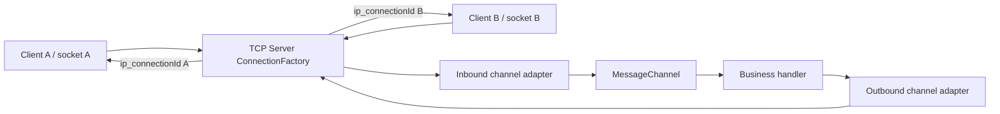
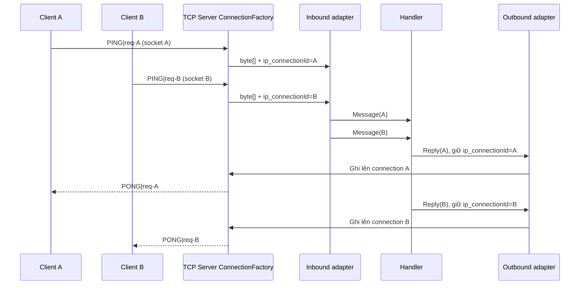
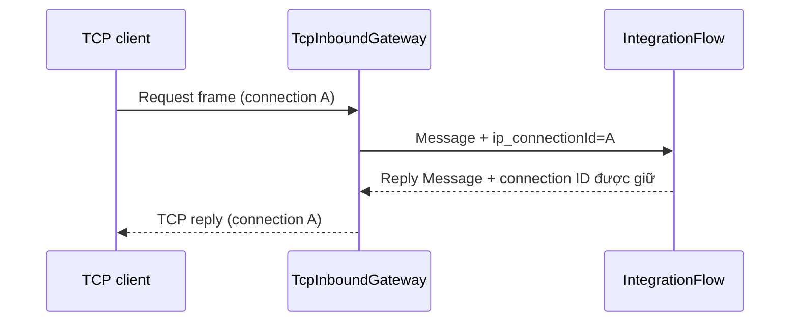
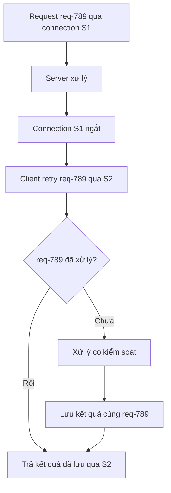

# Connection ID và correlation header

> **Chương:** Adapter TCP  
> **Module:** SPRING_INTEGRATION_ADAPTERS  
> **Phạm vi:** Kết nối các hệ thống ngoài vào Spring Integration bằng inbound/outbound adapter, gateway, poller và MessageChannel. Thực hành luồng trao đổi qua file, SFTP, HTTP, JMS, AMQP, Kafka và cơ sở dữ liệu; xử lý hợp đồng message, lỗi và vòng đời kết nối.

## 1. Mục tiêu học tập

Sau bài học, bạn có thể:

- Giải thích ý nghĩa của **`ip_connectionId`** và truy cập header bằng `IpHeaders.CONNECTION_ID`.
- Phân biệt **ID kết nối TCP**, **ID của Spring Message**, **correlation ID** và **request ID nghiệp vụ**.
- Mô tả cách Spring Integration định tuyến một message phản hồi về **đúng socket của TCP client**.
- Cấu hình một cặp **TCP inbound/outbound channel adapter dùng chung server ConnectionFactory**, bảo toàn connection ID trên đường gửi phản hồi.
- Hiểu gateway quản lý request-reply như thế nào và khi nào cần tự thực hiện tương quan cho mô hình bất đồng bộ.
- Xử lý các tình huống mất header, reconnect, timeout, reply đến muộn, nhiều request trên một socket và nhiều client đồng thời.
- Thiết kế hợp đồng correlation rõ ràng, log/trace hợp lý và chính sách bảo mật cho môi trường thực tế.

## 2. Vì sao TCP integration cần nhiều loại ID?

Một ứng dụng nhận các bản tin `PING|req-101` và `PING|req-102` qua hai socket khác nhau. Cả hai bản tin có thể chạy qua cùng một `MessageChannel` và cùng một handler. Khi handler tạo `PONG|...`, hệ thống cần biết **gửi tới socket nào**. Đồng thời, nghiệp vụ muốn biết reply đó tương ứng với **yêu cầu nào**.

Hai câu hỏi này khác nhau:

1. **Định tuyến kết nối:** Gửi byte trên TCP connection nào?
2. **Tương quan nghiệp vụ:** Response này thuộc request, transaction hay quy trình nào?

Spring Integration dùng header `ip_connectionId` cho việc định tuyến tới một TCP connection. Correlation ID hoặc request ID ở tầng nghiệp vụ dùng để liên kết các message có quan hệ với nhau. Không được dùng hai loại ID thay thế lẫn nhau.



**Ý chính:** Với cặp inbound/outbound adapter ở phía server, `ip_connectionId` chọn socket để viết reply. Nếu quy trình nghiệp vụ chuyển qua hàng đợi, nhiều service hoặc kết nối được mở lại, bạn thường còn cần **request ID độc lập** để khôi phục ngữ cảnh.

## 3. Bốn loại ID không nên nhầm lẫn

| Trường/ID | Ai cấp hoặc quản lý? | Phạm vi sử dụng | Có bền vững qua reconnect? |
| --- | --- | --- | --- |
| **`ip_connectionId`** (`IpHeaders.CONNECTION_ID`) | Tầng kết nối TCP của Spring Integration | Chọn và theo dõi một TCP connection cụ thể | **Không**; socket mới là một phiên khác. |
| **Spring `MessageHeaders.ID`** | Framework tạo cho từng Spring Message | Nhận diện một message trong luồng nội bộ | **Không** thể coi là ID nghiệp vụ bền vững. |
| **`correlationId`** | Flow/ứng dụng hoặc một số thành phần EIP | Nhóm/liên hệ các message nội bộ cùng quy trình | Tùy flow và cách bạn lưu/truyền header. |
| **`requestId` nghiệp vụ** | Giao thức/ứng dụng định nghĩa, ví dụ `req-20261123-01` | Đối chiếu request ↔ response, retry, idempotency | **Nên có**, nếu nghiệp vụ yêu cầu. |

### 3.1. `IpHeaders.CONNECTION_ID`

Spring Integration đặt tên header là `ip_connectionId`. Trong code, sử dụng constant để tránh viết sai:

```java
import org.springframework.integration.ip.IpHeaders;
import org.springframework.messaging.Message;

void inspect(Message<?> message) {
    String connectionId =
            (String) message.getHeaders().get(IpHeaders.CONNECTION_ID);

    System.out.println("TCP connection: " + connectionId);
}
```

`ip_connectionId` do framework thêm cho **message nhận từ TCP**. Khi dùng **server ConnectionFactory** cùng TCP outbound channel adapter để gửi về client đã kết nối, header này phải tồn tại và trỏ tới connection đang hoạt động. Đây là cơ chế routing của adapter.

Một TCP connection có thể chở **nhiều** message. Hai message liên tiếp trên cùng socket thường có **cùng connection ID** nhưng khác request ID. Nếu peer ngắt kết nối và mở lại, request ID có thể giữ nguyên khi retry, còn connection ID thay đổi.

Connection ID cũng **không phải bằng chứng xác thực**: client không nên tự quyết định connection ID đích, và server không được cấp quyền dựa trên ID socket mà không kiểm tra danh tính/quyền theo giao thức.

### 3.2. Spring Message ID

Mỗi Spring `Message` có header `id` do framework quản lý, thường ở dạng UUID. ID này hữu ích để theo dõi từng message trong các bước xử lý:

```java
import org.springframework.messaging.Message;

void inspectMessage(Message<?> message) {
    System.out.println("messageId=" + message.getHeaders().getId());
}
```

Khi flow sinh một message mới, ID của message mới có thể khác message nguồn. Vì vậy **không dùng `message.getHeaders().getId()` như mã giao dịch xuyên nhiều ứng dụng** nếu không có hợp đồng truyền/lưu rõ ràng.

### 3.3. Correlation ID trong Spring Integration

Header `correlationId` được dùng bởi nhiều mẫu **Enterprise Integration Patterns** như aggregator hoặc splitter để liên kết các message cùng nhóm. Tùy endpoint và flow, header này có thể được thiết lập tự động hoặc được ứng dụng chủ động gắn vào.

```java
import org.springframework.messaging.Message;
import org.springframework.messaging.support.MessageBuilder;

Message<byte[]> message = MessageBuilder
        .withPayload("PING|req-101".getBytes(
                java.nio.charset.StandardCharsets.UTF_8))
        .setHeader("correlationId", "req-101")
        .build();
```

Ở ví dụ này, `correlationId` chỉ là **Spring Message header ở trong ứng dụng**. Nó **không tự động trở thành byte trên socket** khi dùng `ByteArrayCrLfSerializer`. Nếu bên nhận là phần mềm bên ngoài, muốn nó đọc correlation ID thì phải **đưa ID vào payload/giao thức**, hoặc cấu hình cơ chế chuyển header qua wire mà cả hai phía đều hiểu.

Đừng giả định bất kỳ header tên `correlationId` nào cũng khiến TCP outbound gateway có thêm khả năng xử lý nhiều request song song trên một socket. Gateway có cơ chế request-reply riêng, còn giao thức giao dịch của hệ thống ngoài cần được mô tả độc lập.

### 3.4. Request ID nghiệp vụ

Giả sử giao thức text là:

```text
Request: PING|req-101
Reply:   PONG|req-101
```

`req-101` nằm **trong payload TCP** nên cả hai bên có thể nhìn thấy nó sau khi decode frame. Khi có timeout và retry, ứng dụng có thể gửi lại **cùng request ID** để server biết đây là cùng một tác vụ; nếu lệnh làm thay đổi trạng thái, server cần lưu trạng thái đã xử lý để tránh thực hiện hai lần.

Request ID nghiệp vụ cũng có thể phục vụ correlation khi đi qua HTTP, JMS, Kafka hoặc cơ sở dữ liệu. Tuy nhiên, nó **không thay thế** `ip_connectionId` trong trường hợp outbound adapter phải chọn socket server-side để gửi phản hồi.

## 4. Các IP header liên quan

| Header | Constant | Ý nghĩa |
| --- | --- | --- |
| `ip_connectionId` | `IpHeaders.CONNECTION_ID` | ID logic của TCP connection; dùng khi cần route reply tới connection. |
| `ip_actualConnectionId` | `IpHeaders.ACTUAL_CONNECTION_ID` | ID connection vật lý bên dưới khi dùng client connection factory kiểu cache/failover; chủ yếu để quan sát. |
| `ip_address` | `IpHeaders.IP_ADDRESS` | Địa chỉ IP nguồn của bản tin nhận. |
| `ip_hostname` | `IpHeaders.HOSTNAME` | Hostname hoặc IP, phụ thuộc cấu hình tra cứu tên host. |
| `ip_tcp_remotePort` | `IpHeaders.REMOTE_PORT` | Port phía TCP peer của connection nhận. |

Ví dụ log:

```java
import org.springframework.integration.ip.IpHeaders;
import org.springframework.messaging.MessageHeaders;

void logNetworkContext(MessageHeaders h) {
    System.out.printf(
            "connection=%s remoteIp=%s remotePort=%s%n",
            h.get(IpHeaders.CONNECTION_ID),
            h.get(IpHeaders.IP_ADDRESS),
            h.get(IpHeaders.REMOTE_PORT)
    );
}
```

**`ACTUAL_CONNECTION_ID` và `CONNECTION_ID` không đồng nghĩa** khi factory có wrapper/cache/failover. Khi gửi qua server outbound adapter, luôn bám theo hợp đồng routing của `IpHeaders.CONNECTION_ID` mà endpoint yêu cầu. IP và port cũng có thể thay đổi khi reconnect, NAT hoặc proxy thay đổi.

## 5. Cách router TCP chọn đúng socket

Một TCP server có thể phục vụ nhiều client. Khi inbound adapter nhận frame trên socket S1, factory gắn `ip_connectionId=S1` lên Spring Message. Nếu handler tạo một reply từ message đó và chuyển sang TCP outbound adapter **cùng server factory**, outbound adapter đọc header để chọn socket S1.



**Quy tắc bắt buộc:** Nếu tạo mới message để trả lại trên socket, phải giữ hoặc gắn `ip_connectionId` của request gốc. Nếu header bị xóa, thay sai giá trị hoặc connection đã đóng, outbound adapter có thể không tìm thấy connection đích và không gửi được reply.

Khi bạn dùng **TCP inbound gateway**, gateway quản lý chu kỳ request/reply. Nhưng nếu flow dựng một reply message mới và đánh mất connection ID, vẫn có nguy cơ không trả về được connection thích hợp. Hãy bảo toàn header quan trọng trên nhánh reply.

### 5.1. So sánh Gateway với cặp adapter

| Topology | Ai xử lý correlation TCP? | Khi phù hợp |
| --- | --- | --- |
| **TCP inbound gateway** | Gateway thực hiện request-reply; reply phải gắn được với connection của request. | Client gửi một request và cần một reply theo hợp đồng. |
| **TCP outbound gateway** | Gateway tương quan request với reply từ TCP server đích; quản lý thời gian chờ. | Ứng dụng chủ động gọi TCP server và đợi kết quả. |
| **Inbound + outbound adapter dùng chung server factory** | Outbound adapter dùng `ip_connectionId` để gửi về đúng socket; tương quan nghiệp vụ do flow quản lý. | Giao tiếp TCP hai chiều bất đồng bộ; event/ACK/reply có thể xử lý riêng. |
| **Cặp adapter dùng client factory** | Ứng dụng phải thiết kế tương quan nghiệp vụ nếu cần ghép reply với request. | Ứng dụng kết nối tới server ngoài và nhận các message bất đồng bộ. |

Với outbound gateway sử dụng **một shared connection**, các request/reply thường được **tuần tự hóa trên connection**, không mặc nhiên chạy song song trong cùng một socket. Dùng pool connections chỉ giải quyết concurrency ở tầng vận chuyển; muốn có idempotency, correlation ID trong payload và chính sách retry vẫn phải tự định nghĩa.

## 6. Ví dụ thực hành: giữ connection ID bằng Java DSL

### 6.1. Bài toán

Xây dựng một TCP server Spring Integration ở cổng `9400`:

- Hai TCP client có thể kết nối vào server đồng thời.
- Mỗi client gửi một dòng UTF-8: `PING|<request-id>\r\n`.
- Mỗi request sinh reply `PONG|<request-id>\r\n` trên **đúng socket** mà request đến.
- Luồng sử dụng **inbound channel adapter** + **service activator** + **outbound channel adapter**.
- Cặp adapter dùng **cùng một server ConnectionFactory**, và reply giữ `IpHeaders.CONNECTION_ID`.
- Header `correlationId` được ghi nhận ở tầng Spring; request ID cũng nằm trong payload vì client TCP thuần cần đọc nó.

Đây là mô hình hợp tác giữa hai adapter, khác với một TCP inbound gateway có request-reply trực tiếp. Code minh họa cách gửi phản hồi khi flow vẫn có thể được mở rộng thành xử lý bất đồng bộ.

### 6.2. Dependency

Ví dụ dùng Spring Boot quản lý phiên bản dependency qua BOM, Java 17+ và Spring Integration 6.x:

```xml
<dependencies>
    <dependency>
        <groupId>org.springframework.boot</groupId>
        <artifactId>spring-boot-starter-integration</artifactId>
    </dependency>
    <dependency>
        <groupId>org.springframework.integration</groupId>
        <artifactId>spring-integration-ip</artifactId>
    </dependency>
</dependencies>
```

### 6.3. Cấu hình factory và flow

```java
import java.nio.charset.StandardCharsets;

import org.springframework.context.annotation.Bean;
import org.springframework.context.annotation.Configuration;
import org.springframework.integration.config.EnableIntegration;
import org.springframework.integration.dsl.IntegrationFlow;
import org.springframework.integration.ip.IpHeaders;
import org.springframework.integration.ip.dsl.Tcp;
import org.springframework.integration.ip.tcp.connection.TcpNetServerConnectionFactory;
import org.springframework.integration.ip.tcp.serializer.ByteArrayCrLfSerializer;
import org.springframework.messaging.Message;
import org.springframework.messaging.support.MessageBuilder;

@Configuration
@EnableIntegration
public class TcpConnectionCorrelationConfiguration {

    @Bean
    TcpNetServerConnectionFactory sessionServerFactory() {
        var factory = new TcpNetServerConnectionFactory(9400);

        // Cả client và server thống nhất mỗi frame kết thúc CRLF.
        var decoder = new ByteArrayCrLfSerializer();
        decoder.setMaxMessageSize(1024);
        factory.setDeserializer(decoder);
        factory.setSerializer(new ByteArrayCrLfSerializer());

        // Cho phép nhiều frame trên một TCP connection.
        factory.setSingleUse(false);
        return factory;
    }

    @Bean
    IntegrationFlow tcpSessionFlow(
            TcpNetServerConnectionFactory sessionServerFactory) {

        return IntegrationFlow
                .from(Tcp.inboundAdapter(sessionServerFactory))
                .handle((payload, headers) -> {
                    String connectionId =
                            (String) headers.get(IpHeaders.CONNECTION_ID);

                    if (connectionId == null) {
                        throw new IllegalStateException(
                                "Missing TCP connection ID");
                    }

                    String request = new String(
                            (byte[]) payload, StandardCharsets.UTF_8
                    );
                    String[] parts = request.split("\\|", -1);

                    String requestId;
                    String reply;

                    if (parts.length == 2
                            && "PING".equals(parts[0])
                            && parts[1].matches("[A-Za-z0-9_-]{1,40}")) {
                        requestId = parts[1];
                        reply = "PONG|" + requestId;
                    } else {
                        requestId = "unknown";
                        reply = "ERR|BAD_REQUEST";
                    }

                    System.out.printf(
                            "connection=%s requestId=%s%n",
                            connectionId, requestId
                    );

                    // Chủ động tạo reply mới, giữ ID kết nối của request.
                    // correlationId phục vụ flow/log nội bộ.
                    Message<byte[]> response = MessageBuilder
                            .withPayload(reply.getBytes(
                                    StandardCharsets.UTF_8))
                            .setHeader(IpHeaders.CONNECTION_ID, connectionId)
                            .setHeader("correlationId", requestId)
                            .build();

                    return response;
                })
                .handle(Tcp.outboundAdapter(sessionServerFactory))
                .get();
    }
}
```

**Đọc dòng chảy:**

1. `sessionServerFactory` lắng nghe cổng `9400` và cấp context của mỗi TCP socket.
2. `Tcp.inboundAdapter(...)` đọc frame từ connection factory, đưa `Message<byte[]>` vào flow; message có `ip_connectionId`.
3. Handler lấy ID kết nối từ `headers`, parse request và tạo reply message mới.
4. `MessageBuilder.setHeader(IpHeaders.CONNECTION_ID, connectionId)` giữ thông tin cần thiết để TCP outbound adapter chọn **đúng connection**.
5. `setHeader("correlationId", requestId)` giữ thông tin nhóm/nghiệp vụ trong **Spring Message**. Với CRLF serializer, header này **không đi ra TCP**.
6. `Tcp.outboundAdapter(sessionServerFactory)` gửi payload reply qua socket được chỉ định bởi `ip_connectionId`.
7. `ByteArrayCrLfSerializer` tự thêm `\r\n` vào reply trên wire; handler không tự thêm delimiter.

**Giới hạn của ví dụ:** Handler tạo reply ngay trong cùng flow để dễ kiểm chứng. Khi đặt công việc vào hàng đợi hoặc service khác, phải mang theo `connectionId` và `requestId` qua toàn bộ đường đi; connection có thể đã đóng trước khi reply được tạo. Giữ header thôi **không đảm bảo connection còn sống**.

### 6.4. Vì sao không tạo reply thiếu header?

Đoạn code sau **không đủ** khi trả reply qua server outbound adapter:

```java
// Sai cho bài toán định tuyến reply theo socket:
Message<byte[]> response = MessageBuilder
        .withPayload("PONG|req-101".getBytes(StandardCharsets.UTF_8))
        .build();
```

Message mới có payload, nhưng **không có** `ip_connectionId`. Nếu outbound adapter dùng server connection factory, nó không biết nên viết vào socket A hay B.

Có thể bảo toàn header theo hai cách:

- Tạo message mới và **gắn rõ** `IpHeaders.CONNECTION_ID` từ message gốc.
- Với các bước transformer/service activator đã có cơ chế sao chép headers, bảo đảm cấu hình thực tế **giữ được** `ip_connectionId`; kiểm thử ngay tại channel trước khi gửi outbound.

Không nên dựa vào một lời giả định chung rằng "Spring tự giữ tất cả headers trong mọi trường hợp". Khi lọc, tách luồng, aggregate, lưu message hoặc dựng DTO mới, header có thể bị thay đổi, không được serialize hoặc bị bỏ sót.

### 6.5. Chạy hai TCP client đồng thời

Đoạn Java dưới đây chạy độc lập với Spring Integration. Hai client tạo **hai socket** và gửi request có ID khác nhau:

```java
import java.io.BufferedReader;
import java.io.InputStreamReader;
import java.net.InetSocketAddress;
import java.net.Socket;
import java.nio.charset.StandardCharsets;
import java.util.concurrent.Executors;

public class TwoTcpClientsDemo {

    private static String exchange(String request) throws Exception {
        try (Socket socket = new Socket()) {
            socket.connect(new InetSocketAddress("127.0.0.1", 9400), 3000);
            socket.setSoTimeout(5000);

            // Đây là TCP client thuần, tự thêm CRLF vào wire.
            socket.getOutputStream().write(
                    (request + "\r\n").getBytes(StandardCharsets.UTF_8));
            socket.getOutputStream().flush();

            var reader = new BufferedReader(new InputStreamReader(
                    socket.getInputStream(), StandardCharsets.UTF_8));

            String reply = reader.readLine();
            if (reply == null) {
                throw new IllegalStateException("Closed before reply");
            }

            return reply;
        }
    }

    public static void main(String[] args) throws Exception {
        var pool = Executors.newFixedThreadPool(2);
        try {
            var first = pool.submit(
                    () -> exchange("PING|req-A"));
            var second = pool.submit(
                    () -> exchange("PING|req-B"));

            System.out.println("A: " + first.get());
            System.out.println("B: " + second.get());
        } finally {
            pool.shutdown();
        }
    }
}
```

Khi Spring Boot chứa `TcpConnectionCorrelationConfiguration` đã khởi động, kết quả **kỳ vọng** là:

```text
A: PONG|req-A
B: PONG|req-B
```

Connection ID trong log server có thể khác nhau giữa client A và B. Chính header `ip_connectionId` giúp outbound adapter trả reply về đúng socket tương ứng. Thứ tự hai dòng log trên server **không được đảm bảo**, vì hai client chạy đồng thời.

Nếu một client giữ socket và gửi thêm `PING|req-C`, request đó vẫn có thể mang **cùng connection ID** với request trước trên socket ấy, nhưng có request ID khác. Vì vậy connection ID không đủ để ghép một response với một request khi có nhiều tác vụ qua cùng connection.

## 7. Gateway request-reply và correlation tự động

### 7.1. TCP inbound gateway

`TcpInboundGateway` nhận request từ client, đưa vào flow, chờ reply rồi gửi payload ra đúng connection tương ứng. Message đầu vào có `ip_connectionId`. Khi tạo reply mới, phải giữ header cần thiết trên đường reply, nhất là nếu thay thế toàn bộ message.



Trong một luồng đồng bộ đơn giản, handler trả payload reply và framework có thể duy trì các headers cần thiết qua cơ chế tạo reply. Khi có các bước dựng message thủ công hoặc xử lý bất đồng bộ, cần kiểm tra header thực tế của **reply message**.

### 7.2. TCP outbound gateway

`TcpOutboundGateway` nhận Spring Message từ ứng dụng, gửi yêu cầu đến server TCP và chờ phản hồi. Gateway chịu trách nhiệm tương quan reply với request theo mô hình trao đổi của endpoint.

Với **một kết nối client dùng chung** (`singleUse=false`), gateway thường chỉ xử lý **một request/reply tại một thời điểm trên connection đó**. Lượt tiếp theo phải đợi để không lẫn phản hồi. Khi cần thông lượng cao, có thể cân nhắc `CachingClientConnectionFactory` với nhiều connection hoặc cặp adapter bất đồng bộ với correlation riêng.

Gateway **không tự cấp** idempotency hoặc exactly-once processing cho nghiệp vụ. Nếu client timeout sau khi server đã thực hiện lệnh, retry có thể làm lệnh chạy lần nữa nếu thiếu request ID và xử lý trùng ở server.

### 7.3. Adapter bất đồng bộ

Khi client A gửi request trên connection A, server có thể nhận và đưa vào xử lý bất đồng bộ. Reply có thể được tạo sau một khoảng thời gian không xác định, trong khi connection A đã đóng hoặc mở lại dưới một ID mới.

Tại đây cần quản lý **hai bảng ánh xạ khác nhau**:

```text
Routing phiên TCP:
  connectionId -> connection đang hoạt động

Correlation nghiệp vụ:
  requestId -> request gốc / trạng thái xử lý / kết quả đã lưu
```

Bảng thứ nhất do connection factory quản lý; bảng thứ hai là trách nhiệm thiết kế của ứng dụng. Không giữ reference `Socket` hoặc Spring `replyChannel` trong payload gửi qua mạng để giả lập bảng thứ hai.

## 8. Header Spring Integration có được truyền qua TCP không?

**Mặc định, các serializer TCP dạng `ByteArray*Serializer` truyền payload, không tự chuyển toàn bộ Spring Message headers.** Bên nhận qua TCP nhìn thấy payload và có các IP headers được tạo **ở phía nhận** theo connection thực tế.

Ví dụ:

```java
Message<byte[]> outbound = MessageBuilder
        .withPayload("PING|req-101".getBytes(StandardCharsets.UTF_8))
        .setHeader("correlationId", "req-101")
        .setHeader("tenantId", "tenant-12")
        .build();
```

Nếu dùng CRLF serializer, dữ liệu wire là:

```text
PING|req-101\r\n
```

Không có `correlationId` hay `tenantId` ở wire chỉ vì chúng là Spring headers.

### 8.1. Cách truyền correlation ID cho hệ thống ngoài

Có ba chiến lược:

| Cách | Khi phù hợp | Lưu ý |
| --- | --- | --- |
| **Đưa request ID vào payload** (`PING|req-101`) | Giao thức tùy chỉnh/legacy cho phép thay đổi payload | Dễ hiểu và kiểm thử; phải có schema, validation và version. |
| **Định nghĩa envelope có metadata** (`JSON`/`protobuf`/binary envelope) | Nhiều trường cần truyền xuyên ứng dụng | Cần framing bên ngoài envelope và kiểm soát kích thước. |
| **Chuyển selected Spring headers bằng message mapper** | Hai phía cùng hỗ trợ định dạng do Spring Integration cấu hình | Cần mapper, converter và serializer/deserializer tương thích; không chuyển live headers. |

Spring Integration hỗ trợ cơ chế `MessageConvertingTcpMessageMapper`, `MapMessageConverter` và serializer như `MapJsonSerializer` để chuyển **những headers được lựa chọn** cùng payload. Đây là cấu hình đặc biệt cần có thỏa thuận wire format ở cả hai bên.

**Không serialize các header chứa đối tượng sống** như `replyChannel` hoặc `errorChannel` của framework ra hệ thống ngoài. Chúng không có ý nghĩa như địa chỉ mạng bền vững và có thể không serializable. Với protocol cần tracing và correlation giữa dịch vụ, đặt ID trong schema một cách tường minh sẽ dễ liên vận hành hơn.

### 8.2. So sánh header nội bộ và trường wire

Giả sử flow nhận một message có:

```text
Spring headers:
  ip_connectionId = server:client:some-session
  correlationId   = req-101
  id              = (UUID của Spring Message)

Wire payload:
  PONG|req-101\r\n
```

Đây là **ví dụ biểu diễn**, không phải chuỗi connection ID thực do framework tạo. Peer TCP chỉ nhận payload đã encode theo framing. Nếu cần peer biết correlation ID, đưa nó vào wire payload theo đúng contract.

## 9. Reconnect, timeout và reply đến muộn

### 9.1. Một connection mới không thay thế connection cũ

Một phiên điển hình:

1. Client kết nối và gửi `CHARGE|req-789|order-42`.
2. Server xử lý lệnh và chuẩn bị reply cho `req-789`.
3. TCP connection cũ bị mất.
4. Client mở socket mới và retry **cùng request ID `req-789`**.
5. Server không thể gửi reply cũ bằng connection ID cũ nếu socket không còn; phải quyết định cách trả kết quả theo request ID mới nhận trên socket mới.



`ip_connectionId` giúp trả lời **đúng socket hiện có**, nhưng không ghi nhớ rằng request đã được commit trên socket cũ. Đó là vai trò của **request ID, kết quả bền vững và idempotency**.

### 9.2. Timeout không chứng minh request chưa chạy

Nếu client đợi reply quá 5 giây rồi timeout, server có thể đang xử lý, đã xử lý thành công hoặc reply đã mất trên mạng. Retry mà không có idempotency có thể tạo tác vụ trùng.

Tùy yêu cầu, giao thức nên xác định:

- Request ID ổn định qua retry.
- Mã ACK phân biệt `ACCEPTED` với `COMPLETED`.
- Reply phải mang request ID để caller kiểm tra tương quan.
- Kho lưu kết quả/idempotency và thời hạn lưu.
- Quy tắc retry/backoff, thời gian chờ và trạng thái cần đối soát.

### 9.3. Xử lý connection ID không còn hợp lệ

Một outbound adapter gửi với connection ID không tồn tại/cũ có thể thất bại vì connection factory không tìm thấy socket. Spring Integration có cơ chế sự kiện lỗi correlation ở tầng TCP, ví dụ `TcpConnectionFailedCorrelationEvent` trong các trường hợp định tuyến không thành công.

Không "sửa" bằng cách gửi lên **một socket bất kỳ còn mở**. Làm vậy có nguy cơ gửi dữ liệu nghiệp vụ sang sai client. Hệ thống phải đánh dấu không gửi được, ghi lại request ID và lựa chọn retry/đối soát qua một request mới nếu protocol cho phép.

## 10. Những cách làm dễ mất header và cách phòng tránh

| Tình huống | Rủi ro | Cách xử lý |
| --- | --- | --- |
| Handler tạo `MessageBuilder.withPayload(...)` mới | `ip_connectionId` không có trong reply. | Copy/gắn rõ header từ inbound message. |
| Transformer đổi payload và headers bị cấu hình lọc | Mất connection ID hoặc correlation ID. | Kiểm tra headers trước outbound adapter; bổ sung mapping phù hợp. |
| Đưa message vào JMS/Kafka/DB rồi lấy ra lại | Message hệ thống mới có thể không chứa đủ headers gốc. | Lưu connection ID và request ID có chủ đích; xác minh connection vẫn hoạt động khi phản hồi. |
| Split/Aggregate message | Correlation ID được sinh/thay đổi theo nhóm; connection ID khó giữ khi trộn nhiều nguồn. | Định nghĩa group key, provenance và routing key riêng cho mỗi connection. |
| Client reconnect | Connection ID cũ không còn hợp lệ. | Giao thức retry bằng request ID và socket mới. |
| Nhiều request cùng connection | Cùng connection ID nên không phân biệt request. | Đưa request ID/correlation ID vào payload hoặc protocol envelope. |
| Gán connection ID từ dữ liệu do client gửi | Có nguy cơ chọn nhầm socket/định tuyến không được phép. | Chỉ dùng ID do tầng TCP nhận thực tế tạo; kiểm soát quyền định tuyến. |
| Gửi header nội bộ trực tiếp ra wire | Peer không biết định dạng, có thể làm lỗi framing. | Chọn wire schema và message mapper rõ ràng. |

### 10.1. Bảo vệ header khi xử lý bất đồng bộ

Giả sử inbound adapter nhận dữ liệu rồi chuyển cho worker queue. Ít nhất cần lưu:

```text
TaskEnvelope {
    connectionId:  "ID kết nối do Spring cấp lúc nhận"
    requestId:     "ID nghiệp vụ trong request payload"
    receivedAt:    "thời điểm nhận"
    payload:       "nội dung cần xử lý"
}
```

Khi worker trả kết quả, application phải:

1. Xác thực `requestId` và trạng thái xử lý.
2. Kiểm tra connection ID cũ còn được phép sử dụng và còn hoạt động.
3. Chuyển reply qua đúng outbound adapter với `IpHeaders.CONNECTION_ID` đã gắn.
4. Nếu socket đã đóng, không tự định tuyến sang client khác; thực hiện retry/đối soát theo giao thức ứng dụng.

Nếu độ trễ xử lý có thể lâu hơn thời gian sống connection, nên cân nhắc mô hình **ACK sớm + truy vấn trạng thái bằng request ID** hoặc broker bền vững, thay vì dựa vào socket tồn tại mãi.

## 11. Bảo mật và vận hành

### 11.1. Không coi IP connection ID là identity

Connection ID chỉ là **định danh phiên truyền tải**. Nó không xác nhận:

- Client là thiết bị nào.
- Client có quyền thực hiện lệnh hay nhận nội dung đó hay không.
- Socket thuộc cùng người dùng sau reconnect.
- Request đang gửi có thuộc transaction hợp lệ hay không.

Với dữ liệu quan trọng, cần xác thực (ví dụ mTLS, token hoặc cơ chế theo giao thức), phân quyền sau khi xác thực và mapping **authenticated principal ↔ connection** trong phạm vi lifecycle thích hợp. Không dùng connection ID của một phiên cũ để cấp quyền cho phiên mới.

### 11.2. Tracing nhiều hệ thống

Nên ghi các trường log độc lập:

| Trường log | Mục đích |
| --- | --- |
| `connectionId` | Ghép các sự kiện socket mở/đóng và message trên phiên TCP. |
| `requestId` / `correlationId` | Ghép log của một yêu cầu qua nhiều bước hoặc nhiều dịch vụ. |
| `messageId` | Quan sát từng Spring Message cụ thể. |
| `direction` (inbound/outbound) | Biết message đi vào hay đi ra. |
| `remoteAddress` | Hỗ trợ chẩn đoán mạng, không dùng làm identity. |
| `resultCode` và `latency` | Phân biệt kết quả nghiệp vụ, lỗi framing và timeout. |

Không ghi payload nhạy cảm, token hoặc dữ liệu cá nhân đầy đủ vào log chỉ để correlation. Nếu ghi request ID, hãy tránh dùng thông tin dễ đoán có thể tiết lộ dữ liệu giao dịch; phân quyền truy vấn log phù hợp.

### 11.3. Metrics và sự kiện

Một số chỉ số hữu ích:

- Số connection đang hoạt động, số lần mở/đóng và reconnect.
- Số message inbound/outbound theo từng endpoint.
- Số reply không định tuyến được vì connection ID không hợp lệ.
- Thời gian chờ request-reply và số timeout.
- Số request ID xuất hiện lại, được deduplicate hoặc cần đối soát.
- Độ trễ xử lý từ lúc nhận frame đến lúc gửi reply.

Phân loại **lỗi socket** và **lỗi xử lý nghiệp vụ** riêng để không gộp tất cả thành "TCP failed".

## 12. Kịch bản kiểm thử cần có

| Kịch bản | Điều cần xác minh |
| --- | --- |
| Hai client gửi đồng thời | Reply đi tới **đúng socket** mỗi client. |
| Cùng connection gửi hai request tuần tự | Cùng connection ID nhưng request ID khác. |
| Hai connection dùng cùng request ID | Không dựa riêng vào request ID để chọn socket; định nghĩa phạm vi uniqueness của ID nghiệp vụ. |
| Tạo reply không có `ip_connectionId` | Đường gửi qua server outbound adapter phải báo lỗi/không gửi sai địa chỉ. |
| Giữ header qua transformer | `IpHeaders.CONNECTION_ID` còn tồn tại trước TCP outbound adapter. |
| Xóa header trong một nhánh bất đồng bộ | Quan sát cách lỗi định tuyến được báo và xử lý. |
| Client đóng socket trước khi có reply | Không gửi sang connection mới hoặc bất kỳ socket khác. |
| Client reconnect rồi retry cùng request ID | Connection ID mới, request ID không đổi; idempotency xử lý đúng. |
| Dùng CRLF serializer | `correlationId` nội bộ không tự xuất hiện trong wire bytes. |
| Reply tới quá hạn sau timeout | Xác định policy cho late reply và cập nhật trạng thái nghiệp vụ đúng. |
| Correlation ID nội bộ thay đổi ở splitter/aggregator | Message vẫn gắn đúng transaction và kết quả. |
| Frame sai hoặc thiếu CRLF | Không nhầm lỗi framing với mất connection ID. |

### 12.1. Cách kiểm tra header ngay trước outbound adapter

Trong flow, có thể chèn một bước log/kiểm tra trước khi chuyển sang `Tcp.outboundAdapter(...)`:

```java
.handle((payload, headers) -> {
    Object connectionId = headers.get(IpHeaders.CONNECTION_ID);
    Object correlationId = headers.get("correlationId");

    if (connectionId == null) {
        throw new IllegalStateException("Missing ip_connectionId");
    }

    System.out.printf(
            "reply routing connection=%s correlation=%s%n",
            connectionId, correlationId
    );

    // Giữ headers gốc bằng cách không tạo message thiếu connectionId.
    return payload;
})
```

Đoạn này là **phần của một IntegrationFlow** đã có request message và bước outbound adapter ở sau. Khi dùng service activator trả payload đơn thuần, cần xác minh cơ chế sao chép headers của flow; nếu tự dựng message thì đặt lại header cần thiết như ví dụ chính.

## 13. Bài tập thực hành

**Bài 1 — Phân biệt ID.** Với hai request `PING|req-1` và `PING|req-2` trên cùng TCP socket, lập bảng `connectionId`, Spring message ID và request ID. Giải thích trường nào giống nhau và trường nào khác nhau.

**Bài 2 — Gây lỗi mất header.** Trong cấu hình ở mục 6, xóa dòng `.setHeader(IpHeaders.CONNECTION_ID, connectionId)` của response. Quan sát lỗi định tuyến và chứng minh server **không gửi reply sang một socket khác**.

**Bài 3 — Tách xử lý bất đồng bộ.** Đưa nghiệp vụ sang executor/queue với thời gian xử lý thay đổi. Thiết kế dữ liệu cần lưu giữa lúc nhận và lúc trả lời; xác định cách xử lý nếu connection đã đóng.

**Bài 4 — Chống trùng.** Thay `PING` bằng `CREATE_ORDER` có request ID. Mô phỏng server hoàn thành nhưng mất reply; client reconnect rồi retry. Thiết kế idempotency store và response dùng cùng request ID.

**Bài 5 — Truyền correlation ID qua wire.** Giữ `ByteArrayCrLfSerializer` nhưng bổ sung ID vào payload, hoặc thiết kế envelope JSON có framing phù hợp. Giải thích tại sao chỉ thêm header `correlationId` trong Spring Message chưa đủ.

**Bài 6 — Giám sát.** Lập log cho connection open/close, request inbound, response outbound, timeout và failed correlation. Thiết kế truy vấn tìm mọi log của `req-1001` kể cả khi nó đã chạy qua hai socket khác nhau.

## 14. Câu hỏi tự kiểm tra

1. `IpHeaders.CONNECTION_ID` tương ứng với tên header thực tế nào?
2. Vì sao hai message trên cùng TCP socket có thể cùng connection ID nhưng khác request ID?
3. ID của Spring Message có thể được dùng làm khóa idempotency xuyên ứng dụng mặc định không?
4. Nếu server dùng inbound/outbound channel adapter chung connection factory, header nào cần có trên message outbound để gửi đúng socket?
5. Vì sao `correlationId` header nội bộ không tự xuất hiện trên wire khi dùng `ByteArrayCrLfSerializer`?
6. Khi dùng inbound gateway, vì sao cần giữ context của request khi tạo reply?
7. TCP outbound gateway làm gì để liên kết request và reply, và shared connection ảnh hưởng concurrency như thế nào?
8. Một request timeout rồi client reconnect: request ID và connection ID nào nên được giữ lại?
9. Nếu connection ID cũ không tồn tại, có được gửi reply sang socket khác đang mở không?
10. Khi nào nên dùng `MapMessageConverter` / `MessageConvertingTcpMessageMapper`?
11. Vì sao `ip_actualConnectionId` có thể khác `ip_connectionId` khi có caching hoặc failover factory?
12. Cần những thông tin nào để vừa theo dõi một request xuyên dịch vụ, vừa định tuyến reply TCP đúng kết nối?

**Gợi ý:** (1) `ip_connectionId`. (2) Connection ID mô tả phiên; request ID mô tả yêu cầu. (3) Không, message mới có thể có ID mới, headers không tự truyền qua TCP. (4) `ip_connectionId`. (5) Serializer CRLF truyền payload và delimiter. (6) Gateway cần reply về đúng request/connection. (7) Gateway quản lý trao đổi request-reply; shared connection thường tuần tự hóa từng lượt. (8) Retry giữ request ID nhưng có connection ID mới. (9) Không. (10) Khi hai phía cần chuyển các selected headers qua wire theo định dạng đồng thuận. (11) Header actual mô tả connection vật lý bên dưới, header chính là ID logic dùng để routing. (12) Connection ID, request/correlation ID, timestamps, trạng thái và contract reply.

## 15. Tài liệu tham khảo

- [Spring Integration Reference — IP Message Headers](https://docs.spring.io/spring-integration/reference/ip/msg-headers.html).
- [Spring Integration Reference — TCP Connection Factories](https://docs.spring.io/spring-integration/reference/ip/tcp-connection-factories.html).
- [Spring Integration Reference — TCP Message Correlation](https://docs.spring.io/spring-integration/reference/6.2/ip/correlation.html).
- [Spring Integration Reference — TCP Gateways](https://docs.spring.io/spring-integration/reference/ip/tcp-gateways.html).

**Điểm cần nhớ:** `ip_connectionId` gắn Spring Message với **một TCP connection cụ thể** để adapter/gateway định tuyến dữ liệu về đúng socket. `correlationId` và `requestId` liên kết **các message thuộc cùng giao dịch/yêu cầu**, đặc biệt khi xử lý bất đồng bộ, qua nhiều hệ thống hoặc reconnect. Hãy giữ đúng header định tuyến trong flow, truyền ID nghiệp vụ qua wire một cách tường minh và thiết kế timeout, retry, idempotency, xác thực và log riêng cho từng trách nhiệm.
