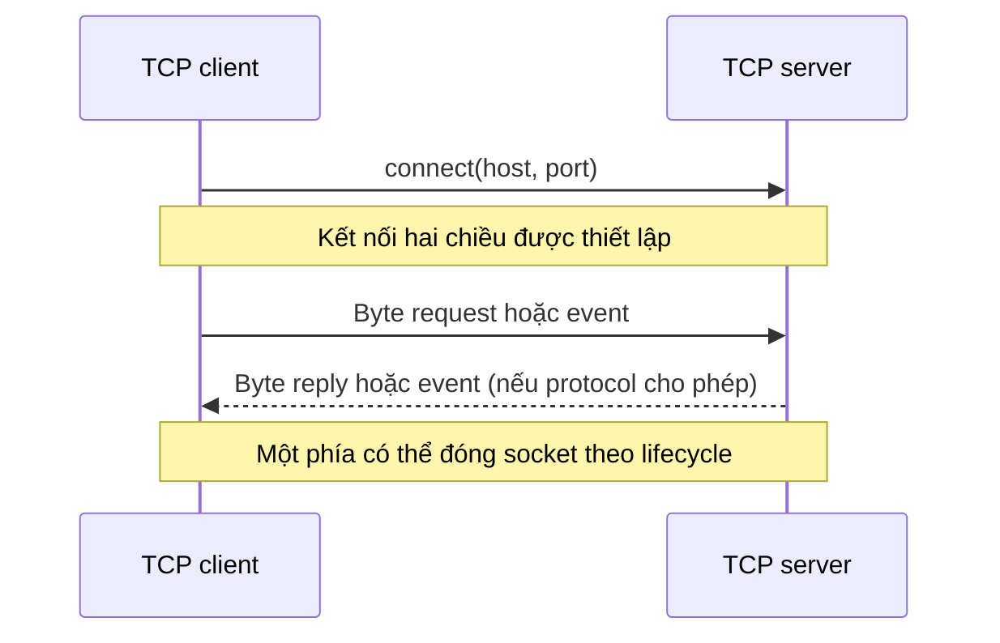
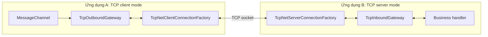
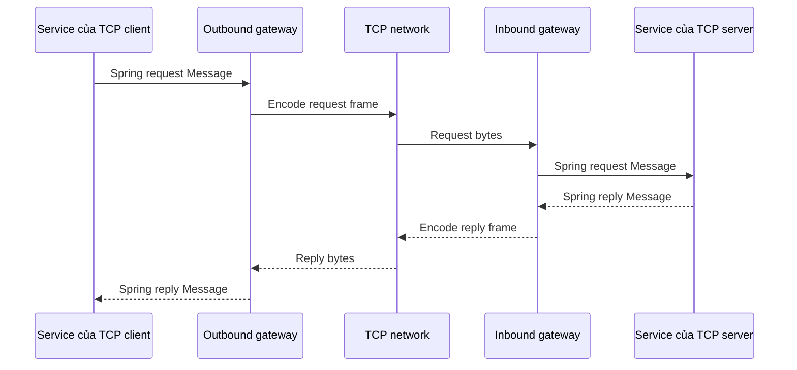
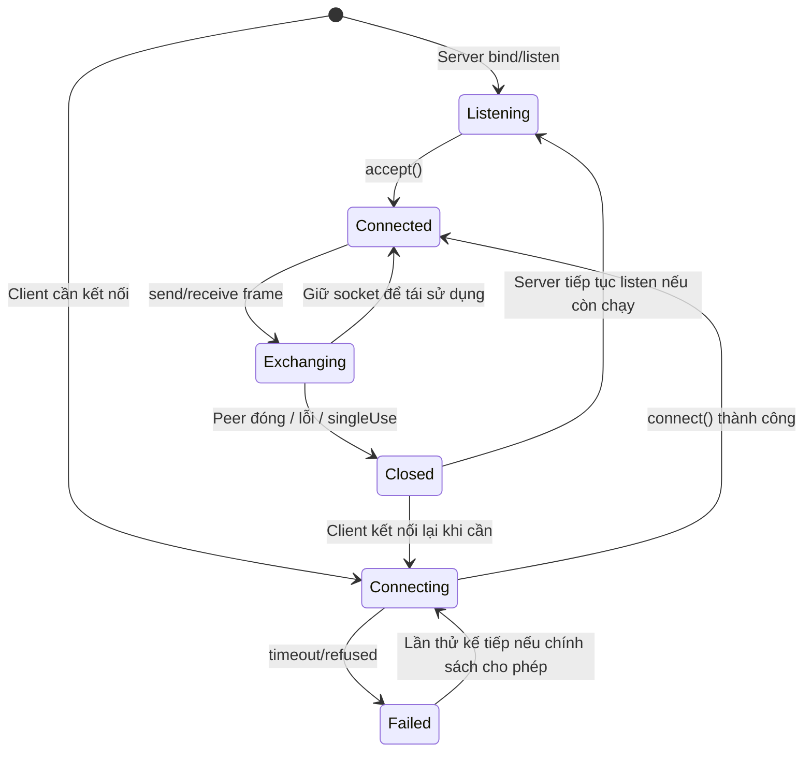

# Client mode và server mode

> **Chương:** Adapter TCP  
> **Module:** SPRING_INTEGRATION_ADAPTERS  
> **Phạm vi module:** Kết nối các hệ thống ngoài vào Spring Integration bằng inbound/outbound adapter, gateway, poller và MessageChannel. Thực hành luồng trao đổi qua file, SFTP, HTTP, JMS, AMQP, Kafka và cơ sở dữ liệu; xử lý hợp đồng message, lỗi và vòng đời kết nối.

## 1. Mục tiêu học tập

Sau khi hoàn thành bài học, bạn có thể:

- Phân biệt **TCP client mode** và **TCP server mode** theo phía **chủ động mở kết nối** và phía **lắng nghe kết nối**, không nhầm với hướng inbound/outbound của Spring Message.
- Chọn `TcpNetClientConnectionFactory` hay `TcpNetServerConnectionFactory` cho đúng vai trò mạng.
- Hiểu sự khác nhau giữa `TcpNet*ConnectionFactory` (Java IO) và `TcpNio*ConnectionFactory` (Java NIO).
- Kết hợp TCP connection factory với **inbound/outbound channel adapter** hoặc **inbound/outbound gateway** theo hợp đồng một chiều hay request-reply.
- Xây dựng **hai ứng dụng Spring Boot**: server nhận request bằng TCP inbound gateway, client gửi request bằng TCP outbound gateway.
- Thiết kế hợp đồng framing, connection ID, thời gian chờ, reconnect và chính sách xử lý lỗi theo vai trò từng phía.
- Nhận diện các vấn đề vận hành gồm bind address, firewall/NAT, kết nối dùng chung, TLS, shutdown và tải đồng thời.

## 2. Client mode và server mode nghĩa là gì?

Trong TCP, **client** là phía **chủ động gọi connect** tới một host/port; **server** là phía **bind, listen và accept** các kết nối đến. Vai trò này chỉ mô tả **cách socket được tạo**.

- **TCP client mode:** ứng dụng biết host và port của peer, chủ động thiết lập kết nối tới TCP server.
- **TCP server mode:** ứng dụng mở một cổng lắng nghe, chấp nhận kết nối từ một hoặc nhiều TCP client bên ngoài.



**Quan trọng:** Sau khi TCP kết nối thành công, **cả hai phía đều có thể đọc và ghi byte**. Không có quy tắc TCP nào bắt buộc client chỉ gửi và server chỉ nhận. Việc có **một chiều**, **request-reply** hay **hai chiều bất đồng bộ** do *giao thức ứng dụng* và endpoint Spring Integration quyết định.

### 2.1. Không đồng nhất socket mode với adapter direction

Trong Spring Integration:

- **Inbound**: Spring Message được đưa **vào** ứng dụng/flow từ hệ thống ngoài.
- **Outbound**: Spring Message được đưa **ra** hệ thống ngoài từ ứng dụng/flow.
- **Client/server**: ứng dụng **chủ động connect** hay **lắng nghe accept** socket.

Vì vậy, một **inbound channel adapter** có thể nhận message từ kết nối do **client factory** chủ động mở đến server bên ngoài; tương tự, server đã chấp nhận kết nối từ client có thể dùng **outbound channel adapter** gửi dữ liệu tới đúng socket đó.

| Vai trò socket của ứng dụng | Spring inbound | Spring outbound |
| --- | --- | --- |
| **Client mode**: ứng dụng gọi `connect` | Nhận frame do TCP server đích gửi qua kết nối client đã mở. | Chủ động đẩy frame hoặc gửi request tới TCP server đích. |
| **Server mode**: ứng dụng `listen/accept` | Nhận frame từ các TCP client kết nối vào ứng dụng. | Gửi frame tới TCP client đang kết nối; thường cần định tuyến theo `ip_connectionId`. |

Trong request-reply, **gateway** thực hiện cả gửi và nhận trong một trao đổi. Tên `inbound gateway` hoặc `outbound gateway` vẫn dựa vào **hướng request khởi phát**, không dựa vào chiều của từng byte.

### 2.2. Ví dụ thực tế

**Hệ thống A — Ứng dụng cung cấp dịch vụ TCP:** thiết bị công nghiệp chủ động kết nối tới ứng dụng ở cổng `9500` và gửi lệnh `STATUS|sensor-01`. Ứng dụng làm **TCP server**, dùng **inbound gateway** để nhận request và trả `OK|sensor-01|ACTIVE`.

**Hệ thống B — Ứng dụng gọi một dịch vụ TCP legacy:** ứng dụng mở kết nối tới máy chủ bên ngoài và gửi lệnh như trên. Ứng dụng làm **TCP client**, dùng **outbound gateway** để chờ kết quả.

**Hệ thống C — Hệ thống nhận thông báo:** ứng dụng làm TCP client, kết nối đến một server cung cấp luồng sự kiện định kỳ. Sau khi connect, server chủ động gửi event; phía ứng dụng dùng **inbound channel adapter** để nhận message. Ví dụ này cho thấy *inbound* không bắt buộc là *server*.

## 3. ConnectionFactory quyết định vai trò socket

Trong Spring Integration TCP, **connection factory** quản lý cách tạo/kết nối socket, serializer/deserializer và vòng đời kết nối. Adapter hoặc gateway dùng connection factory đó để chuyển giữa TCP byte stream và Spring Message.

| Class | Mode | Công nghệ I/O | Công dụng |
| --- | --- | --- | --- |
| `TcpNetClientConnectionFactory` | Client | Java socket I/O | Kết nối ra một host/port đã biết. |
| `TcpNetServerConnectionFactory` | Server | Java socket I/O | Bind cổng và accept các kết nối từ client. |
| `TcpNioClientConnectionFactory` | Client | Java NIO | Kết nối ra, với mô hình xử lý I/O dựa trên NIO. |
| `TcpNioServerConnectionFactory` | Server | Java NIO | Lắng nghe và quản lý nhiều kết nối qua NIO. |



### 3.1. Client factory: host và port đích

Cấu hình tối thiểu:

```java
import org.springframework.integration.ip.tcp.connection.TcpNetClientConnectionFactory;

var clientFactory =
        new TcpNetClientConnectionFactory("127.0.0.1", 9500);
```

Ở client mode, `127.0.0.1:9500` là **địa chỉ TCP server mà ứng dụng muốn kết nối tới**. Nếu hai ứng dụng chạy trên hai máy/container khác nhau, `127.0.0.1` chỉ trỏ về máy/container **đang chạy client**, không phải máy server. Khi triển khai thật, phải cung cấp host có thể định tuyến tới server, ví dụ DNS của service hoặc địa chỉ mạng nội bộ.

Client factory có thể tạo kết nối khi cần giao tiếp; đừng giả định việc khởi tạo bean Spring tự chứng minh server đang hoạt động. Kết nối có thể gặp `Connection refused`, timeout, DNS lỗi hoặc bị peer đóng sau một thời gian idle.

### 3.2. Server factory: cổng lắng nghe

Cấu hình tối thiểu:

```java
import org.springframework.integration.ip.tcp.connection.TcpNetServerConnectionFactory;

var serverFactory = new TcpNetServerConnectionFactory(9500);
```

Ở server mode, `9500` là **cổng ứng dụng mở để lắng nghe**. Kết nối từ client chỉ tới được khi các điều kiện sau đều đúng:

1. Server đã start và bind cổng thành công.
2. Địa chỉ bind phù hợp với interface mạng mà client truy cập.
3. Firewall, container port mapping, security group hoặc network policy cho phép kết nối.
4. Client gọi đúng host/port; protocol cả hai phía tương thích.

Constructor trên chỉ chọn **port**, không tự giới hạn việc bind vào `127.0.0.1`. Nếu môi trường yêu cầu chỉ nghe loopback hoặc một interface cụ thể, cần cấu hình bind address theo API của phiên bản Spring Integration và chính sách triển khai.

### 3.3. Net IO và NIO không thay thế logic nghiệp vụ

**Net** là lựa chọn dễ hiểu khi số lượng kết nối vừa phải hoặc khi bắt đầu học. **NIO** có thể phù hợp cho số lượng socket lớn và tối ưu chi phí chờ I/O, nhưng không mặc nhiên làm tăng throughput nếu handler còn bị chặn bởi database/API.

Khi lựa chọn, nên đo:

- Số kết nối đồng thời và số kết nối bị idle.
- Tần suất mở/đóng socket.
- Số request/giây, p95/p99 latency.
- CPU, memory, số thread và số lượng open file descriptor.
- Thời gian xử lý nghiệp vụ bên ngoài I/O.

**Không chọn NIO chỉ vì "non-blocking" xuất hiện trong tên.** Sự phù hợp còn phụ thuộc request-reply, framing, kích thước payload và downstream.

## 4. Endpoint nào ứng với client/server mode?

### 4.1. Các topology cơ bản

| Bài toán | ConnectionFactory ở ứng dụng | Endpoint nên xét |
| --- | --- | --- |
| Thiết bị gửi sự kiện vào ứng dụng đang lắng nghe | **Server** | TCP **inbound channel adapter**. |
| Client ngoài gọi lệnh và cần ứng dụng trả lời | **Server** | TCP **inbound gateway**. |
| Ứng dụng gửi thông báo tới TCP server ngoài, không chờ reply | **Client** | TCP **outbound channel adapter**. |
| Ứng dụng gọi dịch vụ TCP ngoài và chờ một reply | **Client** | TCP **outbound gateway**. |
| Ứng dụng chủ động kết nối rồi nhận luồng event do server ngoài đẩy | **Client** | Inbound adapter với client connection factory và protocol cho chiều server → client. |
| Ứng dụng đang nghe TCP cần gửi event ngược cho một client đã kết nối | **Server** | Outbound adapter với server connection factory và `ip_connectionId` của socket cần gửi. |

Một topology có thể dùng cặp adapter để **gửi và nhận bất đồng bộ**, nhưng phải rõ ràng về channel, header định tuyến và xử lý reply đến muộn. Với hợp đồng "mỗi request một reply", **gateway** thường làm giảm phần correlation phải tự xây.

### 4.2. Đừng suy luận hướng từ port

Không có quy tắc "port 9500" là inbound hay outbound. Một ứng dụng có thể:

- Lắng nghe `9500` để nhận request của client: **TCP server + inbound gateway**.
- Kết nối ra server ở `9500` để gửi request: **TCP client + outbound gateway**.

Số cổng trùng nhau trong hai mô tả không làm hai ứng dụng có cùng vai trò. **Bên gọi connect** mới là client; **bên accept** mới là server.

### 4.3. Gateway thực hiện cả hai chiều byte

Cách đọc luồng với gateway:



Ở **bên client**, gateway là outbound vì request đi ra. Ở **bên server**, gateway là inbound vì request đi vào. Cả hai phía phải chọn **cùng framing** và tương thích payload schema.

## 5. Hợp đồng message: cả hai phía phải thống nhất

Trong ví dụ thực hành, chúng ta chọn giao thức đơn giản:

| Thuộc tính | Hợp đồng |
| --- | --- |
| Transport | TCP |
| Endpoint server | `127.0.0.1:9500` khi chạy local |
| Mã hóa | UTF-8 |
| Request | `PING|<request-id>` |
| Reply hợp lệ | `PONG|<request-id>` |
| Reply cho yêu cầu sai | `ERR|BAD_REQUEST` |
| Ranh giới frame | **CRLF**: hai byte `0D 0A` |
| Số lượt request trên một kết nối | Có thể nhiều lượt; demo **gửi một request và chờ reply** rồi mới gửi lượt tiếp theo |
| Timeout của client | Cần cấu hình cả thời gian kết nối và chờ reply theo SLA khi triển khai thực tế |
| Phạm vi ID | `request-id` do caller tạo để đối chiếu response, độc lập với connection ID |

Ví dụ một lượt trao đổi trên wire:

```text
Client -> Server: PING|req-101\r\n
Server -> Client: PONG|req-101\r\n
```

TCP không lưu ranh giới message, nên Spring Integration dùng `ByteArrayCrLfSerializer` để:

- **Serialize:** ghi payload byte và **tự thêm** CRLF.
- **Deserialize:** đọc tới CRLF, trả payload byte **không gồm** CRLF.
- Cho phép nhiều frame nối tiếp trên cùng connection khi giao thức cho phép.

Trong mã Java dưới đây, payload chỉ là `PING|req-101`. **Không được tự thêm `\r\n` vào payload** trước khi gửi qua serializer CRLF; nếu thêm, peer có thể đọc thừa một frame rỗng.

Với payload nhị phân hoặc dữ liệu có CRLF trong nội dung, nên chọn một cơ chế như **length header** hoặc escaping được thiết kế rõ ràng, thay vì cố dùng CRLF theo thói quen.

## 6. Ví dụ end-to-end: hai Spring Boot ứng dụng ở hai mode

Ta tạo **hai ứng dụng Spring Boot riêng biệt** để không nhầm client và server:

- **tcp-server-app**: lắng nghe cổng `9500`, nhận request với `TcpNetServerConnectionFactory` và `Tcp.inboundGateway(...)`.
- **tcp-client-app**: chủ động kết nối `127.0.0.1:9500` bằng `TcpNetClientConnectionFactory`, gửi request qua `Tcp.outboundGateway(...)` và đợi reply.

Hai ứng dụng ở đây dùng cùng cấu trúc Spring Integration Java DSL, nhưng **không cần cùng source project**. Nếu chạy cùng một module Spring Boot để thử nhanh, phải quản lý @Configuration và @Bean sao cho không vô tình bật cả server lẫn client trong cùng tiến trình khi triển khai thật.

### 6.1. Dependency chung

Mỗi ứng dụng dùng Spring Boot với Java 17+ và Spring Integration 6.x, do Spring Boot BOM quản lý dependency:

```xml
<dependencies>
    <dependency>
        <groupId>org.springframework.boot</groupId>
        <artifactId>spring-boot-starter-integration</artifactId>
    </dependency>

    <dependency>
        <groupId>org.springframework.integration</groupId>
        <artifactId>spring-integration-ip</artifactId>
    </dependency>
</dependencies>
```

Mỗi ứng dụng có class `@SpringBootApplication` và component scan bao phủ các cấu hình của **chính ứng dụng đó**.

### 6.2. Ứng dụng server: tạo TCP server ConnectionFactory

File `TcpServerModeConfiguration.java` **chỉ đặt trong tcp-server-app**:

```java
import java.nio.charset.StandardCharsets;

import org.springframework.context.annotation.Bean;
import org.springframework.context.annotation.Configuration;
import org.springframework.integration.config.EnableIntegration;
import org.springframework.integration.dsl.IntegrationFlow;
import org.springframework.integration.ip.IpHeaders;
import org.springframework.integration.ip.dsl.Tcp;
import org.springframework.integration.ip.tcp.connection.TcpNetServerConnectionFactory;
import org.springframework.integration.ip.tcp.serializer.ByteArrayCrLfSerializer;

@Configuration
@EnableIntegration
public class TcpServerModeConfiguration {

    @Bean
    TcpNetServerConnectionFactory serverConnectionFactory() {
        var factory = new TcpNetServerConnectionFactory(9500);

        // Request từ client và reply của server đều kết thúc bằng CRLF.
        var decoder = new ByteArrayCrLfSerializer();
        decoder.setMaxMessageSize(1024);
        factory.setDeserializer(decoder);
        factory.setSerializer(new ByteArrayCrLfSerializer());

        // Demo cho phép nhiều vòng request/reply trên một socket.
        factory.setSingleUse(false);
        return factory;
    }

    @Bean
    IntegrationFlow serverRequestReplyFlow(
            TcpNetServerConnectionFactory serverConnectionFactory) {

        return IntegrationFlow
                .from(Tcp.inboundGateway(serverConnectionFactory))
                .handle((payload, headers) -> {
                    String connectionId =
                            (String) headers.get(IpHeaders.CONNECTION_ID);

                    String request = new String(
                            (byte[]) payload, StandardCharsets.UTF_8
                    );
                    String reply = buildReply(request);

                    System.out.printf(
                            "server connection=%s request=%s%n",
                            connectionId, request
                    );

                    return reply.getBytes(StandardCharsets.UTF_8);
                })
                .get();
    }

    private static String buildReply(String request) {
        String[] fields = request.split("\\|", -1);

        if (fields.length != 2
                || !"PING".equals(fields[0])
                || !fields[1].matches("[A-Za-z0-9_-]{1,40}")) {
            return "ERR|BAD_REQUEST";
        }

        return "PONG|" + fields[1];
    }
}
```

**Giải thích server mode:**

1. `TcpNetServerConnectionFactory(9500)` mở cổng TCP server và chấp nhận kết nối đến.
2. Deserializer đợi đủ CRLF mới tạo payload `byte[]` từ request.
3. `Tcp.inboundGateway(...)` chuyển request sang `IntegrationFlow` và quản lý reply.
4. Handler parse request, trả `byte[]` reply; serializer viết reply kèm CRLF.
5. `IpHeaders.CONNECTION_ID` cho biết connection gắn với request, hữu ích để log/truy vết. Handler ví dụ **không tự gửi socket** và không phải chọn connection thủ công vì gateway xử lý đường reply.

**Giới hạn demo:** Server nhận mọi TCP client có thể truy cập cổng. Ứng dụng thật cần kiểm soát bind address, firewall, TLS và xác thực/phân quyền trước khi thực hiện lệnh nhạy cảm. Giá trị `request-id` trong demo chưa có lưu trữ idempotency.

### 6.3. Ứng dụng client: tạo TCP client ConnectionFactory

File `TcpClientModeConfiguration.java` **chỉ đặt trong tcp-client-app**:

```java
import org.springframework.context.annotation.Bean;
import org.springframework.context.annotation.Configuration;
import org.springframework.integration.annotation.IntegrationComponentScan;
import org.springframework.integration.config.EnableIntegration;
import org.springframework.integration.dsl.IntegrationFlow;
import org.springframework.integration.ip.dsl.Tcp;
import org.springframework.integration.ip.tcp.connection.TcpNetClientConnectionFactory;
import org.springframework.integration.ip.tcp.serializer.ByteArrayCrLfSerializer;

@Configuration
@EnableIntegration
@IntegrationComponentScan
public class TcpClientModeConfiguration {

    @Bean
    TcpNetClientConnectionFactory clientConnectionFactory() {
        var factory =
                new TcpNetClientConnectionFactory("127.0.0.1", 9500);

        // Cùng contract CRLF với server.
        factory.setSerializer(new ByteArrayCrLfSerializer());
        factory.setDeserializer(new ByteArrayCrLfSerializer());

        // Cho phép tái sử dụng socket cho nhiều request tuần tự.
        factory.setSingleUse(false);

        return factory;
    }

    @Bean
    IntegrationFlow clientRequestReplyFlow(
            TcpNetClientConnectionFactory clientConnectionFactory) {

        return IntegrationFlow
                .from("tcpRequests")
                .handle(Tcp.outboundGateway(clientConnectionFactory))
                .get();
    }
}
```

**Giải thích client mode:**

1. `TcpNetClientConnectionFactory("127.0.0.1", 9500)` biết TCP server đích, **chủ động connect** khi cần trao đổi.
2. `Tcp.outboundGateway(...)` lấy Spring request Message từ kênh `tcpRequests`, gửi frame TCP rồi đợi reply.
3. Deserializer CRLF đọc trọn reply; gateway trả payload vào đường reply của Spring Message.
4. `singleUse=false` giúp tái sử dụng kết nối còn hoạt động; nếu socket bị đóng, lượt tiếp theo cần cơ chế phát hiện/khôi phục phù hợp.

**Lưu ý:** Dùng cùng một `TcpNetClientConnectionFactory` cho nhiều caller không đồng nghĩa một socket có thể xử lý vô hạn request đang chờ song song. Các request/reply trên shared connection cần được điều phối để không lẫn response.

### 6.4. Interface giao tiếp request-reply cho client

Tạo `RemotePingGateway.java` trong package được quét bởi `@IntegrationComponentScan`:

```java
import org.springframework.integration.annotation.MessagingGateway;

@MessagingGateway(defaultRequestChannel = "tcpRequests")
public interface RemotePingGateway {

    byte[] exchange(byte[] request);
}
```

`@MessagingGateway` tạo một **Java API nội bộ** để gọi message flow và nhận reply đồng bộ. Nó không đồng nghĩa với TCP outbound gateway: interface này đưa Spring Message vào kênh; endpoint `Tcp.outboundGateway(...)` phía sau mới giao tiếp với socket.

### 6.5. Service nghiệp vụ bên client

File `RemotePingService.java`:

```java
import java.nio.charset.StandardCharsets;

import org.springframework.stereotype.Service;

@Service
public class RemotePingService {

    private final RemotePingGateway gateway;

    public RemotePingService(RemotePingGateway gateway) {
        this.gateway = gateway;
    }

    public boolean ping(String requestId) {
        if (requestId == null
                || !requestId.matches("[A-Za-z0-9_-]{1,40}")) {
            throw new IllegalArgumentException("Invalid request ID");
        }

        byte[] request = ("PING|" + requestId)
                .getBytes(StandardCharsets.UTF_8);

        byte[] replyBytes = gateway.exchange(request);
        if (replyBytes == null) {
            throw new IllegalStateException("Missing TCP reply");
        }

        String reply = new String(
                replyBytes, StandardCharsets.UTF_8
        );

        if (reply.startsWith("ERR|")) {
            throw new IllegalStateException(
                    "Remote application error: " + reply
            );
        }

        // Kiểm tra response mang đúng request ID.
        if (!("PONG|" + requestId).equals(reply)) {
            throw new IllegalStateException(
                    "Unexpected reply: " + reply
            );
        }

        return true;
    }
}
```

Service chỉ quan tâm **hợp đồng request/reply**, không mở `Socket`, không tìm delimiter và không thao tác Java I/O. Nhờ vậy, mã nghiệp vụ dễ được unit test bằng giả lập `RemotePingGateway`.

Đây là logic request-reply tối giản; trong production, cần phân loại mã lỗi, giới hạn thời gian chờ và bảo vệ log chứa ID nhạy cảm.

### 6.6. Gọi thử sau khi client application khởi động

File `TcpClientDemoRunner.java`:

```java
import org.springframework.boot.ApplicationRunner;
import org.springframework.context.annotation.Bean;
import org.springframework.context.annotation.Configuration;

@Configuration
public class TcpClientDemoRunner {

    @Bean
    ApplicationRunner pingServer(RemotePingService service) {
        return args -> {
            System.out.println("req-101: " + service.ping("req-101"));
            System.out.println("req-102: " + service.ping("req-102"));
        };
    }
}
```

Chạy theo đúng thứ tự:

1. Khởi động **tcp-server-app** để nó bắt đầu listen cổng `9500`.
2. Khởi động **tcp-client-app**; `ApplicationRunner` gọi hai request tuần tự.
3. Quan sát console phía client; hai lời gọi kỳ vọng trả `true`.
4. Quan sát log server: cùng một client connection còn hoạt động có thể phục vụ hai request.
5. Tắt server rồi gọi lại `ping(...)` để quan sát lỗi kết nối hoặc timeout; **không** mặc định sẽ nhận một reply `ERR` khi socket bị đóng.

Kết quả **kỳ vọng**, không phải kết quả đã chạy trong bài:

```text
req-101: true
req-102: true
```

Phía server có thể log:

```text
server connection=<mã kết nối> request=PING|req-101
server connection=<mã kết nối> request=PING|req-102
```

`<mã kết nối>` do Spring Integration sinh; không giả định một giá trị cố định. Dùng connection ID để chẩn đoán, **không** dùng nó làm request ID hay danh tính client được xác thực.

### 6.7. Những gì xảy ra ở mức TCP byte

Payload logic của request:

```text
PING|req-101
```

Byte trên wire khi sử dụng CRLF:

```text
50 49 4E 47 7C 72 65 71 2D 31 30 31 0D 0A
 P  I  N  G  |  r  e  q  -  1  0  1 CR LF
```

Server deserializer chỉ chuyển thành Spring Message **sau khi nhận đủ `0D 0A`**. Handler nhận `PING|req-101` không có CRLF; server serializer tạo reply `PONG|req-101\r\n`. Client deserializer cũng chờ đủ CRLF của reply.

Nếu client và server chọn framing khác nhau, cả hai ứng dụng vẫn có thể kết nối TCP thành công nhưng **không bao giờ có request/reply hoàn chỉnh**.

## 7. Client mode: các biến thể ngoài outbound gateway

### 7.1. Client gửi sự kiện một chiều

Khi ứng dụng chỉ cần gửi telemetry tới server ngoài và **không đợi reply**, có thể dùng outbound channel adapter với client factory:

```java
// Đoạn trích đặt trong @Configuration, với bean clientFactory đã tồn tại.
@Bean
IntegrationFlow sendTelemetry(
        TcpNetClientConnectionFactory clientFactory) {

    return IntegrationFlow
            .from("telemetryToSend")
            .handle(Tcp.outboundAdapter(clientFactory))
            .get();
}
```

Ở flow này, `telemetryToSend` là channel nhận message nội bộ. Handler outbound adapter ghi payload qua socket và không có hợp đồng chờ một TCP response ứng với từng message.

Không coi `channel.send(...)` trả `true` là bằng chứng server đã xử lý nghiệp vụ. Nếu cần ACK, thiết kế gateway hoặc protocol nhận ACK bất đồng bộ rõ ràng.

### 7.2. Client nhận event từ server bên ngoài

Một ứng dụng **vẫn có thể là TCP client** nhưng **Spring Message đi theo chiều inbound**:

```text
Ứng dụng A: mở client connection tới TCP server B
TCP server B: chủ động phát frame EVENT|...
Ứng dụng A: inbound channel adapter nhận frame thành Spring Message
```

Khi đó cần client connection factory cho socket, nhưng endpoint **inbound adapter** vì Spring Message đi từ mạng **vào** ứng dụng. Phía server phải có giao thức hỗ trợ việc chủ động gửi event sau khi client kết nối.

Với mô hình nhận event liên tục, hãy kiểm tra cách endpoint và connection factory **khởi động, khôi phục kết nối, nhận event khi idle**, không dùng một outbound gateway request-reply rồi kỳ vọng nó tự nhận tất cả unsolicited event. Hai mô hình có hợp đồng trao đổi khác nhau.

### 7.3. Client gửi và nhận bất đồng bộ

Ứng dụng có thể cần vừa gửi command vừa nhận event hoặc ACK không đến ngay. Một phương án là **cặp inbound/outbound adapter** dùng client connection factory phù hợp, với:

- **Request ID/correlation ID** được truyền trong protocol.
- Bộ ghép reply/event với request của ứng dụng.
- Timeout cho từng yêu cầu.
- Chính sách xử lý ACK muộn, duplicate và reconnect.
- Thống nhất liệu protocol cho phép nhiều request chưa nhận reply trên một connection.

Không cố gắng sử dụng đồng thời gateway đồng bộ và inbound adapter bất đồng bộ trên cùng connection factory mà không thiết kế rõ đường nhận, vì có thể làm các bên cạnh tranh đọc dữ liệu và vi phạm giả định correlation.

## 8. Server mode: các biến thể ngoài inbound gateway

### 8.1. Server chỉ nhận event

Một TCP server có thể chỉ tiếp nhận telemetry từ thiết bị, không cần trả response:

```java
// Đoạn trích đặt trong @Configuration, với serverFactory đã tồn tại.
@Bean
IntegrationFlow receiveTelemetry(
        TcpNetServerConnectionFactory serverFactory) {

    return IntegrationFlow
            .from(Tcp.inboundAdapter(serverFactory))
            .handle(message -> {
                // Gửi tiếp sang luồng nghiệp vụ, log có kiểm soát...
            })
            .get();
}
```

Ở đây **server mode** có nghĩa ứng dụng lắng nghe TCP socket; **inbound** có nghĩa frame đi vào Spring Message flow. Cách này phù hợp với các thiết bị chủ động đẩy thông báo.

### 8.2. Server gửi event ngược về client đang kết nối

Với **outbound channel adapter** dùng **server connection factory**, ứng dụng cần chỉ ra **socket đích**. Spring Integration hỗ trợ định tuyến bằng header `IpHeaders.CONNECTION_ID`, thường có tên wire-independent `ip_connectionId` trong Spring Message.

```java
import org.springframework.integration.ip.IpHeaders;
import org.springframework.messaging.Message;
import org.springframework.messaging.support.MessageBuilder;

Message<byte[]> reply = MessageBuilder
        .withPayload("NOTICE|maintenance".getBytes(
                java.nio.charset.StandardCharsets.UTF_8))
        .setHeader(IpHeaders.CONNECTION_ID, connectionIdFromIncomingMessage)
        .build();
```

Khi gửi qua server outbound adapter tương ứng, header giúp chọn **kết nối đã được server accept**. `connectionIdFromIncomingMessage` ở ví dụ phải là ID thật của socket **còn mở** do framework cấp, không phải chuỗi tùy ý từ client.

**Không dùng cùng một request ID để chọn socket**, vì client có thể kết nối lại và nhận connection ID mới. Nếu socket đã đóng, không tự gửi message sang một client khác chỉ để "chữa" lỗi.

### 8.3. Nhiều client đồng thời

Server connection factory có thể chấp nhận nhiều connection, ví dụ:

```text
Client A ─┐
Client B ─┼──> Server:9500 ──> Inbound endpoint ──> MessageChannel
Client C ─┘
```

Ba TCP client là ba connection khác nhau. Trên mỗi connection, TCP giữ thứ tự byte; giữa ba socket, **không có thứ tự toàn cục**. Khi xử lý trên nhiều thread, phải bảo đảm mỗi reply được trả về đúng socket và request ID.

Đối với server sử dụng inbound gateway, framework giữ ngữ cảnh trao đổi request-reply. Khi code tự tạo reply message, hoặc khi di chuyển qua queue/DB, cần kiểm tra cách giữ header và đường reply để tránh mất định tuyến.

## 9. Connection lifecycle và cấu hình `singleUse`

### 9.1. Kết nối được mở, dùng lại và đóng khi nào?



Đây là sơ đồ khái niệm kết hợp hai phía; **server** có trạng thái listen/accept, **client** có connect. Socket được mở/đóng theo connection factory và chính sách endpoint, còn **message** phải được xác định bằng framing như CRLF hoặc length header.

### 9.2. `singleUse=false`

Khi cấu hình:

```java
factory.setSingleUse(false);
```

Một connection đang hoạt động **có thể được dùng lại** cho nhiều message hoặc nhiều vòng request/reply:

- Giảm chi phí kết nối lại nhiều lần.
- Cần server và client thống nhất cách xác định frame liên tiếp.
- Ở shared connection cho gateway, các request thường phải được điều phối theo thứ tự.
- Sau khi peer đóng socket hoặc mạng bị ngắt, connection factory phải xử lý kết nối hỏng; các tác vụ chưa rõ kết quả cần chính sách nghiệp vụ.

**Không nhầm tái sử dụng với bảo đảm socket sống mãi.**

### 9.3. `singleUse=true`

```java
factory.setSingleUse(true);
```

Connection có thể được mở riêng cho một lượt trao đổi rồi đóng. Mô hình này hữu ích khi giao thức quy định **một request/một connection**, nhưng tăng chi phí handshake và số socket khi tải cao.

Không nên tùy ý đổi `singleUse` chỉ ở client mà giữ protocol server yêu cầu một connection dài hạn, hoặc ngược lại. Thay đổi lifecycle có thể ảnh hưởng khả năng khôi phục frame, thứ tự và tương quan reply.

### 9.4. Cache/pool kết nối client

Khi có nhiều caller đồng thời, một shared client connection có thể là điểm nghẽn vì gateway request-reply phải giữ tương quan. Trong các phiên bản Spring Integration hỗ trợ, `CachingClientConnectionFactory` cung cấp khả năng **cache/mượn nhiều connection** dựa trên client factory.

Cần xác định:

1. Kích thước pool/cache tối đa và giới hạn thời gian đợi mượn connection.
2. Chính sách với connection hỏng hoặc bị server đóng.
3. Cách factory con cấu hình `singleUse` phù hợp với wrapper caching.
4. Giới hạn concurrency mà TCP server đích thực sự chịu được.
5. Bộ đo latency và số connection đang sử dụng.

Tăng connection không đồng nghĩa tăng throughput vô hạn. Nếu server xử lý chậm hoặc giới hạn số phiên, mở thêm socket có thể chỉ làm vấn đề nghiêm trọng hơn.

## 10. Kết nối mạng thật: bind address, NAT, firewall và container

### 10.1. Host:port có ý nghĩa khác giữa client/server

| Thuộc tính | Client mode | Server mode |
| --- | --- | --- |
| `host` | **Đích** cần connect (IP/DNS của server). | **Địa chỉ local** để bind nếu cấu hình rõ. |
| `port` | **Port đích** của TCP server. | **Port local** để listen. |
| Kết nối được mở bởi | Ứng dụng client. | TCP peer gọi connect; server accept. |
| Địa chỉ của socket peer | TCP server đích. | TCP client đang kết nối (có thể qua NAT/proxy). |
| Quy tắc firewall | Cho phép outbound đến đích và reply liên quan. | Cho phép inbound trên cổng đã mở và trả lời qua connection. |

`127.0.0.1` có nghĩa "chính máy/network namespace hiện tại". Trong Docker/Kubernetes, `127.0.0.1` ở container client thường **không** trỏ tới container server khác. Dùng DNS service/container network và thiết lập publish/Service port phù hợp.

### 10.2. "Server đã chạy" nhưng client vẫn không connect được

Kiểm tra theo thứ tự:

1. Ứng dụng server đã bind cổng thành công chưa? Có `BindException` hay cổng bị process khác chiếm không?
2. Server bind vào địa chỉ nào: loopback hay interface có thể truy cập từ mạng?
3. Client đang gọi **đúng host và port** hay đang gọi localhost của chính nó?
4. Firewall, NAT, proxy, load balancer, container mapping có cho phép kết nối?
5. Server có yêu cầu TLS/authentication trong handshake hoặc protocol không?
6. Sau khi connect, serializer/deserializer hai phía có dùng **cùng framing**?

**Connect thành công chỉ xác nhận TCP transport**, không chứng minh payload hoặc schema hợp lệ. Nếu client gửi request mà không thêm CRLF theo contract, server có thể chờ mãi mà không đưa message đến handler.

### 10.3. Client address không phải danh tính đã xác thực

Server có thể thấy remote IP và port của một accepted socket. Nhưng NAT, proxy, nhiều thiết bị trong cùng mạng hoặc reconnect làm các thông tin này không đủ để định danh một thiết bị thật.

Nếu nghiệp vụ cần xác thực, hãy dùng TLS/mTLS hoặc cơ chế authentication ở tầng protocol, kiểm tra quyền trên từng loại lệnh và không dựa vào `IpHeaders.CONNECTION_ID` như quyền truy cập.

## 11. Timeout, lỗi và retry theo mode

### 11.1. Phân loại timeout

| Vị trí | Timeout thường gặp | Ý nghĩa |
| --- | --- | --- |
| TCP client | **Connect timeout** | Không thể thiết lập socket với host/port trong hạn. |
| TCP client/server | **Read/socket timeout** | Chưa đọc được dữ liệu/đủ frame trong một khoảng chờ. |
| TCP gateway | **Reply timeout** | Một request chưa có reply hoàn chỉnh tương ứng trong thời hạn. |
| Kênh/queue | **Send/queue timeout** | Message chưa được giao tới consumer trong thời hạn. |
| Business handler | **Downstream timeout** | DB/API/hệ thống nghiệp vụ xử lý lâu hơn giới hạn. |

Để demo dễ học, ví dụ không ép một bộ timeout cố định. Khi đưa vào vận hành, cần cấu hình **connect**, **read/response** và **business timeout** trong các endpoint/connection factory tương ứng của phiên bản Spring Integration thực tế, rồi kiểm thử bằng peer giả lập chậm hoặc không trả reply.

### 11.2. Những lỗi khác nhau ở client và server

| Hiện tượng | Vai trò thường quan sát | Nguyên nhân có thể |
| --- | --- | --- |
| `Connection refused` | Client | Server chưa listen, port sai, hệ thống mạng từ chối kết nối. |
| `BindException: Address already in use` | Server | Port listen bị tiến trình khác chiếm. |
| Không nhận được Spring Message dù socket đã connect | Cả hai | Thiếu delimiter hoặc length header không tương thích. |
| `Broken pipe`/`Connection reset` | Cả hai | Peer đóng socket hoặc network gián đoạn khi ghi/đọc. |
| Client chờ reply mãi | Client/gateway | Server không có reply, reply thiếu framing hoặc xử lý quá chậm. |
| Server gửi reply nhầm client | Server/cặp adapter bất đồng bộ | Header `ip_connectionId` bị mất hoặc định tuyến không đúng socket. |
| Message bị gửi lặp sau timeout | Nghiệp vụ | Retry khi server có thể đã xử lý trước lúc connection bị ngắt. |

Không chuyển mọi lỗi socket thành reply `ERR|...` theo mặc định. Lỗi framing có thể xảy ra trước khi Spring Integration tạo được một request message để handler xử lý; lỗi mạng có thể khiến socket không còn chỗ để trả reply.

### 11.3. Retry phải đi cùng idempotency

Giả sử client gửi `CREATE_ORDER|req-9001|order-42`. Server nhận và lưu đơn hàng, nhưng socket bị ngắt trước khi client đọc reply. Nếu client retry mà server không nhận ra `req-9001`, đơn có thể bị tạo **hai lần**.

Ở tầng nghiệp vụ, nên có:

- Request ID ổn định qua các lần retry.
- Response trả lại request ID và trạng thái rõ ràng (`ACCEPTED` hoặc `COMPLETED`).
- Server lưu kết quả theo request ID hoặc cơ chế idempotency tương đương.
- Retry có giới hạn/backoff, phân biệt lỗi có thể thử lại và lỗi không nên thử lại.
- Khả năng đối soát kết quả khi client timeout mà không biết server đã commit hay chưa.

**ConnectionFactory chỉ quản lý socket**, không bảo đảm exactly-once delivery/processing cho ứng dụng.

## 12. Bảo mật và quan sát

### 12.1. Bảo mật

TCP thuần không mã hóa. Nếu payload nhạy cảm, hãy xem xét **TLS** cho socket, xác thực certificate ở client, mTLS khi cần xác thực hai chiều và phân quyền ở tầng nghiệp vụ.

- Server chỉ bind vào interface cần thiết, giới hạn IP/network được phép truy cập.
- Client chỉ kết nối tới endpoint đáng tin cậy, kiểm tra định danh server.
- Giới hạn frame size để giảm rủi ro memory exhaustion.
- Giới hạn connection, rate và số tác vụ đang chờ.
- Không ghi toàn bộ payload/secret vào log; connection ID không phải chứng minh danh tính.
- Đặt giới hạn vòng đời connection idle và shutdown có kiểm soát.

### 12.2. Metrics/log nên có

| Trường | Công dụng |
| --- | --- |
| `mode=client/server` | Biết vai trò ứng dụng ở tầng socket. |
| Endpoint inbound/outbound/gateway | Phân biệt hướng message và hợp đồng request-reply. |
| Connection ID | Nối các sự kiện open/close và message trên một socket. |
| Request/correlation ID | Ghép log cùng nghiệp vụ qua reconnect hoặc nhiều hệ thống. |
| Remote host/port | Hỗ trợ điều tra network, không thay cho identity. |
| Connect duration, reply latency | Phát hiện chậm trong thiết lập kết nối và xử lý. |
| Số connection open/reconnect/reset | Quan sát sức khỏe transport. |
| Error type: framing/network/business | Tránh gộp mọi lỗi thành "TCP error". |

Một request có thể đi qua nhiều connection nếu client reconnect. Vì vậy request ID nghiệp vụ nên **độc lập** với connection ID.

## 13. Ma trận kiểm thử client/server mode

| Kiểm thử | Kỳ vọng |
| --- | --- |
| Server start trước client | Client kết nối, gửi request, nhận đúng reply. |
| Client start trước khi server listen | Có lỗi connect/refused/timeout được ghi nhận; không báo nghiệp vụ thành công. |
| Hai client kết nối đồng thời | Server phục vụ các socket tách biệt, reply không lẫn client. |
| Một client gửi hai request tuần tự | Nhận hai reply; socket có thể được tái sử dụng với `singleUse=false`. |
| Client chỉ gửi một phần frame rồi dừng | Server chờ đúng delimiter/length; không phát message thiếu frame. |
| Payload chứa CRLF không escape | Protocol CRLF phải từ chối/escape hoặc chuyển sang length header. |
| Server đóng connection sau reply đầu | Client xử lý kết nối cũ không còn hợp lệ và phục hồi theo chính sách. |
| Client đóng socket trước reply | Server xử lý lỗi ghi reply và kết quả nghiệp vụ chưa rõ. |
| Client reconnect rồi gửi lại request ID cũ | Connection ID thay đổi nhưng request ID giữ nguyên; xử lý idempotency. |
| Server bind loopback, client ở máy khác | Client không connect được vào loopback, cần cấu hình interface/network đúng. |
| Server chạy trong Docker/Kubernetes | Client dùng service DNS/port mapping thay vì mặc định `localhost`. |
| Gateway reply không có CRLF | Client có thể chờ tới timeout; cần đối chiếu serializer cả hai phía. |
| Server xử lý chậm và client timeout | Không suy luận server chưa xử lý; xem retry/idempotency. |
| Dùng connection pool khi tải lớn | Đo số connection, throughput, p95 latency, giới hạn tài nguyên. |

### 13.1. Bài kiểm thử thực hành với Java Socket thuần

Để kiểm tra server mode mà chưa chạy client Spring Boot, có thể dùng một client Java nhỏ:

```java
import java.io.BufferedReader;
import java.io.InputStreamReader;
import java.net.Socket;
import java.nio.charset.StandardCharsets;

public class PlainTcpClientProbe {

    public static void main(String[] args) throws Exception {
        try (Socket socket = new Socket("127.0.0.1", 9500)) {
            socket.setSoTimeout(5000);

            // Client thuần phải tự thêm CRLF theo contract.
            socket.getOutputStream().write(
                    "PING|req-probe\r\n".getBytes(StandardCharsets.UTF_8)
            );
            socket.getOutputStream().flush();

            BufferedReader reader = new BufferedReader(
                    new InputStreamReader(
                            socket.getInputStream(), StandardCharsets.UTF_8)
            );

            System.out.println(reader.readLine());
        }
    }
}
```

Kết quả kỳ vọng:

```text
PONG|req-probe
```

Trong đoạn này, `BufferedReader.readLine()` dùng được vì protocol là line-based CRLF; không dùng cách đọc này cho frame nhị phân có length header. Client thuần tự thêm CRLF, trong khi Spring `ByteArrayCrLfSerializer` đã làm điều đó khi dùng gateway.

## 14. Bài tập mở rộng

**Bài 1 — Đổi hướng kết nối.** Với một hệ thống thiết bị hiện phải gọi server ở cổng `9500`, hãy mô tả sự thay đổi khi muốn ứng dụng chủ động kết nối tới thiết bị: thành phần nào chuyển từ server factory sang client factory, thiết bị cần làm gì để listen, và firewall/NAT thay đổi thế nào?

**Bài 2 — Một chiều thay vì gateway.** Thay hệ thống request-reply bằng ứng dụng chỉ nhận telemetry từ client bên ngoài. Chọn mode và endpoint, nêu cách kiểm tra đã nhận đủ frame; giải thích vì sao inbound adapter không tự trả ACK.

**Bài 3 — Client mode nhưng inbound message.** Một TCP server ở xa gửi dữ liệu thị trường liên tục sau khi client connect. Chọn connection factory và adapter phù hợp, nêu cách nhận event, xử lý reconnect, heartbeat và backpressure.

**Bài 4 — Server push.** Khi server nhận `SUBSCRIBE|client-1`, nó phát các `EVENT|...` bất đồng bộ trên socket được client giữ mở. Giải thích tại sao không nên mặc định dùng request-reply gateway cho các sự kiện unsolicited; cần header nào để định tuyến event qua server outbound adapter?

**Bài 5 — Shared socket và pool.** Tạo 20 caller đồng thời tới một TCP server xử lý mỗi request trong 300 ms. Đo độ trễ khi dùng một shared client connection và khi dùng pool giới hạn. Giải thích vì sao phải giới hạn connection pool và khả năng server chịu tải.

**Bài 6 — Reconnect và duplicate.** Mô phỏng server xử lý `CREATE_ORDER|req-001` rồi đóng socket trước khi reply. Client reconnect, gửi lại cùng request ID. Thiết kế cách server phát hiện lặp để tránh tạo hai đơn hàng.

**Bài 7 — Thay đổi framing.** Đổi cả hai ứng dụng sang length header 4 byte. Kiểm tra payload chứa `\r\n` không còn cắt frame; chỉ rõ code nào thay ở connection factory và client thô.

## 15. Câu hỏi tự kiểm tra

1. TCP client và TCP server khác nhau ở hành động thiết lập connection nào?
2. Vì sao inbound adapter không mặc định tương đương với server mode?
3. Phân biệt `TcpNetClientConnectionFactory` và `TcpNetServerConnectionFactory`?
4. TCP client có thể nhận event do server chủ động gửi sau khi đã kết nối không?
5. Endpoint nào thích hợp khi Spring Boot chủ động gọi một TCP server và phải đợi reply?
6. Endpoint nào thích hợp khi client bên ngoài kết nối vào Spring Boot và cần nhận reply?
7. Vì sao cần serializer/deserializer trong cả client và server mode?
8. `singleUse=false` có bảo đảm socket sẽ luôn sống không?
9. Vì sao một shared connection có thể giới hạn số request-reply đồng thời?
10. Khi dùng server outbound adapter để gửi tới một client đã kết nối, header nào giúp chọn socket?
11. Vì sao `127.0.0.1` trong container client có thể không truy cập container server?
12. Có thể coi timeout khi đợi reply là bằng chứng server chưa xử lý lệnh không?
13. NIO có tự biến handler truy vấn database thành bất đồng bộ không?
14. Những trường log nào giúp phân biệt lỗi mạng với lỗi nghiệp vụ và nối log qua reconnect?

**Gợi ý trả lời:** (1) Client gọi connect, server bind/listen/accept. (2) Inbound là hướng Spring Message, không phải ai mở socket. (3) Client factory kết nối ra host/port; server factory lắng nghe port và accept. (4) Có, nếu protocol cho phép và endpoint inbound phù hợp. (5) TCP outbound gateway. (6) TCP inbound gateway. (7) TCP là byte stream không có ranh giới message. (8) Không, socket có thể đứt/đóng. (9) Phải ghép reply đúng request, thường cần tuần tự hóa trên từng connection. (10) `IpHeaders.CONNECTION_ID`. (11) Loopback chỉ là namespace của client. (12) Không; reply có thể mất sau khi server đã xử lý. (13) Không. (14) Mode, endpoint, connection ID, request ID, thời gian, mã lỗi, latency.

## 16. Tài liệu tham khảo

- [Spring Integration Reference — TCP Connection Factories](https://docs.spring.io/spring-integration/reference/ip/tcp-connection-factories.html).
- [Spring Integration Reference — TCP Adapters](https://docs.spring.io/spring-integration/reference/ip/tcp-adapters.html).
- [Spring Integration Reference — TCP Gateways](https://docs.spring.io/spring-integration/reference/ip/tcp-gateways.html).
- [Spring Integration Reference — IP Message Headers](https://docs.spring.io/spring-integration/reference/ip/msg-headers.html).

**Tổng kết:** **Client mode/server mode** trả lời câu hỏi *"bên nào mở socket?"*, còn **inbound/outbound adapter/gateway** trả lời câu hỏi *"Spring Message đi theo hướng nào và có request-reply hay không?"*. Hãy chọn connection factory từ vai trò mạng, endpoint từ hợp đồng message, serializer/deserializer từ **wire protocol** và giới hạn timeout/connection từ yêu cầu vận hành. Thiết kế tốt tách biệt lỗi kết nối, lỗi framing và kết quả nghiệp vụ, đồng thời xử lý retry/idempotency khi TCP bị ngắt giữa một giao dịch.
