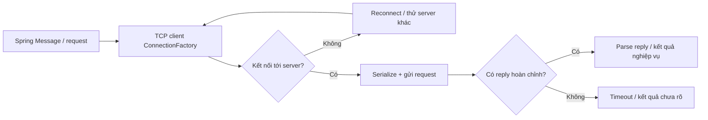
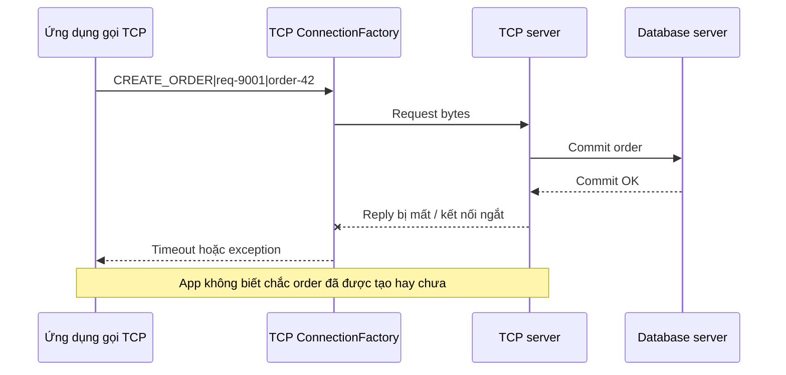
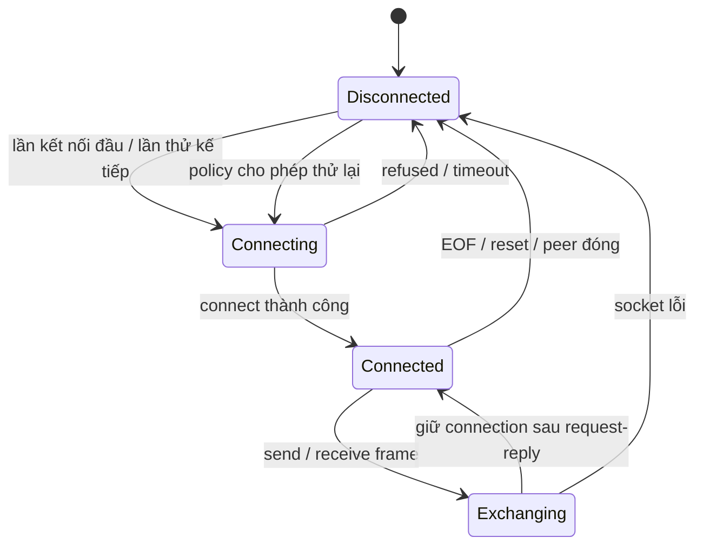
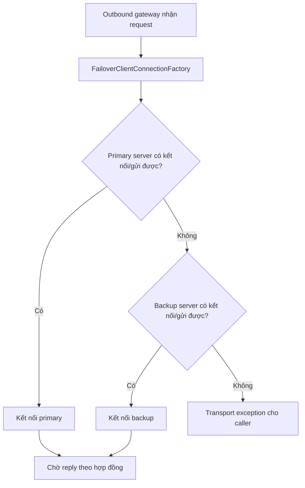
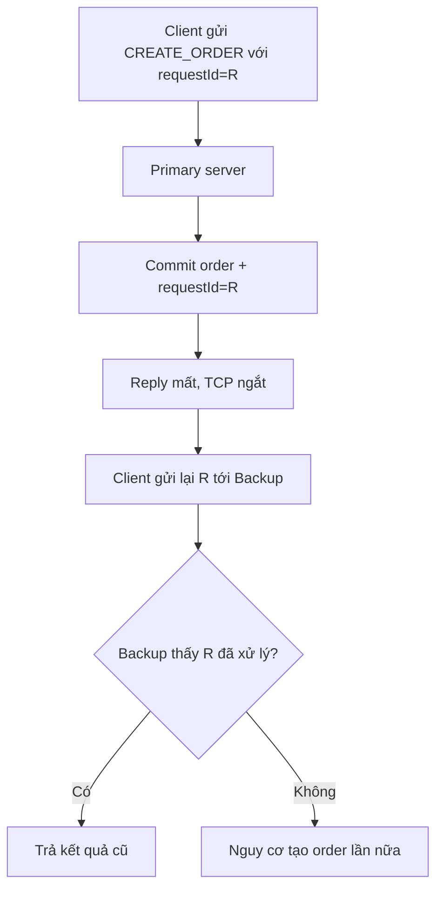

# Retry reconnect và failover

> **Chương:** Adapter TCP  
> **Module:** SPRING_INTEGRATION_ADAPTERS  
> **Phạm vi:** Kết nối các hệ thống ngoài vào Spring Integration bằng inbound/outbound adapter, gateway, poller và MessageChannel. Thực hành luồng trao đổi qua file, SFTP, HTTP, JMS, AMQP, Kafka và cơ sở dữ liệu; xử lý hợp đồng message, lỗi và vòng đời kết nối.

## 1. Mục tiêu học tập

Sau bài này, bạn có thể:

- Phân biệt rõ **reconnect TCP socket**, **retry gửi request** và **failover sang TCP server khác**; hiểu vì sao ba thao tác này không đồng nghĩa.
- Mô tả các điểm có thể thất bại trong luồng `MessageChannel → TCP outbound gateway → ConnectionFactory → TCP server → reply`.
- Dùng `TcpNetClientConnectionFactory` và `FailoverClientConnectionFactory` để cấu hình server chính/dự phòng bằng Spring Integration Java DSL.
- Giải thích `singleUse`, `refreshSharedInterval` và `closeOnRefresh` khi quản lý kết nối dùng chung.
- Thiết kế retry có điều kiện, exponential backoff, jitter, timeout, circuit breaker/rate limit và kiểm tra sức khỏe server.
- Tránh lặp thao tác nghiệp vụ bằng **request ID**, **idempotency** và cơ chế xác định lại kết quả sau timeout.
- Xây dựng thử nghiệm chủ động tắt/mở server chính, chuyển sang server dự phòng và quan sát kết quả.
- Giám sát trạng thái kết nối, sự kiện failover/failback và các yêu cầu đã gửi nhưng **chưa rõ kết quả**.

## 2. Ba khái niệm cần phân biệt ngay từ đầu

Một request TCP có thể đi qua nhiều trạng thái:



Ba cơ chế phục hồi thường bị trộn lẫn:

| Cơ chế | Đơn vị được phục hồi | Ví dụ | **Không** tự bảo đảm điều gì? |
| --- | --- | --- | --- |
| **Reconnect** | Một **kết nối TCP** | Socket cũ hỏng, mở socket mới tới cùng host/port. | Không bảo đảm request cũ được tự động gửi lại hoặc chưa được server xử lý. |
| **Retry** | Một **thao tác/gửi request** | Gửi lại `STATUS|req-12|sensor-01` sau lỗi được phân loại là tạm thời. | Không bảo đảm không xử lý trùng khi reply trước đó bị mất. |
| **Failover** | Một **điểm kết nối/server đích** | Chuyển từ `primary:9601` sang `backup:9602` khi primary không kết nối/gửi được. | Không tự chuyển transaction hay trạng thái nghiệp vụ đang xử lý sang node mới. |

**Reconnect là phục hồi transport; retry là quyết định có thực hiện lại thao tác; failover là chọn một transport/server khác.** Một hệ thống có thể áp dụng cả ba, nhưng mỗi thao tác có thời điểm, điều kiện thành công và mức rủi ro riêng.

Với Spring Integration TCP:

- **ConnectionFactory** quản lý tạo/nhận socket và vận chuyển byte.
- **TCP adapter** gửi hoặc nhận message một chiều.
- **TCP gateway** thực hiện request-reply và đợi phản hồi tương ứng.
- **MessageChannel** nối các endpoint, không tự bảo đảm message đã đến đích qua TCP.
- **Service nghiệp vụ** quyết định liệu một command có thể được gửi lại an toàn.

Không có một cấu hình `retry=true` duy nhất làm cho mọi lệnh TCP trở thành **exactly once**.

## 3. Phân loại thời điểm lỗi: điều gì đã xảy ra?

Xem một request `CREATE_ORDER|req-9001|order-42`:



| Điểm phát hiện | Có thể suy luận | Không được suy luận |
| --- | --- | --- |
| **DNS/route sai trước connect** | Chưa tạo được socket đến server dự định. | Không suy ra server khác chắc chắn không có request cũ từ lần trước. |
| **Connection refused** khi connect | Kết nối mới không được thiết lập trên lượt đó. | Không suy ra trạng thái của request đã gửi trên socket cũ. |
| **Lỗi ghi socket** | Việc truyền dữ liệu không hoàn tất theo quan sát của bên gửi. | Không khẳng định peer chưa nhận **bất kỳ** byte nào. |
| **Read/reply timeout** | Không nhận được reply hoàn chỉnh trong thời hạn. | Không kết luận server chưa xử lý hoặc chưa commit. |
| **Socket reset sau khi gửi** | Connection đã hỏng, cần đóng/khôi phục. | Không kết luận giao dịch thất bại nghiệp vụ. |
| **Reply `ERR|INVALID_REQUEST` hợp lệ** | Server đã gửi kết quả từ chối theo protocol. | Không nên retry như lỗi mạng nếu đây là lỗi dữ liệu cố định. |
| **Reply `OK|req-9001|COMPLETED`** | Server **tuyên bố** hoàn thành theo contract. | Không chứng minh durability nếu protocol/server không quy định rõ. |

Đây là nguyên nhân **retry** phải được đặt dưới một chính sách **an toàn nghiệp vụ**, không đơn thuần bắt mọi exception rồi gọi lại gateway.

### 3.1. Request chưa gửi khác với request đã gửi nhưng không có reply

Tại client, một lỗi connect trước khi ghi frame thường là tình huống retry tương đối an toàn cho lượt gửi đó. Ngược lại, sau khi byte đã được giao cho tầng vận chuyển, kết quả có thể **không xác định** nếu chưa có ACK/reply.

Ngay cả khi `OutputStream.write(...)` trả về thành công, điều đó không có nghĩa hệ thống đích **đã commit nghiệp vụ**. Byte chỉ đi qua một phần của đường truyền tại thời điểm caller quan sát.

### 3.2. TCP và "exactly once"

TCP giữ thứ tự byte trong **một kết nối hoạt động**, nhưng **không** cho ứng dụng bảo đảm "lệnh có tác dụng phụ chỉ chạy đúng một lần" khi mất kết nối hoặc retry. Để đạt hiệu ứng exactly-once ở nghiệp vụ thường cần:

1. Request ID ổn định qua các lần thử.
2. Server lưu kết quả đã xử lý theo request ID với ràng buộc uniqueness.
3. Lưu ID và thay đổi trạng thái nghiệp vụ **nhất quán/atomic** trong cơ sở dữ liệu hoặc transaction phù hợp.
4. Khi gặp ID trùng, server trả kết quả đã lưu thay vì chạy lại command.
5. Phản hồi có request ID và mức cam kết rõ ràng, ví dụ `ACCEPTED`, `COMPLETED` hay `REJECTED`.

Đây là trách nhiệm của **giao thức và ứng dụng**, không phải thuộc tính tự có của `TcpNetClientConnectionFactory` hay `FailoverClientConnectionFactory`.

## 4. Reconnect trong client mode

### 4.1. Vòng đời socket

Với client factory, ứng dụng biết host/port và cần tạo socket để giao tiếp. Khi kết nối bị đóng vì server restart, mạng lỗi hoặc idle timeout, một socket cũ **không thể được cứu sống**; cần tạo socket mới.



**Reconnect không phải resend**: một connection mới không mang theo các frame hoặc response của connection cũ. Nếu request trước đó chưa có kết quả rõ ràng, ứng dụng phải quyết định có gửi lại hay đối soát, thay vì giả định một socket mới sẽ "tiếp tục" request cũ.

### 4.2. Client factory dùng chung

Ví dụ:

```java
import org.springframework.integration.ip.tcp.connection.TcpNetClientConnectionFactory;
import org.springframework.integration.ip.tcp.serializer.ByteArrayCrLfSerializer;

TcpNetClientConnectionFactory factory =
        new TcpNetClientConnectionFactory("127.0.0.1", 9601);

factory.setSingleUse(false);
factory.setSerializer(new ByteArrayCrLfSerializer());
factory.setDeserializer(new ByteArrayCrLfSerializer());
```

`singleUse=false` cho phép sử dụng lại connection còn sống. Nếu server đóng connection, lần tương tác sau cần xử lý kết nối cũ và, tùy endpoint/factory, có thể thiết lập một connection mới. **Không coi cấu hình trên là một vòng lặp reconnect nền tự chạy liên tục**: ở nhiều luồng outbound/gateway, việc tạo connection xảy ra khi có request được gửi.

### 4.3. `client-mode` của TCP channel adapter không phải TCP client factory

Spring Integration TCP **inbound/outbound channel adapter** còn hỗ trợ tùy chọn **`client-mode`**. Đó là cơ chế để endpoint chủ động thiết lập hoặc giữ connection tới TCP server theo scheduler, dù chưa có message outbound.

- Với **outbound adapter** thông thường, connection được tạo khi gửi message đầu tiên; `client-mode=true` cho phép cố gắng connect khi endpoint start.
- Với **inbound adapter** làm client để nhận event từ server ngoài, chế độ này giúp duy trì đường nhận và thử kết nối lại.
- Có thể cấu hình **`retry-interval`** và **`scheduler`** cho cơ chế endpoint chủ động retry connection.
- Khi dùng chế độ này, connection factory phải là **client factory** và `singleUse=false` theo hợp đồng của endpoint.

**Đừng lẫn `retry-interval` của adapter client-mode với retry một business request.** Một tác vụ kết nối lại được scheduler kích hoạt không tự quyết định phát lại một lệnh thay đổi trạng thái đã gửi.

Ví dụ về ý nghĩa cấu hình:

```text
TCP inbound adapter, client-mode=true, retry-interval=5s:
  - endpoint cố duy trì connection tới TCP server phát event
  - nếu ngắt kết nối: scheduler thử kết nối lại
  - KHÔNG có nghĩa: tất cả event trong thời gian mất mạng được replay

TCP outbound gateway:
  - mỗi lời gọi cần request/reply
  - có thể mở socket khi cần gửi
  - timeout/retry nghiệp vụ phải được thiết kế riêng
```

Nếu cần đảm bảo không mất event trong khoảng offline, server nguồn phải có **replay/cursor/offset** hoặc tầng trung gian bền vững; reconnect chỉ nối lại đường byte từ thời điểm mới.

## 5. Failover: chọn server dự phòng

### 5.1. `FailoverClientConnectionFactory`

Spring Integration cung cấp `FailoverClientConnectionFactory` để nhận **danh sách các client connection factory theo thứ tự ưu tiên**. Khi gửi, factory có thể thử các delegate theo thứ tự cho đến khi tìm được connection và gửi thành công, hoặc tất cả lựa chọn đều không dùng được.



**Hành vi quan trọng:**

- Factory bắt đầu ưu tiên phần tử đầu danh sách.
- Khi lựa chọn hiện tại lỗi kết nối/gửi, nó có thể thử các factory tiếp theo.
- Nó hỗ trợ **failback** về server ưu tiên theo cấu hình, không đồng nghĩa kiểm tra sức khỏe liên tục trong mọi cấu hình.
- **Không bảo đảm một request đã gửi nhưng thiếu reply sẽ được tự động replay sang server khác.**
- **Không tự sao chép dữ liệu/transaction** giữa primary và backup.

Nếu server dự phòng không có dữ liệu của primary hoặc không hiểu cùng protocol, failover ở tầng socket có thể thành công nhưng **kết quả nghiệp vụ sai**.

### 5.2. Phân biệt failover và failback

- **Failover:** chuyển từ primary sang backup vì primary không còn sử dụng được.
- **Failback:** sau khi primary phục hồi, chuyển lưu lượng trở lại primary.
- **Failback sớm:** có thể gây nhiều reconnect và làm gián đoạn luồng đang chạy nếu primary chập chờn (*flapping*).
- **Failback quá muộn:** có thể khiến backup phải gánh tải quá lâu.

Cần điều khiển failback bằng thời gian chờ, health check và chính sách làm rỗng/đóng connection cũ. Việc này là lựa chọn vận hành, không thay thế consistency giữa hai server.

## 6. Cấu hình Java DSL: primary và backup

Ví dụ ứng dụng Spring Boot gọi **TCP status service**. Server chính ở `127.0.0.1:9601`; server dự phòng ở `127.0.0.1:9602`.

Hợp đồng:

| Trường | Giá trị |
| --- | --- |
| TCP framing | CRLF: byte `0D 0A` kết thúc mỗi request/reply. |
| Encoding | UTF-8. |
| Request | `STATUS|<request-id>|<device-id>` |
| Reply từ primary | `OK|<request-id>|PRIMARY` |
| Reply từ backup | `OK|<request-id>|BACKUP` |
| Reply lỗi schema | `ERR|BAD_REQUEST` |
| Tính chất ví dụ | Truy vấn **đọc**; an toàn hơn để minh họa retry/failover. |
| Connection | Shared connection, `singleUse=false` ở wrapper và tất cả delegate. |

### 6.1. Maven dependencies

Spring Boot quản lý phiên bản bằng BOM:

```xml
<dependencies>
    <dependency>
        <groupId>org.springframework.boot</groupId>
        <artifactId>spring-boot-starter-integration</artifactId>
    </dependency>
    <dependency>
        <groupId>org.springframework.integration</groupId>
        <artifactId>spring-integration-ip</artifactId>
    </dependency>
</dependencies>
```

Các đoạn Java sau hướng tới Java 17+ và Spring Integration 6.x. Đoạn mã TCP server mô phỏng chạy bằng Java SE độc lập.

### 6.2. Khai báo hai client factory và một failover wrapper

Tạo `TcpFailoverConfiguration.java`:

```java
import java.util.List;

import org.springframework.beans.factory.annotation.Qualifier;
import org.springframework.context.annotation.Bean;
import org.springframework.context.annotation.Configuration;
import org.springframework.integration.annotation.IntegrationComponentScan;
import org.springframework.integration.config.EnableIntegration;
import org.springframework.integration.dsl.IntegrationFlow;
import org.springframework.integration.ip.dsl.Tcp;
import org.springframework.integration.ip.tcp.connection.FailoverClientConnectionFactory;
import org.springframework.integration.ip.tcp.connection.TcpNetClientConnectionFactory;
import org.springframework.integration.ip.tcp.serializer.ByteArrayCrLfSerializer;

@Configuration
@EnableIntegration
@IntegrationComponentScan
public class TcpFailoverConfiguration {

    @Bean("primaryTcp")
    TcpNetClientConnectionFactory primaryTcp() {
        var factory =
                new TcpNetClientConnectionFactory("127.0.0.1", 9601);

        factory.setSingleUse(false);
        factory.setSerializer(new ByteArrayCrLfSerializer());
        factory.setDeserializer(new ByteArrayCrLfSerializer());
        return factory;
    }

    @Bean("backupTcp")
    TcpNetClientConnectionFactory backupTcp() {
        var factory =
                new TcpNetClientConnectionFactory("127.0.0.1", 9602);

        factory.setSingleUse(false);
        factory.setSerializer(new ByteArrayCrLfSerializer());
        factory.setDeserializer(new ByteArrayCrLfSerializer());
        return factory;
    }

    @Bean
    FailoverClientConnectionFactory failoverTcp(
            @Qualifier("primaryTcp")
            TcpNetClientConnectionFactory primary,
            @Qualifier("backupTcp")
            TcpNetClientConnectionFactory backup) {

        // Thứ tự danh sách chính là thứ tự ưu tiên.
        var factory = new FailoverClientConnectionFactory(
                List.of(primary, backup));

        // Phải đồng bộ singleUse giữa wrapper và các delegate.
        factory.setSingleUse(false);

        // Chỉ áp dụng cơ chế refresh/failback cho shared connection.
        factory.setRefreshSharedInterval(30_000L);
        factory.setCloseOnRefresh(true);
        return factory;
    }

    @Bean
    IntegrationFlow statusRequestFlow(
            FailoverClientConnectionFactory failoverTcp) {

        return IntegrationFlow
                .from("statusTcpRequests")
                .handle(Tcp.outboundGateway(failoverTcp))
                .get();
    }
}
```

**Đọc cấu hình:**

1. `primaryTcp` trỏ tới server chính, `backupTcp` trỏ tới server dự phòng.
2. Hai delegate dùng cùng serializer/deserializer CRLF và `singleUse=false`.
3. `FailoverClientConnectionFactory` nhận danh sách **[primary, backup]**, bắt đầu với primary.
4. Wrapper cũng có `singleUse=false`, tránh mâu thuẫn vòng đời socket với delegate.
5. `Tcp.outboundGateway(failoverTcp)` tạo request-reply endpoint; handler dùng **factory failover** thay vì cố định một server.
6. `refreshSharedInterval` và `closeOnRefresh` kiểm soát thử quay về server ưu tiên và đóng connection trước sau khi refresh thành công.

**Cảnh báo:** Cấu hình trên chứng minh **cơ chế lựa chọn endpoint TCP**, không cung cấp rollback hay đồng bộ dữ liệu giữa các server. Với production, dùng host/port từ cấu hình môi trường, giới hạn timeout, bảo mật TLS và kiểm tra chính sách idempotency.

### 6.3. `refreshSharedInterval` và `closeOnRefresh` có tác dụng gì?

Trong `singleUse=false`, một shared connection có thể tiếp tục dùng server backup ngay cả khi primary đã phục hồi.

- `refreshSharedInterval`: thời gian chờ trước khi factory được phép **thử quay về lựa chọn đầu danh sách** khi có yêu cầu lấy connection. Đây **không** phải cam kết có một background timer luôn kiểm tra primary theo chu kỳ chính xác.
- `closeOnRefresh=true`: khi refresh thực sự chuyển sang connection mới, đóng connection shared cũ; giảm việc giữ các socket không còn cần thiết.
- Nếu không cấu hình, các phiên bản hiện đại mặc định ít chủ động failback hơn: `refreshSharedInterval=Long.MAX_VALUE`, `closeOnRefresh=true` (hãy kiểm tra phiên bản đang triển khai).
- Các thuộc tính này **không áp dụng giống vậy** khi một delegate là `CachingClientConnectionFactory`, vì lớp cache tự quản lý việc lấy connection. Cần kiểm thử tổ hợp wrapper cụ thể.

Không nên đặt interval quá ngắn để "tự sửa mọi lỗi" nếu primary thường xuyên chập chờn: failback liên tục có thể làm tăng connection churn và gây khó dự đoán latency.

### 6.4. Java API bên client

Tạo `RemoteStatusGateway.java`:

```java
import org.springframework.integration.annotation.MessagingGateway;

@MessagingGateway(defaultRequestChannel = "statusTcpRequests")
public interface RemoteStatusGateway {

    byte[] exchange(byte[] request);
}
```

Đây là **Spring Messaging Gateway**: chuyển lời gọi Java thành Spring Message và chờ reply từ TCP outbound gateway. Nó khác với `FailoverClientConnectionFactory` là phần chọn socket/server đích.

Tạo `StatusClient.java`:

```java
import java.nio.charset.StandardCharsets;
import org.springframework.stereotype.Service;

@Service
public class StatusClient {

    private final RemoteStatusGateway gateway;

    public StatusClient(RemoteStatusGateway gateway) {
        this.gateway = gateway;
    }

    public String query(String requestId, String deviceId) {
        if (!validId(requestId) || !validId(deviceId)) {
            throw new IllegalArgumentException("Invalid request/device ID");
        }

        String request = "STATUS|" + requestId + "|" + deviceId;

        byte[] reply = gateway.exchange(
                request.getBytes(StandardCharsets.UTF_8)
        );

        if (reply == null) {
            throw new IllegalStateException("Missing TCP reply");
        }

        String text = new String(reply, StandardCharsets.UTF_8);

        if (text.startsWith("ERR|")) {
            // Đây là reply nghiệp vụ, không phải lỗi connect.
            throw new IllegalArgumentException(
                    "Remote rejected request: " + text
            );
        }

        String[] parts = text.split("\\|", -1);
        if (parts.length != 3
                || !"OK".equals(parts[0])
                || !requestId.equals(parts[1])) {
            throw new IllegalStateException(
                    "Unexpected response: " + text
            );
        }

        return parts[2]; // PRIMARY hoặc BACKUP trong demo.
    }

    private static boolean validId(String value) {
        return value != null
                && value.matches("[A-Za-z0-9_-]{1,40}");
    }
}
```

Service xác nhận request ID từ reply, tránh nhầm kết quả không cùng yêu cầu. Với request `STATUS` chỉ đọc, việc retry do caller lựa chọn có rủi ro nhỏ hơn so với lệnh thay đổi trạng thái. Nhưng service hiện tại **chưa tự retry**; nó chỉ gửi một lời gọi qua failover factory, giúp tách bạch hai khái niệm.

### 6.5. Khởi động demo ở phía client

```java
import org.springframework.boot.ApplicationRunner;
import org.springframework.context.annotation.Bean;
import org.springframework.context.annotation.Configuration;

@Configuration
public class FailoverDemoRunner {

    @Bean
    ApplicationRunner queryStatus(StatusClient statusClient) {
        return args -> {
            String node = statusClient.query(
                    "req-101", "sensor-01");
            System.out.println("Response from: " + node);
        };
    }
}
```

Khi có kết nối đến primary, kết quả kỳ vọng là `Response from: PRIMARY`. Khi primary **không thể kết nối** và backup đang chạy, kết quả kỳ vọng là `Response from: BACKUP`, tùy chính sách failover hoạt động trong điều kiện thử nghiệm. Đây là **kết quả dự kiến**, không phải output đã chạy thực tế.

## 7. TCP server mô phỏng primary/backup

Có thể kiểm thử bằng một chương trình Java SE độc lập, chạy thành **hai process** với port và tên node khác nhau.

Tạo `StatusTcpTestServer.java`:

```java
import java.io.BufferedReader;
import java.io.BufferedWriter;
import java.io.InputStreamReader;
import java.io.OutputStreamWriter;
import java.net.ServerSocket;
import java.net.Socket;
import java.nio.charset.StandardCharsets;

public class StatusTcpTestServer {

    public static void main(String[] args) throws Exception {
        if (args.length != 2) {
            throw new IllegalArgumentException(
                    "Usage: StatusTcpTestServer <port> <PRIMARY|BACKUP>");
        }

        int port = Integer.parseInt(args[0]);
        String nodeName = args[1];

        try (ServerSocket listener = new ServerSocket(port)) {
            System.out.printf(
                    "%s listening on port %d%n", nodeName, port);

            while (true) {
                try (Socket socket = listener.accept();
                     BufferedReader in = new BufferedReader(
                             new InputStreamReader(
                                     socket.getInputStream(),
                                     StandardCharsets.UTF_8));
                     BufferedWriter out = new BufferedWriter(
                             new OutputStreamWriter(
                                     socket.getOutputStream(),
                                     StandardCharsets.UTF_8))) {

                    String line;
                    while ((line = in.readLine()) != null) {
                        String[] fields = line.split("\\|", -1);

                        String reply;
                        if (fields.length == 3
                                && "STATUS".equals(fields[0])
                                && fields[1].matches(
                                        "[A-Za-z0-9_-]{1,40}")
                                && fields[2].matches(
                                        "[A-Za-z0-9_-]{1,40}")) {
                            reply = "OK|" + fields[1] + "|" + nodeName;
                        } else {
                            reply = "ERR|BAD_REQUEST";
                        }

                        // Protocol text CRLF, không phải Spring serializer.
                        out.write(reply);
                        out.write("\r\n");
                        out.flush();
                    }
                }
                catch (java.io.IOException e) {
                    // Demo: socket đã đóng/mạng lỗi, tiếp tục accept.
                    System.err.println(
                            "Client connection ended: " + e);
                }
            }
        }
    }
}
```

Chạy hai process trong hai terminal riêng:

```text
# Terminal 1: primary
java StatusTcpTestServer 9601 PRIMARY

# Terminal 2: backup
java StatusTcpTestServer 9602 BACKUP
```

Đây là server học tập **một kết nối tại một thời điểm trên mỗi process**, không có TLS, health checks hay dữ liệu nghiệp vụ thật. Dùng `BufferedReader.readLine()` vì protocol chỉ có frame CRLF văn bản; không dùng cách này cho length header hoặc payload nhị phân tùy ý.

### 7.1. Ba bài thử bắt buộc

| Bài thử | Cách thực hiện | Kỳ vọng |
| --- | --- | --- |
| **Primary khỏe** | Chạy primary và backup rồi khởi động client. | Request chọn primary, trả `PRIMARY`. |
| **Primary mất trước connect** | Dừng primary, giữ backup; khởi động một client mới. | Factory chọn backup nếu primary không kết nối/gửi được. |
| **Failback** | Khi client đang dùng backup, bật lại primary; sau `refreshSharedInterval` phát một request mới. | Factory có thể thử quay về primary; quan sát connection/event thực tế. |

Không khẳng định mọi lời gọi **đã ở giữa request-reply** sẽ được chuyển ngay sang backup nếu primary chết. Trong thực tế, một request đã gửi và đang chờ reply có thể timeout; **không được tự động gửi lại command có tác dụng phụ** khi chưa thiết kế idempotency.

### 7.2. Phân biệt các lỗi khi chạy thử

- **Primary chưa mở cổng:** thất bại ở bước connect; failover factory có cơ hội tìm server backup.
- **Primary chấp nhận TCP nhưng không trả reply:** TCP connection có thể vẫn được coi là hoạt động; **failover không nhất thiết xảy ra ngay** chỉ vì gateway chờ reply quá lâu.
- **Primary trả `ERR|BAD_REQUEST`:** đây là một **response hợp lệ**, không phải dấu hiệu nên thử backup.
- **Primary xử lý xong nhưng socket bị reset:** client không biết chắc kết quả; việc retry cần chính sách riêng.

## 8. Health check: connect thành công không có nghĩa server sẵn sàng

Một máy có thể **accept TCP connection** trong khi ứng dụng phía sau không phục vụ được yêu cầu, ví dụ DB của server bị lỗi, dữ liệu backup không đồng bộ hoặc handler bị treo.

Đó là lý do nên phân biệt:

| Kiểm tra | Phát hiện được | Không đảm bảo |
| --- | --- | --- |
| TCP connect | Port đích chấp nhận kết nối. | Handler và DB sẵn sàng. |
| TCP keepalive | Một số connection chết lâu ngày theo điều kiện OS. | Thời gian phát hiện nhanh hoặc service khỏe. |
| Application heartbeat `PING/PONG` | Server có phản hồi cho lệnh kiểm tra. | Mọi thao tác nghiệp vụ đều thành công. |
| Query thử có kiểm soát | Một nhánh nghiệp vụ quan trọng hoạt động. | Các nhánh khác không lỗi. |
| Readiness/health ở control plane | Server được đánh giá sẵn sàng theo tiêu chí cấu hình. | Request đang xử lý không bị gián đoạn khi failover. |

Spring Integration client factory có thể cấu hình **connection test** thông qua `setConnectionTest(...)` ở các phiên bản hỗ trợ. Factory có thể từ chối connection mới nếu kiểm tra không đạt; khi dùng failover wrapper, lỗi này có thể khiến factory thử server tiếp theo.

Một connection test phải:

1. Có **timeout rõ** để tránh giữ socket mãi.
2. Dùng một protocol message không có tác dụng phụ.
3. Đọc phản hồi bằng **cùng serializer/deserializer** với giao thức thật.
4. Không để **reply health-check** lẫn vào reply của request nghiệp vụ.
5. Tránh gửi health check quá dày làm server thêm tải.

Đặc biệt, `setConnectionTest(...)` thử **connection mới**; đừng xem nó là giám sát liên tục mọi socket đã được cấp phát. Nếu cần phát hiện server đang hoạt động rồi trở nên unhealthy, xây thêm readiness/heartbeat phù hợp.

## 9. Retry ở tầng request: chính sách, không phải phản xạ mặc định

### 9.1. Chỉ retry khi có lý do

| Loại request | Retry sau transport failure? | Ghi chú |
| --- | --- | --- |
| `STATUS|req-101|sensor-01` | **Có thể**, vì là phép đọc thuần nếu server thật chỉ đọc. | Kết quả có thể thay đổi giữa các lần thử. |
| `GET_BALANCE|req-102|account-1` | Có thể nếu read-only và caller cho phép. | Chú ý tính nhất quán giữa primary/backup. |
| `SET_LEVEL|req-103|sensor-01|5` | Chỉ khi định nghĩa hành vi idempotent rõ ràng. | "Gán thành 5" khác "tăng thêm 5". |
| `INCREMENT|req-104|sensor-01|1` | Không retry mù. | Có thể cộng thêm nhiều lần. |
| `CREATE_ORDER|req-105|order-42` | Cần request ID và dedup bền vững. | Reply có thể mất sau khi order đã được tạo. |
| `CHARGE|req-106|order-42|1000` | Không retry mù; yêu cầu quy tắc chặt hơn. | Nguy cơ giao dịch lặp. |

**Chính sách retry tối thiểu** phải quyết định:

- Lỗi nào là **transient transport failure**; lỗi nào là business reject hoặc protocol error cần dừng.
- Request có **safe to retry** theo ngữ nghĩa nghiệp vụ không?
- Được thử tối đa mấy lần và trong **total deadline** bao lâu?
- Delay giữa các lần thử, **exponential backoff** và **jitter**.
- Ai giữ request ID ổn định và ghi lại kết quả?
- Trạng thái cuối cùng là `FAILED` hay **`UNKNOWN/PENDING_RECONCILIATION`**?

### 9.2. Thuật toán retry có giới hạn

Pseudocode, **không phải Java có thể biên dịch**, cho yêu cầu đọc thuần:

```text
requestId = createOnce()
deadline = now + 8 seconds

for attempt in 1..3:
    try:
        response = tcpGateway.exchange(requestWithSameId)
        return validateBusinessReply(response, requestId)

    catch classifiedTransportFailure:
        if attempt == 3 or now >= deadline:
            return UNKNOWN_OR_UNAVAILABLE

        delay = min(200ms * 2^(attempt - 1), 1000ms)
        sleep(delay + randomJitter)

    catch ProtocolOrBusinessReject:
        doNotRetry()
        return REJECTED
```

Ở ví dụ, **request ID được tạo một lần trước vòng lặp**. Nếu mỗi lần retry sinh ID mới, server không thể nhận ra đó là cùng một tác vụ. Trong production, phần `classifiedTransportFailure` phải là bộ phân loại exception cụ thể của ứng dụng; đừng bắt toàn bộ `RuntimeException` rồi mặc định retry, bởi nó còn gồm lỗi parser, phân quyền hoặc bug nghiệp vụ.

### 9.3. Backoff, jitter và retry storm

Nếu hàng nghìn client cùng phát hiện server chết rồi retry ngay lập tức, primary vừa phục hồi có thể lại bị quá tải (*thundering herd*). Vì vậy nên:

- Tăng delay theo số lần thử, có **giới hạn tối đa**.
- Thêm **jitter ngẫu nhiên** để các client không retry cùng thời điểm.
- Đặt tổng deadline và retry budget toàn hệ thống.
- Giới hạn concurrency đang chờ, queue length và rate đến server dự phòng.
- Dùng **circuit breaker** để tránh gửi dồn dập tới server chắc chắn đang lỗi; cho phép thử phục hồi có kiểm soát.

Circuit breaker quản lý quyết định **có gọi** một endpoint hay không; nó không tự biến một command không idempotent thành an toàn để phát lại.

### 9.4. RequestHandlerRetryAdvice là một lựa chọn — nhưng phải chọn phạm vi

Spring Integration hỗ trợ `RequestHandlerRetryAdvice` và cơ chế advice cho nhiều endpoint. Nếu dùng nó quanh outbound gateway, retry có thể thực thi **lại handler gửi TCP** khi lần đầu gặp exception.

Cần suy nghĩ kỹ:

1. Retry quanh **gateway** sẽ tái thực thi request tới server; phải bảo đảm nghiệp vụ cho phép replay.
2. Không bọc một flow dài bằng retry chung nếu nó chứa các bước có tác dụng phụ đã thành công trước khi TCP fail.
3. Giới hạn retry policy theo **loại exception**, thời gian và backoff.
4. Khi dùng asynchronous channel, cách exception/reply quay về caller khác flow đồng bộ; cần kiểm thử riêng.
5. Spring Retry là dependency/chức năng cần cấu hình theo phiên bản, không mặc định bật cho mọi TCP gateway.

Trong bài này, Java DSL chính **không bật automatic request retry**, để biểu diễn đúng khả năng của failover connection factory và tránh vô ý nhân đôi lệnh.

## 10. Failover còn phụ thuộc tính nhất quán của server

Giả sử một command tạo đơn hàng có thể đến:

```text
Primary TCP server -> Database A
Backup TCP server  -> Database B
```

Nếu A và B không đồng bộ, chuyển socket từ primary sang backup có thể cho kết quả trái ngược: backup không biết order vừa tạo trên primary.

**Tầng transport không giải quyết vấn đề này.** Cần xác định kiến trúc dữ liệu:

- Hai node có dùng chung database hoặc một cơ chế replication đáng tin cậy không?
- Khi primary đã commit mà backup chưa đọc thấy, hệ thống trả trạng thái gì?
- Có **fencing/leader election** để tránh hai node cùng chấp nhận write trong split-brain không?
- Idempotency store có **dùng chung** và nhất quán giữa các node không?
- Nếu consistency chỉ eventual, có cho phép backup trả dữ liệu cũ không?
- Trong lúc failback, session state và transaction đang chờ được xử lý ra sao?

### 10.1. Một request ID trên nhiều node



Nếu idempotency records **không được chia sẻ hoặc đồng bộ đúng cách**, backup không thể đảm bảo chống xử lý trùng. Vì vậy một cấu hình `FailoverClientConnectionFactory` dù hoạt động hoàn hảo ở tầng TCP vẫn có thể không đạt yêu cầu nghiệp vụ.

### 10.2. Bảng trạng thái tối thiểu

Với lệnh có tác dụng phụ:

| Request ID | Trạng thái lưu bền | Hành động khi request trùng |
| --- | --- | --- |
| Chưa tồn tại | Chưa bắt đầu | Thử thực thi theo transaction đã định nghĩa. |
| `IN_PROGRESS` | Có tác vụ đang chạy | Không phát lại tác vụ; trả trạng thái đang xử lý hoặc chờ theo contract. |
| `COMPLETED` | Đã commit kết quả | Trả kết quả đã lưu, **không tạo thêm tác dụng phụ**. |
| `REJECTED` | Đã từ chối theo điều kiện cố định | Trả lại mã từ chối nếu contract quy định. |
| `UNKNOWN` | Cần đối soát sau sự cố | Không tự khẳng định thất bại; kiểm tra hệ thống authoritative. |

Đây là mẫu mô hình dữ liệu để suy nghĩ, không phải tính năng Spring Integration tự tạo. Với xử lý cạnh tranh, yêu cầu database uniqueness/transaction để hai node không cùng chạy một request ID.

## 11. Giữ correlation và xử lý reply đến muộn

### 11.1. Connection ID và request ID khác nhau

- `IpHeaders.CONNECTION_ID` cho biết **TCP socket** nào gắn với message.
- `requestId`/`correlationId` cho biết **yêu cầu nghiệp vụ** nào đang được xử lý.
- Sau reconnect hoặc failover, **connection ID thay đổi**; request ID của cùng thao tác retry **nên giữ nguyên**.

Một reply đến muộn trên socket cũ không được tùy ý gán cho request mới nếu framing/protocol không có cách kiểm tra correlation. Đặc biệt với giao thức chỉ có CRLF nhưng không có request ID trong payload, một shared connection với nhiều lượt request có thể gặp nguy cơ mất tương quan sau timeout.

### 11.2. Request-reply gateway và adapter bất đồng bộ

| Topology | Trách nhiệm correlation |
| --- | --- |
| **TCP outbound gateway** | Gateway quản lý một trao đổi request-reply trên connection; shared connection có giới hạn đồng thời. |
| **TCP inbound gateway** | Nhận request và trả reply về connection tương ứng. |
| **Cặp inbound/outbound adapter bất đồng bộ** | Ứng dụng phải ghép request ID với response, xử lý ACK muộn và event không được yêu cầu. |
| **Nhiều node failover** | Ứng dụng còn phải đảm bảo request ID có cùng ý nghĩa trên các node. |

Khi outbound gateway timeout, không nên giả định reply cũ vẫn sẽ được nối lại an toàn qua connection mới. **Đóng hoặc loại bỏ connection mất đồng bộ** theo chính sách endpoint và chỉ gửi request mới khi giao thức có trạng thái rõ ràng.

## 12. Các vấn đề vận hành: observability và health

### 12.1. Metrics cần theo dõi

| Metric | Mục đích |
| --- | --- |
| Số connect attempts / successful connections | Xác định connect/refused/timeout. |
| Số open/close/reset connections | Phát hiện socket churn và peer đóng bất thường. |
| Tỷ lệ failover primary → backup | Đo mức phụ thuộc vào server dự phòng. |
| Tỷ lệ failback backup → primary | Phát hiện primary không ổn định hoặc refresh quá thường. |
| Thời gian kết nối đến mỗi node | Chẩn đoán mạng và tốc độ phục hồi. |
| Request success / business rejection / timeout | Không gộp lỗi nghiệp vụ với lỗi vận chuyển. |
| Retry attempts, backoff, exhausted budget | Phát hiện retry storm và độ trễ bị nhân lên. |
| Số request result `UNKNOWN` | Đánh giá nhu cầu đối soát và idempotency. |
| P50/P95/P99 request-reply latency | Đo trải nghiệm caller qua cả thời gian retry. |
| Số request ID trùng được deduplicate | Quan sát tình huống mất reply/retry. |

### 12.2. Log nên tách network và business

Gợi ý trường log:

```text
time=... requestId=req-101 attempt=1 node=primary
event=tcp_connect_failed error=ConnectionRefused

time=... requestId=req-101 attempt=1 node=backup
event=tcp_reply_received status=OK

time=... requestId=req-105 attempt=1 node=primary
event=tcp_reply_timeout businessOutcome=UNKNOWN
```

Các dòng trên **minh họa schema log**, không phải output mặc định của Spring Integration. Khi cần production observability, kết hợp event/log của connection factory, endpoint, request ID và trace context.

Không ghi secret, token, raw payload nhạy cảm hoặc thông tin nhận diện người dùng không cần thiết vào log. **Connection ID không phải danh tính đã xác thực** và không là khóa idempotency.

### 12.3. TCP keepalive và heartbeat

TCP keepalive có thể giúp phát hiện một số socket chết ở tầng OS, nhưng không có nghĩa TCP server đang **xử lý business request** thành công. Một server có thể giữ socket mở trong lúc thread nghiệp vụ bị treo.

Cân nhắc:

- Socket timeout và reply timeout phù hợp SLA.
- Application heartbeat/connection test có thời hạn rõ.
- Kiểm tra readiness ở load balancer/service discovery nếu có.
- Đóng connection unhealthy và áp dụng circuit breaker/rate limit.
- Test riêng khi node **accept connection nhưng không trả reply**.

## 13. Ma trận kiểm thử retry, reconnect, failover

| Tình huống | Điều cần xác minh |
| --- | --- |
| Primary và backup khỏe | Factory ưu tiên primary. |
| Primary không listen, backup khỏe | Chọn backup nếu kết nối/gửi primary thất bại. |
| Cả hai không listen | Caller nhận lỗi, không báo business success. |
| Primary đang dùng thì bị đóng socket | Phát hiện connection lỗi, các request sau phục hồi theo policy. |
| Primary nhận request nhưng không reply | Gateway timeout; không mặc định chuyển **lệnh đó** sang backup an toàn. |
| Primary trả business `ERR` | Không retry/failover vì lỗi schema cố định. |
| Primary phục hồi trong khi backup đang dùng | Failback theo `refreshSharedInterval` và việc lấy connection. |
| Primary chập chờn liên tục | Không sinh reconnect/failback storm hoặc lặp lệnh vô hạn. |
| Failover wrapper và delegate có `singleUse` không nhất quán | Cấu hình bị từ chối hoặc hành vi vòng đời không đúng; cần giữ nhất quán. |
| Payload CRLF bị thiếu delimiter | Timeout do framing, không tự xem là lỗi primary để chuyển server. |
| Reply đến sau deadline | Phân loại late reply, giữ correlation và xử lý connection. |
| Duplicate request ID trên backup | Server deduplicate theo shared/consistent idempotency store. |
| Lệnh đã commit nhưng reply mất | Client giữ kết quả `UNKNOWN` cho tới khi có xác nhận/đối soát. |
| 50 client cùng retry sau outage | Backoff/jitter và giới hạn tải bảo vệ các node. |
| Failover khi server state chưa đồng bộ | Phát hiện dữ liệu cũ/xung đột, không chỉ kiểm tra TCP success. |
| Graceful shutdown | Ngắt/dừng nhận request mới, đóng connection; xử lý các request chưa rõ. |

### 13.1. Thử fault injection có kiểm soát

Khi chạy bài thực hành, lần lượt:

1. Chạy backup, không chạy primary; khởi động client và kiểm tra nhận `BACKUP`.
2. Chạy primary; khởi động client mới và kiểm tra nhận `PRIMARY`.
3. Dùng client đang giữ connection primary, tắt primary **giữa hai request**; quan sát lỗi/khả năng dùng backup ở lần sau.
4. Cho primary **accept TCP nhưng chậm reply**, xác nhận hành vi khác hẳn `Connection refused`.
5. Dừng cả hai server, xác nhận lỗi được báo và không mất khả năng xử lý các request mới sau khi server phục hồi.
6. Khi thử failback, tăng `refreshSharedInterval` và đo số connection mở/đóng, tránh đánh giá chỉ bằng một lần kết nối.

**Không thực hiện fault injection trên môi trường sản xuất khi chưa có quy trình kiểm soát và phạm vi ảnh hưởng rõ ràng.**

## 14. Troubleshooting theo triệu chứng

| Triệu chứng | Nguyên nhân cần xét | Cách tiếp cận |
| --- | --- | --- |
| Không kết nối được primary nhưng không sang backup | Danh sách factory/config chưa đúng, delegate không start, hoặc lỗi xảy ra ngoài phạm vi failover. | Kiểm tra order, `singleUse`, log connect và các ngoại lệ. |
| Vẫn bám backup dù primary đã sống | Shared connection đang dùng, `refreshSharedInterval` dài hoặc chưa có lần lấy connection tiếp theo. | Xem chính sách failback và gọi mới. |
| Failback quá thường | Interval ngắn, primary flapping. | Giãn interval, health check và giới hạn reconnect. |
| Primary accept được nhưng mọi request timeout | Handler/DB treo, reply thiếu framing, socket read timeout. | Kiểm tra application-level readiness và end-to-end timeout. |
| Retry tạo đơn trùng | Không có request ID/idempotency hoặc hai node không dùng chung dedup store. | Sửa contract nghiệp vụ, không chỉ cấu hình socket. |
| Request lâu hơn kỳ vọng | Mỗi attempt có connect/reply timeout riêng, cộng nhiều lần retry/backoff. | Đặt **total deadline** và timeout từng tầng. |
| Failover hoạt động nhưng trả trạng thái cũ | Backup lag, replication inconsistency. | Kiểm tra consistency và policy đọc/ghi. |
| Mất event trong thời gian reconnect | Socket không buffer bền vững các event đã trôi qua. | Dùng replay/cursor/broker khi bắt buộc không mất event. |
| Lỗi `Broken pipe` hoặc `Connection reset` | Peer đóng socket/network gián đoạn. | Xác định request đã gửi đến đâu trước khi retry. |
| Log không cho biết request đã thử node nào | Thiếu requestId, attempt/node tag và connection events. | Thiết kế correlation/observability rõ ràng. |

**Cách điều tra nhanh:** trước hết xác định lỗi ở **connect**, **serialize/send**, **read reply**, **framing**, hay **business handler**; sau đó mới chọn reconnect, failover, retry hoặc đối soát.

## 15. Bài tập thực hành

**Bài 1 — Failover cơ bản.** Dùng `TcpFailoverConfiguration`, khởi động backup ở `9602` nhưng không khởi động primary. Giải thích cách factory chọn backup, kết quả kỳ vọng và bước quan sát lỗi connect primary.

**Bài 2 — Failback.** Bật lại primary khi client đang dùng backup. Thử `refreshSharedInterval` ngắn/dài, quan sát những lần kết nối kế tiếp. Giải thích vì sao interval này không đồng nghĩa job ping primary chạy đều đặn theo cron.

**Bài 3 — Chậm phản hồi khác không connect được.** Viết một TCP server cố tình chấp nhận request rồi ngủ 10 giây trước khi trả reply, trong khi client timeout sớm hơn. Giải thích vì sao failover factory có thể không tự chọn backup cho đúng request đó.

**Bài 4 — Retry một query idempotent.** Thêm retry tối đa ba lần cho `STATUS`, backoff lũy tiến và jitter. Phân biệt exception transport với response `ERR|BAD_REQUEST`, giữ request ID qua các lần thử, đặt total deadline.

**Bài 5 — Không gửi trùng command.** Thiết kế message `CREATE_ORDER|req-9001|order-42`. Primary commit rồi mất reply; client failover sang backup. Mô tả idempotency store, transaction, cơ chế share state và quy tắc trả kết quả của backup.

**Bài 6 — Reconnect của inbound client adapter.** Một TCP server liên tục đẩy event. Ứng dụng dùng inbound adapter ở `client-mode` và retry-interval khi server restart. Giải thích vì sao reconnect không tự lấy lại các event trong lúc mất kết nối; bổ sung event sequence/cursor và replay.

**Bài 7 — Kiểm tra failover dưới tải.** Tạo 30 caller đồng thời gọi `STATUS` khi primary tắt. Đo số socket, latency, retry attempts và CPU ở backup. Đặt giới hạn concurrency và backoff/jitter nếu kết quả quá tải.

**Bài 8 — Health check có ý nghĩa.** Xây dựng lệnh `HEALTH` với reply `READY|node`, timeout và không có tác dụng phụ. Xác định trường hợp accept socket nhưng database không sẵn sàng; giải thích cách `connectionTest` có thể bổ sung kiểm tra readiness.

## 16. Câu hỏi tự kiểm tra

1. Reconnect, retry và failover khác nhau ở **đơn vị được phục hồi** thế nào?
2. `FailoverClientConnectionFactory` dùng thứ tự danh sách delegate để làm gì?
3. Vì sao failover thành công ở tầng TCP không bảo đảm server dự phòng có cùng dữ liệu?
4. Vì sao `singleUse` phải nhất quán giữa failover wrapper và các delegate?
5. `refreshSharedInterval` có nghĩa ứng dụng chắc chắn ping primary theo chu kỳ đó không?
6. `closeOnRefresh=true` tác động tới shared connection cũ thế nào?
7. TCP client đã gửi request và gặp reply timeout có biết chắc server chưa xử lý không?
8. Với `CREATE_ORDER`, điều gì giúp retry an toàn qua nhiều node?
9. Khi nào TCP adapter `client-mode=true` hữu ích, và `retry-interval` của nó có tự resend business request không?
10. Vì sao exponential backoff và jitter quan trọng khi nhiều client cùng retry?
11. Server trả `ERR|BAD_REQUEST` hợp lệ có cần retry sang backup không?
12. Connection test giúp phát hiện điều gì ngoài việc connect TCP thành công?
13. Vì sao request ID nghiệp vụ nên giữ nguyên qua failover nhưng connection ID thường thay đổi?
14. Shared connection và connection pool ảnh hưởng throughput request-reply ra sao?
15. Một server liên tục đẩy event có cần replay protocol nếu ứng dụng phải không mất dữ liệu trong giai đoạn reconnect không?
16. Những metric nào giúp phân biệt failover thành công về transport với lỗi consistency nghiệp vụ?

**Gợi ý trả lời:** (1) Reconnect phục hồi socket, retry thực hiện lại request, failover chọn server khác. (2) Ưu tiên primary và thử các factory kế tiếp khi connection/write thất bại. (3) Connection factory không đồng bộ database/transaction. (4) Tránh mâu thuẫn vòng đời connection. (5) Không, là quy tắc thử failback khi có lượt lấy connection. (6) Đóng connection cũ sau refresh thành công. (7) Không; server có thể đã commit. (8) Request ID, dedup store nhất quán/atomic, policy ACK/retry. (9) Giữ connection client adapter; không tự replay nghiệp vụ. (10) Tránh retry storm. (11) Không, đó là business reject. (12) Server có thực sự phục vụ được health request không. (13) Request ID mô tả nghiệp vụ, connection ID mô tả socket. (14) Một shared socket thường phải tuần tự request; pool tăng khả năng đồng thời nhưng phải có giới hạn. (15) Có, reconnect không tự phục hồi event cũ. (16) Connect/failover counts, latency, error reply, request ID trùng, stale data và trạng thái chưa rõ.

## 17. Tài liệu tham khảo

- [Spring Integration Reference — TCP Connection Factories (Failover)](https://docs.spring.io/spring-integration/reference/ip/tcp-connection-factories.html).
- [Spring Integration API — FailoverClientConnectionFactory](https://docs.spring.io/spring-integration/docs/6.4.5/api/org/springframework/integration/ip/tcp/connection/FailoverClientConnectionFactory.html).
- [Spring Integration Reference — TCP Adapters (client mode/retry interval)](https://docs.spring.io/spring-integration/reference/ip/tcp-adapters.html).
- [Spring Integration Reference — Testing Connections](https://docs.spring.io/spring-integration/reference/ip/testing-connections.html).
- [Spring Integration Reference — Adding Behavior to Endpoints](https://docs.spring.io/spring-integration/reference/handler-advice.html).

**Tổng kết:** **Reconnect** xây lại socket, **failover** chuyển endpoint TCP, còn **retry** quyết định có gửi lại thao tác. Spring Integration hỗ trợ các connection factories và endpoint giúp quản lý phần vận chuyển, nhưng **không thể suy ra kết quả nghiệp vụ chỉ từ trạng thái TCP**. Thiết kế đáng tin cậy đòi hỏi framing đúng, timeout và retry có giới hạn, server dự phòng có dữ liệu nhất quán, request ID và idempotency cho command có tác dụng phụ, cùng khả năng giám sát/đối soát khi reply bị mất.
